# Én helsetjeneste

**Utredning fra et utvalg oppnevnt ved kongelig resolusjon 29. august 2025**

**Avgitt til Helse- og omsorgsdepartementet 2. november 2026**

## *Til Helse- og omsorgsdepartementet*

Helsereformutvalget ble oppnevnt ved kongelig resolusjon 29. august 2025 for å vurdere hvordan helse- og omsorgstjenestene kan utvikles for å møte framtidige behov og utfordringer. Utvalget avgir med dette sin utredning.

Oslo 2. november 2026

Gunnar Bovim

Leder

Somayeh Sadat Bach

Edith Roth Gjevjon

Silje Naustvik

Øyvind Bakke

Marit Hermansen

Kari Sønderland

Jonny Finstad

Kjetil Andreas  
Hognestad Karlsen

Tone Poulsson Torgersen

Lars Erik Flatø

Oddvar Martin Kaarbøe

Kjetil Telle  
Sekretariatsleder

Helga Aanderaa

Ann Kristin Andresen

Mette Bakkeli

Wenche Dehli

Åshild Flatebakken

Solfrid Vaage Haukaas

Stein Johnsen

Siv Lunde

Linda Midttømme

Vegard Pettersen

Hilde Marie Skarvang

Kari Steig

## 1 Sammendrag

### 1.1 God folkehelse og gode helse- og omsorgstjenester

Den norske befolkningen har gjennomgående god helse, levealderen øker og aldersjustert sykelighet er redusert over tid. Kvaliteten i helse- og omsorgstjenestene er høy, både i historisk perspektiv og sammenlignet med andre land.

Samtidig øker behovet for helse- og omsorgstjenester. Flere lever lenge med sykdommer som tidligere var dødelige, og antallet personer som trenger behandling, oppfølging, pleie og omsorg over mange år, vokser. Forventningene til hva helse- og omsorgstjenesten skal tilby, øker både i befolkningen, blant helsepersonell og gjennom politisk vedtatte rettigheter.

Behovet for å gjennomgå organisering, styring og finansiering av helse- og omsorgstjenestene, skyldes ikke først og fremst utfordringene i dagens situasjon, men behovet for å ruste tjenestene for en framtid preget av at befolkningen blir eldre og velferdsstatens økonomiske rammer endres. Samtidig øker ulikhetene, den teknologiske, helsefaglige og medisinske utviklingen skjer raskt, og verden blir mer usikker.

Utviklingstrekkene vil gjøre det mer utfordrende å dekke befolkningens behov for helse- og omsorgstjenester. Flere enn tidligere vil leve med kroniske sykdommer og flere sykdommer samtidig, og ha behov for langvarig behandling og oppfølging. Økt levealder og at man kan

behandle flere tilstander enn tidligere, er positivt. Det stiller likevel krav til hvordan helse- og omsorgstjenestene organiseres og utvikles for å dekke behovene, i en situasjon med økende knapphet på arbeidskraft.

Uten endringer for å møte framtidens behov, kan det bli krevende å sikre sammenhengende tjenester og et likeverdig tilbud til befolkningen, samtidig som tjenestene skal være rustet til å håndtere uforutsette hendelser. Dette er bakgrunnen for utvalgets arbeid med å vurdere framtidig organisering, styring og finansiering av en sammenhengende og integrert helse- og omsorgstjeneste i Norge.

#### 1.1.1 Flere eldre øker behovet for tjenester

Antall personer over 80 år forventes å bli mer enn doblet fra 2026 til 2050, og antall personer med demens øker i takt med den aldrende befolkningen (FHI, 2026d). Utgiftene til andre aldersrelaterte tilstander, som skader etter fall, hjerneslag og diabetes, forventes også å øke (Kinge mfl., 2025). Antall personer under 80 år med flere kroniske lidelser vil øke med om lag 20 prosent fra i dag til 2050 (figur 1.1). For andre grupper er veksten betydelig lavere, med kun små endringer i antall personer med rus- og psykiske lidelser og i antall barn og unge med varige eller sammensatte tjenestebehov.

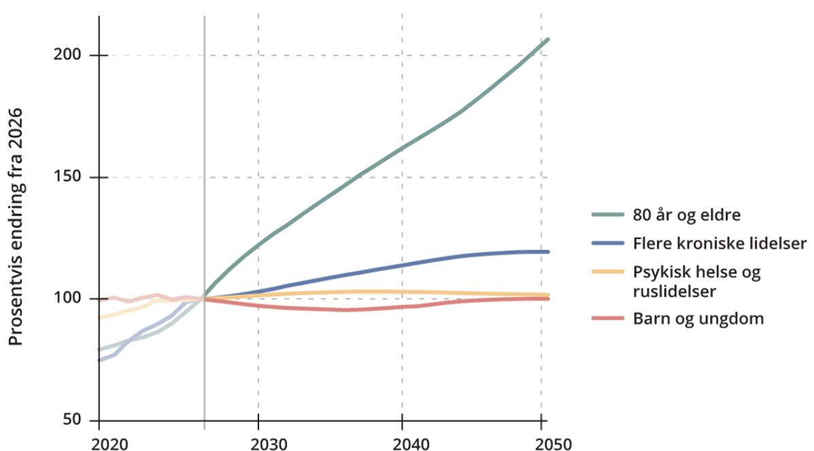

Prosentvis endring fra 2026

2020 2030 2040 2050

| År   | 80 år og eldre | Flere kroniske lidelser | Psykisk helse og ruslidelser | Barn og ungdom |
|------|----------------|-------------------------|------------------------------|----------------|
| 2020 | ~78            | ~75                     | ~92                          | ~100           |
| 2030 | ~125           | ~105                    | ~100                         | ~95            |
| 2040 | ~165           | ~115                    | ~105                         | ~95            |
| 2050 | ~210           | ~120                    | ~100                         | ~100           |

Line chart showing projected percentage change from 2026 to 2050 for four groups: 80 år og eldre, Flere kroniske lidelser, Psykisk helse og ruslidelser, and Barn og ungdom. The 80 år og eldre group shows a significant increase, while the others remain relatively stable.

Legend:

- 80 år og eldre
- Flere kroniske lidelser
- Psykisk helse og ruslidelser
- Barn og ungdom

Line chart: Projected percentage change from 2026 by age group and health condition.

**Figur 1.1 Utviklingen i prosent i fire grupper: Personer 80 år og eldre, personer i alderen 19–79 år med tre eller flere kroniske sykdommer, personer i alderen 19–79 år med minst én diagnose innen psykisk helse eller ruslidelser og barn 2–18 år med varige eller sammensatte behov. Historiske tall før 2026, deretter framskrivinger. Alle gruppene er indeksert til 100 i 2026.**

Kilde: Basert på SSBs befolkningsframskrivinger, mellomalternativet, har FHI (2026g) framskrevet antall personer i de fire gruppene.

Nesten alle i alderen 80 år og eldre (98 prosent) var i kontakt med helse- og omsorgstjenesten i 2025, og mer enn én av tre mottok både allmennlegetjenester, øvrige kommunale helse- og omsorgstjenester og spesialisthelsetjenester (FHI, 2026i). Disse har ofte omfattende og sammensatte behov, og opplever mange og gjentatte overganger mellom ulike deler av tjenesten. Det gjelder særlig overganger mellom allmennlegetjenester og øvrige kommunale helse- og omsorgstjenester, men også mellom kommunale helse- og omsorgstjenester og spesialisthelsetjenesten (FHI, 2026i).

Personer i alderen 80 år og eldre mottar nær halvparten av alle kommunalt tildelte helse- og omsorgstjenester. Samlet mottar de fire pasientgruppene barn og unge, personer med alvorlige psykiske lidelser og rusproblemer, personer med flere kroniske sykdommer og eldre over 80 år, om lag 70 prosent av alle kommunalt tildelte helse- og omsorgstjenester som gis i løpet av et år (FHI, 2026i).

Riksrevisjonen (2026c) peker på at personer over 80 år også har en sterk vekst i bruken av sykehustjenester.

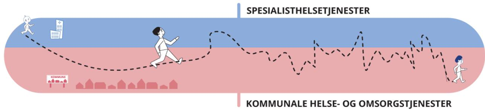

**SPESIALISTHELSETJENESTER**

**KOMMUNALE HELSE- OG OMSORGSTJENESTER**

The infographic shows a dashed line starting at a hospital (labeled 'SPESIALISTHELSETJENESTER') and ending at a municipal building (labeled 'KOMMUNALE HELSE- OG OMSORGSTJENESTER'). A person is running along the path, which starts smooth and becomes increasingly wavy as it approaches the municipal services.

The top half is blue and labeled 'SPESIALISTHELSETJENESTER'. The bottom half is red and labeled 'KOMMUNALE HELSE- OG OMSORGSTJENESTER'. A dashed line starts at a hospital icon on the left and ends at a person on the right. A person is running along the path, which starts smooth and becomes increasingly wavy as it approaches the municipal services.

Infographic: Conceptual path of healthcare services from specialist to municipal.

Figur 1.2 Noen pasientgrupper, særlig eldre, har behov for helse- og omsorgstjenester fra både kommunen og spesialisthelsetjenesten.

#### 1.1.2 Kostnadene øker i kommunene

Flere eldre i befolkningen vil gi betydelig større kostnadsvekst i den kommunale helse- og omsorgstjenesten enn i spesialisthelsetjenesten (figur 1.3). De samlede utgiftene til kommunale helse- og omsorgstjenester er forventet å overstige utgiftene til spesialisthelsetjenester innen 2040. Dette reflekterer at en stadig større del av veksten i tjenestebehovet er forventet å komme i kommunene. Dersom kommunene ikke har kapasitet til denne veksten, vil presset på sykehusene øke og føre til overbelastning (Riksrevisjonen, 2026c). Samtidig viser Riksrevisjonen (2026b) til at de kommunale helse- og omsorgstjenestene i liten grad er dimensjonerte for å møte økningen i antall eldre, og at det er risiko for svikt i tjenestene. Utvalget mener derfor at en styrking av de kommunale helse- og omsorgstjenestene og spesialisthelsetjenester nær der folk bor, er en forutsetning for å møte den demografiske utviklingen på en bærekraftig måte.

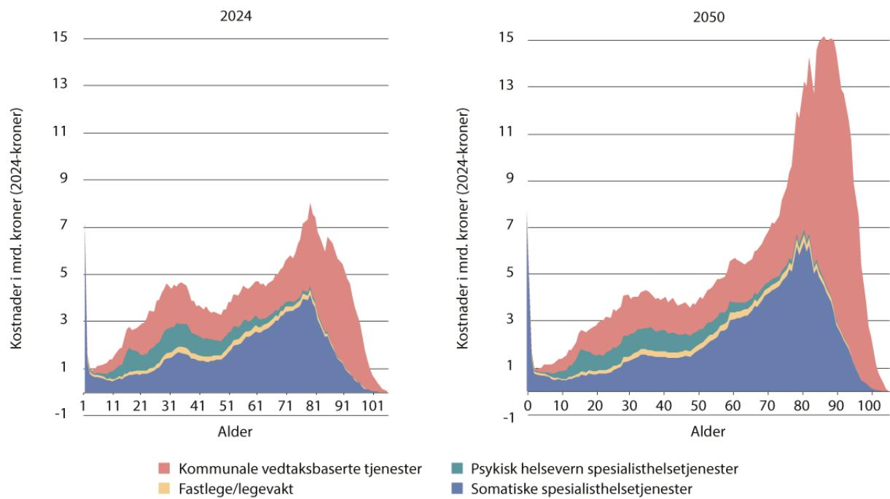

Kostnader i mrd. kroner (2024-kroner)

Alder

2024

2050

Kommunale vedtaksbaserte tjenester

Fastlege/legevakt

Psykisk helsevern spesialisthelsetjenester

Somatiske spesialisthelsetjenester

The figure consists of two stacked area charts. The left chart shows the cost in 2024 kroner for 2024, and the right chart shows the cost in 2024 kroner for 2050. Both charts plot cost in mrd. kroner (2024-kroner) on the y-axis (ranging from -1 to 15) against age (Alder) on the x-axis. The costs are broken down into four categories: Kommunale vedtaksbaserte tjenester (red), Fastlege/legevakt (yellow), Psykisk helsevern spesialisthelsetjenester (teal), and Somatiske spesialisthelsetjenester (blue). In both years, costs peak in the 80-90 age group. The 2050 chart shows a significant increase in total costs compared to 2024, particularly in the 80-90 age group.

| Alder | Somatiske spesialisthelsetjenester (2024) | Fastlege/legevakt (2024) | Psykisk helsevern spesialisthelsetjenester (2024) | Kommunale vedtaksbaserte tjenester (2024) |
|-------|-------------------------------------------|--------------------------|---------------------------------------------------|-------------------------------------------|
| 1     | ~0.5                                      | ~0.1                     | ~0.1                                              | ~0.3                                      |
| 11    | ~0.5                                      | ~0.1                     | ~0.1                                              | ~0.3                                      |
| 21    | ~1.0                                      | ~0.2                     | ~0.2                                              | ~0.6                                      |
| 31    | ~1.5                                      | ~0.3                     | ~0.3                                              | ~1.0                                      |
| 41    | ~1.5                                      | ~0.3                     | ~0.3                                              | ~1.0                                      |
| 51    | ~1.5                                      | ~0.3                     | ~0.3                                              | ~1.0                                      |
| 61    | ~2.0                                      | ~0.4                     | ~0.4                                              | ~1.2                                      |
| 71    | ~3.0                                      | ~0.5                     | ~0.5                                              | ~1.5                                      |
| 81    | ~3.5                                      | ~0.5                     | ~0.5                                              | ~3.5                                      |
| 91    | ~1.0                                      | ~0.1                     | ~0.1                                              | ~1.0                                      |
| 101   | ~0.0                                      | ~0.0                     | ~0.0                                              | ~0.0                                      |

| Alder | Somatiske spesialisthelsetjenester (2050) | Fastlege/legevakt (2050) | Psykisk helsevern spesialisthelsetjenester (2050) | Kommunale vedtaksbaserte tjenester (2050) |
|-------|-------------------------------------------|--------------------------|---------------------------------------------------|-------------------------------------------|
| 0     | ~0.5                                      | ~0.1                     | ~0.1                                              | ~0.3                                      |
| 10    | ~0.5                                      | ~0.1                     | ~0.1                                              | ~0.3                                      |
| 20    | ~1.0                                      | ~0.2                     | ~0.2                                              | ~0.6                                      |
| 30    | ~1.5                                      | ~0.3                     | ~0.3                                              | ~1.0                                      |
| 40    | ~1.5                                      | ~0.3                     | ~0.3                                              | ~1.0                                      |
| 50    | ~1.5                                      | ~0.3                     | ~0.3                                              | ~1.0                                      |
| 60    | ~2.0                                      | ~0.4                     | ~0.4                                              | ~1.2                                      |
| 70    | ~3.0                                      | ~0.5                     | ~0.5                                              | ~1.5                                      |
| 80    | ~6.0                                      | ~0.5                     | ~0.5                                              | ~3.5                                      |
| 90    | ~1.0                                      | ~0.1                     | ~0.1                                              | ~1.0                                      |
| 100   | ~0.0                                      | ~0.0                     | ~0.0                                              | ~0.0                                      |

Multi-panel chart: Cost trends by age group for 2024 and 2050 across healthcare services.

**Figur 1.3 Kostnader i ulike deler av helse- og omsorgstjenesten i 2024 og framskrevet til 2050 (2024-kroner)**

Kilde: Helse Sør-Øst RHF (2026)

#### **1.1.3 Tiltakende knapphet på helsefagarbeidere og sykepleiere**

Statistisk sentralbyrås (2026b) framskriving viser at etterspørselen etter arbeidskraft i de offentlige helse- og omsorgstjenestene øker mer enn tilbudet av personell med relevant utdanning. Ubalansen mellom tilbud og etterspørsel vil vokse, og i 2040 vil sektoren mangle om lag 42 000 årsverk med helsefaglig utdanning. Underskuddet av helsefagarbeidere og sykepleiere alene er anslått til om lag 41 000 årsverk, altså det aller meste av det samlede gapet. Psykologer og leger er i en særstilling med overskudd mot slutten av perioden.

Det er kommuner med befolkningsnedgang, en høy andel eldre og en stor andel av befolkningen utenfor arbeidslivet som vil merke underskuddet på arbeidskraft mest og først (figur 1.4). Fram mot 2040 vil det bli utfordrende å dekke behovet for helsepersonell også i de sentrale kommunene (NOU 2026: 1). Regjeringen har lagt fram en plan med tiltak for å møte utfordringene med mangel på helsepersonell (Meld. St. 11 (2025–2026)).

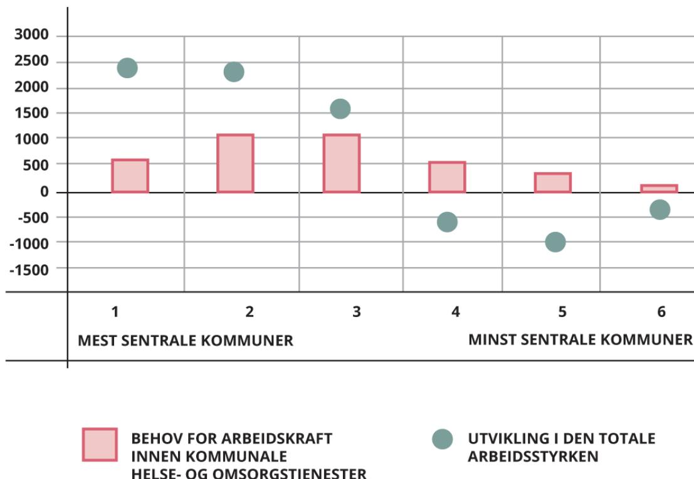

**MEST SENTRALE KOMMUNER** **MINST SENTRALE KOMMUNER**

**BEHOV FOR ARBEIDSKRAFT INNEN KOMMUNALE HELSE- OG OMSORGSTIENESTER**

**UTVIKLING I DEN TOTALE ARBEIDSSTYRKEN**

Y-axis: -1500 to 3000

| Kommune | BEHOV FOR ARBEIDSKRAFT INNEN KOMMUNALE HELSE- OG OMSORGSTIENESTER | UTVIKLING I DEN TOTALE ARBEIDSSTYRKEN |
|---------|-------------------------------------------------------------------|---------------------------------------|
| 1       | ~600                                                              | ~2400                                 |
| 2       | ~1100                                                             | ~2300                                 |
| 3       | ~1100                                                             | ~1650                                 |
| 4       | ~550                                                              | ~-550                                 |
| 5       | ~350                                                              | ~-950                                 |
| 6       | ~100                                                              | ~-300                                 |

A combination bar and scatter chart showing the need for labor in health and care services (red bars) and the development of the total workforce (teal circles) for six central municipalities, ordered from most to least central.

Bar chart: Comparison of labor needs and total workforce development across central municipalities.

Figur 1.4 Behov for arbeidskraft innen kommunale helse- og omsorgstjenester og utvikling i den totale arbeidsstyrken. Årlig gjennomsnittlig endring i antall personer i perioden 2026–2040.

Kilde: NOU 2026: 1

#### 1.1.4 Framtidige behov møtes best med tiltak nå

Utvalget mener at de identifiserte hovedutfordringene krever tiltak allerede nå for å sikre befolkningens behov i tiårene framover. Alternativt vil de geografiske og sosiale helseforskjellene kunne tilta, og det økende antallet pasienter med sammensatte behov vil ikke få det tilbudet de trenger. Når pasientforløpene blir mer komplekse, må tjenestene tilpasses de nye behovene.

Den sterke oppslutningen om felles offentlige, skattefinansierte helse- og omsorgstjenester skal bevares. Befolkningen skal ha tillit til tjenestene og ønske å bruke dem. Helsepersonellet skal oppleve tjenestene som attraktive arbeidsplasser. I en situasjon med knappere ressurser blir gode prioriteringer og effektiv kompetanse- og ressursutnyttelse derfor stadig viktigere.

Utvalget legger til grunn at det ikke er realistisk å møte framtidens behov gjennom økt bemanning alene, og anbefaler derfor endringer i organisering, styring og finansiering av tjenestene. En sentral barriere er at ansvaret er delt mellom flere tjenestenivåer og mange kommuner med ulike forutsetninger. Dette gjør det krevende å samordne prioriteringer, personell, investeringer og tjenesteutvikling. En annen utfordring er at teknologi, som kan forbedre kvalitet, tilgjengelighet og produktivitet, ikke tas i bruk raskt nok.

Utviklingstrekkene og utfordringene er i stor grad felles for hele den vestlige verden: flere eldre, flere personer med sammensatte og langvarige sykdommer, endringer i sykdomsbyrden, relativt færre i arbeid og økende forventninger til tjenestene. Flere land er derfor i ferd med å endre organiseringen av helse- og omsorgstjenestene. Selv om løsningene varierer, er det to tydelige fellestrekk: mer bruk av digitale tjenester og en dreining av kapasitet, kompetanse og oppgaver nærmere der folk bor.

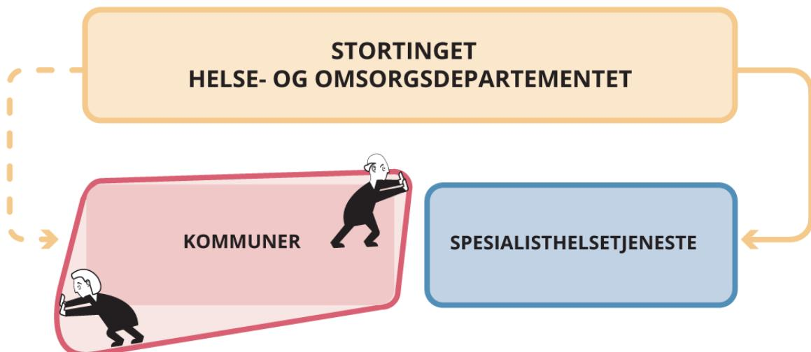

The diagram shows three main components:

- STORTINGET HELSE- OG OMSORGSDEPARTEMENTET** (Top box)
- KOMMUNER** (Pink box with two figures pushing)
- SPESIALISTHELSETJENESTE** (Blue box)

A dashed arrow points from the top box to the pink box. A solid arrow points from the pink box to the blue box.

**STORTINGET  
HELSE- OG OMSORGSDEPARTEMENTET**

**KOMMUNER**

**SPESIALISTHELSETJENESTE**

Infographic: Conceptual diagram of healthcare department roles and interactions.

Figur 1.5 Den demografiske utviklingen med flere eldre i befolkningen gir større press på de kommunale helse- og omsorgstjenestene i årene framover.

### 1.2 Anbefalinger

#### 1.2.1 Fortsatt delt sørge-for-ansvar mellom kommunene og staten

Ansvaret for at befolkningen får helse- og omsorgstjenester er i dag delt mellom to tjenestenivåer. Staten har, gjennom de fire regionale helseforetakene, ansvar for spesialisthelsetjenesten, mens de 357 kommunene har ansvaret for primærhelsetjenestene. Fylkeskommunene har ansvar for tannhelsetjenester. Utvalget har vurdert tre alternativer for å samle sørge-for-ansvaret for spesialisthelsetjenesten og primærhelsetjenesten på ett nivå: samlet ansvar i kommunene, i staten eller i folkevalgte regioner.

Utvalget vurderer at en samling av sørge-for-ansvaret kan ha fordeler i møte med framtidens utfordringer. Særlig vil en samling under staten eller et regionalt nivå fremme mandatets mål om integrerte og helhetlige helse- og omsorgstjenester. Med ett ansvarlig nivå vil det være enklere å lage helhetlige utrednings- og behandlingsforløp for pasienter som i dagens system kan bli sendt fram og tilbake mellom nivåene.

Samtidig vil det være mange tjenesteleverandører, behov for samordning og koordinering og et stort ansvarsområde. Særlig er det fare for svekket sammenheng med andre sosial- og velferdstjenester i kommunene.

Omstillingskostnadene ved å samle sørge-for-ansvaret i staten eller regioner vil også være omfattende. Kommunene må avgi myndighet, og med en regionmodell må det etableres nye folkevalgte og administrative enheter. Kommunenes ansvarsområde vil bli betydelig redusert, og det må gjennomføres virksomhetsoverdragelser.

På denne bakgrunn anbefaler ikke utvalget at sørge-for-ansvaret for alle helse- og omsorgstjenester samles på ett nivå nå. Deler av utvalget peker på at en modell med folkevalgte regioner, som i Danmark, kan være en langsiktig mulighet. Andre deler av utvalget anser det ikke som et mål å samle ansvaret på ett nivå.

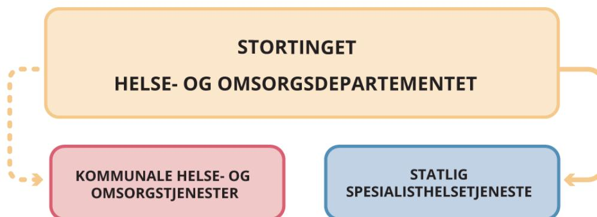

The diagram shows a hierarchical structure with three main entities:

- STORTINGET**  
**HELSE- OG OMSORGSDEPARTEMENTET**
- KOMMUNALE HELSE- OG OMSORGSTJENESTER**
- STATLIG SPESIALISTHELSETJENESTE**

Dashed arrows indicate a flow from the top entity to the two lower entities.

```
graph TD; A["STORTINGET<br/>HELSE- OG OMSORGSDEPARTEMENTET"] -.-> B["KOMMUNALE HELSE- OG OMSORGSTJENESTER"]; A -.-> C["STATLIG SPESIALISTHELSETJENESTE"]
```

The top entity is a large orange box. Below it are two smaller boxes: a pink one on the left and a blue one on the right. Dashed arrows point from the top box to each of the two lower boxes.

Org chart: Organizational structure of the Ministry of Health and Social Services and its sub-departments.

Figur 1.6 Utvalget anbefaler fortsatt delt ansvar for helse- og omsorgstjenestene, der kommunene har ansvaret for primærhelsetjenester og staten for spesialisthelsetjenester.

#### 1.2.2 En nærhelsereform

Pasienter med store og sammensatte behov trenger ofte tjenester fra den kommunale helse- og omsorgstjenesten og spesialisthelsetjenesten samtidig. For disse pasientgruppene må kvaliteten, tilgjengeligheten og sammenhengen i tjenestene styrkes gjennom mer forpliktende samarbeid mellom nivåene. Utvalget foreslår derfor å legge til rette for at kommuner og sykehus bedre kan planlegge, organisere og yte tjenester i fellesskap. Disse tjenestene omtales som nærhelsetjenester, fordi de blant annet innebærer at spesialisthelsetjenester flyttes ut av sykehusene og nærmere der folk bor.

Hensikten er at kompetanse og ressurser fra begge nivåer arbeider sammen, nærmere pasientens hjem, med gode og helhetlige tilbud. Forslaget bygger på erfaringer fra lokalmedisinske sentre, Prosjekt X og andre samhandlingstiltak mellom kommuner og sykehus.

Nærhelsetjenester forutsetter langsiktige avtaler mellom kommuner og helseforetak om å yte bestemte tjenester i fellesskap. Samarbeidet kan organiseres med ulik grad av forpliktelse. Kommuner og helseforetak kan, dersom helseforetaksloven endres, etablere felleseid selskap. Et felleseid nærhelsetjenesteselskap vil være en virksomhet med egen ledelse med ansvar for den daglige driften. Det vil kunne yte både kommunale helse- og omsorgstjenester og spesialisthelsetjenester og ansette personell som kan yte begge typer tjenester. Nærhelsetjenester kan også organiseres gjennom andre former for avtaler. Uavhengig av avtaleform kan samlokalisering av alle eller deler av tjenestene i nærhelsesentre vurderes. Der det er etablert

nærhelsetjenester, bør pasientene kunne motta forskjellige tjenester innenfor nærhelsetjenestestrukturen uten at det forutsetter egne henvisninger.

Kommunene og spesialisthelsetjenesten vil fortsatt ha sitt lovpålagte sørge-for-ansvar. Nærhelsetjenestene innebærer altså ikke en overføring av ansvar mellom nivåene, men en mer integrert måte å planlegge, organisere og levere tjenester på. For pasientene skal tjenestene bli mer helhetlige og sammenhengende.

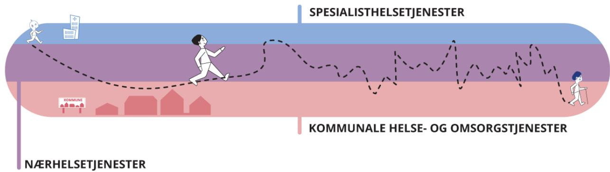

The diagram illustrates three levels of healthcare and care services:

- SPESIALISTHELSETJENESTER** (Specialist healthcare services) at the top, represented by a blue layer with a hospital icon and a person running.
- KOMMUNALE HELSE- OG OMSORGSTJENESTER** (Municipal health and care services) in the middle, represented by a purple layer with a dashed line showing a fluctuating path and a person walking.
- NÆRHELSETJENESTER** (Near healthcare services) at the bottom, represented by a red layer with a commune icon and a person with a cane.

A dashed line starts at the top left, follows the path of the person in the middle layer, and ends at the bottom right.

Infographic: Conceptual diagram of healthcare and care services levels.

**Figur 1.7** Pasienter med store og sammensatte behov mottar mange tjenester i en nærhelsetjeneste (lilla), som er et samarbeid mellom kommuner (rød) og helseforetak (blå).

Nærhelsetjenester må kunne utformes ulikt, avhengig av lokale behov og forutsetninger. Hvilke tjenester som inngår, vil blant annet avhenge av befolkningssammensetning, geografi, reiseavstander, kapasitet og kompetanse. Det er derfor ikke ønskelig å definere én standardmodell for nærhelsetjenester. Samtidig er det enkelte tjenesteområder som gjennomgående forutsetter tett samhandling mellom kommuner og sykehus. Dette gjelder særlig tjenester der pasienter har behov for oppfølging fra begge nivåer, eller der felles organisering kan bidra til bedre ressursutnyttelse og mer sammenhengende pasientforløp. Figur 1.8 gir eksempler på slike tjenester nærmere der folk bor.

Utvalget legger til grunn at alle helseforetak skal inngå avtale om én eller flere nærhelsetjenester innenfor sitt opptaksområde.

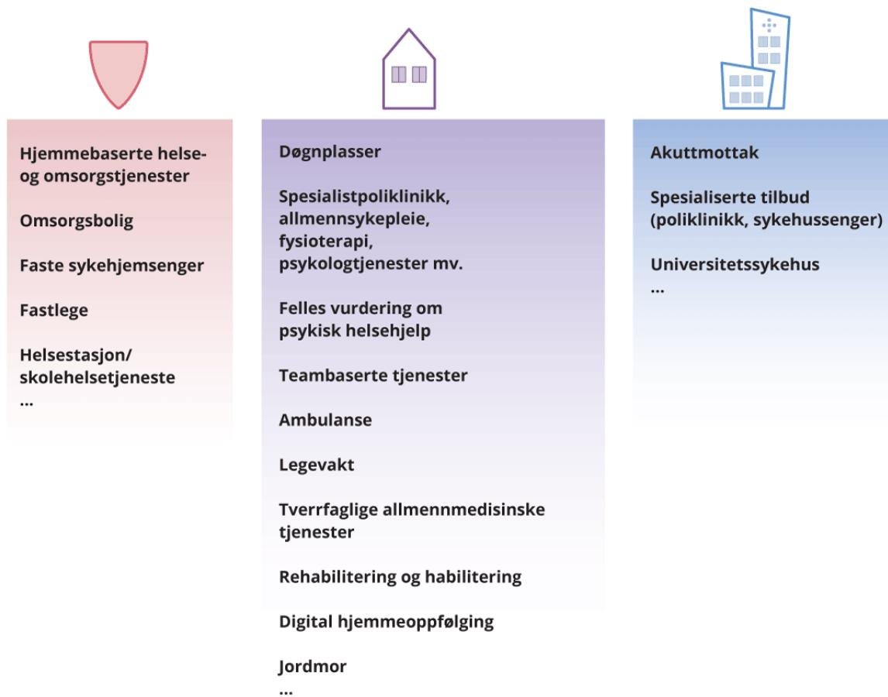

|                                                                                                                                                                                                  |                                                                                                                                                                                                                                                                                                                                                                                                                               |                                                                                                                                     |
|--------------------------------------------------------------------------------------------------------------------------------------------------------------------------------------------------|-------------------------------------------------------------------------------------------------------------------------------------------------------------------------------------------------------------------------------------------------------------------------------------------------------------------------------------------------------------------------------------------------------------------------------|-------------------------------------------------------------------------------------------------------------------------------------|
| <p><b>Hjemmebaserte helse- og omsorgstjenester</b></p><p><b>Omsorgsbolig</b></p><p><b>Faste sykehjemsenger</b></p><p><b>Fastlege</b></p><p><b>Helsestasjon/ skolehelsetjeneste</b></p><p>...</p> | <p><b>Døgnplasser</b></p><p><b>Spesialistpoliklinikk, allmennsykepleie, fysioterapi, psykologtjenester mv.</b></p><p><b>Felles vurdering om psykisk helsehjelp</b></p><p><b>Teambaserte tjenester</b></p><p><b>Ambulanse</b></p><p><b>Legevakt</b></p><p><b>Tverrfaglige allmennmedisinske tjenester</b></p><p><b>Rehabilitering og habilitering</b></p><p><b>Digital hjemmeoppfølging</b></p><p><b>Jordmor</b></p><p>...</p> | <p><b>Akuttmottak</b></p><p><b>Spesialiserte tilbud (poliklinikk, sykehussenger)</b></p><p><b>Universitetssykehus</b></p><p>...</p> |
|--------------------------------------------------------------------------------------------------------------------------------------------------------------------------------------------------|-------------------------------------------------------------------------------------------------------------------------------------------------------------------------------------------------------------------------------------------------------------------------------------------------------------------------------------------------------------------------------------------------------------------------------|-------------------------------------------------------------------------------------------------------------------------------------|

Infographic showing three columns of healthcare services, each with a corresponding icon at the top.

**Figur 1.8** Eksempler på mulige nærhelsetjenester (lilla) som ytes i fellesskap mellom kommuner (rød) og helseforetaket (blå). Nærhelsetjenestene skal særlig rettes inn mot pasienter med behov for oppfølging fra begge nivåer, eller der felles organisering kan bidra til bedre ressursutnyttelse og mer sammenhengende pasienttilbud.

Utvalget mener det er behov for å styrke de økonomiske insentivene til samhandling mellom den kommunale helse- og omsorgstjenesten og spesialisthelsetjenesten. Selv om kommuner og helseforetak har et felles mål om gode og sammenhengende tjenester for pasientene, kan dagens finansieringsordninger gjøre det vanskelig å etablere og drifte felles tilbud.

Utvalget peker på flere økonomiske tiltak som kan stimulere kommuner og regionale helseforetak til å samarbeide i en nærhelsetjeneste. For det første kan utvalgets anbefaling om å overføre innsatsstyrt finansiering av øyeblikkelig hjelp til spesialisthelsetjenestens basisramme, stimulere sykehusene til samarbeid med kommunene om å forebygge sykehusinnleggelser gjennom å utvikle tilbud utenfor sykehus.

For det andre anbefaler utvalget at regelverket legger til rette for at helsepersonell i nærhelsetjenestene kan utløse innsatsstyrt finansiering når de utfører spesialisthelsetjenesteoppgaver. Utvalget anbefaler også at det innføres aktivitetsbasert statlig finansiering av døgnopphold i nærhelsetjenestene.

For det tredje kan staten etablere ordninger med tilskudd til etablering eller drift for kommuner og helseforetak som inngår forpliktende samarbeid om nærhelsetjenester. En mulig modell for driftstilskudd er at kommuner og helseforetak, innenfor vide rammer, selv beslutter hvilke tjenester

som skal inngå i et felles budsjett for nærhelsetjenesten. Staten kan deretter dekke en fast andel av kostnadene, for eksempel 20 prosent.

Formålet med slike endringer i finansieringen er å gi partene økonomiske insentiver til å organisere tjenester i fellesskap til pasientenes beste. Når en andel av kostnadene finansieres gjennom statlige tilskudd, vil samarbeid kunne framstå som mer attraktivt enn å levere de samme tjenestene hver for seg.

Utvalget er samlet om at det bør opprettes nærhelsetjenester, der kommuner og helseforetak forplikter seg til å yte bestemte tjenester i fellesskap gjennom konkrete samarbeidsløsninger.

Medlemmene i utvalget har ulike syn på organisasjonsform og hvordan statlig medfinansiering skal innrettes. Deler av utvalget mener at tilbudet til pasientene vil bli best dersom nærhelsetjenestene primært tilbys i nærhelsetjenesteselskap eid av kommuner og helseforetak i fellesskap.

Kjerneoppgaver i et nærhelsesenter vil være døgnbasert drift og polikliniske tjenester. Dette vil gi forutsigbarhet over tid. En slik virksomhet kan ha egne ansatte som yter både kommunale helse- og omsorgstjenester og spesialisthelsetjenester. Det vil være felles ledelse og ansvar for driften. For å gi partene sterke økonomiske insentiver til å opprette og videreutvikle nærhelsetjenesteselskap, anbefaler denne delen av utvalget at staten yter varig driftstilskudd til selskapet på anslagsvis 20 prosent av kostnadene.

Andre deler av utvalget legger vekt på kommunenes muligheter til å tilpasse sin deltakelse i nærhelsetjenestene ved endrede behov, og anbefaler primært en avtalebasert nærhelsetjeneste. Det avtales å samarbeide om å levere bestemte tjenester. Arbeidsgivertilknytningen ligger fortsatt hos kommunen eller helseforetaket, og disponering av personell på tvers av hverandres ansvarsområder avtales mellom helseforetak, kommunen og den ansatte. Det gis økonomiske insentiver fra aktivitetsbaserte finansieringsordninger, men ikke et kostnadsbasert statlig driftstilskudd.

Hele utvalget mener at nærhelsetjenesten kan utvikle seg til å bli et sentralt helsepolitisk virkemiddel. Nærhelsetjenestene representerer en modell for hvordan kommuner og spesialisthelsetjenesten kan møte framtidens hovedutfordringer i fellesskap, uten at det er nødvendig å samle sørge-for-ansvaret på ett nivå. Nærhelsetjenestene skal bringe tjenestene nærmere innbyggerne og gjøre dem lettere tilgjengelige.

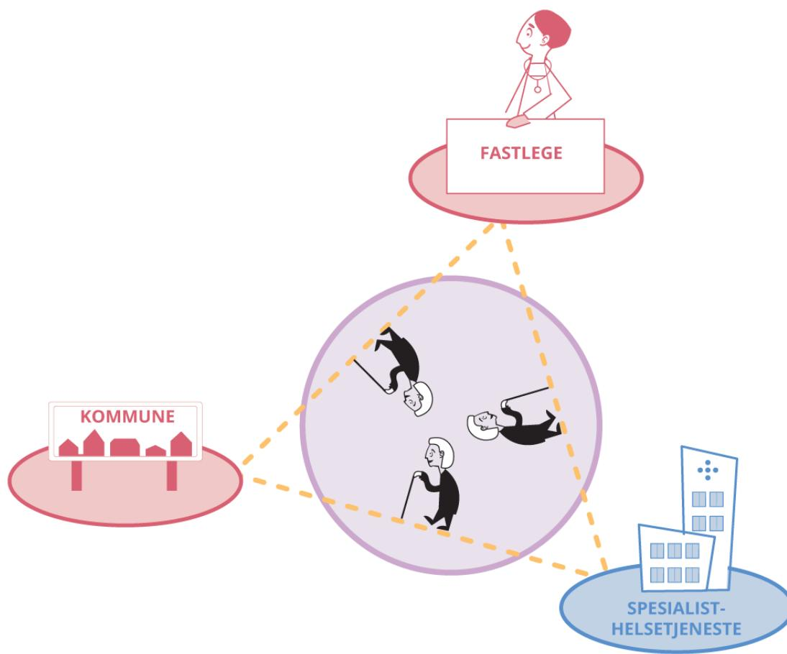

The diagram illustrates a triangular relationship between three entities:

- FASTLEGE**: Represented by a doctor standing on a pink oval.
- KOMMUNE**: Represented by a sign with house icons on a pink oval.
- SPESIALIST-HELSETJENESTE**: Represented by a blue building icon on a blue oval.

Dashed orange lines connect the three entities, with a large purple circle in the center containing three people with walking canes, representing patients.

**FASTLEGE**

**KOMMUNE**

**SPESIALIST-HELSETJENESTE**

Infographic: Conceptual diagram of healthcare collaboration between fastlege, kommune, and specialist services.

Figur 1.9 Pasienter som trenger tjenester fra flere deler av helse- og omsorgstjenesten samtidig, skal få mye av hjelpen i nærhelsetjenesten (lilla), der det utføres både spesialisthelsetjenester, allmennmedisinske tjenester og andre kommunale helse- og omsorgstjenester.

#### **1.2.3 Helsefellesskapene endres til strategiske helseutvalg**

Helsefellesskapene er i dag en dialogarena med et vidt mandat som kan bidra til bedre forståelse mellom helseforetak og kommuner. Erfaringene så langt er likevel svært ulike. Utvalget mener at helsefellesskapene kan fungere bedre dersom de endres til tydelige strategiske arenaer for planlegging og koordinering på tvers av nivåene. Med slik spissing av helsefellesskapenes rolle foreslår utvalget at de endrer navn til strategiske helseutvalg.

Utvalget foreslår at det stilles krav om at spørsmål av strategisk og strukturell betydning for helse- og omsorgstjenestene samlet, må drøftes i de strategiske helseutvalgene før kommunen eller helseforetaket kan fatte vedtak. Etablering og fordeling av oppgaver i nærhelsetjenestene bør også drøftes her før beslutningene tas i kommunene og helseforetaket.

Kommuner og helseforetak har i dag ikke plikt til å delta i helsefellesskapene. Utvalget mener at både helseforetak og kommuner skal ha lovbestemt plikt til å etablere og delta i de strategiske helseutvalgene, og at den som eier helseforetaket også må ta del i det strategiske arbeidet.

Utvalgets anbefaling om sammenslåing av små kommuner vil bidra til å styrke kommunene, slik at de blir mer likeverdige parter i samarbeidet med sykehusene.

#### **1.2.4 En tverrfaglig teambasert allmennmedisinsk tjeneste**

Utvalget har vurdert hvordan allmennlegetjenestene bør innrettes for at helse- og omsorgstjenesten skal møte det økende behovet for tjenester i befolkningen generelt, og særlig til eldre med skrøpelighet og personer med sammensatte behov. Spesielt mennesker med demens mister gradvis eget initiativ og oppsøker ikke helsehjelp.

Utvalget mener det er viktig å bevare en fastlegetjeneste som utvikler seg i takt med samfunnet, for alle pasienter. Samtidig mener utvalget det er behov for allmennmedisinske tjenester som følger pasienter med store og sammensatte behov tettere enn det som er vanlig i dag. Det er blant annet behov for mer oppsøkende virksomhet og bedre koordinering og samhandling med andre kommunale helse- og omsorgstjenester og spesialisthelsetjenesten. Utvalget anbefaler derfor at kommunene skal få plikt til å etablere tverrfaglige teambaserte allmennmedisinske tjenester for pasienter med store og sammensatte behov, samtidig som dagens fastlegeordning videreføres for flertallet av innbyggerne.

Allmennmedisinske team bør organiseres med kommunalt ansatt fastlege, sykepleier og annet personell, avhengig av pasientenes behov. Et slikt oppsøkende team kan bidra til å forebygge behovet for mer personellintensive tjenester, som sykehusinnleggelse og sykehjemsplass. Den teambaserte allmennmedisinske tjenesten kan med fordel inngå i nærhelsetjenesten. Det må vurderes om det er behov for å innføre en lovfestet rett til å motta denne tjenesten for pasienter som oppfyller nærmere fastsatte kriterier.

Utvalget mener at retten til å velge fastlege må videreføres, enten fastlegen opererer som i dag eller inngår i en teambasert allmennmedisinsk ordning. Kommunen må kunne reservere hele eller deler av fastlegelister til pasienter som mottar teambaserte allmennmedisinske tjenester. Det må avklares om dette krever lovendring.

Utvalget legger til grunn at dagens finansieringsordning for fastlegetjenesten videreføres. For å legge til rette for teambaserte allmennmedisinske tjenester anbefaler utvalget at fastlegens mulighet for å kreve refusjon ved delegering av oppgaver til blant annet sykepleier, utvides.

For at kommunen i større grad skal kunne vurdere hvem som skal utføre en oppgave, uavhengig av profesjon, anbefaler utvalget at det åpnes for forsøk med profesjonsnøytrale takster rundt fastlegen i den teambaserte allmennmedisinske ordningen. Utvalget er kjent med at Helsedirektoratet er i gang med å utrede profesjonsnøytrale takster, og mener at denne utredningen må ligge til grunn for forsøk.

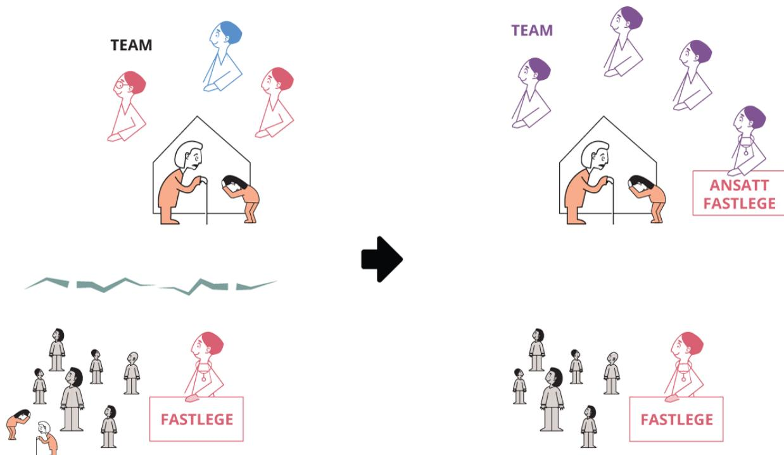

The diagram illustrates a transition in a healthcare setting. At the top, a 'TEAM' of three people (two red, one blue) is shown outside a house where an orange person is helping a black person. A large black arrow points to the right. At the bottom, a 'FASTLEGE' (fast-acting nurse) is shown. On the left, the team is still outside the house. On the right, the team is now inside the house, and the 'FASTLEGE' is now outside.

**TEAM**

**ANSATT  
FASTLEGE**

**FASTLEGE**

**FASTLEGE**

Infographic: Conceptual diagram of a healthcare team and fast-acting nurse before and after.

Figur 1.10 Illustrasjon av at fastlegen ikke alltid er tett nok integrert med øvrige helse- og omsorgstjenester i dag (t.v.). Utvalget foreslår at pasienter med store og sammensatte behov skal kunne få allmennmedisinske tjenester fra et tverrfaglig team med kommunalt ansatt fastlege, sykepleier og annet personell (t.h).

Utvalget anbefaler at denne kombinerte fastlegemodellen fortsatt skal være et kommunalt sørgefor-ansvar. Siden behovet for koordinering med de øvrige kommunale helse- og omsorgstjenestene vil bli mindre for den tradisjonelle delen av fastlegeordningen, reduseres likevel noen av ulempene dersom man beslutter å flytte kun denne delen av fastlegeordningen til tjenestenivået med ansvar for spesialisthelsetjenesten.

#### 1.2.5 En sammenhengende akuttmedisinsk kjede

Utvalget anbefaler at det etableres en digital inngangsport der innbyggerne får kvalitetssikrede råd. En digital interaktiv funksjon skal vurdere om det er behov for kontakt med helsepersonell og eventuelt lede brukeren videre til fastlege, legevakt eller andre aktører. Gjennom den digitale inngangsporten bør legevaktaktiviteten dreies mot mer rådgivning, enten nettbasert, på telefon eller ved videokonsultasjon, og i mindre grad baseres på oppmøte. Dette kan frigjøre tid for helsepersonell og gjøre legevakten mer tilgjengelig for pasienter som har behov for fysisk konsultasjon. Pasienter som ikke er digitale, ikke kan benytte seg av den digitale inngangsporten eller som har behov for fysisk undersøkelse eller behandling, skal fortsatt ha tilgang til helsepersonell gjennom fysisk møte.

Utvalget anbefaler færre og mer robuste AMK- og legevaktsentraler. Det vil gi mer likeverdige helsetjenester og kan bidra til god bruk av arbeidskraft.

Utvalget anbefaler at ansvaret for legevakt og legevaktsentraler blir overført til spesialisthelsetjenesten. Utvalget mener dette vil bidra til en mer sammenhengende akuttmedisinsk kjede, stabil bemanning i hele landet og bedre rekruttering til legevakt. En samlet organisering gjør det lettere å planlegge og styre tilbudet. Det kan bidra til en mer bærekraftig ressursbruk og til at helsepersonellet opplever å være del av en samlet struktur.

Utvalget mener også det vil være fordeler med å inkludere legevakt og ambulansetjeneste i nærhelsetjenestene, sammen med for eksempel kommunal akutt døgnenhet. Dette vil styrke en allerede god beredskap og kan bidra til at flere pasienter kan avklares og ferdigbehandles i nærhelsetjenestene, uten at de må sendes videre til sykehus.


A collection of 12 blue phone icons, each with a white phone handset and the number "113" next to it. The icons are scattered across the page in a random pattern.

Illustration of multiple blue phone icons with the number 113 on them, scattered across the page.


113 113 113 113

Four blue phone icons with the number 113 next to each.

Figur 1.11 Utvalget foreslår færre AMK-sentraler.

#### 1.2.6 Kunnskapsgjennomgang av rehabiliteringsfeltet

Utvalget understreker at gode rehabiliteringstjenester bidrar til mestring, selvstendighet, livskvalitet og deltakelse, og at mange har behov for koordinert og langvarig oppfølging. Riktig rehabilitering er viktig, både for den enkeltes livskvalitet og for bedre bruk av helse- og omsorgsressursene. Det kan utsette behovet for pleie- og omsorgstjenester, redusere presset på hjemmetjenester, sykehjem og heldøgns omsorgstjenester, samt bidra til færre konsultasjoner på legevakt og poliklinikker og redusere innleggelser i sykehus. En stor andel av spesialisthelsetjenestens rehabiliteringstilbud skjer gjennom de regionale helseforetakenes avtaler om tjenester ved private rehabiliteringsinstitusjoner. Utvalget mener at mer rehabilitering må skje nært der pasientene bor, slik at de får et aktivt og deltakende hverdagsliv. Utvalget anbefaler at rehabiliteringstjenester inngår som en sentral del av nærhelsetjenestene.

Utvalget anbefaler videre at det gjennomføres en bred kunnskapsgjennomgang av rehabiliteringsfeltet, som kan danne grunnlag for senere reformforslag. Gjennomgangen bør sammenstille eksisterende forskning, evalueringer, tilsynserfaringer, registerdata og erfaringer fra brukere, pårørende, kommuner, helseforetak og fagmiljøer. Gjennomgangen bør særlig belyse ansvarsdelingen mellom kommune og spesialisthelsetjeneste og hvordan organisering påvirker kvalitet, kontinuitet og tilgjengelighet.

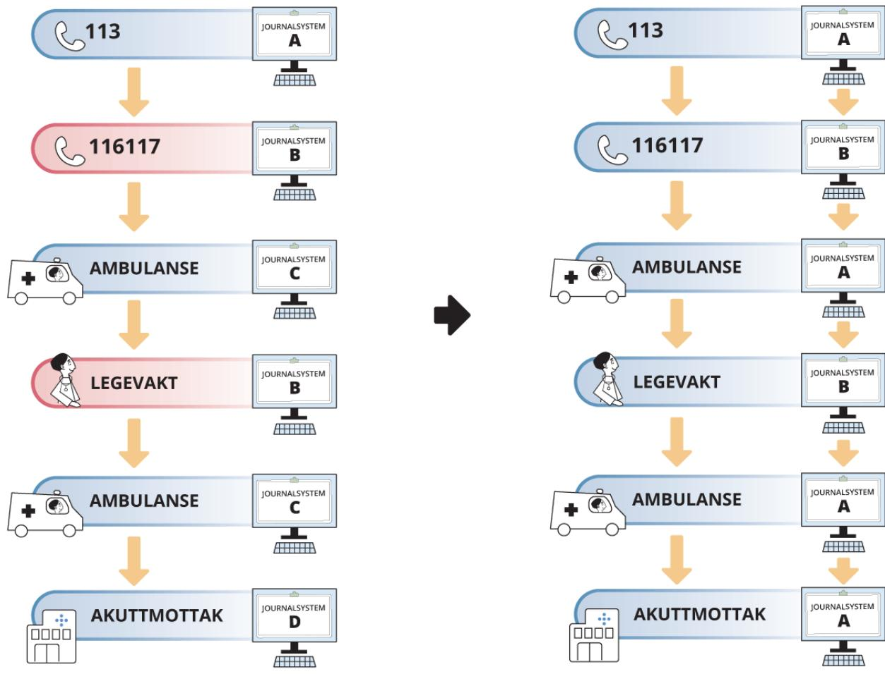

The diagram illustrates two different workflows for handling emergency calls, separated by a large black arrow.

**Left Workflow:**

- 113** (JOURNALSYSTEM **A**) →
- 116117** (JOURNALSYSTEM **B**) →
- AMBULANSE** (JOURNALSYSTEM **C**) →
- LEGEVAKT** (JOURNALSYSTEM **B**) →
- AMBULANSE** (JOURNALSYSTEM **C**) →
- AKUTTMOTTAK** (JOURNALSYSTEM **D**)

**Right Workflow:**

- 113** (JOURNALSYSTEM **A**) →
- 116117** (JOURNALSYSTEM **B**) →
- AMBULANSE** (JOURNALSYSTEM **A**) →
- LEGEVAKT** (JOURNALSYSTEM **B**) →
- AMBULANSE** (JOURNALSYSTEM **A**) →
- AKUTTMOTTAK** (JOURNALSYSTEM **A**)

Both workflows start with a call to 113 and 116117, but the subsequent routing to ambulances and the acute care center differs.

Flowchart: Comparison of two emergency call routing workflows to medical services.

Figur 1.12 Utvalget foreslår at ansvaret for den akuttmedisinske kjede, med unntak av fastlegene, samles under spesialisthelsetjenesten (blå).

#### **1.2.7 Økt kapasitet i de psykiske helsetjenestene**

Barn, unge og voksne med psykiske helse- og rusutfordringer trenger ofte tjenester fra flere sektorer, blant annet sektorer med ansvar for helse, bolig, arbeid, utdanning og barnevern. Utvalget mener at kommunene bør ha hovedansvaret for å koordinere disse tjenestene, og de må videreføre og intensivere arbeidet med å utvikle lavterskeltilbud, særlig for barn og unge.

Utvalget støtter videreutvikling av oppsøkende tjenester som ACT-, FACT- og FACT-ung-team. Slike tilbud kan bidra til mer likeverdige tjenester, men forutsetter stabile og langsiktige finansieringsordninger.

Utvalget anbefaler at kommunene og spesialisthelsetjenesten i fellesskap vurderer henvisninger og henvendelser om psykisk helsehjelp. Når fagpersoner fra kommunen og spesialisthelsetjenesten samarbeider om å vurdere henvisninger og henvendelser, kan kompetansen på begge nivåer brukes til å avklare hva slags hjelp pasienten trenger, og hvor hjelpen best kan gis. Dette kan redusere unødvendig ventetid og hindre at pasienter blir sendt mellom tjenester og blir kasteballer i systemet.

Utvalget mener at distriktspsykiatriske sentre (DPS) i større grad bør utvikles til tverrfaglige samarbeidsarenaer for spesialisthelsetjenesten og kommunene. Utvalget viser til at det i Valdres lokalmedisinske senter (VLMS) er etablert en ny modell for psykisk helsevern. Modellen innebærer tettere samarbeid mellom Sykehuset Innlandet, DPS Gjøvik og Valdres lokalmedisinske senter. Senteret har også en intermediaæravdeling med sengeplasser hvorav to er kommunale akutte døgnplasser og to er DPS døgnstøttesenger. Utvalget mener at det enkelte steder kan være hensiktsmessig å samle døgnplassene i DPS i større enheter, men at det samtidig bør vurderes å etablere tilbud som i Valdres.

Utvalget anbefaler at døgnkapasiteten må styrkes, særlig for personer med alvorlige psykiske lidelser. Utvalget mener at kapasiteten bør styrkes for å kunne gi personer med alvorlige psykiske lidelser nødvendig hjelp tidligere og for å forebygge forverring av tilstanden. Styrket døgnkapasitet kan etter utvalgets vurdering redusere presset på sikkerhetspsykiatrien og begrense behovet for særreaksjoner.

Utvalget anbefaler at spesialisthelsetjenesten overtar ansvaret som i dag er tildelt kommunene for pasienter under tvungent psykisk helsevern uten døgnopphold. Kommunene er ikke satt i stand til å ivareta pasientene på en god måte, verken av hensyn til pasientene selv, de ansatte eller samfunnsvernet. Etablering av små eller mellomstore boliginstitusjoner i regi av spesialisthelsetjenesten (såkalte overgangsboliger og sikkerhetsboliger) vil være en viktig del av slik ansvarsoverføring. Utvalget anbefaler at det utredes nærmere hvilke tvangshjemler som er nødvendige i slike boliginstitusjoner for at spesialisthelsetjenesten skal kunne ivareta sitt utvidede ansvar på en forsvarlig måte.

#### 1.2.8 Én felles helse- og omsorgstjenestelov

Utvalget anbefaler at én felles helse- og omsorgstjenestelov skal erstatte dagens lov om kommunale helse- og omsorgstjenester mm. og lov om spesialisthelsetjenesten mm. En felles overordnet regulering av helse- og omsorgstjenestene vil understøtte målet om mer sammenhengende tjenester. Dette kan oppnås gjennom et felles formål og de samme grunnleggende kravene til tjenesteytelsen, uavhengig av om tjenestene gis av den kommunale helse- og omsorgstjenesten, spesialisthelsetjenesten eller som nærhelsetjeneste. En felles lov legger til rette for en helhetlig regulering av tjenestenes felles ansvar for samarbeid og samhandling. Det vil også gjøre det enklere å få oversikt over den overordnede reguleringen av helse- og omsorgstjenesten.

Når krav skal innføres i en felles lov, vil det innebære strengere krav til begrunnelse for at noe bare skal gjelde ett nivå. Helsefagene utvikler seg over tid, og ansvarsfordelingen mellom tjenestene må kunne endres i takt med det. Slike endringer bør skje ut fra faglige vurderinger slik at tilbudet oppleves helhetlig for brukere, pasienter, pårørende og helsepersonell. Dette kan være enklere med én lov om helse- og omsorgstjenester som også stimulerer den sentrale helseforvaltningen til å arbeide mer enhetlig.

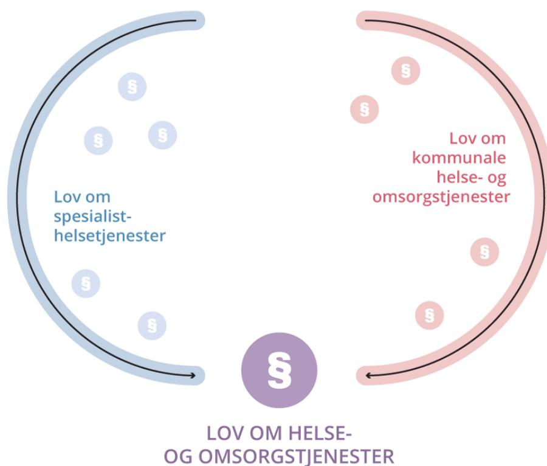

The diagram features two large, semi-circular arcs. The left arc is blue and contains the text "Lov om spesialist-helsetjenester" and five blue circles with a white "§" symbol. The right arc is pink and contains the text "Lov om kommunale helse- og omsorgstjenester" and five pink circles with a white "§" symbol. At the bottom center, there is a purple circle with a white "§" symbol. Below this is the text "LOV OM HELSE- OG OMSORGSTJENESTER".

Lov om  
spesialist-  
helsetjenester

Lov om  
kommunale  
helse- og  
omsorgstjenester

§

LOV OM HELSE-  
OG OMSORGSTJENESTER

Infographic: Conceptual diagram of the Law on Health and Care Services.

Figur 1.13 Utvalget foreslår at lov om kommunale helse- og omsorgstjenester m.m. og lov om spesialisthelsetjenesten m.m. samles i én felles lov om helse- og omsorgstjenester. Sammenstillingen til én lov tydeliggjør at det i dag er forskjeller mellom nivåene som ikke alltid er godt begrunnet.

Gjennomgangen av kravene som stilles til den kommunale helse- og omsorgstjenesten og spesialisthelsetjenesten i dagens to lover, har vist at ansvaret for forskning og utdanning av

helsepersonell er ulikt og at kravet om kliniske etikk-komiteer kun gjelder for spesialisthelsetjenesten. Utvalget anbefaler at kommunene, på samme måte som sykehusene, får ansvar for forskning og utdanning av helsepersonell, og at kommunene får krav om å ta del i, eventuelt opprette, kliniske etikk-komiteer.

#### **1.2.9 En årlig helse- og omsorgstjenestemelding til Stortinget**

Dagens styringssystem gir i begrenset grad Stortinget mulighet til å vurdere utviklingen i de samlede tjenestene. Staten har gjennom sitt eier- og styringsansvar tettere oppfølging av spesialisthelsetjenesten enn av den kommunale helse- og omsorgstjenesten. Kommunenes selvstyre innebærer samtidig at de to delene av helse- og omsorgstjenesten har separate styrings-, finansierings- og beslutningsprosesser.

Denne todelingen kan gjøre det vanskelig å vurdere sammenhengene mellom behov, kapasitet, ressursbruk, investeringer og prioriteringer på tvers av tjenestenivåene. Beslutninger på ett nivå kan få betydelige konsekvenser for oppgaveløsning og ressursbehov på det andre, uten at konsekvensene nødvendigvis er vurdert samlet.

Etter utvalgets vurdering er det derfor behov for en fast, årlig prosess som gir Stortinget et samlet grunnlag for å drøfte utviklingen i hele helse- og omsorgstjenesten. En årlig melding vil gi regjeringen og Stortinget en fast arena for å vurdere utviklingen i helse- og omsorgstjenestene samlet. Behandlingen bør bygge på felles analyse av behov, kapasitet, personell, ressursbruk og investeringer, og synliggjøre hvordan prioriteringer på det ene nivået påvirker det andre.

En slik ordning vil også styrke den nasjonale demokratiske legitimiteten og det politiske ansvaret for utviklingen av helse- og omsorgstjenestene. I dag kommer Stortinget ofte sent inn i beslutningsprosessene, særlig når det gjelder investeringer i spesialisthelsetjenesten, der Stortingets rolle i stor grad er begrenset til å vedta lånerammer. En årlig behandling kan gi Stortinget mulighet til å drøfte investeringer, kapasitetsutvikling, strukturendringer og prioriteringer på et tidligere tidspunkt og i en bredere helsepolitisk sammenheng. En mer helhetlig behandling vil også kunne bidra til at forslag fra Stortinget ses mer samlet. Det vil også gjøre det mulig for Stortinget å følge med på utviklingen av nærhelsetjenester, herunder vurdere og tilpasse investeringer i spesialisthelsetjenesten til behovene for nærhelsetjenester som drives i fellesskap mellom kommuner og helseforetak.

Den årlige behandlingen skal ikke gripe inn i det kommunale selvstyret. Formålet er å gi et samlet kunnskaps- og beslutningsgrunnlag og å synliggjøre gjensidige konsekvenser av prioriteringer og beslutninger på de to nivåene.

###### **NÅ:**

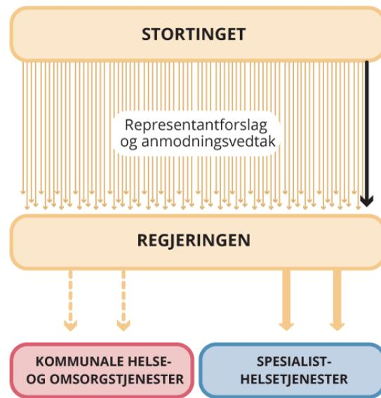

The diagram illustrates the flow of legislative and administrative decisions. At the top, **STORTINGET** (Parliament) is shown with numerous arrows pointing down to **REGJERINGEN** (Government). A central label indicates "Representantforslag og anmodningsvedtak" (Representative bills and requests). From **REGJERINGEN**, two dashed arrows point to **KOMMUNALE HELSE- OG OMSORGSTJENESTER** (Municipal health and care services), and two solid arrows point to **SPESIALIST- HELSETJENESTER** (Specialist health services).

```
graph TD; STORTINGET -->|Representantforslag og anmodningsvedtak| REGJERINGEN; REGJERINGEN -.-> KOMMUNALE[KOMMUNALE HELSE- OG OMSORGSTJENESTER]; REGJERINGEN -.-> KOMMUNALE; REGJERINGEN --> SPESIALIST[SPESIALIST- HELSETJENESTER]; REGJERINGEN --> SPESIALIST;
```

**STORTINGET**

Representantforslag og anmodningsvedtak

**REGJERINGEN**

**KOMMUNALE HELSE- OG OMSORGSTJENESTER**

**SPESIALIST- HELSETJENESTER**

Flowchart: Legislative and administrative flow from Stortinget to Regjeringen and health services.

##### **UTVALGETS FORSLAG:**

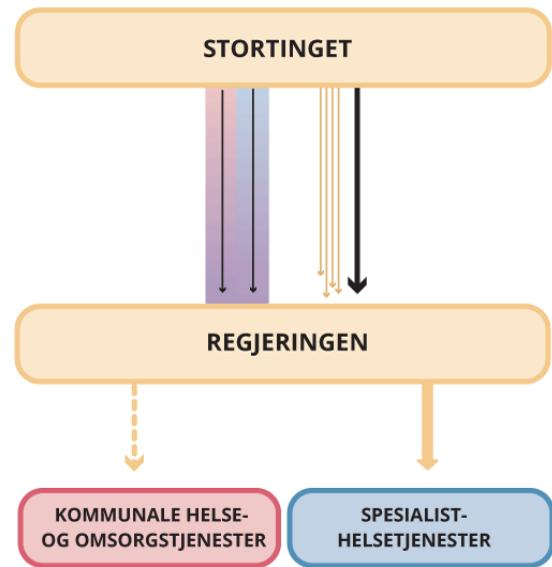

The diagram shows a hierarchy of three levels. At the top is a large orange box labeled "STORTINGET". Below it is a large orange box labeled "REGJERINGEN". At the bottom are two smaller boxes: a pink one on the left labeled "KOMMUNALE HELSE- OG OMSORGSTJENESTER" and a blue one on the right labeled "SPESIALIST- HELSETJENESTER". Arrows indicate the flow: from Stortinget to Regjeringen (with four arrows of different colors), from Regjeringen to the pink box (a dashed arrow), and from Regjeringen to the blue box (a solid arrow).

```
graph TD; STORTINGET --> REGJERINGEN; STORTINGET --> KOMMUNALE[KOMMUNALE HELSE- OG OMSORGSTJENESTER]; STORTINGET --> SPESIALIST[SPESIALIST- HELSETJENESTER]; REGJERINGEN -.-> KOMMUNALE; REGJERINGEN --> SPESIALIST;
```

**STORTINGET**

**REGJERINGEN**

**KOMMUNALE HELSE- OG OMSORGSTJENESTER**

**SPESIALIST- HELSETJENESTER**

Flowchart: Flow of authority or influence from Stortinget to Regjeringen and health services.

Figur 1.14 Utvalget foreslår at regjeringen sender en melding til Stortinget hver vår, som kan bidra til en helhetlig behandling av helse- og omsorgstjenestene.

#### 1.2.10 Små kommuner er for sårbare

Utvalget legger til grunn at den største veksten i behovet for helse- og omsorgstjenester fram mot 2050 vil komme blant pasientgrupper som i hovedsak skal motta tjenester nær der de bor. En større del av den framtidige ressursveksten bør derfor komme i de kommunale helse- og omsorgstjenestene og i desentraliserte helsetjenester som ytes i fellesskap av kommuner og spesialisthelsetjenesten.

Samtidig vil det bli mer krevende for kommunene å ivareta sørge-for-ansvaret framover. Utfordringene vil være særlig store for små kommuner med begrenset tilgang på personell og med små fagmiljøer. Betydningen av kommunestørrelse varierer mellom tjenesteområder, og geografiske forhold og bosettingsmønster har også betydning. Små fagmiljøer kan være særlig sårbare for rekrutteringsproblemer, personell som har fravær, variasjoner i etterspørselen og situasjoner som krever forhøyet beredskap.

Interkommunalt samarbeid vil fortsatt være nødvendig og hensiktsmessig på en rekke områder. Slike samarbeid kan gi kommunene tilgang til bredere fagmiljøer, og gjøre det mulig å løse oppgaver som den enkelte kommune ikke har tilstrekkelig kapasitet eller kompetanse til å ivareta. Samarbeidene kan samtidig ha svakheter ved styring, finansiering, demokratisk ansvar og langsiktige forpliktelser. Kommunenes adgang til å endre prioriteringer eller tre ut av samarbeid kan gjøre det vanskelig å etablere stabile løsninger for tjenester som krever varige investeringer og langsiktig oppbygging av kompetanse.

Det er utvalgets vurdering at interkommunalt samarbeid ikke alene vil løse de strukturelle utfordringene mange små kommuner vil møte. Når en vesentlig del av kommunens lovpålagte oppgaver må ivaretas gjennom mange og omfattende samarbeid, kan ansvaret bli fragmentert og

styringen lite oversiktlig. Utvalget mener derfor at små kommuner ikke vil ha tilstrekkelig kapasitet til å ivareta et helhetlig ansvar for helse- og omsorgstjenestene.

Tidligere vurderinger av hvor store kommunene trenger å være for å ivareta sine oppgaver, har antydet at det ofte er behov for minimum 15–20 000 innbyggere. Utvalget mener det ikke kan settes noe måltall for hvor mange innbyggere en kommune må ha for å kunne ivareta sitt ansvar for helse- og omsorgstjenester. Dette vil avhenge av en rekke forhold som geografi, sentralitet, økonomi, kompetanse, lokale forhold og behov.

Utvalget viser til anbefalingen om nærhelsetjenester og understreker at interkommunalt samarbeid og samarbeid med spesialisthelsetjenesten om nærhelsetjenester vil være nødvendig også for kommuner som er store i norsk sammenheng.

Utvalget har også vurdert om statlige myndigheter bør få hjemmel til å pålegge kommuner å inngå forpliktende samarbeid når tjenestene ikke er forsvarlige eller tilstrekkelig robuste. En slik ordning reiser prinsipielle og praktiske spørsmål, blant annet om forholdet til det kommunale selvstyret, vilkårene for statlig inngrep og ansvaret for å levere tjenester på vegne av en annen kommune. Utvalget mener at spørsmålet bør utredes nærmere, som en mulig sikkerhetsmekanisme ved alvorlig eller vedvarende svikt, men anbefaler ikke pålagt samarbeid som en generell og langsiktig løsning på kommunenes kapasitetsutfordringer.

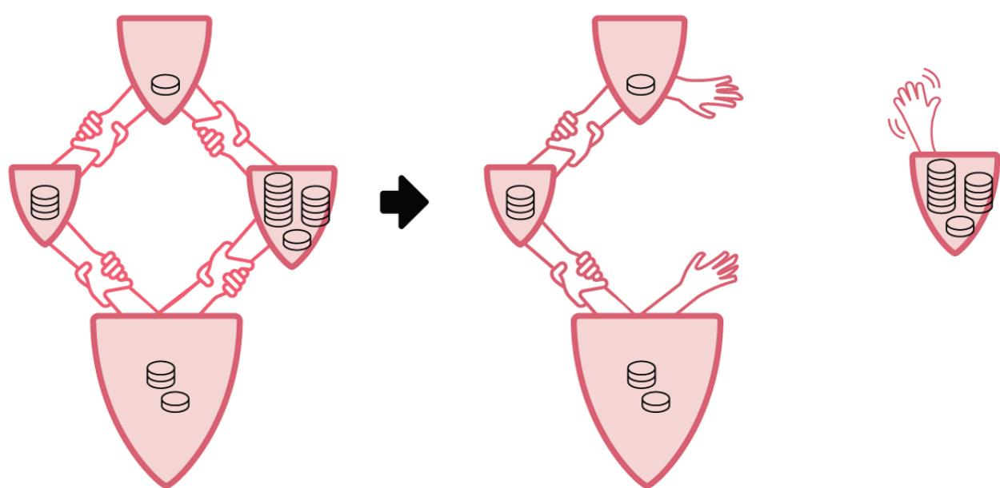

The diagram illustrates a process involving three shielded nodes. On the left, three pink shields are arranged in a triangle, each containing a stack of coins. Red hands are shown holding the shields together in a diamond shape. A black arrow points to the right, where the same three shields are shown with the same hands, but one hand is now raised. To the right of this, a separate shield is shown with a hand raised, and it contains a larger stack of coins.

The diagram shows a transition from a state where three shields are connected by hands to a state where one hand is raised, and a separate shield with a larger stack of coins is shown.

Infographic: Conceptual diagram of a network of shielded nodes with coins and hands.

Figur 1.15 Interkommunalt samarbeid kan kreve en viss størrelse for å fungere godt, og samarbeidet kan dermed bryte sammen dersom én kommune velger å trekke seg ut.

#### **1.2.11 Endringer i styringen av spesialisthelsetjenesten**

Selv om dagens helseforetaksmodell på mange måter har fungert godt, mener utvalget at styringen av spesialisthelsetjenestene kan forbedres. Det er uheldig at det kan stilles spørsmål ved

legitimiteten til de regionale helseforetakene som er satt til å gjøre krevende avveininger på fellesskapets vegne.

Utvalget anbefaler endringer som styrker den politiske styringen, tydeliggjør ansvarsforholdene og legger bedre til rette for samarbeid mellom tjenestenivåene. Utvalgets forslag om en årlig helse- og omsorgstjenestemelding til Stortinget vil også kunne gi en bredere demokratisk involvering og forankring.

For å styrke samhandlingen mellom kommuner og helseforetak anbefaler utvalget at det innføres en lovpålagt plikt til drøfting i de strategiske helseutvalgene før helseforetak eller kommuner treffer beslutninger i saker som har vesentlig betydning for tjenestetilbudet eller samfunnsmessige konsekvenser.

For å styrke den lokale og regionale forankringen anbefaler utvalget at de strategiske helseutvalgene kan foreslå kandidater til styret i helseforetakene, og at det utredes om administrerende direktør i helseforetakene bør ansettes på åremål.

Når det gjelder organiseringen av sørge-for-ansvaret og sykehusene, ser utvalget at det finnes flere mulige modeller som kan understøtte målene om gode, bærekraftige og sammenhengende tjenester. Utvalget har drøftet modeller som innebærer ulike avveininger mellom demokratisk styring, administrativ effektivitet, ansvarslinjer og behovet for regional tilpasning.

Et flertall av utvalgets medlemmer anbefaler at staten har sørge-for-ansvaret, mens helseforetakene yter tjenester og er egne rettssubjekter (forslag 1 i figur 1.16). Dette innebærer at de regionale helseforetakene avvikles og at eierskapet til helseforetakene legges til departementet. Flertallet legger vekt på utfordringene med den politiske legitimiteten i dagens modell og mener det er behov for tydeligere politiske ansvarslinjer. Antall helseforetak bør reduseres til 10–15. Flertallet viser til at de regionale helseforetakene har verdifull kompetanse, og anbefaler derfor en regional statlig tilstedeværelse, for eksempel gjennom regionale forvaltningsorganer underlagt departementet. Dette kan ivaretas ved overdragelse av de regionale helseforetakenes virksomhet til staten.

Et mindretall av utvalgets medlemmer anbefaler en modell der de regionale helseforetakene videreføres som egne rettssubjekter med sørge-for-ansvar for spesialisthelsetjenesten (forslag 2 i figur 1.16). Helseforetakene avvikles som egne rettssubjekter og styringsnivåer, og styrene for dagens helseforetak bortfaller. Sykehusene organiseres som resultatenheter under det regionale helseforetaket med stedlig ledelse og tydelige og vide fullmakter. De regionale helseforetakene beholder et samlet ansvar for drift, investeringer og langsiktig utvikling av tjenestetilbudet i regionen. Modellen skal suppleres med tydeligere nasjonal samordning på utvalgte områder og tiltak som styrker den lokal- og regionalpolitiske medvirkningen.

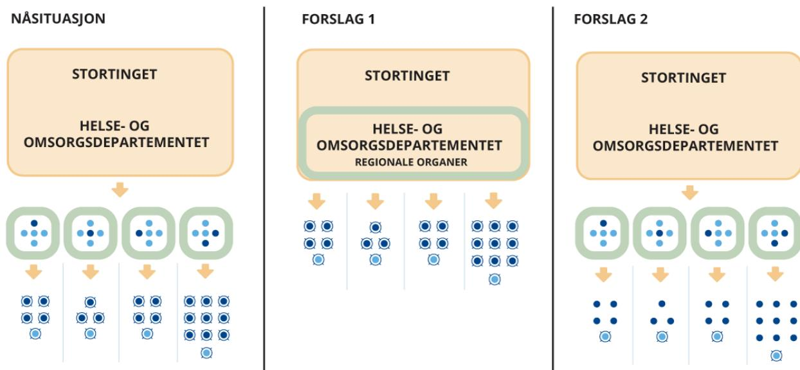

Figur 1.16 Nåsituasjonen med regionale helseforetak med sørge-for-ansvar og underliggende helseforetak. Flertallet foreslår (forslag 1) å legge ned de regionale helseforetakene og overføre ansvaret for spesialisthelsetjenesten til staten ved Helse- og omsorgsdepartementet. Helseforetakene videreføres med egne styrer. Mindretallet foreslår (forslag 2) å opprettholde de regionale helseforetakene, men ikke videreføre helseforetakene som egne rettssubjekter med styre.

#### 1.2.12 Finansieringsordninger som understøtter samhandling og riktig ressursbruk

Utvalget mener at finansieringsordningene må samkjøres mellom nivåene, og gi sterkere insentiver til samhandling. Sørge-for-ansvaret er fordelt på to nivåer, og de ulike nivåene og tjenestene har ulike finansieringssystemer. Resultatet er at hver aktør prioriterer innenfor sitt eget budsjett og sitt eget ansvar, med svake insentiver til å samhandle og ta hensyn til konsekvenser på andre aktørers områder. Etter utvalgets vurdering understøtter dagens finansieringsordninger i for liten grad målene om sammenhengende tjenester, god utnyttelse av knapp arbeidskraft og likeverdig tilgang til helse- og omsorgstjenester. Gevinster ved forebygging, samhandling og tjenesteutvikling kan tilfalle et annet nivå enn det som må bære kostnadene. Dette bidrar til at tiltak som er bra for pasienten og samfunnet, ikke blir gjennomført.

Utvalget legger til grunn at rammefinansiering fortsatt skal være bærebjelken i finansieringen av helse- og omsorgstjenesten. Samtidig mener utvalget at rammefinansiering bør suppleres med andre finansielle virkemidler.

I dag er det økonomiske insentiver til aktivitet i sykehusene, men få eller ingen økonomiske insentiver til aktivitet i den kommunale helse- og omsorgstjenesten. For å dempe de økonomiske insentivene til sykehusinnleggelse anbefaler utvalget at øyeblikkelig hjelp i sykehusene ikke lenger aktivitetsfinansieres. Sammen med forslaget om aktivitetsbasert statlig finansiering av døgnopphold i nærhelsetjenestene vil dette dempe insentivene til sykehusinnleggelser for pasienter som kan få et minst like godt tilbud utenfor sykehus.

For å sikre høy aktivitet innenfor prioriterte områder i sykehusene anbefaler utvalget at andelen innsatsstyrt finansiering av planlagt aktivitet økes noe.

Utvalget mener at statlig aktivitetsbasert finansiering av utvalgte helse- og omsorgstjenester i kommunene kan vurderes for å gi kommunene sterkere insentiver til å utvikle lokale tilbud. Etter utvalgets vurdering kan slike virkemidler bidra til at pasienter i større grad mottar tjenester på riktig omsorgsnivå, og at knapp kapasitet i spesialisthelsetjenesten forbeholdes de delene av pasientforløpet der spesialisthelsetjenester gir tilleggseffekt.

Utvalget mener at det bør prøves ut resultat- eller tilskuddsbaserte modeller basert på forbedring av ulike indikatorer for samhandling, for eksempel færre reinnleggelser, færre utskrivningsklare pasienter eller redusert behov for sykehusinnleggelser blant eldre pasienter.

Utvalget mener også at finansieringsordningene må stimulere til kompetansedeling mellom spesialisthelsetjenesten, allmennlegetjenesten og de øvrige kommunale helse- og omsorgstjenestene. Sæskilt finansiering av veiledning, arbeidsdager i kommunene og nærhelsetjenestene for personell fra spesialisthelsetjenesten kan, sammen med kompetanseoverføring, bidra til å bygge lokal kapasitet og gjøre det mulig å følge opp flere pasienter nær der de bor.

#### **1.2.13 Sammenhengen mellom drift og investering**

Kommunene og spesialisthelsetjenesten er avhengige av investeringer for å kunne drifte gode helse- og omsorgstjenester i framtiden. Både i kommunene og helseforetakene konkurrerer investeringer med personal- og driftskostnader.

Etter utvalgets vurdering er det behov for bedre mekanismer for samordning av investeringer mellom nivåene. Dette innebærer at større investeringsplaner i helseforetak og kommuner drøftes i de strategiske helseutvalgene, at framskrivinger og investeringsplaner utarbeides med felles forutsetninger og gjensidig henvisning til hverandre, og at investeringsplaner i kommuner og spesialisthelsetjenesten synliggjøres og diskuteres samlet i den foreslåtte helse- og omsorgstjenestemeldingen.

Utvalget mener særlig at kapasiteten i lokalsykehus og nærhelsesentre og andre tilbud som retter seg mot de samme pasientgruppene, bør vurderes i sammenheng. Formålet må være å sikre at investeringer i bygninger, teknologi og medisinsk-teknisk utstyr understøtter hensiktsmessig oppgavedeling mellom nivåene, god samhandling og best mulig utnyttelse av knapp arbeidskraft på tvers av helse- og omsorgstjenestene.

Et flertall i utvalget anbefaler å legge ned de regionale helseforetakene og overføre sørge-for-ansvaret for spesialisthelsetjenesten til statsforvaltningen. Ved en slik organisering er utvalget samstemt om at ansvaret for større investeringer ikke bør ligge i helseforetakene. Det betyr at helseforetakene får ansvar for drift og investeringer opp til et visst nivå, mens større investeringer håndteres under Helse- og omsorgsdepartementet, i statsbudsjettet og i den årlige helse- og omsorgstjenestemeldingen.

Et mindretall i utvalget foreslår en modell med regionale helseforetak med sørge-for-ansvar som i dag, men der de underliggende helseforetakene ikke lenger er selvstendige rettssubjekter med styrer. Mindretallet anbefaler at dagens modell med helhetlig ansvar for drift og investeringer

videreføres i en modell med regionalt sørge-for-ansvar. Økonomisk og finansiell risiko som ligger utenfor helseforetakenes kontroll, bør i større grad enn i dag legges til regionalt og statlig nivå som har bedre forutsetninger for å bære slik risiko. Utvalget mener det er behov for låneordninger som gir større forutsigbarhet og lavere finansiell risiko. Dette omfatter blant annet muligheten for rentebinding allerede når Stortinget vedtar lånerammen, og å erstatte deler av lånerammen med investeringstilskudd.

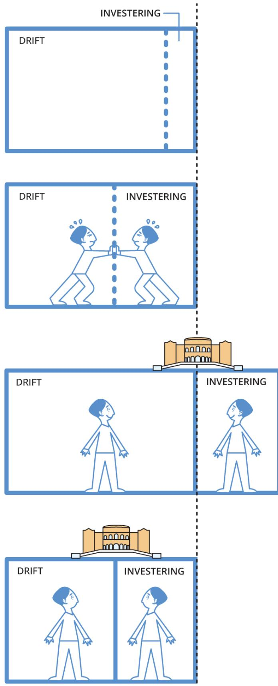

The diagram illustrates a process of drift and investing, separated by a vertical dashed line. It consists of four panels stacked vertically.

- Top Panel:** Labeled "DRIFT" on the left and "INVESTERING" on the right, separated by a dashed line.
- Second Panel:** Labeled "DRIFT" and "INVESTERING", showing two figures pulling on a rope at the dashed line.
- Third Panel:** Labeled "DRIFT" and "INVESTERING", showing two figures standing on either side of a building.
- Bottom Panel:** Labeled "DRIFT" and "INVESTERING", showing two figures standing on either side of a building.

The panels are separated by a vertical dashed line, and a building is depicted at the top of the third and fourth panels.

DRIFT INVESTERING

DRIFT INVESTERING

DRIFT INVESTERING

DRIFT INVESTERING

Infographic: Four-stage diagram of drift and investing behavior separated by a dashed line.

Figur 1.17 Samlet ansvar for drift og investering gir insentiver til helhetlig prioritering mellom god drift i dag og investeringer for god drift i framtiden. Behovet for prioritering

mellom drift og investering blir ikke borte selv om ansvaret for prioriteringen skulle splittes opp.

#### 1.2.14 Digitalisering

Utvalget anbefaler at innbyggerne skal finne samlet oversikt over egne helseopplysninger og avtaler i sanntid på Helsenorge. Utvalget mener at innbyggerne bør få tilgang til helsetjenester i form av digital førstelinje, og at det utvikles KI-løsninger for persontilpasset informasjon og rådgivning. Interaktive funksjoner kan gi mulighet for egenregistrering, dialog og oppfølging av egen helsetilstand over tid.

Utvalget støtter etablering av en nasjonal fullmakts- og reservasjonsordning der det skal være enkelt for pasienter og pårørende å regulere tilganger for seg selv og andre.

For å sikre likeverdighet må det være tilpassede tiltak og tjenester for innbyggere med redusert digital kompetanse og for pasienter og brukere som ikke er digitale.

Utvalget anbefaler at dagens plikt for helsevirksomhetene til å dele helseopplysninger mellom helsepersonell som ber om det for å yte helsehjelp, må spesifiseres til å gjelde digital deling i tilnærmet sanntid. Utvalget peker på at delingsplikten kan ivaretas gjennom en plikt til å bruke en nasjonal delingsplattform. Plattformen skal spesifiseres og driftes av en nasjonal virksomhet, som også får ansvaret for deling av data via plattformen.

I dag er det praktiske regler for sammenstilling av helseopplysninger for styringsformål innenfor én helsevirksomhet. For å legge bedre til rette for datadrevet styring av helse- og omsorgstjenester for pasienter som mottar tjenester fra flere virksomheter, for eksempel i nærhelsetjenestene, anbefaler utvalget en gjennomgang av hjemlene for å sammenstille helseopplysninger på tvers av virksomheter til styringsformål.

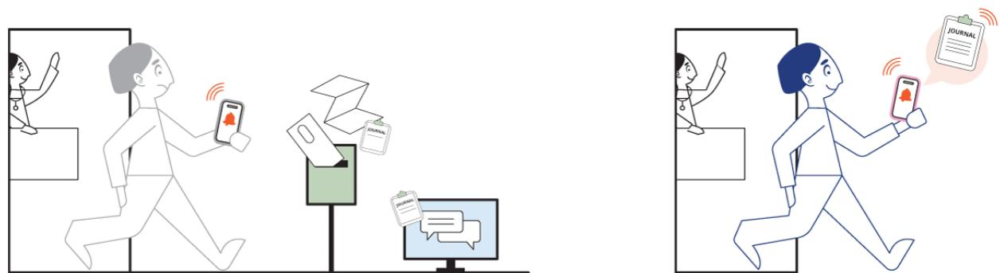

The illustration is divided into two panels. The left panel shows a person in a white shirt running away from a door, holding a phone with a red bell icon. A person is visible behind the door. A mailbox is in the foreground with a journal and a envelope. A computer monitor is on the floor with a journal and a speech bubble. The right panel shows the same person running towards the door, holding the phone with a red bell icon. A journal is floating above the phone. The person behind the door is still visible.

JOURNAL

JOURNAL

Illustration: Two-panel illustration of a person running with a phone and a journal.

**Figur 1.18 Innbyggerne skal finne samlet oversikt over egne helseopplysninger og avtaler i sanntid på Helsenorge.**

Utvalget mener at det er behov for sterkere nasjonal styring av digitaliseringsfeltet. Gjennomføringskraften kan styrkes ved at staten tar tydeligere styring og forplikter aktørene til et felles mål for digitalisering i helse- og omsorgssektoren. Utvalget anbefaler at Helse- og omsorgsdepartementet tydeliggjør mål og ansvars- og rolledelingen mellom Helsedirektoratet og Norsk helsenett SF.

Utvalget anbefaler at Helsedirektoratets rolle for etablering og implementering av en nasjonal strategi for digitalisering i helse- og omsorgssektoren styrkes. Dette inkluderer helsefaglige mål, normer og helsefaglige (semantiske) standarder som digitaliseringen skal bidra til å realisere. For at digitale løsninger skal kunne samvirke gjennom felles komponenter, åpne standarder og grensesnitt, er det avgjørende med obligatoriske og nasjonale standarder og retningslinjer.

Norsk helsenett SF kan gis en tydelig oppgave for å opprette, spesifisere og drifte en nasjonal plattform for deling av helseopplysninger innenfor og mellom helsevirksomheter i Norge, samt for deling til sekundærformål. Utvalget anbefaler at det etableres hjemmel i lov eller forskrift som tydelig plasserer dataansvaret for behandling av helseopplysninger som deles gjennom en slik plattform.

Utvalget anbefaler videre at det utredes om Norsk helsenett SF kan videreutvikles til et nasjonalt e-helseselskap – Digital Helse – der også andre relaterte funksjoner kan inngå.

Med sterkere nasjonal styring gjennom mer ansvar og sterkere virkemidler til Helsedirektoratet, anbefaler utvalget at det nasjonale strategirådet for digitalisering i helse- og omsorgssektoren avvikles. Helsedirektoratet må i stedet selv vurdere hvordan de etter vanlig forvaltningspraksis sikrer medvirkning og gode beslutninger.

Utvalget anbefaler at det etableres regionale IKT-virksomheter som tilbyr digitale tjenester og løsninger til kommunene og helseforetakene i regionen. Oppgaver for de regionale IKT-virksomhetene innbefatter å anskaffe, drifte og forvalte avtalte løsninger på vegne av helsevirksomhetene i regionen. IKT-virksomhetene kan inngå regionale rammeavtaler med ulike leverandører slik at helsevirksomhetene har mulighet til å velge mellom flere løsninger.

Utvalget anbefaler at omfanget av kommunenes og helseforetakenes tjenestekjøp og bruk av de regionale IKT-virksomhetene skal være frivillig og avtalebasert. For å fremme innovasjon er det viktig at helse- og omsorgsvirksomhetene fritt kan velge hvor de vil kjøpe tjenester og løsninger, så lenge disse oppfyller nasjonale standarder og krav til interoperabilitet. Det innebærer at de regionale IKT-virksomhetene må konkurrere på like vilkår med private leverandører.

Opprettelse av regionale IKT-virksomheter endrer ikke på helsevirksomhetenes ansvar for innføring av digitale løsninger, forsvarlig bruk og gevinstrealisering. God ledelse nært der tjenestene utøves er avgjørende for innovasjon, tjenesteutvikling og endring av arbeidsprosessene. Finansieringen av IKT-virksomhetene skal i all hovedsak komme gjennom betaling for tjenester fra helsevirksomhetene.


**MINE HELSEOPPLYSINGER**

eller

**DIGITAL TILGANG HELSE- OG OMSORGSTJENESTER**

**STERKERE NASJONAL STYRING**

**REGIONALE IKT-VIRKSOMHETER SOM TILBYR TJENESTER TIL HELSE- OG OMSORGSSEKTOREN**

**PRIVATE LEVERAN-DØRER KAN TILBY TJENESTER**

**NÆRHELSETJENESTE**

**SPESIALIST-HELSETJENESTE**

**KOMMUNE**

**FASTLEGE**

**DELING AV HELSEOPPLYSNINGER**

The diagram illustrates a hierarchy of healthcare information sharing. At the top, 'MINE HELSEOPPLYSINGER' (my health information) and 'DIGITAL TILGANG HELSE- OG OMSORGSTJENESTER' (digital access to healthcare and care services) are shown. Below this is a box for 'STERKERE NASJONAL STYRING' (stronger national governance). This is supported by 'REGIONALE IKT-VIRKSOMHETER SOM TILBYR TJENESTER TIL HELSE- OG OMSORGSSEKTOREN' (regional ICT entities providing services to the healthcare and care sector) and 'PRIVATE LEVERAN-DØRER KAN TILBY TJENESTER' (private providers can provide services). These two regional entities are connected to each other and to three types of service providers at the bottom: 'NÆRHELSETJENESTE' (primary care), 'SPESIALIST-HELSETJENESTE' (specialist healthcare), and 'FASTLEGE' (doctor). The entire structure is built on a foundation of 'DELING AV HELSEOPPLYSNINGER' (sharing of health information).

Infographic: Conceptual model of national and regional healthcare information sharing and delivery.

Figur 1.19 Bedre nasjonal styring og standardisering er nødvendig for å fremme digitaliseringen.

#### **1.2.15 Avtaler med private som understøtter pasientens valgfrihet**

Både i kommunene og i spesialisthelsetjenesten bør beslutninger om samarbeid med private virksomheter fortsatt tas av virksomheten med sørge-for-ansvaret, basert på en samlet vurdering av behovet, kompetansen og kapasiteten til de private virksomhetene og hensynet til effektiv ressursutnyttelse. Også dersom helseforetaksmodellen endres, bør avtaler med private leverandører inngås og forvaltes av det nivået som har sørge-for-ansvaret.

Utvalget mener at åpen konkurranse, der både kommersielle og ideelle tilbydere kan delta, bør være hovedregelen ved kjøp av tjenester fra private ved anbud. Adgangen til å reservere anskaffelser for ideelle tilbydere bør likevel beholdes og anvendes der samfunnsmessige hensyn tilsier slik reservasjon.

For at private leverandører av helsetjenester skal kunne tilby gode tjenester over tid, er de avhengige av tilstrekkelig forutsigbarhet til å kunne drive økonomisk bærekraftig. Dette gjelder

særlig private ideelle virksomheter. Private virksomheter med offentlig avtale kan i dag oppleve økonomisk usikkerhet når avtalt volum i rammeavtalen med regionalt helseforetak ikke oppnås, eller når mange kontrakter har kort varighet med lave volumer. Utvalget ser at avtaler med lang varighet kan gi redusert fleksibilitet for den virksomheten som har sørge-for-ansvaret, men mener likevel det bør vurderes om det i større grad enn i dag kan inngås mer langsiktige avtaler.

Utvalget vurderer at anskaffelsesreglene framstår komplekse og at det i seg selv kan favorisere egenregi.

For å velge behandling hos en privat tjenesteleverandør som har avtale med spesialisthelsetjenesten, må pasienten i dag først bli rettighetsvurdert i det offentlige. Når et helseforetak foretar rettighetsvurderingen og samtidig blir belastet med kostnadene dersom pasienten velger en privat tjenesteleverandør, kan foretaket ha insentiver til at pasienten velger behandling i foretaket. For å understøtte pasientens reelle valgfrihet, anbefaler utvalget at private tjenesteleverandører med offentlig avtale også blir bemyndiget til å rettighetsvurdere på linje med helseforetak. Det kan være et alternativ at alle rettighetsvurderingene bibeholdes i virksomheten med sørge-for-ansvaret. Regionale vurderingsenheter innen rehabilitering og rusbehandling videreføres.

#### **1.2.16 Bedre styringsinformasjon**

Pasienters valgfrihet er ikke reell dersom befolkningen ikke har tilgang til informasjon om hvordan de skal gå fram for å velge behandlingssted, om reelle ventetider, pasient- og brukeropplevelser og andre mål på kvalitet. Utvalget anbefaler at arbeidet med å tilgjengeliggjøre relevante indikatorer automatiseres og styrkes.

Utvalget har i sitt arbeid hatt tilgang på mye statistikk og analyse for spesialisthelsetjenestene, og en del for de kommunale helse- og omsorgstjenestene. Det er imidlertid svært begrenset med statistikk og analyser som følger pasientene mellom de to nivåene, eller som gjør det mulig å sammenligne utviklingen i tjenestene på tvers av de to nivåene. Uten slik kunnskap er det vanskelig å få til en samordnet utvikling av helse- og omsorgstjenestene.

Det er innført plikt for virksomheter som tilbyr privatfinansierte helse- og omsorgstjenester til å rapportere data til Folkehelseinstituttet (Norsk pasientregister (NPR) og Kommunalt pasient- og brukerregister (KPR)), men systemet er fremdeles ikke operativt. Uten et slikt system er det ikke mulig å fange opp en utvikling i retning av et todelt helsesystem.

Utvalget mener det også er behov for rutinemessige undersøkelser som kan gi nasjonale sammenlignbare tall for medarbeidertilfredshet mellom tjenestene og over tid. Slik informasjon er avgjørende for å kunne utvikle tjenestene på en måte som gjør at de offentlig finansierte tjenestene forblir helsepersonellets foretrukne arbeidssted.

## **2 Utvalgets mandat og arbeidsform**

Utvalg for en helhetlig og sammenhengende tjeneste (Helsereformutvalget) ble oppnevnt i statsråd 29. august 2025 for å vurdere hvordan helse- og omsorgstjenestene kan utvikles for å møte framtidige behov og utfordringer. Utvalgets arbeid tar utgangspunkt i mandatet, fastsatt av Helse-

og omsorgsdepartementet, som beskriver formålet med utvalget, de spørsmålene som skal utredes og rammene for arbeidet.

### **2.1 Helsereformutvalgets mandat**

Formål: Utvalget skal utrede og foreslå modeller for å sikre en sammenhengende og bærekraftig helse- og omsorgstjeneste i Norge.

Bakgrunn: Norge skal ha helse- og omsorgstjenester i verdensklasse, og vår felles helse- og omsorgstjeneste skal være førstevalget for både innbyggere og medarbeidere. For å lykkes med denne ambisjonen må vi ta innover oss viktige utviklingstrekk og erkjenne de store omstillingsbehovene i årene framover.

Befolkningen blir eldre, forventningene til tjenestene er i endring og vi har ikke ubegrenset tilgang til arbeidskraft. Ifølge Helsepersonellkommisjonen og Perspektivmeldingen vil vi få et stramt arbeidsmarked framover, og flere tiltak vil være nødvendig for å møte disse utfordringene. Pasient- og brukerforløpene blir mer kompliserte, og de går på tvers av fagområder og forvaltningsnivåer. Medisinsk og teknologisk utvikling gir nye muligheter. Samtidig kan ny teknologi være kostnadsdrivende. Personell, bygg og utstyr må utnyttes best mulig for å bidra til en bærekraftig velferdsstat, særlig i lys av at Perspektivmeldingen viser at statens utgifter vil overstige statens inntekter allerede tidlig på 2030-tallet. Dette understreker behovet for å fornye, forsterke og forbedre velferdsstaten.

Utvalget skal:

- Utrede og foreslå ulike modeller for framtidig organisering, styring og finansiering av en sammenhengende og integrert helse- og omsorgstjeneste i Norge
- Vurdere ansvars- og oppgavefordelingen mellom den kommunale og fylkeskommunale helse- og omsorgstjenesten og spesialisthelsetjenesten
- Vurdere hvordan samarbeid med private aktører kan organiseres på en hensiktsmessig måte for å sikre at vi fremdeles skal ha felles og likeverdige skattefinansierte helse- og omsorgstjenester i Norge
- Utarbeide et beslutningsgrunnlag og foreslå tiltak som understøtter:
  - a. høy kvalitet i helse- og omsorgstjenestene
  - b. likeverdige tjenester over hele landet
  - c. sammenhengende og helhetlige pasientforløp
  - d. effektiv oppgavefordeling og ressursbruk mellom de ulike delene av tjenestene
  - e. forsterket innsats for folkehelse og god forebygging
  - f. oppfyllelse av pasient- og brukerrettigheter
  - g. valgmuligheter, blant annet fritt sykehusvalg
  - h. pårørendes rolle
  - i. målet om å redusere sosial og geografisk ulikhet
  - j. at den offentlige helse- og omsorgstjenesten skal være fagfolkenes foretrukne arbeidssted
  - k. ny teknologi, KI og digitale løsninger, samt sikre riktig bruk av menneskelige og teknologiske ressurser
  - l. demokratisk styring av helse- og omsorgstjenesten

- m. god totalberedskap i hele landet
- Redegjøre for økonomiske, juridiske, administrative, personellmessige og samfunnsmessige konsekvenser av de ulike forslagene

Gjennomføring og leveranser: Utvalget skal følge utredningsinstruksen, herunder vurdere hvilke utfordringer sektoren står overfor, ulike mulige tiltak for å møte disse og konsekvenser av ulike tiltak.

Det legges til grunn at kommunene skal ha ansvar for omsorgstjenester og at staten skal ha ansvar for sykehusene og spesialisthelsetjenester, der egne rettssubjekter innehar sørge-for-ansvar, faglig autonomi samt selvstendig budsjett- og resultatansvar.

Utvalget bør også se hen til annet pågående utredningsarbeid samt tilsvarende arbeid og erfaringer fra land det er naturlig å sammenligne seg med. Utvalget har anledning til å hente inn ny kunnskap om det er behov for det.

Utvalget skal se hen til Kommunekommisjonens arbeid og henstilles til å ha løpende kontakt med partene og fagorganisasjonene.

Utvalget skal i sitt arbeid involvere de ansatte i helse- og omsorgstjenestene, pasienter, brukere og pårørende, kommuner og helseforetak, fageksperter og andre aktører rundt helse- og omsorgstjenestene. Utvalget skal også skape arenaer for en bred offentlig debatt.

Utvalget vil få eget sekretariat og det etableres en referansegruppe.

Utvalget skal levere sin utredning med anbefalinger innen 1. november 2026.

Tillegg i mandatet: I forbindelse med trontaledebatten (2025) fattet Stortinget følgende vedtak:

Stortinget ber regjeringen sørge for at minst én av modellene som utredes i forbindelse med ny helsereform innebærer å skille mellom drift og investering i sykehusene, og at Stortinget får seg forelagt utredningene med forslag til endringer.

I brev fra Helse- og somsorgsdepartementet, datert 6. november 2025, bes Helsereformutvalget følge oppe Stortingets vedtak innenfor rammen av utvalgets arbeid.

### **2.2 Utvalgets tolkning og avgrensing av mandatet**

Utvalget er gitt et omfattende og bredt mandat, blant annet å foreslå modeller for sammenhengende og bærekraftige helse- og omsorgstjenester i årene framover. Utvalget er enig i at samhandling mellom nivåene vil være en utfordring også i årene framover. Organisatorisk integrasjon kan være et virkemiddel for å legge til rette for bedre samhandling, og kan isolert sett trekke i retning av å samle sørge-for-ansvaret på ett nivå. Dette nivået vil kunne være plassert hos kommunene, i regioner eller hos staten. Samtidig presiserer mandatet at kommunene skal ha ansvar for omsorgstjenesten mens staten skal ha ansvar for spesialisthelsetjenesten. Mandatet kan derfor forstås slik at det utelukker samling på ett nivå. Utvalget mener at en sammenhengende og integrert tjeneste vil bli viktig i årene framover, og vurderer at det er vanskelig å utrede modeller for en sammenhengende og integrert helse- og omsorgstjeneste, uten å berøre modeller der sørge-for-ansvaret er samlet på ett nivå.

Utvalget viser videre til at det ikke er klare skiller mellom hva som anses å være helsetjenester, og hva som er omsorgstjenester. Disse tjenestene er i dag integrert. Mennesker med omfattende og sammensatte behov trenger en kombinasjon av medisinsk oppfølging, pleie, omsorg og praktisk bistand. Utvalget tolker mandatet dithen at det ikke gis anledning til å flytte hele ansvaret for tjenestene som følger av lov om kommunale helse- og omsorgstjenester m.m. (helse- og omsorgstjenesteloven) ut av kommunen. Det vil uansett være gråsoner mellom helse- og omsorgstjenester og kommunale tjenester som har stor betydning for innbyggernes helse, som folkehelse, sosiale tjenester, oppveksttjenester mv.

Mandatet presiserer videre at staten skal ha ansvar for sykehus og spesialisthelsetjenester, der egne rettssubjekter har sørge-for-ansvar, faglig autonomi og selvstendig budsjett- og resultatansvar. Mandatet presiserer ikke hva som skal ligge i dette statlige ansvaret. Staten vil uansett ha ansvar for lovgivning, budsjettvedtak og nasjonal planlegging, uavhengig av hvem som har sørge-for-ansvaret.

For å kunne vurdere målet om «en sammenhengende og integrert helse- og omsorgstjeneste i Norge», har utvalget gått inn i drøftinger av modeller der hele sørge-for-ansvaret er flyttet til nye folkevalgte eller kommunale organer. Utvalget har, av hensyn til helheten, også omtalt forvaltningsmodeller der sørge-for-ansvaret for spesialisthelsetjenestene ikke er lagt til egne rettssubjekter. Noen av modellene ligger derfor i grenseland for mandatets premisser om at kommunene skal ha ansvaret for omsorgstjenesten, og staten for spesialisthelsetjenesten.

Utvalget viser videre til at det er gitt et bredt og omfattende mandat. Flere av temaene er så omfattende at de kunne vært gjenstand for egne utredninger. Enkelte temaer eller fagområder som omtales i denne utredningen, er preget av manglende data. I lys av den fastsatte tidsrammen for arbeidet, har utvalget primært basert sine vurderinger på eksisterende materiale og analyser, samt egne vurderinger.

Utvalget er kjent med at det pågår et arbeid i Helse- og omsorgsdepartementet om organisering av tannhelsetjenesten. Utvalget har fått presentert Tannhelseutvalgets arbeid og slutter seg til Tannhelseutvalgets vurderinger av at det er nødvendig å utvikle en bærekraftig tannhelsetjeneste. Dette innebærer blant annet å harmonisere organiseringen av tannhelsetjenesten slik at den i større grad blir lik de øvrige helse- og omsorgstjenestene samt å utvikle et godt kunnskapsgrunnlag. Utvalget har ikke gått ytterligere inn i problematikken på området sett i lys av det pågående arbeidet, og kommer ikke med ytterligere anbefalinger.

Det er nedsatt et offentlig utvalg som skal utrede framtidens rus- og avhengighetsbehandling, med mål om å sikre kunnskapsbaserte tjenester. Utvalget skal levere sin innstilling i form av en offentlig utredning (NOU) innen desember 2026. Derfor beskrives ikke dette fagområdet spesielt i denne utredningen.

Utvalget har brukt kunstig intelligens (KI) til å finne og oppsummere kilder. Det er også brukt KI som støtte for arbeidet ellers, herunder for å utarbeide scenarioanalyser som grunnlag for utvalgets diskusjoner. Scenarioanalysen har vært et verktøy for å undersøke hvordan ulike styringsmodeller er rustet for å møte framtidens utfordringer. Hovedspørsmålet som scenarioanalysen har søkt å besvare, er hvordan man kan sikre sammenhengende tjenester, bærekraftig personellbruk og teknologisk drivkraft innenfor akseptable omstillingskostnader. Henrik Thorstensen Barstad har

bistått med å lage scenarioanalysene. Analysene er publisert på utvalgets nettside:  
<https://nettsteder.regjeringen.no/helsereformutvalget/>

Medlemmene i utvalget har hatt ulike syn på enkelte områder i utredningen. På noen områder framgår uenighetene i teksten, men det er også områder der det har vært ulike syn uten at medlemmene har hatt behov for å markere det. Selv om det er ulike syn på enkeltheter, stiller utvalget seg bak helheten i utredningen.

### **2.3 Helsereformutvalgets sammensetning**

Helsereformutvalget er sammensatt av medlemmer med erfaring både fra den kommunale helse- og omsorgstjenesten og spesialisthelsetjenesten, medlemmer med kompetanse innen forvaltning, samfunnsøkonomi, jus, teknologi og omstilling samt pasient- og brukerperspektivet.

Helsereformutvalget har bestått av tolv medlemmer:

- rådgiver/professor Gunnar Bovim (utvalgsleder)
- leder/partner Somayeh Sadat Bach
- administrerende direktør Øyvind Bakke
- ordfører Jonny Finstad
- daglig leder Lars Erik Flatø
- fagsjef og professor Edith Lillian Roth Gjevjon
- avdelingsdirektør Marit Hermansen
- klinikksjef Kjetil Andreas Hognestad Karlsen
- professor Oddvar Martin Kaarbøe
- regiondirektør Silje Naustvik
- pensjonist Kari Sønderland
- fagsjef Tone Poulsson Torgersen

### **2.4 Utvalgets arbeid**

Utvalget har i tråd med mandatet sett hen til pågående utredningsarbeid, herunder Kommunekommisjonen, Rusbehandlingsutvalget, Pasient- og brukerrettighetslovutvalget og Innovasjons- og samskapingsutvalget. Det har også vært dialog mellom sekretariatene eller lederne for Helsereformutvalget og Ekspertutvalg for samiske spesialisthelsetjenester, Ekspertutvalg om brukerstyrt personlig assistanse (BPA) og Innvandrerrhelseutvalget. Utvalget har sett hen til arbeid og erfaringer fra land det er naturlig å sammenligne seg med. Utvalget har innhentet innspill fra partene i arbeidslivet, fagorganisasjonene og pasient- og brukerorganisasjonene. Under er en oversikt over aktørene som utvalget har møtt, og hvordan utvalget har skapt arenaer for offentlig debatt.

#### **2.4.1 Utvalgsmøter**

Helsereformutvalget har gjennomført tolv møter, hvorav ett ble gjennomført som videokonferanse. Flere av møtene er gjennomført over to dager og ett møte over tre dager.

2. september 2025. Møtet var digitalt og ble brukt til å introdusere Helsereformutvalgets medlemmer og til en innledende refleksjon om mandatet. Helse- og omsorgsminister Jan Christian Vestre presenterte mandatet og sine forventninger til utvalget i eget digitalt møte.

29.–30. september 2025. Utvalget fikk kunnskap om kommunenes utfordringsbilde gjennom innlegg fra Kommunekommisjonens leder Eivind Dale. De hørte om erfaringer fra Samhandlingsarena Kongsberg ved Heidi Eidskrem (Kongsberg kommune) og Lukas Månsson (Vestre Viken HF) og En vei inn i Vestfold ved Tore Lyse (Sandefjord kommune) og Mette Camilla Moen (DPS Vestfold). Jesper Fisker, leder i den danske Sundhedsstrukturkommissonen, presenterte kommisjonens arbeid. Utvalget diskuterte også behovet for utredninger og arbeidsplanen framover.

15. oktober 2025. Utvalget fikk mer kunnskap om utfordringene ved det norske helsesystemet, blant annet ved Terje P. Hagen fra Universitetet i Oslo. Prosjekter om integrerte helsetjenester i Østfold og Akershus universitetssykehus HF og omkringliggende kommuner ble presentert av Karianne Jenseg Bergman (Sarpsborg kommune), Lise Wangberg Storhaug og Denisa Velic (Sykehuset Østfold HF), Jørn Limi (Akershus universitetssykehus HF), Kjersti Vevstad (Nordre Follo kommune) og Annbjørg Laache (Ullensaker kommune). Utvalget diskuterte aktørbildet innen IKT og digitalisering, utviklingstrekk og behovet for å bestille utredninger. Leder for referansegruppen Lilly Ann Elvestad innledet om plan for arbeidet i referansegruppen.

26. november 2025. Utvalget fikk mer kunnskap om utfordringer innen digitalisering, presentert av Lucie Aunan (Helsedirektoratet) og Johan Ronæs (Norsk helsenett). Eirik Abildsnes (Kristiansand kommune) og Susanne Sørensen (Sørlandet sykehus HF) orienterte om prosjektet Eldre i Agder. Lilly Ann Elvestad la fram utfordringsbildet fra referansegruppens ståsted.

5.–6. januar 2026. Tom Cato Karlsen (statsforvalter i Nordland) orienterte om Generalistkommuneutvalget. Utvalget fikk mer kunnskap om helse- og omsorgstjenestene i Sverige og Finland, presentert av Jean-Luc af Geijerstam og Liina-Kaisa Tynkkynen. Ragnhild Hellesø innledet om samhandlingsperspektiver i den komplekse helsetjenesten. Marius Kurås Skram og Torkil Clementsen (Helsedirektoratet) informerte om direktoratets rolle, oppgaver og vurdering av helsefellesskapene. Temaet psykisk helsevern ble belyst av leder av ekspertutvalget psykisk helse Benedicte Thorsen-Dahl (Sykehuset Innlandet HF), Elisabeth Høyland (Sandnes kommune) og av Jin Marte Øvreeide og Torhild Torjussen Hovdal (Helsedirektoratet). Lilly Ann Elvestad la fram referansegruppens tilbakemeldinger om rammeverk. Utvalget diskuterte prinsipielle modeller for organisering av tjenestene.

3.–4. februar 2026. Leder av Kommunekommisjonen Eivind Dale presenterte kommisjonens første rapport i møtet, som ble holdt i Bodø. Lilly Ann Elvestad la fram referansegruppens tilbakemeldinger om ulike modeller. Helsefellesskapet Lofoten, Vesterålen og Salten ble presentert av Beate Sørslett (Nordlandssykehuset HF) og Stein Ole Bauer-Rørvik (Saltdal kommune). Helsefellesskapet Helgeland ble presentert av Lena Nielsen (Helgelandssykehuset HF) og Rachel Berg (Alstahaug kommune). Utvalget fikk presentert prosjektet LofotENhelsetjeneste ved Beate Sørslett (Nordlandssykehuset HF), Heidi Vik (Vestvågøy kommune) og Siw Skaar (Moskenes kommune). Helse Nord RHF og kommunene Tromsø, Bodø, Narvik, Harstad, Alta og Rana presenterte utfordringsbildet og mulige organisatoriske løsninger sett fra de største bykommunene i

nord. Utvalget diskuterte fordeler og ulemper ved modeller for framtidig organisering og hvilke modeller utvalget skulle gå videre med.

24.–25. mars 2026. Tor Iversen (Universitetet i Oslo) innledet om allmennleger i andre land og om evalueringen av forsøkene med primærhelseteam. Maren Skaset (Helse- og omsorgsdepartementet) orienterte om stortingsmeldingen om allmennlegetjenesten og de akuttmedisinske tjenestene utenfor sykehus, Aleksander Notto Sandnes (Sørlandsparken legesenter) orienterte om erfaringer med primærhelseteam i Kristiansand, og Trond Morten Trondsen (SiO Helse) orienterte om senterorganisering av allmennlegetjenester og bruk av kunstig intelligens ved Studentsamskipnaden i Oslo (SiO). Linn Getz (Norges teknisk-naturvitenskapelige universitet (NTNU)) innledet om fastlegens rolle for de fem prosentene av pasientene som opptar en stor del av ressursene. Steinar Hunskår (Universitetet i Bergen) holdt innlegg om kontinuitet i lege-pasient-relasjonen og fastlegens portvaktrolle og Johan Håkon Bjørngaard (NTNU) om kontinuitet i lege-pasient-relasjonen og betydningen av volum for kvalitet. Jan-Eilert Pedersen (Notodden kommune) innledet om avansert klinisk allmennsykepleiers rolle i tverrfaglige allmennmedisinske tjenester. Lilly Ann Elvestad la fram referansegruppens tilbakemeldinger om psykisk helsevern, rusomsorg og rehabilitering. Utvalget gjennomgikk tekstutkast og diskuterte modeller med delt sørge-for-ansvar. Utvalget fikk presentert scenariometode som verktøy for å understøtte utvalget med å vurdere hvordan alternative organisasjonsmodeller fungerer under ulike framtidige utfordringer.

27.–28. april 2026. Utvalget besøkte Valdres lokalmedisinske senter og fikk omvisning av Anita Rødningen Svenstad. Utvalget diskuterte samhandlingsarenaer og tjenester som kan inngå i samhandlingsarenaer. Lilly Ann Elvestad presenterte referansegruppens innspill om samhandling innen dagens delte sørge-for-ansvar.

18.–19. mai 2026. Pasient- og brukerrettighetslovutvalgets leder Karl Harald Søvig orienterte om arbeidet. Utvalget diskuterte utfordringene ved foretaksmodellen samt drift og investeringer. Helsefellesskapene, samhandling, digitalisering, de privates rolle og enkelttjenester var også tema. Utvalget diskuterte også utfordringsbildet, scenarioanalyse og lovarbeid.

8.–10. juni 2026. Helse- og omsorgsminister Jan Christian Vestre deltok. Lilly Ann Elvestad orienterte om møtet med referansegruppen. Utvalget diskuterte forslag til modeller og tiltak samt fordeler og ulemper ved disse, gikk gjennom utkast til kapitler og diskuterte anbefalinger. Utvalget brukte blant annet scenarioanalyser som grunnlag for diskusjonene om modeller.

20.–21. august 2026. Utvalget gjennomgikk anbefalinger om tiltak. Utvalget diskuterte også sammendraget og scenarioanalyse.

23.–24. september 2026. Utvalget gjennomgikk sammendraget og anbefalinger om tiltak. Utvalget fikk presentert funn fra scenarioanalysen av framtidens styringsmodeller for helse- og omsorgstjenesten.

I tillegg til de ordinære utvalgsmøtene er det gjennomført én times teams-møter annenhver uke, og fra våren 2026 ukentlige møter. Utvalgsmedlemmer og sekretariatet har innledet på disse møtene. Følgende eksterne innledere har holdt innlegg:

- Kjell Erik Ullman Øie om Innovasjons- og samskapingsutvalgets arbeid
- Evy Anni Evensen om Tannhelseutvalgets arbeid
- Jon Magnussen om Sykehusutvalgets arbeid og helseforetaksmodellen

- Håkon Kolden fra Lillehammer kommune og Roy Otterholt Bekkeseth fra Sykehuset Innlandet HF om prosjektet Bo trygt hjemme
- Birger Norderud Lærum fra Voss sykehus og Torstein Kvåle Hellesnes fra Ulvik herad kommune om prosjektet sømløse tjenester i Voss sykehusområde
- Tor Saglie og Kåre Hagen om helsefellesskapene
- De administrerende direktørene ved de regionale helseforetakene om utfordringer og hensyn ved organisering framover: Inger Cathrine Bryne (Helse Vest RHF), Marit Lind (Helse Nord RHF), Terje Rootwelt (Helse Sør-Øst RHF), Jan Frich (Helse Midt-Norge RHF)
- Mari Trommald (KS) om hva som bør bevares og hva som kan endres i dagens organisering
- Riksrevisjonen om undersøkelsen samhandling for et bærekraftig helsevesen
- Doug Eby om helsetenester i Alaska (NUKA-modellen)
- Arve Varden om Helse Førde HF
- Guri Spilhaug om Rusbehandlingsutvalget

Deler av Helsereformutvalget og sekretariatet har besøkt Skottland og England for å få mer informasjon fra helsemyndighetene om hvilke utfordringer helsetjenesten står overfor, arbeidet med integrerte helsetjenester, utviklingen av primærhelsetjenesten, digitalisering og arbeid med helsereformer i disse landene.

Helsereformutvalgets medlemmer har innledet og deltatt på en rekke møter blant annet med KS, kommunedirektørforum, Spekter, Norsk Sykepleierforbund, Den norske legeforening, Den norske tannlegeforening, Norges teknisk-vitenskapelige universitet (NTNU), Næringslivets hovedorganisasjon, Oslo Science City, Helse- og omsorgsdepartementets kontaktforum for brukere, flere helsefellesskap, pasient- og pårørendeorganisasjoner, statsforvaltere, kommuner, regionale helseforetak, helseforetak og styrer mv. Listen er ikke uttømmende.

Utvalget har arrangert innspillmøte med Virke, Spekter, NHO Geneo om private aktørers rolle. Det har også vært innspillmøte med arbeidsgiver- og arbeidstakerorganisasjonene og pasient- og brukerorganisasjonene. Det har vært møte med Sametinget for å få innspill til utvalgets arbeid.

Mange aktører har gitt skriftlige innspill til utvalgets arbeid. Disse er publisert på Helsereformutvalgets nettside: <https://nettsider.regjeringen.no/helsereformutvalget/>

#### **2.4.2 Referansegruppen**

Helse- og omsorgsdepartementet har, i tråd med mandatet, etablert en referansegruppe for Helsereformutvalget. Gruppen har også vært referansegruppe for Pasient- og brukerrettighetslovutvalget og hatt en rådgivende funksjon i Helsereformutvalgets arbeid. Oppgaven har vært å drøfte konkrete problemstillinger som er blitt presentert for gruppen, bidra til å få fram tilnærminger og synspunkter fra interessegrupper, gi konkrete innspill til utvalgets arbeid samt å delta i den offentlige debatten. Referansegruppen har fortløpende levert presentasjoner til utvalget. Utvalgsleder og sekretariatet har regelmessig deltatt på referansegruppens møter. Referansegruppen har kommet med sine samlede innspill til utvalget (boks 2.1). Utvalget er ikke uenig i disse innspillene og har forsøkt å belyse dem i rapporten.

Følgende personer ble oppnevnt til referansegruppen:

- Lilly Ann Elvestad (leder av referansegruppe, Funksjonshemmedes Fellesorganisasjon (FFO)
- Robin Kirkenes Andreassen, Pårørendealliansen Ung
- Gøril Bjerkan, Landsorganisasjonen Norge (LO)
- Jannicke Bruvik, Pasient- og brukerombudet
- Berit Brørby, Rådet for et aldersvennlig Norge
- Reidar Holst Christensen, NHO Geneo
- Tord Dale, Virke
- Orkidee Farzehsaeid, Ungdomsråd
- Magne Wang Fredriksen, NCD-alliansen
- Madli Indseth, Kommunesektorens organisasjon (KS)
- Lill Sverresdatter Larsen, Hovedorganisasjonen for universitets- og høyskoleutdannede (Unio)/Norsk Sykepleierforbund
- Kaja Marienborg, Norges Ingeniør- og teknologiorganisasjon (NITO)
- Anne-Karin Rime, Akademikerne/Den norske legeforening
- Haakon Steen, Helsedirektoratets brukerråd for rus og psykisk helse (Brukerrop)
- Lizzie Ruud Thorkildsen, Yrkesorganisasjonenes Sentralforbund (YS)
- Nora Thunem, Unge funksjonshemmede
- Anita Vatland, Pårørendealliansen
- Trine Wigtil, Samarbeidsforumet av funksjonshemmedes organisasjoner (SAFO)
- Anne Turid Wikdahl, Spekter

##### **Boks 2.1 Referansegruppens samlede innspill til utvalget**

Referansegruppens medlemmer har hatt ulike perspektiver på utfordringsbildet og endringsbehov som er forankret i hvilke interessentgrupper de representerer. Det har vært formidlet til utvalget, noe også utvalget har etterspurt.

Samtidig har referansegruppen etter sitt siste møte med Helsereformutvalgets leder funnet grunnlag for å stå samlet om seks innspill/forventninger til utvalgets anbefalinger. Disse er:

1. Pasienten og pårørende kan ikke selv være systemets koordinator. Noen må til enhver tid ha et tydelig ansvar for pasientene som trenger flere tjenester samtidig.
2. Utvalget må løfte enkelte grupper der dagens todeling fungerer dårligst: skrøpelige eldre, personer med psykisk helse- og rusproblematikk, kronisk syke, rehabiliteringspasienter og barn med sammensatte behov. Her må det foreslås særskilte løsninger.
3. Flytting av oppgaver må sees i sammenheng med kompetanse, kapasitet, finansiering, samt tilgjengelig diagnostikk og teknologi.
4. Det er behov for at medisinsk utstyr og teknologi tas i bruk på en hensiktsmessig måte og at tjenestene lettere kan settes i stand til å ta nye løsninger i bruk.
5. Kommunenes plikter og ressurser må henge sammen. Mangel på kapasitet i den samlede helsetjenesten må adresseres, og det er viktig at manglende kapasitet ikke forveksles med manglende muligheter for samhandling.

6. Enhver modell må være mulig å bemanne, og det må være mulig å sikre nødvendig kompetanse og å beholde personellet.

###### **Rammeslutt**

#### **2.4.3 Dialog med eksterne og offentligheten**

Helsereformutvalget arrangerte 4. desember 2025 et åpent seminar om utfordringsbildet for helse- og omsorgstjenestene i årene framover. Rundt 200 deltakere var til stede på Litteraturhuset i Oslo, både enkeltpersoner og organisasjoner. Seminaret kunne også følges på nett. Hensikten var å presentere utvalgets foreløpige forståelse av utfordringene for helse- og omsorgstjenestene framover, referansegruppens forståelse av utfordringene og å få ytterligere innspill til utfordringsbildet.

Helsereformutvalget arrangerte 3. februar 2026 et åpent seminar på Stormen Konserthus i Bodø om hvordan framtidens helse- og omsorgstjenester kan organiseres bedre. Rundt 100 personer deltok. Seminaret kunne også følges på nett. Hensikten var å presentere utvalgets foreløpige vurderinger om mulige modeller, få innspill om særskilte utfordringer i distriktene og å belyse beredskapsperspektivet.

#### **2.4.4 Utredninger fra eksterne**

Helsereformutvalget har bestilt utredninger fra eksterne. Folkehelseinstituttet har utarbeidet et kunnskapsgrunnlag om hvilke pasienter som bruker mye helsetjenester og hvordan pasientflyten ser ut, og beskrevet geografisk variasjon i kommunale helse- og omsorgstjenester.

Helsedirektoratet fikk i oppdrag å gi en status for og vurdering av helsefellesskapene og en vurdering av hvilket utviklingspotensial helsefellesskapene kan ha framover, samt å bistå med utarbeiding av kart. Statistisk sentralbyrå har levert statistikk for helse- og omsorgstjenestene, sysselsetting, årsverk, sykefravær og inntekt. Helse Sør-Øst RHF har utarbeidet framskrivinger av totale kostnader. Kåre Hagen og Tor Saglie har bidratt med statsvitenskapelig kompetanse til utredningen. Utredningene er publisert på utvalgets nettsider.

# *Del I*

## *Dagens helse- og omsorgstjenester*

## **3 Helse- og omsorgstjenesten i Norge**

### **3.1 Innledning**

Kapittelet gir en oversikt over hvordan helse- og omsorgstjenestene er organisert, styrt og finansiert. Framstillingen tar utgangspunkt i innbyggerens rolle som pasient og bruker og beskriver grunnleggende prinsipper for norsk forvaltning, der ansvar er delt mellom kommunene og staten.

Dagens løsninger for digitalisering og tilgang på styringsinformasjon omtales også. Videre beskrives verdier og prioriteringer i helse- og omsorgstjenesten og sentrale reformer.

Kommunene har sørge-for-ansvaret for kommunale helse- og omsorgstjenester, mens staten har sørge-for-ansvaret for spesialisthelsetjenesten gjennom de regionale helseforetakene. Ansvaret innebærer å sørge for at befolkningen får nødvendige tjenester.

Organiseringen av tjenestene omfatter også samarbeidsstrukturer som helsefellesskapene. Tjenestene leveres i et samspill mellom offentlige, private og frivillige aktører samt pårørende.

### **3.2 Innbygger, pasient og bruker**

Alle innbyggere bor i en kommune og er brukere av kommunale tjenester. De kommunale oppgavene er mangfoldige og dekker et bredt spekter av tjenester, tilpasset lokale forhold og behov. Tjenestene følger livsløpet fra fødsel til død, som jordmor- og helsestasjonstjenester, barnevern, barnehage, skole og eldreomsorg. Renovasjon, brannvesen, beredskap, samfunnsutvikling og planmyndigheter angår innbyggernes hverdag og sikkerhet. Kommunene styres av lokale folkevalgte som representerer innbyggerne og prioriterer på vegne av dem. De folkevalgte har det overordnede ansvaret for tjenestene som kommunene tilbyr. Et helsefremmende nærmiljø, gode lokalsamfunn, kultur- og fritidstilbud, barnehager, skoler og arbeidsplasser er viktig for folkehelsen. Personene i nærmiljøet utgjør en ressurs som kan bety mye for den enkeltes livskvalitet og evne til mestring.

Helse- og omsorgstjenestene i kommunene er vanligvis pasienters og brukeres første kontakt med tjenestene, og de fleste får den hjelpen de har behov for der. Av konsultasjonene fastlegen har, er det nesten 90 prosent som løses i kommunen (Ringberg mfl., 2013). Kommunen har sørge-for-ansvaret for at personer som oppholder seg i kommunen tilbys nødvendige helse- og omsorgstjenester. Mange pasienter har få og enkle konsultasjoner hos fastlegen. En del pasienter vil ha forløp som er komplekse og sammensatte, og som forutsetter bidrag både fra den kommunale helse- og omsorgstjenesten og spesialisthelsetjenesten. Det er over tid innført en rekke koordineringsordninger både i den kommunale helse- og omsorgstjenesten og i spesialisthelsetjenesten. Ved planlagt behandling på sykehus er pasienten normalt henvist fra kommunens helse- og omsorgstjeneste. Pasienter som har behov for øyeblikkelig hjelp på sykehus, trenger ingen henvisning.

Pasient- og brukerrettighetsloven regulerer når pasienten eller brukeren har rett til helse- og omsorgstjenester fra det offentlige. Lovens formål er å sikre befolkningen likeverdig tilgang til tjenester av god kvalitet ved å gi pasienter og brukere rettigheter overfor helse- og omsorgstjenesten.

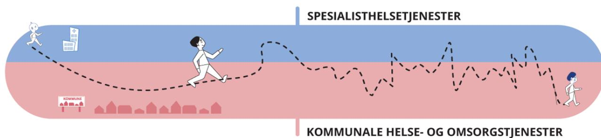

**SPESIALISTHELSETJENESTER**

**KOMMUNALE HELSE- OG OMSORGSTJENESTER**

The diagram shows a horizontal bar divided into two sections: a blue top section for 'SPESIALISTHELSETJENESTER' and a red bottom section for 'KOMMUNALE HELSE- OG OMSORGSTJENESTER'. A dashed line with a wavy pattern starts at a person running in the blue section, goes down into the red section, and ends at another person running in the red section. A building is labeled 'KOMMUNE' in the red section.

Infographic: Conceptual diagram of healthcare services divided into specialist and municipal levels.

Figur 3.1 Noen pasientgrupper har behov for helse- og omsorgstjenester fra både kommunen og spesialisthelsetjenesten, særlig eldre.

###### **Boks 3.1 Rett til valg av behandlingssted i spesialisthelsetjenesten**

Fritt sykehusvalg ble innført med pasientrettighetsloven i 2001. Retten som i dag følger av pasient- og brukerrettighetsloven § 2-4, innebærer at pasienter kan velge hvor henvisningen skal vurderes, og for pasienter med rett til nødvendig helsehjelp, hvor helsehjelpen skal ytes. Pasienten kan velge mellom offentlige behandlingssteder og private behandlingssteder som har avtale med et regionalt helseforetak. Retten gjelder behandlingssted, men ikke valg av behandlingsnivå. Pasient- og brukerombudet har pekt på at det kan være misforståelser og manglende kunnskap om rettigheten blant involverte aktører.

I 2015 ble valgretten utvidet gjennom godkjenningsordningen i fritt behandlingsvalg. Ordningen innebar at pasientene i tillegg kunne velge private leverandører som var godkjent av Helfo for å levere nærmere bestemte spesialisthelsetjenester mot betaling fra staten, uten avtale med et regionalt helseforetak. Formålet var å redusere ventetidene, øke pasientenes valgfrihet og stimulere de offentlige sykehusene til økt effektivitet. Evalueringen av ordningen fant at den i liten grad bidro til å redusere ventetidene eller gjøre de offentlige sykehusene mer effektive (Kaarbøe mfl., 2021). Godkjenningsordningen ble avviklet fra 1. januar 2023. Pasientenes rett til valg av behandlingssted omfatter offentlige behandlingssteder og private behandlingssteder som har avtale med et regionalt helseforetak.

Regjeringen jobber med å videreutvikle og gjøre retten enklere å bruke i praksis. Pasienter skal gjennom løsningen «Mitt sykehusvalg» enklere kunne velge behandlingsted. Pasienter skal også få direkte tildeling av time og de skal enkelt kunne endre oppsatt time.

###### **Rammeslutt**

### **3.3 Prinsipper for norsk forvaltning**

#### **3.3.1 Kommunene – lokalt selvstyre**

Kommunen er eget forvaltningsnivå og rettssubjekt og kjennetegnes av at den er avgrenset geografisk, har en egen folkevalgt ledelse og en betydelig grad av valgfrihet og selvstyre, jf. kommuneloven § 2-1.

Det kommunale selvstyret (Grunnloven § 49 andre ledd) innebærer blant annet at kommunene kan ta avgjørelser på eget initiativ og ansvar. Dersom staten ønsker begrensninger i selvstyret eller å pålegge kommunene bestemte måter å utføre oppgaven på, må dette gjøres gjennom lov eller forskrift med hjemmel i lov. Staten har ingen alminnelig instruksjonsrett overfor kommuner og fylkeskommuner, slik den har i forvaltningen for øvrig. Det kommunale selvstyret innebærer at nasjonale myndigheter må bruke andre virkemidler for å ivareta nasjonale forpliktelser i de kommunale helse- og omsorgstjenestene enn i spesialisthelsetjenesten. Det kan komme til uttrykk på flere områder, som for eksempel beredskap eller urfolks rettigheter (særlig ILO-konvensjon nr. 169, artikkel 25). Slike hensyn er oftest ivaretatt gjennom særlovgivningen.

I kommuneloven § 2-2 er det nedfelt et nærhets- og forholdsmessighetsprinsipp som bygger på Grunnloven § 49 andre ledd. Bestemmelsen er formulert slik at prinsippene er «bør-bestemmelser». Prinsippene gir ifølge lovforarbeidene uttrykk for hvordan nasjonale myndigheter bør utøve sin myndighet.

Det kommunale og fylkeskommunale selvstyret bør ikke begrenses mer enn det som er nødvendig for å ivareta nasjonale mål, jf. kommuneloven § 2-2 første ledd. Dette omtales som forholdsmessighetsprinsippet. Likhetsbetraktninger og rettssikkerhetshensyn er eksempler på nasjonale mål som kan tilsi at det kommunale selvstyret begrenses.

Offentlige oppgaver bør fortrinnsvis legges til det forvaltningsnivået som er nærmest innbyggerne, jf. kommuneloven § 2-2 andre ledd. Dette omtales som nærhetsprinsippet. Selv om hensynet til nærhet til innbyggerne vil være et sentralt og tungtveiende hensyn, legger likevel prinsippet opp til at det må foretas en avveining mellom dette og andre hensyn og interesser.

Kommuneloven § 2-2 tredje ledd fastsetter et sentralt premiss for reell lokal handlefrihet, nemlig at staten bør bidra til at kommunene og fylkeskommunene har et økonomisk handlingsrom. Kommunene og fylkeskommunene bør i hovedsak ha inntekter som kan disponeres fritt. Det er et viktig prinsipp at kommunene samlet skal kompenseres fullt ut for anslåtte merutgifter som følge av nye oppgaver og endringer i regelverk. Tilsvarende skal inntektsrammene til kommunene reduseres hvis de avlastes for oppgaver, eller dersom nytt regelverk medfører innsparinger for kommunene.

Økonomisk og juridisk rammestyring er et hovedprinsipp for den statlige styringen. Rammestyring er en forutsetning for at kommunene skal ha et handlingsrom, slik at de kan fungere som lokale demokratier som kan gjøre lokale og individuelle tilpasninger av tjenestene.

Kommunestyrene organiserer selv virksomheten innenfor kommunelovens rammer, og tilsetter kommunedirektør som har ansvaret for kommunens administrative virksomhet. Det er regler om egenkontroll av kommunene i kommuneloven. Kommunestyrene har ansvaret for internkontroll av administrasjonens virksomhet, og kommunedirektøren har ansvaret for internkontroll i kommunen. Møtene i kommunestyrene er åpne for allmennheten.

Dagens ordning med generalistkommuner innebærer at alle kommuner har samme juridiske status og det samme ansvaret for lovfestede oppgaver, uavhengig av størrelse og innbyggertall, bosettingsstruktur, økonomi eller andre kjennetegn. Dette er nærmere beskrevet av Generalistkommuneutvalget (NOU 2023: 9). Se også omtale i kapittel 9.

Generalistkommuner med bred oppgaveportefølje og et enhetlig ansvar lagt til det folkevalgte kommunestyret, skal gi grunnlag for effektiv og helhetlig oppgaveløsning basert på lokale behov og prioriteringer. Det enhetlige systemet for nasjonal styring, generalistkommunesystemet, bidrar til at innbyggerne får tilgang til de samme offentlige tjenestene, uansett hvor i landet de bor. Det innebærer også at alle innbyggere i utgangspunktet skal ha lik mulighet til å delta i og påvirke beslutninger som angår deres tjenestetilbud. Utfordringer med dette er nærmere beskrevet i kapittel 9.

Det norske kommunesystemet er bygget på en betydelig desentralisering av ansvar og myndighet. Hensynet til demokrati, deltakelse og effektivitet er en viktig del av begrunnelsen for desentraliseringen (NOU 2000: 22). Når beslutningene tas nær folk, legges det til rette for at innbyggerne kan påvirke hvordan tjenestene utformes og leveres i deres lokalsamfunn. Samtidig gir det rom for å tilpasse tjenestene til lokale behov og forhold, noe som kan bidra til effektiv oppgaveløsning.

Kommunenes ansvar omfatter sentrale velferdstjenester som barnehage, grunnskole, sosiale tjenester, bosetting og integrering av flyktninger, barnevern, fastlegetjenesten, helsestasjoner, sykehjem og andre helse- og omsorgstjenester. I tillegg har kommunene ansvar for en rekke andre tjenester som bibliotek, kulturtiltak, kommunale veier, brannvern, vann og avløp og renovasjon. De har også viktige oppgaver knyttet til samfunnsutvikling og arealplanlegging og å ivareta klima- og miljøhensyn i planleggingen. Kommunene har også oppgaver knyttet til næringsutvikling, boligbygging og forvaltningsoppgaver. Kommunene spiller også en viktig rolle i landets totalberedskap og i arbeidet med samfunnssikkerhet. De har et grunnleggende ansvar for å beskytte befolkningen og opprettholde kritiske samfunnsfunksjoner, og de har en viktig samordningsrolle på lokalt nivå.

Kommuneloven setter noen grunnleggende rammer og regler for kommunal organisering. Innenfor disse rammene kan kommunene selv bestemme hvordan de vil organisere seg ut fra lokale ønsker og behov, herunder avtale med private om levering av aktuelle tjenester.

Kommuner og fylkeskommuner kan opprette kommunale eller fylkeskommunale foretak til å gjøre konkrete oppgaver. De kan også delegere oppgaver til eksterne organer, for eksempel aksjeselskap som de helt eller delvis eier selv. Mange kommuner samarbeider med andre kommuner for å få utført sine oppgaver. Kommuneloven fastslår at kommuner og fylkeskommuner kan samarbeide om ulike oppgaver. Kommuneloven har regler om ulike former for interkommunalt samarbeid, som interkommunalt politisk råd, kommunalt oppgavefellesskap og vertskommunesamarbeid. I tillegg finnes det en egen lov for interkommunale selskap.

#### **3.3.2 Statens rolle**

Staten har det overordnede ansvaret for at befolkningen får gode og likeverdige helse- og omsorgstjenester, uavhengig av om tjenestene ytes i den kommunale helse- og omsorgstjenesten eller i den offentlige spesialisthelsetjenesten. Stortinget fastsetter rammer, mål og finansiering for helse- og omsorgstjenestene. Gjennom lovene regulerer Stortinget rettigheter til individet som kan prøves gjennom klage og tilsyn. Stortinget regulerer også hvem som har ansvar for å tilby tjenestene, og for styring og organisering av helse- og omsorgstjenestene.

Stortinget kontrollerer regjeringen gjennom Riksrevisjonen og kontroll- og konstitusjonskomiteen, skriftlige og muntlige spørsmål og behandlingen av meldinger til Stortinget. Stortinget fastsetter hvert år de økonomiske rammene til kommunesektoren og spesialisthelsetjenesten, og har ansvar for å sette kommunene og de regionale helseforetakene i stand til å oppfylle sine plikter og gi innbyggerne nødvendige helse- og omsorgstjenester. Dette inkluderer rammeoverføringer til kommunene, bevilgninger og fastsettelse av vilkår for de fire regionale helseforetakene. Gjennom budsjettvedtakene og ved å stille vilkår i forbindelse med bevilgningene i statsbudsjettet kan Stortinget styre tempo, prioriteringer og omfang av tjenester og reformer.

Helse- og omsorgsministeren representerer staten og regjeringen. Statsråden har det parlamentariske og konstitusjonelle ansvaret overfor Stortinget og skal sørge for at vedtak er i tråd med føringer og rammer som Stortinget har vedtatt.

Helse- og omsorgsdepartementet har ansvar for å forvalte helselovgivningen, fremme forslag om nødvendige lovendringer, sørge for at Stortingets vedtak og nasjonale politiske mål blir fulgt opp, og med hjemmel i lov fastsette juridiske og faglige rammer som gjelder både kommunale og statlige tjenester.

Helse- og omsorgsdepartementet har også ansvar for styring og oppfølging av underliggende organer og eide virksomheter, inkludert Helsedirektoratet, Folkehelseinstituttet, Direktoratet for medisinske produkter og de regionale helseforetakene. Dette er organer som påvirker alle delene av helse- og omsorgstjenesten, og som skal sikre helhet, koordinering og nasjonal standardisering. Helse- og omsorgsdepartementet har videre ansvar for kvalitetsutvikling, tilgjengelighet og pasientsikkerhet i helse- og omsorgssektoren. Ansvaret innebærer å legge til rette for at de lovfestede kravene oppfylles. Departementet har også et bredt samfunnsansvar for folkehelsearbeid, helsefremmende og forebyggende tiltak og beredskap og krisehåndtering.

Det er krav til samarbeid mellom kommuner og helseforetak, gjennom blant annet krav til lovpålagte samarbeidsavtaler og i nasjonale retningslinjer og planer.

Statsforvalteren er statens representant i fylket og har ansvar for å kontrollere at vedtak, mål og retningslinjer fra Stortinget og regjeringen følges opp.

Statens helsetilsyn har det overordnede faglige tilsynet med helse- og omsorgstjenesten i landet. Tilsynet skal medvirke til at befolkningens behov for tjenester blir ivaretatt, at tjenestene blir drevet faglig forsvarlig, at svikt i tjenesteytingen forebygges, og at ressursene blir brukt på en forsvarlig og effektiv måte.

#### **3.3.3 Forebygging og folkehelse**

Et helsesystem og en helse- og omsorgstjeneste som er universelt, likeverdig og tilgjengelig er viktig for folkehelsen. Helse- og omsorgstjenesten bidrar ikke bare til behandling av sykdom og skade, men fungerer også som et sikkerhetsnett som reduserer konsekvensene av helseutfordringer gjennom livsløpet. Når befolkningen har tillit til at nødvendige helse- og omsorgstjenester er tilgjengelige uavhengig av inntekt og bosted, styrkes den opplevde tryggheten og den sosiale beskyttelsen i samfunnet. Et godt utbygd sikkerhetsnett har også betydning utover direkte helsegevinster. Forskning innen velferdsøkonomi peker på at universelle ordninger kan øke den enkeltes økonomiske og sosiale trygghet, noe som igjen kan gjøre mennesker mer villige til å ta

utdanning, skifte jobb, starte virksomhet eller flytte for å utnytte nye muligheter. Når risikoen for å stå uten nødvendig helsehjelp eller økonomisk beskyttelse er lav, reduseres de personlige kostnadene ved å ta slike valg. På denne måten bidrar universelle helse- og velferdsordninger til bedre folkehelse, sosial mobilitet og et mer omstillingsdyktig samfunn. Tillit til at fellesskapet stiller opp ved sykdom er dessuten en viktig del av den sosiale kapitalen i et samfunn.

##### Folkehelsearbeid

Med folkehelseloven ble ansvaret for folkehelsen flyttet fra helsetjenesten til kommunen som helhet. Kommunene har ansvar for å fremme folkehelse innenfor områder som lokal samfunnsutvikling, planlegging, forvaltning og tjenesteyting. Det er i kommunen mange av tjenestene som påvirker de sosiale faktorene, slik som barnehage, skole, eldreomsorg og sosiale tjenester. Kommunen har et lovpålagt ansvar for å ha oversikt over helsetilstanden i befolkningen og påvirkningsfaktorer. Oversikten skal ligge til grunn for arbeidet med planstrategier. Da loven ble revidert i 2025 ble det presisert i § 5 at oversikten over helsetilstanden og påvirkningsfaktorer også skal inneholde en vurdering av hvordan kommunen kan møte disse utfordringene.

Folkehelseloven og plan- og bygningsloven utgjør sammen et viktig grunnlag for det lokale folkehelsearbeidet. Folkehelseloven setter krav om kunnskap om befolkningens helse og påvirkningsfaktorer, mens plan- og bygningsloven gir rammene for å integrere folkehelsehensyn i samfunns- og arealplanleggingen. Slik understøtter lovene et sektorovergripende og langsiktig folkehelsearbeid.

Befolkningsrettede folkehelsetiltak må i stor grad ivaretas på statlig nivå. Dette omfatter blant annet regelverk, økonomiske virkemidler, strategier og tiltak innen andre sektorer, slik som transport, utdanning og arbeid, som påvirker folkehelsen. Staten har ansvar for å fastsette de overordnede rammene for det kommunale folkehelsearbeidet gjennom lovgivning, styringssignaler, kunnskapsgrunnlag og ulike former for finansieringsordninger. Et effektivt folkehelsearbeid forutsetter at hensynet til helse og dens fordeling integreres i politikkutforming og beslutningsprosesser innen blant annet skole og utdanning, transport, by- og stedsutvikling, arbeidsliv, klima- og miljø og næringsutvikling.

##### Forebygging i helse og omsorgstjenesten

Helsestasjonen er sentral i arbeidet med folkehelse og forebygging. Tjenestene fra helsestasjonen er utformet slik at de kan gi mest til de som trenger det mest. En mor med levekårsutfordringer kan ha behov for mer oppfølging, blant annet gjennom hjemmebesøk fra helsesykepleier. Samtidig kan helsesykepleier bruke mindre tid på de som kan ha mindre behov for oppfølging.

Helsestasjons- og skolehelsetjenesten gir tidlig innsats til barn og unge. Skolehelsetjenesten er sentral i oppfølging av barn og unge i sin daglige kontekst som forebygger at utfordringer med helse og livskvalitet eskalerer. Tall fra Ungdata viser at det er en ganske lik andel som har besøkt skolehelsetjenesten en til to ganger det siste året, uavhengig av økonomisk status. Men andelen som har besøkt skolehelsetjenesten mer enn to ganger er derimot høyere blant de laveste sosioøkonomiske gruppene (Ekspertgruppe om barn i fattige familier, 2024).

### 3.4 Verdier og prioriteringer i helse- og omsorgstjenesten

I Meld. St. 38 (2020–2021) *Nytte, ressurs og alvorlighet – Prioritering i helse- og omsorgstjenesten* omtales verdigrunnlaget for tjenesten slik:

##### **Boks 3.2 Overordnede mål i helse- og omsorgspolitikken**

De overordnede målene for helse- og omsorgspolitikken framgår av Meld. St. 9 (2023–2024):

1. God helse og mestring i befolkningen, uavhengig av sosial bakgrunn
2. Gode pasientforløp og rask tilgang til tjenester i hele landet
3. Helse- og omsorgstjenesten er et attraktivt arbeidssted i et livslangt karriereløp
4. Bærekraftig og rettferdig ressursbruk
5. Helse- og omsorgssektoren er forberedt i møte med kriser og katastrofer

###### **Rammeslutt**

Hvert enkelt menneske har en ukrenkelig egenverdi uavhengig av kjønn, religion, sosioøkonomisk status, funksjonsnivå, sivilstand, bosted og etnisk tilhørighet. Befolkningen skal ha likeverdig tilgang til helsetjenester. Like tilfeller skal behandles likt. En rettferdig fordeling innebærer i tillegg at samfunnet er villig til å prioritere høyere de som har størst behov for helsetjenester. Samtidig må dette sees i sammenheng med hva som gir mest mulig helse i befolkningen over tid. Helsetjenesten er videre del av en bred sosial forsikringsordning for befolkningen, og borgerne skal motta likeverdige tjenester etter behov, uavhengig av økonomi, sosial status, alder, kjønn, tidligere helse mv.

Prinsipper og virkemidler for prioriteringer bør utledes fra og støtte opp om verdigrunnlaget. I helse- og omsorgstjenesten overstiger mulighetene og ønskene ressursene. Uten slike prinsipper blir prioriteringene mer tilfældige, og det kan bli vanskeligere å oppnå legitimitet om vanskelige valg (Meld. St. 34 (2015–2016)).

Prioritering foregår i alle deler og på alle nivåer i helse- og omsorgstjenesten. De overordnede prioriteringskriteriene, nytte, ressurs og alvorlighet, gjelder uavhengig av beslutningsnivå i den kommunale helse- og omsorgstjenesten eller i spesialisthelsetjenesten. Disse kriteriene framgår av pasient- og brukerrettighetsloven § 2-2 andre ledd for spesialisthelsetjenesten, mens det ikke er en tilsvarende bestemmelse for de kommunale helse- og omsorgstjenestene. Det er stor variasjon i hvordan kriteriene anvendes og eventuelt operasjonaliseres i de ulike delene av tjenesten (Helse- og omsorgsdepartementet, 2024a). For eksempel vil kommunenes brede samfunnsoppdrag gjøre at de ikke kan betrakte prioriteringsbeslutninger i helse- og omsorgssektoren isolert fra fordelingen mellom helse- og omsorgssektoren og de andre sektorene i kommunen. Dette får konsekvenser for innretning og anvendelse av kriteriene i den kommunale helse- og omsorgstjenesten (NOU 2018: 16). Prioriteringer skal ivareta likeverdig og rask tilgang til helse- og omsorgstjenester av god kvalitet og bidra til bedre helse og mestring i befolkningen i hele landet og uavhengig av bosted. Prioritering skal ha legitimitet i befolkningen og hos personellet i helse- og omsorgstjenestene og ivareta tilliten til den offentlige helse- og omsorgstjenesten. Prioritering skal understøtte utviklingen av og samtidig ivareta helse- og omsorgstjenestens bærekraft (Meld. St. 21 (2024–2025)).

Det er vesentlig at prioriteringsbeslutninger skal være kjennetegnet av åpenhet og etterprøvbarhet. Prioritering skal bidra til at tjenestene kan dekke grunnleggende behov over tid, og at den offentlige helse- og omsorgstjenesten har bæreevne til å levere nødvendige tjenester av god kvalitet på tvers av behandlingsnivåer og pasientgrupper. Valg av perspektiv gir føringer for hvordan nytte- og ressurskriteriet skal avgrenses. Beslutninger som skal fattes innenfor vedtatte helse- og omsorgsbudsjetter, skal legge til grunn et utvidet helsetjenesteperspektiv. Det vil si at det er de potensielle konsekvensene i helse- og omsorgstjenesten som skal tas med i vurderingen av et tiltak. Ved prioriteringsbeslutninger i helse- og omsorgstjenesten foreslo regjeringen i 2025 å videreføre det utvidede helsetjenesteperspektivet. Ved prioriteringsbeslutninger som kan påvirke vedtatte helse- og omsorgsbudsjetter, slik det kan være når beslutningene treffes av Stortinget eller av kommunestyret, kan også bredere samfunnshensyn tillegges vekt. Dette forutsetter at samfunnsgevinstene ved tiltaket er store og godt dokumentert (Meld. St. 21 (2024–2025)).

Ulike virkemidler og ordninger skal legge til rette for gode prioriteringer: For prioriteringer på klinisk nivå ble de første prioriteringsveilederne for spesialisthelsetjenesten publisert i 2008. Kliniske etikk-komiteer (KEK) har vært etablert ved norske sykehus siden 1996. Helsedirektoratet har utarbeidet en nasjonal veileder for prioriteringer i kommunale helse- og omsorgstjenester. Kommunene deltar ikke i helseforetakenes kliniske etikk-komiteer. Noen kommuner har etablert kliniske etikk-komiteer.

For prioriteringer på gruppenivå sikrer dagens systemer for prioritering og innføring av legemidler en systematisk vurdering av legemidler som finansieres i den offentlige helse- og omsorgstjenesten, herunder blåreseptordningen. Systemet for Nye metoder er de regionale helseforetakenes felles system for å beslutte hvilke metoder som kan tilbys i spesialisthelsetjenesten. Gjennom systemet tas det beslutninger om innføring, utfasing og revurdering av metoder, og det er åpnet for å gjøre unntak fra beslutninger på gruppenivå i særlige tilfeller.

### **3.5 Sørge-for-ansvaret**

Helse- og omsorgstjenesteloven § 3-1 fastsetter at kommunen skal sørge for at personer som oppholder seg der, tilbys nødvendige helse- og omsorgstjenester. Kommunens helse- og omsorgstjeneste omfatter offentlig organiserte helse- og omsorgstjenester som ikke hører under stat eller fylkeskommune. Kommunens ansvar omfatter alle pasient- og brukergrupper, herunder personer med somatisk eller psykisk sykdom, skade eller lidelse, rusmiddelavhengighet, sosiale problemer eller nedsatt funksjonsevne. For å oppfylle ansvaret skal kommunen etter § 3-2 blant annet tilby:

1. helsefremmende og forebyggende tjenester, herunder helsetjenester i skoler og helsestasjonstjeneste
2. svangerskaps- og barselomsorgstjenester
3. hjelp ved ulykker og andre akutte situasjoner, herunder legevakt, heldøgns medisinsk akuttberedskap, medisinsk nødmeldetjeneste, og psykososial beredskap og oppfølging
4. utredning, diagnostisering og behandling, herunder fastlegeordning
5. sosial, psykososial og medisinsk habilitering og rehabilitering

6. andre helse- og omsorgstjenester, herunder helsetjenester i hjemmet, personlig assistanse, herunder praktisk bistand og opplæring og støttekontakt og plass i institusjon, herunder sykehjem
7. dagaktivitetstilbud til hjemmeboende personer med demens

Kommunen skal ha knyttet til seg lege, sykepleier, fysioterapeut, jordmor, helsesykepleier, ergoterapeut og psykolog.

Spesialisthelsetjenesteloven fastsetter at staten har det overordnede ansvaret for at befolkningen gis nødvendig spesialisthelsetjeneste (§ 2-1), og at de regionale helseforetakene skal sørge for at personer med fast bopel eller oppholdssted innen helseregionen tilbys spesialisthelsetjeneste i og utenfor institusjon (§ 2-1 a første ledd). Dette inkluderer

1. sykehustjenester
2. medisinske laboratorietjenester og radiologiske tjenester
3. akuttmedisinsk beredskap
4. medisinsk nødmeldetjeneste, luftambulansetjeneste og ambulansetjeneste med bil og eventuelt med båt
5. tverrfaglig spesialisert behandling for rusmiddelavhengighet, herunder institusjonsplasser som kan ta imot rusmiddelavhengige med hjemmel i helse- og omsorgstjenesteloven §§10-2 til 10-4
6. transport til undersøkelse eller behandling i helse- og omsorgstjenesten og
7. transport av behandlingspersonell

Kommunene kan yte tjenestene selv eller inngå avtale med andre offentlige eller private tjenesteytere. Regionale helseforetak kan ikke yte spesialisthelsetjenester selv, og kan derfor velge mellom å gi oppdrag til egne eide helseforetak eller inngå avtale med andre offentlige eller private tjenesteytere.

Kommunens og det regionale helseforetakets ansvar innebærer plikt til å planlegge, gjennomføre, evaluere og korrigere virksomheten, slik at tjenestenes omfang og innhold er i samsvar med krav fastsatt i lov eller forskrift.

Krav til planlegging innebærer å vurdere behovet for helse- og omsorgstjenester og legge planer for hvordan behovet skal dekkes. Behovet for personell og kompetanse må vurderes, og det må legges planer for rekruttering og kvalitetsutvikling for til enhver tid å kunne tilby nødvendige og forsvarlige tjenester som dekker behovet. Krav til gjennomføring innebærer at helse- og omsorgstjenesten blir organisert og gjennomført i tråd med vedtatte planer, at helse- og omsorgtjenestene som tilbys er forsvarlige og at befolkningens behov for tjenester blir dekket. Krav til evaluering forutsetter systematisk evaluering av gjennomføringen av tjenestetilbudet. Innspill til å gjennomføre evaluering av tjenestetilbudet kan komme fra flere hold, blant annet gjennom klager fra tjenestemottakere, opplysninger fra helsepersonell, fra tilsynsmyndigheten, brukerundersøkelser og intern revisjon. Uforsvarlige og uønskede forhold skal korrigeres. Det må iverksettes tiltak dersom evaluering av tjenestetilbudet, tilsyn eller andre forhold viser at tjenestetilbudet ikke er tilstrekkelig eller forsvarlig. Kravet om at helse- og omsorgstjenestene skal være forsvarlige, innebærer å tilrettelegge for at helse- og omsorgstjenestene gir et helhetlig og koordinert tjenestetilbud med riktig kvalitet.

Både de kommunale helse- og omsorgstjenestene og virksomheter som yter spesialisthelsetjenester, skal samarbeide med andre tjenesteytere dersom samarbeid er nødvendig for å gi pasienten eller brukeren et helhetlig og samordnet tjenestetilbud. I tillegg til å følge opp enkelte pasienter eller

brukere skal de samarbeide med andre tjenesteytere slik at de og andre tjenesteyterne kan ivareta sine oppgaver etter lov og forskrift (helse- og omsorgstjenesteloven § 3-4, spesialisthelsetjenesteloven § 2-1 e). Se nærmere omtale av samarbeidsplikter i kapittel 21.8.

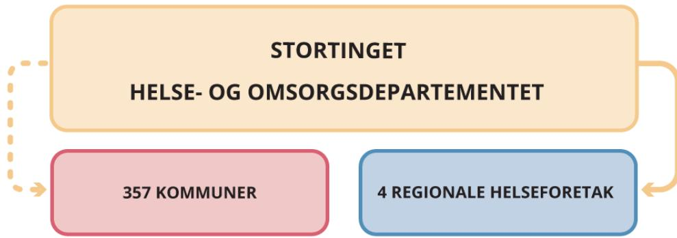

The diagram shows the Ministry of Health and Social Services (STORTINGET HELSE- OG OMSORGSDEPARTEMENTET) at the top. A dashed arrow points from it to 357 kommuner (357 municipalities), and a solid arrow points from it to 4 regionale helseforetak (4 regional health companies).

```
graph TD; A["STORTINGET  
HELSE- OG OMSORGSDEPARTEMENTET"] -.-> B["357 KOMMUNER"]; A --> C["4 REGIONALE HELSEFORETAK"];
```

**STORTINGET  
HELSE- OG OMSORGSDEPARTEMENTET**

**357 KOMMUNER**

**4 REGIONALE HELSEFORETAK**

Org chart: Organizational structure of the Ministry of Health and Social Services and its entities.

Figur 3.2 Illustrasjon av dagens delte sørge-for-ansvar for helse- og omsorgstjenester til befolkningen

### 3.6 Organisering og styring av helse- og omsorgstjenesten

Et hovedtrekk i dagens struktur for organisering og styring av helse- og omsorgstjenestene er det todelte ansvaret mellom den kommunale helse- og omsorgstjenesten og den statlig eide spesialisthelsetjenesten, herunder for planlegging og dimensjonering av tjenestene. Dette omfatter ulike eiere, arbeidsgivere, finansieringskilder og rettslige rammer. Helse- og omsorgstjenesteloven og spesialisthelsetjenesteloven pålegger henholdsvis kommuner og helseforetak å inngå samarbeidsavtaler for å forbedre samarbeid og samordning innenfor dagens todelte struktur. Det er også gitt føringer for involvering av samarbeidsparter i veileder for helseforetakenes utviklingsplaner.

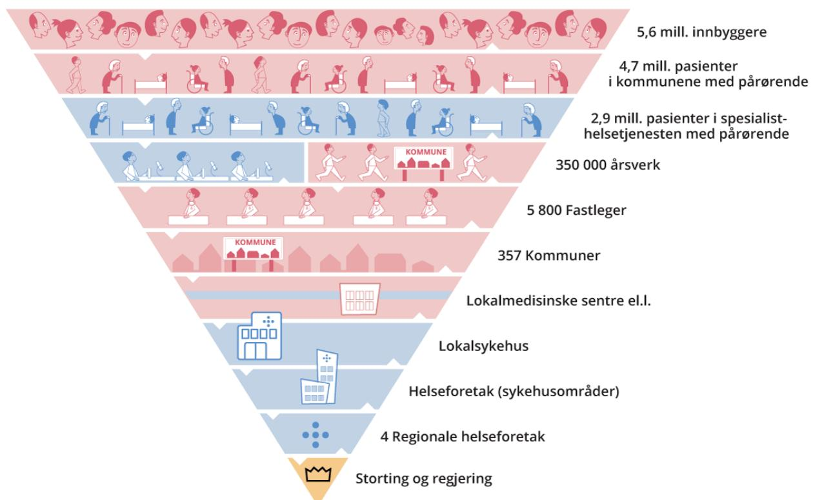

Figur 3.3 Illustrasjon av helse- og omsorgstjenesten i dag

#### 3.6.2 Organisering av kommunale helse- og omsorgstjenester

De kommunale helse- og omsorgstjenestene omfatter et stort mangfold av tjenester, fra pleie- og omsorgstjenester i hjemmet, i tilrettelagte omsorgsboliger eller i sykehjem, avansert behandling, praktisk bistand, støttekontakt, dagtilbud og aktivitetstilbud og brukerstyrt personlig assistanse (for personer med stort hjelpebehov, se kapittel 12). Kommunen har ansvar for fastlegeordningen, og hovedmodellen har i alle år vært at tjenesten ytes av næringsdrivende leger som har avtale med kommunen. I de senere årene har flere kommuner gått over til å yte fastlegetjenester i egen regi ved at fastlegene er ansatt i kommunen (Meld. St. 23 (2024–2025)).

Kommuneloven gir rom for stor variasjon i organisering av tjenestene. I tråd med dette handlingsrommet velger kommunene ulike løsninger for organisering av tjenestene, blant annet ut fra befolkningens sammensetning og behov. Noen kommuner har for eksempel valgt en såkalt bestiller-utfører-modell, der ansvaret for å utrede og treffe vedtak er skilt tydelig fra ansvaret for praktisk tjenesteyting gjennom plassering i ulike organisatoriske enheter. Andre kommuner har valgt modeller der ansvaret for både saksutredning og tjenesteyting er plassert i samme organisatoriske enhet. Noen kommuner har valgt å organisere helsestasjons- og skolehelsetjenesten under en oppvekstenhet, sammen med barnehage, skole, pedagogisk-psykologisk tjeneste (PPT) og barnevernstjenesten. Helse- og omsorgstjenester som hjemmebaserte tjenester og sykehjem organiseres da i en annen enhet, som for eksempel en helse- og omsorgsenhet. Andre organiserer alle helse- og omsorgstjenestene i én enhet som omfatter alt fra sykehjem, omsorgsboliger og frisklivssentraler.

#### **3.6.3 Organisering av spesialisthelsetjenesten**

Det statlige eierskapet til spesialisthelsetjenesten er organisert i fire regionale helseforetak som eier helseforetakene i egen helseregion. Det er til sammen 20 helseforetak som driver pasientbehandling. Alle de regionale helseforetakene har også egne helseforetak som driver sykehusapotekene og drifter, forvalter og utvikler felles IKT-tjenester for sykehusene. De regionale helseforetakene eier fem helseforetak i fellesskap som har nasjonalt virkeområde: Helsetjenestenes driftsorganisasjon for nødnett HF, Luftambulansetjenesten HF, Pasientreiser HF, Sykehusbygg HF og Sykehusinnkjøp HF. Formålet er standardisert, samordnet og effektiv oppgaveløsning innenfor disse områdene (NOU 2023: 8; Meld. St. 9 (2023–2024)).

Helse- og omsorgsministeren representerer staten og regjeringen og ivaretar politisk styring av de regionale helseforetakene. Departementet avholder årlig foretaksmøter i de regionale helseforetakene for å fastsette økonomiske og organisatoriske krav og rammer og for å godkjenne årsregnskap og årlig melding.

Helse- og omsorgsdepartementet tildeler Stortingets budsjettbevilgning til de regionale helseforetakene og fastsetter vilkår gjennom de årlige oppdragsdokumentene. Helse- og omsorgsministeren utøver eierstyring gjennom styreoppnevning, fastsetting av vedtekter og vedtak i foretaksmøter i de regionale helseforetakene. Helseforetaksloven § 30 angir saker som skal vedtas av statsråden i foretaksmøte. Foretaksmøtet kan ellers fatte vedtak, instruere styret og omgjøre beslutninger i alle saker etter helseforetaksloven § 16, med unntak av ansettelse og oppsigelse av daglig leder. Statsråden har stort handlingsrom til aktivt å ta stilling til og sikre nasjonal politisk forankring av saker og vedtak som omhandler den offentlige spesialisthelsetjenesten.

De regionale helseforetakene er regjeringens viktigste verktøy for å iverksette den nasjonale helsepolitikken i spesialisthelsetjenesten. De skal sørge for at pasientenes rett til øyeblikkelig hjelp og nødvendig helsehjelp blir finansiert og oppfylt.

De regionale helseforetakene kan oppfylle sørge-for-ansvaret gjennom å gi oppdrag til egne helseforetak eller ved å inngå avtale om tjenester fra private tjenesteytere.

Helseforetakene har ansvar for den daglige driften av den offentlig eide spesialisthelsetjenesten, inkludert de offentlige sykehusene og øvrige institusjoner i spesialisthelsetjenesten.

Helseforetakene skal yte spesialisthelsetjenester, forskning, undervisning og tjenester som står i naturlig sammenheng med disse oppgavene, eller som er pålagt i lov eller på oppdrag fra det regionale helseforetaket. Helseforetakene bidrar slik til at de regionale helseforetakene kan oppfylle sørge-for-ansvaret. Helseforetakene har som egne rettssubjekter, selvstendig ansvar for at det tilbudet de gir oppfyller kravene til forsvarlighet, pasient- og brukerrettigheter mv. innenfor tildelte økonomiske rammer.

Foretaksmøtet i helseforetaket er helseforetakets øverste styringsorgan. Som eier og overordnet helseforetakene, kan det regionale helseforetaket i foretaksmøte beslutte begrensninger i myndigheten som skal tilligge helseforetakets øverste ledelse, og hvilke saker som skal bringes opp til beslutning i regionalt helseforetak. Saker som er omfattet av § 30 i helseforetaksloven skal alltid besluttes i foretaksmøte i helseforetak. Helseforetaksloven § 30 fastsetter at en del viktige saker ikke kan avgjøres av styret i helseforetak eller i regionale helseforetak, men at de skal behandles politisk og derfor besluttes av statsråden i foretaksmøte. Foretaksmøtet kan fatte vedtak, instruere

styrene og omgjøre beslutninger i alle saker, med unntak av ansettelse mv. av administrerende direktør.

De regionale helseforetakene styrer også ved å fordele tildelte bevilgninger mellom helseforetakene og setter vilkår for disse, på samme måte som departementet gjør i det årlige oppdragsdokumentet overfor de regionale helseforetakene.

Organiseringen av spesialisthelsetjenesten er et uttrykk for bevisst å skille det helsepolitiske, det forvaltningsmessige og det operative ansvaret. Med helseforetaksloven er det etablert en formell struktur som skaper en viss armlengdes avstand mellom det helsepolitiske ansvaret ved statsråd, det forvaltningsmessige nivået og det operative (tjenesteytende) nivået (Innst. 240 S (2014–2015)).

Stortingets, regjeringens og statsrådens politiske vurdering bestemmer hvor aktivt og detaljert staten til enhver tid vil styre de regionale helseforetakene. Ved innføringen av helseforetaksmodellen i 2002, ble det forutsatt at eierstyringen skulle konsentreres om overordnede forhold. Dette ble beskrevet slik i Ot.prp. nr. 66 (2000–2001):

En av reformens sentrale intensjoner er å gi de regionale helseforetakene betydelige frihetsgrader i sin daglige drift, samtidig som det skal legges til rette for at sentrale, nasjonale helsepolitiske målsettinger oppfylles. Visse hensyn tilsier imidlertid at staten i en overgangsfase i noe større grad sikrer hensynene til kostnadskontroll og gjennomføringen av sentrale prioriterte oppgaver ved en noe mer aktiv styring enn det som på sikt forutsettes.

###### **Boks 3.3 Saker som skal vedtas av foretaksmøtet**

Det er ingen begrensinger i hvilke saker statsråden som eier kan ta opp i foretaksmøtet. Det er fastsatt i helseforetaksloven § 30 at en del saker ikke kan avgjøres av styret for de regionale helseforetakene, men skal behandles politisk og derfor besluttes av statsråden i foretaksmøte. Dette gjelder saker som antas å være av vesentlig betydning for foretakets virksomhet, av vesentlig betydning for løsningen av fastsatte målsettinger eller oppgaver, saker som antas å ha prinsipielle sider av betydning og saker som antas å kunne ha vesentlige samfunnsmessige virkninger, som:

- vedtak som kan endre virksomhetens karakter
- vedtak om nedleggelse av sykehus
- omfattende endringer i sykehusstrukturen i helseregionen
- omfattende endringer i tjenestetilbudet
- vedtak om endringer i antallet helseforetak i helseregionen
- vedtak om vesentlige endringer i opptaksområdet for helseforetak

###### **Rammeslutt**

De regionale helseforetakene har ansvar for styring og samordning mellom tjenesteleverandørene innad i regionene – både egne helseforetak og private. De regionale helseforetakene må, for å ivareta sørge-for-ansvaret, sikre at helseforetakene, supplert med private, oppfyller forventningene om behandlingskapasitet og aktivitet slik at befolkningen får nødvendige spesialisthelsetjenester. Fordeling av inntekter mellom helseforetakene og oppfølging av aktivitet, kvalitet og økonomi er sentralt for å sikre dette. De regionale helseforetakene ivaretar også samordningsansvaret gjennom fordeling av spesialistfunksjoner, prioritering av investeringer i sykehusbygg, medisinsk-teknisk

utstyr og digitale løsninger. Dette omfatter også organisering av sykehus i nettverk med felles opplærings- og utviklingstiltak, utnyttelse av kapasitet mellom tjenesteleverandørene, samarbeid om pasienter og pasientforløp, kvalitet og pasientsikkerhet, riktig bruk av personell og utvikling av fagmiljø og tjenestetilbud på tvers.

Styrene i de regionale helseforetakene og helseforetakene har ansvar for at virksomheten drives i samsvar med den nasjonale helsepolitikken og for at samlede ressurser brukes på best mulig måte. Styret har dermed både ansvar for forvaltning av foretaket og for å føre tilsyn med eget foretak og helseforetak som det eier. Sammensetningen av styrene skal sikre både nødvendig kompetanse og en rimelig balanse mellom geografisk representasjon og kjønn.

Styremedlemmene har et selvstendig og personlig ansvar for å ivareta foretakets interesser. Eier oppnevner flertallet av styremedlemmene i foretaksmøte. Inntil en tredjedel og minst to av styrets medlemmer med varamedlemmer velges av og blant de ansatte. Gjennomføring av de ansattes valg av styremedlemmer er regulert i Forskrift om ansattes styrerepresentasjon i HF. Det er eier, departementet for styrene i de regionale helseforetakene, og styrene i de regionale helseforetakene for styrene i helseforetakene, som gjør den endelige vurderingen og sammensetning av styrene ut fra hensynet til samlet kompetanse, kjønnsfordeling og geografiske forhold. Nærings- og fiskeridepartementet (2026) har fastsatt rutiner for styrevalg i selskaper med statlig eierandel. Disse rutinene ligger også til grunn for Helse- og omsorgsdepartementets oppnevning av styrer i de regionale helseforetakene og helseforetakene.

Fylkestingene og Sametinget er gitt anledning til å foreslå kandidater til styrene for de regionale helseforetakene, og kommunene og fylkeskommunene i opptaksområdet kan foreslå kandidater til styrene i helseforetakene. I regionalt helseforetak skal styremedlemmene som foretaksmøtet velger, ha tilknytning til den regionen som foretaket hører under. Det gjelder ikke tilsvarende krav i helseforetak.

Brukermedvirkning på systemnivå er ivaretatt ved at alle helseforetakene og de regionale helseforetakene har brukerutvalg. Det er opprettet ungdomsråd ved alle helseforetak. Styrene i de regionale helseforetakene har vedtatt felles retningslinjer for brukermedvirkning på systemnivå. Der framgår det at én til to representanter fra brukerutvalget, hvorav den ene er brukerutvalgets leder, møter i styremøtene som observatør med tale- og forslagsrett.

##### **Boks 3.4 Oppgaver knyttet til de regionale helseforetakenes sørge-for-ansvar**

De regionale helseforetakene er ved lov pålagt ansvaret for å sørge for nødvendige spesialisthelsetjenester til befolkningen i helseregionen. Dette innebærer blant annet følgende prosesser og beslutninger:

- planlegging og styring i et regionalt perspektiv
- prioritering av investeringer
- oppgave- og funksjonsfordelinger
- fordele driftsbevilgning og stille vilkår til denne i oppdragsdokument
- oppfølging og kontroll av om målene nås og myndighetskrav følges
- strategisk ansvar for kjøp av helsetjenester fra private
- koordinering av forskning og undervisning

### **3.7 Sentrale reformer**

#### **3.7.1 Fastlegereformen**

Fastlegereformen ble innført i 2001 og innebar at alle innbyggerne fikk rett til en fast, navngitt allmennlege (fastlege). Hovedmålet var bedre tilgang til allmennlegetjenester, kontinuitet i lege-pasientforholdet og bedre koordinering av helsehjelp. Alle innbyggere kan velge og bytte fastlege opp til to ganger per år. Fastlegen fungerer som regel som pasientens første kontaktpunkt i helsetjenesten.

Fastlegen har ansvar for allmennmedisinsk behandling, øyeblikkelig hjelp på dagtid og koordinering av pasientens behov for øvrige medisinske tjenester og henvisning til spesialisthelsetjenesten. Ordningen er organisert gjennom lister, der hver lege har ansvar for en definert pasientgruppe.

En viktig forløper til fastlegereformen var kommunehelsetjenesteloven, som ble iverksatt fra 1984. Gjennom denne ble allmennlegetjenesten gjort til et kommunalt ansvar. Før dette hadde Norge hatt et todelt system med statlige distriktsleger og privatpraktiserende leger i byene (Hagen, u.å). Selv om kommunene fikk ansvaret for allmennlegetjenester fra 1984, var tjenesten ulikt organisert i ulike deler av landet. Det eksisterte i hovedsak tre hovedmodeller: leger med fast lønn, leger med driftsavtale og leger uten avtale (privatpraktiserende leger med rett til refusjoner fra staten eller uten refusjoner, men med muligheter for å ta høye egenandeler).

Utover på 1980-tallet økte utfordringene i allmennlegetjenesten. I deler av landet var det store rekrutteringsproblemer. Pasienter opplevde samtidig på hyppig skifte av leger og lange ventetider til konsultasjoner. I 1990 ga Stortinget klarsignal for forsøk med fastlege basert på et listesystem. Fastlegeforsøket ga i hovedsak positive resultater og i løpet av siste halvdelen av 1990-årene fant fastlegeordningen den formen som ble satt i verk fra 1. juni 2001 (Hagen, u.å.).

De første årene etter innføringen ble tilgjengeligheten forbedret og ventetid til behandling redusert (Bakke, 2003). Både leger og pasienter satte pris på kontinuiteten i lege-pasient-forholdet. Fram mot 2020 økte utfordringene, blant annet med rekruttering av leger. Ved utgangen av 2022 sto godt over 200 000 innbyggere uten fastlege, og det ble satt i gang arbeid for å justere ordningen, blant annet utvidet finansiering av spesialisering, og økning og differensiering av tilskuddene (Hagen, u.å.). Det er i dag bedre rekruttering til fastlegeordningen og flere innbyggere har plass på fastlegenes liste (Helse- og omsorgsdepartementet, 2026a)

#### **3.7.2 Helseforetaksreformen**

Helseforetaksreformen ble innført 1. januar 2002 og innebar at staten overtok ansvaret for spesialisthelsetjenesten (sykehusene) fra fylkeskommunene. Hovedmålet var bedre styring, mer effektiv ressursbruk og et mer likeverdig helsetilbud i hele landet. Staten fikk samlet ansvar for eierskap, finansiering og sektoransvar for spesialisthelsetjenesten. Overordnede helsepolitiske mål

fastsettes av staten og ligger til grunn for styring av foretakene. Staten har et helhetlig ansvar for spesialisthelsetjenesten.

Virksomhetene/sykehusene ble organisert i regionale helseforetak og underliggende helseforetak. De regionale helseforetakene fikk ansvar for å planlegge og sørge for tjenester i sin region, samt å eie sykehusene. Før reformen var sykehusene eid av fylkeskommunene, noe som ga fragmentert styring, store geografiske ulikheter og utfordringer med kostnadskontroll og kvalitet. Reformen flyttet spesialisthelsetjenesten til statlig nivå og innførte helseforetaksmodellen for å sikre mer helhetlig styring og likere tilbud.

Det har siden helseforetaksreformen i 2002 vært både faglig og politisk debatt om ulike sider ved denne styringsmodellen. Sentrale problemstillinger som har vært diskutert, er om modellen legger til rette for tilstrekkelig nasjonal samordning og utjevning av forskjeller i kvalitet og effektivitet mellom regioner og mellom helseforetak og sykehus, om rolleklarhet, tilstrekkelig demokratisk legitimitet, om riktig balanse mellom de regionale helseforetakenes beslutningsmyndighet og det politiske ansvaret for beslutningene, om politisk styring og involvering av Stortinget i sentrale beslutninger (NOU 2016: 25).

#### **3.7.3 Samhandlingsreformen**

Samhandlingsreformen trådte i kraft 1. januar 2012. Målet var å skape bedre samarbeid mellom kommunal helse- og omsorgstjeneste og spesialisthelsetjenesten, samt å sikre helhetlige pasientforløp. Målet var «rett behandling – på rett sted – til rett tid», bedre forebygging, mer helhetlige og koordinerte tjenester og en bærekraftig utvikling av helse- og omsorgstjenesten. Med samhandlingsreformen fikk kommunene økt ansvar (mer behandling nær pasientene), det ble innført kommunal medfinansiering av sykehusbehandling, betalingsansvar for utskrivningsklare pasienter, plikt til samarbeid mellom kommuner og helseforetak gjennom avtaler og etablering av kommunale øyeblikkelig hjelp-døgnenheter for å redusere behovet for sykehusinnleggelser. En egen lov om folkehelsearbeid definerte et klarere ansvar på kommunene. I tillegg til disse virkemidlene ble det utviklet et avtaleverk mellom kommunene og helseforetakene med mål om å forbedre samhandlingsrutinene.

Reformen skulle løse tre hovedproblemer: dårlig koordinering mellom tjenestennivåer, for liten innsats for å forebygge sykdom forebygging og økende press på sykehusene på grunn av aldrende befolkning.

Evaluering av samhandlingsreformen viser blant annet på at det har blitt bedre samarbeid mellom kommuner og helseforetak, men at avtalene ga begrenset endring i opplevd likeverdighet. Betalingsordningen for utskrivningsklare pasienter har hatt effekt, og redusert liggetiden i sykehusene. Effekten av kommunal medfinansiering var svak, og hadde ikke signifikante effekter på antall pasientopphold ved sykehusene. Kommunal medfinansiering ble avviklet fra 1. januar 2015. De økte overføringene av ressurser til kommunene som følge av betalingsordningen for utskrivningsklare pasienter og kommunal medfinansiering har økt ressursbruken på kommunale tjenester noe, men man finner ingen signifikante effekter av Samhandlingsreformen på antall plasser i institusjon eller sykehjem. Det er fortsatt usikkert om reformen har gitt mer helhetlige pasientforløp. Kommuner og helseforetak har i hovedsak fulgt opp reformens intensjoner (Universitetet i Oslo, (2013); Norges forskningsråd, 2016).

##### Boks 3.5 Utviklingen i personell siden årtusenskiftet

Helsepersonellkommisjonen (NOU 2023: 4) viser hvordan sysselsettingen i helse- og omsorgstjenestene har utgjort en stadig voksende andel av arbeidsstyrken i Norge siden 1970-tallet, og peker på at en tilsvarende vekst i arbeidsstyrken i helse- og omsorgstjenestene ikke kan forventes framover. Gjennom Meld. St. 11 (2025–2026) *Helsepersonellplan 2040* er det lagt fram tiltak for å bøde på mangelen på kvalifisert helsepersonell framover.

Figur 3.4 viser at veksten i antall årsverk har vært betydelig både i de kommunale helse- og omsorgstjenestene og spesialisthelsetjenestene fra 2003 og fram til i dag. Mens veksten var på rundt 60 prosent i de kommunale tjenestene, var den på om lag 50 prosent i spesialisthelsetjenesten. Disse vekstratene er betydelig høyere enn befolkningsveksten i perioden, som var på drøyt 20 prosent. Tallene kan tyde på at samhandlingsreformens mål om å flytte tjenester nærmere der folk bor er etterfulgt av en noe større økning i bemanningen i den kommunale helse- og omsorgstjenesten enn i spesialisthelsetjenesten.

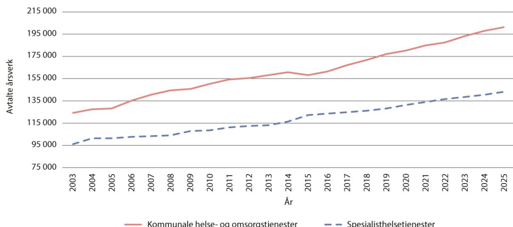

Avtalte årsverk

År

| År   | Kommunale helse- og omsorgstienester | Spesialisthelsetienester |
|------|--------------------------------------|--------------------------|
| 2003 | ~125 000                             | ~95 000                  |
| 2004 | ~128 000                             | ~100 000                 |
| 2005 | ~128 000                             | ~100 000                 |
| 2006 | ~135 000                             | ~102 000                 |
| 2007 | ~138 000                             | ~102 000                 |
| 2008 | ~142 000                             | ~104 000                 |
| 2009 | ~142 000                             | ~108 000                 |
| 2010 | ~148 000                             | ~110 000                 |
| 2011 | ~150 000                             | ~112 000                 |
| 2012 | ~150 000                             | ~112 000                 |
| 2013 | ~155 000                             | ~112 000                 |
| 2014 | ~160 000                             | ~115 000                 |
| 2015 | ~158 000                             | ~120 000                 |
| 2016 | ~162 000                             | ~122 000                 |
| 2017 | ~168 000                             | ~124 000                 |
| 2018 | ~172 000                             | ~126 000                 |
| 2019 | ~175 000                             | ~128 000                 |
| 2020 | ~180 000                             | ~132 000                 |
| 2021 | ~182 000                             | ~134 000                 |
| 2022 | ~185 000                             | ~136 000                 |
| 2023 | ~192 000                             | ~138 000                 |
| 2024 | ~195 000                             | ~140 000                 |
| 2025 | ~198 000                             | ~142 000                 |

— Kommunale helse- og omsorgstienester — Spesialisthelsetienester

The chart shows a steady increase in both categories from 2003 to 2025. Municipal health and care services start higher and grow faster, while specialist health services show a more gradual increase.

Line chart: Annual expenditure on municipal and specialist health services from 2003 to 2025.

**Figur 3.4 Avtalte årsverk i den kommunale helse- og omsorgstjenesten og i spesialisthelsetjenesten per år for 2003–2025**

Det er flere brudd i tidsseriene, særlig i 2015, se SSB (2026a).

Kilde: SSB (2026a)

Når tallene brytes ned på noen av de største utdanningsgruppene (figur 3.5), er helsefagarbeidere i kommunene den største gruppen i 2025. Deretter kommer sykepleiere i spesialisthelsetjenesten og ufaglærte i kommunene. Veksten har vært særlig stor blant leger og andre med helsefaglig utdanning i både spesialisthelsetjenesten og i de kommunale tjenestene. Det har også vært en vekst i ufaglærte i de kommunale tjenestene, mens det har vært et fall i avtalte årsverk for helsefagarbeidere og ufaglærte i spesialisthelsetjenestene.

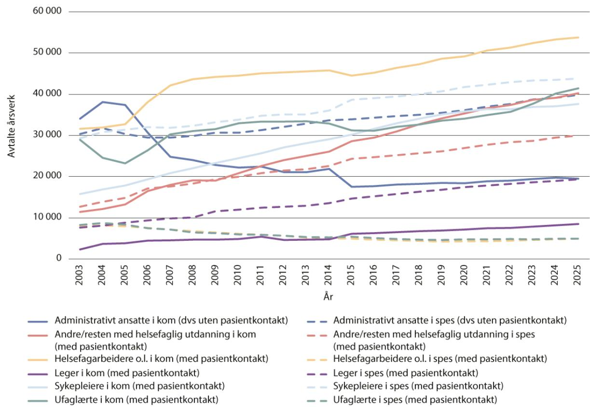

Avtalte årsverk

År

Line chart: Annual number of healthcare workers by category from 2003 to 2025.

**Figur 3.5 Avtalte årsverk i den kommunale helse- og omsorgstjenesten og i spesialisthelsetjenesten per år 2003–2025 etter noen personellgrupper**

Det er flere brudd i tidsseriene, særlig i 2015, se SSB (2026a).

Kilde: SSB (2026a)

Veksten i yrkesinntekt har vært ganske lik på tvers av personellgruppene fra 2003 til 2024, med en noe lavere vekst for leger i spesialisthelsetjenesten enn i kommunene og for ufaglærte (figur 3.6). Tallgrunnlaget fra SSB (2026a) viser at fastlegene var på inntektstoppen med en yrkesinntekt i 2024 på om lag 2,0 millioner kroner, etterfulgt av avtalespesialistene med om lag 1,5 millioner, sykehusleger med 1,4 millioner og kommunalt ansatte leger (eksklusive fastleger) med 1,0 million kroner. Sykepleiere med og uten spesialisering lå på henholdsvis om lag 747 000 og 647 000 kroner i yrkesinntekt, og psykologene på 866 000 kroner. Helsefagarbeiderne hadde en gjennomsnittlig yrkesinntekt i 2024 på 537 000 kroner.

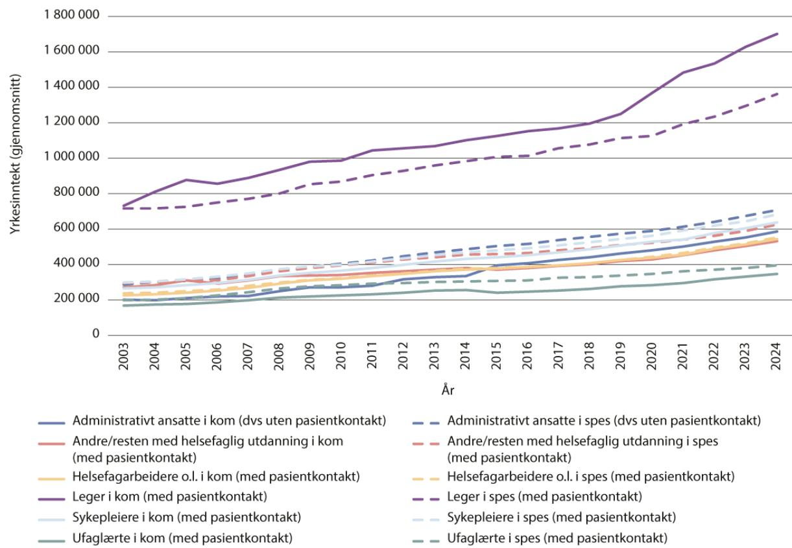

Yrkesinntekt (gjennomsnitt)

År

Line chart: Average employment by profession from 2003 to 2024.

**Figur 3.6 Yrkesinntekt i den kommunale helse- og omsorgstjenesten og i spesialisthelsetjenesten per år 2003–2024 etter noen personellgrupper**

Yrkesinntekten er skattbar inntekt i året, dvs. inntekter fra arbeid etter eventuelle fradrag for kostnader knyttet til drift, pensjoner osv. Eventuelle kapitalinntekter inngår ikke i yrkesinntekten. Det er flere brudd i tidsseriene, særlig i 2015, se SSB (2026a).

Kilde: SSB (2026a)

###### Rammeslutt

### 3.8 Tjenesteleverandører

#### 3.8.1 Den med sørge-for-ansvaret trenger ikke å selv være tjenesteleverandør

Store deler av den offentlige helse- og omsorgstjenesten er offentlig drevet, men det er også en andel som er private næringsdrivende. Dette gjelder for eksempel 80 prosent av fastlegene. Det framgår av lovverket at kommuner og regionale helseforetak kan benytte private for å ivareta sitt sørge-for-ansvar. På flere områder står private for en betydelig del av det samlede tjenestetilbudet.

Kommunene oppfyller i hovedsak sitt sørge-for-ansvar ved egenregi innenfor helse- og omsorgstjenestene. Noen kommuner har avtale med ideelle eller kommersielle leverandører av for eksempel sykehjemstjenester (Helse- og omsorgstjenesteloven § 3-1 femte ledd). Kommunenes

sørge-for-ansvar for legetjenester til befolkningen ivaretas i hovedsak gjennom avtaler med privatpraktiserende fastleger.

De regionale helseforetakene sørger for befolkningens behov for spesialisthelsetjenester enten gjennom de heleide helseforetakene eller gjennom avtaler med private. Tjenestene leveres i stor grad av helseforetakene, men private er viktige samarbeidspartnere og utgjør på noen områder en betydelig del av den samlede kapasiteten i den offentlige spesialisthelsetjenesten. De regionale helseforetakene inngår både langsiktige og kortsiktige avtaler med ideelle og kommersielle aktører som et ledd i arbeidet med å oppfylle sitt sørge-for-ansvar. Sykehus som Haraldsplass Diakonale Sykehus og Lovisenberg Diakonale Sykehus er eksempler på dette, sammen med de private avtalespesialistene som omfatter mer enn tusen spesialister med driftsavtale.

Pasienten har rett til selv å velge behandlingssted i spesialisthelsetjenesten, enten ved en offentlig leverandør eller blant private med avtale med regionalt helseforetak. Retten inntrer etter at henvisningen er vurdert i virksomheter med rett til å tildele pasient- og brukerrettigheter. I noen kommuner inngår private med godkjenning i ordninger med fritt brukervalg i hjemmetjenestene. Godkjenning betyr at private aktører kan tilby nærmere definerte tjenester uten anbud, etter priser fastsatt av kommunen. Ordninger med fritt brukervalg er tatt i bruk i et fåtall kommuner.

#### **3.8.2 Private tjenesteleverandører med avtale med det offentlige**

Det er opp til kommunene hvordan de organiserer sine helse- og omsorgstjenester, og om de velger egenregi eller kjøp av tjenester. Samlet sett utgjør det private innslaget om lag 10 prosent av de offentlig finansierte tjenestene kommunene har ansvar for. Det er imidlertid stor variasjon innenfor de ulike tjenestene og mellom kommunene (NOU 2020: 13).

Kommunene inngår avtaler med private ideelle og kommersielle aktører innen pleie, omsorg, rusbehandling, rehabilitering og psykisk helse, normalt etter anbud. Det kan både være langsiktige avtaler og kjøp av enkeltplasser eller tjenester ved behov.

Drøyt 20 prosent av fastlegene er ansatt i kommunen, snaut 80 prosent er basert på privat næringsdrift. Gjennom individuelle fastlegeavtaler inngår kommunen avtaler med legene om å utøve oppgaven som fastlege for innbyggerne på listen i henhold til lov, forskrifter og andre avtaler. Avtalen spesifiserer hvilke eventuelle andre oppgaver fastlegen skal utføre. Kommunen kan også inngå driftsavtale med privatpraktiserende fysioterapeuter.

De regionale helseforetakene inngår avtaler med private aktører om å levere helsetjenester innenfor somatiske helsetjenester, laboratorietjenester, psykisk helsevern, tverrfaglig spesialisert rusbehandling (TSB), radiologi og rehabilitering. Mange slike avtaler bygger på anbudsprosesser og er særlig vanlig innenfor TSB, rehabilitering og laboratorie- og røntgentjenester. Enkelte private ideelle sykehus har langsiktige avtaler med regionalt helseforetak, og disse er i praksis tett integrert i den samlede offentlige sykehusdriften når det gjelder langsiktig regional planlegging og oppgavefordeling og samarbeid med andre helseforetak og kommuner. Privatpraktiserende avtalespesialister består av selvstendig næringsdrivende leger, psykiatere og psykologer med langsiktig driftsavtale med regionalt helseforetak. Avtalespesialistene leverte i 2022 henholdsvis 22 og 23 prosent av den polikliniske aktiviteten innen somatikk og psykisk helsevern (FHI, 2023). I

perioden fra 1. november 2015 til 1. januar 2023 var det en ordning der private aktører godkjent av Helfo kunne levere nærmere definerte helsetjenester til priser fastsatt av staten.

#### **3.8.3 Private tilbydere uten avtale med det offentlige**

Private leverer også helse- og omsorgstjenester utenfor den offentlige helse- og omsorgstjenestens styring, prioritering og finansiering, basert på betaling fra private helseforsikringsordninger og pasienter som betaler for behandlingen selv. Det er begrenset kunnskap om antall tilbydere i det helprivate markedet samt hvilke tjenester som tilbys.

I tredje kvartal 2025 hadde 880 000 personer helseforsikring. Helseforsikring gjennom arbeidsgiver er det klart vanligste. Målt i antall behandlinger er det fysioterapi, kiropraktikk og diagnostiske undersøkelser hos spesialist som dominerer. Målt i utbetalte erstatninger går derimot hoveddelen av kostnadene til diagnostikk og operasjoner (Finans Norge, 2026).

#### **3.8.4 Frivilligheten og pårørende**

Frivillige organisasjoner og pårørende er viktige samarbeidspartnere i helse- og omsorgstjenesten. Frivillige bidrar med sosial støtte, aktiviteter, praktisk hjelp og informasjon som supplerer de offentlige tjenestene og skaper økt livskvalitet for brukerne. Pårørende spiller en sentral rolle som omsorgsgivere og som kilder til kunnskap om brukerens behov. De samarbeider med tjenestene, medvirker i beslutninger og bidrar til kontinuitet og trygghet i omsorgen. Samtidig har de rett til støtte, opplæring og avlastning.

### **3.9 Rettslige rammer og muligheter for samhandling og samarbeid**

#### **3.9.1 Plikt til å samarbeide og samhandle**

Kommuner, regionale helseforetak og helseforetak er pålagt en rekke lovfestede plikter til å samarbeide med hverandre og andre for å kunne gi pasientene et helhetlig og samordnet tjenestetilbud. Det omfatter samarbeid om den enkelte pasient, men også organisatorisk og strukturert samarbeid som er nødvendig for at andre deler av helse- og omsorgstjenesten kan ivareta sine plikter overfor pasientene.

Grunnleggende sett forutsetter kravet om forsvarlige helse- og omsorgstjenester at helsepersonell og virksomheter samhandler og samarbeider om den enkelte pasient. Kommunene og spesialisthelsetjenesten er derfor pålagt å tilrettelegge tjenestene slik at den enkelte pasient eller bruker gis et helhetlig og koordinert helse- og omsorgstjenestetilbud, jf. helse- og omsorgstjenesteloven (hol.) § 4-1 og spesialisthelsetjenesteloven (sphl.) § 2-2 første ledd. Som et ledd i tilretteleggingen skal både kommuner og regionale helseforetak sørge for at ulike deler av helse- og omsorgstjenesten samarbeider med andre tjenesteytere dersom samarbeid er nødvendig for å gi pasienten et helhetlig og samordnet tjenestetilbud, jf. hol. § 3-4 første ledd og sphl. 2-1 e første ledd.

I tillegg til å samarbeide om oppfølgingen av den enkelte pasient, plikter kommunen og spesialisthelsetjenesten å samarbeide systematisk om tilpasninger i egne virksomheter. Det kan

blant annet gjelde pasientforløp og deling av informasjon og kompetanse. De skal sørge for nødvendig samarbeid mellom ulike deler av helse- og omsorgstjenesten, både innad i eget ansvarsområde og mellom nivåene, slik at de og andre tjenesteytere kan ivareta sine oppgaver etter lov og forskrift, jf. hol. § 3-4 tredje ledd og sphl. § 2-1 e andre ledd. Ifølge forarbeidene er et slikt samarbeid nødvendig for å kunne gi best mulig helsetjenester og god ressursutnyttelse.

Det kreves enighet om blant annet konkrete tilpasninger i de ulike tjenestene til lokale forhold, felles tiltak, organisering, personellbruk og finansiering. Kommuner og regionale helseforetak skal inngå samarbeidsavtaler med mål om å bidra til at pasienter og brukere mottar et helhetlig tilbud om helse- og omsorgstjenester, jf. hol. kapittel 6 og sphl. § 2-1 e fjerde ledd. De regionale helseforetakene kan delegere dette til helseforetakene. Helse- og omsorgstjenesteloven angir detaljerte regler om hvilke forhold som skal reguleres i avtalene, inkludert en konkret beskrivelse av hvordan partene sammen skal utvikle og planlegge tjenestene. Når det avtales samarbeidstiltak, må avtalen klargjøre ansvarsforholdene, arbeidsgiveransvaret og hvordan samarbeidstiltaket skal organiseres og finansieres.

Samhandling forutsetter avklaring av hvem som har ansvaret for å sørge for konkrete tjenestetilbud til befolkningen. Regionale helseforetak og kommuner tar i utgangspunktet selv stilling til hvilke tjenester som inngår i eget ansvar, men har også plikt til å søke å avklare dette i samarbeidsavtaler, jf. hol. § 6-2 og sphl. § 2-1 e. De kan være uenige om ansvarsfordelingen for konkrete helse- og omsorgstjenester som av ulike årsaker oppfattes å befinne seg i en gråsone mellom spesialisthelsetjenester og andre helse- og omsorgstjenester. Oppnås ikke enighet, kan departementet etter spesialisthelsetjenesteloven § 1-2 andre ledd «ved forskrift eller i det enkelte tilfelle bestemme hva som er spesialisthelsetjeneste».

#### **3.9.2 Rettslig handlingsrom**

Samhandling mellom helseforetak og kommuner kan organiseres på ulike måter.

Ved ren samlokalisering av tjenestetilbud fra den offentlige spesialisthelsetjenesten og fra den kommunale helse- og omsorgstjenesten kan det være aktuelt å avtale leie av lokaler, etablering av merkantile fellestjenester, fordeling av felleskostnader mv., men de to nivåene yter selv egne tjenester fullt ut fra egen organisasjon og med egne ansatte. Effektiv samhandling kan også gjennomføres ved at helseforetak og kommune leier helsepersonell eller medisinsk utstyr av hverandre for å kunne yte tjenester. Regionale helseforetak og kommuner har også anledning til å yte tilskudd i forskjellige former til tilbud av tjenester som inngår i den andres sørge-for-ansvar, i den grad det anses hensiktsmessig for å oppnå gode pasientforløp. Eksempler kan være at helseforetak tilbyr personellressurser til intermediaære sengeplasser eller lokaler til legevakt.

Kommuner og regionale helseforetak (eventuelt helseforetak) vil kunne inngå avtaler om å yte ulike helse- og omsorgstjenester på vegne av hverandre, uten at det er behov for lovendring. Det lovpålagte ansvaret for at befolkningen mottar et forsvarlig tilbud og kontrollfunksjonen blir i så fall værende hos den som gir oppdraget, mens oppdragstakeren påtar seg ansvaret for å yte et forsvarlig tilbud på samme måte som private avtaleparter. Slike avtaler kan og må innrettes som et reelt samarbeid etter unntaket i anskaffelsesforskriften § 3-3. Det betyr i hovedsak at samarbeidet må være noe mer enn et ordinært tjenestekjøp. Unntaket passer godt for oppgaver som overlapper eller grenser mot hverandre i et pasientforløp (kapittel 3.9.3).

Det er i dag mulig for (regionale) helseforetak og kommuner hver på sin side, eller koordinert, å inngå egne avtaler med ett og samme private selskap om leveranser av henholdsvis spesialisthelsetjenester og kommunale helse- og omsorgstjenester. Det lovpålagte ansvaret blir værende hos det regionale helseforetaket og kommunen, mens det private selskapet påtar seg ansvaret for å yte et forsvarlig tilbud. I avtalene kan det stilles krav om hvordan det private selskapet skal bidra til helhetlige tjenestetilbud. Helseforetaksloven § 42 er i dag til hinder for at kommuner og (regionale) helsefellesskap etablerer felles eid selskap som kan yte både spesialisthelsetjenester og kommunale helse- og omsorgstjenester på vegne av disse. For at felles eierskap skal lykkes, vil det være nødvendig å ta stilling til en rekke spørsmål i de konkrete avtalene og vedtektene, inkludert arbeidsrettslige forhold, oppgaver, finansiering, representasjon, styring, instruksjon og omgjøring, uttreden og oppløsning og datterselskaper (kapittel 3.9.4).

Kommuneloven begrenser kommunenes anledning til å delegere vedtakskompetanse til andre (kapittel 3.9.5). Arbeidsrettslige spørsmål omtales i kapittel 3.9.6.

#### **3.9.3 Avtaler om å yte tjenester på vegne av hverandre**

Det kan tenkes at kommuner og regionale helseforetak, eller kommuner og helseforetak, vil se nytte av å samle ytelsene av spesialisthelsetjenester og kommunale helse- og omsorgstjenester i én og samme organisasjon etter avtale. Et eksempel på det kan være at en kommune gir befolkningen ikke bare tjenester som klart inngår i kommunens lovpålagte ansvar, men også etter avtale med helseforetaket mot betaling, ivaretar spesialistfunksjoner som er en naturlig forlengelse av disse tjenestene. Motsatt kan det tenkes at helseforetak også ivaretar tjenester som er kommunens ansvar, mot betaling, regulert av avtale.

Helselovgivningen er ikke til hinder for at kommuner og regionale helseforetak (eller helseforetak) inngår avtaler om å yte helse- og omsorgstjenester på vegne av hverandre, på samme måte som det i dag inngås avtaler med private virksomheter. Adgangen til å inngå slike avtaler er omtalt og forutsatt i forarbeidene til både spesialisthelsetjenesteloven § 2-1 a og helse- og omsorgstjenesteloven § 3-1. Det er kun ytelsen av tjenestene som kan overlates til andre. Ansvaret for å sørge for at befolkningen tilbys nødvendige helse- og omsorgstjenester kan ikke overlates til andre (Ot.prp. nr. 10 (1998–99) og Prop. 91 L (2010–2011) kapittel 28.6 og spesielle merknader til §§ 3-1 og 6-1 i helse- og omsorgstjenesteloven ).

På samme måte som ved avtaler med private virksomheter, er kommunen eller helseforetaket bundet av både avtalevilkårene og de lovpålagte kravene til blant annet et forsvarlig tjenestetilbud. Kravet i spesialisthelsetjenesteloven § 3-9 om en faglig ansvarlig leder på alle nivåer, vil som hovedregel også måtte gjelde i situasjoner hvor kommuner yter tjenester etter avtale. Som ledd i sørge-for-ansvaret, skal kommuner og regionale helseforetak føre kontroll med at avtaleparten har nødvendig kompetanse og organisasjon til å yte forsvarlige tjenester i tråd med lovkravene. Dette gjelder både før avtale inngås og under avtaleperioden.

En avtale vil skille seg fra ordinære tjenestekjøp fra private virksomheter ved at det inngår som ledd i et helhetlig og bredere samarbeid om å benytte de offentlige ressursene på best mulig måte ved i fellesskap å ta beslutninger om pasientflyt, prioriteringer, bruk av personell mv. Det vil ikke være krav til konkurranse etter anskaffelsesreglene dersom det er tale om et reelt samarbeid etter vilkårene i anskaffelsesforskriften § 3-3. Samarbeidet må ha som formål å sikre at offentlige

oppgaver blir utført for å oppnå et felles mål, utføres utelukkende av hensyn til offentlige interesser, og at mindre enn 20 prosent av aktivitetene som samarbeidet omfatter kan utføres for andre enn oppdragsgiverne. Se nærmere omtale av unntaket i Direktoratet for forvaltning og økonomistyrings veileder til reglene om offentlige anskaffelser kapittel 8.

Kommunene og de regionale helseforetakene har i dag til sammen ansvaret for hele kjeden av tjenester for pasienter og brukere, fra kommunale helse- og omsorgstjenester til spesialisert behandling. Det felles målet er å gi befolkningen en helhetlig og sammenhengende helse- og omsorgstjeneste på en bedre og mer ressurseffektiv måte. Kommunene og den offentlige spesialisthelsetjenesten kompletterer hverandre. For pasientene er det ikke avgjørende hvem som gir helsehjelpen. Samarbeidet vil derfor kunne innrettes slik at det er reelt, i tråd med vilkårene i anskaffelsesforskriften § 3-3. Det forutsetter blant annet at kommunen og helseforetak etablerer en felles strategi for hvordan pasienter og brukere ivaretas og i avtale utdyper hvordan det løpende samarbeidet skal gjennomføres og utvikles. Felles koordinering av faglige og organisatoriske forhold, for eksempel overordnet planlegging av tilbud, ressurser, rollefordeling og utvikling av tilbudene, vil synliggjøre at alle bidrar i det totale tilbudet til pasientene og brukerne. Det er lettere å begrunne at det foreligger et reelt samarbeid for oppgaver som overlapper eller grenser mot hverandre i et pasientforløp, enn for oppgaver som ikke har tilsvarende berøringsflater og som krever svært ulike innsatsfaktorer.

Statsstøttereglene får ikke anvendelse når kommuner eller helseforetak yter nødvendige helse- og omsorgstjenester som er tilnærmet gratis for befolkningen. Kommuner og helseforetak kan på denne bakgrunnen, uten hinder av statsstøttereglene, bidra med finansiering av oppgaver som de overlater til hverandre som ledd i et samarbeid om felles oppgaver.

#### **3.9.4 Adgangen til å opprette selskap eid av kommuner og (regionale) helseforetak som yter helse- og omsorgstjenester**

Kommuner og (regionale) helseforetak kan finne det hensiktsmessig å inngå koordinerte avtaler med et felles eid selskap om at dette selskapet skal yte helhetlige helse- og omsorgstjenester. Det ville i så fall legge til rette for avtaler om tjenesteyting som tilsvarer avtaler med private tjenesteytere i dag. Dette skiller seg fra rene avtaler om tjenesteleveranser ved at helseforetak og kommuner kan styre tjenesteleveransene ikke bare gjennom regulering i avtaler, men også i kraft av å være eiere som kontrollerer vedtektene og selskapets styrende organer.

Kommuneloven gir bestemmelser om rammene for interkommunalt samarbeid i kapitlene 17–21. Disse reglene begrenser imidlertid ikke kommunens anledning til å etablere selskaper som eies sammen med (regionale) helseforetak. I utgangspunktet kan derfor kommunen, på lik linje med de fleste andre selvstendige rettssubjekter, alene eller sammen med andre etablere selskaper for å løse driftsoppgaver. Selskapsloven § 1-1 bestemmer imidlertid at kommune ikke kan være deltaker i ansvarlig selskap.

Helseforetaksloven § 42 andre ledd bestemmer at foretak ikke kan eie virksomhet som yter spesialisthelsetjenester sammen med andre enn foretak. Dersom flere foretak eier virksomhet som yter spesialisthelsetjenester sammen, skal virksomheten organiseres som helseforetak eller som ansvarlig selskap i medhold av selskapsloven. Dette innebærer at (regionale) helseforetak ikke kan eie selskap som yter både spesialisthelsetjenester og kommunale helse- og omsorgstjenester

sammen med kommune. De kan imidlertid eie virksomhet som yter annet enn spesialisthelsetjenester sammen med blant annet kommuner, når det er egnet til å fremme foretakets formål. Dette åpner for felleseide selskap som yter kommunale helse- og omsorgstjenester eller IKT, administrasjon og andre støttetjenester.

#### **3.9.5 Adgang til å delegere vedtak om tildeling av helse- og omsorgstjenester**

Kommuneloven bestemmer at «[f]or saker som gjelder lovpålagte oppgaver, kan kommunestyret og fylkestinget delegere myndigheten til å treffe vedtak til andre rettssubjekter så langt lovgivningen åpner for det», jf. § 5-4 andre ledd. Det kreves ikke at lovgivningen uttrykkelig åpner for delegasjon av myndigheten til å fatte vedtak. Anledningen til å delegere vil bero på en tolkning av hjemmelsgrunnlaget. Ifølge Prop. 46 L (2017–2018) la departementet til grunn at bestemmelsen ikke regulerer hvilke oppgaver som kan overlates til andre å utføre, for eksempel beslutningen om å kjøpe inn tjenester fra private eller å sette drift av sykehjem ut til et interkommunalt selskap.

Ifølge pasient- og brukerrettighetsloven § 2-7 skal følgende avgjørelser om tildeling av helse- og omsorgstjenester følge regler for enkeltvedtak når varigheten er lenger enn to uker: helsetjenester i hjemmet, personlig assistanse, herunder praktisk bistand og opplæring og støttekontakt, brukerstyrt personlig assistanse, pårørendestøtte til personer med særlig tyngende omsorgsarbeid, plass i sykehjem og andre institusjoner, samt opphold i sykehjem eller tilsvarende bolig særskilt tilrettelagt for heldøgns tjenester.

Kommunelovens bestemmelse om delegering av vedtakskompetanse omfatter imidlertid mer enn de enkeltvedtakene som ifølge helse- og omsorgstjenesteloven skal følge saksbehandlingsreglene om enkeltvedtak i forvaltningsloven. Det omfatter også andre avgjørelser om tildeling av rettigheter, som for eksempel tildeling av dagaktivitetstilbud til hjemmeboende personer med demens og medisinsk habilitering eller rehabilitering. Faktiske handlinger, som tjenesteutøvelse, regnes imidlertid ikke som vedtak.

I dag er det kun regelverket for vertskommunesamarbeid som gir en generell hjemmel for kommunestyret til å delegere myndighet til å treffe enkeltvedtak eller vedta forskrift til et interkommunalt samarbeid, jf. kommuneloven § 20-1. Kommunal- og distriktsdepartementet sendte våren 2026 på høring forslag om endringer i reglene for kommunalt oppgavefellesskap som åpner for at kommunalt oppgavefelleskap som et eget rettssubjekt skal kunne delegeres myndighet til å fatte enkeltvedtak og vedta forskrift.

Helse- og omsorgstjenesteloven § 9-7 åpner for at andre enn kommunen kan fatte vedtak om tvang: «den som har det daglige ansvaret for tjenesten, eller – dersom det ikke er tid til dette – av tjenesteyteren» i nødssituasjoner og ellers av «den som har det overordnede faglige ansvaret for tjenesten». Tvangstiltak overfor rusmiddelavhengige skal likevel treffes av barneverns- og helsenemnda eller kommunen.

Ut over dette har kommunen ikke har anledning til å delegere myndighet til å treffe vedtak om tildeling av helse- og omsorgstjenester til helseforetak eller et selskap eid i fellesskap av kommune og helseforetak. Helse- og omsorgstjenesteloven bestemmer at «kommunen» skal treffe vedtak om kriteriene er oppfylt for tildeling av langtidsopphold i sykehjem eller tilsvarende bolig særskilt tilrettelagt for heldøgns tjenester, jf. § 3-2 a fjerde ledd.

Helse- og omsorgstjenesteloven regulerer ikke uttrykkelig hvem som skal fatte vedtak om andre tjenester, som helsetjenester i hjemmet, personlig assistanse, brukerstyrt personlig assistanse, pårørendestøtte til personer med særlig tyngende omsorgsarbeid, rehabilitering dagaktivitetstilbud mv. Forarbeidene drøfter ikke muligheten for delegasjon og det er uklart om noen kommuner faktisk har delegert myndigheten til andre.

Dersom kommunene i større grad gjør avtaler om konkrete samhandlingstiltak eller tjenesteytelser med helseforetak eller selskap som de eier sammen med helseforetak, kan det også oppstå behov for at kommunene delegerer vedtakskompetanse til disse samarbeidspartnerne. Det kan derfor være aktuelt å endre helselovgivningen på dette punktet.

#### **3.9.6 Arbeidsrettslige rammer**

Det kan være hensiktsmessig at foretak og kommuner samarbeider om arbeidstakere etter avtale, også om oppgaver som inngår i den andre virksomhetens lovpålagte ansvar.

Helsepersonellkommisjonen skriver at nesten 8 800 personer har ansettelsesforhold både i spesialisthelsetjenesten og i de kommunale helse- og omsorgstjenestene.

Totalt er det omtrent to prosent av de sysselsatte i helse- og omsorgstjenestene som har arbeidsforhold i begge sektorene. To utdanningsgrupper skiller seg ut med høyere andel. Det er jordmødre, med knapt 7 prosent, og ambulansearbeidere, med drøyt 7 prosent.

I mange tilfeller vil det være inngått to separate arbeidsforhold med to arbeidsgivere. Når arbeidstaker er ansatt dels i foretak og dels i kommune vil arbeidstaker være undergitt to ledere, ha ulike arbeidsoppgaver med forskjellige arbeidsmiljø og kulturer. Potensialet for samordning og koordinering mellom foretak og kommuner vil ikke være utnyttet fullt ut ettersom arbeidsgiverne ikke samarbeider om arbeidstaker. Arbeidstakerne vil være tilknyttet forskjellige tariffavtaler, som normalt er Spekter- og KS-området. Arbeidsmiljølovens bestemmelser om arbeidstid gjelder det enkelte arbeidsforhold. Den enkelte arbeidsgiver har likevel ansvar for at arbeidstidsordningen er forsvarlig i henhold til arbeidsmiljøloven § 10-2 første ledd. Spørsmål om betaling for overtid for arbeidstakere som jobber utover sin deltidsstilling kan bli en problemstilling knyttet til fortolkning av deltidsdirektivet.

Det kan inngås ett arbeidsforhold hvor arbeidstaker jobber på tvers av virksomhetene. Arbeidsgiver kan da lyse ut stilling som omfatter å utføre oppgaver også med samarbeidende virksomhet, enten arbeidsgiver er kommune eller foretak. Det vil være et naturlig tema på intervjuer og i stillingsbeskrivelser at oppgavene går på tvers av virksomhetene, og kan også framgå av arbeidsavtalen mellom arbeidsgiver og arbeidstaker.

Med ett arbeidsforhold vil arbeidstaker ha en arbeidsgiver og følge én tariffavtale.

Arbeidstidsbestemmelsene gjelder med utgangspunkt i ett arbeidsforhold. Arbeidstaker vil under oppgaveutføringen måtte undergis annens ledelse i kraft av styringsretten og i tråd med det som er regulert gjennom avtale mellom foretak og kommunen. En slik ordning vil kunne bidra til å oppnå målet om en sømløs tjeneste på tvers av forvaltningsnivåene.

Det må også tas stilling til økonomisk forhold ved bruk av arbeidstaker på tvers av nivåene utover det som stillingsandelen tilsier.

For bestående arbeidsforhold hvor man ønsker at ansatte i kommunen eller foretaket skal utføre arbeidsoppgaver også for en annen arbeidsgiver og som medfører endring i arbeidsoppgaver, må det vurderes om dette ligger innenfor styringsretten, eventuelt om det er grunnlag for endringsoppsigelse etter arbeidsmiljøloven § 15-7.

I Rt-2000-1602 klargjorde Høyesterett styringsrettens grenser slik:

Arbeidsgiveren har i henhold til styringsretten rett til å organisere, lede, kontrollere og fordele arbeidet, men dette må skje innenfor rammen av det arbeidsforhold som er inngått. Ved tolkingen og utfyllingen av arbeidsavtalene må det blant annet legges vekt på stillingsbetegnelse, omstendighetene rundt ansettelsen, sedvaner i bransjen, praksis i det aktuelle arbeidsforhold og hva som finnes rimelig i lys av samfunnsutviklingen.

I utgangspunktet går styringsretten langt dersom arbeidsoppgavene er innenfor rammene av det avtalte, og en naturlig forlengelse av det arbeidsforholdet som er inngått. Det vil i lys av samfunnsutviklingen kunne tenkes at styringsretten i tvilstilfeller vil kunne strekkes noe lengre enn før, men det vil være en grense som domstolene trekker i det enkelte tilfellet.

Det kan også være tariffestede begrensninger i styringsretten. Overenskomstens del A2 område 10 mellom Arbeidsgiverforeningen Spekter og Den norske legeforeningen for leger ansatt i helseforetak, bygger på en forutsetning om at tjenestested avtales med den enkelte lege og arbeidsgiver, jf. § 2.2. Tjeneste i helseforetaket utenfor avtalt tjenestested regnes som ambulerende tjeneste, og skal skje på frivillig grunnlag. Arbeidsgiver kan derfor ikke beordre leger som kun har avtalt tjenestested på ett sykehus til å utføre tjenester utenfor det avtalte sykehuset, selv om det er innenfor helseforetaket. Denne begrensningen vil også gjelde for styringsretten til arbeidsgiver for oppgaver innenfor kommunene.

Ved inngåelse av arbeidsavtalen kan arbeidstaker og arbeidsgiver avtale flere tjenestesteder eller avtale et generelt forbehold om å legge til flere tjenestesteder dersom behovet tilsier det. Det kan også avtales å utføre oppgaver i kommunen. Unntaket gjelder imidlertid ikke for lege i spesialisering som i henhold til arbeidsavtalen må utføre tjeneste for å tilfredsstille krav om tellende tjeneste i spesialistutdanningen.

Hvorvidt reglene om innleie fra kommune til foretak eller motsatt kan være et alternativ for to arbeidsforhold med én arbeidsgiver etter reglene i arbeidsmiljøloven § 14-13, bør eventuelt utredes nærmere.

### **3.10 Finansiering**

#### **3.10.1 Finansiering av kommuner og regionale helseforetak**

Både for kommunene og de regionale helseforetakene er det en kombinasjon av rammetilskudd og aktivitetsbasert finansiering som inngår i den samlede finansieringen av sørge-for-ansvaret. Størrelsen på rammetilskuddet fastsettes av Stortinget gjennom årlige budsjettvedtak og fordeles etter modeller som skal legge til rette for likeverdige tjenester i hele landet.

Kommuner og fylkeskommuner finansieres gjennom skatteinntekter, bevilgninger fra staten, brukerbetaling og gebyrer fra innbyggerne til å dekke de offentlige tjenestene de har ansvar for å

tilby. Størstedelen av inntektene kommer fra skatteinntekter og rammeoverføringer fra staten (om lag 70 prosent). Disse inntektene kalles frie inntekter. Frie inntekter kan kommunene disponere fritt innenfor lovens krav. Kommunenes utgifter til helse- og omsorgstjenester utgjør i overkant av 40 prosent av netto driftsutgifter.

Gjennom rammeoverføringene fra staten til kommuner skjer det en utgiftsutjevning basert på demografiske, geografiske og sosiale kriterier. Forskjeller i skatteinntekter blir også delvis utjevnet, men enkeltkommuner kan ha store inntekter fra naturressurser, som vannkraft, havbruk og vindkraft, som ikke blir utjevnet. I tillegg gis det tilskudd innenfor kommunenes rammetilskudd som er begrunnet ut ifra distrikts- og regionalpolitiske målsetninger: til kommuner og fylkeskommuner i Nord-Norge, til kommuner i Sør-Norge med distriktsmessige utfordringer, til kommuner med høy befolkningsvekst og til de største storbykommunene. Disse regionalpolitiske tilskuddene utgjør om lag to prosent av rammetilskuddet til kommunesektoren samlet, men for enkeltkommuner og fylkeskommuner kan de utgjøre en betydelig andel av inntektene.

Kommunene får i tillegg øremerkede midler fra staten, herunder refusjoner fra folketrygden, for enkelte aktiviteter og tjenester ettersom de faktisk blir utført. I helse- og omsorgstjenestene gjelder det særlig fastlegetjenester. Slik aktivitetsbasert finansiering utgjør en svært liten andel av kommunenes totale inntekter.

Kommunene bestemmer selv hvordan de vil fordele budsjettet mellom drift og investeringer, og de kan selv utforme finansieringsordninger for sine underliggende tjenesteleverandører, som sykehjem, hjemmetjenester eller praktisk bistand i hjemmet. Noen kommuner har innført aktivitetsbaserte finansieringsordninger i egne kommunale helse- og omsorgstjenester. Kristiansand og Trondheim kommuner har slike finansieringsmodeller.

De fire regionale helseforetakene finansieres gjennom bevilgninger fra staten og en liten andel brukerbetaling. De er selvstendige rettssubjekter eid av staten og er i likhet med kommunene ansvarlig for egen økonomi. Stortinget bevilger et budsjett som skal dekke kostnader både til drift, investeringer i bygninger, teknologi og utstyr, opplæring, utdanning og forskning. Den samlede finansieringen består av en blanding av rammetilskudd og aktivitetsbasert finansiering. Den aktivitetsbaserte finansieringen er utformet som en stykkpris for hvor mange og hva slags pasienter som mottar helsehjelp – kalt innsatsstyrt finansiering (ISF). I somatikken utgjør ISF om lag 30 prosent av finansieringen, mens døgnbehandling innenfor psykisk helsevern og rusbehandling ikke er omfattet av ISF. Andelen ISF av de totale driftsbevilgningene på 228 milliarder kroner i 2026 utgjør om lag 15 prosent. Staten fordeler rammetilskuddet mellom de fire regionale helseforetakene etter en modell som tar hensyn til forskjeller i behov og kostnader.

Hvert av de regionale helseforetakene bestemmer selv hvordan budsjettet fordeles mellom underliggende enheter og mellom drift og investeringer. De kan altså utforme sine egne interne budsjettmodeller og finansieringsordninger, men i stor grad har de valgt å videreføre ISF på klinikk- og avdelingsnivå.

Finansieringen av kommuner og regionale helseforetak følger dermed i all hovedsak sørge- foransvaret. Det er enkelte unntak. Takstrefusjoner til avtalespesialistene, fastleger, private laboratorier og røntgeninstitutter som har avtale med regionalt helseforetak, samt noen andre helsepersonellgrupper, utløser takstrefusjon fra folketrygden som utbetales fra staten.

Flere økonomiske virkemidler er tatt i bruk for å stimulere til samhandling mellom kommunene og spesialisthelsetjenesten. Et eksempel er betalingsordningen for utskrivningsklare pasienter der kommunene må betale 6 172 kroner (2026) per liggedøgn for pasienter som er meldt utskrivningsklare, men som fortsatt oppholder seg i sykehus i påvente av et kommunalt tilbud. Rekrutterings- og samhandlingstilskuddet for arbeidet i helsefellesskapene er et annet.

Kvalitets- eller resultatbasert finansiering avhenger av måloppnåelse, kvalitet eller resultater. I spesialisthelsetjenesten brukes resultatbasert finansiering i svært begrenset grad, der finansieringen knyttes til oppnådde resultater på et utvalg nasjonale indikatorer. I 2026 inngår åtte indikatorer (bl.a. samarbeidsaktiviteter, teambasert oppfølging av ACT- og FACT-team, video- og telefonkonsultasjoner). Formålet med resultatbasert finansiering er å belønne resultater framfor volum, styrke pasientsikkerhet og fremme ønsket måloppnåelse. Resultatbasert finansiering brukes ikke i statens finansiering av kommunene.

#### **3.10.2 Drift og investeringer**

Både kommuner og helseforetak har et helhetlig ansvar for drift og investeringer innenfor en samlet økonomiske ramme.

Kommunene har selvstyre innen økonomiforvaltning, men låneopptak er regulert av kommuneloven og tilhørende forskrifter. Regelverket setter rammer for hva kommuner kan låne til, hvordan lån kan tas opp og krav til avdrag og risikostyring. For å sikre bærekraftig økonomisk utvikling er det satt noen handlingsregler i kommuneloven som begrenser kommunenes handlefrihet. Dette gjelder blant annet kravet om balanse i driftsregnskapet, skillet mellom drift og investering i budsjett og regnskap, og at kommunene kun kan ta opp lån for å finansiere investeringer. Vedtak om å ta opp lån sendes Kommunal- og distriktsdepartementet til orientering.

Investeringene i kommunesektoren (både kommuner og fylkeskommuner) har de siste årene ligget på om lag 100 milliarder kroner per år. Sett i forhold til sektorens samlede inntekter var investeringsnivået i 2025 i overkant av 14 prosent (SSB, 2026d; NOU 2025: 10).

Investeringene innen de kommunale helse- og omsorgstjenestene utgjorde 17 milliarder kroner i 2025. Tallene for investeringer i helse- og omsorgstjenestene er hentet fra KOSTRA og fra kommunenes innrapporterte regnskapstall. I regnskapsstatistikken i KOSTRA lar det seg ikke gjøre å skille omsorgsboliger fra øvrige kommunalt disponerte boliger. Beløpet omfatter derfor også sistnevnte.

Kommunenes gjeld har økt over tid og kommunenes samlede netto lånegjeld var i 2025 på 608 milliarder kroner. Ikke all gjelden er renteeksponert, og kommunenes samlede netto renteeksponerte gjeld utgjorde om lag 422 milliarder kroner, som tilsvarte 63 prosent av driftsinntektene samme år (SSB, 2026d; NOU 2025: 10). Kommunenes investeringer er porteføljefinansiert, og det lar seg derfor ikke gjøre å henføre gjelden til den enkelte tjeneste.

Kommunenes netto rentekostnader utgjorde i 2025 21 milliarder kroner, eller 3,1 prosent av deres inntekter (SSB, 2026d; NOU 2025: 10).

På lignende måte som for kommunene må også de regionale helseforetakene ha økonomiske resultater over tid som gir rom for investeringer. Innenfor de rammene som Stortinget stiller til disposisjon i de årlige budsjettene, har de regionale helseforetakene stor grad av frihet til å sette

opp ordninger for hvordan investeringer håndteres i helseforetakene, herunder operere som bank (sparing og lån) mellom egne helseforetak. For å sikre bærekraftig økonomisk utvikling er det satt noen regler som begrenser de regionale helseforetakenes handlefrihet. Dette gjelder blant annet kravet om egenkapital, skillet mellom drift og investering i budsjett og regnskap, og at de kun kan ta opp lån fra staten. I tillegg til de årlige driftsbevilgningene kan Stortinget vedta å gi de regionale helseforetakene lån til konkrete investeringsprosjekter over 500 millioner kroner.

Investeringene i helseforetakene har økt de siste årene, og investeringene i 2025 var på om lag 20 milliarder kroner. Sett i forhold til de regionale helseforetakenes samlede driftsinntekter var investeringsnivået i 2025 om lag åtte prosent.

De regionale helseforetakenes samlede låneopptak utgjorde om lag 68 milliarder kroner i 2025, eller i underkant av 30 prosent av driftsinntektene samme år.

De regionale helseforetakenes netto rentekostnader utgjorde i 2025 om lag 750 millioner kroner, eller om lag 0,3 prosent av driftsinntektene (Teknisk beregningsutvalg for spesialisthelsetjenestens

**Tabell 3.1 Gjeldsbelastning for kommuner og helseforetak økonomi, 2026).**

|                                    | Kommunene | Helseforetakene |
|------------------------------------|-----------|-----------------|
| Investeringer (mrd. kroner)        | 95        | 20              |
| ...andel av inntektene             | 14 %      | 8 %             |
| Netto gjeld (mrd. kroner)          | 422       | 68              |
| ...andel av inntektene             | 63 %      | 29 %            |
| Netto rentekostnader (mrd. kroner) | 21        | 0,8             |
| ...andel av inntektene             | 3,1 %     | 0,3 %           |

Tabellnote: Netto gjeld i helseforetakene er langsiktig gjeld til staten. Årsregnskapene til de regionale helseforetakene viser at samlede driftsinntekter i de regionale helseforetakene i 2025 var om lag 236 milliarder kroner, og at netto rentekostnader var 750 millioner kroner (Teknisk beregningsutvalg for spesialisthelsetjenestens økonomi, 2026). Samlede driftsinntekter for kommunene var i 2025 om lag 675 milliarder kroner, og netto rentekostnader var 21 milliarder kroner (kommunekonsern). Netto lånegjeld i kommunene var på 608 milliarder kroner i 2025, men den renteeksponerte gjelden var på 422 milliarder kroner (SSB, 2026d; NOU 2025: 10).

###### **Boks 3.6 Godkjenning av låneopptak i de regionale helseforetakene og kommunene**

De regionale helseforetakene kan bare låne av staten gjennom bevilgningsvedtak på statsbudsjettet.

Kommunene beslutter selv om de skal ta opp lån.

Kommuner som ikke har vedtatt et årsbudsjett eller økonomiplan i balanse innenfor de fristene som gjelder, jf. kommuneloven § 28-1 og § 28-3 registreres i ROBEK (Register om betinget godkjenning og kontroll). Disse kommunene må få låneopptak godkjent av departementet. Slike

kommuner er underlagt statlig kontroll med årsbudsjettet, låneopptak og langsiktige leieavtaler. Per 21. september 2026 gjaldt dette 35 kommuner.

###### **Rammeslutt**

### **3.11 Styringsinformasjon**

Det er mange systemer og tjenester på tvers av etater og øvrige virksomheter som skal gi aktører nasjonalt, regionalt og lokalt grunnlag for innhenting av styringsinformasjon. Land som Belgia og Danmark har utviklet mer helhetlige analysesystemer knyttet til helsepolitiske mål, med et fast sett av indikatorer. Organisasjonen for økonomisk samarbeid og utvikling (OECD) lanserte i 2024 et nytt rammeverk for å analysere og sammenligne helsesystemer på tvers av land.

Helsedirektoratet har ansvar for å utvikle, formidle og vedlikeholde nasjonale kvalitetsindikatorer (NKI). I NKI inngår det indikatorer både for spesialisthelsetjenester og kommunale helse- og omsorgstjenester, inkludert allmennlegetjenester, totalt omtrent 160 indikatorer. De senere årene har det vært arbeidet med å forenkle systemet. For noen av kvalitetsindikatorene publiserer Folkehelseinstituttet (Norsk pasientregister, NPR) utfyllende og hyppigere informasjon (ventetider, fristbrudd, pakkeforløp kreft og nasjonale pasientforløp). Folkehelseinstituttet (Kommunalt pasient- og brukerregister, KPR) publiserer også månedlig informasjon om allmennlegetjenestene. Helsedirektoratet publiserer Samdata (Sammenligningsdata). Eldrebarometeret.no er en nettside som viser kvalitetsindikatorer for eldreomsorgen i hver enkelt kommune.

For helseforetakene er leveranser av data fra NPR og KPR viktige for styring og planlegging, og for regionenes egne styringssystemer. I de tertialvise dataleveransene inngår det informasjon til helsefellesskapene om tjenestebruk for de prioriterte pasientgruppene. Samhandlingsbarometeret benytter slike data til å gi kommunene informasjon.

Det finnes lite kunnskap om private leverandører av helse- og omsorgstjenester. Fra 2025 er det innført plikt for privatfinansierte helse- og omsorgstjenester om å rapportere data til NPR og KPR. Det skal gi bedre oversikt over befolkningens faktiske bruk av slike tjenester.

Helsedirektoratet har ansvar for nasjonale brukererfaringsundersøkelser. Dette inkluderer ansvar for jevnlige analyser av pasient- og brukererfaringer, inkludert pårørende, både i spesialisthelsetjenesten og i den kommunal helse- og omsorgstjenesten.

Senter for klinisk dokumentasjon og evaluering (SKDE) utgir helseatlas som gir oversikt over hvordan ulike spesialisthelsetjenester varierer geografisk i Norge. SKDE er også rådgivende organ for nasjonale medisinske kvalitetsregistre og har dashboards for de mange medisinske kvalitetsregistrene hvor sykehusene kan sammenligne egne resultater med andre (Helse- og omsorgsdepartementet, 2024). På Helsenorge.no publiseres ventetider for behandlinger og undersøkelser som ledd i valg av behandlingssted, men ikke data om kvalitet på behandlingen.

Helsedirektoratet og SSB publiserer noe informasjon om arbeidstokken i helse- og omsorgstjenestene, og både helseforetakene og kommunene gjennomfører medarbeiderundersøkelser. Mange lager også statistikk og framskrivinger av personellbehov. Det finnes imidlertid ikke rutinemessige undersøkelser som kan gi sammenlignbare tall for medarbeidertilfredshet mellom tjenestene og over tid. Eksempler på styringsinformasjon som

mangler er arbeidsbelastning, overtid, korttids sykefravær og permisjoner, vakanser og bemanningsforskjeller mellom tjenester. Mål som kan belyse forskjeller i produktivitetsutvikling mellom spesialisthelsetjenesten og de kommunale helse- og omsorgstjenestene mangler også. Helsepersonellundersøkelsen om digitalisering i helse- og omsorgstjenesten 2025 belyser helsepersonells oppfatning av de digitale løsningene de bruker (Helsedirektoratet, 2026n).

### **3.12 Digitalisering i helse- og omsorgssektoren**

Teknologi i helse- og omsorgssektoren omfatter et bredt spekter av løsninger. Den digitale teknologien som er mest sentral for samhandling er elektroniske pasientjournalsystemer (EPJ), løsninger for digital hjemmeoppfølging, nasjonale felles ehelseløsninger som blant annet det nasjonale helsenettet og samhandlingsplattformen. Infrastrukturen skal sikre digitale prosesser der flere aktører må dele informasjon, koordinere innsats og fatte beslutninger, og den stiller særskilte krav til felles prinsipper og styring av digitaliseringsarbeidet (Helse- og omsorgsdepartementet, 2026e). Mål og strategier for digitalisering omtales i *Nasjonal helse- og samhandlingsplan 2024–2027* (Meld. St. 9 (2023–2024)). Det legges vekt på digital samhandling, helhetlig informasjonsforvaltning og standardisering som grunnlag for tilgjengelige og oppdaterte helseopplysninger for pasienter, personell og virksomhetsstyring. Aktørene i helse- og omsorgssektoren består av flere tusen selvstendige virksomheter. Et nasjonalt strategisk råd for digitalisering i helse- og omsorgssektoren er etablert for å samle sentrale aktører om felles retning, prioriteringer og koordinering. I tillegg har myndighetene etablert over 40 ulike fora for å understøtte utvikling, regelverk og forvaltning (KS, 2024).

Ansvaret for behandlingsrettede helseregistre (journalsystemer) ligger til den enkelte virksomhet. De skal sørge for anskaffelse og drift av system og rutiner som innfrir faglige, juridiske og tekniske krav til dokumentasjon og tilgjengeliggjøring av helseopplysninger internt og eksternt.

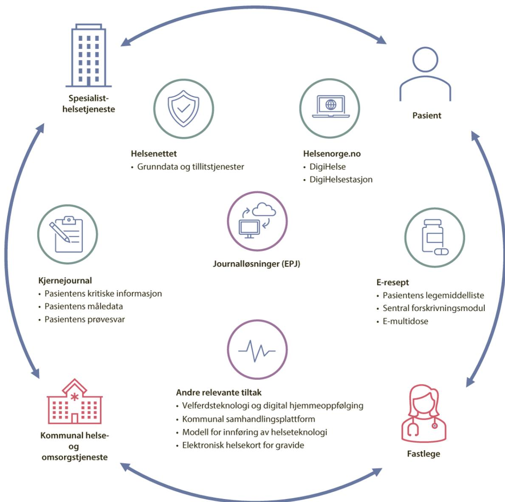

The diagram illustrates a circular ecosystem of healthcare services. At the top right is a patient icon labeled **Pasient**. To the left of the patient is a laptop icon labeled **Helsenorge.no** with bullet points: • DigiHelse • DigiHelsestasjon. Below that is a cloud and monitor icon labeled **Journalløsninger (EPJ)**. To the left of the EPJ is a clipboard icon labeled **Kjernejournal** with bullet points: • Pasientens kritiske informasjon • Pasientens måledata • Pasientens prøvesvar. At the bottom right is a doctor icon labeled **Fastlege**. To the left of the doctor is a hospital icon labeled **Kommunal helse- og omsorgstjeneste**. At the top left is a building icon labeled **Spesialist-helsetjeneste**. In the center, surrounded by these entities, is a shield icon labeled **Helsenettet** with bullet points: • Grunndata og tillitstjenester. A large circular arrow connects the patient, the doctor, the hospital, and the specialist in a clockwise direction.

**Spesialist-helsetjeneste**

**Helsenettet**

- Grunndata og tillitstjenester

**Helsenorge.no**

- DigiHelse
- DigiHelsestasjon

**Journalløsninger (EPJ)**

**Kjernejournal**

- Pasientens kritiske informasjon
- Pasientens måledata
- Pasientens prøvesvar

**E-resept**

- Pasientens legemiddelliste
- Sentral forskrivningsmodul
- E-multidose

**Andre relevante tiltak**

- Velferdsteknologi og digital hjemmeoppfølging
- Kommunal samhandlingsplattform
- Modell for innføring av helseteknologi
- Elektronisk helsekort for gravide

**Kommunal helse- og omsorgstjeneste**

**Pasient**

**Fastlege**

Infographic: Healthcare ecosystem diagram showing components and interactions between patients, specialists, and other entities.

**Figur 3.7 Eksempler på eksisterende løsninger og pågående tiltak for samhandling mellom aktører**

Kilde: Oslo Economics (2024)

De regionale IKT-foretakene og Sykehusinnkjøp HF har en sentral rolle i å koordinere anskaffelser og drift av digitale løsninger i spesialisthelsetjenesten. For å styrke samarbeidet om digital samhandling og helseteknologi i kommunene, har regjeringen og KS inngått en samarbeidsavtale. De siste årene har KS og Helsedirektoratet arbeidet med å etablere arenaer, nettverk og veiledere som skal støtte kommunene i anskaffelse og innføring av journalsystemer og velferdsteknologiske løsninger (KS, 2026). Helseteknologjordningen ble innført i 2024 for å støtte kommunene i digitaliseringsarbeidet. Helsedirektoratet har en sentral rolle i EPJ-løftet med formål å forbedre de elektroniske pasientjournalsystemene til fastleger og avtalespesialister, samt fysio- og manuellterapeuter (Helsedirektoratet, 2026h). Det er fortsatt stor variasjon i kapasitet og

kompetanse for å håndtere oppgavene knyttet til digitalisering, særlig i kommunene og blant fastlegene (NOU 2023: 9; Helsedirektoratet, 2026h).

Sykehusene har felles journalløsning innenfor hver helseregion. Kommunene, med unntak av de som har Helseplattformen, har flere atskilte journalsystemer innad i kommunen, herunder for fastleger og legevakter.

Det er ikke etablert standarder eller systematisk samarbeid om digitale løsninger for hjemmeoppfølging mellom aktørene, og det er ikke etablert felles eller standardiserte driftsløsninger for denne type teknologi.

Helsenorge er den nasjonale innbyggerportalen. Den gir tilgang til generell informasjon, en del individuelle helseopplysninger og digitale dialogtjenester. Innbyggerne i Midt-Norge kan i tillegg benytte HelsaMi som portal. Den er integrert med journalløsningen Helseplattformen. Løsninger for digitale helsetjenester som Helsehjelppiloten og Kommunal nettlege prøves ut i regi av Helsedirektoratet med tanke på at det kan bli nasjonale tjenester via Helsenorge.

Staten har en sentral rolle gjennom ulike tiltak som skal understøtte og styrke samhandlingen i helse- og omsorgstjenesten på tvers av forvaltningsnivåene. De nasjonale e-helseløsningene kjernejournal, helsenorge, e-resept og helsenettet sørger for at definerte helseopplysninger følger pasienten og forenkler samhandlingen mellom aktørene i helse- og omsorgssektoren på noen områder. Mye informasjon utveksles fortsatt i noen få standardiserte elektroniske meldinger (Norsk helsenett, 2026; Oslo Economics, 2024). Nasjonale fellesløsninger som skal sikre deling av spesifikke helseopplysninger mellom virksomhetene, er under innføring, men ikke fullt ut implementert. Det varierer også om og i hvilken grad de benyttes (Oslo Economics, 2024b).

Personvernlovgivningen og regler om taushetsplikt setter rammer for deling og annen behandling av helseopplysninger. I tillegg kommer regler for informasjonssikkerhet knyttet til tekniske løsninger og rutiner. Det er usikkerhet i helsetjenesten om hvilket handlingsrom man har for deling av helseopplysninger internt i egen virksomhet og mellom virksomheter og nivåer. På denne bakgrunn trådte det 1. juli 2026 i kraft flere endringer i plikten til å dele helseopplysninger og taushetspliktsbestemmelsene i helsepersonelloven og pasientjournalloven. Endringene utvider plikten til å dele helseopplysninger både innenfor og mellom virksomheter, samtidig som reglene blir tydeligere og bedre tilpasset digital samhandling.

##### Digitaliseringen av norsk helse- og omsorgssektor

##### *Nasjonale milepæler i utviklingen av digital infrastruktur, styring og samhandling*

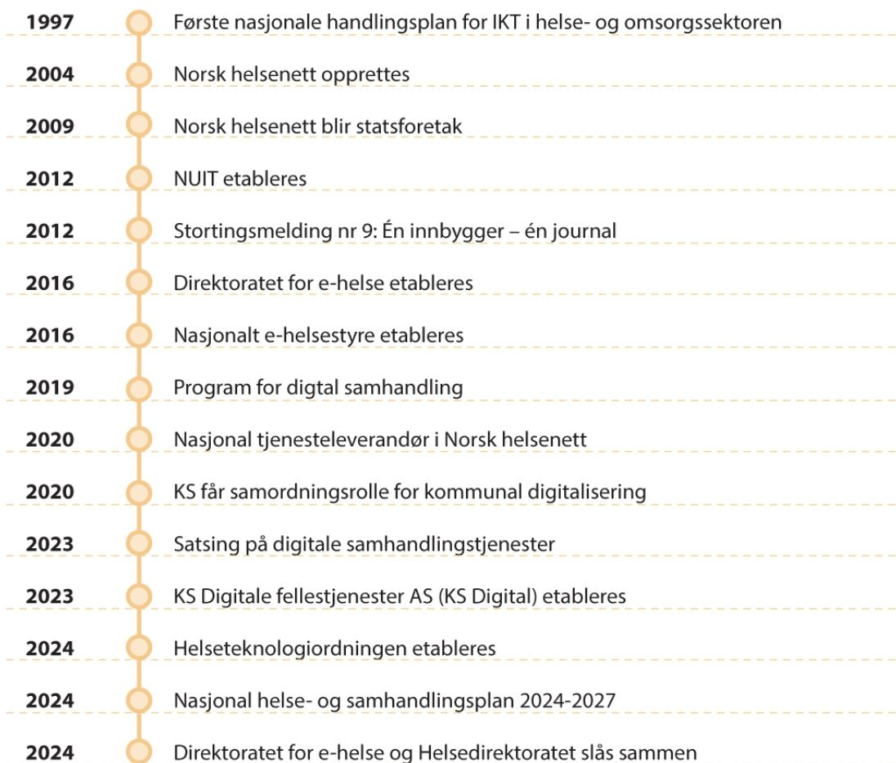

A vertical timeline with a central orange line and circular nodes, showing the following milestones:

|             |                                                                    |
|-------------|--------------------------------------------------------------------|
| <b>1997</b> | Første nasjonale handlingsplan for IKT i helse- og omsorgssektoren |
| <b>2004</b> | Norsk helsenett opprettes                                          |
| <b>2009</b> | Norsk helsenett blir statsforetak                                  |
| <b>2012</b> | NUIT etableres                                                     |
| <b>2012</b> | Stortingsmelding nr 9: Én innbygger – én journal                   |
| <b>2016</b> | Direktoratet for e-helse etableres                                 |
| <b>2016</b> | Nasjonalt e-helsestyre etableres                                   |
| <b>2019</b> | Program for digital samhandling                                    |
| <b>2020</b> | Nasjonal tjenesteleverandør i Norsk helsenett                      |
| <b>2020</b> | KS får samordningsrolle for kommunal digitalisering                |
| <b>2023</b> | Satsing på digitale samhandlingstjenester                          |
| <b>2023</b> | KS Digitale fellestjenester AS (KS Digital) etableres              |
| <b>2024</b> | Helseteknologiordningen etableres                                  |
| <b>2024</b> | Nasjonal helse- og samhandlingsplan 2024-2027                      |
| <b>2024</b> | Direktoratet for e-helse og Helsedirektoratet slås sammen          |

Timeline: Timeline of key milestones in the Norwegian health and digital health sector from 1997 to 2024.

Figur 3.8 Noen nasjonale milepæler i utviklingen av digital infrastruktur, styring og samhandling

Kilde: Helsedirektoratet (2026)

## 4 Helsetjenestesystemene i andre land

I dette kapittelet beskrives helsetjenestesystemene i enkelte andre land som, i likhet med Norge, er kjennetegnet av universell tilgang til tjenester, skattebasert finansiering, hovedsakelig offentlig tjenesteproduksjon, lav egenbetaling og stor oppmerksomhet om rett til likeverdig tilgang uavhengig av økonomi og bosted. I tillegg beskrives Nederland som har en modell med obligatorisk helseforsikring og konkurranse mellom forsikringsselskapene, og der staten setter overordnede prioriteringer, regulerer markedet og overvåker kvalitet, tilgang og kostnader. Gjennomgangen viser at de omtalte landene har samme utfordringer som Norge med økende andel eldre, knapphet på ressurser mv. Landene har likevel forskjellige modeller for organisering, finansiering og styring av tjenestene. De fleste landene har gjennomført, eller er i ferd med å gjennomføre, større helsereformer for å møte utfordringene.

|                                                                                              |  |  |  |  |  |  |
|----------------------------------------------------------------------------------------------|-----------------------------------------------------------------------------------|-----------------------------------------------------------------------------------|-----------------------------------------------------------------------------------|-----------------------------------------------------------------------------------|-------------------------------------------------------------------------------------|-------------------------------------------------------------------------------------|
|                                                                                              | Sverige                                                                           | Danmark                                                                           | Finland                                                                           | Storbritannia                                                                     | Nederland                                                                           | Norge                                                                               |
| Innbyggere (mill.)                                                                           | 10,6                                                                              | 6,0                                                                               | 5,7                                                                               | 69,5 (UK)                                                                         | 18,1                                                                                | 5,6                                                                                 |
| Helseutgifter per capita (PPP-justerte USD)                                                  | 7 871                                                                             | 7 071                                                                             | 6 655                                                                             | 6 747                                                                             | 8 436                                                                               | 9 393                                                                               |
| Helseutgifter som andel av BNP (%)                                                           | 11,3                                                                              | 9,4                                                                               | 10,6                                                                              | 11,1                                                                              | 10,0                                                                                | 9,7                                                                                 |
| Offentlige helseutgifter som andel av totale helseutgifter (%)                               | 86                                                                                | 83                                                                                | 76                                                                                | 82                                                                                | 69                                                                                  | 86                                                                                  |
| Leger/1000 innbyggere                                                                        | 4,5                                                                               | 4,5                                                                               | 2,9                                                                               | 3,4                                                                               | 3,9                                                                                 | 5,0                                                                                 |
| Sykepleiere/ 1000 innbyggere                                                                 | 11,0                                                                              | 10,5                                                                              | 12,7                                                                              | 9,1                                                                               | 11,1                                                                                | 15,6                                                                                |
| Forventet levealder                                                                          | 83,4                                                                              | 81,8                                                                              | 81,6                                                                              | 81,0                                                                              | 81,9                                                                                | 83,1                                                                                |
| Spedbarnsdødelighet/ 1000 levendefødte                                                       | 2,0                                                                               | 2,4                                                                               | 1,9                                                                               | 4,1                                                                               | 3,4                                                                                 | 2,0                                                                                 |
| 30 dagers dødelighet etter sykehusinnleggelse for akutt hjerteinfarkt (per 100 innleggelser) | 3,4                                                                               | 4,5                                                                               | 7                                                                                 | 6,4                                                                               | 2,9                                                                                 | 2,6                                                                                 |
| 30 dagers dødelighet etter sykehusinnleggelse for hjerneslag (per 100 innleggelser)          | 4,9                                                                               | 4,9                                                                               | 9,4                                                                               | 8,5                                                                               | 5,1                                                                                 | 4,0                                                                                 |
| Andel av befolkningen med dårlig eller svært dårlig selvrapportert helse (%)                 | 8,0                                                                               | 7,7                                                                               | 6,1                                                                               | 8,3                                                                               | 6,0                                                                                 | 9,7                                                                                 |

Figur 4.1 De nordiske landene, Storbritannia og Nederland i tall

Kjøpekraftspariteter (PPP) er kursen mellom to valutaer som gir hver av valutaene samme kjøpekraft i begge land (Kjøpekraftparitet, u.å). Variasjon i produksjon og priser på olje og gass påvirker helseutgiftenes andel av Norges BNP. Helseutgifter som andel av fastlands-Norge har ligget stabilt på mellom 12 og 13 prosent (Lindstrøm & Utne, 2023). Rapporten Health at a Glance publiserer ikke helseutgifter som andel av fastlands-Norge. Rapporten publiserer kun tall for Storbritannia som helhet.

Kilde: OECD (2025a)

### 4.2 Sverige

Det er 21 fylker (län) som har hovedansvar for å finansiere, organisere og levere helsetjenester til befolkningen. De 290 kommunene har ansvar for blant annet omsorgstjenester til eldre og tjenester til personer med funksjonsnedsettelser. Staten fastsetter det overordnede politiske og regulatoriske rammeverket. Fylkene og kommunene har stor lokal frihet. Helsetjenesten i Sverige kjennetegnes av høy andel offentlig finansiering, universell dekning, bruk av moderne teknologi og generelt gode resultater, men har utfordringer med lange ventetider til behandling i sykehus, manglende kontinuitet i helse- og omsorgstjenestene i distriktene og ulikheter mellom sosioøkonomiske grupper (Janlöv mfl., 2023).

#### Organisering, styring, planlegging og finansiering

Staten setter rammer gjennom lovgivning, nasjonale mål og prioriteringer, tilsyn, finansielle insentiver og nasjonale retningslinjer. Store nasjonale tiltak og reformer gjennomføres gjennom avtaler mellom staten og fylkene (Ekspertutvalget for gjennomgang av allmennlegetjenesten, 2023).

Hvert fylke og hver kommune har folkevalgte som fatter beslutninger i saker innenfor fylkets eller kommunens ansvarsområde. Både fylker og kommuner opererer innenfor rammene av det kommunale selvstyret, og har stor autonomi når det gjelder organisering, finansiering og prioritering av ressursbruk mellom oppgavene de har ansvar for.

Fylkene har ansvar for både spesialisthelsetjenester og primærhelsetjenester, herunder allmennleger. De fleste sykehusene er eid og drevet av fylkene. Fylkene samarbeider i seks større geografiske områder (samarbeidsregioner) om spesialisert medisinsk behandling til befolkningen. Hver samarbeidsregion har minst ett universitetssykehus (Janlöv mfl., 2023).

Primærhelsetjenesten er i hovedsak organisert rundt vårdcentraler<sup>1</sup> med ansvar for befolkningen innenfor et geografisk område. En vårdcentral består av både allmennleger og annet helsepersonell (f.eks. sykepleiere, psykologer, jordmødre, fysioterapeuter og ergoterapeuter mv.) som jobber i team. Bemanningen på vårdcentralen varierer mellom urbane og rurale strøk (Ekspertutvalget for gjennomgang av allmennlegetjenester, 2023). Det er fri etablering for private tilbydere av primærhelsetjenester som tilfredsstiller fylkenes krav til etablering. Det innebærer at de 21 fylkene selv kan fastsette vårdcentralenes ansvarsområder samt vilkårene for betaling og kompensasjonsnivåer. Alle primærhelsetjenesteytere som oppfyller kravene som fylkene har

---

<sup>1</sup>Vårdcentraler kalles også for husläkarmottagning, familjeläkarmottagning, hälsocentral, hälsovårdscentral eller distriktsläkarmottagning ([www.1177.se](http://www.1177.se)).

fastsatt, har rett til å inngå avtale og motta godtgjørelse fra fylket når de yter helsetjenester i samsvar med avtalen (Janlöv mfl., 2023). I 2021 var om lag 45 prosent av vårdcentralene driftet av private og 55 prosent driftet av fylkene (Ekspertutvalget for gjennomgang av allmennlegetjenesten, 2023). Pasienter kan oppsøke spesialister i og utenfor sykehus uten henvisning (Nordisk samarbeid, u.å.).

Fylkene finansierer i hovedsak helsesektoren gjennom skatteinntekter. I tillegg er det overføringer fra staten til fylkene for å utjevne inntekts-, behovs- og kostnadsforskjeller utenfor fylkenes direkte kontroll. Om lag 64 prosent av fylkenes kostnader finansieres av egne utskrevne skatter. Fylkenes andel av finansieringen har blitt gradvis redusert fra 2015 og fram til i dag, mens andelen statlig finansiering gradvis har økt (Janlöv mfl., 2023).

Finansieringsordningene for vårdcentralene varierer og vilkårene og finansieringen fastsettes av fylkene. Basisfinansiering utgjør den største delen av finansieringen til vårdcentralene, og den varierer mellom fylkene fra 60 til 90 prosent. (Ekspertutvalget for gjennomgang av allmennlegetjenesten, 2023). Sykehusene er i hovedsak finansiert gjennom en kombinasjon av basisbevilgning og aktivitetsbasert finansiering.

Siden 2016 har de fleste fylkene gjort større investeringer for å kunne renovere eller bygge nye sykehus, og nivået på fylkenes lånegjeld har økt. Investeringer i sykehus og andre helsefasiliteter finansieres gjennom skatteinntekter og statlige tilskudd. De fleste fylkene er medlemmer av kredittinstituttet Kommuninvest, som er et finansielt samarbeid mellom fylker og kommuner som finansierer en stor del av investeringene. Fylker uten medlemskap i Kommuninvest får mesteparten av sin finansiering gjennom lån direkte i kapitalmarkedet (Janlöv mfl., 2023).

Kommunene har ansvaret for blant annet omsorgstjenester til eldre og funksjonshemmede, helsetjenester til ferdigbehandlede og utskrevne pasienter og for skolehelsetjeneste. Kommunene finansierer mesteparten av sine tjenester gjennom skatteinntekter, statlige tilskudd og overføringer.

##### Reformer

God och nära vård-reformen startet i 2018 og er en pågående omstilling av helse- og omsorgstjenestene. Målene med reformen er at primærhelsetjenesten skal bli navet i omsorgen, at tjenestene skal bli mer tilgjengelige, mer personsentrerte og at samarbeidet mellom primærhelsetjenesten, spesialisthelsetjenesten og omsorgstjenesten skal styrkes (OECD, 2025b). Reformer i spesialisthelsetjenesten omfatter etablering av et nasjonalt system for kunnskapsstyring og regulering av nasjonale tjenester. Viktige tiltak inkluderer seks samarbeidende regionale kraftsentre og det nasjonale systemet for kunnskapsbasert styring, som organiserer helsetjenestene i 26 nasjonale programområder. Lovgivning fra 2018 begrenser nasjonal høyspesialisert medisinsk behandling til fem enheter som oppfyller bestemte kriterier (Janlöv mfl., 2023). Det er også etablert en ventetidsgaranti som gir pasienter rett til behandling innen fastsatte tidsrammer.

#### Utredning av statlig eierskap for helse- og omsorgstjenestene

I 2023 nedsatte regjeringen en parlamentarisk komité som skulle utrede og utarbeide et beslutningsgrunnlag som skulle legge til rette for en mulig innføring av helt eller delvis statlig eierskap for helse- og omsorgstjenesten. Komiteen skulle vurdere fordeler og ulemper ved ulike

styringsmodeller og foreslå tiltak for bedre statlig styring og ansvar. SOU 2025:62 *Ansvaret för hälso- och sjukvården* ble lagt fram i 2025. Komiteen beskrev utfordringer med å rekruttere personell, manglende sammenheng i helse- og omsorgstjenestene, for lang ventetid til behandling og ulik tilgang til behandling, diagnostikk, hjelpemidler og legemidler avhengig av hvor man bor i landet og av sosioøkonomiske forhold.

Komiteen mente at det ikke forelå et kunnskapsgrunnlag som tilsa at statlig hovedansvar ville gi forbedringer. Komiteen pekte på at statlig overtakelse kan ha fordeler, som for eksempel enhetlig styring og besparelser i administrative ressurser. Ulemper ved statlig overtakelse handlet blant annet om risiko for mange og motstridende styringssignaler i store og komplekse systemer.

Komiteen anbefalte heller ikke delvis statlig eierskap for helse- og omsorgstjenesten. Modellen ble vurdert å være komplisert og lite effektiv, og komiteen mente at det er mulig å forandre ansvarsfordelingen mellom fylkene og staten på andre måter enn ved å overføre ansvaret til staten. Komiteen mente samtidig at staten burde ta et større systemansvar, blant annet for å styre innhold og for å følge opp fylkenes virksomhet. Komiteen anbefalte også at staten tar et større ansvar på områder som tilgang til kompetanse, legemidler, vaksinasjon, screening, luftambulanse, pasienttransport og behandling i tvungent psykisk helsevern.

Komiteen anbefalte videre at statens styring av helse- og omsorgstjenestene burde forbedres, blant annet ved at øremerkede tilskudd kun skal brukes unntaksvis. Komiteen mente at statlige styringssignaler er omfattende, kortsiktige og detaljerte, og at staten bør gi fylkene forutsetninger for langsiktig planlegging. Videre pekte komiteen på at statens ansvar og kontroll bør styrkes, slik at pasientenes rettigheter innfris og at lovverk etterleves.

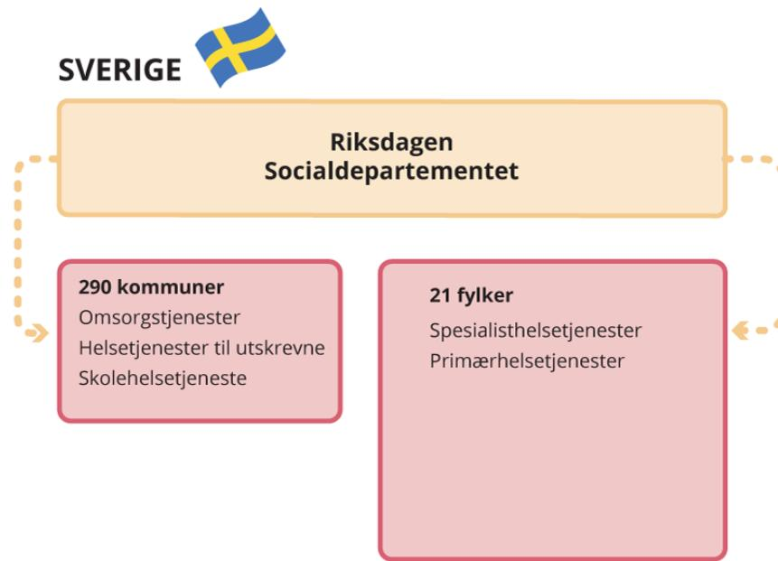

**SVERIGE**

**Riksdagen  
Socialdepartementet**

**290 kommuner**  
Omsorgstjenester  
Helsetjenester til utskrevne  
Skolehelsetjeneste

**21 fylker**  
Spesialisthelsetjenester  
Primærhelsetjenester

The infographic shows a hierarchy starting with the Swedish flag and the text 'SVERIGE'. A large orange box labeled 'Riksdagen Socialdepartementet' is at the top. Below it, two pink boxes represent local levels: '290 kommuner' with services like Omsorgstjenester, Helsetjenester til utskrevne, and Skolehelsetjeneste; and '21 fylker' with services like Spesialisthelsetjenester and Primærhelsetjenester. Dashed arrows connect the top box to the two below.

```
graph TD; A[Riksdagen Socialdepartementet] --> B[290 kommuner  
Omsorgstjenester  
Helsetjenester til utskrevne  
Skolehelsetjeneste]; A --> C[21 fylker  
Spesialisthelsetjenester  
Primærhelsetjenester];
```

**290 kommuner**  
Omsorgstjenester  
Helsetjenester til utskrevne  
Skolehelsetjeneste

**21 fylker**  
Spesialisthelsetjenester  
Primærhelsetjenester

Infographic: Swedish healthcare structure showing Riksdagen Socialdepartementet and local services. Flag of Sweden

Figur 4.2 Illustrasjon av helsetjenestesystemet i Sverige

### 4.3 Danmark

Det er regionene som har ansvar for både spesialisthelsetjenesten og primærhelsetjenesten. I 2024 ble en ny reform vedtatt som svar på utfordringer med demografiske endringer, en økende andel

innbyggere som får behov for helse- og omsorgstjenester, mangel på helsepersonell og ulikhet i helsetjenestetilbudet. Reformen innebærer blant annet ny struktur med fire regioner, etablering av såkalte Sundhedsråd og overføring av oppgaver fra kommuner til regioner. Reformen skal etter planen være gjennomført med virkning fra 2027.

#### Organisering, styring, planlegging og finansiering

Staten har det overordnede ansvaret for regulering, planlegging, finansiering, tilsyn og for strategiske og koordinerende oppgaver (Myndigheten för vård- och omsorgsanalys, 2024; Birk mfl., 2024). Den statlige styringen av helse- og omsorgstjenestene er relativt sterk som følge av at staten tok et større ansvar for å planlegge og finansiere tjenestene i forbindelse med strukturreformen i 2007.

Regionene har sørge-for-ansvaret for både spesialisthelsetjenester og primærhelsetjenester. Regionene styres av regionrådet, som er et folkevalgt organ. Regionenes viktigste oppgaver er helsetjenester, men de har også oppgaver innen samferdsel, miljø og utdanning. Det er fem regioner som reduseres til fire fra 2027, som ledd i den danske Sundhedsreformen.

Regionene har ikke beskatningsrett. De får inntektene fra statlig rammetilskudd (om lag 83 prosent av inntektene), kombinert med resultatbasert finansiering fra staten som gjenspeiler kontinuitet i behandlingen (om lag 1 prosent), og kommunal medfinansiering for tjenester som ytes til innbyggerne i kommunen (om lag 16 prosent) (Birk mfl., 2024).

Sykehusene er i hovedsak offentlige, men private sykehus og klinikker utgjør et supplement, særlig når regionene ikke oppfyller ventetidsgarantier (Einarsson & Kight, 2026). Regioner inngår avtale med private aktører (allmennleger, legespesialister, tannleger, fysioterapeuter, kiropraktorer mv.) om å levere lovpålagte primærhelsetjenester.

Det lages årlige økonomiavtaler mellom staten og regionene. Sykehusene finansieres delvis gjennom aktivitetsbasert finansiering og delvis gjennom en fast ramme. De fleste allmennmedisinske tilbudene er organisert i mindre enheter drevet av selvstendig næringsdrivende leger med avtaler med regionene. Allmennlegetjenestens finansiering er basert på en kombinasjon av fast basistilskudd og aktivitetsbasert finansiering (Ekspertutvalget for gjennomgang av allmennlegetjenesten, 2023). Allmennlegen har en portvaktfunksjon ved henvisninger til spesialisthelsetjenesten, spesialister og også til noen kommunale tjenester (Birk mfl., 2024).

Kommunene har beskatningsrett og styres av folkevalgte. De 98 kommunene har ansvar for rehabilitering utenfor sykehus, hjemmebasert og institusjonsbasert langtidsomsorg, tannhelsetjenester for barn, unge og sårbare grupper samt folkehelsearbeid (Myndigheten för vård- och omsorgsanalys, 2024). Flere kommunale oppgaver overføres fra kommunene til regionene som ledd i Sundhedsreformen.

##### **Boks 4.1 Sundhedsreformen i korte trekk**

- Ny struktur: fire regioner, 17 sundhedsråd, målretting av midler til de nære helsetjenestene, overføring av oppgaver fra kommuner til regioner

- Legereform: en mer nasjonalt styrt fordeling av leger innen allmennmedisin, sykehusmedisin og avtalespesialister
- Sammenheng mellom psykiatri og somatikk: organisatorisk samling av psykiatri og somatisk medisin, kapasitetsløft og utbredelse av digitale løsninger i psykiatrien
- Ny organisering av digitalisering: etablering av Digital Helse-Danmark, ny statlig planleggingskompetanse, Nasjonalt senter for helseinovasjon mv.
- Behandling nærmere pasienten: standarder for helse- og omsorgsplasser, folkehelselov, hjemmebehandlingsteam, 96-timers behandlingsansvar mv.
- Kronikerpakker og nye pasientrettigheter: styrket fritt valg i de nære helsetjenestene, rask tilgang til praktiserende spesialister, nye kronikerpakker og rett til rask utredning og behandling

Kilde: Indenrigs- og Sundhedsministeriet, u.å.

###### **Rammeslutt**

##### **Reformer**

Gjennom strukturreformen i 2007 ble de tidligere amtene slått sammen til fem større regioner, styrt av folkevalgte, og som fikk eierskapet til sykehusene. Reformen innebar også en reduksjon i antall kommuner fra 270 til 98, overføring av flere oppgaver til kommunene og en bedre modell for fordeling av ressurser mellom regioner og mellom kommuner. Det meste av primærhelsetjenestene, inkludert omsorgstjenestene, ble værende i kommunene, mens allmennlegene fulgte med amtskommunene til regionene (Hagen, 2025).

Bakgrunnen for strukturreformen var at mange kommuner og amter var for små til å bære kostnadene for velferden, og uklar ansvarsfordeling mellom stat og amt førte til svak kostnadskontroll. Det var et mål å få bedre kontroll over kostnadene ved å innføre to beskatningsnivåer i stedet for tre, samtidig som man så en mulighet til å effektivisere helse- og omsorgstjenestene. Med større regioner og kommuner skulle styringen bli enklere og tydeligere, og man ville få bedre forutsetninger for å etablere en mer hensiktsmessig sykehusstruktur. Mer nasjonal styring skulle bidra til økt likhet og effektivitet (Myndigheten för vård och omsorgsanalys, 2024).

##### **Boks 4.2 Sundhedsrådene**

Sundhetsrådene er et samarbeidsorgan mellom region, fastlege og kommunene. De settes sammen av folkevalgte fra regionrådet og folkevalgte medlemmer fra kommunene i deres geografiske område. Regionrådets medlemmer har leder og nestlederfunksjonen og er i flertall i rådet. Sundhedsrådene ivaretar følgende oppgaver innenfor et geografisk område:

- det politiske ansvaret for strategi og planlegging av drift av sykehusene
- lokal planlegging av det allmennmedisinske tilbudet og avtalespesialister
- helseoppgavene som flyttes fra kommunene til regionene
- oppgaver på sosialområdet

Sundhetsrådene skal treffe beslutninger som skal bidra til nødvendig omstilling og utbygging av de nære helsetjenestene. Det innebærer å bygge opp og styrke kapasiteten i de nære helsetilbudene, omstilling til mer utadvendte sykehus og tilby tjenester tettere på og i innbyggernes hjem. Sundhedsrådene skal bidra til et tettere samarbeid på tvers av sektorene. Sundhedsrådene skal lage nærsundhetsplaner som skal bidra til å implementere omstillingen av sykehusene og utbyggingen av de nære helsetjenestene.

Kilde: Indenrigs- og Sundhedsministeriet, u.å.

###### Rammeslutt

I 2024 vedtok Folketinget en ny reform, Sundhedsreformen. Reformen bygger på Sundhedsstrukturkommissionens utredning, som pekte på et økende gap mellom behov for tjenester og helsetjenestens evne til å levere tilgjengelige og sammenhengende tjenester. Reformens mål er mer behandling og tjenester nær innbyggernes hjem, bedre fordeling av ressurser over hele landet og bedre koordinering mellom nivåene i helsetjenesten. Reformen innebærer en endring av organiseringen av helse- og omsorgstjenesten. Danmark går fra fem til fire regioner ved at Region Sjælland og Region Hovedstaden slås sammen. Samtidig flyttes følgende oppgaver fra kommunene til regionen: akutsygepleje<sup>2</sup>, genoptræning (avansert rehabilitering), pasientrettet forebygging og sundheds- og omsorgspladser (korttidsplasser). Kommunene beholder ansvaret for blant annet eldreomsorg og forebygging. Det opprettes 17 sundhedsråd som skal understøtte den nye ansvarsfordelingen. Sundhedsrådene består av politiske representanter fra både regioner og kommuner, som skal planlegge, finansiere og koordinere helsetjenester lokalt. Reformen skal etter planen være gjennomført med virkning fra januar 2027 (Indenrigs- og Sundhedsministeriet, u.å.)

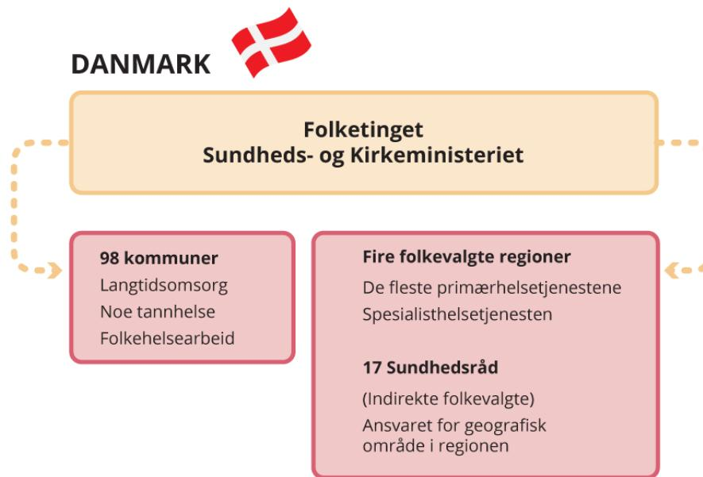

**DANMARK**

**Folketinget  
Sundheds- og Kirkeministeriet**

**98 kommuner**  
Langtidsomsorg  
Noe tannhelse  
Folkehelsearbeid

**Fire folkevalgte regioner**  
De fleste primærhelsetjenestene  
Spesialisthelsetjenesten

**17 Sundhedsråd**  
(Indirekte folkevalgte)  
Ansvaret for geografisk område i regionen

The infographic shows a hierarchy from the Danish Parliament and Ministry of Health and Church to 98 municipalities, 4 elected regions, and 17 health councils.

```
graph TD; A["Folketinget<br>Sundheds- og Kirkeministeriet"] --> B["98 kommuner<br>Langtidsomsorg<br>Noe tannhelse<br>Folkehelsearbeid"]; A --> C["Fire folkevalgte regioner<br>De fleste primærhelsetjenestene<br>Spesialisthelsetjenesten"]; A --> D["17 Sundhedsråd<br>(Indirekte folkevalgte)<br>Ansvaret for geografisk område i regionen"];
```

**Folketinget  
Sundheds- og Kirkeministeriet**

**98 kommuner**  
Langtidsomsorg  
Noe tannhelse  
Folkehelsearbeid

**Fire folkevalgte regioner**  
De fleste primærhelsetjenestene  
Spesialisthelsetjenesten

**17 Sundhedsråd**  
(Indirekte folkevalgte)  
Ansvaret for geografisk område i regionen

Infographic: Danish health and social services structure and governance. Danish flag

**Figur 4.3** Illustrasjon av helsetjenestesystemet i Danmark

<sup>2</sup>Akutsygepleje beskrives slik: «I dag har kommunerne ansvaret for sygepleje til borgere i tilfælde af akut eller kronisk sygdom, hvor det er nødvendig med sygeplejefaglig indsats udenfor hospitalerne. Betegnelsen «akutsygepleje» dækker over den specialiserede del af den nuværende kommunale sygepleje» (Indenrigs- og Sundhedsministeriet, u.å.).

### 4.4 Finland

Ansvaret for helse- og omsorgstjenestene er delt mellom staten og 21 nyopprettede velferdsområder samt Helsingfors by. Staten har ansvaret for finansiering, overordnet planlegging, styring og tilsyn. Sosial- og helsereformen som ble innført i 2023, innebar sterkere statlig styring og etablering av velferdsområdene.

Helse- og sykehustjenestene hadde i lang tid hatt utfordringer med lange ventetider, geografiske forskjeller i tilgang til tjenester, mangel på kompetanse, endringer i utgifter og utilstrekkelig regionalt og nasjonalt samarbeid. Utfordringer med en aldrende befolkning med færre i yrkesaktiv alder og reduserte skatteinntekter var også viktige begrunnelser for reformen (Myndigheten för vård- och omsorgsanalys, 2024). Forut for reformen var ansvaret for helse- og omsorgstjenester, inkludert sykehusene, lagt til kommunene.

#### Organisering, styring, planlegging og finansiering

Velferdsområdene har ansvar for å tilby helse- og omsorgstjenester, sosialtjenester, eldreomsorg og brann- og redningstjeneste. Velferdsområdene har også ansvaret for tannhelsetjenester (Karanikolos mfl., 2024).

Velferdsområdene er et nytt regionalt administrativt nivå med politisk styring. Hvert område har et velferdsdistriktsråd som oppnevnes gjennom allmenne valg. Velferdsdistriktsrådet har virksomhets- og økonomiansvar og selvstendig beslutningsmyndighet, men har ikke beskatningsrett. Staten finansierer helse- og omsorgstjenestene. Velferdsområdene driver hovedsakelig helse- og omsorgstjenestene selv, men kan inngå avtaler med private aktører.

Sykehusbehandling tilbys ved distrikts-, sentral- og universitetssykehus. Hvert velferdsområde er organisert i samarbeidsområder rundt de fem universitetssykehusene. Samarbeidsområdene bestemmer organiseringen av tjenester på universitetsnivå (regionsykehusnivå) og fordeler ansvarsområder mellom sykehusene (Hagen, 2025).

Primærhelsetjenesten har tradisjonelt vært basert på tverrfaglig teamarbeid i helsesentre (Ekspertutvalget for gjennomgang av allmennlegetjenesten, 2023). Personalet på helsesentrene omfatter vanligvis både allmennleger, sykepleiere og annet helsepersonell. Hovedregelen er offentlig ansatte allmennleger, med unntak av en del helsesentre i utkantkommuner som driftes av helprivate selskaper. Hoveddelen av arbeidsstyrken benytter bedriftshelsetjenesten til allmennlegetjenester, individuell forebygging og rehabilitering (Oslo Economics, 2026). Allmennlegenes avlønningsordninger varierer med spesifikke arbeidsoppgaver og kvalifikasjoner. I 2019 var det vanligst med fast lønn med ekstra aktivitetsbasert finansiering (Ekspertutvalget for gjennomgang av allmennlegetjenesten, 2023).

Kommunene har etter reformen ansvar for folkehelse og miljørettet helsevern, i tillegg til barnehage, undervisning, idrett og kultur.

##### Reformer

Sosial- og helsereformen i 2023 omfattet både helse- og sykehustjenester, sosialtjenesten og redningstjenesten. Reformen innebar at ansvaret for disse områdene ble overført fra kommunene til

21 nyopprettede velferdsområder samt Helsingfors by. Kommunene hadde tidligere ansvar for primærhelsetjenester, men også et felles ansvar for sykehustjenester som var organisert som 20 såkalte «helsedistrikter» eid av interkommunale samarbeidsorganer, såkalte «samkommuner» (Myndigheten för vård- och omsorgsanalys, 2024). Formålet med sosial- og helsereformen var å fremme og opprettholde befolkningens velferd og helse og å sikre likeverdige, samordnede og kostnadseffektive sosial- og helsetjenester i hele landet. Ifølge rapporten *Strukturreformer i Norden* (Myndigheten för vård- och omsorgsanalys, 2024) var målet å:

- redusere forskjellene i velferd og helse
- imøtekomme trygge, likeverdige tjenester og tjenester med høy kvalitet
- fremme tilgangen til tjenester og øke tilgjengeligheten
- trygge tilgangen til kompetent arbeidskraft
- håndtere utfordringer som aldrende befolkning og redusert tilbud samt dempe kostnadsøkningen i de offentlige utgiftene
- styrke velferdsområdenes organiseringsansvar og forpliktelse for å trygge helse- og sykehustjenester og sosialtjenester i alle situasjoner
- skape en enhetlig tjenestestruktur med sterkere aktører gjennom å samle tjenestene under en beslutningstaker, ledelse og ett budsjett
- endre virksomheten slik at tyngdepunktet ligger på primærhelsetjenesten og forebyggende arbeid

Av forarbeidene til reformen framgår det at strukturen og finansieringssystemene ikke lenger kunne sikre likeverdige tjenester til befolkningen, og at ansvaret for helse- og sykehustjenestene og sosialtjenesten burde overføres til aktører som er større enn de enkelte kommunene. Sentraliseringen av helse- og sykehustjenestene og sosialtjenesten til velferdsområdene skulle skape stordriftsfordeler og effektivisere dimensjonering av tjenestene. Kostnadskontroll og mer sammenhengende tjenester var også viktige motiver (Myndigheten för vård- och omsorgsanalys, 2024).

##### Statlig ansvar for planlegging og finansiering

Gjennom reformen overtok staten finansieringsansvaret for helse- og sykehustjenestene og sosialtjenestene fra kommunene og innførte nasjonal styring i form av prinsipper og mål, som skal revideres hvert fjerde år. Staten har dermed en sentral rolle i både styring og finansiering av tjenestene. Velferdsområdene organiserer tjenestene, men staten setter rammene, finansierer tjenestene og følger dem tett opp gjennom nasjonale mål og økonomiske rammer.

Ett element i reformen var å innføre årlige forhandlinger mellom staten og velferdsområdene om investerings- og tjenesteplaner. Institutet för hälsa och välfärd (THL) har en viktig rolle med å støtte planlegging og styring på nasjonalt, regionalt og lokalt nivå. Instituttet skal hvert år evaluere resultatene i velferdsområdene. THL støtter også regjeringen med kunnskapsgrunnlag i de årlige forhandlingene mellom staten og velferdsområdene om investerings- og serviceplaner.

Før reformen var finansieringsansvaret for helse- og sykehustjenestene delt mellom staten og kommunene. Over halvparten av alle offentlige midler på helse- og sykehusområdet kom fra kommunene, men også det nasjonale sykeforsikringssystemet hadde en sentral rolle i finansieringen. Kostnadene for kommunenes virksomhet har minsket betydelig ettersom de ikke

har ansvaret for helse- og sykehustjenester eller sosialtjenester. Kommunale inntekter er overført til staten gjennom endringer i skattesystemet. Statens inntektsskatt og andel av inntektene fra samfunnsskatten økes i tilsvarende grad som kommunenes skatteinntekter reduseres (Myndigheten för vård- och omsorgsanalys, 2024).

##### **Sentralisering av beslutninger om investeringer**

Reformen innebar at velferdsområdene overtok kommunenes eiendommer, leieavtaler og eierandeler i eiendomsselskaper. Kommunene hadde over tid underinvestert, samtidig som mange sykehusdistrikt startet opp store investeringsprogrammer og bygde nye sykehus kort tid før reformen. Dette skjedde til tross for at Finland i 2016 vedtok en lov om midlertidig begrensning i store investeringer i bygg innenfor sosial- og helsetjenesten. Sosial- og helsedepartementet kunne gi dispensasjon for nødvendige investeringer. I perioden 2016–2019 ble det gitt dispensasjon for til sammen 93 investeringsprosjekter som utgjorde 3,7 milliarder euro. Gjennom reformen forsterkes den statlige styringen ved at regjeringen skal godkjenne velferdsområdenes investeringer. Det er forventet at den framtidige investeringstakten vil øke lånebelastningen for velferdsområdene (Myndigheten för vård- och omsorgsanalys, 2024).

##### **Midtveisevaluering av reformen**

Tre år etter at sosial- og helsereformen trådte i kraft, er den nye hovedstrukturen etablert. Midtveisevalueringen viser at reformen er gjennomført under krevende økonomiske forhold, men at systemet har håndtert omstillingen bedre enn det den offentlige debatten har gitt inntrykk av (Einarsson & Kight, 2026). I de første årene har velferdsområdene gjennomført omfattende tilpasninger i tjenestene og organisasjonen for å håndtere økonomiske underskudd, men har i hovedsak klart å opprettholde og videreutvikle tjenestene (Einarsson & Kight, 2026). Evalueringen viser at befolkningens tillit til helse- og omsorgstjenestene har sunket når det gjelder tilgang til tjenester og kvalitet på tjenester. Det kan både gjenspeile den offentlige debatten om velferdsområdene, men kan også ha sammenheng med avstanden mellom reformen, lokale behov og innbyggernes behov (Haveri mfl., 2026). Evalueringen viser også at likeverdigheten har blitt bedre, men at det er store forskjeller mellom velferdsområdene (Haveri mfl., 2026). Reformens strukturelle endringer har dermed ennå ikke fullt ut ført til mer likeverdig tilgang til tjenester i praksis (Einarsson & Kight, 2026).

Spørsmålet som kommer tydeligst fram i midtveisevalueringen, er spørsmålet om forholdet mellom statlig styring og regionalt ansvar for gjennomføringen. Færre organisatoriske nivåer har forenklet den politiske styringen og tydeliggjort ansvaret for tjenestene. Samtidig har velferdsområdene et bredt ansvar for å organisere og utvikle virksomheten, men handlingsrommet formes i stor grad av nasjonale finansieringsrammer og lovpålagte krav til tjenestene. Midtveisevalueringen anbefaler at det finske parlamentet tar stilling til om velferdsområdenes selvstendighet bør styrkes, eller om statens rolle i styringen bør videreutvikles. På kort sikt bør også antallet velferdsområder vurderes idet 21 velferdsområder innebærer at flere områder har et relativt lite befolkningsgrunnlag (Einarsson & Kight, 2026; Haveri mfl., 2026).

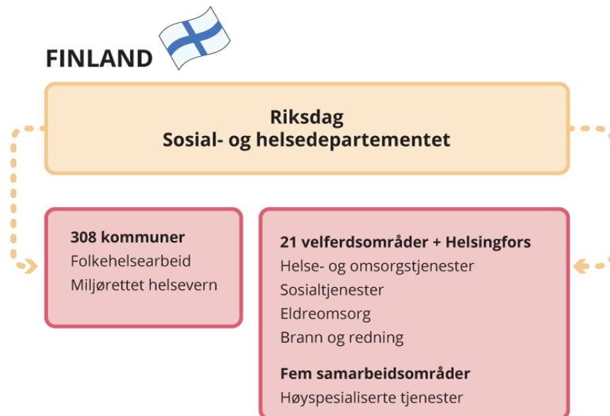

**FINLAND**

**Riksdag**  
**Sosial- og helsedepartementet**

**308 kommuner**  
Folkehelsearbeid  
Miljørettet helsevern

**21 velferdsområder + Helsingfors**  
Helse- og omsorgstjenester  
Sosialtjenester  
Eldreomsorg  
Brann og redning

**Fem samarbeidsområder**  
Høyspesialiserte tjenester

The infographic shows a hierarchy from the Riksdag (Parliament) and Sosial- og helsedepartementet down to 308 municipalities and 21 welfare areas, with specific services listed for each.

Infographic about the Finnish social and health department structure. Flag of Finland

Figur 4.4 Illustrasjon av helsetjenestesystemet i Finland

### 4.5 Storbritannia

Storbritannia, det vil si England, Skottland, Wales og Nord-Irland, har offentlig finansierte helsetjenester. Den offentlige helsetjenesten finansieres primært gjennom skatteinntekter. Helsetjenestene er universelle og er i hovedsak fritt tilgjengelige for dem som har permanent opphold i Storbritannia. De enkelte landene overtok ansvaret for helsesektoren i 1999 som del av økt indre selvstyre. Det har ført til større ulikheter i hvordan helsetjenestesystemene er organisert, men landene har flere av de samme utfordringene: å levere et økende behov for helsetjenester framover, mangel på helsepersonell, lange ventetider til behandling og dårlige resultater på helseindikatorer, blant annet forventet levealder, spedbarnsdødelighet og kreftoverlevelse (Anderson mfl., 2022). England og Skottland er nærmere beskrevet under.

#### 4.5.1 England

Department of Health and Social Care har det overordnede ansvaret for mål, regulering og kontroll med helse- og omsorgstjenestene. National Health Service (NHS) England er underlagt departementet og har hatt en sentral rolle med å omsette politikk til styring. NHS England fastsetter prioriteringer og kvalitetskrav, fordeler midler og følger opp resultater. Fra 2027 blir oppgavene til NHS delvis overført til departementet som del av en større reform.

England er organisert i geografiske samarbeidsstrukturer (Integrated Care Systems) som har ansvar for å planlegge, prioritere, finansiere og levere helsetjenester til innbyggerne i sitt geografiske område.<sup>3</sup> Formålet er å samordne helse- og omsorgstjenester lokalt slik at de blir mer tilpasset befolkningens behov. I hver av samarbeidsstrukturene er det et Integrated Care Board som har en planleggings- og bestillerfunksjon, og som mottar finansiering fra NHS England, blant annet basert

<sup>3</sup>Det er 42 Integrated Care Systems som reduseres til om lag 26, som ledd i den pågående helsereformen.

på befolkningsstørrelsen i området. De kjøper tjenester fra helseleverandører og står til ansvar overfor NHS England for forbruk og resultater.

De offentlige sykehusene er enten organisert som foretak direkte underlagt helsemyndighetene (NHS trust) eller som mer selvstyrte (semiautonome) enheter (NHS foundation trusts). NHS foundation trusts har en friere stilling enn NHS trusts. De kan blant annet låne fra kommersielle banker og eventuelle overskudd kan reinvesteres i virksomheten. NHS trusts og NHS foundation trusts har kontrakt med et Integrated Care Board. Større investeringer finansieres av egne statlige bevilgninger i tråd med nasjonale planer og prioriteringer.

De fleste primærhelsetjenester i England (inkludert allmennleger, tannleger, optikere og farmasøyter) leveres av private aktører med kontrakt med NHS (Powel, 2023). De fleste allmennlegene er private næringsdrivende. Allmennlegene er organisert i General Practice Partnerships, som kan bestå av én eller flere leger. De inngår kontrakter med NHS for å levere tjenester til en definert pasientliste. Mange allmennleger samarbeider i nettverk (Primary Care Networks). Dette er grupper av allmennlegepraksiser som samarbeider med lokale tjenester innen psykisk helsevern, omsorgstjenester mv. Nurse practitioners (tilsvarende allmennsykepleiere) er viktige i den engelske helsetjenesten. De fungerer ofte som første kontaktpunkt på allmennlegekontorer, legevakt og akuttmottak. De kan undersøke, diagnostisere og behandle pasienter. De kan også henvise til spesialister og skrive ut medisiner (Drayton Medical Practice, u.å.).

Primærhelsetjenesten finansieres over samme budsjett som spesialisthelsetjenesten fra staten til NHS og videre til Integrated Care Board, som finansierer allmennlegene og primærhelseteam med en blanding av grunnfinansiering og aktivitets- og kvalitetsbasert finansiering.

Lokale myndigheter har ansvar for det som betegnes som «social care». Dette er tjenester som skal hjelpe mennesker som trenger støtte og tjenester i hverdagen. Social care omfatter blant annet hjemmetjenester, sykehjem, støtte til personer med demens, funksjonsnedsettelser og psykisk sykdom, praktisk bistand og hjemmehjelp. Tjenester som i Norge regnes som helse- og omsorgstjenester, regnes dermed som social care i England (og i Skottland som er omtalt under). Disse tjenestene er ikke fullt ut gratis, slik behandling i NHS er. Mange brukere må betale deler av kostnaden selv etter en behovsvurdering (National Health Service, 2026). Flere tjenester leveres ikke av lokale myndigheter, men av blant annet frivillige organisasjoner.

##### Reformer

Health and Social Care Act 2012 var en omfattende reform som skulle forbedre effektiviteten, øke pasientenes valgmuligheter og forbedre kvaliteten på tjenestene. De viktigste endringene var at NHS England ble opprettet som et nytt nasjonalt organ som skulle styre NHS mer uavhengig av politikere og departementet. Staten skulle sette mål, mens NHS England skulle stå for den daglige styringen. Reformen innebar også at ansvaret for å planlegge og kjøpe helsetjenester ble flyttet fra regionale offentlige organer (Primary Care Trusts) til Clinical Commissioning Groups. Tanken var at leger som møtte pasientene daglig, skulle bestemme hvilke tjenester lokalbefolkningen trengte. Reformen innebar også mer konkurranse og markedsstyring. Sykehus og andre leverandører måtte konkurrere om kontrakter på flere områder. Reformen var kontroversiell, og kritikken handlet blant

annet om at organiseringen var for kompleks og bidro til mer administrasjon og fragmentering av tjenestene (Anderson mfl., 2022; Powell, 2023).

Gjennom The Health and Care Act 2022 ble deler av 2012-reformen reversert. Clinical Commissioning Groups ble avskaffet og erstattet av Integrated Care Systems. Disse er lovpålagte geografiske partnerskap som skal planlegge og levere integrerte tjenester til lokalbefolkningen med vekt på integrasjon, samordning og felles ansvar for befolkningens helse. Med koronapandemien ble det tydelig at helsetjenesten stod overfor omfattende problemer med lange ventelister og mangel på personell. En uavhengig rapport slo fast at NHS England er i en kritisk tilstand etter tiår med underinvestering, pandemipåvirkning, sviktende produktivitet og lang ventetid (Darzi, 2024). Rapporten danner grunnlaget for regjeringens tiårsplan som presenterer tre systemskifter (The King's Fund, 2025):

- Fra sykehus til lokalmiljø (community): Mer helsehjelp skal gis der folk bor for å avlaste sykehusene.
- Fra analogt til digitalt: Digitale verktøy og data skal gi enklere og mer tilgjengelige tjenester.
- Fra sykdom til forebygging. Tjenestene skal gå fra å reparere til å forebygge, og det skal bli lettere å gjøre sunne valg slik at sykdom forebygges.

Samtidig skjer det organisatoriske endringer som skal understøtte systemskiftet og redusere administrasjon og byråkrati. Antallet Integrated Care Systems reduseres og samles i større geografiske enheter. Organisasjonen NHS England legges ned, og oppgaver skal etter planen innlemmes i Department of Health and Social Care. Det skal redusere byråkrati og legge NHS under demokratisk kontroll (NHS Confederation, 2025).

###### **Boks 4.3 Neighbourhood health service**

Neighbourhood health service er en viktig del av den engelske regjeringens visjon for NHS og gjennomføringen av tiårsplanen. Dette er en modell for organisering av helsetjenester der mer ansvar og koordinering flyttes til lokalt nivå, slik at tjenester blir mer tilgjengelige og tilpasset lokalbefolkningen i et område. Modellen handler om å etablere tverrfaglige team for å hjelpe pasienter med komplekse behov, bedre tilgangen til allmennmedisinske tjenester, bedre samordning mellom helse- og omsorgstjenester og bedre bruken av digitale verktøy og data om befolkningens helse. Regjeringens tiårsplan skisserer flere konkrete politiske tiltak som skal gjøre det mulig å etablere en nabolagshelsetjeneste.

Kilde: The King's Fund (2025)

###### **Rammeslutt**

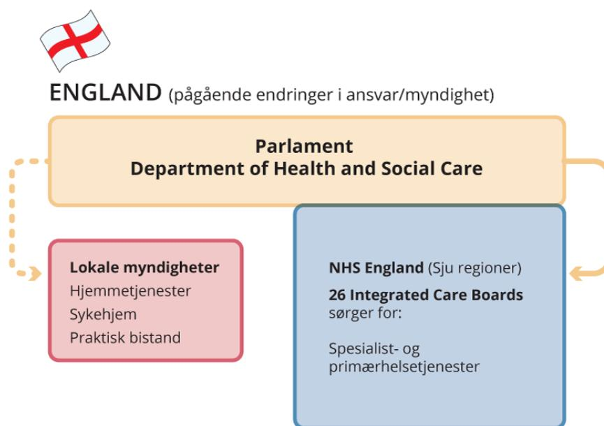

The infographic illustrates the structure of the English healthcare system. At the top is a flag of England. Below it is the text "ENGLAND (pågående endringer i ansvar/myndighet)". Three main boxes are shown: a large orange box for "Parlament Department of Health and Social Care", a pink box for "Lokale myndigheter" (Hjemmetjenester, Sykehjem, Praktisk bistand), and a blue box for "NHS England (Sju regioner) 26 Integrated Care Boards" (sørger for: Spesialist- og primærhelsetjenester). Arrows indicate the flow of responsibility from the Parliament box to the local and NHS boxes.

**ENGLAND** (pågående endringer i ansvar/myndighet)

**Parlament  
Department of Health and Social Care**

**Lokale myndigheter**  
Hjemmetjenester  
Sykehjem  
Praktisk bistand

**NHS England** (Sju regioner)  
**26 Integrated Care Boards**  
sørger for:  
  
Spesialist- og  
primærhelsetjenester

Infographic showing the structure of the English healthcare system.

Figur 4.5 Illustrasjon av helsetjenestesystemet i England

#### 4.5.2 Skottland

Den overordnede politiske og økonomiske styringen skjer på nasjonalt nivå. Det skotske helsevesenet er i dag organisert innenfor NHS Scotland.

Landet er delt inn i 14 regionale helsestyrer. Medlemmene i de regionale helsestyrene blir i hovedsak utpekt av regjeringen. De regionale helsestyrene har et overordnet sørge-for-ansvar for primærhelsetjenesten og spesialisthelsetjenesten i sine regioner. I tillegg er det sju spesialstyrer med ansvar for nasjonale tjenester<sup>4</sup> og et folkehelseorgan (Public Health Scotland).

Primærhelsetjenester omfatter allmennleger, helsesykepleiere, tannleger, tannpleiere, optikere, optikerassistenter, farmasøyter og apotekteknikere. Allmennlegene er i hovedsak selvstendig næringsdrivende og inngår kontrakt med de regionale helsestyrene. Siden 2018 er betydningen av tverrfaglighet i praksisene forsterket.

Sykehusene styres og finansieres direkte fra de regionale helsestyrene. Store investeringer prioriteres og vedtas av det skotske parlamentet innenfor en samlet sykehusramme som også inkluderer egne midler til prioriterte sykehusutbygginger.

De regionale helsestyrene får rammebevilgninger etter kombinasjon av befolkningens størrelse og behov for tjenester. Det kompenseres også for særlige kostnader knyttet til å levere tjenester i spredtbygde områder (NOU 2016: 25).

Lokale myndigheter har, i likhet med lokale myndigheter i England, ansvar for tjenester som skal hjelpe mennesker som trenger støtte og tjenester i hverdagen på grunn av alder, sykdom, funksjonsnedsettelser, psykiske helseutfordringer eller sosiale problemer.

---

<sup>4</sup>Sju helsestyrer: NHS Education for Scotland, Healthcare Improvement Scotland, Scottish Ambulance Service, NHS Health Scotland, NHS National Waiting Times Centre, NHS 24 og The State Hospital.

De regionale helsestyrene og lokale myndigheter er integrert gjennom såkalte Integration Joint Boards. De ble etablert som felles styringsorgan med ansvar for planlegging og finansiering av tjenestene. Skottland har også nylig opprettet to administrative organer, NHS Scotland East og NHS Scotland West, som skal bidra til mer koordinerte tjenester, styrket bemanning og kompetanse og et løft for arbeidet med digitalisering (Oslo Economics, 2026).

##### Reformer

Sykehusene i Skottland var tidligere organisert i foretak, men foretaksmodellen ble avviklet i 2004. Fra 2010 ble det innført prøveordninger med direkte valg av medlemmer til de regionale helsestyrene. Disse skulle utgjøre flertallet i styrene sammen med representanter fra lokale myndigheter. I 2013 ble det bestemt at direkte valg ikke skulle videreføres på grunn av lav deltakelse i disse valgene (NOU 2016: 25). Skottland har siden 2014 arbeidet med å integrere helse- og omsorgstjenester gjennom Integration Joint Boards. Modellen legger til rette for tettere samarbeid mellom helsestyrene og lokale myndigheter, og en egen lov legger de formelle rammene for samarbeidet. Et kjernepunkt i loven er at partene skal delegere bestemte funksjoner og tilhørende ressurser til Integration Joint Boards, slik at de har reell myndighet til å styre helhetlig. Modellen skal gi et tydelig organisatorisk grep for å møte utfordringer med en aldrende befolkning og flere pasienter med sammensatte behov. Til tross for økte ressurser over tid viser revisjonsrapporter at NHS Scotland ikke er økonomisk bærekraftig og at modellen sliter med å levere i tråd med ambisjonene (Audit Scotland, 2025).

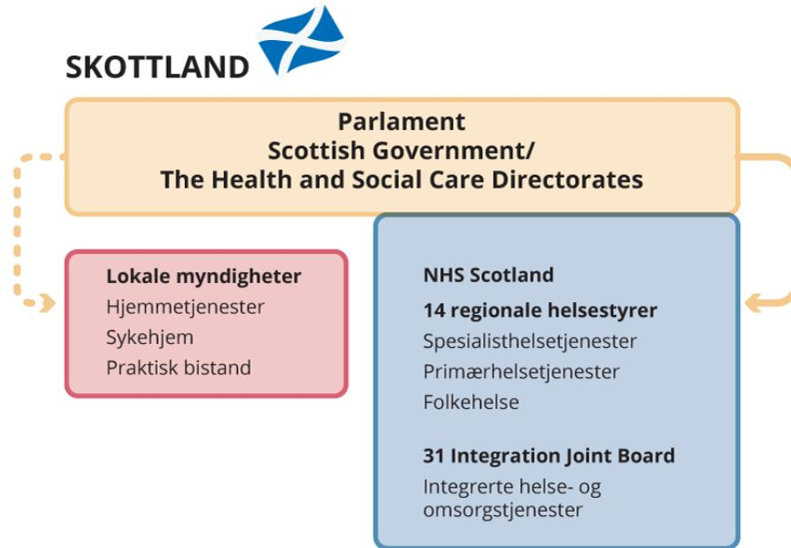

**SKOTTLAND**

**Parlament  
Scottish Government/  
The Health and Social Care Directorates**

**Lokale myndigheter**  
Hjemmetjenester  
Sykehjem  
Praktisk bistand

**NHS Scotland**  
**14 regionale helsestyrer**  
Spesialisthelsetjenester  
Primærhelsetjenester  
Folkehelse  
  
**31 Integration Joint Board**  
Integrerte helse- og  
omsorgstjenester

The infographic shows a hierarchy starting with the Scottish Government/Health and Social Care Directorates, which branches into local authorities and NHS Scotland.

```
graph TD; A["Parlament  
Scottish Government/  
The Health and Social Care Directorates"] -.-> B["Lokale myndigheter  
Hjemmetjenester  
Sykehjem  
Praktisk bistand"]; A --> C["NHS Scotland  
14 regionale helsestyrer  
Spesialisthelsetjenester  
Primærhelsetjenester  
Folkehelse  
  
31 Integration Joint Board  
Integrerte helse- og  
omsorgstjenester"];
```

Infographic: Scottish Government and Health and Social Care Directorates structure.

Figur 4.6 Illustrasjon av helsetjenestesystemet i Skottland

### 4.6 Nederland

Nederland har et universelt, forsikringsbasert helsesystem med obligatorisk grunnforsikring levert av konkurrerende, private forsikringsselskaper under sterk statlig regulering. Hovedutfordringene i Nederland er ventetider og kapasitet (særlig innen psykisk helsehjelp), personellmangel,

fragmentering og koordineringsutfordringer mellom ulike ordninger. Det er også kostnadspress og debatt om egenandeler og administrativ kompleksitet i en regulert konkurransemodell (Kroneman mfl., 2024).

#### Organisering, styring, planlegging og finansiering

I 2006 gjennomførte Nederland en omlegging av trygde- og finansieringssystemet. Før 2006 tilhørte befolkningen enten den offentlige trygdeordningen eller hadde privat forsikring. Helseforsikringsloven av 2006 slo sammen de tradisjonelle offentlige og private forsikringsmarkedene til ett universelt sosialt helseforsikringsprogram. Alle innbyggerne ble pålagt å tegne helseforsikring hos konkurrerende private forsikringsselskaper (NOU 2016: 25). Staten fikk en mer tilbaketrukket rolle, der det nederlandske helse-, velferds- og idrettsdepartementet har et mer overordnet ansvar for styring, planlegging, regulering og kontroll av helsetjenesten (Kroneman mfl., 2024).

Innbyggerne kan velge forsikringsselskap og sin egen helseforsikringsplan. Tjenestetilbudet blir bestemt av staten ved at det blir definert en grunnpakke som gir en relativ bred dekning av tjenester som legetjenester, sykehustjenester, medisiner, medisinsk utstyr, rehabilitering, forebygging, psykisk helsehjelp og tannhelse for barn (Hagen, 2025).

Forsikringen består av to deler; en inntektsavhengig del som den forsikredes arbeidsgiver betaler inn til felleskassen, og en del som den forsikrede selv betaler til forsikringsselskapet. En ordning for overføringer mellom felleskassen og det enkelte forsikringsselskap kompenserer for ulik risikoprofil. Forsikringsselskapene konkurrerer om kundene gjennom prisene på forsikringsproduktet, og kundene kan bytte selskap én gang i året. Gjennom den årlige kontrakten som inngås, kan forsikringskundene vurdere flere forhold, for eksempel om de vil ha lav fast pris på forsikringen og høye egenandeler og om de vil ha mulighet til å velge fritt mellom alle sykehus eller kun et begrenset antall (NOU 2016: 25).

Systemet inkluderer også subsidier til lavinntektsgrupper og arbeidsledige for å sikre at alle kan betale forsikringspremiene (Hagen, 2025).

Fire store forsikringsselskap dekker 80 prosent av markedet (Kroneman mfl., 2024).

Forsikringsselskapene inngår kontrakter med den enkelte leverandør av helsetjenester, både primærhelsetjeneste og spesialisthelsetjeneste.

Primærhelsetjenesten er grunnmuren i helsetjenesten, og fastlegene har en viktig portvaktfunksjon. Pasientene må ha henvisning fra fastlegen for å få tilgang til spesialisthelsetjenester. Solopraksiser blant fastleger er blitt mindre vanlig, og andelen fastlegepartnerskap og gruppepraksiser er høy (Kroneman mfl., 2024).

De fleste sykehus er ideelle stiftelser. Legespesialister som arbeider ved sykehus er enten selvstendig næringsdrivende som inngår avtaler med sykehus (omtrent 60 prosent), eller ansatt av sykehuset (Kroneman mfl., 2024).

Den nederlandske helsemyndigheten Nederlandse Zorgautoriteit har ansvaret for å overvåke at markedskreftene i helsetjenesten fungerer tilfredsstillende. Også andre enheter bidrar til kvalitetsoppfølging og vurdering av ny behandling mv. (NOU 2016: 25).

Langtidsomsorg er basert på en sosial forsikringsordning som administreres av det dominerende helseforsikringsselskapet i regionen. De inngår avtaler med omsorgsleverandører for å sikre tilstrekkelig tilbud og kvalitet på omsorgstjenestene.

Kommunene har ansvar for et bredt spekter av forebyggende helse- og sosialtjenester som forebyggende helsetjenester, folkehelse, sosial støtte og egenmestring.

##### Reformer

Innen langtidsomsorgen har store deler av systemet blitt reorganisert og desentralisert siden 2015. Psykisk helsevern har siden 2014 vært levert på tre nivåer for å redusere unødvendig spesialistbehandling. Fra og med 1. januar 2022 er et integrert finansieringssystem innført for å begrense kostnadene i psykisk helsevern for voksne (Kroneman mfl., 2024).

I 2022–2023 ble en ny tverrsektoriell avtale om integrerte tjenester inngått med interessenter fra helse- og sosialsektoren. Det er en nasjonal samarbeidsavtale for helsesektoren som skal få aktørene i nederlandsk helsetjeneste til å gjennomføre en felles omstilling mot mer sammenhengende og integrerte tjenester, bedre tilgjengelighet og mer bærekraftige kostnader. Samarbeidsavtalen er en operativ avtale mellom mange sentrale parter (helsemyndighetene, forsikringsaktører, tjenesteleverandører, profesjonsaktører og pasientrepresentanter) om mål, tiltak og hvordan man skal følge opp (Kroneman mfl., 2024).

Nyere reformer har handlet om utvidet dekning, som for eksempel utvidet barseloppfølging, fallforebyggende tiltak og bedre tilgang til aborttjenester. Framtidige reformer vil ta for seg mangel på arbeidskraft, dekning av tannhelsetjenester, kvalitet i tjenestene og helsesystemets finansielle bærekraft og robusthet (Kroneman mfl., 2024).

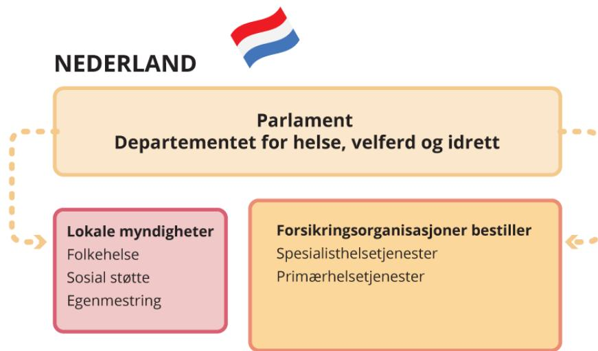

**NEDERLAND**

**Parlament**  
**Departementet for helse, velferd og idrett**

**Lokale myndigheter**  
Folkehelse  
Sosial støtte  
Egenmestring

**Forsikringsorganisasjoner bestiller**  
Spesialisthelsetjenester  
Primærhelsetjenester

```
graph TD; A[Parlament  
Departementet for helse, velferd og idrett] -.-> B[Lokale myndigheter  
Folkehelse  
Sosial støtte  
Egenmestring]; A -.-> C[Forsikringsorganisasjoner bestiller  
Spesialisthelsetjenester  
Primærhelsetjenester];
```

The infographic shows the structure of the Dutch healthcare and sports department. At the top is the Dutch flag and the word "NEDERLAND". Below is a large orange box for the "Parlament Departementet for helse, velferd og idrett". Two dashed arrows point from this box to two smaller boxes below: a pink one for "Lokale myndigheter" (Local authorities) listing Folkehelse, Sosial støtte, and Egenmestring; and an orange one for "Forsikringsorganisasjoner bestiller" (Insurance organizations) listing Spesialisthelsetjenester and Primærhelsetjenester.

Infographic: Healthcare and sports department structure in the Netherlands. Dutch flag

Figur 4.7 Illustrasjon av det nederlandske helsetjenestesystemet

### 4.7 Nuka System of Care

Alaska har en befolkning der om lag 20 prosent er urfolk (Alaska Native). Urfolkstammene forvalter direkte et omfattende helsesystem som omfatter klinikker i mer enn 200 landsbyer og

tettsteder, et nettverk av mindre sykehus over hele delstaten, samt et stort sykehus- og spesialistsenter i Anchorage. Finansieringen er en kombinasjon av aktivitetsbasert refusjon (fee-for-service) og direkte føderal finansiering gjennom Indian Health Service, samt refusjoner fra Medicare og Medicaid, private helseforsikringsordninger og ulike tilskuddsprogrammer.

Nuka System of Care er en modell innenfor dette systemet som blir framhevet som et eksempel på brukerstyrte og integrerte tjenester. Nuka System of Care drives av Southcentral Foundation (SCF), som sammen med Alaska Native Tribal Health Consortium (en overordnet organisasjon som omfatter sykehus- og spesialisttjenester og representerer alle urfolksgruppene i Alaska) eier og leverer helhetlige helsetjenester til den urfolksbaserte befolkningen i Anchorage-regionen. Dette delstatsdekkende systemet betjener om lag 200 000 innbyggere. Nuka-modellen bygger på ideen om at helsetjenester fungerer best når de eies og styres av lokalsamfunnet, og når tjenestene er forankret i befolkningens verdier og kulturelle tradisjoner. Utviklingen av Nuka System of Care ble i utgangspunktet drevet fram av utfordringer som lange ventetider og lav pasienttilfredshet. Mange brukere har også komplekse sosiale levekårsutfordringer, noe som fører til sammensatte helsebehov og krevende livssituasjoner. Dette bidrar til et relativt høyt forbruk av helsetjenester i befolkningen generelt, men særlig blant de mest sosialt og medisinsk sårbare.

Gjennom Nuka-modellen er det etablert et integrert system med store tverrfaglige team som støtter hele befolkningen, men spesielt personer med personlige og sosiale utfordringer, kroniske sykdommer og komplekse tilstander. I tillegg til pasienten og deres familie eller sosiale nettverk, består primærteamet vanligvis av lege, sykepleier med koordinatoransvar, en person med ansvar for oppfølging og koordinering, helsefaglige assistenter, atferdsspesialister, lett tilgjengelige kliniske farmasøyter, ernæringsfysiologer, psykiatritjenester, spesialister på kroniske smerter, fysioterapeuter og hjemmebesøksteam. Innbyggerne har tilbud om konsultasjon samme dag, med tilgang via SMS, e-post, video eller fysisk oppmøte. Når relasjoner, historikk og tillit er etablert, blir de fleste problemstillinger løst gjennom telefon-, video- eller nettkonsultasjoner.

Modellen legger stor vekt på best mulig håndtering av kroniske sykdommer, utvikling av god helse og forebygging gjennom systematisk bruk av dokumentert effektive medisinske og kliniske tiltak på befolkningsnivå. Primærhelseteamet er navet i helsesystemet og henter inn nødvendig ekspertise framfor å sende pasientene videre til spesialister. De fleste spesialistvurderinger trekkes inn i dialogen via telefon, e-post eller meldinger, i stedet for at pasientene må reise til separate polikliniske konsultasjoner. Sykehusspesialister støtter også primærteamene gjennom undervisning, faglige oppdateringer og direkte rådgivning når det er nødvendig. Modellen legger også betydelig vekt på brukerinvolvering i kvalitetsforbedringsarbeidet, som er integrert i organisasjonens daglige drift.

Southcentral Foundation rapporterer om en rekke resultater etter innføringen av Nuka System of Care, blant annet forbedringer i håndteringen av medisinske tilstander, reduksjon i polikliniske spesialistkonsultasjoner, nedgang i akuttinnleggelser, færre sykehusinnleggelser og høyere tilfredshet blant både pasienter og ansatte (Eby & McIntyre, 2024).

### **4.8 Forskjeller og likheter mellom landene**

Gjennomgangen viser både betydelige forskjeller og noen fellestrekk i hvordan helsetjenesten er organisert, finansiert og drevet i de ulike landene. Det går et tydelig skille mellom land med

skattefinansierte offentlige organiserte helsesystemer (de nordiske landene, England og Skottland) og Nederland som bruker en regulert konkurransemodell med private forsikringsselskaper. Nederlands modell innebærer at innbyggerne betaler premien direkte istedenfor over skatteseddelen. De merker derfor utgiftsøkninger i utviklingen i premien som skal betales inn til den enkelte forsikringskasse på en mer direkte måte enn i de skattefinansierte systemene. Forskjellene mellom landene gjenspeiler ulike normative prioriteringer: likhet og politisk kontroll versus valgfrihet og konkurranse som styringslogikk.

Grad av statlig styring er et annet hovedskille. Sverige har en modell med desentralisert eierskap, styring og finansiering og politisk ansvar for helse- og omsorgstjenestene på fylkesnivå. Finland og Danmark har en modell med et regionalt folkevalgt ansvar, men staten har en langt mer aktiv rolle sammenlignet med Sverige. Blant annet har staten ansvar for finansieringen i disse landene, og det regionale nivået i Finland og Danmark har ikke beskatningsrett slik det regionale nivået i Sverige har. Både i England og Skottland er statens rolle mer omfattende. Erfaringene viser at sterk statlig styring kan gi svært ulike utslag, avhengig av hvordan ansvaret fordeles og organiseres.

Både Finland og Danmark har gjennomført reformer der det meste av ansvaret for helsetjenester legges på regionnivået. Sverige har fortsatt en modell med to nivåer, men fylkene i Sverige har også ansvar for vårdcentralene som er en viktig del av primærhelsetjenesten. Danmark, Nederland, England og Skottland bygger på et system med privatpraktiserende allmennleger med tydelig portvaktrolle, mens Sverige og Finland organiserer primærhelsetjenesten rundt helsesentre der innbyggerne velger senter framfor lege, og portvaktrollen er svakere. Dette gir ulike konsekvenser for pasientflyt, samhandling og kostnadskontroll.

I Storbritannia har de enkelte landene hatt ansvaret for helsesektoren siden 1999. Det har ført til større ulikheter i hvordan landenes helsetjenestesystemer er organisert. I Skottland er det regionale helsestyrer som har det overordnede sørge-for-ansvaret for hoveddelen av helsetjenestene til befolkningen. Det skotske helsesystemet er kjennetegnet ved at det ikke er noe klart skille mellom bestiller og utfører, slik det er i England. I likhet med de nordiske landene er sykehusene i Skottland offentlig eid og drevet. I England er sykehusene organisert som egne, selvstyrte enheter med stor grad av autonomi. Både Skottland og England har etablert geografiske samarbeidsstrukturer som skal samordne primærhelsetjenestene, sykehus og lokale helse- og omsorgstjenester. Også Danmark har gjennom de nye sundhedsrådene etablert strukturer som skal bidra til samordning og nære helsetjenester.

Landene møter flere av de samme utfordringene: demografiske endringer, økende andel eldre og kronisk syke, knapphet på helsepersonell, økende kostnader, fragmenterte tjenester og ulikhet i tilgang og varierende kvalitet. Flere land erfarer et økende gap mellom behandlingsmuligheter og tilgjengelige budsjetter. Sverige, Finland og Skottland har i likhet med Norge en geografi med store avstander og spredt befolkning som gir utfordringer med tilgang til tjenester i rurale områder. I England og Skottland er det kapasitetsutfordringer og lange ventetider, også i akuttmottakene. Flere av landene har gjennomført, eller er i ferd med å gjennomføre, store helsereformer for at landene skal være rustet til å møte utfordringene. Fellestrekk ved reformene er at de handler om å etablere strukturer for mer integrerte tjenester, mer arbeid i team, styrking av primærhelsetjenestene gjennom mer forebygging og lokalt forankrede tjenester, styrking av arbeidet med digitalisering (digitale konsultasjoner, datadeling og velferdsteknologi mv.) og større grad av regionalisering/større enheter, samtidig som landene må sørge for økonomisk bærekraft.

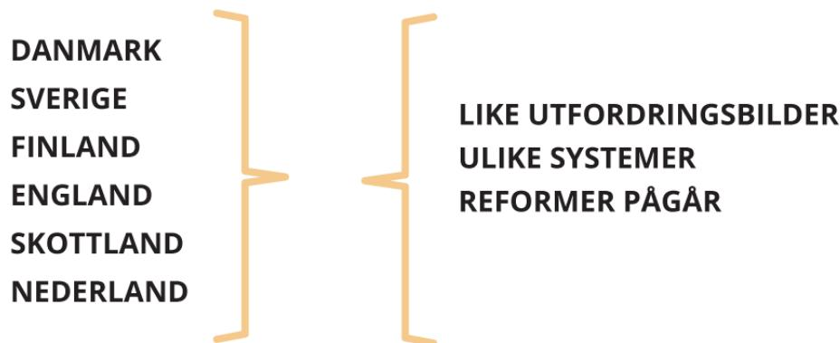

|           |  |
|-----------|--|
| DANMARK   |  |
| SVERIGE   |  |
| FINLAND   |  |
| ENGLAND   |  |
| SKOTTLAND |  |
| NEDERLAND |  |

|                        |
|------------------------|
| LIKE UTFORDRINGSBILDER |
| ULIKE SYSTEMER         |
| REFORMER PÅGÅR         |

A diagram with two large orange brackets. The left bracket groups the countries: DANMARK, SVERIGE, FINLAND, ENGLAND, SKOTTLAND, and NEDERLAND. The right bracket groups the challenges: LIKE UTFORDRINGSBILDER, ULIKE SYSTEMER, and REFORMER PÅGÅR.

Figur 4.8 Illustrasjon av at det er likheter mellom landene

### 4.9 Utvalgets vurdering

Gjennomgangen viser at landene utvalget har sett nærmere på, står overfor mange av de samme utfordringene som Norge. Samtidig har de valgt ulike modeller for organisering, finansiering og styring av tjenestene. De fleste landene har gjennomført eller er i ferd med å gjennomføre større helsereformer for å møte disse utfordringene. Flere av landene legger vekt på å utvikle tjenester utenfor de tradisjonelle sykehusene nærmere der folk bor og å skape mer sømløse overganger mellom frisk aldring og økende skrøpelighet og hjelpebehov. Utadrettede spesialisthelsetjenester og økt bruk av kompetanse fra ulike profesjoner er også viktige virkemidler for å møte den forventede mangelen på høyt kvalifisert personell. Utvalget vurderer at det har vært nyttig å se til andre land i diskusjonene om ulike måter å organisere, finansiere og styre tjenestene på. Samtidig er det vanskelig å hente entydige råd for hvordan den norske helse- og omsorgstjenesten bør innrettes for å møte framtidige utfordringer. Vektingen mellom fordeler og ulemper vil i siste instans være et politisk spørsmål om hvilke hensyn som bør vektlegges mest, gitt utfordringene og endringene samfunnet står overfor.

Erfaringene viser at valg av organisering og styringsmodell kan ha konsekvenser for både kapasitet, kvalitet og sammenheng i tjenestene. Landene har også ulik erfaring med budsjettkontroll. Særlig har Finland utfordringer med å oppnå budsjettmessig kontroll innenfor den nye modellen, slik også Norge hadde ved innføringen av helseforetaksmodellen. Det er usikkert om dette skyldes et innføringsproblem eller er en konsekvens av den valgte modellen. I Sverige er det økende bekymring for geografiske forskjeller som følge av ulike lokale prioriteringer. England og Skottland illustrerer hvordan sterk statlig styring kan gi ulike utslag avhengig av organisering. I England har bestiller-utfører-modellen bidratt til økt kompleksitet og fragmentering, samtidig som også Skottlands mer integrerte modell har utfordringer, ikke minst knyttet til økonomisk bærekraft. Store folkehelseutfordringer og økonomisk press forsterker bærekraftutfordringene i begge land. For Norge innebærer dette at eventuelle endringer i styring og ansvarsdeling bør bygge på en grundig vurdering av hvilke problemer som skal løses, hvilke mekanismer som kan bidra til måloppnåelsen, og hvordan tydelige roller, god koordinering og sterk gjennomføringsevne kan sikre ønskede effekter.

# *Del II**Utfordringsbildet*

## **5 Utviklingstrekk som utfordrer framtidens helse- og omsorgstjenester**

### **5.1 Innledning**

Utviklingstrekk nasjonalt og internasjonalt vil påvirke helse- og omsorgstjenestenes muligheter til å møte befolkningens behov framover. Det vil bli økende knapphet på arbeidskraft, trangere økonomiske rammer for den norske velferdsstaten og endringer i befolkningssammensetningen som vil påvirke sykdomsbyrden. Samtidig preges verden av økende geopolitisk usikkerhet, at ulikhetene øker og at den teknologiske og medisinske utviklingen skjer raskt. Disse trekkene ved samfunnsutviklingen må ligge til grunn i en vurdering av hvordan helse- og omsorgstjenestene skal organiseres, styres og finansieres framover.

Fem utviklingstrekk som helse- og omsorgstjenesten vil måtte forholde seg til i tiårene framover, er: en aldrende befolkning, endringer i velferdsstatens økonomiske rammer, økende ulikhet, en mer usikker verden og medisinsk og teknologisk utvikling (figur 5.1).

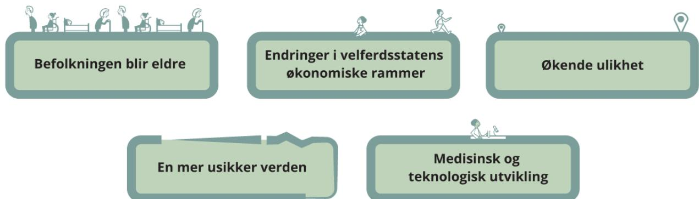

**Befolkningen blir eldre**

**Endringer i velferdsstatens økonomiske rammer**

**Økende ulikhet**

**En mer usikker verden**

**Medisinsk og teknologisk utvikling**

Infographic with five green rounded rectangles containing text about aging and related factors, each with a small illustration on top.

**Figur 5.1 Fem utviklingstrekk som henger sammen og vil prege helse- og omsorgstjenestene i tiårene framover.**

Utviklingstrekkene som utvalget trekker fram her, er ikke uttømmende, men utgjør trekk ved samfunnsutviklingen som utvalget mener det er særlig grunn til å vektlegge i vurderingen av hvordan framtidens helse- og omsorgstjenester bør innrettes. I kapittel 6 beskrives hvilke utfordringer pasienter og pårørende kan møte dersom helse- og omsorgstjenestene ikke tilpasses framtidens behov.

### 5.2 Befolkningen blir eldre

Aldringen av befolkningen er en sterk og tydelig trend, uavhengig av forutsetninger om fruktbarhet, levealder og innvandring. Norges befolkning vil vokse fra rundt 5,6 millioner personer i 2026 til 6,2 millioner rundt 2050 og til nesten 6,4 millioner i 2100, ifølge SSBs hovedalternativ. Se figur 5.2. Befolkningen over 80 år forventes å mer enn doble seg innen 2050 og utgjøre litt i underkant av én million personer innen 2100. Fra 2046 vil all befolkningsvekst være drevet av positiv nettoinnvandring. Andelen innvandrere i befolkningen forventes å øke fra 17,5 prosent til litt over 22 prosent innen 2050. Deretter forventes andelen å stabilisere seg, samtidig som også innvandrerbefolkningen vil bli eldre enn den er i dag (Tømmerås mfl., 2026).

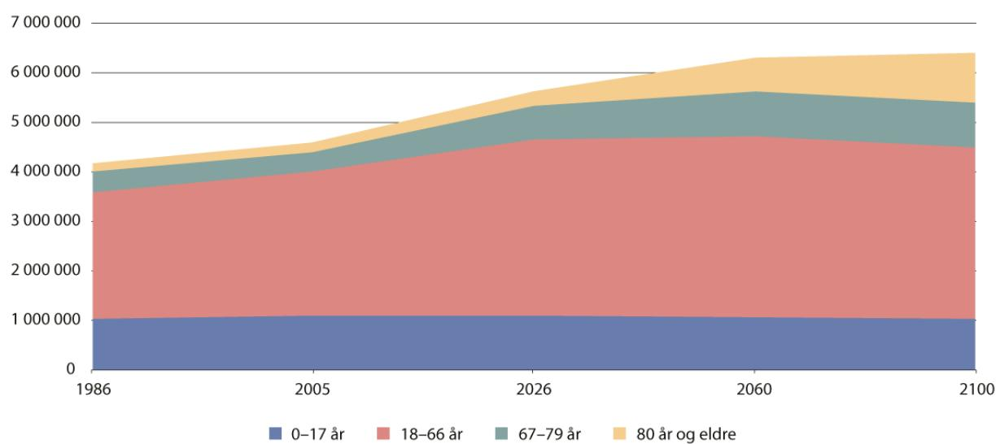

A stacked area chart showing the population of four age groups from 1986 to 2100. The y-axis represents population in thousands, ranging from 0 to 7,000,000. The x-axis shows the years 1986, 2005, 2026, 2060, and 2100. The legend indicates the age groups: 0-17 år (blue), 18-66 år (red), 67-79 år (teal), and 80 år og eldre (yellow). The total population increases from approximately 4,100,000 in 1986 to about 6,400,000 in 2100, with the 18-66 år group being the largest contributor throughout.

| Year | 0-17 år   | 18-66 år  | 67-79 år | 80 år og eldre |
|------|-----------|-----------|----------|----------------|
| 1986 | 1,000,000 | 2,500,000 | 300,000  | 100,000        |
| 2005 | 1,050,000 | 2,900,000 | 350,000  | 150,000        |
| 2026 | 1,050,000 | 3,500,000 | 400,000  | 250,000        |
| 2060 | 1,050,000 | 3,600,000 | 450,000  | 300,000        |
| 2100 | 1,000,000 | 3,400,000 | 450,000  | 350,000        |

Area chart: Stacked area chart of population by age group from 1986 to 2100.

**Figur 5.2 Befolkningen i ulike aldersgrupper**

Kilde: SSB-tabell 14740 og 07459. Registrerte tall for 1986–2025 og framskrevne tall for 2026–2100 (hovedalternativet MMM)

Andelen eldre øker dels fordi fødselskullene i de første årene etter andre verdenskrig var store sammenlignet med de relativt små kullene i mellomkrigstiden. I tillegg lever befolkningen lenger enn tidligere, samtidig som innvandringen forventes å bli lavere framover. Innvandrere er i gjennomsnitt yngre enn den bosatte befolkningen, og bidrar dermed til å bremse aldringen av befolkningen (Leknes & Løkken, 2026).

Befolkningsutviklingen vil treffe ulike deler av landet ulikt. Deler av Norge har allerede flere eldre enn yngre. Dette gjelder Innlandet, Telemark, Nordland og Troms. Fire nye fylker ventes å følge i løpet av de to neste årene. Oslo vil oppleve det sist, innen 2046 (Leknes & Løkken, 2026).

Distriktene vil merke aldringen først og sterkest. Sentrale kommuner har typisk høyere tilflytting og innvandring av yngre mennesker. Det betyr også flere fødsler i disse kommunene, noe som er med på å bremse aldringen (Leknes & Løkken, 2026). Kommunekommisjonen viser til at sterk vekst i de eldste aldersgruppene, sammen med nedgang i befolkningen i yrkesaktiv alder, vil skape betydelige utfordringer for flere distriktskommuner framover (NOU 2026: 1). Eldre over 80 år har størst behov for kommunale tjenester, og andelen eldre over 80 år er betydelig høyere i distriktene enn i byene (Fossanger, 2025).

En konsekvens av de demografiske endringene er at det vil bli tiltakende kamp om arbeidskraften. Den såkalte forsørgerbrøken er et enkelt og mye brukt mål på forholdet mellom antall personer i eldre aldersgrupper og antall personer i yrkesaktiv alder. Målet kan illustrere sider ved befolkningsstrukturen som har stor betydning for arbeidstilbud og offentlige inntekter på den ene siden, og pensjonsutgifter, pleie- og omsorgsbehov og lignende på den andre. Målet tar ikke hensyn til den faktiske sysselsettingen i disse gruppene, eller til i hvilken grad eldre faktisk forsørges eller har omsorgsbehov (Tømmerås mfl., 2026). I 2026 er det 0,33 personer som er 67 år eller eldre per person i yrkesaktiv alder (20–66 år). I 2050 ventes det at det vil være 0,47 (SSBs befolkningsframskrivinger, hovedalternativet).

Det er i Perspektivmeldingen 2024 lagt til grunn at andelen eldre som er yrkesaktive, vil fortsette å øke fordi de har bedre helse, og fordi pensjonsreformen gir sterke insentiver til å stå lenger i arbeid. Dette vil bidra positivt til den samlede yrkesdeltakelsen, men vil ikke fullt ut kunne motvirke at forsørgerbrøken øker.

Framskrivinger viser betydelige regionale forskjeller i utviklingen av arbeidsstyrken. De mest sentrale kommunene vil oppleve vekst i arbeidsstyrken de nærmeste ti årene, men også i disse kommunene vil veksten bli klart lavere etter hvert. I de mindre sentrale kommunene vil derimot arbeidsstyrken bli redusert i hele perioden fram til 2040 (NOU 2026: 1). Se figur 5.3 som viser forsørgerbrøken i norske kommuner i 2026 og 2050, sortert etter sentralitet.

Forsørgerbrøken er høyest i de minst sentrale kommunene og lavest i de mest sentrale. Den ventes å øke i alle sentralitetsgruppene fram mot 2050. Målt i prosent blir økningen størst i de mest sentrale kommunene, fordi disse har den laveste forsørgerbrøken i utgangspunktet. De minst sentrale kommunene vil likevel fortsatt ha den klart høyeste forsørgerbrøken i 2050.

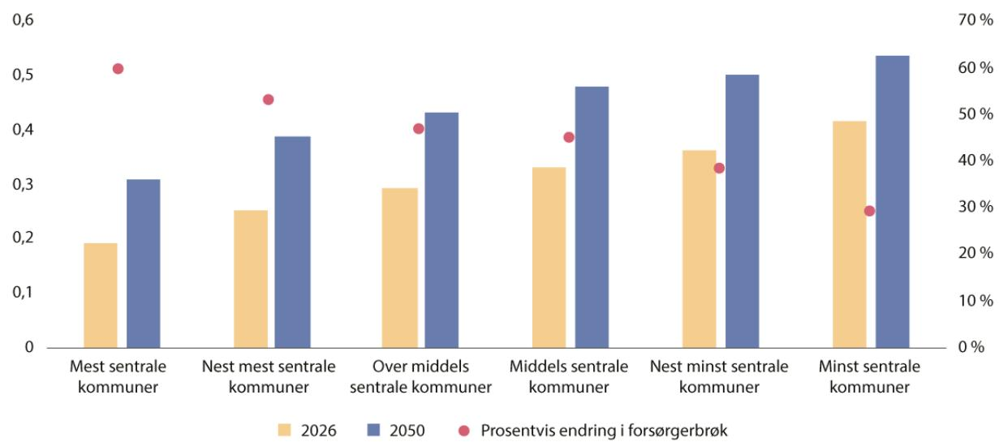

The chart shows the values for 2026 (orange bars) and 2050 (blue bars) for six categories of central municipalities. The right y-axis represents the percentage change in 2026 (Prosentvis endring i forsørgerbrøk) as red dots.

| Kategori                       | 2026 | 2050 | Prosentvis endring i forsørgerbrøk |
|--------------------------------|------|------|------------------------------------|
| Mest sentrale kommuner         | 0,19 | 0,31 | 61 %                               |
| Nest mest sentrale kommuner    | 0,25 | 0,39 | 45 %                               |
| Over middels sentrale kommuner | 0,29 | 0,43 | 40 %                               |
| Middels sentrale kommuner      | 0,33 | 0,48 | 39 %                               |
| Nest minst sentrale kommuner   | 0,36 | 0,50 | 33 %                               |
| Minst sentrale kommuner        | 0,42 | 0,53 | 25 %                               |

Legend: 2026 (orange bar), 2050 (blue bar), Prosentvis endring i forsørgerbrøk (red dot).

The values for 2050 are consistently higher than for 2026 across all categories, with the percentage change decreasing as the category becomes less central.

Bar chart: Comparison of values for 2026 and 2050 across central municipalities with percentage change in 2026.

**Figur 5.3 Aldersgruppen 67 år eller eldre som andel av befolkningen i yrkesaktiv alder (20–66 år) samt endringen i forsørgebrøken fram mot 2050**

Kilde: SSBs befolkningsframskrivinger (Hovedalternativet MMMM)

Flere kommuner og næringer, særlig i distriktene, har allerede betydelige utfordringer med å rekruttere kompetent arbeidskraft til å løse grunnleggende oppgaver. Dersom ikke flere deltar i

arbeidsmarkedet eller står lenger i arbeid, kan arbeidsstyrken bli redusert i mange deler av landet samtidig som behovet for arbeidskraft vil øke. Dette kan føre til betydelig knapphet på arbeidskraft fram mot 2040 i flere kommuner (NOU 2026: 1).

### **5.3 Endringer i velferdsstatens økonomiske rammer**

Det ventes at veksten i skatte- og avgiftsinntekter vil avta, som følge av lavere vekst i fastlandsøkonomien sammenlignet med årene før koronapandemien. Mindre tilgang på arbeidskraft vil også bidra til lavere skatteinnngang. Lavere tilførsel av petroleumsinntekter til Statens pensjonsfond utland vil bidra til lavere vekst i fondet og dermed lavere vekst i hvor mye fondsmidler som kan brukes over statsbudsjettet, ifølge *Perspektivmeldingen 2024* (Meld. St. 31 (2023–2024)). Ut fra dette må det forventes at det økonomiske handlingsrommet vil bli mindre i årene framover (NOU 2026: 1). Dette vil påvirke handlingsrommet for finansiering av helse- og omsorgstjenester i statsbudsjettet og de kommunale budsjettene.

Samtidig vil økningen i forsørgerbrøken bidra til å øke utgiftene for stat og kommune, målt som andel av BNP for Fastlands-Norge. Ettersom offentlige utgifter er høyere for eldre enn for andre aldersgrupper, vil utgiftene øke når andelen eldre øker. Lave fødselstall de siste årene trekker i retning av mer moderat vekst i utgifter til tjenesteyting rettet mot barn og unge en lang stund framover (Meld. St. 31 (2023–2024)).

En vesentlig del av handlingsrommet i de årlige budsjettene går med til å dekke veksten i demografidrevne utgifter i helseforetakene og kommunene. I tillegg er deler av det framtidige handlingsrommet i praksis bundet opp gjennom oppfølgingen av regjeringens forslag til langtidsplan for forsvarssektoren. Finansdepartementet viser i Perspektivmeldingen 2024 til at overføringene til kommuner og helseforetakene har økt utover veksten som følger av demografi. Med mindre handlingsrommet økes betydelig, vil det ikke være mulig å opprettholde samme vekst som tidligere på alle utgiftsområder (Meld. St. 31 (2023–2024)).

Ifølge Perspektivmeldingen 2024 vil en del av arbeidskraftbehovet kunne dekkes ved at arbeidskraft frigjøres når aktiviteten i petroleumssektoren etter hvert går ned. Dette vil innebære et finansieringsgap, ettersom aktiviteten avtar i en næring som gir betydelige skatteinntekter, samtidig som aktiviteten øker i helse- og omsorgstjenestene, som er personellintensiv og i hovedsak offentlig finansiert.

Utviklingen innen kunstig intelligens er en viktig usikkerhetsfaktor i vurderingen av de langsiktige økonomiske utsiktene. Dersom teknologien bidrar til betydelig produktivitetsvekst i privat og offentlig sektor, kan vekstevnen i økonomien bli høyere enn det som legges til grunn i dagens framskrivinger. Samtidig er det usikkert hvor store gevinstene blir, hvor raskt de kan realiseres, og i hvilken grad de vil kunne kompensere for de demografiske utfordringene som følger av en aldrende befolkning og lavere tilgang på arbeidskraft.

### **5.4 Økende ulikhet**

Økende økonomisk ulikhet utfordrer helse- og omsorgstjenestene på to måter. For det første kan den forsterke sosiale forskjeller i helse og dermed øke behovet for tjenester. For det andre kan den

svekke finansieringsgrunnlaget og den politiske oppslutningen om universelle, skattefinansierte ordninger.

Sosiale forskjeller i inntekt, utdanning og arbeids- og levekår gjenspeiles i forskjeller i helse, sykdomsbyrde og levealder. Økende ulikhet kan derfor føre til større forskjeller i behovet for helse- og omsorgstjenester. Samtidig kan personer med størst behov ha svakere forutsetninger for å orientere seg i tjenestene, benytte digitale løsninger og ivareta egne interesser. Dette kan gjøre det mer krevende å realisere målet om likeverdige helse- og omsorgstjenester og øke behovet for differensiert innsats.

Ulikheten innad i land har økt de siste tiårene, også i Norge. De med høyest inntekt mottar en stadig større andel av verdiskapingen, og forskjellene i lønn mellom faglært og ufaglært arbeidskraft øker. Det er flere mulige årsaker til dette, blant annet økt markedsmakt til bedrifter, ny teknologi og handel som vrir produksjonen i vestlige land mot sektorer som krever mer spesialisert arbeidskraft (Meld. St. 31 (2023–2024)).

Når mer av inntektene i økonomien kommer fra kapital, samtidig som kapitalinntekter er krevende å beskatte effektivt, kan finansieringsgrunnlaget og legitimiteten for brede fellesløsninger gradvis svekkes. Økende økonomisk ulikhet kan svekke oppslutningen om universelle skattefinansierte helse- og omsorgstjenester. Posner (2024) viser hvordan økende ulikhet undergraver sentrale institusjoner, inkludert tillit og oppslutning om kollektive ordninger.

Dette kan blant annet medføre at høyinntektsgrupper i større grad etterspør private alternativer, særlig hvis de opplever ventetid eller kvalitet som utilstrekkelig. Dette kan forsterke utfordringene ved at framveksten av private alternativer undergraver støtten til universelle velferdssystemer (Busemeyer & Iversen, 2020). Moene og Wallerstein (2001) analyserer hvordan høyinntektsgrupper i mindre grad støtter offentlige ordninger når private alternativer finnes, mens Korpi og Palme (1998) viser at universelle ordninger svekkes når middelklassen trekker seg ut.

### **5.5 En mer usikker verden**

Skillet mellom fred, krise og krig er mindre tydelig enn på mange tiår. Verden har blitt farligere og mer uforutsigbar. Det er krig i Europa, konkurransen mellom stormaktene er økende, det er store spenninger i det transatlantiske forholdet, forpliktende internasjonalt samarbeid svekkes og den teknologiske utviklingen skjer svært raskt.

Totalforsvarskommisjonen beskriver det slik (NOU 2023: 17):

Utfordringsbildet verden og Norge står overfor er alvorlig og usikkert. Stormaktsrivalisering og klimautfordringer er eksistensielle trusler, som sammen med teknologiutvikling og demografiske utfordringer påvirker norsk sikkerhet og beredskap. Disse faktorene påvirker og forsterker hverandre og vil i tillegg kunne påvirke andre samfunnsforhold som økende sosial ulikhet, migrasjon og et endret kriminalitetsbilde.

Nasjonal sikkerhetsstrategi (Statsministerens kontor, 2025) peker på tre hovedprioriteringer for Norge: å styrke forsvarsevnen raskt, gjøre samfunnet mer motstandsdyktig og styrke den økonomiske sikkerheten. Situasjonen vil påvirke prioriteringene, og en større del av fellesskapets ressurser må brukes på sikkerhet, forsvar og beredskap. Dette omfatter både penger og personell.

Økt geopolitisk usikkerhet øker konkurransen om knappe offentlige ressurser og knappe personellressurser. Økende krav til forsvar, beredskap og motstandskraft absorberer finanspolitisk kapasitet, kvalifisert arbeidskraft og politisk oppmerksomhet. Dette får konsekvenser også for helse- og omsorgstjenestene.

Norge har en åpen økonomi og er avhengig av tilgang til globale markeder for import og eksport. Naturkatastrofer, epidemier, krig og konflikter, eller plutselige endringer i medisinske behov, kan gi store utslag i både tilbud og etterspørsel av legemidler og medisinsk utstyr samt påvirke transport og distribusjon. Da settes vanlige markedsmekanismer ut av spill, og små markeder uten store alliansepartnere er særlig utsatt.

Folkehelsen vil kunne påvirkes av klimaendringer som vil kunne gi økt risiko for sykdom og død og forsterke sosiale forskjeller. Sårbare grupper, som barn, eldre, personer med underliggende sykdom og økonomisk sårbare personer, vil rammes hardest av konsekvensene av klimaendringene. De har færre ressurser til å beskytte seg, tilpasse seg og gjenopprette funksjoner etter hendelser (Helsedirektoratet, 2025c).

Miljø- og klimaendringer, befolkningsøkning, økt reiseaktivitet, livsstilsendringer og forflytning av store folkegrupper på grunn av krigshandlinger, matmangel, flom, tørke eller andre naturkatastrofer, kan gjøre det krevende å holde smittsomme sykdommer under kontroll. Farlige smittestoffer som kommer på avveie, kan forårsake alvorlig sykdom hos mennesker, dyr og planter. Det kan skje etter laboratorieuhell eller som en villet handling for å gjøre skade (bioterror).

Både EU og Verdens helseorganisasjon vurderer at resistens mot antimikrobielle legemidler er en av de mest alvorlige truslene mot folkehelsen. Antimikrobiell resistens forsterker trusselen fra både smittsomme og ikke-smittsomme sykdommer, blant annet fordi det gir redusert mulighet for å behandle mange alminnelige infeksjoner.

Utslipp og spredning av radioaktive stoffer kan ha konsekvenser for liv, helse, miljø og andre viktige samfunnsinteresser. En større atomhendelse i utlandet vil kunne få store konsekvenser for Norge og norske interesser, blant annet vil en slik hendelse få store følger for matproduksjonen og påvirke matforsyningen.

### **5.6 Medisinsk og teknologisk utvikling**

Medisinsk og teknologisk utvikling har stor betydning for mulighetene til å håndtere de andre utviklingstrekkene. Den vil blant annet kunne påvirke folkehelsen, mulighetene til å avdekke forverring av helsetilstand, behandlingen av kroniske sykdommer og hvordan helse- og omsorgstjenester leveres (OECD, 2023; WHO, 2025). Utviklingen av metoder for å forebygge, oppdage og behandle demenstilstander vil være en viktig faktor for framtidig ressursbehov i helse- og omsorgstjenesten.

Digitale verktøy og utviklingen i teknologi og medisinske behandlingsmetoder gjør at alvorlig sykdom kan oppdages tidligere, og mer tilpasset oppfølging og skånsom behandling kan bidra til at flere pasienter lever lenger med bedre livskvalitet. Like viktig er hvordan teknologi kan bidra til helsefremmende livsstil og forebygge funksjonsfall og sykdom.

Kunstig intelligens (KI) kan bidra med beslutningsstøtte innen diagnostisering og prioritering samt analysere medisinske data for bedre diagnostikk. Robotteknologi kan bidra med alt fra kirurgiske inngrep til praktisk bistand, og gi tilgang til spesialistkompetanse på tvers av landegrenser. Sensorer kan kontinuerlig overvåke pasienters helse og gi tidlige varsler om helsemessige utfordringer (Helsedirektoratet, 2025i). Med digitale tjenester kan pasienter følges opp hjemme, på sykehjemmet eller hos fastlegen, uten å måtte reise. Helsepersonell kan samarbeide om pasientbehandling uten å være på samme sted. Utprøving av digitale løsninger kan øke innbyggernes selvstendighet og redusere behovet for fysisk oppmøte. Bruk av VR (virtuell virkelighet) og simuleringer i utdanning og opplæring kan bidra til økt kompetanse og bedre praktiske ferdigheter blant helsepersonell.

Den svært raske utviklingen innen KI og robotikk er i liten grad fanget opp i eksisterende framskrivingsmodeller for produktivitet og arbeidskraft. KI og robotikk kan gi produktivitetsgevinster og redusere behovet for arbeidskraft i samfunnet generelt, slik at arbeidskraft frigjøres til helse- og omsorgstjenesten.

Helsedirektoratet legger til grunn at ny teknologi og godt digitalt samarbeid kan bidra til bedre og mer effektiv pasientbehandling og bedre arbeidsforhold for helsepersonell. Tjenestene kan bli mer sammenhengende, samtidig som diagnostisering og behandling kan skje raskere og pasientsikkerheten styrkes. Ifølge Helsedirektoratet (2025i) forutsetter dette digital kompetanse både i befolkningen og blant helsepersonell. Videre må både befolkningen og helsepersonell ha tillit til at de digitale løsningene er trygge, effektive og ikke medfører økt arbeidsbelastning.

I beredskapssammenheng vil ny teknologi være et av de viktigste grepene for å samordne sivile og militære helseressurser bedre (NOU 2023: 14). Digitale systemer er avgjørende også for logistikk, styring, forskning, anskaffelser og forsyningslinjer. Digitale verktøy i kriser og krig vil være en ressurs, men vil også utgjøre en ny type sårbarhet som må håndteres.

Sterk nasjonal koordinering og investering i kompetanse, styring og lederskap er viktige forutsetninger for at utviklingen skal kunne gi positive gevinster for samfunnet. Uten slike tiltak kan utviklingen bidra til økte sosiale og geografiske forskjeller og utfordre både pasientsikkerheten og personvernet (OECD, 2023; WHO, 2025).

Samtidig utgjør utviklingen innen KI og annen teknologisk utvikling en risiko. PST forventer at norske virksomheter vil bli utsatt for cyberoperasjoner fra statlige cyberaktører, der KI-verktøy er sentrale i gjennomføringen (PST, 2026). FN og industrien selv advarer om at KI kan utgjøre en fare for menneskeheten (UN, 2026; Digi, 2026).

Økt bruk av digitale tjenester innebærer lagring og deling av sensitive persondata, med tilhørende risiko for misbruk. Tekniske problemer og nedetid vil kunne få store konsekvenser. Tjenester som bruker KI, kan gjøre feil eller være trent på data med systematiske skjevheter, uten at helsepersonell fanger det opp. Dette kan føre til feilbehandling og diskriminering, og dermed svekke pasientsikkerheten. Dersom personer med lav digital kompetanse faller utenfor, kan den raske teknologiske utviklingen føre til økt ulikhet i helse. Mindre menneskelig kontakt kan utfordre pasientenes tillit til tjenestene, samtidig som pasienter kan oppleve å bli pålagt et større ansvar for egen helse.

### 5.7 Oppsummering

Samfunnets utviklingstrekk virker ikke uavhengig av hverandre, men påvirker og forsterker hverandre. Aldringen av befolkningen bidrar både til økt etterspørsel etter helse- og omsorgstjenester, knapphet på kvalifisert arbeidskraft og press på offentlige finanser. Økende ulikhet kan forsterke forskjeller i helse og tilgang til tjenester og samtidig utfordre oppslutningen om universelle, skattefinansierte ordninger. Geopolitisk usikkerhet, klimaendringer og nye helsetrusler stiller større krav til beredskap og kan redusere det økonomiske handlingsrommet ytterligere, blant annet som følge av økte utgifter til forsvar og beredskap. Samtidig kan medisinsk og teknologisk utvikling gi bedre behandling og samhandling, nye tjenesteformer og økt produktivitet, men også skape nye kostnader, sårbarheter og ulikheter. Det samlede utfordringsbildet vil derfor avhenge av hvordan utviklingstrekkene samvirker, og av samfunnets evne til å møte dem gjennom prioritering, organisering og langsiktig styring.

## 6 Overordnet om utfordringer for framtidens helse- og omsorgstjenester

### 6.1 Innledning

Norge har god folkehelse og gode helse- og omsorgstjenester. Figur 6.1 viser at den forventede levealderen er høyere enn gjennomsnittet av de nordiske landene og andre høyinntektsland. I høyinntektsland som gruppe flatet veksten i forventet levealder ut etter 2010, men denne utflatingen var mindre tydelig i Norge enn i mange andre europeiske land (Folkehelseinstituttet, 2025d).

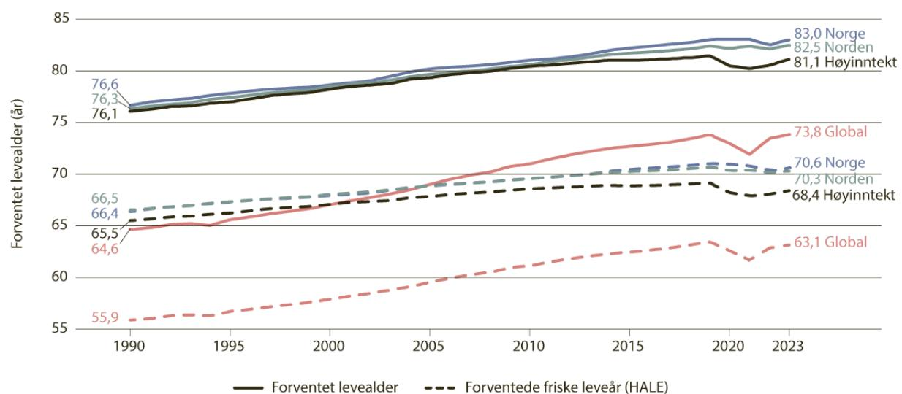

Forventet levealder (år)

1990 1995 2000 2005 2010 2015 2020 2023

Forventet levealder --- Forventede friske leveår (HALE)

| År   | Forventet levealder | Forventede friske leveår (HALE) | Norge | Norden | Høyinntekt | Global |
|------|---------------------|---------------------------------|-------|--------|------------|--------|
| 1990 | 76,1                | 65,5                            | 76,6  | 76,3   | 66,4       | 55,9   |
| 1995 | ~77.5               | ~65.5                           | ~77.5 | ~77.0  | ~66.5      | ~56.5  |
| 2000 | ~78.5               | ~67.0                           | ~78.5 | ~78.0  | ~67.5      | ~58.0  |
| 2005 | ~79.5               | ~68.0                           | ~80.0 | ~79.5  | ~68.5      | ~59.5  |
| 2010 | ~80.5               | ~68.5                           | ~81.0 | ~80.0  | ~69.0      | ~61.0  |
| 2015 | ~81.0               | ~69.0                           | ~82.0 | ~81.5  | ~70.0      | ~62.5  |
| 2020 | ~81.0               | ~68.5                           | ~83.0 | ~82.0  | ~70.5      | ~62.5  |
| 2023 | 81,1                | 68,4                            | 83,0  | 82,5   | 70,6       | 73,8   |

The chart shows the expected life expectancy (solid lines) and healthy life expectancy (dashed lines) in years from 1990 to 2023. The lines for Norge, Norden, and Høyinntekt show an upward trend, while the Global lines show a more complex pattern with a dip around 2021.

Line chart: Expected life expectancy and healthy life expectancy from 1990 to 2023.

**Figur 6.1 Utvikling i forventet levealder og forventede friske leveår (HALE) fra 1990–2023 for Norge, Norden, høyinntektsland og globalt**

Kilde: FHI (2025d) og Global Burden of Disease-prosjektet (GBD)

Figur 6.2 viser at Norge også har lav dødelighet, både av årsaker som kan forebygges gjennom folkehelsetiltak og årsaker som kan behandles gjennom rettidige og effektive helsetiltak. I 2023 var den samlede dødeligheten i Norge nesten 30 prosent lavere enn EU-gjennomsnittet, og den største forskjellen i dødelighet er blant årsaker som kan behandles. De viktigste årsakene til behandlingsbare dødsfall i Norge er tykktarmskreft, iskemisk hjertesykdom og brystkreft (OECD & European Observatory on Health Systems and Policies, 2025).

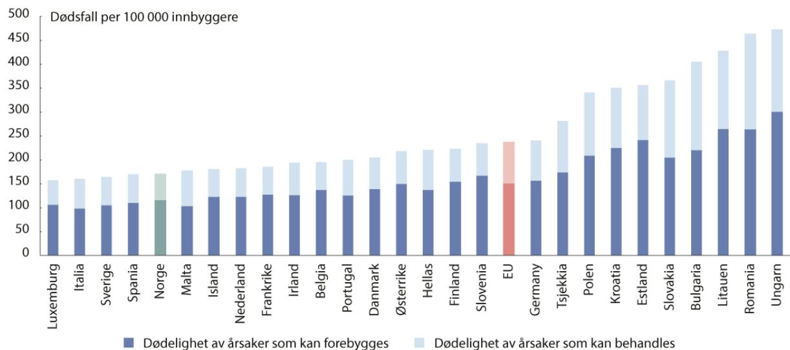

Dødsfall per 100 000 innbyggere

Dødelighet av årsaker som kan forebygges | Dødelighet av årsaker som kan behandles

The chart shows mortality per 100,000 residents for various European countries and the EU average. The y-axis ranges from 0 to 500. The x-axis lists countries from Luxembourg to Ungarn. The EU average is highlighted in red. The legend indicates that blue represents preventable causes and light blue represents treatable causes.

| Country   | Dødelighet av årsaker som kan forebygges | Dødelighet av årsaker som kan behandles |
|-----------|------------------------------------------|-----------------------------------------|
| Luxemburg | ~100                                     | ~50                                     |
| Italia    | ~90                                      | ~60                                     |
| Sverige   | ~100                                     | ~60                                     |
| Spania    | ~105                                     | ~60                                     |
| Norge     | ~110                                     | ~55                                     |
| Malta     | ~95                                      | ~75                                     |
| Island    | ~115                                     | ~60                                     |
| Nederland | ~115                                     | ~65                                     |
| Frankrike | ~120                                     | ~60                                     |
| Irland    | ~120                                     | ~70                                     |
| Belgia    | ~130                                     | ~60                                     |
| Portugal  | ~120                                     | ~75                                     |
| Danmark   | ~135                                     | ~65                                     |
| Østerrike | ~145                                     | ~70                                     |
| Hellas    | ~130                                     | ~85                                     |
| Finland   | ~150                                     | ~70                                     |
| Slovenia  | ~160                                     | ~70                                     |
| EU        | ~145                                     | ~85                                     |
| Germany   | ~150                                     | ~85                                     |
| Tsjekkia  | ~165                                     | ~110                                    |
| Polen     | ~205                                     | ~130                                    |
| Kroatia   | ~220                                     | ~125                                    |
| Estland   | ~235                                     | ~120                                    |
| Slovakia  | ~200                                     | ~160                                    |
| Bulgaria  | ~215                                     | ~185                                    |
| Litauen   | ~260                                     | ~160                                    |
| Romania   | ~260                                     | ~200                                    |
| Ungarn    | ~295                                     | ~270                                    |

Bar chart: Mortality per 100,000 residents by cause of death and country.

**Figur 6.2 Dødelighet per 100 000 innbyggere av årsaker som kan forebygges og behandles. 2023.**

Kilde: Eurostat

Til tross for god folkehelse og gode helse- og omsorgstjenester, vil utviklingstrekkene som er beskrevet i kapittel 5 gjøre det stadig mer utfordrende å dekke befolkningens behov for helse- og omsorgstjenester. En aldrende befolkning og helsefaglige og medisinske framskritt gjør at flere enn tidligere vil leve med kroniske sykdommer, multimorbiditet og behov for langvarig behandling og oppfølging. Økt levealder og det at flere tilstander kan behandles er utelukkende positivt. Det stiller likevel krav til hvordan helse- og omsorgstjenestene innrettes for å kunne dekke behovene i en situasjon med økende knapphet på arbeidskraft.

Dersom det ikke gjøres endringer for å møte framtidens behov, kan det bli svært utfordrende å sikre sammenhengende tjenester og et likeverdig tilbud til befolkningen, samtidig som tjenestene skal være rustet til å håndtere uforutsette hendelser. Dette er bakgrunnen for utvalgets arbeid med å vurdere framtidig organisering, styring og finansiering av en sammenhengende og integrert helse- og omsorgstjeneste i Norge. I dette kapittelet drøfter utvalget hva de viktigste utfordringene vil være, årsakene til utfordringene og sentrale barrierer for at helse- og omsorgstjenestene kan møte utfordringene på en god måte.

##### **Boks 6.1 Tre hovedutfordringer for framtidens helse- og omsorgstjenester**

- Det vil bli utfordrende å dekke behovet for helse- og omsorgstjenester.
- Det vil bli utfordrende å oppnå sammenhengende helse- og omsorgstjenester.

- Det vil bli utfordrende å sørge for likeverdige helse- og omsorgstjenester.

###### **Rammeslutt**

### **6.2 Det vil bli utfordrende å dekke behovet for helse- og omsorgstjenester**

I tiårene framover vil befolkningens behov for helse- og omsorgstjenester øke, samtidig som tilgangen på kvalifisert helsepersonell og andre ressurser ikke vil øke like mye. Dermed vil det bli svært utfordrende å gi helse- og omsorgstjenester av riktig kvalitet over hele landet. Dette kan svekke befolkningens tillit til at de vil få nødvendig helsehjelp når de trenger det.

#### **6.2.1 Økende behov for helse- og omsorgstjenester**

##### **Utvikling i sykdomsbyrde**

Fram mot 2050 vil sykdomsbyrden i Norge øke, i hovedsak som følge av en større og eldre befolkning (FHI, 2024b). Antall personer over 80 år forventes å bli mer enn doblet fra 2026 til 2050 (figur 6.3), og antall personer med demens øker i takt med den aldrende befolkningen (FHI, 2026d). Utgiftene til andre aldersrelaterte tilstander som skader etter fall, hjerneslag og diabetes forventes også å øke (Kinge mfl., 2025).

Antall personer under 80 år med flere kroniske lidelser vil øke med om lag 20 prosent fra i dag til 2050 (figur 6.3). For andre grupper er veksten betydelig lavere, med kun små endringer i antall personer med rus- og psykiske lidelser og i antall barn og ungdom med varige eller sammensatte tjenestebehov.

Selv om det forventes friskere aldring<sup>5</sup> vil befolkningens behov for helse- og omsorgstjenester øke, særlig som følge av demens (FHI, 2026d; Kinge mfl., 2025; Robinson, 2020; Gjøra mfl., 2020). Alzheimers sykdom og andre typer demens forventes i 2050 å være den største årsaken til sykdomsbyrde i Norge, selv om den aldersjusterte forekomsten av demens er synkende (SSB, 2025a). Utgiftene til andre aldersrelaterte tilstander som fall, hjerneslag og diabetes forventes også å øke (Kinge mfl., 2025; Helsedirektoratet, 2024a; FHI, 2024b).

---

<sup>5</sup>Perspektivmeldingen 2024 legger til grunn at forventet levealder vil øke med 6–7 år fram mot 2060, og at tre av disse årene er friske leveår. Ressursinnsatsen for en 80-åring i 2060 vil dermed kunne tilsvare ressursinnsatsen til en 77-åring i dag (Meld. St. 31 (2023–2024)). Et unntak fra antakelsen om friskere aldring gjelder personer over 90 år, der sykdomsbyrden kan øke fram mot 2050 (Barstad & Hammersland, 2025).

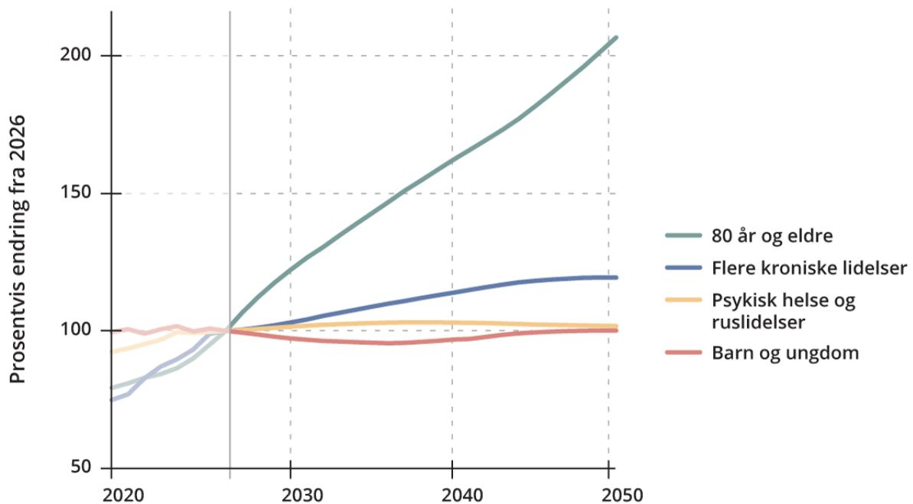

Prosentvis endring fra 2026

2020 2030 2040 2050

| År   | 80 år og eldre | Flere kroniske lidelser | Psykisk helse og ruslidelser | Barn og ungdom |
|------|----------------|-------------------------|------------------------------|----------------|
| 2020 | ~75            | ~75                     | ~90                          | ~100           |
| 2030 | ~125           | ~105                    | ~105                         | ~95            |
| 2040 | ~165           | ~115                    | ~105                         | ~95            |
| 2050 | ~210           | ~120                    | ~105                         | ~100           |

The line chart shows projected percentage changes from 2026 to 2050 for four groups: 80 år og eldre, Flere kroniske lidelser, Psykisk helse og ruslidelser, and Barn og ungdom. The 80 år og eldre group shows a significant increase, reaching over 200% by 2050. The other groups remain relatively stable, with Flere kroniske lidelser and Psykisk helse og ruslidelser slightly increasing, and Barn og ungdom remaining around 100%.

Legend:

- 80 år og eldre
- Flere kroniske lidelser
- Psykisk helse og ruslidelser
- Barn og ungdom

Line chart: Projected percentage change from 2026 by age group and health condition up to 2050.

**Figur 6.3 Utviklingen i prosent i fire grupper: personer 80 år og eldre, personer i alderen 19–79 år med tre eller flere kroniske sykdommer, personer i alderen 19–79 år med minst én diagnose innen psykisk helse eller ruslidelser, og barn 2–18 år med varige eller sammensatte behov.**

Historiske tall før 2026, deretter framskrivinger. Alle gruppene er indeksert til 100 i 2026.

Kilde: Basert på SSBs befolkningsframskrivinger, mellomalternativet, har FHI (2026g) framskrevet antall personer i de fire gruppene.

Framtidig innvandring kan påvirke utviklingen i behovet for helse- og omsorgstjenester. Innvandrerbefolkningen er en sammensatt gruppe med store forskjeller i levekår, helse, helseatferd og helsetjenestebruk. For mange grupper av innvandrere finnes det lite eller ingen data og forskning, og det totale bildet av innvandreres helse og helsetjenestebruk er mangelfullt. Innvandrere er en ung befolkning, og andelen over 70 år er vesentlig lavere enn i resten av befolkningen. Innvandrere har generelt lavere dødelighet og noe høyere forventet levealder enn befolkningen ellers. Noen grupper har dårligere selvrapportert helse, psykisk helse og tannhelse enn andre, og noen sykdommer, tilstander og levevaner er vanligere i enkelte innvandrergrupper enn i den øvrige befolkningen. Noen sykdommer, tilstander og levevaner er imidlertid mindre utbredt i enkelte innvandrergrupper enn i den øvrige befolkningen. Det gjelder blant annet flere kreftformer og diabetes (FHI, 2026a; 2026f). Et offentlig utvalg, som ble oppnevnt i juni 2026, skal se på bruken av helsetjenester blant innvandrere og nordmenn med innvandrerbakgrunn, og hvordan dette påvirker arbeidsdeltakelse og inkludering i arbeidslivet.

##### Utvikling i behov for kommunale tjenester og spesialisthelsetjenester

Med aldringen av befolkningen vil flere få behov for helse- og omsorgstjenester, og flere vil få behov for å benytte flere forskjellige tjenester samtidig. Flere vil for eksempel leve med

skrøpelighet<sup>6</sup>, og dermed ha stort behov for behandling og institusjonstjenester (Kyrdalen mfl., 2024; Helsedirektoratet, 2023c).

Det vil særlig bli økt behov for allmennlegetjenester, polikliniske konsultasjoner og akuttinnleggelser (FHI, 2022b). De fleste eldre bruker flere deler av helsetjenesten i løpet av ett år. Blant personer over 80 år er hver tredje i kontakt med både fastlege/allmennlege, spesialisthelsetjenesten og andre kommunale helse- og omsorgstjenester i løpet av et år. I andre aldersgrupper gjelder dette bare én av tjue personer (FHI, 2026i).

Både kommunenes og spesialisthelsetjenestens ressursbruk er konsentrert om relativt små andeler av pasientene og brukerne (kapittel 12).

Gitt dagens organisering og tjenestetilbud vil en eldre befolkning gi vekst i ressursbehovet både i kommunene og spesialisthelsetjenesten. Dette er illustrert i figur 6.4, som er basert på tall fra Helse Sør-Øst RHF (2026). Figuren viser at de samlede kostnadene til både somatiske spesialisthelsetjenester og vedtaksbaserte kommunale helse- og omsorgstjenester vil øke betydelig, og at veksten vil komme av økt behov for tjenester til den eldre befolkningen. Analyser gjort av Helse Sør-Øst RHF (2026) viser at de samlede utgiftene til kommunale vedtaksbaserte tjenester, fastlege og legevakt, forventes å overstige kostnadene til spesialisthelsetjenester fra om lag 2037, jf. figur 6.5.

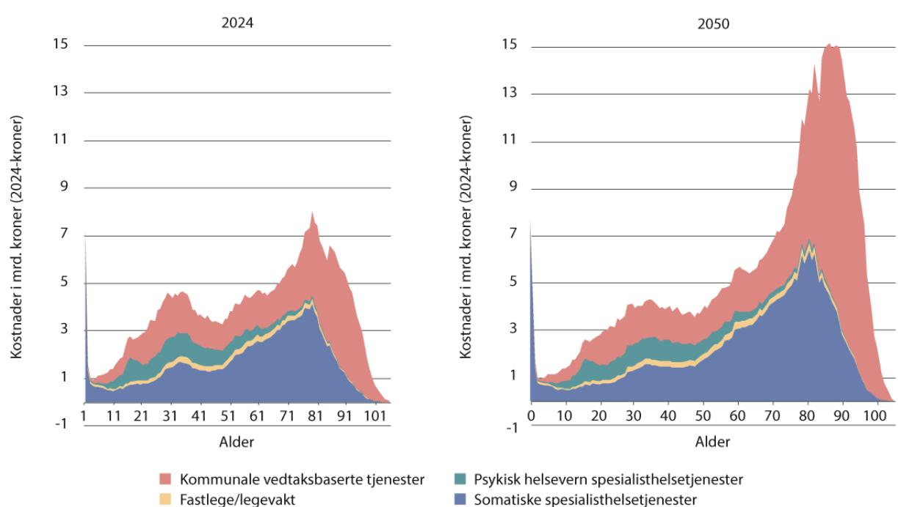

The figure consists of two stacked area charts comparing healthcare costs in 2024 and 2050. The y-axis represents costs in mrd. kroner (2024-kroner) from -1 to 15. The x-axis represents age (Alder) from 1 to 101.

**2024**

**2050**

**Legend:**

- Kommunale vedtaksbaserte tjenester
- Fastlege/legevakt
- Psykisk helsevern spesialisthelsetjenester
- Somatiske spesialisthelsetjenester

Both charts show a general increase in costs with age, peaking around age 80-90. The 2050 chart shows a significant increase in the total cost compared to 2024, particularly in the 80-90 age group.

| Alder | Somatiske spesialisthelsetjenester (2024) | Fastlege/legevakt (2024) | Psykisk helsevern spesialisthelsetjenester (2024) | Kommunale vedtaksbaserte tjenester (2024) |
|-------|-------------------------------------------|--------------------------|---------------------------------------------------|-------------------------------------------|
| 1     | ~0.8                                      | ~0.1                     | ~0.1                                              | ~0.1                                      |
| 21    | ~1.2                                      | ~0.3                     | ~0.2                                              | ~1.2                                      |
| 41    | ~1.8                                      | ~0.5                     | ~0.4                                              | ~1.9                                      |
| 61    | ~2.5                                      | ~0.8                     | ~0.6                                              | ~2.9                                      |
| 81    | ~4.2                                      | ~1.2                     | ~1.0                                              | ~4.5                                      |
| 91    | ~1.5                                      | ~0.5                     | ~0.3                                              | ~1.8                                      |
| 101   | ~0.1                                      | ~0.1                     | ~0.1                                              | ~0.1                                      |

| Alder | Somatiske spesialisthelsetjenester (2050) | Fastlege/legevakt (2050) | Psykisk helsevern spesialisthelsetjenester (2050) | Kommunale vedtaksbaserte tjenester (2050) |
|-------|-------------------------------------------|--------------------------|---------------------------------------------------|-------------------------------------------|
| 0     | ~7.5                                      | ~0.1                     | ~0.1                                              | ~0.1                                      |
| 20    | ~1.2                                      | ~0.3                     | ~0.2                                              | ~1.2                                      |
| 40    | ~2.0                                      | ~0.5                     | ~0.4                                              | ~2.0                                      |
| 60    | ~3.2                                      | ~0.8                     | ~0.6                                              | ~3.2                                      |
| 80    | ~6.5                                      | ~1.2                     | ~1.0                                              | ~6.5                                      |
| 90    | ~3.5                                      | ~0.5                     | ~0.3                                              | ~3.5                                      |
| 100   | ~0.1                                      | ~0.1                     | ~0.1                                              | ~0.1                                      |

Multi-panel chart: Cost trends by age group for 2024 and 2050 across healthcare services.

**Figur 6.4 Kostnader i ulike deler av helse- og omsorgstjenestene i 2024 og framskrevet til 2050 (2024-kroner)**

<sup>6</sup>Faguttrykket skrøpelighet defineres som redusert fysiologisk reserve, som fører til økt sårbarhet og høyere risiko for sykdom, skade, funksjonssvikt og død. Kroppen håndterer akutt sykdom og medisinsk behandling dårligere (Helsedirektoratet, 2026g).

Kilde: Helse Sør-Øst RHF (2026)

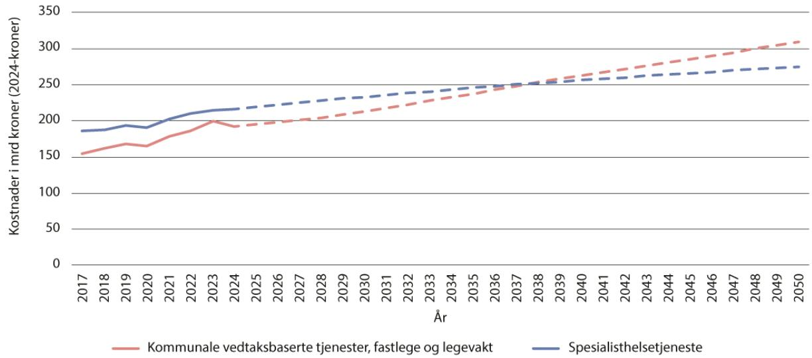

Kostnader i mrd kroner (2024-kroner)

År

| År   | Kommunale vedtaksbaserte tjenester, fastlege og legevakt | Spesialisthelsetjeneste |
|------|----------------------------------------------------------|-------------------------|
| 2017 | ~152                                                     | ~182                    |
| 2018 | ~160                                                     | ~183                    |
| 2019 | ~166                                                     | ~192                    |
| 2020 | ~163                                                     | ~187                    |
| 2021 | ~175                                                     | ~198                    |
| 2022 | ~182                                                     | ~208                    |
| 2023 | ~198                                                     | ~212                    |
| 2024 | ~190                                                     | ~213                    |
| 2025 | ~192                                                     | ~217                    |
| 2026 | ~195                                                     | ~220                    |
| 2027 | ~198                                                     | ~223                    |
| 2028 | ~202                                                     | ~226                    |
| 2029 | ~205                                                     | ~228                    |
| 2030 | ~210                                                     | ~231                    |
| 2031 | ~215                                                     | ~234                    |
| 2032 | ~220                                                     | ~237                    |
| 2033 | ~225                                                     | ~240                    |
| 2034 | ~230                                                     | ~242                    |
| 2035 | ~235                                                     | ~245                    |
| 2036 | ~240                                                     | ~247                    |
| 2037 | ~245                                                     | ~248                    |
| 2038 | ~250                                                     | ~250                    |
| 2039 | ~255                                                     | ~252                    |
| 2040 | ~260                                                     | ~253                    |
| 2041 | ~265                                                     | ~255                    |
| 2042 | ~270                                                     | ~256                    |
| 2043 | ~275                                                     | ~258                    |
| 2044 | ~280                                                     | ~260                    |
| 2045 | ~285                                                     | ~262                    |
| 2046 | ~290                                                     | ~264                    |
| 2047 | ~295                                                     | ~266                    |
| 2048 | ~300                                                     | ~268                    |
| 2049 | ~305                                                     | ~270                    |
| 2050 | ~310                                                     | ~272                    |

— Kommunale vedtaksbaserte tjenester, fastlege og legevakt — Spesialisthelsetjeneste

The chart shows a steady increase in costs for both categories from 2017 to 2050. The 'Kommunale vedtaksbaserte tjenester, fastlege og legevakt' category starts lower but grows faster, surpassing the 'Spesialisthelsetjeneste' category around 2037.

Line chart: Cost trends in 2024 kroner from 2017 to 2050 for two service categories.

**Figur 6.5 Framskrevet utvikling i kostnader til kommunale helse- og omsorgstjenester og spesialisthelsetjenester (2024-kroner)**

Kilde: Helse Sør-Øst RHF (2026)

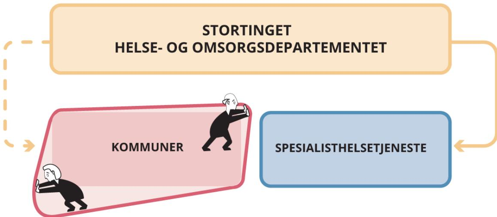

The diagram illustrates the relationship between three entities: **STORTINGET HELSE- OG OMSORGSDEPARTEMENTET** (top), **KOMMUNER** (bottom left, with two cartoon figures pushing a box), and **SPESIALISTHELSETJENESTE** (bottom right). A solid orange line connects the top box to the bottom right box. A dashed orange line with an arrow points from the top box to the bottom left box.

**STORTINGET  
HELSE- OG OMSORGSDEPARTEMENTET**

**KOMMUNER**

**SPESIALISTHELSETJENESTE**

Infographic: Conceptual diagram of the Danish healthcare and social services system.

**Figur 6.6 Den demografiske utviklingen med flere eldre i befolkningen gir større press på de kommunale helse- og omsorgstjenestene i årene framover.**

#### **6.2.2 Økende forventninger**

Det forventes også økt etterspørsel etter helse- og omsorgstjenester som følge av at befolkningen får økt betalingsevne og vilje til å betale for helse- og omsorgstjenester. I OECD-landene anslås det at demografiske endringer i gjennomsnitt vil forklare rundt 25 prosent av veksten i etterspørselen etter helse- og omsorgstjenestene fram mot 2030. Omtrent halvparten av veksten forventes derimot å skyldes inntektsvekst i befolkningen, som leder til økt etterspørsel etter disse tjenestene. I Norge

er det anslått at effekten av de demografiske endringene og økte inntekter forklarer 40 prosent hver av kostnadsveksten mot 2030 (Lorenzoni mfl., 2019).

Medisinsk, helsefaglig og teknologisk innovasjon utvider kontinuerlig mulighetene i helse- og omsorgstjenesten og øker forventningene til hva tjenestene kan tilby. Et viktig spørsmål vil være om forbedringer i tilbudet kan oppnås gjennom mer effektiv ressursbruk og bedre utnyttelse av teknologi, uten at utgiftene eller bruken av arbeidskraft øker tilsvarende (Meld. St. 14 (2020–2021)).

#### **6.2.3 Knappe helsepersonellressurser**

Etterspørselen etter helsepersonell vil øke betydelig mer enn tilbudet. SSB (2026b) presenterer oppdaterte framskrivinger av etterspørselen etter kvalifisert arbeidskraft i de offentlige helse- og omsorgstjenestene og tilbudet av personell med relevant utdanning. Det vil særlig bli mangel på helsefagarbeidere og sykepleiere (SSB, 2026b)<sup>7</sup>. SSBs analyser viser at for 14 autoriserte helsepersonellgrupper vil underskuddet øke fra om lag 9 900 årsverk i 2025 til 42 400 årsverk i 2040, hvorav 25 900 vil være årsverk innen helsefagarbeid og 14 700 vil være sykepleierårsverk. Det forventes moderate, men vedvarende underskudd på vernepleiere, helsesekretærer, bioingeniører, jordmødre og radiografer. Psykologer og leger vil være i en særstilling med overskudd mot slutten av perioden, noe som ifølge SSB kan gi rom for å tilpasse hvordan arbeidskraften kan anvendes innenfor sektoren (SSB, 2026b).

I tillegg vil det, ved videreføring av dagens bemanningssammensetning, i 2040 være behov for 171 500 årsverk utenom disse 14 autoriserte helsepersonellgruppene. Dette inkluderer 41 000 årsverk fra personell med andre helseutdanninger, 57 200 årsverk i administrasjon og service og 73 300 årsverk fra personell uten relevant helseutdanning. For disse personellgruppene er det imidlertid ikke modellert en tilbudsside (ibid.).

Det er særlig kommuner med befolkningsnedgang og en høy andel eldre og andre utenfor arbeidslivet som vil merke knappheten på kvalifisert helsepersonell mest og først. Figur 6.7 viser at det i de minst sentrale kommunene vil bli betydelige utfordringer med å dekke arbeidskraftbehovet innen omsorgssektoren fram mot 2040. Her vil veksten i arbeidsstyrken være klart lavere enn det forventede økte behovet i sektoren. Mot slutten av perioden vil det, med dagens tilgang på arbeidskraft og arbeidskraftfordelingen i arbeidslivet, bli utfordrende å dekke arbeidskraftbehovet også i de mer sentrale kommunene, som følge av at veksten i arbeidsstyrken ventes å bli klart lavere (NOU 2026: 1).

Med økende knapphet på arbeidskraft er det risiko for at eldre vil kunne oppleve å få redusert tilgang til omsorg og helsehjelp. Riksrevisjonen (2026b) viser at de kommunale helse- og

---

<sup>7</sup>SSB understreker at framskrivingene bygger på sterke forutsetninger om tilbud, etterspørsel og sammensetning av ulike utdanningsgrupper i helse- og omsorgstjenestene framover. Forutsetningene er følsomme for teknologisk utvikling, oppgaveglidning mellom utdanningsgrupper og virkninger av eventuelle framtidige politikkendringer. Slike tilpasninger kan påvirke både etterspørselen etter ulike typer kompetanse og tilbudet av arbeidskraft, og dermed også det beregnede gapet mellom tilbud og etterspørsel. Resultatene bør derfor tolkes som betingede framskrivinger, ikke som presise prognoser for den framtidige utviklingen. SSB viser til at forutsetninger om utviklingen i årsverk per bruker har stor betydning for bemanningsbehovet, og er en viktig kilde til variasjon mellom scenarioene. Videre gir forskjeller i utviklingen i familieomsorg store utslag i behovet for offentlig bemanning.

omsorgstjenestene i liten grad er dimensjonerte for å møte økningen i antall eldre, og at det er risiko for svikt i tjenestene. Kvaliteten på slike tjenester kan også forringes, med forverring av pasientens tilstand som konsekvens. Mangel på arbeidskraft kan også påvirke kommunesektorens mulighet til utvikling og omstilling (NOU 2026: 1).

Selv om de største utfordringene vil komme i kommunene framover, vil også spesialisthelsetjenesten møte økt press. Utfordringen framstår samlet sett likevel som mindre drevet av volumvekst enn i kommunene, og er i større grad knyttet til knapphet på nøkkelpersonell, endringer i bemanningssammensetningen og behov for mer effektiv organisering (Meld. St. 11 (2025–2026)). Det er flere oppgaver knyttet til rapportering, informasjonsinnhenting, dokumentasjon og logistikk som bør automatiseres og effektiviseres for å avlaste helsepersonellet (NOU 2023: 4).

I takt med økende rekrutteringsutfordringer vil konkurransen om arbeidskraft mellom spesialisthelsetjenesten, de kommunale helse- og omsorgstjenestene og privatfinansierte leverandører av helse- og omsorgstjenester øke. Helsepersonellkommisjonen mente at det private helsemarkedet utgjør en utfordring for den offentlige helse- og omsorgstjenesten med hensyn til konkurranse og tilgang på arbeidskraft, og at det er tiltakende utfordringer med at personell velger å jobbe hos ulike private aktører (NOU 2023: 4).

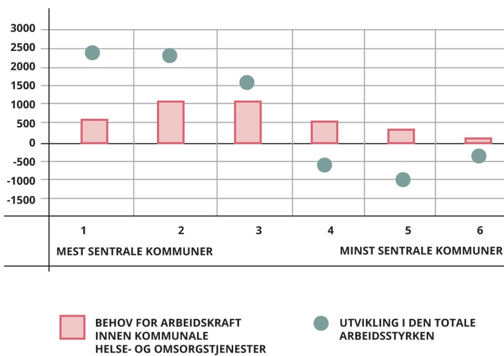

**MEST SENTRALE KOMMUNER** **MINST SENTRALE KOMMUNER**

**BEHOV FOR ARBEIDSKRAFT INNEN KOMMUNALE HELSE- OG OMSORGSTJENESTER**

**UTVIKLING I DEN TOTALE ARBEIDSSTYRKEN**

Y-axis: -1500 to 3000

| Kommune | BEHOV FOR ARBEIDSKRAFT INNEN KOMMUNALE HELSE- OG OMSORGSTJENESTER | UTVIKLING I DEN TOTALE ARBEIDSSTYRKEN |
|---------|-------------------------------------------------------------------|---------------------------------------|
| 1       | ~600                                                              | ~2400                                 |
| 2       | ~1100                                                             | ~2300                                 |
| 3       | ~1100                                                             | ~1650                                 |
| 4       | ~550                                                              | ~-550                                 |
| 5       | ~300                                                              | ~-950                                 |
| 6       | ~100                                                              | ~-300                                 |

A combination bar and scatter chart showing the need for labor force in municipal health and care services (red bars) and the development of the total workforce (teal dots) for six municipalities, ordered from most to least central.

Bar chart: Comparison of labor force needs and total workforce development across municipalities.

Figur 6.7 Behov for arbeidskraft innen kommunale omsorgstjenester og utvikling i arbeidsstyrken samlet. Årlig gjennomsnittlig endring i antall personer i perioden 2026–2040.

Kilde: NOU 2026: 1

#### **6.2.4 Hvordan dekke behovet når det uforutsette skjer?**

Helse- og omsorgstjenestene skal bidra til å verne liv og helse ved ekstraordinære hendelser av ulik karakter og varighet og sørge for nødvendige helse- og omsorgstjenester i krise og krig. Evalueringer etter store kriser i Norge viser at helse- og omsorgssektoren i stort har håndtert kriser godt (Meld. St. 5 (2023–2024)). Framover vil det likevel være behov for å vurdere tiltak for at tjenestene fremdeles skal kunne håndtere slike hendelser, i en situasjon der behovene vokser og tilgangen på ressurser avtar. Beredskap er ikke en uavhengig oppgave som kan dimensjoneres isolert fra det øvrige tjenestetilbudet, men trekker på de samme personell- og kompetanseressursene.

Usikkerheten om fremtidige hendelser gjør at helsesektoren må bygges med større fleksibilitet og tilpasningsevne enn tidligere. Dette kan påvirke dimensjonering, kompetansebehov og organisering.

Helseberedskapsmeldingen (Meld. St. 5 (2023–2024)) beskrev seks sentrale risiko- og sårbarhetsområder som vil få konsekvenser for helseberedskapsarbeidet i sektoren og dermed for helse- og omsorgstjenestene: sammensatte trusler og krig, digital sikkerhet, forsyningssikkerhet, pandemi og smittsomme sykdommer, trygg vannforsyning og atomhendelser.

En militær konflikt der Norge er stridende part, vil kreve store omstillinger og utløse behov for mobilisering av personell, kompetanse og ressurser. Også en militær konflikt hvor artikkel fem er utløst utenfor norsk territorium, vil involvere helse- og omsorgssektoren. I en krigssituasjon skal helsetjenestene støtte Forsvaret og totalforsvaret, og det pågår arbeid med å utvikle operative beredskapsplaner som er koordinert med Forsvaret. Planene skal blant annet omfatte omdisponering og økning av antall senger, personell og arealer, samarbeid på tvers av helseforetak og regioner og planer for overføring av pasienter mellom sykehus. Kapittel 16 omtaler behovet for økt sengekapasitet.

I en krigssituasjon vil både soldater og sivile kunne ha behov for evakuering og helsehjelp. Dette vil påvirke prioriteringer og pasientforløp og medføre at enkelte behov må ivaretas av andre kapasiteter i det sivile samfunnet. Ved større hendelser eller krig, når behovet overstiger tilgjengelige ressurser, vil det kreves prioriteringer med sikte på å redde flest mulig liv. Ved endret og streng prioritering av hvem som kan behandles på sykehus, vil et stort antall pasienter for eksempel måtte håndteres i primærhelsetjenesten.

Ved mobilisering vil Forsvaret innkalle innsatspersonell etter lov om verneplikt, enten som helsepersonell eller grunnet deres militære kompetanse. Ved krise og krig kan personell i helse- og omsorgstjenesten omdisponeres etter helseberedskapsloven, spesialisthelsetjenesteloven og helse- og omsorgstjenesteloven.

*Beredskapsanalyse for helse- og omsorgssektoren 2025–2026* (Helse- og omsorgsdepartementet, 2026b) gir en oppdatert oversikt over nasjonalt spesialisert planverk i sektoren. Analysen har ikke avdekket at det mangler planverk der det er pålagt, men viser at det er nødvendig å videreutvikle planverk innen alle kategorier beredskapssituasjoner. Innenfor enkelte kategorier er det mulig at det er behov for en ny plan eller et lignende dokument.

En tilsynsrapport viste at to av tre kommuner som det ble ført fellestilsyn med i perioden 2020–2023, jobber godt med beredskap og oppfyller de fleste kravene til kommunal beredskapsplikt og

helseberedskap. En tredjedel av kommunene har utfordringer i beredskapsarbeidet, og en del kommuner har mangelfullt og utdatert beredskapsplanverk, og mangler i styring og ledelse av beredskapsarbeidet (Helsetilsynet, 2024).

#### **6.2.5 Barrierer mot at behovene skal kunne dekkes i tiårene framover**

Det er sammensatte årsaker til at det vil bli utfordrende å dekke framtidige behov for helse- og omsorgstjenester. De viktigste barrierene er:

- Ulike tjenestenivåer og finansieringsordninger svekker mulighetene for hensiktsmessig allokering av ressurser.
- Det er svakheter ved prioriteringen av ressursene i helse- og omsorgstjenestene.
- Det er svakheter ved kunnskapen om hvor behovet er og hvordan dekke det.
- Arbeidskraften, kompetansen og andre ressurser i kommunene og spesialisthelsetjenesten brukes ikke effektivt nok.
- Utvikling, innføring og gevinstrealisering av digitale løsninger går for sakte.

##### **Ulike tjenestenivåer og finansieringsordninger svekker mulighetene for hensiktsmessig allokering av ressurser**

Dagens system svekker grunnlaget for effektiv allokering av begrensede ressurser og kan føre til at pasienter ikke behandles på laveste effektive omsorgsnivå. Det at kommunale helse- og omsorgstjenester og spesialisthelsetjenester planlegges, finansieres og styres hver for seg, kan utgjøre en barriere mot effektiv bruk av ressurser og personell. Mens spesialisthelsetjenesten finansieres over Helse- og omsorgsdepartementets budsjett, finansieres de kommunale helse- og omsorgstjenestene over Kommunal- og distriktsdepartementets budsjett.

Den delte ansvars- og finansieringsstrukturen innebærer at de samlede ressursene i liten grad vurderes i sammenheng. Ingen aktør har fullstendig informasjon, og nytte og kostnader av beslutninger er ulikt fordelt mellom nivåene. Den enkelte aktør har derfor begrensede insentiver til å ta hensyn til hvilke konsekvenser egne beslutninger har for andre aktører, for helse- og omsorgstjenesten samlet eller for samfunnet for øvrig. Der en investering på ett nivå gir gevinst på et annet, finnes det ikke finansielle verktøy som automatisk kan fordele kostnader og gevinster mellom nivåene.

Riksrevisjonen (2026c) viser for eksempel at kommuner hvor det ligger sykehus har høyere bruk av spesialisthelsetjenester for eldre over 80 år enn de fleste andre kommuner. Etter Riksrevisjonens vurdering er dette verken rimelig eller ønskelig. De viser til at dersom flere eldre i disse kommunene får dekket mer av sitt behov for helsetjenester på det laveste effektive omsorgsnivået, kan dette frigjøre kapasitet i sykehusene, noe som igjen kan brukes på pasienter med større behov for spesialisert behandling. Riksrevisjonen mener at dette er særdeles viktig ettersom den prosentvise veksten i antall eldre over 80 år fram mot 2040 er like sterk i vertskommunene som i de andre kommunene. De aller fleste vertskommunene har flere innbyggere enn de andre kommunene i opptaksområdet. Riksrevisjonen (2026c) slår videre fast at spesialisthelsetjenesten i mange tilfeller behandler pasienter som heller skulle fått hjelp i helse- og omsorgstjenesten i kommunene, og at sykehusene vil bli overbelastet dersom ikke helsetjenestene i større grad enn i dag utføres på

lavest mulige omsorgsnivå. Det er utfordrende å sørge for dette i et system der ansvaret for tjenestene og finansieringen er fordelt på flere forvaltningsnivåer.

Tilsvarende variasjon finnes i arbeidsdelingen mellom spesialisthelsetjenesten og allmennlegetjenesten i tilbudet til barn. I enkelte opptaksområder mottar barn i større grad helsehjelp i somatisk spesialisthelsetjeneste enn i andre, uten at det er grunn til å anta at barn i disse områdene har større behov for spesialisthelsetjenester enn barn i opptaksområder hvor de i større grad følges opp i allmennlegetjenesten (SKDE, 2025).

Dagens ansvarsdeling har også fordeler. Når primærhelsetjenesten i hovedsak finansieres over kommunerammen, ses de kommunale helse- og omsorgstjenestene i sammenheng med andre kommunale oppgaver, og kommunene får insentiver til å forebygge behov for tjenester. At kommunene må prioritere på tvers av sektorer og vurdere hvor den siste kronen kaster mest av seg, kan bidra til en effektiv utnyttelse av samfunnets samlede ressurser. Tilsvarende gevinster er imidlertid vanskelige å oppnå i allokeringen av ressurser mellom de to forvaltningsnivåene. Den kommunale helse- og omsorgstjenesten og spesialisthelsetjenesten kan tvert imot ha insentiver til å overlate oppfølging og behandling av pasienter til hverandre, selv når dette verken er best for pasientene eller for den samlede ressursutnyttelsen.

Insentivene i dagens finansieringsordninger kan også motvirke en hensiktsmessig fordeling av pasienter mellom fastlegene, de øvrige helse- og omsorgstjenestene i kommunene og sykehusene. Fastlegene og til dels sykehusene har et høyt innslag av aktivitetsbasert finansiering, mens de øvrige kommunale helse- og omsorgstjenestene må dekkes innenfor faste budsjettrammer. Den aktivitetsbaserte finansieringen stimulerer til mange og korte kontakter hos fastlege eller sykehus hver for seg, framfor grundigere og mer helhetlig samarbeid om pasientene. Insentivene i de øvrige kommunale helse- og omsorgstjenestene trekker derimot i retning av å begrense aktiviteten.

##### **Svakheter ved prioriteringen av ressurser**

Norge er det landet i Europa som bruker mest penger per innbygger på helse. Norge har også flest praktiserende sykepleiere per innbygger enn noe annet europeisk land, og flere praktiserende leger enn i de fleste andre land, inkludert de andre nordiske landene (OECD & European Observatory on Health Systems and Policies, 2025). Norge har altså et godt utgangspunkt for å dekke framtidig behovsvekst, forutsatt at ressursene prioriteres riktig. En vesentlig andel av helseutgiftene i OECD-landene brukes på uheldige helsetjenester eller helsetjenester uten effekt (OECD, 2017). Det må gjøres reelle prioriteringer i helse- og omsorgstjenestene. Ansvaret for dette strekker seg fra Stortinget til den enkelte klinikk.

Internasjonalt sett har Norge et velutviklet prioriteringsregime på systemnivå, med bred politisk forankring og eksplisitte kriterier. Samtidig er det behov for at prinsippene i større grad omsettes i faktiske beslutninger på klinisk nivå, i de kommunale tjenestene og i fordelingen av ressurser mellom tjenestenivåene.

Videre kan tilgangen på private helseforsikringer og helsetjenester svekke myndighetenes mulighet til å prioritere. En svensk studie (Palme mfl., 2026) finner at forbruket av helsetjenester blant personer med privat helseforsikring øker med om lag 23 prosent sammenlignet med nivået før de hadde forsikring, og at om lag to tredjedeler av den forsikringsutløste utgiftsøkningen bæres av det

offentlige, ved at private aktører henviser pasienter til offentlig finansiert behandling. Antall fastlegebesøk faller, mens spesialistbesøk, innleggelser og legemiddelbruk øker.

##### **Svakheter ved kunnskapen om hvor behovet er og hvordan dekke det**

Når behovet er stort og det samtidig er mangel på ressurser, er det særlig viktig med kunnskap om hvor behovet er størst og om ressursene brukes på best mulig måte. Det er en utfordring at det ikke finnes gode nok indikatorer og mål for dette. Det er en særlig utfordring at kunnskapen stort sett bare finnes for ett av de to nivåene, slik at det er vanskelig å sammenligne utviklingen i spesialisthelsetjenesten og den kommunale helse- og omsorgstjenesten. Det er også en utfordring at det finnes lite informasjon om helse- og omsorgstjenester som ytes av private aktører.

En annen utfordring er at det ikke finnes gode mål på produktiviteten og produktivitetsutviklingen. Det gjør det vanskelig å sammenligne tjenesteutøvelsen i kommunene med tjenesteutøvelsen i spesialisthelsetjenesten, noe som igjen svekker mulighetene til å vurdere hvor oppgavene løses best.

Det er mangel på oversikt over aktiviteten i de kommunale helse- og omsorgstjenestene. Riksrevisjonen (2026b) viser til at selv om helsemyndighetene har tatt i bruk mange virkemidler, mangler det fremdeles nødvendig informasjon om kvaliteten i de kommunale helse- og omsorgstjenestene. Riksrevisjonen mener dette gjør det vanskelig å utvikle treffsikre tiltak.

Kommunene har god tilgang på åpen, aggregert statistikk om innbyggernes helsetilstand (folkehelseprofiler, KPR-publiseringsløsning, KOSTRA, SSB), men ofte er det tidsetterslep og dataene finnes ikke på bydelsnivå. Kommunene har fragmentert og leverandørbundet tilgang på data fra egne fagsystemer. Uttrekks- og analysekapasiteten er ujevn. Tilgang til pasientopplysninger på tvers av nivåer er under utvikling nasjonalt. Midt-Norge er et unntak der Helseplattformen gir helsepersonell tilgang til felles journal- og samhandlingsløsning på tvers av store deler av helsetjenesten. Det finnes ikke noe kommunalt motstykke til helseatlasene. Analyser av variasjon i kommunale tjenester finnes, som for eksempel Eldrebarometer fra Helsedirektoratet, men bare som spredte enkeltrapporter, ikke som en etablert systematisk tjeneste.

Kommunene har behov for bedre data om allmennlegetjenestene og de akuttmedisinske tjenestene for å kunne styre disse tjenestene på en hensiktsmessig måte (Meld. St. 23 (2024–2025)). Kommunene mangler også data om henvisningspraksisen til fastlegene, noe som har betydning for ressursbruken i spesialisthelsetjenesten (Riksrevisjonen, 2026c).

Kunnskapen om omfanget og bruken av private helse- og omsorgstjenester er svært begrenset. Dette inkluderer kunnskap om hvilke sosioøkonomiske grupper som har private forsikringer og om hvem som benytter forsikringer til å få private helse- og omsorgstjenester. Tall fra Sverige tyder på at private forsikringer er vanligere blant personer med høy inntekt og utdanning (Palme mfl., 2026).

FHI har gjennomført brukererfaringsundersøkelser med fastlegene. Helsedirektoratet har publisert resultater fra brukerundersøkelser om blant annet legevakt og innen svangerskaps-, fødsels- og barselomsorgen. Det mangler fortsatt god kunnskap om hvordan pasienter og pårørende opplever tjenestene de mottar. Helsedirektoratet har i samarbeid med FHI utarbeidet en tiårsplan for systematisk gjennomføring av nasjonale pasient-, bruker- og pårørendeundersøkelser.

Det finnes heller ikke noe system for løpende innhenting og analyse av lokale og regionale pasient- og brukerundersøkelser. Et slikt system ville gjort det mulig å følge med i sanntid og dermed å vurdere og justere tjenestene som en respons på pasientenes og brukernes opplevelser og selvrapporterte helseutfall. Mangel på slike analyser kan gjøre det vanskeligere å fange opp behov for endringer i tjenestenes sammensetning, dimensjonering og brukeropplevd kvalitet. Mangel på konsistente og systematiske undersøkelser av brukernes behov gjør det heller ikke mulig å benytte brukererfaringer som grunnlag for resultatbaserte finansieringsordninger, slik det eksempelvis gjøres i England. Helsedirektoratet skal i samarbeid med FHI utrede modeller for systematisk oppfølging av bruker- og pårørendeundersøkelser slik at det kommer til nytte i helse- og omsorgstjenesten.

Forordningen om det europeiske helsedataområdet (European Health Data Space, EHDS) er en ny forordning fra EU som skal sikre trygg, sømløs og effektiv deling av helsedata i Norge og på tvers av europeiske land. Målet er å gi pasienter bedre kontroll over egne elektroniske helseopplysninger, forbedre pasientbehandling og tilrettelegge for forskning.

##### **Arbeidskraften utnyttes ikke godt nok**

Helse- og sosialtjenester er næringen med høyest deltidsandel i Norge. 32 prosent av all avtalt arbeidstid i næringen i fjerde kvartal 2023 var deltidsarbeidstid (SSB, 2024b). Dette tilsier at det finnes en reservearbeidskraft. Det er anslått at utvalgte helse- og omsorgsyrker omfattet 167 916 deltidsansatte og en arbeidskraftreserve på om lag 35 000 årsverk. Bare rundt 5 000 av disse årsverkene var knyttet til ansatte som selv oppga at de ønsket økt stillingsprosent. Dette tyder på at den teoretiske reserven er betydelig større enn den reelt mobiliserbare reserven på kort sikt (Oslo Economics, 2024a).

Helsepersonellkommisjonen understreker at økt heltidsandel er et viktig tiltak, men at potensialet ikke uten videre kan realiseres, fordi arbeidstidsordninger, belastning, organisering og preferanser begrenser hvor mye deltidsarbeid som faktisk kan omgjøres til flere årsverk.

Sykehusene har stort behov for kompetent arbeidskraft alle ukens dager, samtidig som de fleste ansatte ønsker å begrense arbeid i helger og på kveldstid. Arbeidsmiljøloven og ulike avtaler med tillitsvalgte setter rammer for sykehusenes mulighet til å bemanne viktige oppgaver utenfor normal arbeidstid. Dette kan føre til krevende planprosesser og lite egnede arbeidsplaner. Det må for eksempel planlegges for lav bemanning i helgene og for høy bemanning på ukedagene. Konsekvensene er mangel på kompetanse i helgene, behov for deltidsstillinger og innleie, dårlig ressursutnyttelse på avdelingene og dårlig utnyttelse av sykepleieres kompetanse, som er en begrenset ressurs i helsetjenesten (Oslo Economics, 2018).

Det legemeldte sykefraværet innenfor helse- og sosialtjenester er høyere enn i alle andre næringer (NAV, 2026). Fraværet innen spesialisthelsetjenesten er lavere, med unntak for Helse Nord RHF der sykefraværet er på nivå med helse- og sosialtjenester generelt (Helse- og omsorgsdepartementet, 2025a).

Det mangler oppdatert og løpende nasjonal informasjon om hvordan de ansatte i tjenestene har det på jobb. Virksomhetene gjennomfører medarbeiderundersøkelser, men disse brukes i stor grad bare innenfor hver enkelt virksomhet. Det finnes heller ikke offentlige oversikter over for eksempel

korttidsfravær, permisjoner, overtid, doble vakter og vakanser. Dermed er det vanskelig å sammenligne de ansattes behov på tvers av virksomheter og nivåer samt å kunne analysere kapasiteten i tjenestene, særlig ved kriser. Det er også lite systematisk kunnskap om tidsbruken til helsepersonellet.

Perspektivmeldingen 2024 viste blant annet at lavere vekst i standarden på tjenester vil dempe bemanningsbehovet i offentlig sektor (Meld. St. 31 (2023–2024)).

##### **Kommunenes størrelse og ressursutnyttelse**

Dagens kommunestruktur, der mange kommuner har få innbyggere, er en viktig barriere mot å få dekket behovene for helse- og omsorgstjenester framover. Det at landet består av mange små kommuner, er et vanskelig utgangspunkt når begrensede ressurser skal utnyttes på en god måte. Kommunene samarbeider i liten grad om de store og ressurskrevende kommunale tjenestene. Samarbeidene er dessuten svært fragmenterte ved at de skjer i mange ulike konstellasjoner. Samarbeidene er sårbare over tid, ved at alle partene fritt kan trekke seg ut, for eksempel etter et valg, og derved etterlate samarbeidspartnerne uten stordriftsfordeler.

Det er rom for mer effektiv ressursbruk i kommunene. Effektivitetsanalyser indikerer at kommunenes ressursbruk innenfor barnehage-, skole- og pleie- og omsorgssektoren kunne vært redusert med rundt 18 prosent, dersom alle kommuner var like effektive som de mest effektive kommunene. Effektiviseringspotensialet er størst i pleie- og omsorgssektoren (Kommunal- og distriktsdepartementet, 2026a; NOU 2025: 10).

Små kommuner har større utfordringer med å levere tjenester enn større kommuner. Det er disse kommunene som først vil oppleve konsekvensene av de demografiske endringene og som vil få ytterligere problemer med å dekke innbyggernes behov.

Se kapittel 9 for omtale av utfordringene i kommunesektoren.

##### **Svakheter ved ressursbruken i spesialisthelsetjenesten**

Analyser fra Teknisk beregningsutvalg for spesialisthelsetjenestens økonomi viser at produktiviteten i sykehusene er noe lavere enn før pandemien (Helse- og omsorgsdepartementet, 2025a). Dette er også godt dokumentert i flere vestlige land, særlig i den britiske helsetjenesten (NHS), der produktiviteten fortsatt ligger langt under nivået før pandemien (Darzi, 2024).

Helsepersonellkommisjonen har pekt på at den medisinske utviklingen fører til økt spesialisering, og at økt grad av spesialisering gjør beredskap i alle deler av landet mer ressurskrevende. Sykehus som tidligere kunne bemanne akuttjenester med et begrenset antall spesialister på vakt, trenger mange flere spesialister i døgnkontinuerlige tjenester når det er krav om flere parallelle vaktlag av spesialister. Med begrenset tilgang til personell og høy grad av spesialisering blir det krevende å bemanne døgnfunksjoner (Meld. St. 9 (2023–2024)).

Sykehusutvalget og Helsepersonellkommisjonen anbefalte utredning av en framtidig bærekraftig sykehusstruktur. Sykehusutvalget anbefalte at en slik utredning også inkluderte en vurdering av antallet helseforetak og regionale helseforetak i en framtidig struktur (NOU 2023: 4; NOU 2023: 8).

Sykehusutvalget viste til at Stortinget, gjennom anmodningsvedtak, har pålagt gjennomføring av enkeltprosjekter eller stanset planlagte endringer i funksjons- og oppgavefordeling i helseforetakene. Det er en utfordring at styrene på denne måten ikke gis mulighet til å sørge for forsvarlig organisering og forvaltning av foretaket, at de økonomiske resultatene er i henhold til planer og budsjett for foretakets virksomhet, og at virksomheten drives forsvarlig.

Se kapittel 10 for omtale av disse utfordringene.

###### **Boks 6.2 Færre sykehus**

Det har over tid vært en sentralisering i spesialisthelsetjenesten. På 1970-tallet var det over 80 sentral- og lokalsykehus, i tillegg til fem regionsykehus (SSB, 1982). I dag er det totalt 19 helseforetak med opptaksområder. De fleste helseforetak har sykehusvirksomhet på flere steder. Det er i tillegg ideelle sykehus med egne opptaksområder etter avtale med det offentlige. Det har vært store forbedringer i infrastruktur og medisinsk teknologi siden 1970-tallet.

Selv om reiseavstanden til sykehus har økt ved at det har blitt færre sykehus, kan reisetiden ha blitt betydelig redusert gjennom bedre veier og annen infrastruktur. Norge har også en godt utbygd prehospital tjeneste som til en viss grad flytter akuttmedisinsk diagnostikk og behandling ut i ambulanser og luftambulanse.

Økt grad av spesialisering har en sentraliserende effekt ved at man trenger større befolkningsgrunnlag for sykehusene.

De siste årene har det vært sammenslåinger av sykehus og sykehusfunksjoner, der følgende er eksempler eller planer om det:

- Sentrale funksjoner i Larvik og Sandefjord er samlet i Tønsberg.
- Sentrale funksjoner i Molde og Kristiansund er samlet i Sykehuset Nordmøre- og Romsdal.
- Sentrale funksjoner i Elverum, Lillehammer, Gjøvik og Hamar skal samles på Moelv.
- Sentrale funksjoner i Mosjøen, Mo i Rana og Sandnessjøen samles i Mo i Rana og Sandnessjøen.
- Sentrale funksjoner på Aker, Ullevål og Rikshospitalet samles på Gaustad og Aker.

###### **Rammeslutt**

##### **Utvikling, innføring og gevinstrealisering av digitale løsninger går for sakte**

Teknologisk utvikling kan redusere ressursinnsatsen per bruker i helse- og omsorgstjenesten. Holmøy mfl. (2023) viser imidlertid til at den teknologiske utviklingen også har vært virksom i tiårene fram til nå, uten at dette har hindret en sterk vekst i antall årsverk i sektoren.

Det må skilles mellom teknologi som i hovedsak er innført for å bedre kvaliteten, og løsninger som har som mål å øke produktiviteten. Det er flere årsaker til at digitale løsninger så langt ikke har realisert gevinstpotensialet. En årsak er begrensninger i muligheten til å ta ut gevinst fordi det ikke har vært systematisk metodikk for å identifisere eller realisere gevinstpotensial ved endring i arbeidsprosesser (Oslo Economics, 2024b). Uten konkrete mål eller tydelig ansvar for gjennomføring kan gevinstene bli begrensede, og i verste fall kan innføringen av digitale løsninger føre til økt ressursbruk.

En annen årsak er ufullstendige løsninger med manglende faglig og teknisk standardisering som gjør at man må opprettholde manuelle rutiner eller ha flere digitale løsninger (Oslo Economics, 2024b). Utbredelsen av digitale løsninger har gått sakte. Selv om mange kommuner rapporterer at de har tatt i bruk velferdsteknologi og andre digitale løsninger, er det relativt få pasienter som faktisk mottar slike tjenester (FHI, 2026e).

De siste årene er det etablert nettverksstrukturer som «diginettverk» og e-helsenettverk i hvert fylke for å bidra til økt samarbeid om digitalisering mellom kommunene. De har imidlertid ikke delegerte fullmakter, og alle prosesser må fortsatt forberedes, prioriteres og besluttes i hver kommune. Potensialet for å effektivisere sikker tilgang til informasjon og samhandling forsinkes av fragmenterte anskaffelser og driftsløsninger, manglende standardisering og felles teknologiske prinsipper.

Se kapittel 15 for omtale av utfordringer knyttet til digitalisering.

### **6.3 Det vil bli utfordrende å oppnå sammenhengende helse- og omsorgstjenester**

For enkelte pasienter eller pasientgrupper er det mangler i sammenhengen mellom tjenestene, og samhandling og koordinering fungerer ikke godt nok. Disse utfordringene vil forsterkes framover, fordi flere vil ha behov for sammensatte tjenester, det vil være knapphet på kvalifisert personell, og de demografiske endringene vil utfordre kapasiteten i systemet. Utfordringene oppstår særlig i overgangene mellom den kommunale helse- og omsorgstjenesten og spesialisthelsetjenesten, men også mellom ulike kommunale tjenester og innad i spesialisthelsetjenesten. Fragmenterte forløp kan føre til dårligere helsehjelp og livskvalitet og fare for forverring av tilstanden. Det gjelder særlig for pasientgrupper med langvarige og sammensatte behov, eldre med skrøpelighet, personer med kronisk sykdom og personer med alvorlige psykiske lidelser og/eller ruslidelser. Manglende sammenheng i og mellom tjenestene er belastende for pasienter og pårørende, og kan samtidig svekke både kvaliteten og effektiviteten i helse- og omsorgstjenesten som helhet.

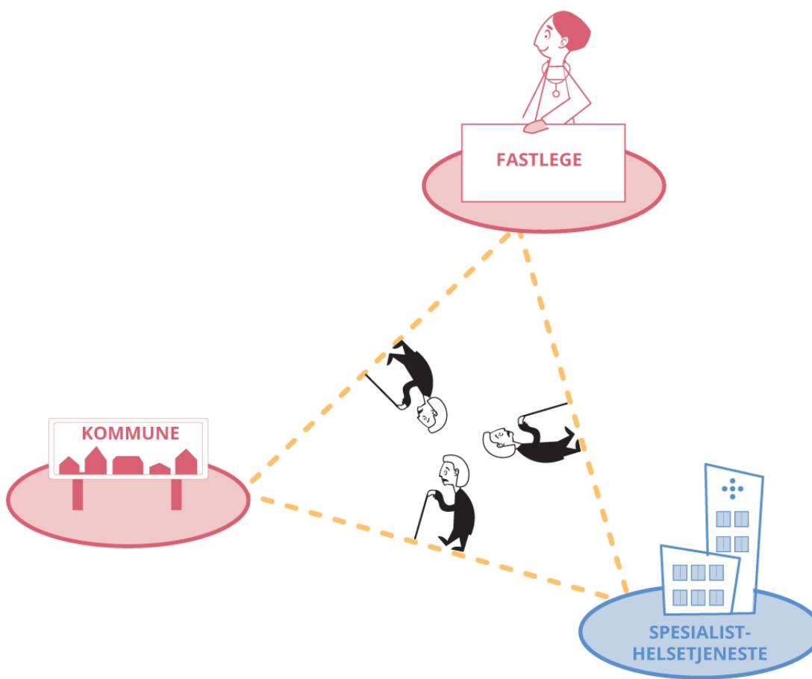

The diagram illustrates a triangular relationship between three entities: **FASTLEGE** (top, represented by a doctor), **KOMMUNE** (bottom left, represented by a town), and **SPESIALIST-HELSETJENESTE** (bottom right, represented by a hospital). Three patients are shown within the triangle, connected by dashed orange lines.

**FASTLEGE**

**KOMMUNE**

**SPESIALIST-HELSETJENESTE**

Infographic: Triangular relationship between fastlege, kommune, and specialisthelsetjeneste with patients.

Figur 6.8 Pasienten kan bli kasteball mellom tjenestene.

#### **6.3.2 Sammenheng og koordinering i helse- og omsorgstjenestene?**

Samhandlingsutfordringer har blitt løftet som en av de største utfordringene i helse- og omsorgstjenesten i flere tiår.

Pasienter med store og sammensatte behov som trenger at tjenestene samarbeider på tvers av fagområder og virksomheter, er særlig sårbare for svikt i pasientforløpene.

Når samarbeidet ikke fungerer godt nok, vil ansvaret for koordinering ofte havne hos pasienten, brukeren og de pårørende. Dette kan være belastende og kan gå utover kvaliteten i behandling og oppfølging. Mangelfull samhandling skaper risiko for pasientskader og feil ressursbruk (Meld. St. 9 (2023–2024)).

Det er ikke enighet om hvordan man kan måle graden av sammenheng eller fragmentering, men studier tyder på at helsesystemer med høy grad av fragmentering både koster mer og gir dårligere kvalitet enn systemer med liten grad av fragmentering (Frandsen mfl., 2015).

##### **Boks 6.3 Kjennetegn ved helhetlige pasientforløp**

- Kontinuitet: Tjenestene henger sammen gjennom god samhandling – tjenestene virker sammen/er koordinerte.

- Samarbeid: To eller flere virksomheter har gjensidig forpliktende og samtidig ansvar over tid.
- Sømløshet: Smidig overføring av informasjon og oppgaver til rett tid.
- Pasientsentrert: Pasienten deltar i beslutninger om målsetting og utforming.
- Informasjonsdrevet: Framdriften i forløpet er kontinuerlig basert på kunnskap/opplysninger om pasientens tilstand og behov.

Helsedirektoratet (2017)

###### **Rammeslutt**

##### **Er tjenestene koordinerte – henger de sammen?**

Brukerundersøkelser som inkluderer spørsmål om koordinering og samhandling i helsetjenestene, tyder på at de fleste opplever helsetjenestene som koordinerte. Men undersøkelsene viser også at enkelte pasientgrupper opplever samhandlings- og koordineringsutfordringer.

OECDs Patient-Reported Indicator Surveys (PaRIS) er en internasjonal undersøkelse av brukererfaringer med allmennlegen, som særlig legger vekt på pasienter med kroniske tilstander. Norge ligger på gjennomsnittet når det gjelder pasientopplevd koordinering, personsentrerte tjenester og opplevd kvalitet. OECD peker på pasientopplevd koordinering og troen på egenmestring som mulige forbedringsområder i Norge. 70 prosent av pasientene som har minst én kronisk tilstand, og som mottar helsehjelp fra mer enn én tjeneste, rapporterer at de har et ansvarlig helsepersonell som koordinerer tjenestene de får. Blant pasienter med to eller flere kroniske tilstander var andelen som opplevde at tjenestene fungerer for dem, dobbelt så høy blant dem som hadde helsepersonell med ansvar for koordinering av tjenestene, som blant dem som ikke hadde det. Andelen respondenter som hadde helsepersonell med ansvar for koordinering av tjenestene var lavere i Norge enn i gjennomsnittet i PaRIS-undersøkelsen (FHI, 2025b).

Den norske fastlegeundersøkelsen viser at ni prosent av pasienter som hadde én eller flere langvarige helseproblemer, «ikke» eller «i liten grad» opplevde at fastlegen koordinerte helsetjenestetilbudet på en god måte. Om lag 18 prosent innenfor samme gruppe pasienter opplevde at fastlegen i noen grad koordinerte helsetjenestetilbudet på en god måte. Ni prosent av pasientene opplevde «ikke» eller «i liten grad» at fastlegen samarbeidet bra med andre tjenester de hadde behov for, mens 19 prosent av pasientene opplevde «i noen grad» at fastlegen gjorde dette (FHI, 2025a).

En nasjonal undersøkelse av pasienterfaringer ved somatiske sykehusavdelinger i 2021 viser at 26 prosent av respondentene opplever «ikke» eller «i liten grad» at sykehuset har samarbeidet bra med fastlegen. 25 prosent opplever «ikke» eller «i liten grad» at sykehuset har samarbeidet bra med hjemmetjenesten eller andre kommunale tjenester (FHI, 2022d).

##### **Utfordringer knyttet til overganger for utskrivningsklare pasienter**

Et område der samhandlingsutfordringer kan komme til uttrykk, er i håndteringen av utskrivningsklare pasienter. Dette er pasienter som har behov for oppfølging i kommunen etter sykehusoppholdet. Noen pasienter blir værende i sykehus etter at de er vurdert som ferdigbehandlet

i sykehus og utskrivningsklare, i påvente av kommunale helse- og omsorgstjenester. Slike overliggerdøgn legger beslag på kapasiteten i sykehusene, og pasientenes oppholdskommune må betale døgnpris for hvert overliggerdøgn.

Det er et mål å ha færrest mulig oppholdsdøgn på sykehus etter at pasienten er meldt utskrivningsklar til kommunen. Da vil helsetjenesten oppleves som mer sømløs og kontinuerlig for pasienten. Det er heller ikke effektiv ressursbruk at ferdigbehandlede pasienter blir liggende på sykehus (Helsedirektoratet, 2024b).

De fleste utskrivningsklare pasientene blir raskt tatt hånd om av kommunene. I 2022 ble om lag 90 prosent registrert som utskrevet innen 24 timer (Meld. St. 9 (2023–2024)). Antall overliggerdøgn varierer imidlertid betydelig mellom kommunene, fra ingen døgn til 111 døgn per 1 000 innbyggere i 2022. Det er flest overliggerdøgn per innbygger både i sentrale kommuner og i kommuner med et høyt innbyggertall, samt i enkelte vertskommuner for sykehus (Helsedirektoratet, 2024b). I 2022 sto 17 kommuner for om lag halvparten av alle overliggerdøgn i somatiske sykehus (Meld. St. 9 (2023–2024)).

En høy andel reinnleggelser er lite ønskelig både for pasientene og sykehusene. For alle utskrivningsklare pasienter var andel reinnleggelser for øyeblikkelig hjelp i løpet av en til 30 dager etter forrige utskrivelse, 21,7 prosent i 2022. Andelen reinnleggelser etter opphold med overliggerdøgn var 19,1 prosent i 2022. Analysen viser at kort gjennomsnittlig oppholdstid i sykehus var assosiert med en høy andel reinnleggelser for utskrivningsklare pasienter (Helsedirektoratet, 2024b).

Kommuner og sykehus kan være uenige om terskelen for utskrivning og utskrivningstidspunkt. En undersøkelse viste at respondentene i sykehusene mente at utskrivningstidspunktene var riktige, mens respondentene i kommunene mente at pasienter ble skrevet ut for tidlig (Rødal mfl., 2020).

Riksrevisjonen (2026c) vurderer at mange eldre pasienter som blir akuttinnlagt, kunne vært behandlet i den kommunale helse- og omsorgstjenesten. Det pekes på dårlig kapasitet i helse- og omsorgstjenesten, mindre erfarne sykehjemsleger, legevaktleger og sykepleiere i hjemmetjenesten som mulige årsaker til at terskelen for å henvise til sykehus er lavere i noen kommuner. Lederne ved sykehusene mener at fastlegene og legevaktene burde henvist flere pasienter til kommunal akutt døgnenhet (KAD), istedenfor å henvise til akuttavdelingen på sykehuset. Riksrevisjonen vurderer at kommuner og sykehus ikke samarbeider godt nok for å få felles forståelse av når pasientene skal legges inn på sykehus, og når kommunene bør håndtere pasientene selv gjennom legevakt, KAD eller andre kommunale tilbud (Riksrevisjonen, 2026c)

Samhandlingsutfordringer omtales i de fleste kapitlene 7–16.

##### **Utviklingen framover vil forsterke samhandlingsutfordringene**

Den demografiske utviklingen vil kunne forsterke samhandlingsutfordringene, ved at det vil bli flere personer i grupper som har behov for flere tjenestetyper og tjenester fra begge forvaltningsnivåer. Blant annet forventes antall personer over 80 år å bli fordoblet fra 2025 til 2050. Antall personer med tre eller flere kroniske lidelser framskrives også til å øke med om lag 20 prosent fra 2025 til 2050 (FHI, 2026g).

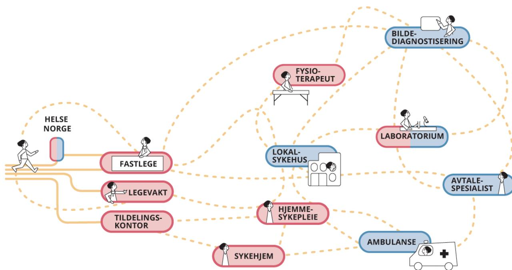

HELSE NORGE

FASTLEGE

LEGEVAKT

TILDELINGS-KONTOR

FYSIO-TERAPEUT

LOKAL-SYKEHUS

HJEMME-SYKEPLEIE

SYKEHJEM

BILDE-DIAGNOSTISERING

LABORATORIUM

AVTALE-SPESIALIST

AMBULANSE

The diagram illustrates a healthcare network in Norway. On the left, 'HELSE NORGE' is shown with a person running. Several services are represented by rounded rectangles with icons of people: 'FASTLEGE', 'LEGEVAKT', 'TILDELINGS-KONTOR', 'FYSIO-TERAPEUT', 'LOKAL-SYKEHUS', 'HJEMME-SYKEPLEIE', 'SYKEHJEM', 'BILDE-DIAGNOSTISERING', 'LABORATORIUM', 'AVTALE-SPESIALIST', and 'AMBULANSE'. Dashed orange lines connect these services, indicating a network of relationships. Solid orange lines connect 'HELSE NORGE' to 'FASTLEGE', 'LEGEVAKT', and 'TILDELINGS-KONTOR'.

**HELSE NORGE**

**FASTLEGE**

**LEGEVAKT**

**TILDELINGS-KONTOR**

**FYSIO-TERAPEUT**

**LOKAL-SYKEHUS**

**HJEMME-SYKEPLEIE**

**SYKEHJEM**

**BILDE-DIAGNOSTISERING**

**LABORATORIUM**

**AVTALE-SPESIALIST**

**AMBULANSE**

Infographic: Healthcare network diagram showing interconnected roles and services in Norway.

Figur 6.9 Illustrasjon av hvordan samhandlingsutfordringer kan oppstå i overgangene mellom de kommunale helse- og omsorgstjenestene og spesialisthelsetjenestene, men også mellom ulike kommunale tjenester og innad i spesialisthelsetjenestene.

#### 6.3.3 Barrierer mot sammenhengende tjenester

Det er sammensatte årsaker til at det vil bli utfordrende å sørge for sammenhengende helse- og omsorgstjenester i tiårene framover. Utgangspunktet er at ansvar og oppgaver innen helse- og omsorgstjenestene er fordelt på to tjenestenivåer, men det er også mange organisatoriske inndelinger innad i kommunene og innad i helseforetakene. Koordineringsproblemer eller samhandlingsutfordringer kan oppstå der pasienter har behov for helse- og omsorgstjenester fra ulike forvaltningsnivåer og fra ulike deltjenester. Sømløse og helhetlige pasientforløp forutsetter at kapasiteten på de ulike nivåene og i deltjenestene er tilpasset hverandre. For eksempel vil for liten kapasitet i de kommunale helse- og omsorgstjenestene kunne føre til at pasienter som kunne ha fått oppfølging i de kommunale tjenestene, blir henvist til spesialisthelsetjenesten. De viktigste barrierene mot sammenhengende tjenester er:

- Kostnader og gevinster er ujevnt fordelt.
- Digitale barrierer hindrer samhandling.
- Tjenestene reguleres av flere ulike lover.
- Kommuner og sykehus har ulike utgangspunkt for tjenesteytingen.
- Mange små kommuner med begrenset kapasitet og kompetanse.
- Spesialisering bidrar til fragmentering.
- Lite tilgjengelig og manglende styringsinformasjon.

##### **Kostnader og gevinster er ujevnt fordelt**

Det todelte ansvaret for helse- og omsorgstjenestene innebærer at helseforetak og kommuner har separate budsjetter og ulike finansieringssystemer. Samtidig vil beslutninger og tiltak som iverksettes i spesialisthelsetjenesten i mange tilfeller ha innvirkning på ressursbruken i kommunene, og omvendt.

Sykehusutvalget mente at dagens todelte finansiering ikke understøtter samhandling mellom de to nivåene i tilstrekkelig grad, og pekte på at gevinster og kostnader kan være ujevnt fordelt. En styrking av tilbudet i spesialisthelsetjenesten kan gi økte kostnader for helseforetakene, men reduserte kostnader for kommunale helse- og omsorgstjenester. Styrking av allmennlegetjenesten kan gi økte kommunale kostnader, men samtidig kan flere fastleger gi reduksjon i antall henvisninger og dermed reduserte kostnader i spesialisthelsetjenesten. Mer bruk av spesialistkompetanse i kommunene kan gi bedre kvalitet og hindre (re-)innleggelser i spesialisthelsetjenesten (NOU 2023: 8). Beslutningstakere på de ulike nivåene er ansvarlige for egne budsjetter og resultater. Tiltak som reduserer de samlede kostnadene, men øker kostnadene for én av aktørene, kan møte motstand selv om de er til fordel for både pasientene og helsetjenesten som helhet.

Dagens finansieringsordninger fanger i for liten grad opp pasientforløp som går på tvers av spesialisthelsetjenesten og de kommunale helse- og omsorgstjenestene.

Se kapittel 13 for omtale av utfordringer knyttet til finansiering.

##### **Digitale barrierer for samhandling**

Helse- og omsorgstjenesten er fortsatt preget av digitale løsninger med begrenset evne til å dele og sammenstille informasjon på tvers. Samtidig har pasienter og tjenestemottakere fortsatt begrenset tilgang til egne helseopplysninger på tvers av tjenestene, noe som svekker muligheten til å ta en mer aktiv rolle i oppfølgingen av egen helse. Dette får særlig betydning for pasientgrupper med langvarige og/eller sammensatte behov (Meld. St. 9 (2023–2024)).

Se kapittel 15 for omtale av utfordringer knyttet til digitalisering.

##### **Tjenestene reguleres av flere ulike lover**

Virksomhetene i helse- og omsorgstjenestene omfattes av en rekke lover og forskrifter som regulerer sentrale forhold knyttet til ytelsen av helse- og omsorgstjenester. For eksempel er kravene til helsepersonells yrkesutøvelse regulert i helsepersonelloven, pasienters og brukeres rettigheter er regulert i pasient- og brukerrettighetsloven og tilsynet med tjenesteutøvelsen er regulert i helsetilsynsloven. Ytelse av spesialisthelsetjenester og kommunale helse- og omsorgstjenester reguleres i to separate tjenestelover. Regelverket er dermed både omfattende og fragmentert.

##### **Kommuner og sykehus har ulike utgangspunkt for tjenesteytingen**

Helsepersonell i den kommunale helse- og omsorgstjenesten og i spesialisthelsetjenesten kan ha ulike oppfatninger av pasientenes behov (Hellesø mfl., 2019). Spesialisthelsetjenesten er i stor grad preget av at målet med helsetjenestene er medisinsk helbredelse, og er orientert mot diagnoser og

sykdomsepisoder. Den kommunale helse- og omsorgstjenesten legger større vekt på pasientens funksjonsnivå og pasienten og brukerens mestringsevne. For pasienten eller brukeren er begge deler viktig, men forskjellen i målforståelse kan likevel bidra til samhandlingsproblemer, fordi det påvirker kommunikasjonen og hvilke problemstillinger som vektlegges (Hellesø mfl., 2019; St. Meld. nr. 47 (2008–2009)).

En annen dimensjon ved dette er at de kommunale helse- og omsorgstjenestene i større grad skal ivareta en helhet for pasienten og brukeren, og helse- og omsorgstjenestene gis ofte sammen med andre kommunale tjenester. På sykehus er pasienten som regel innlagt for behandling av én tilstand eller diagnose, mens brukere av kommunale helse- og omsorgstjenester ofte har flere diagnoser og tilstander som må følges opp (Grimsmo mfl., 2018; Hellesø mfl., 2019).

##### **Mange små kommuner med begrenset kapasitet og kompetanse**

Riksrevisjonen har pekt på manglende kapasitet i de kommunale helse- og omsorgstjenestene og at for mange pasienter som kunne vært tatt hånd om av de kommunale tjenestene, behandles i spesialisthelsetjenesten (Riksrevisjonen, 2026c). Ulik og manglende kapasitet i de kommunale tjenestene kan bidra til å svekke pasientforløpene.

Mange kommuner har små fagmiljøer og utfordringer med å rekruttere kvalifisert helsepersonell (NOU 2023: 9). I små kommuner er det spesielt utfordrende å rekruttere spesialisert helsepersonell og opprettholde fagmiljøer.

Små fagmiljøer og lite kapasitet i tjenestene kan også gjøre det krevende for kommuner å samhandle med spesialisthelsetjenestene. Samtidig kan også store avstander og store organisasjoner gjøre det krevende å få til god koordinering.

Se kapittel 9 for nærmere omtale av utfordringer i kommunesektoren.

##### **Spesialisering bidrar til fragmentering**

Utviklingen med økt spesialisering i helsetjenestene i takt med teknologiske og medisinske framskritt har pågått over flere tiår (Oslo Economics, 2026a). Spesialisering og sentralisering av tjenester kan gi helsetjenester med høyere kvalitet, men helsetjenestene blir samtidig mer fragmenterte. Pasientene må innom mange ulike og spesialiserte helsetjenester. Større fragmentering og oppsplitting av tjenester fører dermed til større behov for koordinering, særlig for pasientgrupper med sammensatte behov. Høy grad av spesialisering kan utfordre generalistkompetansen som særlig trengs i behandlingen av pasienter med flere sykdommer og sammensatte behov. Sterk vekst i antall legespesialister kan skape flere siloer internt og gjøre det vanskelig å opprettholde bred klinisk kompetanse (Oslo Economics, 2026a; Meld. St. 9 (2023–2024)).

Se kapittel 12 for omtale av tjenester til personer med store behov for samhandling.

##### **Lite tilgjengelig og manglende styringsinformasjon**

Styringsdata om pasientforløp og samhandling på tvers av og mellom tjenestenivåene er ikke tilgjengelig i tilstrekkelig grad i dag. For å få et helhetlig bilde av samhandlingen og for å kunne

måle effekter når nivåene samhandler om pasientforløp, må data om de kommunale helse- og omsorgstjenestene og spesialisthelsetjenesten kobles. Tillatelse til å koble data fra Norsk pasientregister (NPR) og Kommunalt pasient- og brukerregister (KPR) blir gitt med begrenset varighet. Riksrevisjonen mener at utfordringene med å følge forløpene til pasienter som får tjenester på begge nivåer, gir begrensede muligheter til å vurdere om sårbare pasienter får sammenhengende tjenester (Riksrevisjonen, 2026c).

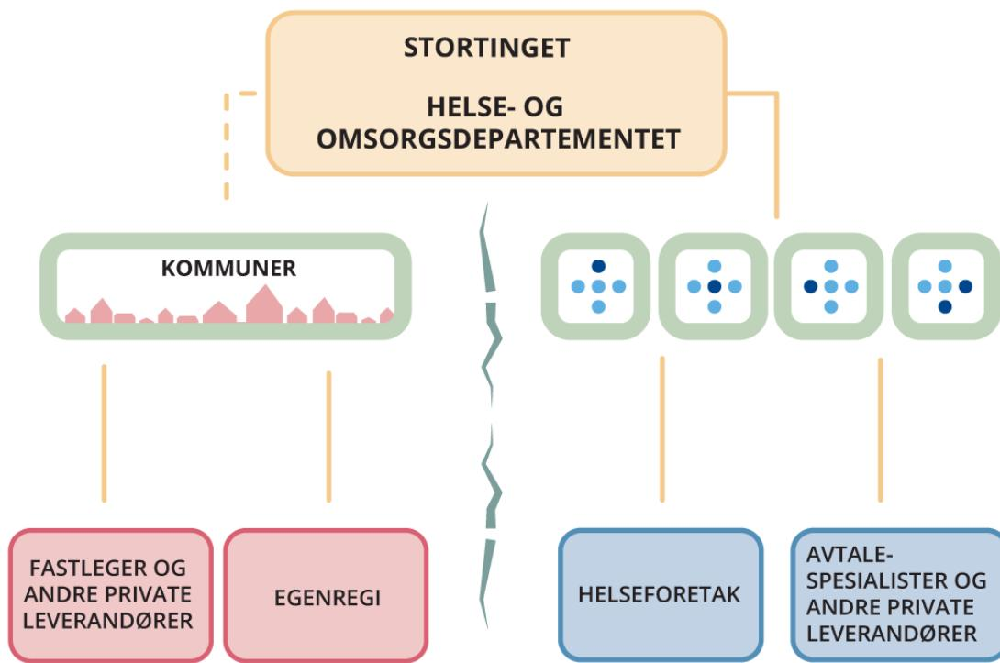

The diagram illustrates the organizational structure of the Ministry of Health and Social Services (STORTINGET HELSE- OG OMSORGSDEPARTEMENTET). It is divided into two main branches:

- KOMMUNER**: This branch is responsible for **FASTLEGER OG ANDRE PRIVATE LEVERANDØRER** and **EGENREGI**.
- HELSEFORETAK** and **AVTALE-SPESIALISTER OG ANDRE PRIVATE LEVERANDØRER**: This branch is responsible for **HELSEFORETAK** and **AVTALE-SPESIALISTER OG ANDRE PRIVATE LEVERANDØRER**.

The Ministry is connected to the Kommuner branch by a dashed line and to the Helseforetak and Avtale-spesialister branch by a solid line. A wavy line separates the two branches.

```
graph TD; STORTINGET["STORTINGET<br/>HELSE- OG OMSORGSDEPARTEMENTET"] -.-> KOMMUNER["KOMMUNER"]; STORTINGET --- HELSEFORETAK["HELSEFORETAK"]; STORTINGET --- AVTALE["AVTALE-SPESIALISTER OG ANDRE PRIVATE LEVERANDØRER"]; KOMMUNER --- FASTLEGER["FASTLEGER OG ANDRE PRIVATE LEVERANDØRER"]; KOMMUNER --- EGENREGI["EGENREGI"]; HELSEFORETAK --- Helseforetak["HELSEFORETAK"]; AVTALE --- Avtale["AVTALE-SPESIALISTER OG ANDRE PRIVATE LEVERANDØRER"];
```

**STORTINGET**  
**HELSE- OG OMSORGSDEPARTEMENTET**

**KOMMUNER**

**FASTLEGER OG ANDRE PRIVATE LEVERANDØRER**

**EGENREGI**

**HELSEFORETAK**

**AVTALE-SPESIALISTER OG ANDRE PRIVATE LEVERANDØRER**

Org chart: Organizational structure of the Danish Ministry of Health and Social Services.

Figur 6.10 Illustrasjon av at det kan være for tette skott mellom den kommunale helse- og omsorgstjenesten og spesialisthelsetjenesten

### 6.4 Det vil bli utfordrende å sørge for likeverdige helse- og omsorgstjenester

Et sentralt mål i den nasjonale helse- og omsorgspolitikken er å sikre gode og likeverdige tjenester til innbyggere i hele landet når de trenger det. Det er likevel betydelige sosiale og geografiske helseforskjeller i Norge (Baravelli mfl., 2025; FHI, 2022a). Til tross for mindre inntektsulikhet og et høyere utdanningsnivå enn i de fleste andre land, er de relative sosiale helseforskjellene større enn i mange andre europeiske land (FHI, 2022a). Med økende behov for helse- og omsorgstjenester og knappe personellressurser vil forskjellene kunne øke.

Forskjeller som ikke er helsefaglig begrunnet, kan svekke tilliten og oppslutningen om de skattefinansierte helse- og omsorgstjenestene. Dette kan føre til økt bruk av arbeidsgiverleverte tjenester, direkte betaling eller supplerende privat forsikring, spesielt blant mer mobile og ressurssterke grupper. Over tid vil dette fragmentere og svekke politisk støtte til universelle løsninger.

#### **6.4.1 Hva er akseptable forskjeller?**

Befolkningen skal ha tilgang på helse- og omsorgstjenester etter behov, uavhengig av økonomi, sosioøkonomisk status, kjønn, bosted og etnisitet (Meld. St. 21 (2024–2025)). Systematiske forskjeller som følger slike skillelinjer, er uakseptable. Andre forskjeller trenger imidlertid ikke være et uttrykk for manglende likeverdighet.

Kommunene står fritt til å prioritere fordelingen av sine samlede ressurser mellom ulike kommunale oppgaver, så lenge de oppfyller krav i lov og forskrift. Kommunekommisjonen peker på at dersom statens styring av kommunene blir for detaljert, kan ikke kommunene gjøre lokale prioriteringer og finne gode løsninger for hvordan tjenestene organiseres. Kommisjonen viser til at sterk statlig styring kan undergrave lokaldemokratiet (NOU 2026: 1). Variasjon i tjenestetilbudet kan altså være et resultat av lokal innovasjon og tilpasning til lokale behov.

Variasjon er både positivt og nødvendig når den reflekterer ulike behov, preferanser og kliniske responser blant tjenestemottakere og i befolkningen. I noen tilfeller avspeiler altså variasjon et nødvendig mangfold.

Samtidig er kommunenes forutsetninger for å yte likeverdige tjenester svært ulike (NOU 2026: 1; NOU 2023: 9). Variasjon er uønsket dersom den ikke kan forklares med forskjeller i helse, pasientpreferanser, lokale tilpasninger eller tilfeldig variasjon. Stor uønsket variasjon kan også være et uttrykk for under- eller overbehandling eller feilbehandling. Underbehandling er alvorlig ved at noen ikke får den helsehjelpen de burde ha. Overbehandling og feilbehandling er alvorlig både fordi det utsetter pasientene for unødig risiko, og fordi det legger beslag på ressurser som kunne vært brukt til nyttig behandling for andre pasienter.

#### **6.4.2 Sosioøkonomiske forskjeller i helse og bruk av helse- og omsorgstjenester**

Det er store sosiale helseforskjeller i Norge (Helsedirektoratet, 2026i). Med en eldre befolkning og knappere tilgang på personell kan disse forskjellene øke. Kommunene som opplever den sterkeste demografiske aldringen, har ofte også dårligst tilgang på personell, samtidig som de eldre innbyggerne i større grad har lav utdanning og begrensede økonomiske ressurser. De mest ressurssterke eldre bor i fylker der aldringen vil bli svakest (Rogne & Syse, 2017). Utdanning og inntekt har betydning for dødelighet og helserelatert atferd (Baravelli mfl., 2025).

Folkehelseinstituttet (2022a) viser til at det er bedre behandling og bedre helseutfall blant hjertepasienter med lang utdanning, sammenlignet med hjertepasienter med kort utdanning. FHI understreker at det ikke er opplagt om disse forskjellene i behandling skyldes samsykelighet eller andre forhold som det er vanskelig å ta hensyn til i analyser, og at funnet ikke trenger å skyldes avvikende behandling basert på sosioøkonomiske kjennetegn fra helsetjenestens side.

De sosiale ulikhetene finnes først og fremst for dødsårsaker som kan forebygges og behandles, altså unngåelige dødsfall. For sykdommene det er vanskelig å gjøre noe med, er forskjellene marginale. De med lavest inntekt har omtrent fem ganger så høy sannsynlighet for å dø for tidlig av sykdommer som kan forebygges eller behandles, sammenlignet med den rikeste tidelen (Heggebø & van der Wel, 2024). Det er vist at kreftpasienter med lang utdanning og høy inntekt gjennomgående har bedre overlevelse for de vanligste kreftformene, sammenlignet med pasienter med kortere utdanning og lav inntekt (FHI, 2022e).

Det er klare forskjeller knyttet til utdanningsnivå i selvrapportert helse, kronisk sykdom og psykisk helse. Blant personer som bare har grunnskoleutdanning, er det 66 prosent som vurderer sin egen helse som god eller svært god, og 87 prosent blant personer med høyere utdanning. Mens 43 prosent av personer med grunnskoleutdanning oppgir at de har en kronisk sykdom som har vedvart seks måneder eller mer, gjelder dette bare 30 prosent av dem med lengre utdanning (Helsedirektoratet, 2023d).

Allmennlegetjenester er hyppigere brukt blant dem med kort utdanning enn blant de med lengre utdanning (SSB, 2026c). Personer fra husholdninger med vedvarende lavinntekt bruker sykehustjenester sjeldnere og har færre konsultasjoner. Sosial ulikhet i bruk av sykehus er spesielt tydelig for planlagte polikliniske konsultasjoner i flere store diagnosegrupper og for alvorlig kreft. Personer med vedvarende lavinntekt fikk i gjennomsnitt 1,2 behandlinger i 2022 mot 1,5 behandlinger for den øvrige befolkningen. Forskjellene øker med alderen, og eldre med vedvarende lav inntekt bruker sykehustjenester i mindre grad enn den øvrige befolkningen i samme alder. Det er mindre sosial ulikhet i akuttbehandling enn for planlagt behandling (SSB, 2024a).

Det er lite kunnskap om hvordan samisk bakgrunn påvirker helse, fordi det er vanskelig å fange opp og definere samisk etnisitet i helseundersøkelser. Undersøkelser viser likevel at i geografiske områder der samer lever i fellesskap med ikke-samer, har begge grupper mange av de samme folkehelseutfordringene. Kvinner og menn med samisk bakgrunn rapporterer likevel om mer psykiske plager enn de uten samisk bakgrunn i de samme geografiske områdene, og samer rapporterer i litt større grad om dårlig fysisk helse enn ikke-samer (FHI, 2024a).

Det er flere yngre enn eldre som oppgir et udekket behov for helsehjelp. Behovet er størst blant mennesker i sårbare livssituasjoner, som personer med lav inntekt, svekket helse, psykiske plager, uføre og arbeidsledige. Blant dem som har et udekket behov for legehjelp, er det sjelden dårlig råd eller transport som er årsaken, men enkelte mener det er for lang ventetid for å få time. For tannlegetjenester er dette annerledes; halvparten av dem med et udekket behov sier at de ikke har hatt råd til tannlegebehandling. Det er en klar sosial gradient etter inntekt i bruk av tannlegetjenester, uavhengig av helsetilstand (SSB, 2024a).

Eldre innvandrere mottar sjeldnere helsehjelp i hjemmet, uten at dette kan begrunnes i andre behov (FHI, 2025c). Innvandrerkvinner har økt risiko for en rekke negative svangerskaps- og fødselsutfall (Bains mfl., 2021).

Samlet sett utgjør finansieringen av helsetjenester fra private forsikringer en liten del av Norges samlede helseutgifter, anslagsvis 0,4–0,5 prosent. Om lag 90 prosent av private helseforsikringer er kollektive, det vil si at de er tegnet av arbeidsgivere (Hagen & Nylenna, u.å.). Det har imidlertid vært en sterk etterspørsel etter private helseforsikringer de siste tiårene. I tredje kvartal 2025 hadde 880 000 personer helseforsikring, jf. omtale i kapittel 3.

Økningen i bruk av private helseforsikringer kan forsterke sosioøkonomiske forskjeller i helsetilbud. Palme mfl. (2026) finner at forsikrede får kortere ventetid også i offentlig finansiert behandling. Martinussen & Nordheim (2026) finner indikasjoner på at flere private helseforsikringer gir dårligere helse i befolkningen over tid, og at de negative helseeffektene for befolkningen sett under ett er større enn gevinstene de private helseforsikringene gir for den enkelte. Videre finner de at personer med lav utdanning har større sannsynlighet for å rapportere dårlig helse, dersom de bor i et land der private helseforsikringer økte i perioden. Dette står i

motstrid til en hypotese om at private tilbydere kan frigjøre kapasitet i det offentlige tilbudet og øke tilgangen på arbeidskraft, gjennom kortere ventetider på behandling. Det finnes for lite kvalitetssikret kunnskap og forskning på dette temaet til at utvalget kan si noe sikkert om utfordringene ved tilgangen på og bruken av private helsetjenester og helseforsikringer. Omfanget av slike tjenester er foreløpig begrenset, men utviklingen bør følges tett.

#### **6.4.3 Geografiske forskjeller**

Geografiske forskjeller i tjenestebruk uten tilsvarende variasjon i sykelighet peker mot at det er systemets praksis, ikke befolkningens behov, som er hovedforklaringen.

##### **Variasjon i kommunale helse- og omsorgstjenester**

FHI har, på oppdrag fra Helsereformutvalget, undersøkt geografisk variasjon i kommunale helse- og omsorgstjenester, ved hjelp av både registerdata og brukererfaringer. De registerbaserte målene viser gjennomgående små forskjeller mellom kommuner i institusjonsopphold og akuttinnleggelser, mens variasjonen er noe større for bruk av hjemmebaserte tjenester, særlig i mindre sentrale og mer ressurssterke kommuner. Selv om gjennomsnittsforskjellene er små, er det samtidig betydelig spredning mellom kommuner med høyest og lavest nivå (FHI, 2026c).

Funksjonsnivå ved oppstart av tjenester er relativt likt på tvers av kommuner. FHI mener dette kan være forenlig med relativt like terskler for tildeling, men må tolkes med varsomhet fordi funksjonsskår bygger på vurderinger som kan påvirkes av lokal kartleggings- og registreringspraksis. For samhandling og pasientflyt blant eldre er forskjellene også moderate, men med tydelige geografiske mønstre. Dette kan indikere at variasjonen ikke bare skyldes forhold i kommunene, men også strukturelle forhold på systemnivå, som organisering av tjenester og samspill med spesialisthelsetjenesten.

Hagen (2024) finner at tildelingen av langtidsplass for personer over 70 år er assosiert med inntektsnivået i kommunen. For personer over 80 år finner ikke FHI (2026c) tilsvarende mønster, men finner en tendens til at andelen av befolkningen med langtidsplass øker med inntektsnivå i kommunen. FHI (2026c) bruker en nyere dataperiode enn Hagen (2024) og de justerer for alderssammensetning på et mer detaljert nivå, mens Hagen justerer for medisinsk historie. Videre er analysen i Hagen (ibid.) av tildeling av langtidsplass betinget av at man allerede mottar kommunalt tildelte helse- og omsorgstjenester.<sup>8</sup>

FHI (2026c) finner at brukererfaringene med fastlegene viser tydelig variasjon mellom kommuner, men at forskjellene i liten grad er systematisk knyttet til sentralitet eller inntektsnivå. De geografiske mønstrene er svake. Indikatorer knyttet til tilgjengelighet, kontinuitet og ventetid varierer mer mellom kommuner enn enkelte andre indikatorer, noe som kan tyde på at disse i større grad henger sammen med organisering og kapasitet i fastlegetjenesten.

Riksrevisjonen (2026b) viser at det er stor variasjon mellom kommunene i andelen som får helse- og omsorgstjenester, og at det er stor variasjon i antall årsverk uten helsefaglig utdanning.

---

<sup>8</sup>FHI (2026c) bemerker at det i deres rapport ikke er gjort en formell statistisk analyse, men beskrevet mønstre i data, i motsetning til Hagen, som i dette tilfellet baserer seg på en hierarkisk regresjonsmodell.

I fastlegeordningen er kontinuiteten i pasient-lege-forholdet bedre i store enn små kommuner (Helsedirektoratet, 2025h). Det kan være flere årsaker til dette, for eksempel kan den tilfeldige variasjonen være stor i små kommuner med få fastlegelister. Hvis en fastlege for eksempel slutter eller har fravær på grunn av utdanning eller svangerskap, vil det ofte gi store utslag på resultatene. Også forhold som kollegial fraværsdekning og bruk av ordninger med rotasjonsturnus og felleslister, vil kunne bidra til at kontinuiteten blir lavere i små kommuner.

Videre er det vanskeligere å rekruttere og beholde fastleger i små kommuner og distriktskommuner, noe som kan resultere i hyppigere vikarbruk og skifte av lege (Helsedirektoratet, 2025h). Bruken av vikar er større dess mer usentrale kommunene er (Helsedirektoratet, 2025b). Fastleger i små kommuner har i tillegg oftere andre kommunale allmennlegeoppgaver som sykehjemslege, helsestasjonslege og legevakt, enn fastleger i større kommuner. Andelen konsultasjoner hos egen og mest brukte lege i kommunene reflekterer derfor ikke kvaliteten på arbeidet til fastlegene i kommunene, men er heller et uttrykk for kontinuitet og tilgjengelighet i fastlegetjenesten lokalt. Forskjeller på fylkesnivå vil blant annet gjenspeile omfanget av små distriktskommuner.

Det er også størst andel innbyggere på liste uten fast lege i kommuner med lav sentralitet. Samtidig har små kommuner samlet sett flere legeårsverk per innbygger enn befolkningsmessig store kommuner. Små kommuner må ofte ha flere årsverk for å dekke opp legevakt og deltakelse i annet allmennmedisinsk arbeid, samtidig med å drive fastlegeordningen (Helsedirektoratet, 2025b).

##### Forskjeller innen psykiske helsetjenester

Riksrevisjonen har slått fast at det er for store forskjeller i tilbudet som barn og unge med psykiske plager og lidelser får i kommunene. Det er ulik tilgang til psykiske helsetjenester i kommunene (Riksrevisjonen, 2021, 2026a), og bosted avgjør hvilket tilbud barn og unge med psykiske plager og lidelser får (Riksrevisjonen, 2026a). Mange barn og unge bor i kommuner uten et godt nok utbygd hjelpetilbud, og bosted får for stor betydning for hvilken hjelp barn og unge faktisk får. Kommunene har blant annet ulike oppfatninger av hvilke grupper barn og unge de har ansvar for å gi behandling (Riksrevisjonen, 2026a).

Flere barn og unge får behandling i spesialisthelsetjenesten, men det er store forskjeller i ventetider, i hvor mange henvisninger som blir avslått, i antall kontakter og i det ambulante tilbudet. Tilbudet til mange barn og unge er ikke tilstrekkelig koordinert og helhetlig. Riksrevisjonen anbefaler blant annet at det må være særlig oppmerksomhet på å forbedre situasjonen til barn og unge som er bosatt i kommuner som har et lite utbygd tjenestetilbud, og der det er lite samarbeid mellom kommunen og spesialisthelsetjenesten.

Det er store forskjeller i tilgang til behandling og oppfølging av enkelte psykiske lidelser, herunder store forskjeller i ventetid og andel avslåtte henvisninger (Riksrevisjonen, 2021; Riksrevisjonen, 2026a; SKDE, 2026). For barn og unge er det lengst ventetid ved sykehus i Nord-Norge og Midt-Norge. Barna har flest kontakter ved sykehus på Østlandet (Riksrevisjonen, 2026a).

Det er også betydelig geografisk variasjon i oppfølging fra spesialisthelsetjenesten og kommunehelsetjenesten etter utskrivning, særlig ved psykoselidelser. Riksrevisjonen finner ikke grunnlag for å si noe om hva som er riktig omfang av behandlingen, eller om pasientene får for lite

eller for mye behandling, men vurderer at det er uheldig at pasienter med psykiske plager og lidelser blir behandlet ulikt avhengig av hvilken helseregion de bor i.

##### **Forskjeller i bruken av spesialisthelsetjenester**

Riksrevisjonen har flere ganger vist til uønsket variasjon i bruken av spesialisthelsetjenester mellom helseforetakenes opptaksområder (Riksrevisjonen, 2019; 2026a; 2026c). Det er systematisk ulike vurderinger av like tilstander, og kvaliteten på nødvendige helsetjenester avhenger av hvor du bor, blant annet fordi den faglige praksisen varierer mellom opptaksområdene i spesialisthelsetjenesten (Riksrevisjonen, 2019; SKDE, 2021).

Det er store geografiske forskjeller i bruk av sykehus, særlig høyere bruk i sykehusenes vertskommuner. Riksrevisjonen mener ledelsen i helseforetak, kommuner og departementet i for liten grad følger opp kjente svakheter og mangler gode styringsdata. Samlokalisering med legevakt ser ut til å øke bruken av spesialisthelsetjenester (Riksrevisjonen, 2026c).

For barn og unge er det funnet ulik arbeidsdeling mellom spesialisthelsetjenesten og allmennlegetjenesten i ulike deler av landet, herunder stor geografisk variasjon i bruken av innleggelser og polikliniske konsultasjoner. I noen opptaksområder mottar barn i større grad helsehjelp i somatisk spesialisthelsetjeneste, uten at det er grunn til å anta at behovet for slike tjenester er større enn i andre opptaksområder. I andre områder følges barn i større grad opp i allmennlegetjenesten (SKDE, 2025).

Det er store forskjeller innen rehabilitering, både mellom kommuner og innenfor spesialisthelsetjenesten (Riksrevisjonen, 2024).

#### **6.4.4 Barrierer mot likeverdige tjenester i tiårene framover**

Det er sammensatte årsaker til at det vil bli utfordrende å sørge for likeverdige helse- og omsorgstjenester i tiårene framover. De viktigste barrierene er:

- Mange små kommuner
- Samfunnsforhold og levekår
- Mangel på kunnskap og data
- Fragmenterte digitale løsninger

##### **Mange små kommuner**

Kommunenes grad av lovoppfyllelse har sammenheng med sentralitet og innbyggertall. Jo mer perifer og jo mindre kommune, desto lavere grad av lovoppfyllelse (Menon Economics, 2022). Riksrevisjonen finner også sammenheng mellom kommunestørrelse og tilbudet av helse- og omsorgstjenester (Riksrevisjonen, 2026a; 2026b).

De geografiske forskjellene vil trolig bli større framover, ettersom de demografiske endringene vil få størst konsekvenser for små kommuner. Det er i disse kommunene at forholdet mellom eldre og innbyggere i yrkesaktiv alder vil være mest prekært (NOU 2026: 1; NOU 2023: 4; NOU 2023: 9). Innbyggerne i små kommuner og kommuner i distriktene vil ha en høyere andel innbyggere med behov for helse- og omsorgstjenester, samtidig som kommunene vil ha de største utfordringene

med tilgang på kvalifisert helsepersonell. Kommunekommisjonen viste at graden av lovoppfyllelse allerede er svakest i små og usentrale kommuner (NOU 2026: 1). Det må forventes at dette forverres ytterligere når tjenestene i disse kommunene settes under enda større press.

Se nærmere omtale av utfordringer i kommunene i kapittel 9.

##### Samfunnsforhold og levekår

FHI (2022a) viser til at for å utjevne helseforskjeller kan man ta utgangspunkt i at alle de bakenforliggende faktorene som bidrar til forskjellene; inntekt, utdanning, arbeid, bosted og bolig har stor betydning for levevaner og helsetjenestebruk. Levevaner, sosial støtte og andre fysiske og sosiale miljøfaktorer virker direkte inn på helsen og på behovet for helse- og omsorgstjenester.

Forskjeller i helserelatert atferd bidrar til å forklare sosioøkonomiske forskjeller i helse, sykelighet og dødelighet. Studier viser at levevaner som røyking, kosthold og fysisk aktivitet ofte følger utdannings- og inntektsnivået (FHI, 2022a).

En nasjonal kartlegging av befolkningens helsekompetanse viser blant annet at en av tre var på eller under det laveste nivået for generell helsekompetanse. Personer som skårer på eller under dette nivået, kan mangle sentrale ferdigheter til å imøtekomme forventninger i helsesystemet generelt og i den enkelte helsetjenesten spesielt. Undersøkelsen viste også at en betydelig andel synes det er vanskelig å navigere i helsetjenesten. Mange oppga utfordringer med å finne informasjon om hvordan psykiske lidelser kan håndteres (Helsedirektoratet, 2021a).

Resultatene viser også at mange innvandrere har store utfordringer med å finne, forstå, vurdere og anvende helseinformasjon, spesielt informasjon om behandling av sykdommer. I de fleste innvandrerutvalgene var lav generell helsekompetanse forbundet med lav utdanning og lav økonomisk status.

Det kan også være en utfordring at de kommunale helse- og omsorgstjenestene ikke fanger opp personer som har behov for tjenester. Dette kan blant annet skyldes svak helsekompetanse hos enkelte grupper og mangel på oppsøkende virksomhet i tjenestene, herunder fastlegene.

##### Mangel på kunnskap og data

Det mangler indikatorer for systematisk måling av utviklingen i sosial ulikhet i helse og bruk av helse- og omsorgstjenester. Helsedirektoratet viser for eksempel til at nye tall fra EuroHealthNet og CHAIN tyder på at de sosiale ulikhetene i en rekke selvrapporterte helseindikatorer har økt i Norge de siste ti årene, men at mangelen på standardindikatorer gjør at man ikke kan si noe om utviklingen fra år til år (Helsedirektoratet, 2026i).

Det finnes lite kvalitetssikret offentlig informasjon om bruken av helprivate helsetjenester og helseforsikringer. Det ble imidlertid besluttet i 2024 at privatfinansierte spesialisthelsetjenester og privatfinansierte kommunale helse- og omsorgstjenester skal registrere aktiviteten sin i Norsk pasientregister (NPR) og kommunalt pasient- og brukerregister (KPR) (Helse- og omsorgsdepartementet, 2024b).

Riksrevisjonens undersøkelse viser at det er vanskelig både for statlige myndigheter og kommunene å følge med på nivået og utviklingen i kvaliteten på tjenestene (Riksrevisjonen, 2026b).

##### Fragmenterte digitale løsninger

Dagens fragmenterte systemlandskap og beslutningsprosesser gir treg utvikling og implementering av digitale løsninger som kunne bidratt til å utjevne sosioøkonomiske og geografiske forskjeller. Dette drøftes nærmere i kapittel 15.

### 6.5 Sammendrag

Utviklingstrekk ved samfunnet vil gjøre det utfordrende å dekke behovene for sammenhengende og likeverdige helse- og omsorgstjenester. I dette kapittelet har utvalget drøftet sentrale barrierer i dagens system, som utgangspunkt for videre drøfting av relevante tiltak som kan sette tjenestene i stand til å håndtere en eldre befolkning og knappe personellressurser. Sentrale barrierer er at ansvaret for tjenestetilbudet er delt på flere forvaltningsnivåer, mangel på kunnskap om hvor behovet er, mange små kommuner og at digitaliseringen går for sakte. Utfordringene drøftes nærmere i de påfølgende kapitlene.

## 7 Sørge-for-ansvaret og organisering

### 7.1 Innledning

De overordnede utfordringene er omtalt i kapittel 6, som blant annet peker på utfordringer med å dekke behovet for helse- og omsorgstjenester, å oppnå sammenhengende helse- og omsorgstjenester og å sørge for likeverdige helse- og omsorgstjenester. I de resterende kapitlene i utredningens del II behandles noen spesifikke utfordringer mer inngående. Her i kapittel 7 beskrives utfordringer ved det todelte sørge-for-ansvaret, virkemidler for å ivareta dette, og at utøvelse av sørge-for-ansvaret krever koordinering og kompetanse.

### 7.2 Det todelte sørge-for-ansvaret

Et hovedtrekk i dagens struktur for organisering, styring og finansiering av helse- og omsorgstjenestene er det todelte ansvaret mellom den kommunale helse- og omsorgstjenesten og den statlige spesialisthelsetjenesten, herunder ansvaret for planlegging, gjennomføring, evaluering og korrigering av tjenestene. Dette ansvaret, ofte omtalt som sørge-for-ansvaret, er lagt til hver av de 357 kommunene og de fire regionale helseforetakene. I tillegg har de 15 fylkeskommunene sørge-for-ansvar for enkelte tannhelsetjenester.

Hva det innebærer å ha sørge-for-ansvaret, framkommer av helse- og omsorgstjenesteloven og spesialisthelsetjenesteloven. Helse- og omsorgstjenesteloven fastsetter at kommunen skal sørge for at personer som oppholder seg i kommunen, tilbys nødvendige helse- og omsorgstjenester (§ 3-1).

For å oppfylle dette ansvaret plikter kommunen å sørge for at det tilbys en rekke tjenester (kapittel 3.5).

Spesialisthelsetjenesteloven fastsetter at staten har det overordnede ansvaret for at befolkningen gis nødvendige spesialisthelsetjenester (§ 2-1), og at de regionale helseforetakene skal sørge for at personer med fast bopel eller oppholdssted i helseregionen tilbys spesialisthelsetjenester i og utenfor institusjon (§ 2-1 a). Det er altså det regionale helseforetaket som har sørge-for-ansvaret, ikke det enkelte helseforetak eller sykehus.

Kommunene og de regionale helseforetakene kan velge om de tilbyr tjenestene i egenregi (kommunen selv eller eide helseforetak) eller ved å inngå avtaler med hverandre eller private (se boks 7.2). Sørge-for-ansvaret kan ikke overføres til andre, og dermed forblir kommunen og det regionale helseforetaket ansvarlige for å sikre forsvarlige helse- og omsorgstjenester, uavhengig av om oppgaven med å tilby tjenestene er tillagt andre.

Det todelte sørge-for-ansvaret mellom kommunene og de regionale helseforetakene innebærer en grenseflate mellom de kommunale helse- og omsorgstjenestene og spesialisthelsetjenesten, der kommunenes ansvar opphører og spesialisthelsetjenestens ansvar begynner. Mange pasientforløp er veldefinerte, og ansvarsfordelingen mellom kommunen og spesialisthelsetjenesten er i de fleste tilfeller tydelig. For noen pasientgrupper kan imidlertid todelingen gi opphav til uklare ansvarsforhold. Hvilke tjenester som hører til på hvilket nivå, kan også endre seg over tid med den medisinske, helsefaglige og teknologiske utviklingen. Det kan også oppstå situasjoner med uenighet om hvem som har ansvaret for at pasientene får de tjenestene de har behov for. En samling av sørge-for-ansvaret på ett nivå ville ikke fjernet uenigheter om hvem som skal levere tjenestene, men det ville gi en tydeligere plassering av ansvaret for at tjenestene faktisk blir levert.

Grenseflaten mellom kommunale helse- og omsorgstjenester og andre kommunale tjenester er et eksempel på en slik situasjon. Det kan for eksempel oppstå uklarheter eller uenigheter mellom oppveksttjenestene og helse- og omsorgstjenestene i en kommune om hvem som skal følge opp en familie. Slike spørsmål må imidlertid løses internt i kommunen, og kommuneledelsen kan ikke peke på noen eksterne. Innenfor helse- og omsorgstjenesten er situasjonen annerledes fordi sørge-for-ansvaret er delt mellom kommunene og de regionale helseforetakene. Todelingen kan gi opphav til «svarteperspill» om hvem som egentlig har ansvaret for å sørge for at pasienten mottar nødvendige tjenester. At ansvaret er regulert gjennom ulike lover og regelverk, tidvis med noe ulike formuleringer, kan bidra til slike uenigheter.

Det todelte sørge-for-ansvaret innebærer at staten ved Helse- og omsorgsdepartementet har en direkte styringslinje til spesialisthelsetjenesten gjennom foretaksmøtene, men mye svakere mulighet til å styre de kommunale helse- og omsorgstjenestene. Helse- og omsorgsministerens direkte ansvar for spesialisthelsetjenesten innebærer ikke bare en mulighet, men også en plikt til å utvikle og følge særlig med på utviklingen i denne delen av helse- og omsorgstjenesten. Dette bidrar til en mer detaljert utvikling og bruk av nasjonale styringsvirkemidler for spesialisthelsetjenesten enn for de kommunale helse- og omsorgstjenestene. Dagens todeling av sørge-for-ansvaret kan dermed trekke den nasjonale politiske oppmerksomheten mot sykehusene, i stedet for – eller til og med på bekostning av – de kommunale helse- og omsorgstjenestene.

Det større ansvaret for spesialisthelsetjenester kan ha bidratt til at analyse, oppfølging og virkemiddelutforming for spesialisthelsetjenesten og de kommunale helse- og omsorgstjenestene er

organisert i ulike enheter, blant annet i Helse- og omsorgsdepartementet og Helsedirektoratet. En slik organisering kan gi god kunnskap om hvert enkelt tjenesteområde. Samtidig kan den gjøre det vanskeligere å følge opp forhold som kan styrke samhandlingen mellom nivåene. Regelverket og finansieringsordninger kan fungere godt hver for seg, men konsekvensene for samspillet og samhandling på tvers kan få mindre oppmerksomhet.

Det todelte sørge-for-ansvaret kompliserer også planarbeidet. Når spesialisthelsetjenesten skal dimensjonere bygg, benytter de framskrivingsmodeller. Modellene tar kun for seg spesialisthelsetjenesten, og forutsetter blant annet at liggedøgn for utskrivningsklare pasienter vil bli dekket av kommunene. Denne måten å dimensjonere sykehusene på vil ha konsekvenser for behovet for sengeplasser i kommunene i framtiden, men det er sjelden at framskrivinger for spesialisthelsetjenesten speiles med framskrivinger for kommunene (Lauvsnes, 2014). Når sykehusene lager utviklingsplaner hvert fjerde år, bygger de på nasjonal helse- og samhandlingsplan. Planene fokuserer på spesialisthelsetjenesten. Det ville gitt bedre total oversikt dersom alle helse- og omsorgstjenestene i et område hadde felles utviklingsplaner. Nå foretas investeringer hver for seg. Det samme gjelder rekruttering.

For å sikre bærekraftige helse- og omsorgstjenester framover er det nødvendig at flere tjenester blir gitt på et lavest mulig tjenestenivå (Riksrevisjonen, 2026c). Det er utfordrende å sørge for dette i et system der ansvaret for tjenestene er fordelt på to forvaltningsnivåer. Dette er særlig utfordrende når det ene nivået ikke vurderer systematisk hvordan deres beslutninger påvirker det andre nivået, slik Riksrevisjonen (2026c) påpeker.

For kommunene og spesialisthelsetjenesten er det også grenseflater mot tjenester som ligger utenfor deres sørge-for-ansvar. Et praktisk eksempel er hvilke behov innbyggerne og pasientene selv må håndtere, altså helse- og omsorgsrelaterte tjenester som verken er omfattet av kommunens eller de regionale helseforetakenes sørge-for-ansvar. Pårørende er ikke tillagt noe ansvar for å yte helse- og omsorgstjenester, og grensene for sørge-for-ansvaret til kommunene og de regionale helseforetakene er dermed bestemmende for hva innbyggerne, herunder pårørende, vil måtte håndtere selv. Pårørende er en svært viktig ressurs som kan yte mye omsorg og hjelp til sine nære, men i dag opplever mange i for stor grad å bli koordinatorer og informasjonsbærere for den de er pårørende til.

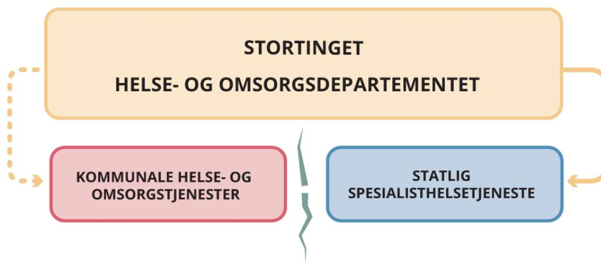

The diagram shows a hierarchical structure with three main entities:

- STORTINGET**  
**HELSE- OG OMSORGSDEPARTEMENTET**
- KOMMUNALE HELSE- OG OMSORGSTJENESTER**
- STATLIG SPESIALISTHELSETJENESTE**

A dashed orange arrow points from the top box to the left box. A solid orange line extends from the right side of the top box. A solid blue arrow points to the right box. A vertical jagged line separates the left and right boxes.

```
graph TD; A["STORTINGET<br>HELSE- OG OMSORGSDEPARTEMENTET"] -.-> B["KOMMUNALE HELSE- OG<br>OMSORGSTJENESTER"]; A --> C["STATLIG<br>SPESIALISTHELSETJENESTE"];
```

**STORTINGET**  
**HELSE- OG OMSORGSDEPARTEMENTET**

**KOMMUNALE HELSE- OG  
OMSORGSTJENESTER**

**STATLIG  
SPESIALISTHELSETJENESTE**

Org chart: Organizational structure of the Ministry of Health and Social Services and its departments.

Figur 7.1 Illustrasjon av at det todelte sørge-for-ansvaret kan gi for tette skott mellom den kommunale helse- og omsorgstjenesten og spesialisthelsetjenesten

##### **Boks 7.1 Helse og omsorg**

Reguleringen av helse- og omsorgstjenester ble samlet i helse- og omsorgstjenesteloven i forbindelse med samhandlingsreformen i 2012. Loven definerer ikke uttrykkelig hvilke av disse som er helsetjenester og hvilke som er omsorgstjenester. Det kan derfor være vanskelig å skille helsedelen fra omsorgsdelen i praksis. Skillet følger av definisjonen av «helsehjelp» i pasient- og brukerrettighetsloven § 1-3 bokstav c og helsepersonelloven § 3 tredje ledd, der helsehjelp er «enhver handling som har forebyggende, diagnostisk, behandlende, helsebevarende, rehabiliterende eller pleie- og omsorgsformål, og som utføres av helsepersonell». Hvem som regnes som helsepersonell, er definert i pasient- og brukerrettighetsloven § 1-3 bokstav e og helsepersonelloven § 3. Tjenester som forutsetter at de utføres av personell med slik formell helsefaglig kompetanse, kan dermed regnes som helsetjenester. Helsetjenester som utføres i hjemmet og ved korttids- og langtidsplass i institusjon, er typisk slike tjenester, mens omsorgstjenester i denne sammenhengen typisk er praktisk bistand, opplæring i dagliglivets gjøremål og støttekontakt, som primært skal dekke praktiske og sosiale behov i hverdagen.

Dette skillet er nødvendig av juridiske og organisatoriske årsaker fordi det avklarer ansvar, kompetansekrav og finansiering, og ligger til grunn for hvordan kommunene organiserer og dimensjonerer tjenestetilbudet. Dette skillet må imidlertid ikke forveksles med et skille i hva som faktisk kreves for å yte god og forsvarlig helsehjelp. Helsehjelp kan ikke gis løsrevet fra omsorg. Faglig forsvarlig behandling og pleie forutsetter alltid en relasjonell og omsorgsfull tilnærming til pasienten og brukeren. Dette er også presisert i helsepersonelloven § 4 om faglig forsvarlig og omsorgsfull hjelp. Omsorg er altså en forutsetning for at helsehjelpen skal oppleves som trygg, verdig og helhetlig for pasienten.

I andre land har det lokale nivået ofte mindre innslag av helsefaglige og medisinske oppgaver selv om det lokale nivået oftest har langt flere innbyggere enn norske kommuner. I Danmark, Sverige, Finland, Skottland og England ligger allmennlegetjenester under samme nivå som spesialisthelsetjenesten. I Storbritannia kalles det statlige ansvaret i NHS for «health care», mens ansvaret som ligger hos lokale myndigheter, kalles «social care». «Social care» omfatter langtidsplasser som aldershjem og praktisk hjelp i hjemmet samt oppgaver som vi ofte omtaler som sosiale tjenester som omsorgsboliger og sosialhjelp.

I Norge er det stort innslag av sykepleiere i kommunene, i motsetning til i England og Skottland der svært få sykepleiere arbeider innen «social care». I Norge ivaretar sykepleieren pasienten med utgangspunkt i pasientens situasjon og behov. Sykepleieren utfører ikke praktiske oppgaver som ikke er relatert til pasientens helse, men når praktisk hjelp inngår i en helhetlig vurdering av pasientens behov, kan sykepleieren ivareta også denne delen av hjelpebehovet. Fordelen er dermed at én person, sykepleieren, kan utføre helhetlig sykepleie, mens det i andre land ofte må sendes to personer til pasienten; én til å ivareta de medisinske behovene og én til å utføre pleie og helserelatert praktisk hjelp.

###### **Rammeslutt**

##### **Boks 7.2 Bestillere og utførere**

Virksomhetene med sørge-for-ansvaret (kommunene og de regionale helseforetakene) kan velge å oppfylle ansvaret ved å levere tjenestene i egenregi eller gjennom innkjøp. Det innebærer i prinsippet en bestiller-utfører-modell for helse- og omsorgstjenestene. I praksis har imidlertid både kommunene og de regionale helseforetakene valgt å levere mye i egenregi. For å holde de to rollene atskilt kan ikke de regionale helseforetakene selv levere spesialisthelsetjenester. De ivaretar bestillerfunksjonen, mens de som yter tjenestene har utførerfunksjon. Sykehustjenestene ytes av helseforetak eid av det regionale helseforetaket eller av private virksomheter.

Det har vært pekt på at samlingen av de to rollene i den samme virksomheten kan bidra til favorisering av tjenester i egenregi på bekostning av private virksomheter (Hagen, 2013). Andersen mfl. (2006) vurderer at den valgte organiseringen er en fornuftig og hensiktsmessig tilpasning, gitt premisset om at de regionale helseforetakene har et sørge-for-ansvar, at de vurderer hva de selv ønsker og har kapasitet til å levere gjennom sine helseforetak, og at de så benytter begrenset anbudskonkurranse der interne enheter ikke har anledning til å delta.

En arbeidsgruppe med styreledere og ledere på ulike nivåer i helseforetakene ble satt ned i 2019 (Helse- og omsorgsdepartementet, 2019). De ga blant annet tilrådninger om mer autonomi til helseforetakene. Arbeidsgruppen mente at det var et potensial for bedre prosesser ved anskaffelser fra private aktører. Dette kunne skje gjennom større grad av involvering av helseforetakene i vurderinger av behov og utforming av kravspesifikasjoner i forkant av anbudsutlysning av nye avtaler.

###### **Rammeslutt**

### **7.3 Virkemidler for å kunne ivareta sørge-for-ansvaret**

Det er et sentralt prinsipp at den som har ansvaret, også må ha myndighet og virkemidler til å ivareta ansvaret. Dette gjelder for ansvarsforhold innen helse- og omsorgstjenesten og på andre samfunnsområder (Kommunal- og distriktsdepartementet, 2024; Finansdepartementet, 2026).

Ved at det faglige og økonomiske ansvaret legges til samme enhet, oppnås oversiktlige ansvarsforhold, og rommet for strategiske tilpasninger («svarteperspill») reduseres. Det bidrar dessuten til kostnadseffektive løsninger at den som har beslutningsmyndighet, også bærer kostnadene ved beslutningen. Den enheten som har ansvaret og dermed avgjør ressursbruk, må også betale (Saglie, 2026; Kommunal- og distriktsdepartementet, 2024).

Kommunene og de regionale helseforetakene har derfor stor grad av frihet til å styre, finansiere og organisere helse- og omsorgstjenestene de har ansvaret for. De regionale helseforetakenes handlingsrom i styring og ledelse er begrenset på flere måter. Blant annet skal enkelte beslutninger treffes av statsråden i foretaksmøtet, jf. helseforetaksloven § 30. Formelt er det få begrensninger på hvilke saker som kan behandles i foretaksmøtet, selv om intensjonen er at den politiske styringen skal være overordnet og avgrenset til spørsmål av prinsipiell eller vesentlig betydning.

Bærekraftige tjenester forutsetter langsiktig og planmessig styring. Dette kan utfordres dersom enkeltsaker får stor oppmerksomhet på bekostning av helhetlige prioriteringer og vurderinger av langsiktige konsekvenser.

Regjeringen har lagt fram flere prioriteringsmeldinger for Stortinget for å understøtte en mer langsiktig utvikling av helse- og omsorgstjenestene. En nasjonal helse- og samhandlingsplan legges fram for Stortinget om lag hvert fjerde år. Samtidig har antallet enkeltforslag og enkeltvedtak på helse- og omsorgsområdet økt betydelig de senere årene. Dette kan blant annet ses i sammenheng med den parlamentariske situasjonen, men kan også reflektere et behov for sterkere politisk forankring av beslutninger innen helse- og omsorgstjenestene. Statsråden vil følge opp vedtak fattet av Stortinget, ofte ved beslutninger i foretaksmøtet.

Når helseforetakene gjennomfører krevende omstillingsprosesser som innebærer vanskelige prioriteringsbeslutninger, vil politisk overprøving av enkeltbeslutninger ofte innebære at det må gjøres nødvendige endringer på andre områder. Utfordringen oppstår dersom enkeltbeslutninger omgjøres uten at konsekvensene for helheten vurderes.

Gjentatt politisk inngripen i enkeltsaker kan svekke troverdigheten til styrings- og beslutningssystemet. Berørte interesser kan få inntrykk av at vedtak kan omgjøres gjennom politisk mobilisering, mens lokale og regionale ledere kan bli mer tilbakeholdne med å fremme eller gjennomføre nødvendige, men kontroversielle endringer. Over tid kan dette redusere helse- og omsorgstjenestens omstillingsevne.

Resultatet kan bli at overordnede politiske mål og prioriteringer blir vanskeligere å realisere i praksis. Formelt sett opprettholdes den politiske styringen, men den reelle evnen til å styre gjennom langsiktige mål, prioriteringer og rammer kan svekkes dersom oppmerksomheten i stor grad rettes mot enkeltbeslutninger. En slik mekanisme er beskrevet også på andre forvaltningsområder. Kommunekommisjonen peker eksempelvis på at omfattende statlig detaljstyring kan redusere kommunenes handlingsrom for nødvendig omstilling og tilpasning (NOU 2026: 1).

De regionale helseforetakene og kommunene har stor grad av frihet til å tilpasse finansieringsordningene overfor sine tjenesteleverandører på den måten de selv mener er best for å ivareta sørge-for-ansvaret. Det kommunale selvstyret gir kommunene frihet til selv å organisere sin virksomhet og tjenestene ut fra lokale forhold og behov innenfor rammene av kommuneloven og særlover. Det inkluderer også å kunne prioritere fordeling av ressurser mellom ulike tjenesteområder innenfor lovens rammer. I praksis står kommunene overfor mange rettslige føringer. En undersøkelse foretatt av Generalistkommuneutvalget viser at ingen kommuner tilfredsstiller alle lovpålagte oppgaver, og at variasjonen er stor (Menon Economics, 2022). Dermed kan valgene for mange kommuner ikke bare gjelde hvordan de skal handle innenfor lovens rammer, men også hvilke rettslige forpliktelser de skal og ikke skal overholde. Menon Economics (2022) finner at kommuner med høyere innbyggertall i større grad oppfyller de lovpålagte oppgavene, og at mindre kommuner har større utfordringer med å ivareta lovkrav.

De regionale helseforetakene og kommunene får rammetilskudd fra staten som de skal bruke slik de selv mener er tjenlig for å ivareta sørge-for-ansvaret (kapittel 13). De regionale helseforetakene får også en del aktivitetsbasert finansiering fra staten, men de velger selv om de viderefører denne finansieringsordningen til sine helseforetak eller ved avtaler med private leverandører. Det samme gjelder når kommunene får øremerkede midler. Kommunen får bare pengene dersom aktiviteten som foreskrives blir gjennomført, men de kan likevel selv velge finansieringsordningen til den eller de enhetene som utfører aktiviteten. I tillegg finansieres deler av helse- og omsorgstjenestene

direkte fra staten gjennom stønader etter folketrygdloven, forvaltet av Helfo. Da er det unntak fra hovedregelen om at pengene går til den med sørge-for-ansvaret, og kommunen eller det regionale helseforetaket har ingen eller liten mulighet til å velge om de vil videreføre denne finansieringsordningen til sine tjenesteleverandører. Dette omtales ofte som tredjepartsfinansiering.

De regionale helseforetakene og kommunene har stor grad av frihet i hvordan de vil organisere tjenesteleveransene, både i egenregi og fra private, for å ivareta sørge-for-ansvaret. Det ligger imidlertid en del begrensninger blant annet i kommuneloven (kapittel 9) og helseforetaksloven (kapittel 21). Det er for eksempel begrensninger rundt organisasjonsformer for å yte spesialisthelsetjenester (helseforetaksloven § 42), som blant annet innebærer at et helseforetak og en kommune ikke kan eie en juridisk enhet som yter både primær- og spesialisthelsetjenester sammen. Kommunen kan utføre oppgaver gjennom interkommunalt samarbeid der en vanlig samarbeidsform er interkommunale selskap. Helseforetak kan ikke inngå i en slik samarbeidsform. *Nasjonal helse- og sykehusplan 2016–2019* (Meld. St. 11 (2015–2016)) påpeker at når helseinstitusjonene driver både spesialisthelsetjeneste og kommunale helse- og omsorgstjenester, må det foreligge avtale mellom den aktuelle kommunen og det regionale helseforetaket som avklarer ansvarsforholdene i virksomheten. I tillegg må spesialisthelsetjenestedelen defineres som en egen virksomhet som reguleres av spesialisthelsetjenesteloven. Helsedirektoratet (2019) har påpekt at det er «flere eksempler på at etablering av slike avtaler er krevende». Reglene for organisatorisk sameierskap framstår ikke harmonisert eller integrert mellom kommunene og helseforetakene, noe som kan komplisere samhandlingen unødig.

Den virksomheten som yter helsehjelp og har plikt til å dokumentere denne i pasientjournalen, er som hovedregel dataansvarlig for behandlingen av personopplysningene etter personvernforordningen (kapittel 15). Som et utgangspunkt er de regionale helseforetakene, som i dag har sørge-for-ansvaret for spesialisthelsetjenestene, ikke dataansvarlige for helseforetakenes pasientjournalsystemer (behandlingsrettede helseregistre). Kommunen er dataansvarlig for egne pasientjournalsystemer. Her er sørge-for-ansvaret og dataansvaret sammenfallende. Samtidig vil normalt tjenesteytere som kommunen eller det regionale helseforetaket har avtale med, være dataansvarlig for egen behandling av personopplysninger, som for eksempel avtalespesialister eller fastleger. Virksomheter på tvers av nivåer og på samme nivå kan inngå avtale om å ha felles pasientjournal, slik som i Midt-Norge. I dag synes utgangspunktet dermed å være at den som har sørge-for-ansvaret, ikke alltid vil ha dataansvaret. Dette kan gjøre det vanskeligere å få til god digital samhandling og tilgang i sanntid til styringsinformasjon på tvers av enheter.

### **7.4 Utøvelse av sørge-for-ansvaret krever koordinering og en viss størrelse**

Generalistkommuneprinsippet innebærer at alle kommuner har samme juridiske status og det samme ansvaret for de lovfestede oppgavene, uavhengig av innbyggertall, bosettingsstruktur, økonomi eller andre kjennetegn (NOU 2023: 9). Alle kommuner, fra de minste med et par hundre innbyggere til de største med flere hundre tusen innbyggere, har dermed ansvaret for de samme oppgavene.

Hvert regionalt helseforetak har ansvar for vesentlig større befolkningsgrupper enn de aller fleste kommunene. Det gir dem andre muligheter til å styre og fordele funksjoner og risiko på en måte

som styrker kvaliteten og effektiviteten. Samtidig kan det gi sentralisering og manglende tilpasninger til lokale behov. De regionale helseforetakene gir også ansamling av makt, noe som også er poenget for å oppnå helhetlig samordning og prioriteringer som man ikke ville kunne oppnådd ellers.

Selv om ansvaret for helse- og omsorgstjenestene i hovedsak er delt mellom den kommunale helse- og omsorgstjenesten og den statlige spesialisthelsetjenesten, er ikke sørge-for-ansvaret samlet på ett organisatorisk nivå innenfor hver av disse sektorene. I spesialisthelsetjenesten er ansvaret fordelt mellom fire regionale helseforetak. Dette kan skape behov for koordinering mellom regionene, men som eier har staten mulighet til å gripe inn dersom nasjonale hensyn tilsier det.

I den kommunale helse- og omsorgstjenesten er ansvaret fordelt på 357 kommuner. Kommunene er selvstendige folkevalgte enheter og kan ikke styres gjennom eierstyring. Statlig påvirkning skjer i hovedsak gjennom lovgivning og økonomiske rammer. Også mellom kommunene kan ulike interesser, prioriteringer og forutsetninger gjøre samarbeid og koordinering krevende, både innbyrdes og i samhandlingen med spesialisthelsetjenesten.

Samlet innebærer dette at sørge-for-ansvaret for helse- og omsorgstjenestene er fordelt på 361 virksomheter. Dette skaper et betydelig behov for koordinering dersom tjenestene skal oppleves som helhetlige for pasienter og brukere.

Ved å spre sørge-for-ansvaret på 361 forskjellige virksomheter vil det oppstå en rekke ulike interesser og store behov for koordinering. Én enkelt av disse 361 virksomhetene vil sjelden kunne planlegge og dimensjonere sine tjenester uten at det er avhengigheter til flere av de andre. Med så mange aktører kan noen høste gevinster ved å peke på en annen i stedet for å ta ansvaret selv, såkalt «svarteperspill».

Det er en rekke regelverk som kan være vanskelig å navigere i, for eksempel knyttet til anskaffelser. For små kommuner vil det være en utfordring å ha kompetanse til å kunne utnytte spillerommet som sørge-for-ansvaret gir til å yte tjenester gjennom egenregi, interkommunale samarbeid, private eller samarbeid med spesialisthelsetjenesten. Det er krevende, særlig for små kommuner, å oppfylle alle lovkrav (Menon Economics, 2022). Riksrevisjonen (2026b) finner at kommunene ikke planlegger systematisk for framtidens økning i antall eldre, og at det er risiko for svikt i de kommunale tjenestene. Ifølge Riksrevisjonen (2026b) er det om lag 30 prosent av kommunene, først og fremst i distriktene, som verken har tid, ressurser eller kompetanse til å drive planarbeid.

## **8 Tjenesteleverandører, inkludert private**

### **8.1 God kvalitet krever et visst volum**

#### **8.1.1 Kommunale helse- og omsorgstjenester krever et visst volum**

For kommunale oppgaver er det i liten grad gitt føringer for dimensjonering av tjenestestrukturen. Grunnprinsippet er at kommunene er løpende ansvarlig for organisering og dimensjonering av lovpålagte tjenester, herunder nødvendig kompetanse og kapasitet for selv å kunne ivareta

oppgavene, eventuelt i samarbeid med andre aktører. Kommunenes virkemidler knytter seg til løpende interne prioriteringer og utviklingstiltak i egen organisasjon, etablering av formelt og uformelt interkommunalt samarbeid på frivillig grunnlag og eventuelt samarbeid med private.

Det er gjort få utredninger av hva som utgjør en hensiktsmessig dimensjonering av de kommunale tjenestene i Norge. Daværende Kommunal- og moderniseringsdepartementet satte ned et utvalg som vurderte at kommuner bør ha mellom 15 000 og 20 000 innbyggere for å kunne ivareta oppgavene på en faglig bærekraftig måte (Ekspertutvalg for kommunereformen, 2014).

Vurderingen bygger særlig på behovet for tilstrekkelig kompetanse og robuste fagmiljøer innen spesialiserte helse- og velferdstjenester. Selv med en slik kommunestørrelse vil enkelte funksjoner, som deler av legevaktenes vaktsentraler, fortsatt kunne organiseres på en hensiktsmessig måte gjennom interkommunalt samarbeid. For vanlige og mer standardiserte tjenester, som grunnskole og pleie- og omsorgstjenester, kan effektiv drift oppnås også i mindre kommuner. Ekspertutvalget pekte imidlertid på at små fagmiljøer er mer sårbare for sykdom, turnover og andre uforutsette hendelser, samtidig som de ofte har begrensede ressurser til faglig utvikling og innovasjon. Økt kommunestørrelse vurderes derfor å kunne styrke kvaliteten og utviklingskapasiteten i tjenestene.

I arbeidet med den danske strukturkommisjonens utredning (Strukturkommissionen, 2004) ble det vurdert at kommunene bør ha minimum 20 000 innbyggere for å sikre tilfredsstillende rammer for faglig bæredyktighet i løsningen av sine oppgaver, samtidig som hensynet til nærhet og demokratisk legitimitet ivaretas. Strukturkommisjonen vurderer at store forskjeller i styrken på fagmiljøene mellom kommunene bidrar til betydelig variasjon i kvaliteten på tjenestene til innbyggerne. Større kommuner antas å kunne redusere konsekvensene av tilfeldige svingninger både i innbyggernes etterspørsel etter tjenester og i kompetanse og kapasitet i fagmiljøene. Kommisjonen vurderer at forutsigbarheten for kommunene blir bedre, og at tilbudet til innbyggerne kan planlegges og utvikles bedre med større kommuner.

Kommunekommisjonen, som ble satt ned i 2025 for å vurdere hvordan staten styrer kommunesektoren, og foreslå endringer som kan gi kommuner og fylkeskommuner større handlingsrom og mer effektiv ressursbruk, har bestilt en analyse av systemkapasitet med vekt på fagkompetanse og fagmiljøstørrelse i kommunene. Resultatet vil først foreligge når kommisjonen leverer sin andre rapport ved årsskiftet.

På flere tjenesteområder har interkommunalt samarbeid blitt et svar på kapasitets- og kompetanseutfordringer som følger av at mange kommuner er for små til selv å løse oppgavene alene. Flere kommuner har inngått interkommunalt samarbeid om for eksempel legevakt og alarmsentraler for å sikre et tilstrekkelig fagmiljø. Størrelsen på slike samarbeid kan gi en pekepinn på hvor stort befolkningsgrunnlag som bør ligge til grunn for disse tjenestene. For enkelte tjenester er det gitt noen anbefalinger, blant annet for hvor mange ACT- og FACT-team som bør etableres ut fra ulik befolkningsstørrelse. Landheim mfl. (2017) opererer med en befolkningsstørrelse på minimum 15 000 innbyggere.

Etablering av kommunale akutte døgnenheter (KAD) skjer i stor grad gjennom interkommunale samarbeidsordninger. I 2014 samarbeidet 73 prosent av kommunene om slike døgnenheter. Opptaksområdene besto i gjennomsnitt av 42 146 personer (Tjerbo & Skinner, 2016). Det er betydelige forskjeller i størrelse mellom opptaksområdene. Det minste hadde knapt 600 innbyggere, mens det største hadde over 600 000 innbyggere.

Antall legevakter er gradvis redusert fra 230 legevakter i 2007 til 167 legevakter i 2024. I 2024 var det 83 kommunale og 84 interkommunale legevakter i landet (Morken mfl., 2026). Det varierer hvor mange kommuner de interkommunale legevaktene dekker, fra to til 12 kommuner. Antall interkommunale legevakter har vært synkende i perioden 2012–2020. De siste årene har antallet vært stabilt. 73 legevakter (44 prosent) dekker færre enn 10 000 innbyggere. Disse legevaktene har i gjennomsnitt et befolkningsgrunnlag på om lag 4 000 innbyggere, og 38 av dem er lokalisert i de nordligste fylkene. Videre dekker 83 legevakter (50 prosent) mellom 10 000 og 100 000 innbyggere, mens 11 legevakter (7 prosent) har et befolkningsgrunnlag på mer enn 100 000 innbyggere (Allertsen & Morken, 2024).

I forslag til nasjonal handlingsplan for legevakt anbefalte Nasjonalt kompetansesenter for legevaktmedisin i 2009 at en typisk legevakt burde favne mellom 30 000 og 100 000 innbyggere.

God kvalitet i tjenestene og robuste fagmiljøer forutsetter et visst befolkningsgrunnlag. I deler av landet kan bosettingsmønsteret gjøre det vanskelig å oppnå et tilstrekkelig befolkningsgrunnlag uten at reiseavstanden til tjenestene blir lang. Det kan derfor oppstå en avveining mellom robuste fagmiljøer med tilstrekkelig pasienttilfang på den ene siden og hensynet til reisetid, lokale behov og lokaldemokratisk forankring på den andre. Digitale løsninger og ny teknologi kan for enkelte tjenester avhjelpe slike avveininger (se kapittel 15).


A collection of red, shield-shaped icons with dark red outlines. They are arranged in two groups: a larger group of six shapes in the top row and a smaller group of ten shapes in the bottom row, some of which overlap.

Illustration: Red shield-like shapes of varying sizes and overlapping patterns.

**Figur 8.1** God kvalitet i tjenestene og robuste fagmiljøer forutsetter at kommunene er tilstrekkelig store

#### **8.1.2 Sykehus krever et visst volum**

Regionaliseringsprinsippet har vært sentralt i spesialisthelsetjenesten siden St.meld. nr. 9 (1974–75) la grunnlaget for inndeling av landet i fem helseregioner. I dag er det fire helseregioner etter at Helse Sør og Helse Øst ble slått sammen i 2007 til Helse Sør-Øst RHF. Hver helseregion har et regionsykehus, et «hovedsykehus» med det største tilbudet av regionsfunksjoner og nasjonale behandlingstjenester. I tillegg er regionsykehuset lokalsykehus i sitt opptaksområde. Regionsykehusets rolle er sentral når det gjelder faglig samarbeid om pasientforløp og faglig utvikling.

Med unntak av noen lands- og flerregionfunksjoner dekkes befolkningens behov for spesialisthelsetjenester i all hovedsak innenfor egen helseregion. Helseregionenes dekningsgrad, som viser at 92–98 prosent av pasientene får behandling i egen bostedsregion, har vært stabil over lang tid. Tall fra 2024 viser at innen somatikk foregikk 96,9 prosent av aktiviteten målt i ISF-poeng i egen helseregion (Helsedirektoratet, 2026e). 0,5 prosent av aktiviteten var hos private og 2,6 prosent i sykehus i andre regioner. Egendekningsgraden varierer mellom regionene. Andelen er høyest i Helse Sør-Øst RHF med 98,5 prosent og lavest i Helse Nord RHF med 91,8 prosent. Dette skyldes blant annet at Oslo universitetssykehus HF har den største andelen lands- og flerregionfunksjoner.

Innen psykisk helsevern skjedde 92,6 prosent av aktiviteten, målt i ISF-poeng, i egen helseregion. Kjøp hos private utgjør 6,5 prosent, mens institusjoner i andre helseregioner utgjør 1 prosent. Det er større regionale forskjeller i psykisk helsevern. I Helse Vest RHF utgjør kjøp hos private 14,7 prosent av aktiviteten, mens den i Helse Sør-Øst er 2,1 prosent. Helse Vest RHF har lavest egendekningsgrad med 84,2 prosent, mens Helse Sør-Øst RHF har størst andel med 97,4 prosent. (Helsedirektoratet, 2026e)

Flere av region- og universitetssykehusene er små i internasjonal målestokk. Det innebærer at personellet møter enkelte diagnoser og prosedyrer svært sjelden. For enkelte tjenester er det viktig at oppgavene utføres regelmessig og av flere fagpersoner i et fagmiljø for å videreutvikle kompetansen. Et stort fagmiljø øker muligheten for å holde seg faglig oppdatert og for å håndtere svingninger i etterspørselen, herunder beredskapssituasjoner. Særlig for mindre vanlige oppgaver kan tjenestekvaliteten vokse med voksende befolkningsgrunnlag i opptaksområdet. Geografiske hensyn, herunder reiseavstand for pasientene, er en av grunnene til at Norge likevel har valgt å etablere regionsykehus med de fleste funksjoner. Dette innebærer en avveining mellom nærhet til tjenestene på den ene siden og konsentrasjon av pasientvolum, kompetanse og ressurser på den andre. For enkelte høyspesialiserte funksjoner kan dette føre til et begrenset pasientvolum, små og sårbare fagmiljøer og mindre mulighet til å fordele høye faste kostnader over et større aktivitetsvolum.

Den medisinske og teknologiske utviklingen vil bidra til endringer i oppgavefordelingen mellom sykehusnivåene framover. Noen behandlingsfunksjoner vil bli sentralisert for å samle kompetanse, pasientvolum og kostnadskrevende infrastruktur, mens andre kan desentraliseres som følge av nye behandlingsmetoder, ny teknologi og bedre muligheter for å følge opp pasientene der de bor. Regionsykehusene vil ha en sentral rolle i denne utviklingen, både som leverandører av høyspesialiserte tjenester og som pådrivere for utvikling og spredning av ny kunnskap og nye behandlingsformer.

Bækken og Moldestad (2017) har sett på avveiningen mellom befolkningsgrunnlag og reisetid ved plassering av sykehus. De har gjennomgått kilder om minimum befolkningsgrunnlag og ideelt befolkningsgrunnlag for ulike typer sykehus, og konkluderer med at det ikke finnes noen ideell sykehusstørrelse. Basert på litteraturen vurderer de likevel at en nedre grense for et befolkningsgrunnlag som sikrer god nok kvalitet, kan være omtrent 30 000 og 60 000 for akuttberedskap i medisin og kirurgi. Men fra et økonomisk ståsted vurderer de at befolkningsgrunnlaget bør være høyere, 100 000 til 300 000, for å sikre kostnadseffektiv drift. Asheim mfl. (2025) finner at barns sannsynlighet for å dø ved fødsel i norske sykehus ville vært signifikant lavere dersom alle fødeavdelinger hadde 2 000 fødsler i året, et antall som er langt høyere enn for mange fødeavdelinger i dag. Dette tilsier at det er en avveining mellom tilstrekkelig faglig kvalitet og god ressursbruk når ulike funksjoner skal fordeles mellom sykehus med ulikt befolkningsgrunnlag.

#### **8.1.3 Hensiktsmessig størrelse på tjenestene**

Graden av spesialisering er et godt utgangspunkt for å vurdere hensiktsmessig dimensjonering av tjenestene. Jo mer spesialisert en tjeneste er, desto større må befolkningsgrunnlaget være for å sikre at helsepersonellet får nok erfaring til å sikre god kvalitet på tjenesten. Graden av sentralisering avhenger også av hvor ofte tjenesten brukes. Jo lavere andel innbyggere som bruker tjenesten, jo mer sentralisert kan den være. Basistjenester som alle innbyggere bruker gjennom livsløpet, og som i stor grad er avhengig av nærhet til innbyggerne, bør som oftest ligge desentralt. I utgangspunktet gjelder dette kommunale tjenester som fastlegetjenester, hjemmebaserte helse- og omsorgstjenester og sykehjem. Men også for slike tjenester kan større enheter gi gevinster i form av større fagmiljøer, enklere rekruttering og tjenester som er mer robuste for variasjoner i behov.

For mange tjenester vil befolkningsgrunnlaget særlig i små kommuner i distriktene være for lite til å sikre robuste fagmiljøer og god kvalitet. Tjenester som ytes i kommunens egen regi, vil ikke gi tilstrekkelig kapasitet til å sikre faglig bærekraftig oppgaveløsning. Dette vil hemme kommunenes evne til å løse sine grunnleggende oppgaver og tjenester, evnen til å utvikle og omstille kommunale tjenester og evnen til å planlegge og styre de kommunale tjenestene på en hensiktsmessig måte (Riksrevisjonen, 2026b). Mange kommuner mangler slik styringskapasitet, inkludert for fastlegetjenesten.

Størrelse påvirker også kommunenes evne til å håndtere uforutsett variasjon og ulike former for risiko. Medvirkning og samarbeid med brukere, pasienter, pårørende og ansatte i helse- og omsorgstjenestene, som er viktig for å yte helse- og omsorgstjenester med riktig kvalitet, vil kunne bli mer krevende særlig i små og særlig store organisasjoner.

Interkommunalt samarbeid kan forbedre situasjonen i noen sammenhenger, men det er ikke alltid like enkelt å få til i praksis (kapittel 9). Det samme gjelder samarbeid mellom kommuner og spesialisthelsetjenesten. Helseforetaksloven § 42 tillater ikke at kommuner og helseforetak etablerer én felles juridisk enhet som driver tjenestene sammen (se kapittel 21). Dermed er det vanskelig å bygge større fagmiljøer, drive faglig og digital utvikling og å effektivisere, blant annet fordi ledelsen vil være splittet på flere juridiske enheter som er underlagt forskjellig regelverk, tariffområder mv. Håndtering av variasjon i behovene kan også bli unødig komplisert når flere virksomheter må involveres for å redimensjonere aktiviteten eller justere budsjettene. Felles

digitale løsninger for å håndtere helseopplysninger kan også være mer komplisert, for eksempel hvis dataansvaret går på tvers av flere virksomheter. Det kan også være unødig kompliserende å framskaffe god styringsinformasjon – blant annet om helsepersonellets trivsel – når flere virksomheter må involveres. Dermed kan det bli mer krevende å utvikle god datadrevet ledelse, inkludert å unngå medisinsk over- og underaktivitet. Mangel på enhetlig ledelse vil også kunne hemme utvikling av systematisk og god medvirkning, både blant ansatte og brukere. Det vil også være utfordrende for ulike virksomheter å måtte bli enige om budsjetter og lokalisering av tjenester.

Det er et mønster både for kommunale helse- og omsorgstjenester og spesialisthelsetjenester at behovet for et større befolkningsgrunnlag øker med graden av spesialisering, kompleksitet og krav til kontinuerlig tilgang på kompetanse. Samtidig avtar betydningen av geografisk nærhet når tjenestene brukes sjeldnere. Dette innebærer at ulike tjenester vil ha ulike optimale størrelser, men at mange av dagens kommuner og enkelte sykehusenheter kan ha for lite befolkningsgrunnlag til å sikre robuste fagmiljøer, høy kvalitet og effektiv ressursutnyttelse for alle oppgaver de skal ivareta.

### **8.2 Utfordringer ved flyten av pasienter mellom tjenestene og henvisninger**

Det har lenge vært et mål å yte helse- og omsorgstjenester på laveste effektive omsorgsnivå (LEON) (St.meld. nr. 9 (1974–75); Borglin & Gjevjon, 2022; Hunskår, 2023). Figur 8.2 viser hvordan eldre på minst 80 år som får vedtak om hjemmetjenester, umiddelbart reduserer bruken av spesialisthelsetjenester. Dette kan indikere at hjemmetjenester kan være et mer effektivt omsorgsnivå, fordi hjemmetjenestene avlaster behovet for sykehus tjenester. Figur 8.3 viser et tilsvarende fall for bruk av fastlege når det ytes hjemmetjenester. Dette kan tolkes som at en overgang til hjemmetjenester reduserer behovet for fastlegetjenester, og dermed avlaster fastlegene, eller at disse pasientene ikke får tilstrekkelig allmennlegetjenester. Ved overgang til korttidsinstitusjonsplasser i kommunen overtar en annen kommunal legetjeneste fastlegens ansvar.

Figur 8.4 illustrerer flyten mellom spesialisthelsetjenesten, fastlegetjenesten og de øvrige kommunale helse- og omsorgstjenestene for ulike pasientgrupper. Personer på 80 år og over, som hadde 4,4 konsultasjoner hos fastlegen per person i 2025 (Folkehelseinstituttet, 2026i), hadde i snitt 4,2 overganger mellom allmennlegetjenester (fastlege og legevakt) og andre kommunale tjenester i 2025. De hadde 2,6 overganger mellom andre kommunale tjenester og spesialisthelsetjenesten, mens de hadde færre overganger (1,4) mellom allmennlegetjenester og spesialisthelsetjenesten. For de eldste er det først og fremst overganger mellom allmennlegetjenesten og øvrige kommunale tjenester som er hyppige, og som det er viktig at fungerer godt. Det samme gjelder mellom de øvrige kommunale tjenestene og spesialisthelsetjenesten.

Fastlegen har en sentral rolle i å vurdere pasientenes behov og henvise videre til andre kommunale tjenester eller spesialisthelsetjenesten når det er nødvendig. Et viktig formål med fastlegeordningen er å ivareta en medisinskfaglig koordineringsrolle og samarbeide med andre relevante tjenesteytere om innbyggerne på legens liste. Fastlegen omtales derfor ofte som portvakt til de andre helse- og omsorgstjenestene, særlig til spesialisthelsetjenesten.

Portvaktrollen følger imidlertid ikke av regelverket. Selv om det vanligvis er fastleger som henviser pasienter til spesialisthelsetjenesten, vil alle leger med norsk autorisasjon og annet helsepersonell også kunne henvise. Hvem som vanligvis henviser, må ses i sammenheng med reglene om finansiering av helsetjenester gjennom refusjon og takster. Spesialisthelsetjenesten må forholde seg til henvisningene uavhengig av reglene om refusjon og takster. Disse reglene gir imidlertid spesialisthelsetjenesten ulike insentiver, avhengig av hvem som har henvist pasienten. Det har vært eksempler på konkrete fortolkninger av poliklinikkforskriften § 2 andre ledd om hvorvidt vilkårene der var oppfylt når skadelegevakten undersøkte pasienten uten henvisning fra noen «utenfor vedkommende sykehus». Resultatet kan være situasjoner der pasienter sendes mellom tjenestenivåer for å oppfylle formelle eller økonomiske krav, snarere enn fordi dette er faglig nødvendig. Slike insentiver vil særlig kunne oppstå i overgangene mellom spesialisthelsetjenesten og allmennlegene i den kommunale helse- og omsorgstjenesten. Det vil både kunne oppleves svært uhensiktsmessig for pasientene og være ineffektivt (kapittel 13). Samtidig er tradisjonen med fastlegene som portvakt ansett som en styrke for å unngå medisinsk overaktivitet og ivaretakelse av at behandlingen skal skje på laveste effektive omsorgsnivå (LEON) (Sripa mfl., 2019; Hunskår, 2023; Ekspertutvalget for gjennomgang av allmennlegetjenesten, 2023; Hjörleifsson mfl., 2024).

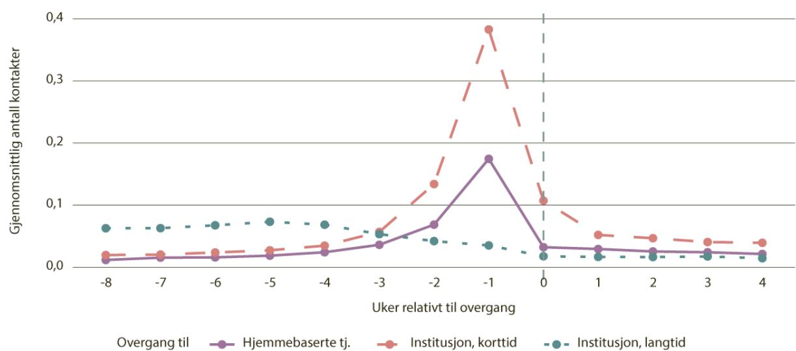

Gjennomsnittlig antall kontakter

Uker relativt til overgang

Overgang til

- Hjemmebaserte tj.
- Institusjon, korttid
- Institusjon, langtid

The chart shows the average number of contacts (y-axis, 0.0 to 0.4) relative to a transition (x-axis, -8 to 4 weeks). A vertical dashed line is at 0 weeks. The 'Hjemmebaserte tj.' (purple line with circles) shows a peak at -1 week. The 'Institusjon, korttid' (red dashed line with circles) shows a sharp peak at -1 week. The 'Institusjon, langtid' (teal dashed line with circles) remains relatively flat around 0.06.

| Uker relativt til overgang | Hjemmebaserte tj. | Institusjon, korttid | Institusjon, langtid |
|----------------------------|-------------------|----------------------|----------------------|
| -8                         | 0.01              | 0.02                 | 0.06                 |
| -7                         | 0.01              | 0.02                 | 0.06                 |
| -6                         | 0.02              | 0.02                 | 0.06                 |
| -5                         | 0.02              | 0.02                 | 0.07                 |
| -4                         | 0.02              | 0.03                 | 0.06                 |
| -3                         | 0.03              | 0.05                 | 0.05                 |
| -2                         | 0.07              | 0.13                 | 0.04                 |
| -1                         | 0.17              | 0.38                 | 0.03                 |
| 0                          | 0.03              | 0.10                 | 0.02                 |
| 1                          | 0.03              | 0.05                 | 0.02                 |
| 2                          | 0.02              | 0.04                 | 0.02                 |
| 3                          | 0.02              | 0.04                 | 0.02                 |
| 4                          | 0.02              | 0.04                 | 0.02                 |

Line chart: Average number of contacts relative to transition for different service types.

**Figur 8.2 Gjennomsnittlig antall akutte kontakter i spesialisthelsetjenesten per person per uke, fra 8 uker før til 4 uker etter ny kommunalt tildelt tjeneste i 2025 for personer 80 år og eldre**

Kilde: Folkehelseinstituttet (2026i)

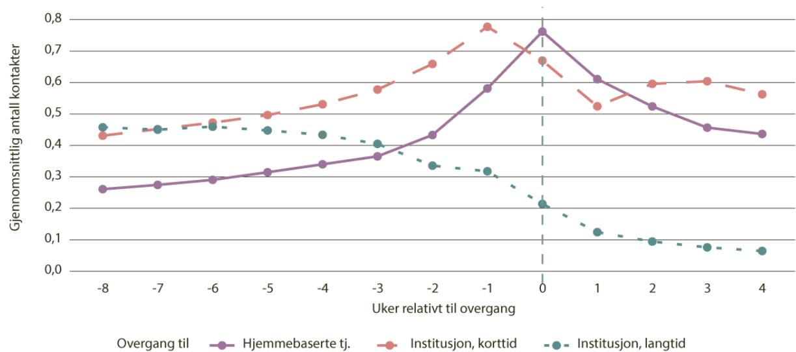

Gjennomsnittlig antall kontakter

Uker relativt til overgang

Overgang til

- Hjemmebaserte tj.
- Institusjon, korttid
- Institusjon, langtid

The chart shows the average number of contacts (y-axis, 0.0 to 0.8) relative to the transition (x-axis, -8 to 4 weeks). The 'Hjemmebaserte tj.' line peaks at 0 weeks. The 'Institusjon, korttid' line peaks at -1 week. The 'Institusjon, langtid' line decreases sharply after 0 weeks.

| Uker relativt til overgang | Hjemmebaserte tj. | Institusjon, korttid | Institusjon, langtid |
|----------------------------|-------------------|----------------------|----------------------|
| -8                         | 0.25              | 0.42                 | 0.45                 |
| -7                         | 0.27              | 0.44                 | 0.44                 |
| -6                         | 0.29              | 0.47                 | 0.45                 |
| -5                         | 0.31              | 0.49                 | 0.44                 |
| -4                         | 0.34              | 0.53                 | 0.43                 |
| -3                         | 0.36              | 0.57                 | 0.40                 |
| -2                         | 0.43              | 0.65                 | 0.33                 |
| -1                         | 0.58              | 0.77                 | 0.31                 |
| 0                          | 0.76              | 0.66                 | 0.21                 |
| 1                          | 0.61              | 0.52                 | 0.12                 |
| 2                          | 0.52              | 0.59                 | 0.09                 |
| 3                          | 0.45              | 0.60                 | 0.07                 |
| 4                          | 0.43              | 0.56                 | 0.06                 |

Line chart: Average number of contacts relative to transition for three types of transitions.

**Figur 8.3 Gjennomsnittlig antall kontakter hos fastlegen per person per uke, fra 8 uker før til 4 uker etter ny kommunalt tildelt tjeneste i 2025 for personer 80 og eldre**

Kilde: Folkehelseinstituttet (2026i)

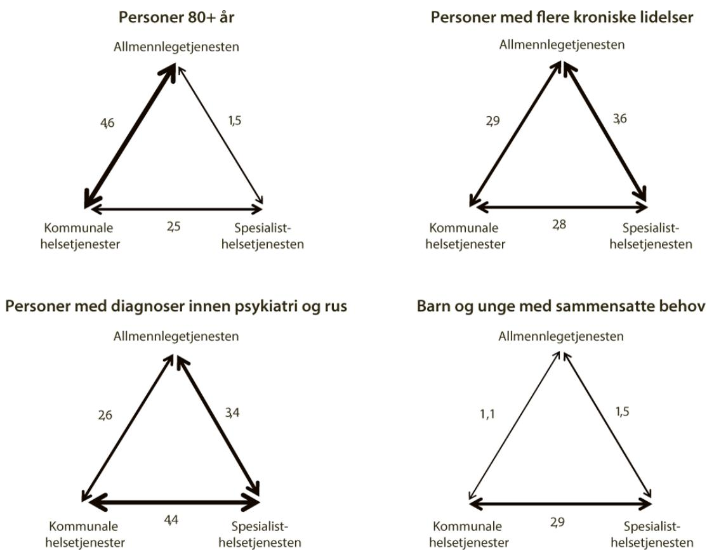

**Personer 80+ år**

Allmennlegetjenesten

Kommunale helsetjenester

Spesialist-helsetjenesten

4,6

1,5

2,5

**Personer med flere kroniske lidelser**

Allmennlegetjenesten

Kommunale helsetjenester

Spesialist-helsetjenesten

2,9

3,6

2,8

**Personer med diagnoser innen psykiatri og rus**

Allmennlegetjenesten

Kommunale helsetjenester

Spesialist-helsetjenesten

2,6

3,4

4,4

**Barn og unge med sammensatte behov**

Allmennlegetjenesten

Kommunale helsetjenester

Spesialist-helsetjenesten

1,1

1,5

2,9

Each diagram is a triangle with arrows pointing from one service to another, labeled with numerical values on the edges.

Network diagram: Triangular network diagrams of healthcare services for different patient groups.

**Figur 8.4 Gjennomsnittlig antall overganger per person mellom hovedtjenestetyper for fire pasientgrupper i 2025**

### **8.3 Utfordringer for tjenester som er offentlig finansiert og privat drevet**

Private aktører er tilknyttet den offentlige helse- og omsorgstjenesten på ulike måter. Tilbudet gis av private ideelle og kommersielle, gjerne i et samarbeid med det offentlige. I NOU 2020: 13 anslås kommunal egenproduksjon til om lag 90 prosent av de samlede driftsutgiftene på området. Selv om den offentlige helse- og omsorgstjenesten i hovedsak er offentlig drevet («offentlig finansiert og offentlig drevet»), står private for en ikke ubetydelig del av det samlede tilbudet. Et eksempel er fastlegeordningen, der over 80 prosent av tjenesten er basert på private næringsdrivende leger som har avtaler med det offentlige. Ulike kilder indikerer at andelen private har holdt seg rimelig stabilt på om lag ti prosent over tid både i kommunene og i spesialisthelsetjenesten (NOU 2016: 25; NOU 2020: 13; NOU 2024: 17).

#### **8.3.1 Anskaffelsesordningene**

Det er en rekke private, både ideelle og kommersielle, som har ordinære kjøpsavtaler med regionale helseforetak etter anbud. Innenfor tverrfaglig spesialisert rusbehandling (TSB), rehabilitering og laboratorie- og røntgentjenester utgjør private en betydelig del av den samlede kapasiteten.

Anskaffelser er et sentralt virkemiddel for å sikre tilgang til nødvendige helsetjenester, særlig der kapasiteten i egenregi ikke er tilstrekkelig. Regelverket bygger på prinsipper om konkurranse, likebehandling og effektiv ressursbruk og gjelder både for staten og kommunesektoren. For flere tjenester, som tverrfaglig spesialisert rusbehandling, rehabilitering, kirurgi, psykisk helsevern og sykehjemstjenester, er anskaffelser den etablerte måten å inngå avtaler med private på i dag.

I 2025 ble det satt ned et offentlig utvalg (rusbehandlingsutvalget) som skal utrede hvordan private aktører skal inngå i framtidens rus- og avhengighetsbehandling, hvordan anbud påvirker kvalitet, hvordan anbud kan forbedres og hvordan offentlige, ideelle og kommersielle leverandører kan samhandle mer hensiktsmessig.

Det er pekt på flere utfordringer knyttet til anskaffelser. Det kan være krevende å gjennomføre anskaffelsesprosesser, noe som kan forhindre mindre kommuner fra å bruke anbud for å oppfylle sitt sørge-for-ansvar. Også i spesialisthelsetjenesten krever anskaffelser høy kompetanse og god oversikt over tjenestebehovene. En anskaffelsesprosess vil også kunne lede til at man må avslutte et avtaleforhold med en privat tjenesteleverandør som har levert tjenester over lang tid, noe som kan oppleves vanskelig både for pasientene og de ansatte.

Det kan være krevende å utforme avtaler som både gir private leverandører tilstrekkelig forutsigbarhet og samtidig gir virksomheten med sørge-for-ansvaret fleksibilitet til å tilpasse tjenestetilbudet ved endrede behov. Anskaffelser må normalt beskrive tjenestene som skal leveres relativt presist, slik at ulike leverandører kan konkurrere på like vilkår. Samtidig kan detaljerte spesifikasjoner gjøre det vanskeligere å tilpasse avtalene dersom teknologi, behandlingsformer eller behov endrer seg i kontraktsperioden. Dette kan bidra til at kortere kontrakter ofte framstår som

mer hensiktsmessige enn lange kontrakter, selv om lengre kontrakter kunne gitt større forutsigbarhet for investeringer og rekruttering.

I spesialisthelsetjenesten vil det også være en avveining mellom ønsket om forutsigbar aktivitet hos private leverandører og behovet for å kunne disponere den samlede kapasiteten i tjenesten på en effektiv måte. Dersom private leverandører gis sterke garantier for aktivitetsnivå eller finansiering, reduseres leverandørens risiko, men samtidig begrenses de regionale helseforetakenes mulighet til å omfordele aktivitet mellom egne og private tjenesteleverandører når behovene endrer seg.

Private vil ha behov for en viss grad av forutsigbarhet for å kunne gi et godt tilbud. Det vil være krevende med økonomisk usikkerhet knyttet til at avtalt volum i rammeavtalen med regionalt helseforetak ikke kan oppnås, eller til at mange kontrakter har kort varighet med lave volumer. Lokale helseforetak kan også ha insentiver til å behandle pasienter selv istedenfor å informere om retten til å velge private med avtale fordi kostnadene typisk må dekkes innenfor helseforetakets eget budsjett. Innenfor psykisk helsevern og tverrfaglig spesialisert rusbehandling (TSB) er døgnbehandling rammefinansiert. Det har også vist seg krevende å involvere utdanning og beredskap i avtalene, og å integrere de private på en hensiktsmessig måte i felles digitale løsninger.

Arbeidsgruppen som i 2019 ga tilrådninger om mer autonomi til helseforetakene (Helse- og omsorgsdepartementet, 2019), mente at det var et potensial for bedre prosesser ved anskaffelser fra private aktører. Dette kunne skje gjennom større grad av involvering av helseforetakene i vurderinger av behov og utforming av kravspesifikasjoner i forkant av anbudsutlysning av nye avtaler.

##### **Boks 8.1 Kommersielle leverandører til spesialisthelsetjenesten**

Det finnes lite offentlig informasjon om de regionale helseforetakenes kjøp fra den enkelte private kommersielle virksomhet. Den største private kommersielle aktøren Aleris Helse AS har avtaler med alle helseregionene innenfor en rekke områder. Selskapet har også fristbruddavtale med det offentlige. Aleris Helse AS er eid av Aleris Healthcare AB via Aleris Group AB. Fram til 2026 har Aleris-gruppen vært eid av investeringsselskapet Triton Partners. Finske Mehiläinen Group annonserte oppkjøp av Aleris-gruppen i mai 2026. Aleris Helse AS hadde en omsetning på 1,9 milliarder kroner i 2025, 633 ansatte og er lokalisert 14 steder i Norge. UNICARE AS hadde en omsetning på 1,1 milliarder kroner i 2024 og er et konsern med 20 selskaper og to datterselskaper. Unicare eies hovedsakelig av det britiske private equityfondet G Square Capital. Selskapet ble etablert i 2008. Selskapet har hovedkontor i Oslo og virksomhet innen rehabilitering, bo- og omsorgstjenester, psykisk helse og brukerstyrt personlig assistanse (BPA). Alle de regionale helseforetakene kjøper laboratorie- og radiologitjenester fra Fürst Medisinsk Laboratorium og Unilabs Røntgen for pasienter i egen region. Fürst Medisinsk Laboratorium hadde en omsetning på 1,2 milliarder kroner i 2024. Inntektene til selskapet er i hovedsak basert på betaling for analyser av blod- og urinprøver gjennom rammeavtaler med regionale helseforetak og refusjon fra Helfo for analyser i henhold til offentlig forskrift.

###### **Rammeslutt**

#### 8.3.2 Fastlegeordningen

Fastlegeordningen er den delen av helse- og omsorgstjenesten som de fleste innbyggerne har kontakt med hvert år, mer enn 4,5 millioner i 2025 (Folkehelseinstituttet, 2026i). Rundt 80 prosent av fastlegene er privatpraktiserende, og resten er ansatt i kommunen. Fastlegetjenestene ligger spredt rundt i hele landet (figur 8.6), og innbyggerne er i stor grad tilfreds med fastlegetjenestene (FHI, 2025a). De fleste konsultasjonene løses og avsluttes hos fastlegen, mens drøyt ti prosent henvises til spesialisthelsetjenesten (Ringberg mfl., 2013).

Det har vært en større økning i antall fastleger enn i befolkningsveksten de siste årene, og dermed er det blitt færre pasienter på hver fastlegeliste. Mens antall konsultasjoner hos fastlegen per person stort sett har økt de siste årene, har det vært et fall for gruppene som det kan være grunn til å anta har størst behov, som eldre og personer med flere kroniske sykdommer (Ekspertutvalget for gjennomgang av allmennlegetjenesten, 2023). Samtidig viser Riksrevisjonen (2026c) en økning i poliklinikk-kontakter i spesialisthelsetjenesten for de eldste, og de peker på at mange av disse burde kunne vært håndtert i de kommunale helse- og omsorgstjenestene. Dette kan tyde på at enkelte grupper med store og sammensatte behov har et underforbruk av allmennlegetjenester. Dagens finansieringsordning for fastlegeordningen med høy andel aktivitetsbasert finansiering (om lag 65 prosent av finansieringen) gir insentiver til høy aktivitet og mange og korte konsultasjoner (kapittel 13).

Det har lenge vært en ambisjon å knytte fastlegetjenesten tettere opp mot de øvrige kommunale helse- og omsorgstjenestene. Dette var hovedbudskapet til Ekspertutvalget for gjennomgang av allmennlegetjenesten (2023) og i Meld. St. 23 (2024–2025) som blant annet omhandler allmennlegetjenesten. Regjeringen sier der at den vil bedre kapasiteten, kvaliteten og tilgjengeligheten til fastlegeordningen, særlig for innbyggere med store og sammensatte behov. Regjeringen ønsker å legge til rette for tverrfaglige fastlegekontorer med god oppgavedeling og tverrfaglig samarbeid. Den vil også utvikle og innføre flere digitale samhandlingsløsninger som skal legge til rette for samarbeid på tvers av nivåene i helsetjenesten, at fastleger vil få tilgang til journaldokumenter fra sykehus, prøvesvar og radiologiske beskrivelser, kritisk informasjon og pasientens legemiddelliste.

En aldrende befolkning med flere sammensatte helseutfordringer, sammen med en intendert vridning fra institusjonsbasert omsorg til hjemmetjenester i kommunene der mer komplisert behandling og oppfølging av pasienter vil skje utenfor sykehusene, stiller krav til tilstrekkelige ressurser, hensiktsmessig oppgavedeling, god ledelse og prioriteringer og god samhandling mellom aktørene. Det stilles videre omfattende krav til dokumentasjon, drift og samhandling med andre aktører innenfor helse- og omsorgstjenestene, Nav og andre sektorer (Ekspertutvalget for gjennomgang av allmennlegetjenesten, 2023). Utviklingen utfordrer både kapasitet og kvalitet i de kommunale helse- og omsorgstjenestene.


**TEAM**

The top part of the image shows the word "TEAM" above three stylized figures (two red, one blue) looking down at a house. Inside the house, an elderly man with a cane and a woman are shown. A wavy line separates this from the bottom part. The bottom part shows a group of people (some standing, some sitting) and a nurse with a stethoscope behind a sign that says "FASTLEGE".

**FASTLEGE**

Illustration: Conceptual illustration of a care team and a nursing home setting.

Figur 8.5 Illustrasjon av at fastlegen ikke alltid er tett nok integrert med øvrige helse- og omsorgstjenester

##### **Boks 8.2 Allmennmedisinske tjenester i andre nordiske land**

Allmennmedisinske tjenester til befolkningen er organisert på ulike måter i landene rundt oss. I Sverige og Finland ytes slike tjenester stort sett i større sentre der en rekke profesjoner arbeider i samme organisasjon og på samme sted for å yte tjenester til befolkningen. Disse sentrene tilbyr dermed flere allmennmedisinske tjenester enn det som er vanlig på norske fastlegekontor og legevakter. Også i Danmark er det et tungt innslag av sykepleiere i allmennlegekontorene, mens innslaget av andre profesjoner med høyere utdanning er lavt i de norske fastlegekontorene (Skudal mfl., 2019).

###### Rammeslutt


A map of Norway divided into counties, with markers indicating the locations of three types of healthcare facilities:

- Legevakt
- ◆ Ambulansestasjon
- Fastlege

The map shows a high concentration of Fastlege and Ambulansestasjon in the southern and central parts of the country, while Legevakt is more evenly distributed across the entire country.

Map: Map of Norway showing locations of on-call, ambulance stations, and fast-acting doctors.

Figur 8.6 Fastleger, ambulansestasjoner og legevakter er spredt ut over landet

Kilde: Helsedirektoratet (2026s)

For å yte gode tjenester til personer som har komplekse sykdommer som krever tjenester fra flere tjenesteytere, er det behov for at disse pasientene følges opp og gis en tydelig prioritering, for eksempel ved ambulant virksomhet, planlagt og i tilknytning til pasientenes hverdag. Et eksempel kan være personer som bor i en omsorgsbolig, som gjør det mulig for fastlegen å besøke flere pasienter samtidig. Planlagte og strukturerte stedlige besøk av fastlegen kan gi bedre oppfølging, bidra til redusert tidsbruk knyttet til koordinering og henvendelser til fastlege og økt tilgang til medisinsk kompetanse for annet personell.

Dagens organisering og arbeidsformer er i stor grad rettet mot behandling av oppståtte behov, der tjenestene kobles på når behov oppstår. Det betyr at fastlegen i praksis behandler dem som oppsøker hjelp, framfor systematisk å identifisere og følge opp dem som har høy risiko, men lav etterspørselsevne. Dette kan igjen innebære at fastlegeordningen slik den er i nåværende form, ikke er tilstrekkelig tilpasset behovene til personer med komplekse og langvarige behov for tjenester. Individrettet forebyggende arbeid er utbredt i allmennpraksis i Norge, men det aller meste handler om forebyggende legemiddelbehandling ved risiko for sykdom og utgjør et vesentlig innslag i konsultasjonene (Rønnevik mfl., 2020). Det er behov for å understøtte systematisk forebygging, planlagt oppfølging og arbeid som bidrar til å opprettholde funksjon over tid. Fastlegenes involvering i folkehelsearbeid og primærforebygging kan bli begrenset av at takstene i finansieringsordningen knyttes til Folketrygden. Folketrygden kan ikke benyttes til forebyggende tjenester, da den kun kan dekke «sykdom, skade eller lyte».

Selv om kommunene har sørge-for-ansvaret, er fastlegeordningen i stor grad styrt og finansiert nasjonalt. Ekspertutvalget for gjennomgang av allmennlegetjenesten (2023) pekte på at dagens nasjonale krav til individuelle avtaler med hver enkelt lege begrenser kommunenes mulighet til å tenke nytt om organisering av fastlegetjenesten. Selv om legene er samlokalisert i et legekontor og ofte har etablert et felles driftsselskap, har den enkelte lege et individuelt ansvar for å oppfylle lov- og forskriftsfestede krav for sin virksomhet. Kommunen må forholde seg til den enkelte lege. Dette gjør det krevende for kommunen å følge opp, lede og utvikle fastlegetjenesten. De individuelle avtalene gjør det også vanskelig å etablere kontoravtaler med tydelig ledelse ved fastlegekontorene. Ledelse må ofte skje gjennom konsensus. Dette utfordrer mulighetene for oppgavedeling og tverrfaglig samarbeid.

At finansieringen ikke følger sørge-for-ansvaret for tjenesten, såkalt tredjepartsfinansiering, kan medføre at kommunene i mindre grad involverer seg i eller ser det som mulig å endre og utvikle tjenesten etter lokale behov og ønsker. Det kan oppstå situasjoner hvor den statlige finansieringen, fastlegens prioriteringer og kommunens ønsker for fastlegetjenesten ikke er sammenfallende. Finansieringsmodellen kan dermed bli en barriere for prioritering, ledelse og tverrfaglig samarbeid, blant annet fordi en såpass stor andel utløses av aktivitet, og fordi finansieringen i hovedsak er koblet til legerollen (i stedet for oppgaven som løses).

Innretningen av finansieringsordningene stimulerer heller ikke til å prioritere kvalitetsarbeid, innovasjon og ledelse, hos kommunen og fastlegen, og samhandling, for eksempel tverrfaglige team. Finansieringsordningen legger heller ikke til rette for god samlet ressursbruk gjennom oppgavedeling med annet personell og tverrfaglig samarbeid i fastlegekontorene (Ekspertutvalget for gjennomgang av allmennlegetjenesten, 2023; Meld. St. 23 (2024–2025)).

Kommunens tilgang til styringsinformasjon om fastlegenes aktivitet er også begrenset, blant annet fordi de kommunale journalsystemene ikke har hatt muligheter for å hente ut slik informasjon, og fordi fastlegene stort sett benytter andre journalsystemer enn de øvrige tjenestene i kommunen. Dette gjør det utfordrende å hente ut gode indikatorer for å se på pasientflyt mellom allmennlegetjenestene og de øvrige kommunale helse- og omsorgstjenestene.

Til tross for at fastlegeordningen i stor grad er finansiert av staten, er det store geografiske forskjeller i tilgangen til fastleger. Det er særlig innbyggere i distriktskommuner som opplever hyppige bytter av fastleger og vikarer, og dermed mindre kontinuitet i fastlegetjenesten. Den delte styringen og de statlige rammene for finansieringen av fastlegene kan svekke kommunens insentiver til å innrette fastlegenes virksomhet slik kommunene mener den bør innrettes for å ivareta behovene for helse- og omsorgstjenester.

#### **8.3.3 Avtalespesialistordningen**

Avtalespesialistene leverte i 2022 henholdsvis 22 og 23 prosent av den polikliniske aktiviteten innen somatikk og psykisk helsevern (FHI, 2023). En grunn til at de klarer å levere så mye av den polikliniske aktiviteten, er at avtalespesialistene ofte er organisert med små kontorer som har spesialisert seg på noen typer elektiv virksomhet. De kan derfor ha høy aktivitet og produktivitet. Tilbudet er ulikt i de fire helseregionene.

Det har lenge vært en ambisjon å knytte avtalespesialistene tettere opp mot helseforetakene. De regionale helseforetakene fikk i foretaksmøtet i januar 2022 i oppdrag å gi en omforent beskrivelse av hvordan avtalespesialistene kan inngå og benyttes i tjenesten på best mulig måte. Det er innført felles henvisningsmottak for helseforetak og avtalespesialister innenfor psykisk helsevern. Hensikten er å bedre integreringen av avtalespesialistene og de øvrige tjenestene, slik at den totale kapasiteten utnyttes bedre. Det er i dag ikke noe felles henvisningsmottak innen somatikken.

De regionale helseforetakene utarbeider og vedtar regionale planer for utvikling og fordeling av avtalepraksis i regionen. Nye og ledige avtalehjemler kunngjøres og vilkår knyttet til hjemmelen skal framgå av kunngjøringen. De privatpraktiserende avtalespesialistene reguleres gjennom lov og forskrift og avtaler på flere nivåer, herunder avtaler om driftstilskudd mellom regionalt helseforetak og avtalespesialist samt ulike oppgjørsavtaler.

Selv om de regionale helseforetakene har sørge-for-ansvar for avtalespesialistenes tjenester, er ordningen i stor grad styrt og finansiert nasjonalt. At finansieringen ikke følger sørge-for-ansvaret for tjenesten, såkalt tredjepartsfinansiering, kan medføre at de regionale helseforetakene i mindre grad involverer seg i eller ser det som mulig å endre og utvikle tjenesten etter lokale behov og ønsker. Det kan oppstå situasjoner hvor den statlige finansieringen, avtalespesialistenes prioriteringer og de regionale helseforetakenes ønsker for aktiviteten ikke er sammenfallende. Finansieringsmodellen kan dermed bli en barriere for prioritering, ledelse og samarbeid med foretakene og de kommunale tjenestene. Vesentlige deler av avtaleverket besluttes nasjonalt med klare likhetstrekk med fastlegeordningen. Mens fastlegene er spredt ut over store deler av landet, illustrerer figur 8.7 at avtalespesialistene stort sett finnes i og rundt sykehusene og de store byene.


This map of Sweden shows the distribution of various healthcare and specialist locations. The legend indicates the following categories:

- Sykehus
- Legespesialist
- Fysioterapeut mv.
- Psykolog
- ▲ TSB/PHV

The map is divided into counties, with symbols representing the locations of these facilities across the country.

Map: Map of Sweden showing the distribution of healthcare and specialist locations.

Figur 8.7 Sykehus, avtalespesialister og institusjoner for psykisk helse og rus (TSB/PHV)

###### **Boks 8.3 Privatpraktiserende leger i sykehuset**

Fram til 1970-tallet var det vanlig at overlegene på sykehusene drev privat spesialistpraksis i tilknytning til sykehusstillingen (Skaset, 2005). For denne polikliniske aktiviteten kunne de sende regningen til trygden på samme måte som legene utenfor sykehusene gjorde. Denne private praksisen foregikk i sykehuslokalene, og sykehuset stod også for utstyret og lønnet hjelpepersonellet. Aktiviteten gav noen typer overleger en god biinntekt, og etter krigen ønsket ledelsen på sykehusene at slik poliklinisk aktivitet skulle integreres i den øvrige sykehusdriften. Sykehuslegene var imot dette (ibid.).

Utover på 1960-tallet økte presset for at ordningen med privat legepraksis i sykehuslokalene skulle strammes inn, og det ble vedtatt en lov som gjorde at sykehusene kunne motta refusjoner for poliklinisk virksomhet. Refusjonsretten var altså ikke lenger forbeholdt legen, men ble også tilgjengelig for sykehuset. Dette ledet til opprettelse av poliklinikker som en integrert del av virksomheten i flere sykehus innenfor ansettelsesforholdet til legene. Blant legene var det sterk motstand mot at den private og aktivitetsbaserte praksisen skulle innlemmes i de vanlige stillingene, og det ble hevdet at det var langt mer effektivt med privat praksis i stedet for fast lønn (ibid., s.78, s. 148–150). Det ble hevdet at utbyggingen av poliklinikker ville redusere effektiviteten og skade helsevesenet på grunn av legemangel (ibid., s. 177–181). Sykehusene så på poliklinikkene som viktige både for fagutvikling, undervisning og for å sikre befolkningen spesialisthelsetjenester. Utover på 1970-tallet vokste dagens poliklinikker fram der de ble en integrert del av den øvrige sykehusaktiviteten, og legene fikk fast lønn. Man samarbeidet med ulike helseprofesjoner i poliklinikken for å løse pasientenes behov, og finansieringen ble mer profesjonsnøytral som i dag.

I sykehusene i Nederland og USA (Kroneman mfl., 2024; Cebul mfl., 2008) er det fortsatt vanlig med privatpraktiserende leger i sykehusene, også for å håndtere innlagte pasienter. Legene er selvstendig næringsdrivende på kontrakter i stedet for å være ansatt. Cebul mfl. (2008) peker på slik privat praksis i sykehussektoren som en viktig årsak til fragmenteringen av tjenestene i USA, og understreker hvordan fast ansettelse vil gjøre det enklere for sykehusledelsen å få til integrerte tjenester. Det har vist seg vanskelig å endre fra kontrakter til ansettelser av spesialister i sykehusene, og sykehusene har forsøkt å styrke sammenhengen for pasientene gjennom større integrering med allmennleger, med blandet hell (Harris mfl., 2025).

Det er antatt at omfanget av leger i Norge med hovedstilling i sykehus som også har sin egen private praksis, er begrenset. Det har imidlertid vært drøftet om avtalespesialistene bør kobles tettere på poliklinikkene på sykehuset, nettopp for at de som sitter med sørge-for-ansvaret bedre skal kunne sikre fagutvikling, undervisning, sammenheng i tjenestene og (re)dimensjonering etter endrede behov (f.eks. Riksrevisjonen, 2015).

###### **Rammeslutt**

### **8.4 Utfordringer med tjenester som er privat finansiert og privat drevet**

#### **8.4.1 Begrenset kunnskap om omfanget av helprivate tjenester**

Med helprivate tjenester mener vi virksomheter som yter helse- og omsorgstjenester uten avtale med det offentlige.

Omfanget av privat helseforsikring har vokst over tid. I tredje kvartal 2025 hadde 880 000 personer helseforsikring. Helseforsikring gjennom arbeidsgiver dominerer. I privat sektor er det blitt vanlig å tilby helseforsikring til de ansatte. Flere arbeidsgivere bruker slike goder som en del av en total kompensasjonspakke. Raskere behandling på områder der det offentlige har lange ventetider, oppleves som et gode for den enkelte arbeidstaker og kan gi mindre sykefravær. Målt i bruk er det behandling hos fysioterapeut, kiropraktor og diagnostikk hos spesialist som dominerer. Hoveddelen av erstatningsutbetalingene går imidlertid til diagnostikk og operasjoner (Finans Norge, 2026).

Det finnes lite offentlig statistikk over hvilke deler av befolkningen som har og benytter private helseforsikringer. Tall fra Sverige tyder på at private helseforsikringer er vanligere blant personer med høy inntekt og utdanning (Palme mfl., 2026). Statistisk sentralbyrå har ikke tilsvarende tall for Norge, noe som gjør det vanskelig å vurdere utviklingen på feltet og betydningen for de offentlig finansierte helsetjenestene og ulike deler av befolkningen.

Det finnes noe forskning på hvordan private helseforsikringer påvirker helsen i ulike deler av befolkningen. I den internasjonale forskningslitteraturen opererer man ofte med to hovedhypoteser. Den ene er at private forsikringer bidrar til å avlaste helsetjenesten slik at pasienter uten forsikring – oftere personer med lav inntekt og utdanning – får bedre tjenester innenfor det offentlige systemet. Den andre hypotesen er at private forsikringer bidrar til det motsatte, ved at de trekker personell og penger ut av de vanlige tjenestene for å betjene dem som er forsikret.

Martinussen og Nordheim (2026) har sett på endringer i frivillige private forsikringer i europeiske land. De konkluderer med støtte til den andre hypotesen ved at den egenvurderte helsen til dem som forblir i den offentlige helsetjenesten, blir dårligere ettersom private forsikringer vokser. De finner også en sosial gradient siden personer med lav utdanning oftere rapporterer dårlig helse i land der bruk av frivillig helseforsikring har økt. I en omfattende registerstudie fra Sverige viser Palme mfl. (2026) at privat helseforsikring er mye vanligere blant personer med høy inntekt, selv om disse i snitt har lavere behov for helsetjenester. De finner videre at ansatte som får tilgang til helseforsikring gjennom arbeidsgiver, øker tilgangen til og bruken av helsetjenester. Dette gjelder særlig ansatte med lavere inntekt. I likhet med Martinussen og Nordheim (2026) finner Palme mfl. (2026) støtte til hypotesen om at private forsikringer øker bruken og belastningen på de offentlige helsetjenestene, og at forsikringene påvirker fordelingen av ressurser i de offentlige tjenestene, og dermed hvilke pasienter som får tilbud raskest.

Helsedirektoratet (2025b) har kartlagt status og utvikling i den helprivate allmennlegetjenesten. Kartleggingen viste at det er mangelfulle datakilder som kan belyse omfang, hvilke tjenester som tilbys og kvaliteten på tjenestene i den helprivate tjenesten. Kartleggingen indikerte at omfanget har vokst både i antall virksomheter og i antall legeårsverk, men at omfanget likevel er relativt beskjedent sammenlignet med den offentlige allmennlegetjenesten.

Fram til 1. januar 2025 fantes det ikke registerdata som kan belyse befolkningens bruk av helprivate tjenester, eller hvilke tjenester som tilbys. Fra 2025 er det innført plikt for privatfinansierte helse- og omsorgstjenester om å rapportere data til Norsk pasientregister (NPR) og Kommunalt pasient- og brukerregister (KPR). Formålet er å gi myndighetene bedre oversikt over befolkningens faktiske bruk og etterspørsel etter helprivate tjenester, men det foreligger fremdeles ikke slike data. Uten denne kunnskapen kan man ikke vurdere hva slags betydning helprivate tjenester har for det offentlige tilbudet og for befolkningens totale bruk av helse- og omsorgstjenester.

#### **8.4.2 Helprivate kan trekke på offentlige ressurser**

Helsepersonelloven § 4 pålegger leger en personlig plikt til å yte faglig forsvarlig helsehjelp. Bestemmelsen er førende for all utøvelse av legenes profesjon. Plikten til faglig forsvarlig utøvelse av profesjonen gjelder uavhengig av om legen er tilknyttet privat eller offentlig sektor. Tilsvarende hjemler helsepersonelloven § 6 helsepersonells plikt til å bidra til en effektiv ressursutnyttelse i helsetjenesten. Plikten er personlig og gjelder uavhengig av om helsepersonellet er tilknyttet den offentlige helse- og omsorgstjenesten eller helprivate virksomheter.

Helsepersonell med autorisasjon kan belaste offentlige budsjetter på flere områder. Retten til å sykmelde følger av lovgivning og autorisasjon, ikke av avtale med det offentlige. Det samme gjelder legemidler på blå resept dersom vilkårene er oppfylt. Laboratorieprøver og røntgenundersøkelser dekkes av det offentlige dersom disse er rekvirert fra autorisert helsepersonell og undersøkelsen utføres hos en virksomhet med avtale med regionalt helseforetak. I tillegg kan helprivate leger henvise pasienter til den offentlige spesialisthelsetjenesten. Helprivate helsetjenester er unntatt merverdiavgift.

Helprivate allmennleger kan forskrive legemidler, sykmelde og henvise pasienter til spesialisthelsetjenesten, men verken Navs registre, Legemiddelregisteret eller Norsk pasientregister har informasjon som enkelt kan identifisere helprivate allmennleger eller vurdere forskjeller i klinisk praksis mellom helprivate og offentlige tjenester.

Slik indirekte mulighet for de helprivate til å gi pasienter tilgang til offentlige tjenester og finansiering, svekker styring og kontroll med og prioritering av offentlige midler. Fastleger rapporterer at de forbinder privat helseforsikring med økt risiko for medisinsk overforbruk og helseulikheter. Likevel rapporterte 28 prosent at de ofte eller alltid henviser pasienter med privat helseforsikring på forespørsel, uten å vurdere om det forelå medisinsk indikasjon for henvisningen eller ikke (Breivold, 2026). Forfatteren konkluderer videre med «at en del fastleger i Norge resignerer i portvaktrollen når de utsettes for pasientpress, også for helsetjenester som de anser som medisinsk unødvendige eller potensielt skadelige».

Skillet mellom offentlig og helprivat helsetjeneste kan være viktig for blant annet å vurdere om privat virksomhet har melde- og tilskuddsplikt til Norsk pasientskadeerstatning (NPE). Regionale helseforetak, fylkeskommuner og kommuner betaler tilskudd til NPE for å dekke erstatning for pasientskader som skjer i den offentlige helse- og omsorgstjenesten. Private med avtale med det offentlige om driftstilskudd eller kjøp av helse- og omsorgstjenester regnes her som en del av den offentlige helse- og omsorgstjenesten. Private virksomheter med avtale må betale tilskudd til NPE for pasientskader som skjer utenfor den offentlige helse- og omsorgstjenesten. Annen drift utover

det som inngår i avtalen med det offentlige, regnes som helprivat helse- og omsorgstjeneste med melde- og tilskuddsplikt til NPE. Private kan både ha virksomhet som inngår i den offentlige helse- og omsorgstjenesten og helprivat virksomhet utenfor den offentlige helse- og omsorgstjenesten.

I tillegg har det vært en bekymring at helprivate trekker helsepersonell ut av høyt prioriterte helsetjenester i det offentlige til lavere prioriterte tjenester i det private (NOU 2024: 17; NOU 2023: 4; NOU 2020: 13).

###### **Boks 8.4 Innkjøp av medisinske produkter fra private**

For å drive offentlig finansierte helse- og omsorgstjenester er det helt nødvendig med en rekke produkter fra private leverandører. Helt sentralt står medisinske produkter, som i hovedsak omfatter legemidler og medisinsk utstyr. Medisinsk utstyr er en bred kategori som kan være alt fra plaster og diagnostiske tester til avanserte implantater og frittstående software. Digital teknologi spiller en stadig større rolle og med det også kunstig intelligens (KI). Et eksempel som er mye diskutert i det siste, er KI-verktøy for transkribering fra tale til tekst der det samtidig gis forslag til diagnose eller behandling. Et annet utviklingstrekk for medisinske produkter er at kombinasjoner av legemiddel og medisinsk utstyr blir mer vanlig.

Det er to hovedutfordringer knyttet til medisinske produkter i framtidens helsetjeneste: å prioritere de riktige produktene og å sikre at de er tilgjengelige når det trengs.

Prioritering kan være vanskelig, med høye forventninger til hva produktene direkte kan gjøre for overlevelse og livskvalitet, men også for å avlaste helsepersonell. Blant produktene som har fått mye oppmerksomhet, er nye legemidler mot store sykdomsgrupper som fedme og demens, nye vaksiner, ny persontilpasset medisin for små grupper og den brede kategorien av digitalt medisinsk utstyr basert på KI.

Samtidig kan nye produkter komme med risiko for pasientene, økt heller enn redusert personellbehov og press på helsetjenesten, og høy pris og større press på offentlige utgifter. Det betyr at nye medisinske produkter kan både ha en stor oppside og en betydelig nedside.

Derfor blir prioritering avgjørende. Norge har prioriteringssystemer for legemidler. For spesialisthelsetjenesten har vi *Nye metoder*, der Direktoratet for medisinske produkter (DMP) bidrar med beslutningsgrunnlag i form av metodevurderinger. *Nye metoder* er et eksplisitt prioriteringssystem som er systematisk, transparent og modent i et internasjonalt perspektiv. For legemidler finansiert over folketrygden (blåreseptordningen) har direktoratet et system for metodevurdering og beslutning om offentlig finansiering. For vaksiner har de nå fått ansvar for å utvikle systemet Nye vaksiner.

Norge mangler systematiske og transparente prioriteringssystemer for medisinsk utstyr i de kommunale helse- og omsorgstjenestene, selv om det pågår et arbeid med beslutningsstøtte til kommunene (Folkehelseinstituttet, 2026j). Mangel på transparens er en utfordring for legitimitet og kan true likeverdigheten.

Det er et betydelig potensial for bedre koordinering mellom kommuner i kunnskapsinnhenting knyttet til anskaffelser, samt mellom primær- og spesialisthelsetjenesten. I visse tilfeller kan det også være aktuelt mellom sivilsamfunnet og Forsvaret. Bedre koordinerte anskaffelser vil kunne øke volum og gjøre det lettere ved at flere bruker de samme produktene – til vanlig og under krise.

Tilgjengeligheten til medisinske produkter kan være særlig sårbar i beredskapssituasjoner, selv om Norge også opplever situasjoner med legemiddelmangel hvert år som følge av små og store hendelser langt unna Norge. Medisinske produkter er ofte avhengig av et velfungerende globalt marked der nordisk og europeisk samarbeid kan være avgjørende for tilgjengeligheten. Slike produkter har i økende grad blitt en del av internasjonal sikkerhets- og handelspolitikk. DMP har forsyningssikkerhet som en av sine viktigste satsinger for de neste årene.

Hvordan helsetjenesten organiseres, kan påvirke produktberedskapen. Det er nå stor oppmerksomhet på oppbygning av lager i Europa og Norge. Her er det en fordel om flere kommuner kan samarbeide, at primær- og spesialisthelsetjeneste ses samlet, og at behovene på sivil og militær side løses helhetlig.

Norge kan ikke sikre seg gjennom lager og eventuelt økt nasjonal produksjon alene. Hvilke avtaler og løsninger man har for anskaffelser, blir helt avgjørende. Sykehusinnkjøp HF er sentralt for spesialisthelsetjenesten, men man har ikke noe tilsvarende system for anskaffelser til primærhelsetjenesten på nasjonalt nivå. Når det gjelder lagerkapasitet, vil det være en fordel om flere kommuner kan samarbeide i enda større grad enn i dag, at primær- og spesialisthelsetjeneste ses i sammenheng, og at behovene på sivil og militær side løses helhetlig. Det kan skje gjennom større innkjøpsvolum, bedre diversifisering av produkter og leverandører der det er nødvendig for robusthet, og samtidig mer ensartede produkter der det er uheldig at personell og pasienter må bytte mellom ulike produkter.

###### **Rammeslutt**

### **8.5 Utfordringer knyttet til valgfrihet for pasientene**

I spesialisthelsetjenesten kan pasienter som har rett til behandling, selv velge mellom helseforetak og private behandlingssteder som har avtale med regionalt helseforetak. Alle helseforetak har i utgangspunktet adgang til å vurdere om en pasient har rett til behandling fra spesialisthelsetjenesten. For private virksomheter er adgangen til å vurdere retten til behandling avtaleregulert. Dette innebærer at dersom en privat virksomhet, som har avtale med et regionalt helseforetak, ikke har adgang til å tildele pasient- og brukerrettigheter, må pasienten først få en rettighetsvurdering med individuell frist fra en virksomhet som kan gjøre slik vurdering. Først når pasienten har en slik rettighetsvurdering, normalt fra et offentlig sykehus, kan pasienten velge det private behandlingsstedet.

Utviklingen har gått i retning av at rettighetsvurderingene gjøres i offentlige sykehus eller egne regionale vurderingsenheter. Innenfor rehabilitering og rusbehandling foretas all rettighetsvurdering av regionale vurderingsenheter.

Det er det regionale helseforetaket som har avtale med den private virksomheten som avgjør hvorvidt kompetanse til å rettighetsvurdere skal delegeres eller ikke. Mulige hensyn i det regionale helseforetaket i en slik vurdering kan inkludere behov i regionen, kompetansen og kapasiteten til den private virksomheten og hensynet til effektiv ressursutnyttelse. Det regionale helseforetaket kan stille vilkår i forbindelse med delegasjon av retten til å rettighetsvurdere.

For private tjenesteleverandører med rammeavtaler innebærer denne valgfriheten at det regionale helseforetaket kan ønske å unngå avtaler med garantert minsteantall pasienter, fordi det regionale helseforetaket ikke kan vite om og hvor mange pasienter som vil velge den private tjenesteleverandøren. Valgfriheten kan også gjøre det utfordrende for det regionale helseforetaket å dimensjonere aktivitet i egenregi. Videre vil valgfriheten være illusorisk dersom befolkningen ikke har tilgang til samlede og gode indikatorer for ventetider og kvalitet på helsetjenestene fra alle tjenesteleverandørene de skal kunne velge blant. Slik informasjon finnes i dag bare i begrenset grad selv om behandlingsstedene skal oppdatere ventetidene på Helsenorge.

Det kan være en tilleggsutfordring at de offentlige sykehusene har økonomiske insentiver til at pasienten ikke velger private med avtale. Dette følger av at de regionale inntektsmodellene fordeler midler til helseforetakene etter egenutviklede inntektsmodeller basert på trekk ved befolkningen i helseforetakenes opptaksområde. Når det regionale helseforetaket kjøper privat kapasitet og pasienten benytter seg av dette, er det pasientens helseforetak som har fått tildelt inntekten og derfor må dekke kostnaden. Hvis mange velger private, kan det gi budsjettutfordringer og redimensjoneringsbehov i helseforetaket.

### **8.6 Utfordring knyttet til samhandling med pårørende og frivilligheten**

Pårørende og frivillige organisasjoner er viktige samarbeidspartnere i helse- og omsorgstjenesten.

#### **8.6.1 Pårørende**

Pårørende spiller en sentral rolle som omsorgsgivere og som kilder til kunnskap om brukerens behov. Når samarbeidet med tjenestene fungerer, medvirker pårørende i beslutninger og bidrar til kontinuitet og trygghet i omsorgen. Samtidig har de rett til støtte, opplæring og avlastning.

Det anslås at det er om lag 800 000 pårørende i Norge i dag. Familieomsorg og omsorg fra andre nærstående utgjør en betydelig ressurs. Det er estimert at den uformelle omsorgen i Norge utgjør om lag 136 000 årsverk, og kvinner utfører en større del av denne. Dette er omtrent på samme nivå som den kommunale omsorgstjenesten, som utgjør om lag 149 000 årsverk (Helse- og omsorgsdepartementet, 2020). Omfanget av uformell omsorg i Norge tilsvarer dermed nesten hele den offentlige omsorgstjenesten.

Kommunene har plikt til å tilby støtte til pårørende som står i særlig krevende omsorgssituasjoner (Helsedirektoratet, 2026f). Mange pårørende opplever at dette tilbudet ikke er godt nok. Én av tre pårørende har unnlatt å søke om tiltak og tilbud som kan være avlastende, fordi tilbudet ikke er godt nok tilpasset behovet, har for dårlig kvalitet eller ikke finnes nær der de bor (Helsedirektoratet, 2022d).

Mye av pårørendes innsats er knyttet til koordinering av tjenestene og til å skape sammenheng, helhet og kontinuitet i tjenestetilbudet til den de er pårørende til. For mange blir belastningen så stor at de selv blir syke. I Helsedirektoratets pårørendeundersøkelse for 2020–2021 oppgir 72 prosent å måtte gi samme informasjon flere ganger til flere ansatte i helse- og omsorgstjenesten. Halvparten sier de bruker mye tid på å koordinere ulike tjenester. Seks av ti svarer at det er de, og ikke helsetjenesten, som tar initiativ til samarbeid. Pårørende til personer med alvorlige psykiske

lidelser og/eller rusproblemer, eldre med skrøpelighet og personer med kroniske lidelser er overrepresentert blant dem som gjør oppgaver de mener helse- og omsorgstjenesten burde ha gjort (Helsedirektoratet, 2022d).

Pårørende til eldre med skrøpelighet og pårørende til personer med demens utgjør den største gruppen av pårørende. 12 prosent av befolkningen over 40 år er pårørende til én eller flere eldre hjemmeboende personer med omfattende hjelpebehov. Helsedirektoratet gjennomførte i 2023 en spørreundersøkelse blant pårørende til eldre hjemmeboende. To av tre oppgir at det er belastende å være pårørende, og halvparten opplever at helse- og omsorgstjenesten overlater mye av jobben til dem. Bare 13 prosent oppga å ha en samarbeidsplan med helsetjenesten (Helsedirektoratet, 2023e).

#### **8.6.2 Frivilligheten**

Frivillige bidrar med sosial støtte, aktiviteter, praktisk hjelp og informasjon som supplerer de offentlige tjenestene og skaper økt livskvalitet for brukere, pasienter og pårørende. Mange frivillige organisasjoner kan også bidra til medvirkning fra grupper de representerer inn mot beslutninger.

Det kan være en viss gråsone i skjæringspunktet mellom frivillige aktører og den offentlige helse- og omsorgstjenesten. Å avgjøre om en aktivitet er en tjeneste som den offentlige plikter å tilby, eller et supplement som kan gis av frivillige, kan være en skjønnsmessig vurdering.

Helsedirektoratet har derfor utarbeidet et rundskriv for å klargjøre hvor skillet går (Helsedirektoratet, 2025a).

Organisasjoner påpeker utfordringer når det offentlige (kommuner) driver egenrekruttering av frivillige som ikke får en fellesskapsforankring i en organisasjon. Frivillige organisasjoner har kompetansen og erfaringen som er nødvendig for å lære opp og følge opp frivillige. De kan også bistå frivillige som opplever å bli bedt om å gjøre oppgaver som ikke bør drives på frivillig basis.

Et samarbeidsforhold mellom det offentlige og frivilligheten må være preget av likeverdighet, der frivillige organisasjoner bidrar på egne premisser. Likeverdigheten utfordres når offentlig sektor ser på frivillige organisasjoner kun som gjennomførere av oppgaver som offentlig sektor allerede har definert. Likeverdig samarbeid og medvirkning forutsetter at frivillige organisasjoner blir hørt når en utfordring vurderes og kan påvirke både valg, utforming og evaluering av tiltak (NOU 2025: 8).

Det er en utfordring når kommuner og helsetjenestene ikke kjenner til hva som finnes av aktiviteter i regi av frivilligheten. Tilbud fra frivilligheten som aktivitetsgrupper, sosiale møteplasser og likepersonstøtte kan forsterke innsatsen fra det offentlige og utgjøre støtte til både folkehelsearbeid, forebygging, rehabilitering og pasientforløp. Innovasjons- og samskapingsutvalget har utredet nye muligheter og modeller for samskaping om velferd (NOU 2026: 6).

I praksis er det ikke alltid enkelt å innpasse pårørende og frivillige på en god måte i tjenestene. Hvis aktiviteten blir viktig nok for kvaliteten på tjenestene, må den ytes innenfor rammer som ikke er avhengig av enkeltpersoner. Det er også viktig at pårørende og frivillige innlemmes i arbeidet på en slik måte at de kan bidra til mer likeverdighet i helse- og omsorgstjenestene. Det er derfor avgjørende at nødvendige helse- og omsorgstjenester alltid ytes av tjenesteleverandører, mens pårørende og frivillige er et viktig supplement for pasienten i møte med tjenestene.

##### **Boks 8.5 Hjelpelinjer**

Flere interesseorganisasjoner tilbyr hjelpelinjer hvor de som trenger det kan ringe for å få støtte, veiledning og noen å snakke med når livet oppleves vanskelig, blant annet Nasjonalforeningen for folkehelsen, Diabetesforbundet, Kreftforeningen og LHL. Det finnes også andre aktører, hvor flere retter seg mot psykisk helse, som Kirkens SOS og Mental Helse. Hjelpelinjene er viktige fordi mange har behov for informasjon, råd, veiledning eller bare noen som har tid til å lytte. Tilbudene kan være både forebyggende og mestringsfremmende, samtidig som de kan hjelpe mennesker videre til riktig hjelpeinstans ved behov.

##### **Rammeslutt**

## **9 Organisering og styring i kommunene**

### **9.1 Innledning**

Hele helse- og omsorgstjenesten står overfor en økende ubalanse mellom behovet for arbeidskraft og tilgangen på personell i tiårene som kommer. De største utfordringene vil komme i dagens kommunale helse- og omsorgstjenester, særlig i institusjonsomsorg og hjemmetjenester (Meld. St. 11 (2025–2026)). Dette er tjenesteområder som både har sterk vekst i behovet for tjenester og samtidig er sårbare for mangel på sentrale personellgrupper. Kommunene skal både håndtere sterk vekst i behovet, gjennomføre nødvendige omstillinger og samtidig opprettholde et forsvarlig og godt tjenestetilbud til alle brukere uavhengig av alder eller diagnose. Utfordringene knyttet til demografi og mangel på arbeidskraft vil treffe alle kommuner, men noen hardere enn andre. Distriktskommuner har ofte begrenset tilgang på arbeidskraft og større sårbarhet knyttet til bemanning.

I små kommuner er det spesielt utfordrende å rekruttere spesialisert helsepersonell og opprettholde fagmiljøer. Dette medfører at kommunene ofte kompenserer gjennom kostbar innleie fra vikarbyråer. Etterspørsel etter helse- og omsorgstjenester kan variere over tid, for eksempel for enkeltbrukere med særlige behov. Slik variasjon er særlig utfordrende for små kommuner som har begrensede muligheter til å utjevne slike endringer.

Det norske kommunesystemet bygger på en betydelig desentralisering av ansvar og myndighet til det lokale folkevalgte nivået. Kjennskap til lokale forhold, utfordringer og ressurser gjør det mulig å utforme tiltak som er tilpasset befolkningen. Samtidig skaper små og sårbare fagmiljøer utfordringer i arbeidet med å løse lovpålagte oppgaver (NOU 2023: 9). Mange kommuner er avhengige av samarbeid med andre kommuner for å løse oppgavene.

Kommunene har over tid hatt en sterk vekst i oppgaveomfanget og ressursinnsatsen i tjenestene. Kommunene har fått mer spesialiserte oppgaver, og innbyggernes forventninger og krav til kvalitet i tjenestene har økt. I tillegg har den statlige sektorstyringen, spesielt regelstyringen, blitt mer detaljert. Summen av denne utviklingen stiller store krav til kommunenes kapasitet og kompetanse for å kunne gi innbyggerne et godt og likeverdig tilbud, uavhengig av hvor i landet de bor.

### 9.2 Kommunestruktur og generalistkommuneprinsippet

#### 9.2.1 Dagens kommuner

Norge er et land med spredt bosetting og store geografiske avstander. Mye av landarealet er fjell og vidder, og det er ofte store avstander mellom arbeidsmarkedene. Mange kommuner har få innbyggere fordelt på store arealer.

Norge har i dag 357 kommuner. Kommunene varierer betydelig i geografisk størrelse, fra kommuner med under 10 km<sup>2</sup> til Kautokeino som er størst med sine 9 707 km<sup>2</sup>.

Det er store forskjeller i kommunenes befolkningsstørrelse, og mange kommuner har få innbyggere. De fleste bor i store kommuner. De 20 prosent største kommunene huser i overkant av 70 prosent av befolkningen. Rundt halvparten av kommunene har færre enn 5 000 innbyggere. Utsira kommune er minst med om lag 220 innbyggere, mens Oslo er størst med over 729 000.

Det er en tydelig samvariasjon mellom innbyggertall og sentralitet. Statistisk sentralbyrås (SSB) sentralitetsindeks deler kommunene inn i seks sentralitetsklasser. Indeksen er ment å gi et mål på kommunenes sentralitet, basert på avstand til arbeidsplasser og servicefunksjoner. Grovt sett kan man si at sentralitetsklasse 1 og 2 er sentrale kommuner, sentralitetsklasse 3 og 4 er mellomsentrale kommuner, og sentralitetsklasse 5 og 6 er usentrale kommuner. Flertallet av kommunene i Norge tilhører sentralitetsklasse 5 og 6, mens flertallet av befolkningen bor i kommuner i sentralitetsklasse 1 til 3.

Befolkningssammensetningen varierer mellom kommunene. Mindre sentrale kommuner har en høyere andel eldre. I 2024 var 10 prosent av befolkningen 70 år eller eldre i de mest sentrale kommunene, mens andelen var 19 prosent i de minst sentrale kommunene. Distriktskommunene har dermed en høy eldreandel allerede i dag, og den fortsetter å øke. I 2050 forventes de mest sentrale kommunene (sentralitet 1) å ha en eldreandel på 16 prosent og de minst sentrale kommunene (sentralitet 6) en eldreandel på 25 prosent (Leknes & Løkken, 2024).

Generalistkommuneprinsippet er et grunnleggende kjennetegn ved kommunesystemet. Prinsippet står sterkt og har bred forankring. Det innebærer at alle kommuner har et helhetlig ansvar for de samme lovfestede oppgavene, uavhengig av innbyggertall, bosettingsstruktur, økonomi eller andre kjennetegn. Staten styrer kommunene likt, og kommunene har et bredt oppgaveansvar med folkevalgt ledelse. Lovgivningen gir de samme rammer for organiseringen og styringen av kommunene, og det samme finansieringssystemet gjelder for alle kommuner. Kommunene har stor frihet til å velge hvordan de organiserer oppgaveløsningen – gjennom egen organisasjon, interkommunalt samarbeid eller ved kjøp av tjenester fra andre kommuner eller private aktører.

#### 9.2.2 Utfordringer med dagens kommunestruktur

Mange små kommuner mangler kapasitet og kompetanse, og flere kommuner har utfordringer med å oppfylle lovpålagte krav (Menon Economics, 2022). Telemarksforsking utredet i 2019 hvordan små kommuner med under 3 000 innbyggere fyller sin rolle. De fant at små kommuner har betydelige utfordringer med å skaffe tilstrekkelig kompetanse på flere områder. Dette gjelder særlig spesialisert kompetanse, og det er en god del kommuner som på ulike områder oppgir at de ikke har tilstrekkelig tilgang på kompetanse, verken i egen organisasjon, via interkommunalt samarbeid

eller via kjøp fra private. Dette skyldes i første rekke at kommunene har for få innbyggere og brukere til å kunne etablere et fagmiljø. Videre er det en utfordring at kommunene er for små til å fylle stillinger innenfor ett ansvarsområde, og dermed har vanskeligheter med å få kvalifiserte søkere. Det er også en del kommuner som peker på mangel på økonomiske ressurser i kommunen og vanskeligheter med å holde på kompetanse (Brandtzæg mfl., 2019).

Generalistkommuneutvalgets oppgave var å gi et helhetlig kunnskapsgrunnlag om generalistkommunesystemet, vurdere forutsetninger og rammer kommunene har for å være en generalistkommune nå og framover, samt å vurdere om det er grunnlag for fortsatt å ha et generalistkommunesystem (NOU 2023: 9).

Utvalget pekte på at presset på kommunesystemet har økt og sannsynligvis vil fortsette å øke. Små og usentrale kommuner har systematisk dårligere lovoppfyllelse enn andre kommuner.

Ifølge utvalget skyldes manglende lovoppfyllelse i hovedsak utilstrekkelig kapasitet og kompetanse. Særlig gjelder dette kompetanse for å løse høyt spesialiserte oppgaver, samt oppgaver som krever tverrfaglig innsats. Generalistkommuneutvalget mente likevel at dagens generalistkommunesystem bør videreføres. De foreslo tiltak for å sikre at alle kommuner kan være generalistkommuner også i framtiden.

Utvalgets flertall mente at det bør føres en aktiv politikk for å få større kommuner. Generalistkommuneutvalget pekte på at større kommuner vil styrke grunnlaget for generalistkommuner med et bredt oppgaveansvar og folkevalgt styring. Større kommuner gir bedre forutsetninger for å ivareta lovpålagte oppgaver gjennom større fagmiljøer, noe som også styrker grunnlaget for rekruttering. Større kommuner med høyere administrativ kapasitet vil kunne styrke den folkevalgte styringen ved at de har bedre kapasitet til å utrede beslutningsgrunnlag, særlig innen samfunnsutviklerrollen. Større kommuner vil også redusere noe av behovet for interkommunalt samarbeid og vil kunne legge til rette for mindre stram statlig detaljstyring.

Erfaringer fra den siste kommunereformen viser at sammenslåtte kommuner har klart å vri bruken av arbeidskraft fra administrasjon til tjenesteyting. De 47 sammenslåtte kommunene økte antallet ansatte med 5,6 prosent fra 2020 til 2025, mens antallet administrativt ansatte ble redusert med 1 prosent. Andelen administrativt ansatte gikk fra 13,5 prosent i 2020 til 12,7 prosent i 2025, en reduksjon på 0,8 prosentpoeng. De 310 ikke-sammenslåtte kommunene har økt antallet ansatte med 7 prosent og antallet administrativt ansatte med 4,9 prosent i samme periode. Andelen administrativt ansatte var relativt stabil og gikk fra 13,9 prosent i 2020 til 13,7 prosent i 2025 (Prop. 94 S (2025–2026)).

###### **Boks 9.1 Kommunenes etterlevelse av lovpålagte krav**

En kartlegging av kommunenes oppfyllelse av lovpålagte krav innenfor rollene som tjenesteyter, myndighetsutøver og samfunnsutvikler viste en gjennomsnittlig lovoppfyllelse på litt over 80 prosent. Kartleggingen (Menon Economics, 2022) var basert på kvantifiserbare lovkrav med data fra flest mulig kommuner. Kommuner det ikke var tilstrekkelig tallgrunnlag for, ble utelatt fra beregningene. De utelatte kommunene har signifikant lavere befolkningstall, lavere befolkningsvekst og ligger mindre sentralt enn kommunene som inngår. Blant annet mangler tall fra nær halvparten av kommunene med færre enn 2 000 innbyggere. Følgende indikatorer ble valgt

for helse- og omsorgstjenesten: oppfyllelse av kompetansekravene i helse- og omsorgstjenesteloven om at kommunen skal ha tilknyttet lege, sykepleier, fysioterapeut, jordmor, helsesykepleier, ergoterapeut og psykolog, andelen kommuner med helsestasjon for barn og unge, tilbud om øyeblikkelig hjelp døgnopphold og andelen mottakere av habilitering og rehabilitering som har vedtak om individuell plan. Analysen viste at graden av lovoppfyllelse har sammenheng med sentralitet og innbyggertall. Jo mer usentral kommunen er og jo lavere innbyggertall den har, desto lavere er graden av lovoppfyllelse. Det er imidlertid store variasjoner mellom kommunegruppene. Når det gjelder de kommunale helse- og omsorgstjenestene, viste Menon til at det er krevende å måle om en kommune tilfredsstiller sørge-for-ansvaret, det vil si kravet om at alle som oppholder seg i kommunen, skal tilbys nødvendige helse- og omsorgstjenester.

Alle kommuner hadde tilknyttet sykepleier, fysioterapeut, jordmor og helsesykepleier. 305 kommuner rapporterte at de har knyttet til seg ergoterapeut. 84 prosent av kommunene hadde knyttet til seg psykologkompetanse ved utgangen av 2020, enten ved å ansette psykolog(er), samarbeide med andre kommuner eller ved å kjøpe tjenesten, eller en kombinasjon av disse.

84 prosent av kommunene rapporterte at de oppfylte kravet om helsestasjon for barn og unge. Befolkningsstørrelse og sentralitet er viktige faktorer. Jo flere innbyggere kommunen har og jo mer sentralt kommunen ligger, jo større sannsynlighet er det for at kommunen innfrir lovkravet.

Om lag 73 prosent av kommunene tilfredsstilte lovkravet om øyeblikkelig hjelp døgnopphold innen somatikk og psykisk helse og rus. Befolkningsstørrelse er en viktig faktor.

Om lag 68 prosent av mottakere på institusjon og 65 prosent av mottakere i hjemmet fikk tilbud om individuell plan.

###### **Rammeslutt**

#### **9.2.3 Tidligere arbeid med kommunestruktur og vurdering av kommunestørrelse**

Schei-komiteen la i 1951 fram forslag til prinsipielle retningslinjer for kommuneinndelingen, herunder en minstestørrelse på 2 500–3 000 innbyggere og 5 000–10 000 der forholdene ligger til rette for det. Forslaget fikk støtte i Stortinget. Komiteens arbeid førte til at kommunetallet ble redusert fra 747 til 454 kommuner i 1967. Christiansen-utvalget (1992) konkluderte med at det var behov for en reform som omfattet både kommuneinndelingen og fylkesinndelingen. Utvalget foreslo at kommunene så vidt mulig burde ha minst 5 000 innbyggere.

Erna Solbergs regjering igangsatte kommunereformen med mål om gode og likeverdige tjenester, helhetlig og bærekraftig samfunns- og næringsutvikling, økonomisk robuste kommuner og styrket lokaldemokrati. Reformen, som ble gjennomført i perioden 2014 til 2020, førte til at antallet kommuner gikk fra 428 til 356 i 2020. 119 kommuner slo seg sammen til 47 nye kommuner. Senere er Ålesund kommune blitt delt, slik at det per i dag er 357 kommuner. Sett under ett ble ikke kommunereformens mål om større kommuner oppfylt i særlig grad. Kommunestrukturen forble uendret i det meste av Østlandet nord for Oslo og i store deler av Nord-Norge. De aller fleste av Norges minste kommuner forble små også etter kommunereformen (NOU 2023: 9).

Et ekspertutvalg vurderte blant annet hvordan kommuneinndeling og størrelsen på kommunene påvirker tjenesteytingen, som et kunnskapsgrunnlag for kommunereformen (Ekspertutvalg for kommunereformen, 2014).

Ekspertutvalget vurderte at minste kommunestørrelse med dagens kommunale oppgaver bør være på mellom 15 000 og 20 000 innbyggere. Utvalget la vesentlig vekt på behovet for kompetanse innen de spesialiserte helsetjenestene som er utviklet på kommunenivå. Deler av legevaktsamarbeidet, primært legevaktsentralen, vil med en slik kommunestørrelse i mange tilfeller fortsatt være organisert gjennom kommunale samarbeidsordninger. Driften av større tjenester som grunnskole og pleie- og omsorgstjenester kan være effektiv ved et lavere innbyggertall. Men kommuner med små fagmiljøer er sårbare med hensyn til uforutsette hendelser som sykdom og turnover, og de har færre ressurser til videreutvikling av tjenesten. Utvalget vurderte at minstestørrelsen vil være fordelaktig for kvalitetsutviklingen i disse tjenestene.

Til tross for utfordringer med dagens kommunestruktur ble det ikke tatt nye statlige initiativ til større og mer bærekraftige kommuner i Norge etter kommunereformen under Solberg-regjeringen.

### **9.3 Interkommunalt samarbeid**

#### **9.3.1 Omfang av interkommunale samarbeid**

Kommunene samarbeider mye, og omfanget av interkommunalt samarbeid har økt de siste tiårene. Interkommunale samarbeid er særlig utbredt i tilfeller der

- kommunens ansvar dekker geografiske områder som går på tvers av kommunegrenser, eller naturgitte ressurser som naturområder, vannforsyning og havner
- det er behov for investeringer i fysisk utstyr med begrenset alternativ bruk, som renovasjon, brannvesen og legevakt
- oppgavene er spesialiserte og har et begrenset aktivitetsomfang, slik som barnevern, innkjøp, pedagogisk-psykologisk tjeneste (PPT) og krisesenter.

By- og regionforskningsinstituttet NIBR har utviklet en egen indeks for interkommunalt samarbeid som måler både omfanget av samarbeidet og utviklingen over tid. Indeksen viser at i gjennomsnitt 26 prosent av de kommunale oppgavene helt eller delvis løses gjennom interkommunalt samarbeid. Bruken av interkommunalt samarbeid har økt siden 2004, og bruken er mest utbredt blant de minste kommunene. Det er også fylkesvise forskjeller i bruk av interkommunalt samarbeid. Størst er forskjellen mellom Agder og Finnmark. I Agder var gjennomsnittlig bruk av interkommunalt samarbeid 32 prosent i 2024, mens den bare var 16 prosent i Finnmark.

Interkommunale samarbeid dreier seg i hovedsak om mindre kommunale oppgaver, som utgjør en begrenset del av kommunens totale ressursbruk. Store kommunale tjenester, som grunnskole, barnehage og omsorgstjenester, løses i all hovedsak i egen organisasjon supplert med innkjøp fra private. Under 1 prosent av kommunene samarbeidet om institusjonsbaserte omsorgstjenester, og om lag 3 prosent av kommunene samarbeidet om PU-omsorg (tjenester til personer med psykisk utviklingshemming). I 2024 oppga ingen kommuner at de hadde interkommunalt samarbeid om hjemmebaserte omsorgstjenester (Organisasjonsdatabasen for 2024). Kommunene bruker anslagsvis mellom 4 og 10 prosent av de totale driftsutgiftene på interkommunalt samarbeid, men

også her er det betydelig variasjon. Dette viser at det i liten grad samarbeides om de store og ressurskrevende kommunale tjenestene (Jacobsen, 2022).

Det er særlig omfattende interkommunalt samarbeid på fagområdene legevakt og barnevern. Det er også vanlig med samarbeid om kommunale akutte døgnplasser, kommunelegefunksjoner, jordmortjenester, kommunepsykologtjenester og ulike samfunnsmedisinske funksjoner.

Vertskommunesamarbeid er den vanligste samarbeidsformen for interkommunalt samarbeid om helse- og omsorgsoppgaver. Det har blant annet sammenheng med at mulighetene for å delegere vedtakskompetanse er større i vertskommunesamarbeid enn i alternative samarbeidsmodeller (Advokatfirmaet Lund & Co DA & Menon Economics, 2026).

Kommuneloven § 17-1 slår fast at kommuner kan samarbeide om å løse oppgaver, og i hvilke former kommunene kan samarbeide. Kommuneloven kapittel 18 til 20 og lov om interkommunale selskaper (IKS-loven) gir nærmere regler for samarbeidsformene. Det er en del av kommunenes organisasjonsfrihet at de selv kan velge om en oppgave skal løses i egen organisasjon, gjennom et interkommunalt samarbeid eller på annen måte.


A stylized illustration of three pink shields, each containing a black outline of a coin. The shields are held together by four hands, forming a diamond shape. The shields are arranged in a triangle, with one at the top, one on the left, and one at the bottom. The hands are shown in a red line art style, holding the shields together.

Illustration of three pink shields with coins, held together by four hands in a diamond shape.

Figur 9.1 Interkommunalt samarbeid kan være nødvendig for å gi gode tjenester til befolkningen.

#### **9.3.2 Ulike former for interkommunalt samarbeid**

##### **Vertskommunesamarbeid**

Kommuner kan samarbeide med kommuner og fylkeskommuner gjennom vertskommunesamarbeid etter kommuneloven kapittel 20. Kommunene kan ikke samarbeide med helseforetak i et vertskommunesamarbeid, se nærmere om dette i siste avsnitt.

Ordningen åpner for at en kommune kan delegere myndighet til en annen kommune om å treffe enkeltvedtak eller vedta forskrift.

I vertskommunemodellen delegeres oppgaver og beslutningsmyndighet fra én kommune til en annen; vertskommunen. Samarbeidskommunen(e) har fortsatt sørge-for-ansvaret, selv om oppgaver og myndighet er delegert til vertskommunen.

I et vertskommunesamarbeid kan den enkelte kommune gi instruks om hvordan den delegerte myndigheten skal utøves i saker som bare gjelder samarbeidskommunen eller dens innbyggere. Samarbeidskommunen kan også omgjøre beslutninger etter bestemmelser i forvaltningsloven. Samarbeidskommunen kan når som helst trekke tilbake den delegerte myndigheten og/eller utøve myndigheten selv.

Samarbeidet skjer enten gjennom et administrativt samarbeid eller gjennom en folkevalgt nemnd. I det administrative samarbeidet delegeres myndighet til administrasjonen i vertskommunen, men bare i saker som ikke har prinsipiell betydning. I en vertskommune med folkevalgt nemnd delegeres myndigheten til en nemnd med folkevalgte fra samarbeidende kommuner og vertskommunen. Denne delegerer saker av ikke-prinsipiell betydning til administrasjonen i vertskommunen. Regler for folkevalgte organer kommer til anvendelse, som innkalling, saksliste og møteoffentlighet samt regler om valg og valgbarhet.

Vertskommunesamarbeidet som sådan utgjør ikke et eget rettssubjekt. Det innebærer at rettigheter og plikter tilligger vertskommunen og den enkelte kommune, ikke vertskommunesamarbeidet.

##### **Interkommunalt selskap**

Interkommunale selskap er et selskap hvor alle deltakerne er kommuner, fylkeskommuner eller interkommunale selskaper. Samarbeidsformen reguleres av lov om interkommunale selskaper. Det kreves hjemmel for å kunne delegere lovpålagte oppgaver til et interkommunalt selskap, jf. kommuneloven § 5-4. I henhold til forarbeidene stilles det ikke strenge krav til en slik hjemmel.

Instruksjon skjer gjennom vedtak fra representantskapet til styret. Den enkelte kommune kan ikke instruere selskapet om forhold som angår kommunen i en slik samarbeidsform, men vil kunne instruere den eller de representanten(e) som kommunen har valgt som sitt representantskapsmedlem.

Interkommunale selskap skiller seg fra oppgavefellesskap (se neste avsnitt) og vertskommunesamarbeid (se avsnittet over) ved at samarbeidet bygger på selskapsrettslige prinsipper. Et interkommunalt selskap styres gjennom et representantskap som er selskapets øverste organ. Representantskapet er ikke et folkevalgt organ i motsetning til representantskapene i kommunale oppgavefellesskap. Alle deltakerkommunene skal være representert i representantskapet med minst én representant. I tillegg har selskapet et styre og en daglig leder.

Interkommunale selskap er alltid egne rettssubjekter, og deltakerne i selskapet har ubegrenset ansvar for sin del av selskapets forpliktelser. Selskapet kan derfor ikke gå konkurs. Lov om interkommunale selskaper stiller mer detaljerte krav til samarbeidet mellom deltakerkommunene enn samarbeidsformene i kommuneloven. Samarbeidet er derfor særlig egnet for større og mer sammensatte samarbeid, eller der mange kommuner deltar i samarbeidet.

Selskapet kan ha arbeidsgiveransvar for ansatte.

##### Oppgavefellesskap

To eller flere kommuner eller fylkeskommuner kan opprette et kommunalt oppgavefellesskap for å løse alle typer oppgaver etter kommuneloven kapittel 19. Verken staten eller private aktører kan være deltakere i et oppgavefellesskap.

Ordningen åpner for et mer fleksibelt samarbeid mellom kommunene om oppfyllelse av lovpålagte oppgaver. Oppgavefellesskapet er tenkt som en enkel og fleksibel samarbeidsmodell for produksjonssamarbeid om mindre omfattende oppgaver.

Det er i dag ikke adgang til å delegere myndighet til å treffe enkeltvedtak i denne ordningen.

Den enkelte kommune har instruksjons- og omgjøringsmyndighet for beslutninger som gjelder kommunen selv i et oppgavefellesskap. Deltakerkommunene oppretter et felles styringsorgan, representantskapet, som deltakerkommunene utøver sin myndighet gjennom. Hver deltaker må være representert med minst ett medlem, slik at alle kommunene er representert i oppgavefellesskapets styrende organ. Representantskapet er et folkevalgt organ.

Kommunene velger selv om samarbeidet skal opprettes som et eget rettssubjekt eller ikke. Dersom deltakerkommunene oppretter et eget rettssubjekt, innebærer det at deltakerkommunene etablerer en sammenslutning med et felles styringsorgan som det overføres myndighet til.

Oppgavefellesskapet som eget rettssubjekt har rettslig handleevne på fellesskapets vegne. Oppgavefellesskapet kan da samarbeide overfor en tredjepart, inngå kontrakter, herunder arbeidskontrakt med arbeidstakere, og må registreres i enhetsregisteret.

Oppgavefellesskap som ikke er egne rettssubjekter, må organisatorisk inngå i en av deltakerkommunenes eller deltakerfylkeskommunenes organisasjon. Beslutninger som treffes i oppgavefellesskapet, treffes da på vegne av den eller de aktuelle deltakerkommunene eller fylkeskommunene. Dette krever at oppgavefellesskapet har fått delegert myndighet til å treffe slike beslutninger.

Deltakerne har ubegrenset ansvar for sin andel av oppgavefellesskapet forpliktelser.

Kommunal- og distriktsdepartementet har nylig hatt på høring et forslag til endringer i regelverket for å legge bedre til rette for mer langsiktig og helhetlig samarbeid. Forslaget åpner for at kommunalt oppgavefellesskap som er eget rettssubjekt skal kunne delegeres myndighet til å fatte enkeltvedtak og vedta forskrift. En slik endring vil bidra til at samarbeidsmodellen kan brukes til langsiktig samarbeid om flere oppgaver og tjenester. For at det skal være forsvarlig å delegere myndighetsutøvelse til et oppgavefellesskap, vurderes i tillegg flere andre lovendringer. Dette gjøres blant annet for å styrke deltakernes mulighet for styring og kontroll og for å klargjøre hvilke regler som gjelder ved omgjøring av enkeltvedtak, kontroll og tilsyn.

#### **9.3.3 Utfordringer ved kommunesamarbeid**

Det er mange fordeler med interkommunalt samarbeid. Kommunene samarbeider om tjenester i større enheter, og kommunene blir sterkere og mer robuste på disse områdene. Dette gir blant annet

mulighet til å etablere større fagmiljøer som kan gi bedre lovoppfyllelse, bedre tjenester og effektiviseringsgevinster. Interkommunalt samarbeid kan dermed bidra til å utjevne ulikheter i kommunenes forutsetninger.

Det er noen utfordringer med interkommunalt samarbeid. Det gjelder blant annet kostnader til etablering og drift av samarbeid, styring og kontroll av samarbeidet samt samordning og koordinering av tjenesteområder som drives innenfor og utenfor kommunenes egne organisasjoner. Det er også vanskeligere for de folkevalgte å gjøre økonomiske prioriteringer mellom driftsområder i samarbeidet og kommunenes ordinære drift. Kommuner som vil samarbeide, er dessuten avhengige av at en annen kommune vil samarbeide med dem.

Regionale kartlegginger fra NIVI Analyse viser at kommunene samarbeider i stort omfang, og at samarbeid er svært fragmentert ved at kommunene samarbeider i mange ulike konstellasjoner. Flere rapporter peker på behovet for et mer forpliktende, langsiktig og helhetlig interkommunalt samarbeid (Vinsand, 2021; Vinsand, 2023).

I en studie av lokalpolitikeres opplevelse av politisk handlingsrom og innflytelse mener om lag 34 prosent av kommunepolitikere at «omfanget av interkommunalt samarbeid er blitt så omfattende at det har blitt et problem for lokaldemokratiet» (Brandtzæg mfl., 2022). 24 prosent opplever at egen kommune ikke har gode systemer og verktøy for å sikre politisk oversikt og styring av aktiviteten i interkommunale samarbeid og selskaper. Interkommunalt samarbeid kan binde opp handlingsrommet for folkevalgte politikere fordi sentrale tjenester ligger i et samarbeid utenfor kommunen. Dermed får ikke politikerne styrt tjenestene direkte eller prioritert mellom ulike tjenester i kommunens administrasjon. Fordelingen av kostnader mellom kommunene kan også være utfordrende.

Mange samarbeid om ulike oppgaver kan gjøre det vanskeligere å samordne oppgaver som bør ses i sammenheng. Det kan også føre til at kommunene bruker mye ressurser på å koordinere og styre samarbeidene. Samarbeidet går utenpå de eksisterende styringslinjene i kommunene. Det fører til mer administrasjon og utfordringer med kommunikasjonsflyt og samhandling på faglig nivå i linjene i og mellom kommunene. En risiko ved slikt samarbeid er at enkeltkommuner kan melde seg ut. Dette kan i stor grad påvirke de andre kommunenes evne til å løse de oppgavene som var avhengig av at alle kommunene deltok. Muligheten til å tre ut av samarbeidet viser samarbeidsordningenes sårbarhet.

##### **Boks 9.2 Interkommunalt samarbeid i praksis**

Region Nordhordland helsehus (RNH) er et samarbeid der kommunale tjenester, fylkeskommunale tjenester og spesialisthelsetjenester er samlokalisert i samme bygg. Helsehuset drives av Region Nordhordland Helsehus IKS og er utviklet i samarbeid mellom kommunene i regionen og spesialisthelsetjenestene.

Vestre Varanger 4K er et eksempel på et forsterket interkommunalt samarbeid. Samarbeidet bygger på en felles grunnavtale og omfatter fem interkommunale samarbeid, hovedsakelig organisert som vertskommunesamarbeid. Kommunene samarbeider blant annet om et felles forvaltningskontor for helse- og omsorgstjenesten, der Båtsfjord er vertskommune for Tana, Nesseby og Berlevåg. Alle

kommunene er vertskommune for et område innen områder som økonomi, IT og barnevern. Planarbeidet er organisert som et oppgavefellesskap.

###### **Rammeslutt**

### **9.4 Statlig styring**

#### **9.4.1 Omfattende detaljstyring**

Det kommunale selvstyret er grunnlovsfestet. Samtidig har kommunene en sentral rolle i gjennomføringen av nasjonal politikk, og staten har derfor et legitimt behov for å styre kommunene. Det lokale selvstyret må derfor operere innenfor rammene av nasjonale mål. Spørsmålet er altså ikke om staten skal styre, men hvordan og i hvilken grad. Om styringen er forholdsmessig, det vil si egnet og nødvendig, og balanserer godt mellom hensynet til lokalt handlingsrom og nasjonale mål, er sentralt i denne vurderingen. Styring av helse- og omsorgssektoren er nærmere beskrevet i kapittel 3.

Gjennom oppbyggingen av velferdsstaten har målet om likeverdige tjenester mellom innbyggere og mellom geografiske områder stått sentralt. Likeverdige tjenester er ikke nødvendigvis det samme som like tjenester med samme form, innhold og omfang overalt. Kommuner og fylkeskommuner skal kunne tilby tjenester som er mest mulig tilpasset innbyggernes behov. Dette er en konsekvens av lokaldemokratiet der folkevalgte nær innbyggerne skal bestemme innenfor de rettslige rammene som er gitt.

Rammestyring er hovedprinsippet for statlig styring, både juridisk og økonomisk. Stor grad av rammestyring er en forutsetning for at det lokale selvstyret og lokaldemokratiet skal være reelt. Effektivitetshensyn tilsier også bruk av kommunene som velferdsprodusenter. Dette forutsetter at kommunene kan innrette virksomheten ut fra lokale forhold og gjøre prioriteringer tilpasset lokale behov. Det ligger også i rammestyring at kommunene beholder gevinsten ved effektivisering. Dette gir lokale folkevalgte klare insentiver til effektiv ressursbruk.

Den statlige styringen av kommunesektoren er økende. Flere utredninger de siste årene, blant annet Generalistkommuneutvalget (NOU 2023: 9), Kommunekommisjonen (NOU 2026: 1) og Innovasjons- og samskapingsutvalget (NOU 2026: 6) har pekt på redusert statlig detaljstyring som et tiltak for å møte framtidens utfordringer.

##### ***Kommunekommisjonen***

Kommunekommisjonen leverte sin første delutredning i januar 2026, og den andre delutredningen skal komme rundt årsskiftet 2026/2027. I sin første delutredning beskrev kommisjonen det norske kommunesystemet, statens styring og utfordringer som kommunesektoren står overfor. Endringer i befolkningssammensetningen og konsekvenser for, behov for og tilgang til arbeidskraft trekkes særlig fram. Kommisjonen foreslo konkrete endringer i den statlige styringen.

Kommunekommisjonen vurderer at kommunesektoren står overfor et sammensatt og langsiktig utfordringsbilde, særlig drevet av den kraftige veksten i antallet eldre og tilsvarende press på helse- og omsorgstjenestene. Kommisjonen mente at kommunesektoren må kunne fortsette å levere gode

tjenester, til tross for økende knapphet på arbeidskraft og store demografiske endringer. Disse endringene krever omstilling av tjenestetilbudet. Kommisjonen mente derfor at det bør vurderes om statens styring av kommunesektoren og andre rammebetingelser legger til rette for at arbeidskraft og andre ressurser brukes best mulig, både innenfor og på tvers av sektorer.

Kommisjonen peker på at hvert enkelt inngrep i det lokale selvstyret er begrunnet i hensyn som anses legitime og viktige å ivareta. Staten har behov for å styre kommunene slik at grunnleggende rettigheter ivaretas, herunder menneskerettighetene. Det er mange krefter og mekanismer som trekker i retning av økt statlig styring. Organiserte interesser arbeider for å sikre nivået på tjenester til sine områder, gjerne gjennom rettighetsfesting. Både stortingskomiteene og ansvarlige statsråder svarer med statlige reguleringer. Når disse reguleringene ses samlet, blir byrden for stor og går utover kommunenes mulighet til å gjøre nødvendige prioriteringer og effektiviseringer innenfor lokaldemokratiske rammer.

Det handler også om at ulike profesjonsinteresser ønsker å sikre høy faglig kvalitet på de tjenestene kommunene yter. Hver for seg vil ingen av disse aktørene vinne på å argumentere for økt kommunalt handlingsrom.

For lokaldemokratiet og det politiske handlingsrommet vil rettsliggjøring kunne føre til begrensninger. Rettsliggjøring binder opp kommunenes mulighet til selv å organisere tjenestene sine innenfor lokaldemokratiske rammer. Flere politiske beslutninger påvirkes og bindes opp av rettighetsbestemmelser i stedet for å være gjenstand for fri offentlig debatt.

Lokale folkevalgte kan også oppleve at kommunen kun er utfører av statlige beslutninger. Dersom det blir mindre beslutningsmyndighet lokalt, kan interessen for å være lokalpolitiker reduseres og lokaldemokratiet kan svekkes. Videre kan en konsekvens være at beslutninger flyttes fra folkevalgte organer til domstoler eller statlige organer som tar stilling til rettslige spørsmål knyttet til tjenestene, for eksempel i forbindelse med klage eller tilsyn.

Mange kommuner har små fagmiljøer og utfordringer med mangel på kompetanse og kapasitet. Kommunekommisjonen viste til at dette kan være en driver for detaljert statlig styring av kommunesektoren. Kommunekommisjonen har foreslått flere tiltak for å redusere den statlige detaljstyringen.

### **9.5 Andre sentrale utfordringer for kommunene**

#### **9.5.1 Krevende prioriteringer for å dekke behovene for befolkningen**

Kommunene skal sørge for nødvendige helse- og omsorgstjenester til befolkningen. De velger selv innenfor lovens rammer hvordan de skal organisere virksomheten og tjenestene ut fra lokale forhold og behov. I mange tilfeller er det likevel spenninger mellom kommunens rett til å organisere tjenestene og innbyggernes ønsker og forventninger om hvordan tjenestene skal organiseres. Det gjelder særlig for ressurskrevende brukere, som ofte mottar omfattende tjenester i eget hjem. Tjenester i hjemmet er i mange tilfeller kostnadskrevende for kommunene.

Helsepersonell kan bli bundet opp til tjenester for enkeltbrukere også der kommunene mener det er mer hensiktsmessig å tilby tjenestene på institusjon eller i omsorgsboliger i tilknytning til andre brukere med særlige behov. Kommuner melder også om at Husbankens krav knyttet til

investeringstilskuddet til heldøgns omsorgsplasser er for rigide og uten tilstrekkelig hensyn til lokale behov og demografiske endringer. Kommuner ønsker ofte å samlokalisere bofellesskap med leiligheter til mennesker med nedsatt funksjonsevne for åtte eller helst 10–12 beboere, mens Husbankens regelverk begrenser antall beboere til 4–6. Dette gjør det mer kostbart og mer personellkrevende for kommunene (KS, 2026).

Kommunene står overfor betydelige utfordringer med å møte behovet for tjenester i årene som kommer og samtidig sikre likeverdige tjenester på tvers av kommunegrensene. Mange kommuner har store rekrutteringsutfordringer og sliter med å etablere attraktive fagmiljøer. Mangel på kompetent arbeidskraft utfordrer kommunenes evne til å levere forsvarlige tjenester. Disse utfordringene forventes å øke i årene som kommer.

Utfordringer er særlig knyttet til økningen i antall eldre i kommunene, men det har også over tid vært en økning i gruppen yngre brukere. Mange kommuner peker på at handlingsrommet er for snevert, og at staten gjennom ulike virkemidler binder opp kommunene, slik at de ikke har det handlingsrommet som er nødvendig, for eksempel ved rettighetsfesting eller ved bruk av øremerkede tilskudd.

Kommunale helse- og omsorgstjenester er i stor grad avhengige av at pasienter selv oppsøker tjenestene. For noen grupper er terskelen for å søke tjenester høy, selv om de ville hatt stor nytte av dem. Det gjelder blant annet personer med kognitiv svikt, psykiske lidelser og rusutfordringer. Forebyggende og helsefremmende arbeid er en sentral oppgave for alle kommunale helse- og omsorgstjenester. Målet med forebygging er ikke bare å bedre befolkningens helse, men også å skape gevinster på andre samfunnsområder enn helse- og omsorgssektoren.

#### **9.5.2 Økning i antallet eldre**

Selv om dagens eldre generelt har bedre helse og lever mer aktive liv enn tidligere generasjoner, vil behovet for kommunale helse- og omsorgstjenester øke i takt med at antallet eldre blir større. Flere forventes å leve lenger med sammensatte og omfattende helseutfordringer, blant annet demens, noe som vil øke presset på tjenestene. Ifølge SSBs framskrivinger vil antallet personer som er 80 år eller eldre øke med 50 prosent fra 2020 til 2030. Alle kommuner vil ha utfordringer med å dekke behovet for helse- og omsorgstjenester til en voksende eldre befolkning. Kommuner med befolkningsnedgang, en høy andel eldre og mange som står utenfor arbeidslivet vil merke det mest og først.

Et av de vanligste kjennetegnene ved kognitiv svikt og demens er manglende initiativ og innsikt i egen sykdom og symptomer. Personer med kognitiv svikt eller demens vil ofte etterspørre tjenester i mindre grad enn behovet tilsier.

Riksrevisjonen har undersøkt kommunale helse- og omsorgstjenester til eldre (Riksrevisjonen, 2026b). Formålet har vært å vurdere om kommunene sørger for bærekraftige helse- og omsorgstjenester av god kvalitet til eldre og om statlige myndigheter legger til rette for dette. Riksrevisjonen finner at kommunale helse- og omsorgstjenester i liten grad er dimensjonert for å møte økningen i antallet eldre. Det avdekkes også risiko for svikt i de kommunale helse- og omsorgstjenestene til eldre, ved at kommunene ikke planlegger systematisk for framtiden.

Direktoratet for forvaltning og økonomistyring (DFØ) gjennomførte i 2024 en områdegjennomgang for økt rammestyring av kommunene (Direktoratet for forvaltning og økonomistyring, 2024). Flere informanter i kommunene peker på at balansen mellom omsorg for eldre og yngre er krevende, og at det er vanskelig å måtte prioritere mellom eldre og yngre brukere. Kommunene får også ansvar for flere pasienter og brukere. Økningen i yngre brukere kan også føre til at det blir vanskeligere for kommunene å prioritere de eldre, noe som igjen kan føre til økt bruk av spesialisthelsetjenester blant eldre (Riksrevisjonen, 2026c).

#### 9.5.3 Økning i antallet yngre brukere

Samtidig med at andelen eldre som har behov for helse- og omsorgstjenester øker i kommunene, har det over flere år vært en i økning i antall yngre som har behov for helse- og omsorgstjenester fra kommunen. Vista analyse har funnet at det i perioden 2012 til 2020 var en sterk vekst i tjenestemottakere i kommunale helse- og omsorgstjenester blant de under 67 år, og en særlig kraftig vekst i tjenestemottakere under 49 år (Rasmussen mfl., 2022). Andelen mottakere som var under 67 år, gikk ned igjen i perioden 2023–2025, til om lag samme nivå som i 2015 (Prop. 94 S (2025–2026)).

Figur 9.2 viser øyeblikksbilde per 31. desember for årene 2012, 2015, 2020 og 2025 der antall tjenestemottakere er fordelt etter alder og bruk av langtidsopphold i institusjon og helsetjenester i hjemmet. I tillegg til veksten i bruk av helsetjenester i hjemmet for tjenestemottakere under 49 år, har det også vært en vekst i bruk av helsetjenester i hjemmet for aldersgruppen 50–79 år. Det har vært en nedgang i både institusjonsbruk og helsetjenester i hjemmet for aldersgruppen 80–89 år fram til 2020, mens helsetjenester i hjemmet økt for denne gruppen mellom 2020 og 2025. Også for den eldste gruppen (over 90 år) er det en reduksjon i institusjonsbruk fra 2015, mens det er en svak vekst i hele perioden i bruk av helsetjenester i hjemmet. Det mangler data for bruk av helsetjenester i hjemmet for 2025 for gruppen 90 år eller eldre.


A bar chart showing the number of home (hjemmet) and institutional (institusjon) care services for five age groups across five years (2012, 2015, 2020, 2025). The y-axis represents the number of services, ranging from 0 to 50,000. The x-axis shows age groups: 0-49 år, 50-66 år, 67-79 år, 80-89 år, and 90 år eller eldre.

| Age Group         | 2012 Helsetjenester i hjemmet | 2015 Helsetjenester i hjemmet | 2020 Helsetjenester i hjemmet | 2025 Helsetjenester i hjemmet | 2012 Langtidsopphold i institusjon | 2015 Langtidsopphold i institusjon | 2020 Langtidsopphold i institusjon | 2025 Langtidsopphold i institusjon |
|-------------------|-------------------------------|-------------------------------|-------------------------------|-------------------------------|------------------------------------|------------------------------------|------------------------------------|------------------------------------|
| 0-49 år           | ~31,000                       | ~35,000                       | ~45,000                       | ~43,000                       | ~500                               | ~500                               | ~1,000                             | ~1,000                             |
| 50-66 år          | ~23,000                       | ~25,000                       | ~29,000                       | ~28,000                       | ~1,500                             | ~1,500                             | ~1,500                             | ~1,500                             |
| 67-79 år          | ~26,000                       | ~28,000                       | ~34,000                       | ~36,500                       | ~6,000                             | ~6,000                             | ~7,000                             | ~8,000                             |
| 80-89 år          | ~42,000                       | ~40,000                       | ~39,000                       | ~43,000                       | ~16,000                            | ~15,000                            | ~13,000                            | ~12,500                            |
| 90 år eller eldre | ~17,000                       | ~18,000                       | ~19,500                       |                               | ~11,000                            | ~11,000                            | ~10,500                            | ~9,000                             |

Legend:

- 2012 Helsetjenester i hjemmet
- 2015 Helsetjenester i hjemmet
- 2020 Helsetjenester i hjemmet
- 2025 Helsetjenester i hjemmet
- 2012 Langtidsopphold i institusjon
- 2015 Langtidsopphold i institusjon
- 2020 Langtidsopphold i institusjon
- 2025 Langtidsopphold i institusjon

Bar chart: Comparison of home and institutional care services by age group and year.

**Figur 9.2 Antall tjenestemottakere fordelt etter alder**

Kilde: SSB, statistikkbanken tabell 11645

Også utgiftene til yngreomsorgen har økt betydelig. I 1998 gikk 26 prosent av utgiftene til helse- og omsorgstjenester til yngre brukere (under 67 år), mens tallet i 2022 var 43 prosent. Undersøkelsen til Vista analyse viste også at yngre brukere tildeles flere timer enn eldre brukere med samme bistandsnivå. Yngre brukere har også mer sammensatte behov (Rasmussen mfl., 2022).

En mindre andel av brukerne (om lag fem prosent) står for en betydelig del av ressursbruken i pleie- og omsorgstjenestene, anslagsvis rundt 40 prosent. Gjennomsnittlig årlig kostnad i denne gruppen er knapt 2,2 millioner kroner, sammenlignet med om lag 186 000 kroner for øvrige brukere. Denne gruppen består i hovedsak av yngre personer som bor hjemme, mange med psykisk utviklingshemming eller nevrologiske tilstander. De har omfattende behov for bistand i hverdagen, særlig knyttet til husholdsoppgaver og egenomsorg. Behovet for støtte og tjenester er ofte langvarig, og mange vil ha behov for oppfølging gjennom store deler av livet. Endringer i tjenestetilbudet kan derfor få betydelige økonomiske konsekvenser for kommunene over tid. (Hagen mfl., 2024).

Kommunene blir kompensert for endringer i den demografiske sammensetningen gjennom inntektssystemet. Teknisk beregningsutvalg lager hvert år et anslag på merutgifter knyttet til endringer i alderssammensetningen, som er et uttrykk for hva det vil koste kommunesektoren å opprettholde tjenestetilbudet til den enkelte gruppe innbyggere fra det ene året til det neste, beregnet for kommunene samlet (NOU 2024: 23). Det er en etablert praksis at kommunesektoren skal kompenseres for anslåtte demografiutgifter gjennom veksten i frie inntekter (NOU 2025: 10).

Kostnadsnøklene i inntektssystemet skal fange opp og omfordele inntekter etter de enkelte kommuners utgiftsbehov. Her blir eldre innbyggere beregnet som mer utgiftsdrivende enn yngre. Følgelig får kommuner et høyere beløp for innbyggere i de eldre aldersgruppene sammenlignet med de yngre. Samtidig fanger delkostnadsnøkkelen for pleie og omsorg i dagens inntektssystem opp veksten i yngre brukere ved at yngre aldersgrupper har fått en større vekt enn tidligere (Prop. 102 S (2023–2024)). Beløpene som innbyggere i ulike aldersgrupper utløser, er basert på gjennomsnittsverdier. Kommunene vil både ha brukere som koster mindre og brukere som koster betydelig mer enn de får tildelt gjennom inntektssystemet.

Kommuner som har innbyggere med et særlig stort behov for helse- og omsorgstjenester, kan be om refusjon av utgifter over et gitt nivå. Bakgrunnen for ordningen er at tjenestetilbudet til personer som krever stor ressursinnsats fra den kommunale omsorgstjenesten, i størst mulig grad skal være uavhengig av kommunens økonomi. Kommunene får i 2026 kompensert 80 prosent av netto lønnsutgifter de hadde i 2025 som overstiger innslagspunktet. Innslagspunktet for 2026 er 1 921 000 kroner. Stortinget besluttet ved innføringen av ordningen at den gjelder for mottakere opp til 67 år, og at sterkt hjelpetrengende eldre over 67 år skal finansieres gjennom ordinære midler til eldreomsorgen i kommunene. Kommunene melder om at aldersgrensen for utgiftsdekning er en utfordring.

#### **9.5.4 Personellbehov**

Utfordringer knyttet til demografi og mangel på arbeidskraft treffer alle kommuner og fører til store omstillingsbehov. Dagens kommuner har imidlertid svært ulike forutsetninger for å håndtere disse utfordringene, noe som vil forsterkes framover. Flere offentlige utredninger og rapporter har

de seneste årene pekt på at det særlig er små og usentrale kommuner som har de største utfordringene med befolkningsnedgang og aldrende befolkning. Disse kommunene har også størst utfordringer med å levere i tråd med det brede oppgaveansvaret kommunene har. Mange små og usentrale kommuner opplever utfordringer med å rekruttere ansatte i helse- og omsorgssektoren, og de er preget av små og sårbare fagmiljøer. Det er blant annet store geografiske forskjeller i tilgangen til fastleger. Det er spesielt innbyggere i distriktskommuner som opplever hyppige bytter av fastleger og vikarer, og dermed mindre kontinuitet i fastlegetjenesten. Rekrutteringsutfordringer gjør at kommuner overbyr hverandre for å få tak i fastleger. Dette gir en lønnsspiral som er krevende for kommunene, og kan medføre økte kostnader uten at tilgjengeligheten og kvaliteten bedres (Meld. St. 23 (2024 – 2025)).

Telemarksforsking har kartlagt arbeidskraftbehovet i kommunesektoren, hvordan det utvikler seg over tid og i ulike deler av landet, og sett på konsekvenser for kommunenes oppgaver og roller (Vareide mfl., 2026).

Rapporten viser at distriktskommuner står overfor en betydelig og varig mangel på arbeidskraft i årene som kommer. I 108 av de minst sentrale kommunene forventes det 26 prosent færre sysselsatte. I 12 av disse kommunene vil antallet sysselsatte halveres. Telemarksforsking anslår at befolkningsnedgangen i distriktskommuner fortsetter i større grad enn SSB anslår i sine framskrivinger.

#### **9.5.5 Beslutninger i spesialisthelsetjenesten får konsekvenser for kommunene**

Samhandlingsreformen bidro til å legge flere og mer avanserte oppgaver til den kommunale helse- og omsorgstjenesten. Blant annet har kommunene fått en plikt til å sørge for tilbud om døgnopphold til pasienter og brukere med behov for øyeblikkelig hjelp. Kommunene opplever at de etter samhandlingsreformen må ta hånd om pasienter som er sykere, mer behandlingstrengende og med mer komplekse sykdomstilstander enn før. Samtidig er det flere utskrivninger fra sykehus og økt tempo i utskrivningsprosessene. Mye tyder også på et skifte i kommunehelsetjenestens karakter i retning av mer behandling og pleie av kort varighet og av mer spesialisert karakter (Abelsen mfl., 2014).

Når spesialisthelsetjenesten melder en pasient utskrivningsklar til kommunen, innebærer det at kommunen overtar ansvaret for pasienten som trenger medisinsk oppfølging. Kommunen må sørge for at pasienten ivaretas på en forsvarlig måte. Spesialisthelsetjenesten har sjelden inngående kjennskap til pasientens funksjonsnivå forut for den aktuelle sykdomsepisoden. Derfor vil de kunne trekke konklusjoner om videre forløp og oppfølging på utilstrekkelig grunnlag. Videre vil spesialisthelsetjenesten ikke alltid ha inngående kjennskap til hvilke tilbud og tiltak den enkelte kommune har bygget opp. Når spesialisthelsetjenesten uttaler seg om hvilke tiltak som kommunen bør iverksette, vil det skape forventninger hos pasienter og pårørende. Dette kan føre til at pasienter og pårørende føler utrygghet, dersom kommunen tilbyr andre tiltak enn det spesialisthelsetjenesten har foreslått. Flere kommuner opplever det som utfordrende at spesialisthelsetjenesten i stor grad definerer hvilke tjenester som skal tilbys når pasienten skrives ut fra sykehuset. Sluttrapporten til evalueringsprosjektet om samhandlingsreformen (EVASAM) viser at kommunene opplever at sykehusene gir pasienter løfter på vegne av kommunen (Grimsmo, 2015). Dette vil kunne gi

konsekvenser for hvilke rammer kommunene kan prioritere innenfor og som kommunene i liten grad opplever at de kan påvirke selv.

At kommuner ikke alltid er klar til å ta imot utskrivningsklare pasienter, trekkes ofte fram som en utfordring (Riksrevisjonen, 2026c). Liggedøgn for utskrivningsklare pasienter utgjør imidlertid bare om lag 2 prosent av det totale antall liggedøgn i sykehus. Kommunenes begrensede tilgang på sengeplasser er en viktig årsak til disse utfordringene.

#### **9.5.6 Samhandling**

De fleste mottar det meste av sine helse- og omsorgstjenester i kommunen. Samlet sett mottok om lag fem millioner innbyggere en kommunal helse- og omsorgstjeneste i 2025, der allmennlegetjenester utgjør størstedelen (Folkehelseinstituttet, 2026i). Til sammenligning mottok 2,2 millioner innbyggere spesialisthelsetjenester.

Behovet for samhandling innad i kommunen og mellom kommunen og spesialisthelsetjenesten varierer for ulike grupper av befolkningen. Eldre over 80 år får i hovedsak sine tjenester i kommunen, enten gjennom allmennlegetjenesten eller andre helse- og omsorgstjenester.

For personer med flere kroniske sykdommer og for personer med psykiske lidelser eller rusutfordringer har en betydelig andel både mange fastlegekonsultasjoner og hyppig kontakt med spesialisthelsetjenesten. De fleste barn og ungdom med varige og/eller sammensatte behov har kontakt med allmennlege og spesialisthelsetjeneste, mens færre mottar kommunalt tildelte tjenester. Personer med flere kroniske lidelser har mange og gjentatte overganger mellom kommunalt tildelte tjenester og spesialisthelsetjenester, og representerer en særlig ressurskrevende gruppe med stort behov for koordinert oppfølging.

Manglende planlegging er også en utfordring for samhandlingen. Befolkningens økende behov for sammensatte tjenester gjør at samhandling, planlegging og forebygging blir stadig viktigere for å kunne levere helhetlige helse- og omsorgstjenester til pasienter og brukere. Et godt kunnskapsgrunnlag er nødvendig for god planlegging, styring og treffsikker bruk av tilgjengelige virkemidler.

Kommuneplanens samfunnsdel skal gi retning til utviklingen av lokalsamfunnet og bidra til at nasjonale og regionale mål tilpasses lokale forhold. Planlegging innad i og mellom ulike sektorer i kommunen er en viktig forutsetning for å kunne fordele og bruke kommunale ressurser på best mulig måte, også slik at innbyggerne får de helse- og omsorgstjenestene de har behov for.

Det er iverksatt flere tiltak for å styrke felles planlegging av tjenestene.

Helsefellesskapene skal bidra til bedre felles planlegging mellom kommuner og helseforetak. Endringer i tjenestetilbudet i en kommune, for eksempel nedlegging av sykehjemsplasser, kan få betydning for sykehusene. Tilsvarende kan endringer i ambulansestrukturen påvirke øyeblikkelig hjelp-tilbudet i kommunen. Et nytt krav til hva den lovpålagte samarbeidsavtalen mellom kommuner og helseforetak skal omfatte trådte i kraft i august 2022. Kravet innebærer at helseforetak og kommuner skal avtale helt konkret hvordan de skal involvere hverandre i planarbeid som har betydning for den andre. Rekrutterings- og samhandlingstilskuddet er ment å gjøre det enklere for kommuner og sykehus å samarbeide om felles planlegging, tjenesteutvikling og gode pasientforløp for de fem prioriterte pasientgruppene gjennom helsefellesskapene.

Samhandlingsutfordringer mellom den kommunale- helse- og omsorgstjenesten og spesialisthelsetjenesten er nærmere omtalt i kapittel 12.

#### **9.5.7 Samhandlingsutfordringer innad i kommunen**

Kommunene har ansvar for et bredt spekter av tjenester, og den kommunale helse- og omsorgstjenesten er avhengig av å samhandle internt og med andre kommunale tjenester. Tjenestene er ofte organisert i ulike enheter med egne mål, kulturer og styringslinjer.

Manglende samordning mellom hjemmetjenester, institusjonstjenester og tjenester innen psykisk helse og rus kan føre til at pasienter og brukere ikke opplever tjenestene som helhetlige og sammenhengende. Det samme gjelder samarbeidet mellom kommunens øvrige helse- og omsorgstjenester og fastlegene. Selv om en stor andel av fastlegene er selvstendig næringsdrivende, er de en sentral del av kommunens helse- og omsorgstjeneste.

Mangelfull koordinering i kommunen kan føre til at brukere opplever manglende sammenheng i tjenestene. En sentral utfordring er at nødvendige opplysninger ikke deles effektivt mellom ulike enheter i kommunen. Ulike oppdrag, knapphet på ressurser og forskjeller i faglig forståelse og prioriteringer mellom profesjoner kan skape barrierer for samarbeid. Også manglende kjennskap til hverandres yrkeskulturer kan skape utfordringer. Slike forhold kan gjøre det vanskelig å etablere en felles tilnærming til brukernes behov.

Med økende alder vil en stadig økende andel innbyggere utvikle kognitiv svikt og etter hvert demens. Et av de vanligste kjennetegnene ved demens er manglende initiativ og forståelse for egen sykdom og symptomer. Samtidig er systemet i helse- og omsorgstjenesten i kommunene i stor grad søknadsbasert. Det betyr at pasient, eller pårørende dersom pasienten ikke har beslutningskompetanse, selv må søke om tjenester som dagaktivitet, korttidsopphold omsorgsbolig eller sykehjemsplass. Mens en fastlege kan henvise til undersøkelse i spesialisthelsetjenesten, har de i mange kommuner ikke like gode systemer for å foreslå (henvise til) korttidsopphold for utredning av en person som trenger å observeres mer over tid for å vurdere behov for oppfølging. Det er grunn til å tro at det varierer fra kommune til kommune hvor proaktive tjenestene er overfor pasient og pårørende og hvor godt samarbeidet er mellom fastleger, hjemmesykepleie og ansvarlige for tildeling av omsorgstjenester. Det søknadsbaserte systemet kan innebære en risiko for at tilbud av nødvendige tjenester kan bli avhengig av ressursene hos den enkelte pasient og pårørende til å søke om tjenester. Dette utfordrer også målet om likeverdige tjenester.

Samhandlingsutfordringer kan også oppstå mellom ulike tjenesteområder, som for eksempel helse- og omsorgstjenester og barnevernstjenester eller skole. Det er derfor ikke slik at samhandlingsutfordringer kun gjelder mellom spesialisthelsetjenesten og den kommunale helse- og omsorgstjenesten, men også mellom tjenestene innad i kommunen og innad mellom spesialisthelsetjenestene.

Ledelse og styring spiller også en viktig rolle, og manglende eller utydelige prioriteringer eller strukturer for samhandling kan svekke koordineringen av tjenestene innad i kommunene. Det samme skjer ved mangelfull internkontroll eller kvalitetsarbeid. Dersom det ikke finnes etablerte arenaer, rutiner og forventninger til samarbeid på tvers, vil samhandling ofte bli personavhengig og tilfeldig. Samtidig kan geografiske forskjeller og størrelsen på kommunen påvirke

samhandlingsutfordringene. Både store avstander og store organisasjoner kan gjøre det mer krevende å få til god koordinering.

### **9.6 Utvalgets vurderinger av utfordringene**

Dagens kommunestruktur gjør det krevende å sikre tilstrekkelig kapasitet, kompetanse og faglig bærekraft i helse- og omsorgstjenestene. Utfordringene vil forsterkes som følge av demografiske endringer og økende behov for tjenester.

## **10 Organisering og styring av spesialisthelsetjenesten**

### **10.1 Innledning**

De overordnede utfordringene er omtalt i kapittel 6, blant annet økende spesialisering, økende krav til dokumentasjon og konkurranse om kvalifisert arbeidskraft. Dette kapittelet handler om utfordringer med organisering og styring av spesialisthelsetjenesten med utgangspunkt i debatten om helseforetaksmodellen.

### **10.2 Debatten om helseforetaksmodellen**

Helseforetaksloven ble vedtatt av Stortinget i juni 2001 og innebar at staten overtok eierskapet til spesialisthelsetjenesten fra januar 2002. Helseforetaksreformen var basert på to hovedelementer (NOU 2016: 25):

- Staten overtok eierskapet til de fylkeskommunale sykehusene og øvrige virksomheter innenfor spesialisthelsetjenesten.
- Sykehus og andre virksomheter ble organisert i foretak som egne rettssubjekter på to nivåer.

NOU 2016: 25 *Organisering og styring av spesialisthelsetjenesten* beskriver følgende bakgrunn for reformen:

Bevilgningsøkningene hadde vært store de siste årene uten at de økonomiske problemene var løst. Pasientbehandlingen hadde økt mye uten at ventelistene hadde blitt kortere. Det var personellmangel til tross for økt utdanningskapasitet. Samarbeidet for å utnytte ledig kapasitet var for dårlig, og kapitalutstyret var dårlig utnyttet. Dette ble et stykke på vei sett som et uttrykk for organisatoriske og styringsmessige problemer. Det ble stilt spørsmål ved om forvaltningsorganiseringen satte begrensninger for sykehusenes ansvar på en slik måte at det ble vanskelig å oppfylle de helsepolitiske målsettingene.

Tre problemstillinger trekkes særlig fram i NOU 2016: 25:

- Målsettingen om likeverdige helsetjenester: Det var store forskjeller i ventetider og geografiske variasjoner i medisinsk praksis.
- Betydelige forskjeller i ressursbruk. Dette kunne dels forklares i lokale forhold, men også ulik tilrettelegging fra eiers side.

- Uklare ansvarsforhold: Fylkeskommunene hadde ansvaret for eierstyring og arbeidsgiveransvaret, mens finansieringen i hovedsak var statens ansvar. Staten hadde også det overordnede ansvaret for helsesektoren.

Helseforetaksmodellen regulerer organisering av spesialisthelsetjenesten som statlig eide foretak på to nivåer. Det er regler for hvordan styringen mellom nivåene skal skje, hvordan styrer oppnevnes og for styrenes oppgaver og kompetanse. Foretakene skal følge regnskapslovens bestemmelser. Dette innebærer blant annet at kapitalkostnader blir synlige i regnskapet gjennom årlige avskrivinger, og at inntekter og kostnader blir regnskapsført i den perioden de faktisk oppstår.

I både NOU 2016: 25 og NOU 2023: 8 *Fellesskapets sykehus* ble erfaringer med helseforetaksmodellen vurdert. Begge utvalgene framhevet at det er utfordrende å identifisere klare årsak-virkning-sammenhenger mellom enkeltelementer i utformingen av helsetjenesten og måloppnåelse. Utviklingen i den offentlige spesialisthelsetjenesten er et resultat av mange faktorer, og det er derfor vanskelig å fastslå hvilke endringer som kan tilskrives helseforetaksmodellen alene. Dette er også et sentralt trekk ved den offentlige debatten. Begrepet helseforetaksmodellen brukes ofte som en samlebetegnelse på forhold som dels følger av den formelle organiseringen av spesialisthelsetjenesten, og dels av andre styringsvirkemidler. Debatten omfatter blant annet finansieringsordninger, prioriteringsbeslutninger, mål- og resultatstyring, rapporteringskrav, samhandling mellom tjenestenivåer og organisering og ledelse internt i sykehusene.

Kritikken av helseforetaksmodellen har særlig handlet om demokratisk legitimitet og politisk styring. Gjennomgående temaer i debatten har vært kritikk om demokratisk underskudd, lukkede beslutningsprosesser, stor administrativ innflytelse og for sterk vektlegging av økonomiske hensyn. I de senere årene har debatten også i økende grad handlet om investeringer og finansiering. Etter en periode med høy investeringstakt og flere store sykehusprosjekter under gjennomføring eller ferdigstillelse forventes kapitalkostnadene å utgjøre en større andel av helseforetakenes samlede kostnader. Dette har aktualisert spørsmål om hvorvidt de regionale helseforetakene selv bør ha ansvaret for å balansere investeringer og drift. Dette er nærmere drøftet kapittel 13 og 28.

#### NÅSITUASJON


**STORTINGET**

**HELSE- OG  
OMSORGSDEPARTEMENTET**

The infographic shows a hierarchy from the Stortinget and Helse- og Omsorgsdepartementet at the top, leading down to four columns. Each column has a green box with a 5-dot pattern (one dark blue, four light blue) and a downward arrow. Below each arrow is a 3x3 grid of circles. The first two columns have one dark blue circle in the center, while the last two columns have all nine circles as dark blue.

| Column 1                 | Column 2                 | Column 3                 | Column 4                 |
|--------------------------|--------------------------|--------------------------|--------------------------|
| 5 dots (1 dark, 4 light) | 5 dots (1 dark, 4 light) | 5 dots (1 dark, 4 light) | 5 dots (1 dark, 4 light) |
| ↓                        | ↓                        | ↓                        | ↓                        |
| 3x3 grid (1 dark center) | 3x3 grid (1 dark center) | 3x3 grid (1 dark center) | 3x3 grid (all dark)      |

Infographic: Storting and Health and Social Department structure with four columns.

**Figur 10.1 Helseforetaksmodellen - dagens organisering av spesialisthelsetjenesten**

Illustrasjonen viser de fire regionale helseforetakene, underliggende helseforetak og private aktører som har avtale med de regionale helseforetakene.

#### **10.2.2 Politisk styring**

I Norge og England har de folkevalgte på nasjonalt nivå og regjeringen det overordnede ansvaret for styringen av spesialisthelsetjenestene. I Sverige, Danmark og Finland styres spesialisthelsetjenesten av folkevalgte på regionalt nivå. I Nederland er ansvaret for å sørge for spesialisthelsetjenester lagt til (private) forsikringsselskap, mens de folkevalgtes rolle i stor grad er knyttet til lovgivning og overordnet regulering.

I den norske debatten om spesialisthelsetjenesten brukes behovet for mer politisk styring om ulike og til dels motstridende mål. Noen argumenterer for sterkere nasjonal politisk styring gjennom Stortinget og departementet, mens andre ønsker større lokal og regional folkevalgt innflytelse over beslutninger som berører sykehusstrukturen og tjenestetilbudet. Debatten omfatter også spørsmål om hvordan lokal og regional forankring skal ivaretas gjennom sammensetningen av styrer, oppnevning av styremedlemmer og geografisk representasjon i styringsorganene.

##### Nasjonal politisk styring

Et viktig premiss for helseforetaksreformen i 2002 var at sektoren skulle være underlagt politisk styring for å sikre nasjonale velferdspolitiske mål, samtidig som man ikke ønsket en så omfattende detaljstyring som fylkeskommunene til dels hadde utøvd. Nasjonal styring skulle bidra til å oppnå målet om likeverdig tilgang til spesialisthelsetjenester. Et annet hensyn var å gi de enkelte virksomhetene myndighet og frihet til å oppfylle de lovfestede formålene og pliktene. Den offentlige spesialisthelsetjenesten skulle være politisk styrt og profesjonelt drevet (Ot.prp. nr. 66 (2000–2001)).

I helseforetaksmodellen utøves den politiske styringen av de regionale helseforetakene innenfor rammene av det parlamentariske ansvaret. Helse- og omsorgsministeren representerer staten og regjeringen ved eierstyring i foretaksmøter i regionale helseforetak og ved å knytte vilkår til bevilgninger over statsbudsjettet i oppdragsdokumentene. Som den øverste myndigheten i foretaket, kan foretaksmøtet med hjemmel i helseforetaksloven § 16 velge å fatte vedtak i alle saker. Det er fastsatt i helseforetaksloven § 30 at en del saker ikke kan avgjøres av styret i de regionale helseforetakene eller helseforetakene, men skal behandles politisk og derfor besluttes av statsråden i foretaksmøte (kapittel 3). Hvilke konkrete vedtak som behandles i foretaksmøtet, vil i praksis være påvirket av den politiske situasjonen og statsrådens vurdering av hva som er prinsipielle eller samfunnsmessige viktige saker.

Stortinget setter premisser for styringen gjennom å vedta lover, statsbudsjett, stortingsmeldinger og vedtak om enkeltsaker. Stortinget har dermed større påvirkningsmulighet i styringen av spesialisthelsetjenesten enn da eierskapet og ansvaret lå i fylkeskommunene. Fylkeskommunene som regionalt nivå, mistet samtidig sin påvirkning på beslutningene.

Stortingets engasjement i sykehussaker har økt etter helseforetaksreformen i 2002 (NOU 2023: 8). Stortingsrepresentantene involverer seg også oftere i saker som angår regionale helseforetak og helseforetak, sammenlignet med statlige selskaper i andre sektorer (Colbjørnsen, 2019). I de tre årene 2022–2024 fikk helse- og omsorgsministeren i gjennomsnitt 358 skriftlige spørsmål per år fra stortingsrepresentanter, og det ble fremmet i gjennomsnitt 30 representantforslag per år (Dokument 8-forslag) som ble behandlet i Stortinget. I 2025 var det henholdsvis 511 skriftlige spørsmål og 45 representantforslag. En vesentlig andel av spørsmålene omhandler styringen av spesialisthelsetjenesten og pasienttilbudet, og flere tar til orde for at saker om lokale tjenestetilbud bør besluttes av helse- og omsorgsministeren i foretaksmøte. Omfattende bruk av representantforslag og detaljerte styringssignaler kan svekke den strategiske helheten i styringen, og bidra til mer fragmenterte og mindre forutsigbare rammer (Colbjørnsen, 2019; Hagen, 2026).

De regionale helseforetakene er satt til å fordele begrensede offentlige ressurser mellom ulike behov innenfor spesialisthelsetjenesten, i tråd med de prinsippene for prioritering som Stortinget har vedtatt. Denne rollen som rasjoneringsaktør lå tidligere hos fylkeskommunen. Statlig detaljstyring begrenser styrenes handlingsrom når de skal ivareta sitt ansvar for å sikre forsvarlig drift og prioritering mellom ulike behov innenfor de økonomiske rammene som er stilt til disposisjon.

Styret skal også sørge for at virksomheten er tilfredsstillende organisert og drives forsvarlig. Politisk styring av enkeltsaker som berører deler av virksomheten, kan være krevende å balansere opp mot styrenes ansvar for å ivareta helheten i tjenestetilbudet og sikre forsvarlig ressursbruk

innenfor de fastsatte økonomiske rammene. I beslutningsprosesser kan det oppstå avveininger mellom hensynet til enkeltområder og hensynet til den samlede tjenesteutviklingen.

###### **Boks 10.1 Om balansen mellom politisk styrt og profesjonelt drevet**

En rapport fra Oslo Economics (2026) på oppdrag fra Spekter peker på at den parlamentariske situasjonen kan ha betydning for hvordan modellen fungerer i praksis.

I perioder med mindretallsregjering kan Stortingets bruk av anmodningsvedtak og mer detaljerte føringer bidra til økt politisk styring av sektoren. I oppdragsdokumentene for 2025 fikk RHF-ene mellom 35 og 37 oppdrag, og i juli samme år fikk de ytterligere 27 oppdrag gjennom tilleggsdokument som hvert år legges fram etter Stortingets behandling av revidert nasjonalbudsjett. Dette kan oppfattes som at politiske myndigheter griper inn i den løpende styringen av helseforetakene på et nivå som utfordrer den faglige styringen.

Det kan også reises spørsmål ved om oppdragsdokumentene over tid har blitt mer omfattende og konkrete, noe som kan indikere en sterkere politisk detaljstyring enn det som opprinnelig var forutsatt i reformen. Dette aktualiserer diskusjonen om balansen mellom politisk kontroll og foretaksmodellens intensjon om operativ selvstendighet.

Kilde: Oslo Economics (2026)

###### **Rammeslutt**

##### **Lokal- og regionalpolitisk medvirkning**

I forarbeidene til helseforetaksloven (Ot.prp. nr. 66 (2000–2001)) ble det lagt til grunn at lokale og regionale politiske myndigheter, sammen med bruker- og pårørendeorganisasjonene, skal få anledning til å gi innspill til de regionale helseforetakenes planprosesser og andre viktige saker. I lovproposisjonen ble det foreslått å lovfeste regionale rådsorganer for å gi foretakene sterkere lokal og regional forankring og innflytelse på utviklingen av spesialisthelsetjenesten. Bestemmelsen ble ikke vedtatt, jf. Innst. O. nr. 118 (2000–2001) *Om lov om helseforetak m.m.* Begrunnelsen var at rådsorganer ble ansett som unødvendige og at de regionale helseforetakene skulle ha tilstrekkelig kompetanse og kapasitet til å ta seg av faglige og strategiske oppgaver, og arbeide etter fullmakter fra eier.

Mange beslutninger som fattes av styrene i de regionale helseforetakene og helseforetakene, har stor grad av politisk interesse og sensitivitet, både lokalt, regionalt og nasjonalt. Lokalisering av sykehus er eksempel på beslutninger som har samfunnsmessige konsekvenser langt ut over det som berører spesialisthelsetjenesten. Funksjons- og oppgavefordeling mellom sykehus er også politisk konflikttema. Det er vanskelig i tilstrekkelig grad å sikre at alle relevante interessenter opplever å være tilstrekkelig hørt og ivaretatt i slike beslutningsprosesser.

En forklaring på det store volumet av representantforslag og spørsmål fra Stortinget, ofte med utgangspunkt i lokale helsetemaer, kan være at det er et underskudd av institusjonaliserte kanaler på lokalt og regionalt nivå. Muligheten for innflytelse gjennom Stortinget blir da viktigere.

###### **Boks 10.2 Plikt til involvering og samarbeid**

Sykehusutvalget foreslo å gi det enkelte helseforetaket en lovpålagt plikt til å inngå avtale med kommuner og fylkeskommuner i opptaksområdet om i hvilke saker disse skal høres før styret i helseforetaket fatter beslutninger. Det ble framhevet at det er behov for regelmessig og mer strukturert dialog om utfordringer, strategier og saker på et tidlig stadium mellom ledelsen i helseforetakene og politisk ledelse i kommunene og fylkeskommunene.

I Meld. St. 9 (2023–2024) ble det påpekt at det er viktig at også kommunene involverer spesialisthelsetjenesten i planlegging og utvikling av de kommunale helse- og omsorgstjenestene. Stortinget sluttet seg til forslaget om å utrede endringer i spesialisthelsetjenesteloven og helse- og omsorgstjenesteloven for bedre gjensidig involvering i planleggings- og beslutningsprosesser for både helseforetak og kommuner (Innst. 387 S (2023–2024)). Forslaget er per november 2026 ikke fulgt opp i departementet.

###### **Rammeslutt**

#### **10.2.3 Sammensetning og oppnevning av styrer**

Styrene i de regionale helseforetakene og helseforetakene har ansvar for at virksomheten drives i samsvar med den nasjonale helsepolitikken, og at foretakets samlede ressurser brukes på best mulig måte. Styrets sammensetning er regulert i helseforetaksloven §§ 21–23 som har bestemmelser om antall styremedlemmer, og om forholdet mellom styremedlemmer oppnevnt av eier og av de ansatte. Eier velger flertallet av styremedlemmene i foretaksmøtet.

Sammensetningen av styrene skal sikre både nødvendig kompetanse og en rimelig balanse mellom geografisk representasjon og kjønn. I regionalt helseforetak skal styremedlemmene som foretaksmøtet velger, ha tilknytning til den regionen som foretaket hører under. Det gjelder ikke tilsvarende krav om lokal og regional tilhørighet for styremedlemmer i helseforetak. Styremedlemmene har et selvstendig og personlig ansvar for å ivareta foretakets interesser. Av hensyn til mulige rollekonflikter er det fra departementets side lagt til grunn at de verken formelt eller reelt sett bør representere andre interesser i rollen som styremedlem.

Fra og med 2005 ble det stilt krav til de regionale helseforetakene om tydeligere organisatorisk skille mellom de to rollene som ivaretaker av sørge-for-ansvaret og eier av underliggende helseforetak («bestiller og utfører»). Det ble blant annet begrenset adgang til styrerepresentasjon i egne helseforetak for ansatte som ivaretar sørge-for-ansvaret i det regionale helseforetaket.

Kritikken av helseforetaksmodellen omfatter også at det er styremedlemmer i helseforetak som innehar lederroller i andre helseforetak eller regioner, og at dette framstår som samling av konsentrasjon av makt hos noen personer. Mange mener også at styremedlemmer som hovedregel bør ha bosted i eller annen tilknytning til regionen eller det geografiske opptaksområdet for helseforetaket.

Sykehusutvalgets forslag om at de som har lederroller i regionale helseforetak, eller er administrerende direktør i helseforetak, ikke samtidig skal kunne inneha styreverv i annet helseforetak i andre regioner, ble vurdert i *Nasjonal helse- og samhandlingsplan 2024–2027* (Meld. St. 9 (2023–2024)). Regjeringen mente at i lys av utfordringene spesialisthelsetjenesten står

overfor, kan det være viktig å sikre erfaringsoverføring mellom helseforetakene og med styremedlemmer som har ledererfaring fra tilsvarende virksomheter.

###### **Boks 10.3 Politisk representasjon i styrene (2006–2013)**

Med bakgrunn i regjeringserklæringen fra 2005 (Stoltenberg II), ble det fastsatt at et flertall av de eieroppnevnte styremedlemmene skulle velges av og blant foreslåtte folkevalgte i kommuner og fylkeskommuner. Etter denne ordningen økte antall styremedlemmer betydelig sammenlignet med 2002, da styrene bestod av ni medlemmer. De største styrene hadde etter hvert 16 styremedlemmer.

Regjeringen Solberg avviklet dette kravet ved valget av nye styrer i 2014. Dette ble begrunnet med at den sterke politiseringen av styrene hadde gått på bekostning av rekruttering av personer med bakgrunn og kompetanse for å løse de oppgavene og utfordringene de regionale helseforetakene og helseforetakene står overfor. Det ble også framhevet at størrelsen på styrene i flere sammenhenger hadde vært til hinder for gode prosesser og grundige diskusjoner (NOU 2023: 8).

###### **Rammeslutt**

#### **10.2.4 Beslutningsprosesser og åpenhet**

Mange beslutninger som fattes av styrene i de regionale helseforetakene, har, som omtalt i 10.2.1, ofte samfunnsmessige konsekvenser langt ut over de som berører spesialisthelsetjenesten direkte. Det er derfor viktig at det er åpenhet og transparens om hvilke vurderinger som ligger til grunn når beslutninger blir tatt.

Helseforetaksloven stiller krav om at eier må treffe sine beslutninger i foretakets saker i bestemte former. Styringssignaler som eier gir i kraft av sitt eierskap, er ikke bindende for foretakets ledelse dersom de er truffet utenfor foretaksmøtet (Ot.prp. nr. 66 (2000–2001)). Protokoller fra foretaksmøter er offentlige og tilgjengelige for alle på regjeringen.no. Helseforetaksloven stiller også krav om at styremøter som hovedregel skal være åpne. Det er til sammenligning ikke tilsvarende formkrav til åpenhet om instruksjoner fra overordnet myndighet i forvaltningen.

I flere sammenhenger blir det stilt spørsmål ved om det skjer «uformell eierstyring» eller «gis styringssignaler utenom foretaksmøtet» mellom departementet som eier og styreledere og administrerende direktører i regionale helseforetak. Departementet og statsråden har jevnlig kontakt med alle de regionale helseforetakene, både administrativt og med styrelederen. Tilsvarende er det kontakt mellom regionale helseforetak og de underliggende helseforetakene. Det er regulert i helseforetaksloven (§ 16 a) at departementet skal holde seg orientert om foretakenes virksomhet, innhente skriftlige opplysninger og avholde rapporteringsmøter.

###### **Boks 10.4 Åpne styremøter**

Det skal være møteoffentlighet i styremøter i regionalt helseforetak og helseforetak. Krav til åpne styremøter innebærer normalt at alle som ønsker det kan være til stede og overhøre møtene, men uten tale-, forslags- eller stemmerett. De fleste styremøtene blir også overført digitalt slik at media og andre interessenter kan følge disse direkte.

En viktig begrunnelse for åpne styremøter er at helseforetakene regulerer fellesgoder av stor betydning for befolkningen, og at åpne styremøter bidrar til å understøtte tillit og legitimitet til foretakene. Oversikt over styremøter, saksdokumenter og protokoller fra styremøtene ligger også tilgjengelig på foretakenes hjemmesider.

Kravet om åpenhet, med enkelte unntak, gjaldt fra og med 2004 og ble tatt inn i helseforetaksloven § 26 a fra januar 2013 (Prop. 120 L (2011–2012)), jf. Innst. 62 L (2012–2013). De regionale helseforetakene og helseforetakene er også omfattet av lov om rett til innsyn i dokument i offentlig verksemd (offentleglova).

###### **Rammeslutt**

##### **Boks 10.5 Om dialog utenom foretaksmøte**

Helse- og omsorgsdepartementet har i brev datert 30. juni 2015 redegjort for adgangen til å ha dialog og utveksle synspunkter med underliggende virksomheter utenom foretaksmøte i brev til de regionale helseforetakene.

I brevet er det tatt utgangspunkt i helseforetaksloven § 16 første ledd som bestemmer at «eiere utøver den øverste myndighet i foretak i foretaksmøte» og at «eier kan ikke utøve eierstyring i foretak utenom foretaksmøte». Eierstyring skal skje i foretaksmøte. Det innebærer at all kommunikasjon mellom statsråden og ledelsen i regionalt helseforetak utenom foretaksmøtet må anses som dialog og meningsutvekslinger. Det er ikke instrukser. Det er et ledd i å opplyse sakene og de ulike hensynene på best mulig måte. Styremedlemmene skal fatte vedtak på selvstendig grunnlag. Det samme gjelder i forholdet mellom regionalt helseforetak og helseforetak.

Dette er en grunnleggende forutsetning for all kontakt mellom departementet og de regionale helseforetakene og kontakten mellom de regionale helseforetakene og helseforetakene. Dette skal gi en felles forståelse for når styring skjer og notoritet og åpenhet om det konkrete innholdet i instruksen.

Kilde: Helse- og omsorgsdepartementet (2015)

###### **Rammeslutt**

#### **10.2.5 Byråkrati og ressurser til administrasjon**

Helseforetaksmodellen blir kritisert for at den er for byråkratisk, at det er for mange administrativt ansatte, og at for mye ressurser medgår til administrasjon.

##### **Årsverk for administrasjon og service i spesialisthelsetjenesten og de regionale helseforetakene**

Andelen årsverk i administrasjon og service ved de offentlige helseforetakene som driver pasientbehandling, de regionale helseforetakene og støtteforetakene har holdt seg stabilt på 27

prosent<sup>9</sup> målt i 2015 og 2024 (Haugen, 2025). Administrasjon og service omfatter ansatte med oppgaver innen økonomi, personal, dokumentasjon, kontorarbeid, logistikk, IKT, teknisk drift samt kjøkken og renhold.

Helseforetakene velger ulike løsninger for å organisere administrasjon og servicefunksjoner – enten internt, i egne støtteforetak (boks 10.6) eller kjøp fra private firma. Andelen administrativt personell og servicepersonell kan dermed variere mellom helseforetakene avhengig av organisering, ikke nødvendigvis på grunn av ulik ressursbruk eller effektivitet.

Universitetssykehusene, særlig Oslo universitetssykehus HF, har en høyere andel årsverk innenfor administrasjon og service. Det skyldes blant annet at disse foretakene utfører nasjonale og regionale oppgaver innenfor forskning, utdanning og faglig utvikling. Mange av årsverkene knyttet til disse funksjonene blir klassifisert som administrasjon og service, og dermed blir andelen høyere.

I 2024 var det til sammen 495 avtalte årsverk i de regionale helseforetakene (Haugen, 2025). Dette er en vekst på om lag 200 årsverk fra 2012 (BDO & Telemarksforskning, 2012). BDO gjennomførte en kartlegging av de regionale helseforetakenes oppgaver og ressursbruk på oppdrag av Helse- og omsorgsdepartementet i 2012. En oversikt fra de regionale helseforetakene (2025) viser at oppgaveporteføljen har endret seg siden 2012, blant annet som følge av nye oppgaver og krav fra departementet. Dette gjelder for eksempel på områder som samfunnssikkerhet og beredskap, digitalisering og samfunnsansvar, klima og miljø.

Ved gjennomføring av helseforetaksreformen i 2002 var det om lag 700 årsverk (fordelt på 2 000 ansatte) i fylkeskommunene som hadde oppgaver innenfor spesialisthelsetjenesten. Det ble overført om lag 320 årsverk til helseforetakene og i underkant av 80 årsverk til de regionale helseforetakene. Bemanningsplanene for de regionale helseforetakene i 2002 var i underkant av 150 årsverk. Den første tiden etter reformen var det omfattende innleie av personell for å etablere organisasjonene og funksjonene som skulle ivaretas (NOU 2016: 25).

I en rapport fra Oslo Economics (2026) går det fram at antall årsverk i de regionale helseforetakene utgjør 0,36 prosent av de samlede årsverkene i spesialisthelsetjenesten.

###### **Boks 10.6 Organisering av fellesfunksjoner i helseregionene**

Sykehusapotekene HF: Sykehusapotekene ble samordnet i et eget helseforetak i hver region i 2002. Formålet er å være farmasøytisk og apotekfaglig kompetansesenter og drive sykehusapotekene i helseregionene.

Sykehuspartner HF leverer tjenester innen IKT og administrative fellestjenester til alle sykehusene i Helse Sør-Øst. Sykehuspartner har om lag 2 000 medarbeidere. Hovedkontoret ligger i Drammen med åtte lokale avdelinger. Brukerservice betjener om lag 81 000 brukere i tjenesten. IKT-området utgjør rundt 85 prosent av Sykehuspartner målt i omsetning og antall ansatte. Sykehuspartner leverer regionale administrative fellestjenester i regionen for å standardisere arbeidsprosesser og oppnå høyere kvalitet for brukerne av tjenestene.

---

<sup>9</sup>Til sammenligning viser en undersøkelse fra Khrono (2023) at andelen administrative årsverk i universitets- og høgskolesektoren var om lag 28 prosent.

Helse Vest IKT AS leverer IKT-tjenester til spesialisthelsetjenesten i Helse Vest. Det er om lag 750 medarbeidere som er lokalisert på sju steder i regionen. De betjener systemer for 25 000 brukere i tjenestene.

Hemit HF er Helse Midt-Norges teknologiforetak som utvikler, forvalter og drifter felles IKT-systemer for spesialisthelsetjenesten i Trøndelag og Møre og Romsdal. Hemit har om lag 450 medarbeidere som er lokalisert på ni steder. Hemit betjener systemer for over 20 000 IKT-brukere.

Helseplattformen AS eies av Helse Midt-Norge RHF, Trondheim kommune og 34 øvrige kommuner som bruker Helseplattformen. Helseplattformen AS utvikler og innfører pasientjournalen Helseplattformen og er bindeleddet mellom helsetjenesten, eierfellesskapet, flere fagmiljø, teknologer og innbyggere. Helseplattformen AS har om lag 370 medarbeidere med arbeidsplass i Trondheim, Namsos, Levanger, Molde og Ålesund (Helseplattformen, u.å.).

Helse Nord IKT HF har ansvaret for drift, forvaltning og utvikling av felles IKT-tjenester for spesialisthelsetjenesten i Helse Nord. Helse Nord IKT har om lag 500 medarbeidere fordelt på 11 arbeidssteder, hvorav Tromsø er hovedkontoret. Helse Nord IKT betjener om lag 19 000 IKT-brukere.

###### **Rammeslutt**

###### **Boks 10.7 Felleseide nasjonale helseforetak**

Helseforetaksloven åpner for at regionale helseforetak og helseforetak kan etablere ny virksomhet eller skille ut deler av virksomheten i eget foretak. Dette gjelder både virksomhet som yter spesialisthelsetjenester og virksomhet som yter støttefunksjoner som er nødvendige forutsetninger for at det kan ytes spesialisthelsetjenester, og for at sektoransvaret kan ivaretas.

Følgende nasjonale helseforetak er eid av de fire regionale helseforetakene i fellesskap: Luftambulansetjenesten HF, Sykehusinnkjøp HF, Pasientreiser HF, Sykehusbygg HF og Helsetjenestens driftsorganisasjon for nødnett HF. De regionale helseforetakene har hver sin eierandel på 25 prosent i de felleseide helseforetakene.

###### **Rammeslutt**

###### **Lederlønn**

Lederlønninger i helseforetakene blir med jevne mellomrom løftet fram i den offentlige debatten. De regionale helseforetakene og helseforetakene er som heleide statlige foretak underlagt statens retningslinjer for lederlønn i selskaper med direkte statlig eierandel som Nærings- og fiskeridepartementet fastsetter.

Dette framgår blant annet av protokoll fra foretaksmøte i de regionale helseforetakene (Helse- og omsorgsdepartementet, 2026d):

[...]staten forventer at godtgjørelsen for ledende ansatte i de regionale helseforetakene skal være konkurransedyktig, men ikke lønnsledende, og at hensynet til moderasjon ivaretas. Hensynet til moderasjon er vesentlig for å ivareta helseforetakenes langsiktige interesser, blant annet for å unngå at omdømmene svekkes gjennom at lederlønningene bidrar til urimelige forskjeller i

foretaket og samfunnet for øvrig. I tidligere foretaksmøter er det presisert at disse prinsippene også skal gjøres gjeldende i underliggende helseforetak.

De regionale helseforetakene skal hvert år framstille en årlig samlet oversikt over lønnsutviklingen for ledende ansatte i det regionale helseforetaket og i underliggende og felleseide helseforetak og en oversikt over hvordan føringene om moderasjon er ivaretatt.

###### **Boks 10.8 Statlige selskaper**

Selskapene med statlig eierskap er delt i to kategorier. De regionale helseforetakene inngår i kategori 2. Statens mål som eier er bærekraftig og mest mulig effektiv oppnåelse av sektorpolitiske mål. Dette er selskaper som primært ikke opererer i konkurranse med andre.

De fire regionale helseforetakene er de fire største målt i antall ansatte. Av de øvrige statseide selskapene har Bane Nor SF flest ansatte med 5 557, Avinor AS har 3 392 ansatte, NRK AS har 3 137 ansatte og Statnett SF har 2 372 ansatte.

Målt i statens samlede kjøp fra og tilskudd til selskaper i kategori 2, er tre av de fire regionale helseforetakene blant de største. Helse Nord RHF er på femte plass med 26,1 milliarder kroner, tilsvarende 55 prosent av kjøpene fra og tilskuddene til de øvrige selskapene. Etter Helse Nord RHF følger Nye Veier AS og NRK AS med henholdsvis 6 755 og 6 688 millioner kroner.

Kilde: Nærings- og fiskeridepartementet (2025)

###### **Rammeslutt**

#### **10.2.6 Fag, ledelse og styring**

Helseforetaksmodellen har Stortinget og regjeringen som øverste politiske beslutningsnivåer. Det er styrer og administrativ ledelse på to nivåer, de regionale helseforetakene og helseforetakene. Internt i helseforetakene varierer antall ledernivåer mellom fire og seks (Kjekshus, 2022). Lange lederlinjer og mange beslutningsnivåer skaper avstand mellom beslutningstakerne og de som utøver tjenestene og kan gi mindre legitimitet til beslutningene. På den annen side vil et for stort lederspenn med for mange tilsatte direkte under én leder føre til at mye tid brukes på administrativ personalhåndtering, og for lite tid på ledelse og strategiske spørsmål.

Helseforetaksmodellen kritiseres for at økonomi-, mål- og resultatstyring går på bekostning av faglig ledelse og prioritering. Det er særlig de ansatte i sykehusene som trekker fram dette perspektivet. Det hevdes at viktige beslutninger har blitt flyttet bort fra fagmiljøene i klinikkene.

Et sentralt tema i den helsepolitiske debatten de senere årene, er spørsmålet om å skille finansieringsansvaret for drift og investeringer i spesialisthelsetjenesten. Det argumenteres med at kravet om egenkapital gjør at nødvendige investeringer blir utsatt og at prosjektene blir nedskalert («det bygges for smått»). Det er også utfordrende å formidle behovet for å gå med overskudd på driften for å kunne skaffe tilstrekkelig egenkapital til å dekke nødvendige investeringer. Det er ikke tilstrekkelig forutsigbarhet knyttet til renteusikkerhet, og det blir lagt til grunn urealistiske forutsetninger om framtidig bæreevne for å kunne dekke inn kapitalkostnadene. Spørsmålet om å skille drift og investeringer er drøftet i kapittel 28.

###### **Boks 10.9 Pliktetikk og konsekvensetikk**

I NOU 2023: 8 drøfter Sykehusutvalget hvordan pliktetikk kan kollidere med konsekvensetikk. Mange helsearbeidere vil være drevet av pliktetikk der normer og prinsipper i det nære møtet med den enkelte pasient blir vektlagt. For samfunnet eller ledere vil imidlertid verdigrunnlag i større grad legger vekt på konsekvensetikk, størst mulig nytte for alle - rettferdig fordelt. Mange saker som kommer opp i media, er ofte preget av pliktetikk. Politikken som responderer når saker får oppmerksomhet, preges oftest av den samme etikken. Dette kan innebære mindre vektlegging av konsekvensetikk og faglig forsvarlig drift.

I Meld. St. 34 (2015–2016) heter det at «Helsepersonell har en plikt til å hjelpe pasientene etter beste evne samtidig som de har et ansvar for helheten». Det er ikke uten videre gitt at verdigrunnlaget, slik det her formuleres, oppleves å samsvare med de viktigste verdiene til ansatte i helsetjenesten i det daglige. Selv om ansatte neppe vil ha problemer med å slutte seg til verdigrunnlaget slik dette er beskrevet over, vil de kunne oppleve at det er forskjell mellom verdiene de selv mener er viktigst, og de verdiene som oppleves vektlagt sterkest gjennom utforming av styringsformer og organisasjonsmodeller (NOU 2023: 8).

###### **Rammeslutt**

#### **10.2.7 Utvalgets oppsummering av utfordringene**

Utvalget mener at debatten om helseforetaksmodellen ikke bare handler om organisasjonsform, men også om grunnleggende spørsmål om demokratisk legitimitet, politisk styring, prioritering og ressursbruk. Mange av innvendingene som reises mot modellen, berører sentrale hensyn som det er viktig å ta på alvor. Samtidig vurderer utvalget at flere av utfordringene som trekkes fram i debatten, også reflekterer dilemmaer og målkonflikter som i ulik form vil gjøre seg gjeldende, uavhengig av hvordan spesialisthelsetjenesten organiseres.

Etter utvalgets vurdering er en sentral utfordring å balansere hensynet til pliktetikk og konsekvensetikk. Pasienter, pårørende, ansatte og lokalsamfunn vil ofte vektlegge konsekvensene for enkeltpasienter og lokale tilbud. Myndigheter og ledelse må samtidig ivareta hensynet til likeverdig tilgang, prioritering og bærekraftig ressursbruk for befolkningen som helhet. Dette kan skape motsetninger og ulike oppfatninger av hvilke beslutninger som er riktige og legitime, uavhengig av hvordan tjenestene organiseres.

Utvalget mener at legitimiteten til beslutninger i spesialisthelsetjenesten avhenger både av prosessene som leder fram til beslutningene, og resultatene som oppnås. Åpenhet, involvering og gode beslutningsprosesser er viktige for å sikre tillit til beslutningene. Samtidig vil legitimiteten også være avhengig av at beslutningene bidrar til en bærekraftig, likeverdig og velfungerende spesialisthelsetjeneste. Legitimiteten påvirkes også av hvordan ledelse og styring utøves i praksis. Forhold som lederlønninger, åpenhet om lønnsfastsettelse og etterlevelse av statens retningslinjer for lederlønn kan ha betydning for befolkningens og de ansattes tillit til virksomhetene, selv om de har begrenset betydning for tjenestenes faktiske resultater.

Redusert tilgang på arbeidskraft, begrenset økonomisk handlingsrom, endringer i bosettingsmønster og medisinsk og teknologisk utvikling tilsier at det vil være behov for betydelige omstillinger i årene som kommer. Etter utvalgets vurdering vil dette kunne forsterke eksisterende

spenninger mellom lokale og nasjonale hensyn og gjøre spørsmål om legitimitet, prioritering og gjennomføringskraft enda viktigere. Utvalget mener derfor at evnen til å kombinere legitime beslutningsprosesser med nødvendige og bærekraftige prioriteringer vil være avgjørende for utviklingen av spesialisthelsetjenesten framover.

##### **Politisk styring**

Vedvarende uenighet om legitimiteten til beslutningsprosessene og vedtakene som fattes er en utfordring. Det kan svekke tilliten til styringen og gjøre det vanskeligere å føre gode og nødvendige helsepolitiske debatter om prioritering, utvikling og tilpassing av tjenestetilbudet. Dette er et uttrykk for at det er krevende å balansere hensynet til at sektoren skal være «politisk styrt, men profesjonelt drevet», slik intensjonen var med helseforetaksreformen. Etter utvalgets syn er dette også et uttrykk for at institusjoner som skal foreta vanskelige og viktige prioriteringer, alltid vil bli kritisert, både for beslutningene og prosessene som leder til dem.

Politisk oppmerksomhet om og begrenset tillit til styringen kan bidra til et betydelig volum av dels detaljerte oppdrag og styringskrav overfor spesialisthelsetjenesten. Omgjøring av vedtak om endringer i funksjons- og oppgavefordeling mellom sykehusene har også i noen tilfeller ført til tilleggsbevilgninger gjennom året, noe som fører til uforutsigbare økonomiske rammer for sektoren. Økte bygge- og rentekostnader fører til krav om innsparingstiltak og endringer i driften, som i neste omgang blir overprøvd av Stortinget. Utvalget vurderer at den økonomiske usikkerheten som oppstår ved endringer i de økonomiske rammene eller ved store investeringsbeslutninger, kan være vanskelig å håndtere for de regionale helseforetakenene. Det kan også gjøre budsjettdisiplinen i sykehusene mer krevende (kapittel 13).

##### **Lokal- og regionalpolitisk medvirkning**

Etter utvalgets vurdering vil redusert økonomisk handlingsrom, begrenset tilgang til kvalifisert arbeidskraft, medisinsk og teknologisk utvikling og demografiske endringer, herunder endringer i bosettingsmønsteret, kreve omfattende omstillinger i spesialisthelsetjenesten også i årene som kommer. Slike beslutninger vil ofte være krevende og kontroversielle. For å sørge for nødvendig gjennomføringskraft er det viktig at Stortinget og regjeringen står bak de overordnede prioriteringene og beslutningene som må fattes.

Samtidig er gjennomføringskraft avhengig av at beslutningene oppfattes som legitime. Etter utvalgets vurdering forutsetter dette at beslutningene bidrar til en bærekraftig og velfungerende helsetjeneste, og at beslutningene bygger på åpne, kunnskapsbaserte og inkluderende prosesser. Lokale og regionale interesser må derfor belyses og vurderes på en systematisk måte, og beslutningsgrunnlaget bør inneholde en representativ framstilling av synspunktene til berørte aktører og interessenter.

##### **Sammensetning av styrer**

Utvalget mener det er viktig å understøtte helseforetakenes legitimitet og erkjenner at sammensetning av styrene er viktig i denne sammenheng. Erfaringer fra sykehusdrift og ledelse i andre helseforetak bidrar til kompetanseoverføring og kan være viktig for styrenes samlede

kompetanse. Utvalget har drøftet de ulike aspektene ved dette, og det er ulike vurderinger i utvalget av om personer med ledende administrative stillinger i sykehussektoren skal kunne være styremedlem i andre helseforetak.

##### **Beslutningsprosesser og åpenhet**

Spesialisthelsetjenesten er en sektor med stor politisk interesse og mye oppmerksomhet i media. Det er derfor nødvendig at det er dialog om vanskelige saker mellom styreledere og administrerende direktør i de regionale helseforetakene og departementet og statsråden. Slik kontakt kan i enkelte tilfeller ha behov for fortrolighet. Eksistensen av dialog som ikke skjer i det offentlige rom, kan bidra til uklarhet om eier har forsøkt å overbevise eller presse styret til å treffe beslutninger som det ikke selv står inne for. I en forvaltningsmodell ville slik dialog inngått i en direkte styringslinje og dermed i mindre grad skapt uklarhet om ansvar og myndighet.

##### **Administrative ressurser**

Spesialisthelsetjenesten skal ivareta en oppgaveportefølje som forutsetter administrative ressurser. Utvalget mener oppgaver som rapportering, informasjonsinnhenting, dokumentasjon og logistikk kan og bør automatiseres og effektiviseres i størst mulig grad, ikke minst ved bruk av teknologiske løsninger og kunstig intelligens (KI). Utvalget mener også det er grunnlag for å vurdere om det er flere områder der mer nasjonal samordning og organisering av oppgaver og tjenesteområder kan være både mer hensiktsmessig og effektivt. Det er en rekke eksempler på områder der departementet gir likelydende oppdrag til de regionale helseforetakene, gjerne under ledelse av ett regional helseforetak, om utredningsarbeid, analyser og evalueringer mv. Utvalget mener det er grunn til å vurdere om flere oppgaver kan løses mer rasjonelt ved å samle kapasitet og kompetanse ett sted, enten i ett regionalt helseforetak eller Helsedirektoratet.

##### **Lederlønn**

De regionale helseforetakene og helseforetakene er store og komplekse virksomheter med betydelig samfunnsansvar og stor offentlig oppmerksomhet. Ledende stillinger i foretakene stiller høye krav til kompetanse, erfaring og evne til å håndtere krevende avveininger mellom faglige, økonomiske og politiske hensyn.

Lønnsnivået for ledende ansatte må være tilstrekkelig konkurransedyktig til å sikre rekruttering og stabilitet i lederfunksjonene. Samtidig er helseforetakene underlagt statlig eierskap, og hensynet til moderasjon og tillit må tillegges stor vekt.

Legitimiteten til lederlønningene avhenger ikke bare av virksomhetenes størrelse og kompleksitet, men også av hvordan lønnsnivået oppfattes av ansatte, befolkningen og andre interessenter. Åpenhet om lønnsfastsettelsen og etterlevelse av statens retningslinjer for lederlønn er derfor viktig for å opprettholde tilliten til helseforetakene og deres ledelse.

Utvalget mener det er viktig at lønnsutviklingen for ledende ansatte også framover skjer innenfor rammene av statens retningslinjer for lederlønn, herunder prinsippene om konkurransedyktighet, moderasjon og legitimitet.

##### Fag, ledelse, styring

Utviklingen etter 2002 med sammenslåing til større helseforetak, samtidig med mer nasjonal standardisering og nasjonale løsninger på flere områder, reiser spørsmål om dagen struktur med helseforetak på to nivåer er optimal. Dette gir etter utvalgets mening grunnlag for å vurdere om andre organisatoriske løsninger kan være mer hensiktsmessige i framtiden og bidra til å redusere avstanden mellom beslutningstakere og dem som utøver tjenestene.

Avveiningene mellom mål-, økonomi- og resultatstyring på den ene siden og faglige vurderinger på den andre representerer iboende dilemmaer i helse- og omsorgstjenesten. Hvordan balansen skal være, vil avhenge av mange forhold, inkludert rollen man har i systemet og dermed om perspektivet først og fremst preges av hensynet til pasienten man har foran seg eller likeverdighet for alle pasientene. Prioriteringer og beslutninger må skje innenfor fastsatte rammer for virksomheten. Utvalget vil også understreke at ledelse i de enkelte virksomhetene må utøves med en forståelse av at helse- og omsorgssektoren inngår i en større helhet. Dette er ikke minst viktig i lys av utviklingstrekkene og utfordringsbildet som samfunnet står overfor.

## 11 Helsefellesskapene

### 11.1 Innledning

Til tross for innsats for bedre samhandling og god ressursutnyttelse, har helse- og omsorgstjenestene i Norge fortsatt samhandlingsutfordringer, utfordringer med å dekke behov for personell og å gi likeverdige tjenester til innbyggerne.

Helsefellesskapene er en strukturert arena for samarbeid mellom kommuner og helseforetak, men helsefellesskapenes rammer og virkemidler understøtter i for liten grad forpliktelser, prioritering og varig implementering av tiltak.

### 11.2 Om helsefellesskapene

Spesialisthelsetjenesten og den kommunale helse- og omsorgstjenesten har en lovpålagt plikt til å samarbeide med andre tjenesteytere dersom samarbeid er nødvendig for å gi pasienten et helhetlig og samordnet tjenestetilbud. De er også pålagt å inngå samarbeidsavtaler hvor loven regulerer minimumskrav til avtalens innhold i henhold til helse- og omsorgstjenesteloven § 6-1 og 6-2 og spesialisthelsetjenesteloven § 2-1 e. Partene har plikt til å beskrive hvordan avtalepartene sammen skal planlegge og utvikle tjenestene.

For å understøtte denne plikten, ble det etablert 19 helsefellesskap mellom kommuner og sykehus med utgangspunkt i helseforetaksområdene som ledd i oppfølgingen av *Nasjonal helse- og sykehusplan 2020–2023*, jf. Meld. St. 7 (2019–2020). Representanter fra helseforetak, kommuner, lokale fastleger og brukere skal møtes for å planlegge og utvikle tjenestene sammen. De prioriterte pasientgruppene for felles planlegging og tjenesteutvikling i helsefellesskapene er personer med alvorlige psykiske lidelser, skrøpelige eldre, barn og unge og personer med flere kroniske lidelser. I *Nasjonal helse- og samhandlingsplan 2024–2027* ble også kvinner i svangerskaps-, fødsels- og

barselomsorgen tatt inn som en prioritert gruppe, jf. Meld. St. 9 (2023–2024). Etablerte avtaler og samarbeidsstrukturer skal ligge til grunn, men videreutvikles.

Regjeringen og KS har inngått samarbeidsavtaler om prinsipper for helsefellesskapenes virke. Første avtale ble inngått 23. oktober 2019 og avtalen ble videreført og videreutviklet i avtale av 26. april 2024 (Avtale mellom Regjeringen og KS, 2024). Mandatet og oppgavene for helsefellesskapene følger av de lovpålagte samarbeidsavtalene mellom foretak og kommuner og prinsippene som følger av avtalen mellom regjeringen og KS.

Helsefellesskapene er organiserte som samarbeidsarenaer med den beslutningsmyndighet som partene velger å legge til fellesskapene. Helsefellesskapene har verken felles finansiering eller styringslinje, og tiltak forutsetter forankring og beslutning i hver enkelt kommune og helseforetak. Dette innebærer at helsefellesskapenes evne til å påvirke prioriteringer og ressursbruk er avhengig av oppfølging i helseforetakene og kommunene.

Det er uklart om alle kommuner og helseforetak deltar aktivt i helsefellesskapene.

Organisatorisk skal helsefellesskapene ha partnerskapsmøte, strategisk samarbeidsutvalg og faglige samarbeidsutvalg i henhold til *Nasjonal helse- og sykehusplan 2020–2023*. Helsefellesskapene har støtte fra et samhandlingssekretariat.

Helsedirektoratet har etablert et nettverk for helsefellesskapene for erfaringsdeling og utarbeider styringsinformasjon og gode faglige råd. KS har også etablert samhandlingskoordinatorer for kommunene eller grupper av kommuner, og har også en egen nettside om helsefellesskap.

##### **Boks 11.1 Arbeidsdeling i helsefellesskap**

Partnerskapsmøtet skal være et årlig møte for politisk og administrativ toppledelse i kommuner og helseforetak der formålet er å forankre retning for samhandlingen.

Strategisk samarbeidsutvalg skal være en møtearena for administrativ og faglig ledelse i kommuner og helseforetak der formålet er å utvikle strategier og handlingsplaner, samt håndtere saker og fatte løpende beslutninger.

Faglige samarbeidsutvalg skal utvikle prosedyrer og tjenestemodeller på tvers av forvaltningsnivåene.

Brukere og fastleger skal delta på alle nivåer.

Kilde: Meld. St. 7 (2019-2020)

###### **Rammeslutt**

##### **Boks 11.2 Rekrutterings- og samhandlingstilskudd**

I 2024 lanserte regjeringen et rekrutterings- og samhandlingstilskudd som skal tildeles alle fire helseregioner, og brukes etter enighet mellom helseforetak og kommuner. Rekrutterings- og samhandlingstilskuddet skal understøtte gode pasientforløp, effektiv ressursbruk og tjenesteutvikling mellom nivåene (Meld. St. 9 (2023–2024) og Prop. 1 S (2023–2024)).

### 11.3 Svake virkemidler i helsefellesskapene

Helsefellesskapene er etablert for å understøtte samhandlingen mellom foretak og kommuner om å tilby sammenhengende helse- og omsorgstjenester. Til tross for at helsefellesskapene har virket noen år er samhandlingen fortsatt for svak. Helsefellesskapene har ikke i tilstrekkelig grad virkemidler til å understøtte forpliktende samarbeid, prioriteringer og varig implementering av tiltak i driften slik at samhandlingen får konkret betydning for pasientforløpene. Dette understreker Riksrevisjonen (2026b) i sin undersøkelse av helsetjenestenes samhandling om eldre:

Helsefellesskapa er eit av dei viktigaste verkemidla for å betre samhandlinga mellom kommunar og helseføretak. Samtidig er det lagt få verkemiddel til helsefellesskapa, noko som etter Riksrevisjonen si vurdering gjer denne arenaen for samhandling relativt svak. I helsefellesskapa skal partane planleggje langsiktig saman. Etter vår vurdering har helsefellesskapa bidrege til dette i avgrensa grad så langt.

Moland mfl. (2026) peker på at forvaltningen av rekrutterings- og samhandlingsmidlene har styrket den lokale samhandlingen og bidratt til en sterkere samhandlingskultur, men at tildelingen av midlene er forskjellig i de ulike helseregionene og helsefellesskapene. Det pekes spesielt på at Helse Nord forvalter en stor andel tildelte midler i en regionalt styrt prosess, og mange av informantene mener midlene burde vært disponert av helsefellesskapene i sin helhet. Moland mfl. (2026) peker også på at innspill og pålegg fra nasjonale myndigheter («øremerking») som isolert sett kan være gode tiltak, ikke burde vært finansiert av tilskuddsordningen. Det beskrives som prioriteringer som Helse- og omsorgsdepartementet har besluttet.

Moland mfl. (2026) skriver videre at særlig mindre kommuner kan oppleve prosessene med fordeling og bruk av tilskuddet som ressurskrevende, og at tildelingen i en del tilfeller kan skje på helseforetakets premisser, og kan innebære oppgaveoverføring uten varig finansiering. Videre kan små kommuner oppleve skjevhet overfor større kommuner.

### 11.4 For lite strategisk retning og styringskraft

Evalueringer og erfaringer viser at helsefellesskapene i stor grad har dialog og gjensidig informasjonsutveksling på ulike nivåer mellom foretak og kommuner, men ikke i tilstrekkelig grad har strategisk retning og varig implementering av tiltak i samarbeidet. Helsefellesskapene planlegger og utvikler ikke tjenestene sammen i tilstrekkelig grad.

Helsedirektoratet (2026c) skriver at:

[H]elsefellesskapene må bli reelle omstillingsarenaer, og ikke bare samarbeidsarenaer. Samarbeidet på systemnivå må omsettes til konkret forbedring i pasientforløp og drift. Direktoratet skriver at «[m]ål, prioritering, ledelseforankring og oppfølging må heves betydelig for å gi nødvendig styringskraft.

Menon Economics (2026) skriver at finansieringsordningene i for stor grad er prosjektbaserte, og at tiltakene ofte ikke implementeres i drift. Styringsinformasjon brukes i begrenset grad som grunnlag for prioriteringer. Moland mfl. (2026) peker på noe lignende.

De regionale helsefellesskapene, som har sørge-for-ansvaret for spesialisthelsetjenesten, deltar ikke i helsefellesskapene. KS (2025) skriver i sitt innspill til Helsereformutvalget at dette er en utfordring. De skriver videre at det for eksempel ikke er etablert en fast struktur for samarbeid som handler om restrukturering av sykehus og strategiske utviklingsplaner.

Behov for strategisk fokus i helsefellesskapene framgår ikke tydelig nok av helsefellesskapenes mandat og oppdrag, heller ikke av prinsippene som følger av avtalen mellom Regjeringen og KS. Hvilke spørsmål partene sammen skal drøfte i helsefellesskapene er ikke tilstrekkelig konkretisert. Det er heller ikke inntatt noe om samhandling og samarbeid med andre tjenesteområder innenfor kommunene, som for eksempel skole og barnevern.

#### **11.5 Helsefellesskapene mangler beslutningsmyndighet**

Evalueringer og erfaringer viser også at manglende beslutningsmyndighet i helsefellesskapene er en utfordring, jf. blant annet Menon Economics (2026) og Helsedirektoratet (2026c). Hagen og Saglie (u.å.) skriver at den nye avtalen mellom Regjeringen og KS, og summen av de tiltakene som skisseres, er en økt institusjonalisering av samhandlingsprosessene mellom kommuner og helseforetak. Fortsatt er ansvar og myndighet delt mellom mange aktører med de utfordringer dette medfører.

Helsefellesskapene er ikke egne rettssubjekter, og kan ikke med rettslig bindende virkning fatte beslutninger om rettigheter og plikter for pasienter, helseforetak eller kommuner. De kan for eksempel ikke treffe vedtak om tildeling av helsehjelp eller enkeltvedtak om tildeling av sykehjemsplasser.

Helsefellesskapene har ikke mulighet til å treffe beslutninger som binder den enkelte deltakende kommune eller helseforetak. Helsefellesskapene kan ikke være arbeidsgiver eller inngå avtaler om kjøp eller leie av lokaler. Forankring av anbefalinger eller beslutninger i helsefellesskapene kan ta lang tid, og vedtak i ulike besluttende organer for foretak og kommuner kan gjøre det vanskelig å gjennomføre den enigheten som er oppnådd i helsefellesskapet.

Helsedirektoratet (2026c) skriver at når beslutninger i praksis må forankres og fattes i hver enkelt linjeorganisasjon, øker risikoen for at arbeidet primært resulterer i informasjonsdeling og prosjekter framfor varig endring i drift og ressursbruk.

Menon Economics (2026) skriver at styrings- og beslutningsprosessene må styrkes. Det innebærer å sikre tilstrekkelig høyt representasjonsnivå i samarbeidsorganene, tydeliggjøre og standardisere beslutningsprosesser samt videreutvikle de lokale helsefellesskapsavtalene som effektive styringsverktøy.

Ulik styringslogikk mellom partnerne i helsefellesskapene ble løftet fram som en utfordring for samarbeidet av Rambøll Management Consulting (2024). De skriver videre at selvstyrte kommuner møter spesialisthelsetjenesten, med direkte styringslinje til helse- og omsorgsdepartementet gjennom (regionale) helseforetak. Representantene har derfor ulike mulighetsrom og tidsrom for å treffe beslutninger og implementere beslutningene.

Manglende beslutningsmyndighet i helsefellesskapet og partnernes ulike styrings- og beslutningslinjer virker hemmende på samhandlingen, og ordningen er ressurskrevende.

## **12 Tjenester til pasientgrupper med stort behov for samhandling**

Mangel på samhandling mellom den kommunale helse- og omsorgstjenesten og spesialisthelsetjenesten, og også innad i de to tjenestenivåene, er en av hovedutfordringene i tjenesten, jf. kapittel 6. Dette kapittelet beskriver pasientgrupper som har store og sammensatte behov og tjenester som særlig krever samhandling mellom den kommunale helse- og omsorgstjenesten og spesialisthelsetjenesten. Kapittelet beskriver også utfordringer ved disse tjenestene.

### **12.1 Samhandling mellom den kommunale helse- og omsorgstjenesten og spesialisthelsetjenesten**

Særlig for pasientgrupper med langvarige og sammensatte behov kan fragmenterte tjenester gi dårligere helse og livskvalitet og fare for forverring av tilstand. Dette gjelder særlig de fire gruppene; eldre med skrøpelighet, personer med kronisk sykdom, personer med alvorlige psykiske lidelser eller rusmiddelproblemer og barn og unge med store tjenestebehov. De fire gruppene utgjorde 14 prosent av befolkningen i 2025 (figur 12.1). Den største gruppen er personer over 80 år som utgjør 5,6 prosent av befolkningen (FHI, 2026i). Pårørende til pasienter i disse gruppene kan ha store belastninger knyttet til oppfølging og koordinering av tjenestetilbud.

Kvinner i svangerskap, fødsel og barsel utgjør den femte prioriterte gruppen hvor det også er behov for sammenhengende og helhetlige tjenester (Meld. St. 9 (2023–2024)).


| Category                         | Percentage |
|----------------------------------|------------|
| 80+ år                           | 5,6 %      |
| Kroniske lidelser                | 2,9 %      |
| Unge med sammensatte behov       | 1,5 %      |
| Psykiske lidelser og ruslidelser | 3,9 %      |
| Andre                            | 86.0%      |

A pie chart showing the distribution of five categories. The largest share is 'Andre' at 86.0%. The remaining categories are '80+ år' (5.6%), 'Kroniske lidelser' (2.9%), 'Unge med sammensatte behov' (1.5%), and 'Psykiske lidelser og ruslidelser' (3.9%).

Pie chart: Percentage breakdown of categories by age group and condition.

**Figur 12.1 Andel av befolkningen i de fire gruppene**

De fire gruppene: Eldre over 80 år, personer med kronisk sykdom, personer med alvorlige psykiske lidelser eller rusmiddelproblemer, og barn og unge med store tjenestebehov.

Kilde: FHI (2026i)

Kommunen skal inngå samarbeidsavtale med det regionale helseforetaket i helseregionen eller med helseforetak som det regionale helseforetaket bestemmer, jf. helse- og omsorgstjenesteloven § 6-1. Det er over tid etablert en rekke former for samarbeid mellom nivåene. Demografisk utvikling, medisinsk-teknisk utvikling og avstand til sykehus er faktorer som spiller inn i vurderingen av

samhandlingsformer/-arenaer mellom den kommunale helse- og omsorgstjenesten og spesialisthelsetjenesten.

Lokalmedisinske sentre (LMS), distriktsmedisinske sentre (DMS), sykestuer og ambulante team er eksempler på hvordan kommuner og helseforetak samarbeider om desentraliserte helsetjenester. Prosjekt X er prosjekter mellom kommuner og helseforetak som prøver ut nye måter å samarbeide og organisere tjenestene på, se omtale i avsnitt 12.3.

Kombinerte stillinger mellom helseforetak og kommuner og internt i henholdsvis helseforetak og kommuner prøves ut flere steder, og er et tiltak som kan bidra til felles rutiner og læring på tvers av enheter (Meld. St. 9 (2023–2024)). Helsepersonellkommisjonen omtaler slike kombinerte stillinger som «hus og hytte». Det innebærer at arbeidstaker har hovedstilling ett sted, der har vedkommende sitt «hus» hvor vedkommende arbeider mesteparten av tiden. I tillegg har vedkommende en bistilling et annet sted, en «hytte», hvor vedkommende arbeider av og til. Slike stillinger kan etableres mellom enheter ved samme tjenestested, mellom like eller ulike enheter og på tvers av tjenestenivåer. Det kan for eksempel avtales faste perioder i «hytta» (NOU 2023: 4).

### **12.2 Befolkningens bruk av helse- og omsorgstjenester**

Ser man på befolkningen som helhet, har de fleste kontakt med én eller to deler av helse- og omsorgstjenesten i løpet av et år. Om lag seks prosent av befolkningen som hadde kontakt med helse- og omsorgstjenesten i 2025, hadde kontakt med både allmennlegetjenesten, spesialisthelsetjenesten og de øvrige kommunale helse- og omsorgstjenestene samme år (FHI, 2026i). Denne gruppen har høy forekomst av kronisk sykdom og har et betydelig større omfang av legekontakter. Disse multibrukerne representerer en relativt liten, men ressurskrevende gruppe med særlig behov for koordinering. Bruk av alle de tre tjenestetypene er særlig utbredt blant eldre og personer med kroniske lidelser.


A bubble chart showing three categories of healthcare services: Allmennlegetjenester (4 600 000), Spesialisthelsetjenester (2 200 000), and Øvrige kommunale helse- og omsorgstjenester (390 000). The bubbles are proportional to the values, with the largest being orange, the medium blue, and the smallest red.

| Category                                    | Value     |
|---------------------------------------------|-----------|
| Allmennlegetjenester                        | 4 600 000 |
| Spesialisthelsetjenester                    | 2 200 000 |
| Øvrige kommunale helse- og omsorgstjenester | 390 000   |

Legend:

- Allmennlegetjenester
- Spesialisthelsetjenester
- Øvrige kommunale helse- og omsorgstjenester

Other chart: Venn-style bubble chart of healthcare services by category with values.

**Figur 12.2 Venndiagram over hovedtjenestetypene som befolkningen (over 2 år) var i kontakt med i 2025.**

845 761 (av 5 567 740) personer hadde ingen kontakt med en helsetjeneste og er ikke representert i figuren.

Kilde: FHI (2026i)

Selv om gruppene eldre over 80 år, personer med flere kroniske lidelser og personer med psykiske lidelser og rusproblemer har høyere bruk av tjenester per person enn gjennomsnittet, står resten av befolkningen for størsteparten av fastlegekonsultasjonene (FHI, 2026i).

Allmennlegetjenesten er den mest brukte tjenesten, og den fungerer som et sentralt kontaktpunkt for alle grupper, både alene og i kombinasjon med andre tjenester. Andelen personer som bruker både allmennlege- og spesialisthelsetjeneste samme år har økt fra 2019 til 2025. Andelen personer som bruker andre kombinasjoner av tjenester, har holdt seg relativt stabil gjennom perioden (FHI, 2026i). FHI (2026i) har ikke tjenester fra avtalespesialister med i datagrunnlaget.

#### **12.2.2 Eldre**

FHI (2026i) finner at det var over 312 000 eldre over 80 år i 2025, hvorav mer enn 98 prosent var i kontakt med minst én del av helse- og omsorgstjenesten i løpet av året. Blant personer over 80 år som mottar helse- og omsorgstjenester, mottar 34 prosent tjenester både fra allmennlegetjenesten, spesialisthelsetjenesten og den øvrige kommunale helse- og omsorgstjenesten i løpet av året. Om lag 65 prosent av de eldre bruker både allmennlegetjenester og spesialisthelsetjenester. Kombinert bruk av tjenester øker med alderen og er vanligere blant kvinner og enslige (FHI, 2026i).


A Venn diagram with three overlapping circles representing different categories of services. The orange circle (Allmennlegetjenester) has a value of 290 000. The blue circle (Spesialisthelsetjenester) has a value of 200 000. The red circle (Øvrige kommunale helse- og omsorgstjenester) has a value of 150 000. The diagram shows the intersection of these services.

| Category                                    | Count   |
|---------------------------------------------|---------|
| Allmennlegetjenester                        | 290 000 |
| Spesialisthelsetjenester                    | 200 000 |
| Øvrige kommunale helse- og omsorgstjenester | 150 000 |

Allmennlegetjenester    Spesialisthelsetjenester    Øvrige kommunale helse- og omsorgstjenester

Other chart: Venn diagram showing counts of public health and care services.

**Figur 12.3 Venndiagram over hovedtjenestetypene som personer over 80 år var i kontakt med i 2025.**

Kilde: FHI (2026i)

Skrøpelighet rammer særlig eldre. Tilstanden kjennetegnes blant annet ved redusert muskelstyrke, utilsiktet vekttap og redusert motstandskraft mot sykdom (Meld. St. 9 (2023–2024)). Denne gruppen har stort behov for helse- og omsorgstjenester. Nasjonalt senter for aldring og helse (2024) finner at antall eldre over 70 år med skrøpelighet vil øke fra 71 000 i 2023 til 123 000 innen 2040. Dette innebærer at flere eldre vil leve med skrøpelighet i årene framover. Med økende alder, vil en stadig økende andel utvikle kognitiv svikt og etter hvert demens. Et av de vanligste kjennetegnene ved demens er manglende initiativ og forståelse for egen sykdom og symptomer. Mennesker med demens kan derfor ha vansker med å etterspørre tjenester, og de kan også motsette seg tjenester som er nødvendige for forsvarlig helsehjelp. Det blir viktig å legge forholdene til rette for forebyggende og helsefremmende helse- og omsorgstjenester som bidrar til å styrke fysiske, sosiale og mentale reserver. Dette vil bidra til å redusere og utsette skrøpelighet i befolkningen som helhet (Kyrdalen m.fl., 2024).

Det er betydelig overlapp mellom utskrivningsklare pasienter og pasienter som lever med skrøpelighet. Denne pasientgruppen har ofte behov for tjenester både fra spesialisthelsetjenesten og de kommunale helse- og omsorgstjenestene, og samhandling er derfor viktig. Gode utskrivningsprosesser vil bidra til bedre pasientforløp, færre uønskede reinnleggelser og riktigere ressursbruk (Helsedirektoratet, 2024b).

#### 12.2.3 Personer med kroniske lidelser og behovet for samhandling i tjenestene

FHI (2026i) finner at om lag 163 000 personer har hatt kontakt med helsetjenesten på grunn av minst tre ulike kroniske lidelser i 2025. Personer med flere kroniske lidelser benytter i stor grad flere ulike tjenestetyper samtidig. I 2025 fikk 81 prosent i denne gruppen tjenester fra både allmennlegetjenesten og spesialisthelsetjenesten, mens 19 prosent fikk tjenester fra både allmennlegetjenesten, spesialisthelsetjenesten og den øvrige kommunale helse- og omsorgstjenester.


A circular chart showing three categories of healthcare services: Allmennlegetjenester (orange), Spesialisthelsetjenester (blue), and Øvrige kommunale helse- og omsorgstjenester (red). The values are 162 000 for Allmennlegetjenester, 134 000 for Spesialisthelsetjenester, and 34 000 for Øvrige kommunale helse- og omsorgstjenester.

| Service Category                            | Value   |
|---------------------------------------------|---------|
| Allmennlegetjenester                        | 162 000 |
| Spesialisthelsetjenester                    | 134 000 |
| Øvrige kommunale helse- og omsorgstjenester | 34 000  |

Legend:  
 Allmennlegetjenester (orange)  
 Spesialisthelsetjenester (blue)  
 Øvrige kommunale helse- og omsorgstjenester (red)

Other chart: Treemap or bubble chart of healthcare services with numerical values.

**Figur 12.4 Venndiagram over hovedtjenestetypene som personer med flere kroniske sykdommer var i kontakt med i 2025.**

Kilde: FHI (2026i)

Helsedirektoratet (2021b) finner at pasienter med kompleks multimorbiditet hadde en reinnleggelse seks ganger så ofte sammenlignet med pasienter uten kroniske sykdommer. Andelen som mottar helsetjenester i hjemmet, er nærmere fem ganger høyere for personer med kompleks multimorbiditet enn for personer med kun én kronisk sykdom. Andelen pasienter hvor fastlegen har registrert takst for tverrfaglig samarbeid, er litt over tre ganger høyere for personer med kompleks multimorbiditet enn for personer med kun én kronisk sykdom (Helsedirektoratet, 2021b).

#### 12.2.4 Personer med psykiske lidelser og rusmiddelproblemer og deres behov for tjenester

Personer med psykiske lidelser og rusmiddelproblemer har en høy og sammensatt bruk av helse- og omsorgstjenester. FHI (2026i) finner at om lag 223 800 personer over 18 år har hatt kontakt med

spesialisthelsetjenesten der de er registrert med diagnoser innenfor psykiske lidelser og ruslidelser. De fleste i denne gruppen har kontakt med både allmennlegetjenesten og spesialisthelsetjenesten i løpet av året (74 prosent). Om lag 18 prosent har hatt kontakt med både allmennlegetjenesten, spesialisthelsetjenesten og øvrige kommunale helse- og omsorgstjenester.


A circular diagram with three overlapping circles representing different categories of healthcare services. The total count is 214 000, the specialist services count is 159 000, and the other municipal health and care services count is 47 000.

| Category                                    | Count   |
|---------------------------------------------|---------|
| Allmennlegetjenester                        | 214 000 |
| Spesialisthelsetjenester                    | 159 000 |
| Øvrige kommunale helse- og omsorgstjenester | 47 000  |

Legend:

- Allmennlegetjenester
- Spesialisthelsetjenester
- Øvrige kommunale helse- og omsorgstjenester

Other chart: Venn-style circular diagram showing counts of healthcare services.

**Figur 12.5 Venndiagram over hovedtjenestetypene som personer med diagnoser innen psykiske lidelser og ruslidelser var i kontakt med i 2025.**

Kilde: FHI (2026i)

Helsedirektoratet (2022c) har avgrenset alvorlige psykiske lidelser til å omfatte personer som er 18 år og eldre, og som har vært i kontakt med psykisk helsevern for minst én av følgende diagnoser: schizofreni, bipolar lidelse, depresjon og personlighetsforstyrrelse. Basert på aktivitetsdata fra NPR i 2019 omfatter dette i underkant av 69 000 pasienter. Omfanget er størst i alderen 18–29 år og synker med økende alder.

Pasienter med alvorlige psykiske lidelser og samtidig ruslidelse mottar helse- og omsorgstjenester i større grad enn pasienter uten samtidig ruslidelse. Andelen pasienter som har vært innlagt i psykisk helsevern, er også betydelig høyere i gruppen med samtidig ruslidelse (Helsedirektoratet, 2022c).

#### **12.2.5 Barn og unge med langvarige og/eller omfattende behov for tjenester**

Barn og unge med behov for omfattende og/eller langvarige tjenester kan omfatte flere grupper barn med til dels ulike behov for helse- og omsorgstjenester. Det kan dreie seg om barn med medfødte tilstander, funksjonsnedsettelser, kronisk sykdom, alvorlig sykdom, psykiske lidelser eller andre store helseutfordringer.

FHI (2026i) har identifisert om lag 86 000 barn og unge i alderen 2–18 år med store og sammensatte tjenestebehov. FHI viser til at de fleste i denne gruppen har kontakt med helsetjenesten i løpet av året, hovedsakelig med allmennlegetjenesten og spesialisthelsetjenesten. Om lag 67 prosent av barn og unge med store og sammensatte behov som mottok tjenester i 2025, bruker både allmennlegetjenester og spesialisthelsetjenester, mens om lag 17 prosent mottok tjenester fra allmennlegetjenesten, spesialisthelsetjenesten og øvrige kommunale helse- og omsorgstjenester. For barn med varige tjenestebehov er bruken av fastlege lavere enn for gjennomsnittet av befolkningen.

Helsedirektoratet (2022b) finner at det for barn og unge med langvarige behov for tjenester også kan være utfordringer i overgangen mellom behandlingstilbud for barn og ungdom og behandlingstilbud for voksne.


A Venn diagram with three overlapping circles representing different categories of healthcare services. The numbers are: 75 000 for Allmennlegetjenester, 59 000 for Spesialisthelsetjenester, and 17 000 for Øvrige kommunale helse- og omsorgstjenester.

| Category                                    | Count  |
|---------------------------------------------|--------|
| Allmennlegetjenester                        | 75 000 |
| Spesialisthelsetjenester                    | 59 000 |
| Øvrige kommunale helse- og omsorgstjenester | 17 000 |

Legend:

- Allmennlegetjenester
- Spesialisthelsetjenester
- Øvrige kommunale helse- og omsorgstjenester

Other chart: Venn diagram showing counts of healthcare services.

Figur 12.6 Venndiagram over hovedtjenestetypene som barn og ungdom med varige eller sammensatte behov var i kontakt med i 2025.

Kilde: FHI (2026i)

#### 12.2.6 Svangerskap, fødsel og barsel

De siste årene har fødepopulasjonen i Norge økt i kompleksitet. Det betyr at det i dag er flere kvinner med risikofaktorer som trenger grundig oppfølging både i svangerskap, fødsel og barseltid (Helsedirektoratet, 2020). Norge har generelt en god og trygg svangerskaps-, fødsels- og barselomsorg. I 2025 ble det ifølge Medisinsk fødselsregister født 55 851 barn i Norge. Ansvaret

for svangerskaps, fødsels- og barselomsorgen er delt mellom sykehus, helsestasjon<sup>10</sup> og fastlege. Den gravide møter ofte mange ulike helsepersonell i løpet av denne perioden. Helsedirektoratets brukerundersøkelse viser at det er forbedringsbehov når det gjelder informasjon, kontinuitet og overgang mellom nivåene (Helsedirektoratet, 2026a).

Det har vært en nedgang i liggetid etter fødsel fra 2015 (FHI, 2024c). Kortere liggetid i sykehus overlater et større ansvar til den kommunale helse- og omsorgstjenesten (Meld. St. 9 (2023–2024)). Kvinner opplever at de ikke alltid får veiledning på sykehus og tilstrekkelig oppfølging i kommunene (Helsedirektoratet, 2026o). Fram til nå har det også vært mangelfull informasjonsoverføring mellom tjenestennivåene, men et digitalt helsekort for gravide prøves ut. Det prøves også ut modeller for mer sammenhengende tjenester. Oslo universitetssykehus HF, Akershus universitetssykehus HF og Oslo kommune har gått sammen i et prosjekt om mer sammenheng i svangerskaps-, fødsels- og barselperioden. Prosjektet inngår i regjeringens utprøvinger (Prosjekt X) som skal gi bedre sammenheng i helse- og omsorgstjenestene (Kapittel 12.3.5).

##### **Boks 12.1 Få pasienter trenger en stor del av helse- og omsorgstjenestene**

En liten andel av befolkningen har omfattende og sammensatte helse- og omsorgsbehov og mottar derfor en stor andel av helse- og omsorgstjenestene. Innenfor somatikken i spesialisthelsetjenesten står seks prosent av pasientene for halvparten av kostnadene til pasientbehandling. De fleste av disse er eldre (Starrfelt & Hjemås, 2025). Det er i stor grad pasientene i de fire prioriterte gruppene som trekker på flest ressurser. Disse pasientene har behov for både kommunale helse- og omsorgstjenester og spesialisthelsetjenester (Helsedirektoratet, 2018).

Holte mfl. (2023) finner at fem prosent av pasientene i kommunale pleie- og omsorgstjenester står for 39 prosent av de samlede kostnadene. Disse tjenestemottakerne har en gjennomsnittsalder på 46 år, og har ofte funksjonshemninger.


The infographic illustrates a large group of people representing a population. A circular callout highlights a 5% segment, which is further broken down into a larger circle showing a doctor (FASTLEGE), a hospital (SPESIALIST-HELSETJENESTE), and a commune (KOMMUNE).

5%

KOMMUNE

SPESIALIST-HELSETJENESTE

FASTLEGE

Infographic: Population breakdown showing 5% specialized healthcare services.

<sup>10</sup>De kommunale jordmødrene arbeider vanligvis ved helsestasjon.

**Figur 12.7** Illustrasjon av at 5 prosent av innbyggerne bruker en stor andel av ressursene.

Som omtalt i dette kapittelet, finner FHI (2026i) at pasienter og brukere i de fire prioriterte gruppene i stor grad får tjenester fra begge nivåene. Dette gjelder særlig de eldre (figur 12.3). Når de samme pasientene bruker tjenester fra begge nivåene samtidig, vil den samlede ressursbruken for noen pasienter kunne bli enda mer markant enn når opphopningen betraktes innenfor ett av nivåene separat.

For helse- og omsorgstjenestene som helhet går 70 prosent av kostnadene for tjenestene til fem prosent av befolkningen (Helse Sør-Øst RHF, 2026), se figur 12.8. FHI (2026i) har gjennomført lignende analyser og finner at fem prosent av befolkningen får om lag en tredjedel av tjenestene og at disse utgjør over 90 prosent av tidsbruken.


The chart shows the cost in billion kroner (left y-axis) and the share of construction in Norway (right y-axis) for different percentage ranges. The cost decreases significantly as the percentage range increases.

| Andel av innbyggere i Norge | Kostnader i mrd. kroner | Andel av kostnader |
|-----------------------------|-------------------------|--------------------|
| 0-5%                        | ~295                    | ~70 %              |
| 5-10%                       | ~48                     | ~10 %              |
| 10-15%                      | ~22                     | ~5 %               |
| 15-20%                      | ~10                     | ~2 %               |
| 20-25%                      | ~5                      | ~1 %               |
| 25-30%                      | ~3                      | ~0.5 %             |
| 30-35%                      | ~2                      | ~0.3 %             |
| 35-40%                      | ~1                      | ~0.2 %             |
| 40-45%                      | ~1                      | ~0.2 %             |
| 45-50%                      | ~0.5                    | ~0.1 %             |
| 50-55%                      | ~0.5                    | ~0.1 %             |

Andel av innbyggere i Norge

Kostnader i mrd. kroner

Andel av kostnader

Bar chart: Cost in billion kroner and share of construction in Norway by percentage.

**Figur 12.8** Beregning av fordeling blant befolkningen av kostnader i både spesialisthelsetjenestene og de kommunale helse- og omsorgstjenestene basert på aktivitetsdata fra 2024.

Kilde: Helse Sør-Øst RHF (2026)

###### Rammeslutt

### 12.3 Utfordringer ved samhandlingsarenaer

#### 12.3.1 Lokalmedisinske sentre, distriktsmedisinske sentre og sykestuer

Lokalmedisinske sentre (LMS), distriktsmedisinske sentre (DMS) og sykestuer er eksempler på samarbeidsarenaer mellom den kommunale helse- og omsorgstjenesten og spesialisthelsetjenesten. Det er om lag 35 sykestuer, DMS og LMS (KS, 2026c). Lokale forhold og medisinsk-teknologisk utvikling har betydning for hvilke tjenester som tilbys i slike sentre. Kommuner og sykehus benytter begrepene LMS, DMS og sykestuer om ulike helsetilbud, både tilbud som innholdsmessig

og organisatorisk ligner hverandre, og tilbud som er relativt ulike. LMS, DMS og sykestuer er i hovedsak etablert i små, mellomstore og mindre sentrale kommuner med lang vei til nærmeste sykehus.

De vanligste polikliniske tjenestene i sentrene er dialyse, radiologiske undersøkelser (røntgen, CT og/eller bildediagnostikk), laboratoriske undersøkelser, hud/lysbehandling og gynekologi. Noen sentre har fødestue, kreftpoliklinikk og tilbud til pasienter med psykiske lidelser. Flere har en kombinasjon av dagtilbud og enkelte døgntilbud med sengeplasser. Sykestuene skiller seg fra DMS og LMS ved at tilbudet alltid omfatter sengeplasser som kan benyttes til observasjon av pasienter, stabilisering før transport til sykehus eller etterbehandling etter sykehusinnleggelser (KS, 2026c).

En sentral målgruppe er pasienter som av ulike årsaker har behov for jevnlig poliklinisk oppfølging i spesialisthelsetjenesten, ofte som følge av kronisk sykdom. For disse pasientene er det svært gunstig å slippe lang reisevei. For flere av sentrene er pasienter som er i overgangen mellom kommunale helse- og omsorgstjenester og spesialisthelsetjenesten en viktig målgruppe. Dette omfatter både pasienter som skrives ut fra sykehus og pasienter som vurderes innlagt på sykehus. Dette er pasienter som i stedet kan få behandling på sykestue, LMS eller DMS, eller som er inne til observasjon til situasjonen er mer avklart. Eldre pasienter er en stor og økende målgruppe, uavhengig av tjenestetilbudets innhold. Denne pasientgruppen har ofte mange sykdommer, redusert funksjonsnivå og dermed behov for gjentatt behandling og tett oppfølging. Flere sentre og/eller sykestuer har også pasientgruppene barn og unge og pasienter med kroniske lidelser, og tjenester til personer med rusmiddellidelser og psykiske lidelser (KS, 2026c).

Pasientene er generelt godt fornøyde med tilbudet i de lokalmedisinske sentrene. Tilbudene kan bidra til tettere samarbeid og mer helhetlige pasientforløp, og til å styrke den medisinskfaglige beredskapen lokalt. Lokalmedisinske sentre kan bidra til mer samarbeid mellom nivåene og til at andelen pasienter som blir innlagt i sykehus reduseres (KS, 2026c).

###### **Boks 12.2 Døgnplasser og døgnopphold**

Korttidsopphold på sykehjem er et tilbud for pasienter som trenger pleie og omsorg i en periode, og for pasienter som trenger vurdering av hjelpebehov, rehabilitering, eller opptrening etter behandling, som avlastning for pårørende og for alvorlig syke og døende som trenger lindrende behandling.

Langtidsopphold er et tilbud til pasienter som trenger oppfølging og tilsyn hele døgnet over en lengre periode. Det er ingen begrensning på hvor lenge et langtidsopphold varer. Det finnes ulike typer langtidsopphold, som for eksempel enheter tilpasset personer med demens eller personer med psykisk sykdom eller rusmiddelavhengighet.

Øyeblikkelig hjelp døgntilbud i kommunen (KAD) skal gi innbyggerne helsetjenester i nærhet til eget hjem og bidra til å avlaste sykehusene for innleggelser som kan håndteres i kommunene.

Døgnopphold i spesialisthelsetjenesten omfatter både somatikk, psykisk helsevern og tverrfaglig spesialisert rusmiddelbehandling, rehabilitering og habilitering.

Barnebolig og avlastningsbolig er et tilbud for barn under 18 år som har store omsorgsbehov.

###### **Rammeslutt**

#### **12.3.2 Organisering, drift og finansiering av LMS, DMS og sykestuer**

Det er stor variasjon i hvordan de ulike sentrene er organisert, med ulike løsninger for drift og personell, finansiering og samhandling mellom tjenestene. Noen steder har enhetene blitt etablert som erstatning for lokalsykehus, mens det andre steder er etablert enheter som følge av lang reisevei til nærmeste sykehus. Gjennomsnittlig innbyggertall i en vertskommune er om lag 14 800. I gjennomsnitt ligger sykestuene, LMS og DMS to timer og 19 minutter fra nærmeste sykehus. Avstanden varierer fra om lag ti minutter til nærmere seks timer. En betydelig andel av sentrene er i Nord-Norge. I Finnmark er mange av sykestuene en videreføring av en lang tradisjon for denne typen tilbud (KS, 2026c).

Det er vanligst at vertskommunen har det administrative ansvaret for sentrene. Arbeidsgiveransvaret kan ligge hos vertskommunen, både for ansatte som yter kommunale helsetjenester og for enkelte spesialisthelsetjenester. Legespesialister som reiser ut til sentrene fra sykehuset, kan ha sitt ansettelsesforhold i sykehuset. Da har sykehuset arbeidsgiveransvar.

Det benyttes ulike finansieringsmodeller for sentrene. De mest brukte modellene er ulike kombinasjoner av grunnfinansiering og fordeling etter folketall eller forbruk. I noen samarbeid deles kostnader kun for avgrensede tjenester, for eksempel legevakt, mens kostnadene til øvrige tjenester bæres av vertskommunen eller helseforetak. Se kapittel 13 for beskrivelse av utfordringer knyttet til avtaler og finansiering.

Det er forskjeller mellom sentrene i hvordan samarbeidet organiseres. Noen sentre har faste samarbeidsfora mellom kommuner og helseforetak og har etablerte samarbeidsarenaer på klinisk og administrativt nivå. Ved andre sentre framstår samarbeidet som uformelt og personavhengig (KS, 2026c).

###### **Boks 12.3 Valdres lokalmedisinske senter**

Valdres lokalmedisinske senter (VLMS) er lokalisert på Fagernes i Nord-Aurdal kommune og eies av de seks Valdres-kommunene. VLMS Eiendom IKS drifter og leier ut lokaler til disse virksomhetene: Sykehuset Innlandet HF, Virksomhet VLMS, Innlandet fylkeskommune og Nord-Aurdal kommune. Nord-Aurdal kommune har kommunale tjenester i bygget: heldøgnsinstitusjon, omsorgsboliger, fysioterapi- og ergoterapitjeneste, kjøkken og hjelpemiddellager.

Nord-Aurdal er vertskommune og Sør-Aurdal, Etnedal, Vang, Øystre Slidre og Vestre Slidre er deltakerkommuner med vertskommuneavtale. Avtalen omfatter disse interkommunale tjenestene: Valdres legevakt, intermediaæravdeling med øyeblikkelig hjelp døgntilbud og Valdres jordmortjeneste.

Sykehuset Innlandet HF og Valdres lokalmedisinske senter har en samarbeidsavtale om spesialisthelsetjenester: røntgen, dialyse, følge- og beredskapstjeneste i jordmortjenesten, kreftpoliklinikk og spesialistpoliklinikk.

Det er felles ledelse for både spesialisthelsetjenestene og de interkommunale tjenestene i Virksomhet VLMS. Vertskommunen Nord-Aurdal har drift-, personal- og økonomiansvar. Sykehuset Innlandet Gjøvik er organisatorisk og faglig ansvarlig for spesialisthelsetjenestene i Virksomhet VLMS. Vertskommunen drifter spesialisthelsetjenestene etter avtalte årsverk og økonomisk ramme som Sykehuset Innlandet HF beslutter.

Leger fra Sykehuset Innlandet avdeling Gjøvik og Lillehammer kommer til VLMS for å behandle pasienter. I tillegg er det flere private avtalespesialister. Spesialistene er på senteret 1–2 ganger i måneden. Sykehuset Innlandet HF avgjør etter henvisning fra fastlegen, om pasienten skal til spesialistpoliklinikk på sykehus eller til VLMS.

Spesialistpoliklinikken har disse tilbudene: audiograf, diabetespoliklinikk, lungepoliklinikk, fundusfoto (øyebunnsfotografering), hjertespesialist, hudlege, gynekolog, lysbehandling, nyrespesialist, dialyse, pediater, ortopedkirurg, ortopediingeniør, radiolog, revmatolog og nevrolog.

Valdres legevakt er en interkommunal legevakt for personer som oppholder seg i Vang, Øystre Slidre, Vestre Slidre, Nord-Aurdal, Sør-Aurdal og Etnedal. Oppgaven er å behandle akutte tilstander som trenger øyeblikkelig hjelp, og som ikke kan vente til vanlig kontortid. Legevakten er åpen kl. 1500–0800 på hverdager, helger og helligdager. Fastlegene i regionen bidrar ved legevakten. Fastlegekontorene i de seks kommunene ivaretar øyeblikkelig hjelp på dagtid.

Valdres interkommunale jordmortjeneste har ansvar for kommunal svangerskapsoppfølging før og etter fødsel. Jordmortjenesten følger opp de gravide med tidlig livsstilsamtale fra svangerskapsuke 6–8. Tjenesten har ansvar for følge- og beredskapstjenesten for Sykehuset Innlandet HF.

Intermediær avdeling har kommunale akutte døgnplasser (KAD/ØHD) og DPS døgnstøttesenger: Intermediær avdeling har 14 sengeplasser. Ti senger er tilknyttet intermediærplass, to er kommunale akutte døgnssenger (KAD/ØHD) for somatikk, psykiske lidelser og ruslidelser, og to senger er tilknyttet DPS på Gjøvik, poliklinikk Valdres. Intensjonen er observasjon og behandling før, etter, eller istedenfor sykehus. Pasientene ivaretas av sykepleiere og leger. Fysioterapeut er tilknyttet avdelingen og samhandler tett med andre kommunale tjenester og med sykehus.

###### **Rammeslutt**

#### **12.3.3 Ambulante tjenester, team og hjemmesykehus**

Ambulante tjenester er tjenester som tilbys uten at pasienten må legges inn på sykehus. Dette kan inkludere behandling, utredning og oppfølging i pasientens eget hjem eller i andre lokaler.

Ambulant behandling er en viktig del av helse- og omsorgstjenesten, blant annet innenfor psykisk helse, rusbehandling og rehabilitering. Arbeidsformen er godt egnet til å kombinere veiledning knyttet til pasientens og brukerens daglige livsarena, og til å styrke det tverrfaglige samarbeidet mellom nivåene.

Ambulante tilbud er ulikt organisert. Noen er organisert som team, for eksempel FACT og ACT som er tverrfaglige, ambulante team som gir tjenester til mennesker med alvorlige psykiske lidelser og/eller ruslidelser. Polikliniske kontakter som gjennomføres i pasientens hjem eller i kommunal institusjon, er også ambulante tjenester.

Hjemmesykehus er et tilbud der pasientene mottar behandling og oppfølging hjemme for sykdommer som normalt krever sykehusinnleggelse. Kvalifisert personell fra sykehuset besøker pasienten regelmessig eller har digital kontakt (Akershus universitetssykehus HF, 2025). Personell fra spesialisthelsetjenesten og kommunen samarbeider om opplæring og oppfølging. Det er blant annet hjemmesykehus for pasienter i palliativ fase, som trenger lindrende behandling og omsorg,

og for barn og unge. Både barn og voksne får i økende grad ambulante og digitale tilbud (Meld. St. 9 (2023–2024)).

###### **Boks 12.4 Uteteam Ung**

Uteteam Ung er et tverrfaglig team som følger opp unge i alderen 16–26 år som har problemer knyttet til rusmiddelbruk, og som ikke er i etablert og fungerende behandling. Det kan være unge som er på vei inn eller ut av døgnbehandling, som er i poliklinisk behandling der oppmøte er en utfordring, eller som ikke er i behandling og er usikre på om de ønsker eller trenger behandling. Opptaksområdet er hele Oslo kommune.

Uteteam Ung hjelper pasientene i overgangene til den typen behandling de ønsker og trenger, og med å etablere helsehjelpen de har bruk for. Det kan blant annet være inn og ut av døgnbehandling og poliklinisk behandling. Teamet samarbeider med sykehus, bydeler og skoler, og de bistår med veiledning og konsultasjon for unge som også har rusproblematikk.

Uteteam Ung kan ha samtaler med personer som er usikre på om de ønsker behandling, og ha samtaler med personer i aktiv rus. Teamet jobber arenafleksibelt og kan møtes der det passer for den enkelte.

Teamet bistår samarbeidspartnerne i behandling, oppfølging, avklaring og hjelp til å motivere unge med rusproblemer, særlig de som ikke nyttiggjør seg de etablerte tilbudene eller som har falt ut av andre behandlings- og oppfølgingstilbud.

Kilde: Oslo universitetssykehus HF (2013)

###### **Rammeslutt**

#### **12.3.4 Utfordringer ved LMS, DMS, sykestuer og team**

Hovedutfordringene for LMS, DMS, sykestuer og ambulante team er avtaleverk og finansiering. Dagens avtaler for samarbeidet kan være mangelfulle og ansvarsforholdene kan være uklare. Dette understreker behovet for gode avtaler, med tydelig ansvarsfordeling og finansieringsansvar (KS, 2026c).

Det kan være krevende for kommuner og helseforetak å bli enige om finansieringen av samhandlingstiltak. Når avtalene ikke forplikter partene økonomisk, kan det skape utfordringer for langsiktig økonomisk bærekraft. Finansieringen oppleves i noen tilfeller som lite bærekraftig, og det kan være vanskelig å etablere modeller som både er tilpasset lokale organisasjonsformer og sikrer en rimelig fordeling av kostnader mellom tjenestenivåene.

Det er en utfordring at fast eller historisk fastsatt finansiering i begrenset grad justeres for faktisk bruk eller endrede behov over tid. Dette kan innebære at kommunene dekker betydelige kostnader til drift, personell og utstyr, mens gevinster i form av reduserte sykehusinnleggelser i hovedsak tilfaller helseforetaket. Mangelfulle finansieringsmodeller kan også føre til utfordringer ved større investeringer som er nødvendig for å opprettholde og videreutvikle tilbudene, eller uenighet om hvorvidt kostnadene skal bæres av kommunen eller helseforetaket.

Manglende avklaring av arbeidsrettslig ansvar for personellet som inngår i samhandlingen og fordelingen av det faglige ansvaret, innebærer risiko for uklarhet, usikkerhet, uklar ansvarsdeling og ansvarspulverisering. Avtaler som ikke fastlegger struktur for samhandling, som faste samarbeidsmøter, kan bli personavhengige og mindre robuste over tid (KS, 2026c).

Samhandling ved blant annet LMS og DMS forutsetter at et tilstrekkelig antall kommuner klarer å samarbeide seg imellom og med helseforetaket. Lokal uenighet kan dermed bli et hinder for å etablere felles driftsløsninger.

Det må også være et tilstrekkelig pasientgrunnlag for å desentralisere tjenester slik at helsepersonellet får nok erfaring. Det kan ta lang tid å bygge opp slike sentre som krever investeringer og organisatoriske endringer – avhengig av tilstrekkelig sterke finansielle insentiver.

Etablering av LMS kan innebære at tjenester flyttes, med tilhørende lokaliseringsdebatter, beslutningsproblemer og lokaldemokratisk legitimitet, og at spesialister i sykehus må bruke mer tid på reising. Det kan gi lengre reiseavstand til noen tjenester for pasientene (KS, 2026c).

Mange har gode erfaringer med teamarbeid i helse- og omsorgstjenesten, men det er også utfordringer. Oppgavedeling kan føre til fragmenterte tjenester, og svak ledelse og uklar organisering kan gjøre samarbeidet vanskelig. Pasientnærhet og helhetlig omsorg kan bli utfordret (Thorkildsen mfl., 2025). Rekruttering av de ulike fagpersonene og rollene i teamene varierer.

#### **12.3.5 Prosjekt X – tiltak**

Regjeringen varslet i 2025 arbeidet med en helsereform som skal gi bedre sammenheng i helse- og omsorgstjenestene. En del av reformarbeidet skal bygge på erfaringer fra utprøvingsarbeid mellom kommuner og sykehus, der tjenestene prøver ut nye måter å samarbeide og organisere tjenestene på. Disse utprøvingene kalles Prosjekt X og skal bidra til et bedre kunnskapsgrunnlag om hva som skal til for å utvikle mer sammenhengende tjenester mellom kommuner og spesialisthelsetjeneste (Helsedirektoratet, 2026b).

Prosjekt X-utprøvingene er i ulike stadier. Flere prosjekter er i etableringsfasen. Enkelte prosjekter er i drift, pilotering eller under utvidet utprøving, som Én vei inn i Vestfold der Sandefjord kommune og DPS Vestfold samarbeider om en felles inntaksmodell som skal gi innbyggerne raskere psykisk helsehjelp og koordinert hjelp på riktig. Prosjektet Eldre Agder utvikler og forsker på modeller for bærekraftige helsetjenester for befolkningen over 65 år. Integrerte helsetjenester ved henholdsvis Akershus universitetssykehus HF og kommuner, og Sykehuset Østfold HF med kommuner, er samarbeidsprosjekt der sykehus, kommuner og fastleger utgjør et team som blant annet tilbyr hjemmebesøk til pasienten. Samhandlingsarena Kongsberg tester ut konsepter som kan bidra til å løse utfordringene med sammenhengende tjenester, tilgang på fagfolk og evnen til å levere likeverdige tjenester til alle. 72 timers utvidet behandlingsansvar etter sykehusinnleggelse inngår i samarbeidet. Bo trygt hjemme i Lillehammer har som mål å gi pasienter med sammensatte helsebehov et trygt, koordinert og individuelt tilpasset helsetilbud. Interkommunalt innsats- og vurderingsteam på Helgeland er samarbeid for å sikre bedre samhandling ved utskrivning fra sykehus mellom ansatte fra kommuner og sykehus (Helsedirektoratet, 2026b).

Helsedirektoratets sluttrapport viser at de mest modne utprøvningene rapporterer om lovende resultater når det gjelder samhandling, økt trygghet, raskere avklaringer og mer sammenhengende

pasientforløp. Enkelte utprøvinger rapporter også om endret tjenestebruk, blant annet færre reinnleggelser. Kunnskapsgrunnlaget er imidlertid ikke tilstrekkelig til å trekke sikre konklusjoner om varige effekter, og Helsedirektoratet vurderer at det ikke er tilstrekkelig til å anbefale en nasjonal innføring av noen av modellene (Helsedirektoratet, 2026b).

###### **Boks 12.5 Helsedirektoratets hovedanbefalinger om Prosjekt X**

- Nasjonale satsinger og virkemidler understøtter i større grad hele løpet fra utvikling og pilotering til implementering, ordinær drift og spredning.
- Læring, veiledning og gjenbruk av erfaringer systematiseres, og Helsedirektoratet, sammen med KS og RHF-ene tar en tydelig rolle i dette arbeidet.
- Eksisterende samarbeidsstrukturer, særlig helsefellesskapene, videreutvikles for å understøtte felles prioriteringer, implementering og oppfølging, og at det utredes om kommuner og helseforetak bør få større juridisk handlingsrom til å samorganisere tjenester.
- Finansielle virkemidler bør videreutvikles for å bedre understøtte samhandling, forebygging og varig drift, blant annet gjennom justeringer i tilskuddsordninger og egenandelsregelverk.
- Innføring av nasjonale digitale samhandlingsløsninger prioriteres, samtidig som behovet for felles digitale behandlings- og oppfølgingsplaner og andre udekkede behov følges opp av Helsedirektoratet.
- Arbeidet med bedre tilgang til data for styring, evaluering og individuell helsehjelp videreføres.
- Handlingsrommet i dagens regelverk utnyttes bedre gjennom veiledning fra Helsedirektoratet, samtidig som det vurderes egne forsøkshjemler i helselovgivningen.
- Videre utprøving og eventuell læringsbasert spredning kobles til systematisk oppfølging og evaluering, slik at erfaringene både kan brukes nå og gi et grunnlag for senere beslutninger om skalering og eventuell nasjonal innføring.

Kilde: Helsedirektoratet (2026b)

###### **Rammeslutt**

#### **12.3.6 Prosjekt X – barrierer**

Utprøvingene i Prosjekt X viser at det finnes lokalt og regionalt handlingsrom, men også at flere barrierer er strukturelle og går igjen på tvers av prosjekter og regioner. Det er derfor viktig å skille mellom forhold som kan løses lokalt eller regionalt, og forhold som krever nasjonale avklaringer, regelverksutvikling eller videreutvikling av nasjonale virkemidler. De fleste problemstillingene gjelder behov for avklaring av gjeldende rett og handlingsrom, og kan foreløpig håndteres gjennom lokale avtaler, organisatoriske tilpasninger, tydeligere arbeidsprosesser og videre konkretisering (Helsedirektoratet, 2026b).

Finansielle, organisatoriske og digitale barrierer går igjen på tvers av utprøvingene og framstår delvis som strukturelle. Dette gjelder særlig finansiering av tjenester på tvers av nivåer, ansvars- og styringslinjer, tilgang til digitale samhandlingsverktøy og bruk av styrings- og registerdata.

De finansielle barrierene handler særlig om hvordan tjenester skal finansieres når ansvar, kostnader og gevinster fordeles på tvers av kommuner og spesialisthelsetjeneste. Ulike finansieringsordninger, insentiver og egenandelsregimer kan skape usikkerhet både i utprøvingsfasen og ved eventuell videreføring. Slike forhold kan gjøre det krevende å etablere bærekraftige modeller og vurdere skalering.

De organisatoriske barrierene handler særlig om ansvar, styring, beslutningslinjer og kapasitet på tvers av virksomheter og ansvarsnivåer. Utprøvingene viser at nye samarbeidsformer kan utvikles innenfor dagens rammer, men også at mer integrerte modeller utfordrer etablerte ansvars- og styringslinjer. Dersom modellene skal gå fra prosjekt til varig drift, vil det ofte være behov for tydeligere avtaler, felles forståelse av ansvar og mer forpliktende samarbeid.

Digitale barrierer er blant de mest gjennomgående utfordringene. Det er behov for bedre informasjonsflyt, felles digitale verktøy, tilgang til pasientopplysninger i relevante arbeidsprosesser, felles digital behandlingsplan og bedre tilgang til styringsdata på tvers av nivåer. Flere av utfordringene kan håndteres lokalt eller regionalt gjennom bedre bruk av eksisterende løsninger, integrasjoner, arbeidsprosesser og avtaler. Samtidig peker særlig behovet for kobling og bruk av styrings- og registerdata, herunder data fra Norsk pasientregister (NPR) og Kommunalt pasient- og brukerregister (KPR), mot problemstillinger som kan kreve nasjonale avklaringer eller regelverksutvikling. Flere av aktørene i utprøvingene peker på at nasjonale samhandlingsløsninger kan understøtte bedre samhandling, men at nytten først realiseres når løsningene tas i bruk lokalt, integreres i journalsystemer og inngår i faktiske arbeidsprosesser, og at nasjonale løsninger ikke alene dekker alle behovene som oppstår i mer integrerte modeller. Også virksomhetenes eget ansvar for å etablere og integrere gode digitale løsninger er en barriere i utprøvingene.

Det er i dag også juridiske begrensninger for kommuner og helseforetaks adgang til å etablere samhandlingsorganisasjoner i fellesskap. Helseforetaksloven § 42 tillater ikke at helseforetak eller regionalt helseforetak eier selskap som yter spesialisthelsetjenester sammen med en kommune. Det er ikke klart om denne begrensningen har mye å si i praksis, men det er vanskelig å se gode grunner for at et helseforetak ikke sammen med én eller flere kommuner skal kunne eie selskap som yter både spesialisthelsetjenester og kommunale helse- og omsorgstjenester på vegne av det offentlige (kapittel 21).

### **12.4 De akuttmedisinske tjenestene utenfor sykehus**

De akuttmedisinske tjenestene utenfor sykehus består av kommunal legevaktordning, bil-, båt- og luftambulansetjeneste, nødmeldetjeneste (AMK- og legevaktsentral) samt øvrige kommunale øyeblikkelig hjelp-tjenester. Kommunene har ansvar for legevakt, legevaktsentral og kommunale øyeblikkelig hjelp-tjenester. Kommunen har også det overordnede ansvaret for å tilby øyeblikkelig hjelp på dagtid. I praksis er dette organisert gjennom fastlegen. Hjemmesykepleie, sykehjem og andre institusjoner der akutte hendelser oppstår og håndteres, spiller også en viktig rolle selv om øyeblikkelig hjelp ikke er den primære oppgaven. Andre nødetater, frivillige organisasjoner og befolkningen er andre viktige aktører i akuttkjeden (Meld. St. 23 (2024–2025)).

For at befolkningen skal få et likeverdig, sammenhengende og tilgjengelig nok tilbud, må kommuner og helseforetak samarbeide om utviklingen av de akuttmedisinske tjenestene. Samarbeidsavtalene mellom kommuner og helseforetak skal ivareta dette. Akuttmedisinforskriften

stiller krav om samarbeid og trening. Helsedirektoratet reviderer veileder for samarbeidsavtalene, beredskapsplaner og planer for den akuttmedisinske kjeden. De regionale helseforetakene har fått i oppdrag å sørge for at helseforetakene gjennomgår og planlegger de akuttmedisinske tjenestene utenfor sykehus i samarbeid med kommunene. Helsefellesskapene er arenaen for samarbeidet.

#### **12.4.1 Organisering av legevakt, legevaktsentraler og heldøgns medisinsk akuttberedskap**

Kommunen skal tilby hjelp ved ulykker og andre akutte situasjoner, herunder legevakt, heldøgns medisinsk akuttberedskap, medisinsk nødmeldetjeneste og psykososial beredskap og oppfølging. Kommunene står fritt til å organisere legevakten som en kommunal eller interkommunal ordning. I 2024 var det 167 legevakter, og tre av fire kommuner inngår i et interkommunalt samarbeid hele døgnet eller deler av døgnet. Organiseringen av legevakt er ulik mellom kommunene og kan også variere innad i den enkelte kommune, gjennom døgnet og uken. Det har vært en utvikling mot færre legevakter og legevaktsentraler (Meld. St. 23 (2024–2025); NOU 2015: 17).

Den medisinskfaglige kompetansen ved legevakt ivaretas i stor grad av allmennleger, særlig fastleger. Arbeidet utføres i tillegg til legenes ordinære arbeid. I tillegg utgjør sykepleiere en viktig del av bemanningen på de fleste legevakter. Sykepleiere bidrar blant annet i pasientbehandling, prøvetakning, observasjon og triagering. Ved stadig flere legevakter består bemanningen enten av fast ansatte legevaktleger (særlig i større kommuner) eller leger med andre tilknytningsformen (nordsjøturnus) (Meld. St. 23 (2024–2025)). I mindre legevaktdistrikter kan vaktbelastningen på den enkelte fastlege være stor, fordi det er få leger som deler på å ha vakt.

På dagtid har fastlegene plikt til å tilby øyeblikkelig hjelp til sine listeinnbyggere. I tillegg ivaretar de fleste kommuner sørge-for-ansvaret på dagtid ved at ett av fastlegekontorene har ansvar for øyeblikkelig hjelp som ikke kan ivaretas av fastlegen (Meld. St. 23 (2024–2025)).

Den kommunale medisinske nødmeldetjenesten ivaretas av legevaktsentraler som tar imot og håndterer telefonhenvendelser fra innbyggere i én eller flere kommuner. Operatørene ved de fleste legevaktsentralene (80 prosent) kombinerer mottak av henvendelser til legevaktnummer 116 177 med andre oppgaver, som for eksempel kliniske oppgaver ved legevakten (Morken mfl., 2026). Det er 94 legevaktsentraler, hvorav 63 dekker ett legevaktdistrikt og 31 dekker flere distrikter. Mange legevaktsentraler har tilgang til videoløsninger til arbeidet med å vurdere og prioritere henvendelser fra publikum (Morken mfl., 2026).

Det er gjennomført forsøk med alternativ legevaktorganisering med legevaktsatellitter bemannet med sykepleier i utvalgte kommuner perifert i legevaktdistriktet. Ved satellittene gjennomførte lege fra legevaktsentral konsultasjonen via video med pasient som ble assistert av annet helsepersonell (oftest sykepleier) i en legevaktsatellitt. Aktørene beskriver helsetilbudet som ble gitt ved satellittene som forsvarlig (Helsedirektoratet, 2023a).

Det prøves ut en kommunal nettlegeordning som et digitalt supplement til fastlege og legevakt som skal gi innbyggerne rask tilgang til helsehjelp. Nettlegen er et alternativ når pasientene trenger å snakke med en lege uten å måtte møte opp fysisk. Utprøvingen skal gi erfaring med hvordan en slik digital løsning fungerer i praksis. Nettlegen har vært i drift siden juli 2025 i blant annet Kristiansand kommune, og resultatene derfra viser så langt at sju av ti henvendelser er godt egnet

for videokonsultasjon. Nettlegetjeneste er etablert i tilknytning til legevakten, og så langt ser det ut til at den i noen grad kan avlaste legevakttjenesten (Meld St. 11 (2025–2026)). I 2026 har flere kommuner startet opp kommunal nettlege, blant annet Oslo.

Kommunene har siden 2016 hatt plikt til å tilby dognopphold for innbyggere med behov for øyeblikkelig hjelp. Flere kommuner har opprettet tjenester som kan være komplementære til øyeblikkelig hjelp døgntilbud, som for eksempel dognbemannet trygghetspatrulje i Lillehammer.

Kommunene har også ansvaret for et helhetlig samordnet tilbud om psykososial oppfølging. Dette innebærer ikke bare hjelp i den akutte fasen, men også å sørge for at berørte får nødvendig oppfølging gjennom de ordinære helse- og omsorgstjenestene etterpå.


A vertical flowchart showing a sequence of emergency contacts and their associated journal systems. The sequence is: 113 (Journal System A), 116117 (Journal System B), AMBULANSE (Journal System C), LEGEVAKT (Journal System B), AMBULANSE (Journal System C), and AKUTTMOTTAK (Journal System D). Each step is represented by a colored banner with an icon and a downward arrow leading to the next step.

```
graph TD; A[113] --> B[116117]; B --> C[AMBULANSE]; C --> D[LEGEVAKT]; D --> E[AMBULANSE]; E --> F[AKUTTMOTTAK];
```

**113** JOURNALSYSTEM **A**

**116117** JOURNALSYSTEM **B**

**AMBULANSE** JOURNALSYSTEM **C**

**LEGEVAKT** JOURNALSYSTEM **B**

**AMBULANSE** JOURNALSYSTEM **C**

**AKUTTMOTTAK** JOURNALSYSTEM **D**

Flowchart: Emergency contact flow and corresponding journal systems.

**113** **JOURNALSYSTEM  
A**


**116117** **JOURNALSYSTEM  
B**


**AMBULANSE** **JOURNALSYSTEM  
C**


**LEGEVAKT** **JOURNALSYSTEM  
B**


**AMBULANSE** **JOURNALSYSTEM  
C**


**AKUTTMOTTAK** **JOURNALSYSTEM  
D**


Icon of a hospital or clinic building with a blue cross on the roof.

Figur 12.9 Den akuttmedisinske kjeden er oppbrutt og har flere ulike journalsystemer som ikke snakker sammen.

#### **12.4.2 Ambulansetjenester og AMK sentraler**

De regionale helseforetakene har ansvaret for at befolkningen får nødvendige ambulansetjenester. Ambulansetjenesten består av ambulansebil og -båt og bemannes hovedsakelig av ambulansearbeidere med fagbrev og paramedisinere med bachelorgrad. I tillegg benyttes sykepleiere. Ambulansetjenesten skal utføre nødvendige undersøkelser, behandling og overvåkning ved akutt sykdom og skade, og bringe syke eller skadde pasienter til forsvarlig behandlingssted og mellom behandlingssteder.

Ambulansetjenesten består i tillegg av luftambulansetjenesten (ambulansefly og -helikopter) som de regionale helseforetakene forvalter som en nasjonal tjeneste.

De regionale helseforetakene har også ansvaret for akuttmedisinsk kommunikasjonssentral (AMK). Det har vært en utvikling mot færre AMK-sentraler, men siden 2015 har det vært 16 sentraler. Hver helseregion har en koordinerende AMK-sentral. Det er fire AMK-sentraler som koordinerer ambulansehelikoptrene. De regionale helseforetakene har besluttet at den medisinske ambulanseflykoordineringen for framtiden skal utføres to steder: Ved Universitetssykehuset i Nord-Norge og ved Oslo universitetssykehus (Meld. St. 23 (2024–2025)).

AMK-sentralene er i ferd med å ta i bruk en ny nasjonal IKT-løsning. Løsningen er interregional og gjør det mulig for AMK-operatører å samhandle i sanntid, uavhengig av geografisk tilhørighet. Legevaktsentralene er ikke en del av den nasjonale IKT-anskaffelsen. Det er også anskaffet en ny kommunikasjonsløsning for telefoni, video, tekst og Nødnett. Løsningen gjør det mulig å samhandle i alle kontrollrom, uavhengig av om de befinner seg i spesialist- eller kommunehelsetjenesten. AMK-sentralene har tatt i bruk video som beslutningsstøtteverktøy for operatører. Helsedirektoratet har fått i oppdrag å utvikle et kunnskapsgrunnlag for beslutningsstøtte for medisinsk nødmeldetjeneste. I neste omgang er det grunnlag for å se nærmere på et standardisert opplæringsprogram for operatører i medisinsk nødmeldetjeneste (Meld. St. 23 (2024–2025)).

#### **12.4.3 Utfordringene**

Utfordringene i den akuttmedisinske kjeden sammenfaller med hovedutfordringene i kapittel 6, og er beskrevet i Meld. St. 23 (2024–2025).

Organiseringen på to forvaltningsnivåer og finansieringen legger ikke til rette for at tjenestene henger sammen, og endringen av tjenester på ett nivå påvirker tjenester på det andre nivået uten at det alltid hensyntas (Meld. St. 23 (2024–2025); NOU 2015: 17).

Det har vært en sterk oppdragsvekst i de akuttmedisinske tjenestene som ikke kan forklares i befolkningsutviklingen alene (Meld. St. 23 (2024–2025)). Mulige drivere kan være befolkningens manglende helsekompetanse og samfunnets utvikling i retning av at mange tjenester er tilgjengelige hele døgnet. Dette gir økt belastning på tjenester som er ment å være beredskap for akutt og alvorlig sykdom.

Pasienter med skrøpelighet, psykiske lidelser, rusmiddellidelser og mer sammensatte og komplekse sykdomsbilder, behandles i økende grad i kommunal helse- og omsorgstjeneste med bidrag fra spesialisthelsetjenesten. Disse pasientene blir raskt dårligere når tilstanden utvikler seg, og det kan medføre økt behov for bistand fra de akuttmedisinske tjenestene. Manglende kompetanse og kapasitet i ulike deler av den kommunale helse- og omsorgstjenesten kan ytterligere bidra til økt pågang i de akuttmedisinske tjenestene.

Legevakttjenesten har blitt stasjonær i mange distrikter. Det understøtter ikke deltakelse i komplekse vurderinger av pasienter som ikke selv kan forflytte seg og fører til økt belastning på ambulansetjenesten. Det fører også til flere transporter av skrøpelige pasienter til og fra legevakt. I grisgrendte strøk kan ambulansetjenesten ha få akuttoppdrag og lite pasientkontakt, og det er en utfordring å sørge for tilstrekkelig kompenserende øvelser og trening (Meld. St. 23 (2024–2025)).

Det er utfordrende å rekruttere og bevare fagpersonell, særlig i distriktene. Rapporten fra Ekspertgruppe legevakt (2021) viste at fastleger i mindre legevaktdistrikter hadde flere timer legevakt og hyppigere helgevakt enn fastleger i større distrikter. En større andel jobber også nattvakter. For stor vaktbelastning påvirker rekrutteringen til fastlegeordningen, særlig i distriktene (Meld. St. 23 (2024–2025)).

De akuttmedisinske tjenestene mangler styringsdata om aktivitet, kvalitet og data om det samlede pasientforløpet. IKT-systemer har til nå i liten grad vært tilpasset tjenestenes behov for informasjonsdeling, beslutningsstøtte, dokumentasjon og styringsinformasjon (Meld. St. 23 (2024–2025)).

### **12.5 Habilitering og rehabilitering**

Habilitering og rehabilitering er i forskrift om habilitering, rehabilitering og koordinator definert som målrettede samarbeidsprosesser på ulike arenaer mellom pasient, bruker, pårørende og tjenesteytere. Av forskriften følger det videre at formålet med habilitering og rehabilitering er at den enkelte pasient og bruker, som har eller står i fare for å få begrensninger i sin fysiske, psykiske, kognitive eller sosiale funksjonsevne, skal gis mulighet til å oppnå best mulig funksjons- og mestringsevne, selvstendighet og deltagelse i utdanning og arbeidsliv, sosialt og i samfunnet. Habilitering handler om planer og tiltak for barn og voksne som er født med funksjonsnedsettelser, eller som fikk sykdom eller skade som barn. Mange trenger oppfølging og støtte hele livet. Rehabilitering innebærer å trene opp funksjon etter sykdom eller skader som har oppstått senere i livet. Habilitering og rehabilitering bør i størst mulig grad tilbys der livet leves; i hjem, barnehage, skole, fritidsarenaer, bo- og nærmiljø og på arbeidsplassen. Det har derfor vært et uttalt helsepolitisk mål at kommunene skal ta større del av oppfølgingen av pasienter som er ferdig behandlet i sykehus, når dette vurderes som faglig forsvarlig.

#### **12.5.1 Ansvars- og oppgavedeling**

For å oppfylle sitt ansvar for å sørge for at personer som oppholder seg i kommunen tilbys nødvendige helse- og omsorgstjenester, følger det av helse- og omsorgstjenesteloven at kommunen blant annet skal tilby sosial, psykososial og medisinsk habilitering og rehabilitering. Og for spesialisthelsetjenesten følger det av spesialisthelsetjenesteloven at det regionale helseforetaket

skal sørge for at personer med fast bopel eller oppholdssted innen helseregionen tilbys spesialisthelsetjenester i og utenfor institusjon. Dette omfatter et ansvar for habilitering og rehabilitering. Hvorvidt rehabiliteringen skjer hjemme, i regi av kommunale rehabiliteringstjenester eller spesialisthelsetjenesten, er avhengig av kompleksitet og hvilken kompetanse det er behov for. Ansvaret er nærmere utdypet i forskrift om habilitering, rehabilitering, individuell plan og koordinator og tilhørende veileder, se boks 12.6.

Den endelige konkretisering av ansvarsdelingen skjer lokalt gjennom de lovpålagte samarbeidsavtalene. Habilitering og rehabilitering skal beskrives i disse samarbeidsavtalene.

###### **Boks 12.6 Anbefalinger om ansvar og oppgaver mellom nivåene**

I nasjonal veileder om rehabilitering, habilitering, individuell plan og koordinator anbefaler Helsedirektoratet (2023b) følgende ansvar og oppgaver mellom nivåene:

- Pasienter og brukere med kroniske sykdommer og tilstander innen de store diagnosegruppene bør som hovedregel få tilbudet i kommunene.
- Dette gjelder blant annet personer med muskel- og skjelettsykdommer, livsstilssykdommer, lettere psykiske lidelser, diabetes, KOLS og lungesykdommer, kreft, og rehabilitering i senere fase innen hjerte- og karsykdommer, herunder hjerneslag. Tilbudet må inkludere læring og mestring.
- Kommunene bør ha ansvar for rehabilitering ved mindre omfattende behov etter ortopedisk behandling.
- Kommunen bør styrke habiliterings- og rehabiliteringstilbudet til personer med sansetap, herunder logopedi og syns- og audiopedagogikk.
- Kommunen bør styrke sine tilbud innen læring og mestring og endring av levevaner.
- Kommunenes helhetlige koordineringsansvar for barn og unge med nedsatt funksjonsevne, herunder fastlegens medisinskfaglige koordineringsansvar, bør tydeliggjøres i dialogen mellom nivåene.
- Spesialisthelsetjenesten må sikre tidlig oppstart av rehabilitering tett integrert med medisinsk behandling i akutt fase for alle aktuelle pasientgrupper.
- Spesialisthelsetjenesten bør styrke tilbud knyttet til å bistå kommunene med utredning av behov for behandling, habilitering og rehabilitering.
- Spesialisthelsetjenesten bør videreutvikle og spisse sine tilbud til pasienter med behov for rehabilitering av særlig kompleks art, for eksempel til pasienter med progredierende nevrologiske tilstander samt andre nevrologiske tilstander, f.eks. cerebral parese, hjerneslag med komplekse utfall av for eksempel kognitiv art, ryggmargsskade, traumatisk hodeskade, amputasjoner, multitraumer og sjeldne diagnoser og tilstander.
- Spesialisthelsetjenesten bør tilby utredning og nødvendig oppfølging i akutte faser og ved betydelige endringer i funksjonsnivå til pasienter med kroniske sykdommer.
- Spesialisthelsetjenesten bør styrke ambulant virksomhet, herunder tjenester til pasienter og veiledning til personell i kommunene, både innen habilitering og rehabilitering.

###### **Rammeslutt**

##### Kommunale habiliterings- og rehabiliteringstjenester

Rehabilitering i kommunene skjer både i og utenfor institusjon. Rehabilitering i institusjon kan skje som døgntilbud i definerte korttids institusjonsplasser, de fleste lokalisert til sykehjem med varierende grad av flerfaglig personell og tverrfaglig samarbeid. Noen kommuner har dagtilbud med tilbud om rehabilitering, ofte knyttet til et sykehjem med dagsenter. Noen store kommuner har etablert egne rehabiliteringssentre med både døgnbehandling og dagtilbud. Habilitering og rehabilitering utenfor institusjon kan skje som tverrfaglig tilbud i hjemmet med målrettet oppfølging fra ulike faggrupper (Helse- og omsorgsdepartementet, 2016).

Kommunene er pålagt å ha en koordinerende enhet for habiliterings- og rehabiliteringsvirksomheten. Den koordinerende enheten skal bidra til å sikre et helhetlig rehabiliteringstilbud. Koordinerende enhet skal ha overordnet ansvar for arbeidet med individuell plan og for oppnevning, opplæring og veiledning av koordinator.

I samsvar med samhandlingsreformen og ansvars- og oppgavedelingen mellom kommunene og spesialisthelsetjenesten kan kommunene inngå avtaler med private institusjoner om rehabiliteringstjenester (Norsk helseinformatikk, 2022).

##### Habilitering og rehabilitering i spesialisthelsetjenesten

Rehabilitering i spesialisthelsetjenesten ytes i sykehus eller ved privat rehabiliteringsinstitusjon. Spesialisert rehabilitering kan være en del av akuttforløpet eller gis senere i forløpet hvor det er behov for kompetanse fra spesialisthelsetjenesten (Helse Midt-Norge RHF, 2024). Noen pasienter får behandlingen i spesialiserte enheter for rehabilitering, men de fleste får rehabiliteringstilbud i andre avdelinger integrert med øvrig behandling (Helsedirektoratet, 2022a). Helse- og omsorgsdepartementet har i 2026 gitt FHI i oppdrag å gjøre en kunnskapsoppsummering om effekt av rehabiliteringstiltak i både den kommunale helse- og omsorgstjenesten og spesialisthelsetjenesten.

Habilitering tilbys primært i egne habiliteringsavdelinger i helseforetak. Tjenester som kan defineres som habilitering, ytes også fra andre avdelinger i helseforetakene (Helse- og omsorgsdepartementet, 2016).

En stor andel av spesialisthelsetjenestens rehabiliteringstilbud skjer gjennom de regionale helseforetakenes avtaler om tjenester ved private rehabiliteringsinstitusjoner. Det setter begrensninger i løpende utvikling av tjenestene. De private og ideelle rehabiliteringsinstitusjonene inngår ikke i helsefellesskapene.

Det er koordinerende enheter i de regionale helseforetakene som rettighetsvurderer alle henvisninger fra primærhelsetjenesten til private rehabiliteringsinstitusjoner som har avtale med regionale helseforetak.

Felles for habiliterings- og rehabiliteringstjenester i spesialisthelsetjenesten er at det er nødvendig med høy medisinsk kompetanse på relevante områder og tverrfaglig helsefaglig kompetanse fra en rekke personellgrupper. I tillegg til å ivareta oppgaver som krever spesialisert tilrettelegging, skal de gi veiledning til kommunene og bistå kommunene i diagnostisering og utredning av behov (Helse- og omsorgsdepartementet, 2016).

#### 12.5.2 Utfordringer

Habilitering og rehabilitering har i flere år vært pekt på som en av de svakeste fagområdene i helse- og omsorgstjenesten (Meld. St. 26 (2014–2015)). *Opptrappingsplan for habilitering og rehabilitering* (2017–2019) vektla god samhandling mellom spesialisthelsetjenesten og kommunen. Planen skulle bidra til å sette kommunene i stand til å gi et godt tilrettelagt rehabiliteringstilbud og over tid overta et større rehabiliteringsansvar fra spesialisthelsetjenesten. Evalueringen viste blant annet at opptrappingsplanen framsto som en tilskuddsordning framfor en plan for en systematisk og varig styrking av tjenestene (KPMG, 2020).

Riksrevisjonens undersøkelse av rehabilitering i helse- og omsorgstjenestene (Riksrevisjonen, 2024) konkluderer med at tjenesten ikke er blitt bedre siden deres forrige undersøkelse i 2012. Rapporten pekte på at det mangler data om både omfang, innhold og effekt. Det er derfor begrenset kunnskap om hva som virker, og som i neste omgang fører til usikre beslutninger om hvordan samfunnet får mest igjen for ressursbruken. Riksrevisjonens rapport viser at:

- Mange pasienter får ikke rehabiliteringstjenester de har behov for fra kommunehelsetjenesten og spesialisthelsetjenesten. Rapporten slår fast at det er store nasjonale forskjeller. Over 60 prosent av kommunene mener det er vanskelig å gi innbyggerne gode rehabiliteringstjenester. Også tilbudet fra spesialisthelsetjenesten varierer. Hvor pasienten bor, avgjør hvilken type hjelp vedkommende får.
- Flere steder fungerer ikke samhandlingen mellom spesialisthelsetjenesten og kommunehelsetjenesten til det beste for pasientene. Arbeidsdelingen mellom kommuner og helseforetak er uklar, individuell plan og koordinator brukes lite og koordinerende enhet i sykehus er lavt prioritert.
- Svakheter i rehabiliteringstjenestene får store konsekvenser for pasientenes helse, arbeidsevne, familieliv og fritid.
- Styringen av rehabiliteringstjenestene er mangelfull på alle nivåer. Helsemyndighetene har ikke gjort nok selv om det har vært kjent at feltet er et av helsetjenestens svakeste. Både kommunene og de regionale helseforetakene jobber for lite systematisk med rehabilitering.

### 12.6 Psykiske helsetjenester

Psykisk helse- og rustjenester har stått sentralt på den politiske agendaen over mange år. Det har vært et uttalt politisk mål fra flere regjeringer å prioritere disse fagområdene. Dette har for eksempel blitt formulert slik i oppdragsdokumentene til de regionale helseforetakene:

Det er høyere vekst innen psykisk helsevern og rusbehandling enn for somatikk på regionnivå. Det legges til grunn at veksten innen psykisk helsevern skjer ved DPS og innenfor psykisk helsevern for barn og unge (Helse- og omsorgsdepartementet, 2014).

Realveksten i kostnader innen psykisk helsevern og tverrfaglig spesialisert rusbehandling skal være høyere enn den demografiske veksten for disse områdene lagt til grunn i Prop.1 S (2025–2026) (Helse- og omsorgsdepartementet, 2026c).

Til tross for høye politiske ambisjoner, er det fortsatt utfordringer innenfor disse fagfeltene.

#### **12.6.1 Ansvars- og oppgavefordeling**

Tilbudet følger av helse- og omsorgstjenesteloven. For personer med psykiske plager og lidelser kan dette blant annet omfatte utredning og behandling, rådgivning og veiledning, psykososial støtte – inkludert hjelp til å skaffe bolig og hjelp i bolig og henvisning til psykisk helsevern i spesialisthelsetjenesten. I tillegg har sosialtjenesten og den øvrige arbeids- og velferdsforvaltningen ansvarsoppgaver, tjenester og tilbud som også omfatter personer med psykiske plager og lidelser, inkludert økonomiske ytelser, arbeidsrettet rehabilitering, midlertidig botilbud med mer.

Spesialisthelsetjenesten har ansvar for å tilby befolkningen spesialiserte tjenester. Sykehusene ivaretar utredning, behandling og oppfølging av pasienter med moderate til alvorlige psykiske lidelser og rusmiddelproblemer. Utredning og behandling kan skje i poliklinikk, i regi av ambulante tjenester eller som døgnbehandling. Avtalespesialister er en viktig del av tjenestetilbudet (kapittel 8.3.3).

#### **12.6.2 Tjenestetilbudet**

Desentralisering av tjenestene og integrering i samfunnet har vært viktige mål for utvikling av de psykiske helsetjenestene. Kommunene har de senere årene satset på lavterskeltilbud og generell styrking av psykisk helsearbeid og rusomsorg, samt de økte behovene for oppfølging i hjemmet og i boliger med bemanning. I spesialisthelsetjenesten er det utviklet mer desentraliserte tilbud. Utviklingen likner på den man ser i andre europeiske land, med mindre bruk av langvarig institusjonsbehandling. Under er en omtale av eksempler og status i etableringen av slike tjenester.

##### **Lavterskeltilbud innen psykisk helse og rus i kommunene**

I 2025 hadde 85 prosent av kommunene minst én type lavterskeltilbud, enten i form av Rask psykisk helsehjelp (RHP) eller andre lavterskeltilbud rettet mot målgrupper for psykisk helsearbeid eller rusarbeid (Sintef, 2025).

##### **Digitale tilbud og tjenester**

Bruk av teknologi og digitale løsninger har også vært en del av tjenesteutviklingen innen psykiske helsetjenester. Digitale helsetjenester gjør det mulig for pasientene å veksle mellom fysiske og digitale møter etter behov. Terapeutveiledet internettbehandling ved psykiske lidelser (eMestring, eBehandling) er etablert i alle helseregioner (Helse- og omsorgsdepartementet, 2025). Veiledet internettbehandling (Assistert selvhjelp) tilbys i regi av Rask psykisk helsehjelp i 11 kommuner.

###### **Ambulante tjenester – ACT, FACT og FACT-ung**

ACT og FACT er tjenestemodeller for oppsøkende og helhetlige tjenester til personer med alvorlige og sammensatte psykiske lidelser eller rusproblemer og eventuelt andre tilleggsutfordringer. Teamene er tverrfaglige med ansatte fra både spesialisthelsetjenesten og de kommunale helse- og omsorgstjenestene. Det er etablert i overkant av 80 FACT-team for voksne og 30 FACT-ung-team, og det er søkt om midler til forprosjekt for rundt 30 nye team (Nasjonalt

kompetansesenter for psykisk helsearbeid, 2026). Det var avsatt 179,8 millioner kroner til tilskudd til etablering og utprøving av nye team i 2026 (Helsedirektoratet, u.å.a).

###### **Distriktspsykiatriske sentre**

Distriktspsykiatriske sentre (DPS) er den desentraliserte spesialisthelsetjenesten som skal tilby allmennpsykiatriske tjenester på spesialistnivå. Hovedvekten av tilbudet er poliklinisk behandling, dagbehandling eller ambulante tjenester. Det er i tillegg døgntilbud ved flere DPS. DPS har et opptaksområde med tiltenkt ansvar for 30 000 til 75 000 innbyggere, men dette varierer mellom regionene. Ved noen DPS i distriktene der det er mindre befolkningsgrunnlag enn 20 000, vurderes det omstilling av tilbudene med blant annet samling av døgnplasser til færre steder.

###### **Barne- og ungdomspsykiatriske poliklinikker**

Barne- og ungdomspsykiatriske poliklinikker (BUP) utgjør den desentraliserte spesialisthelsetjenesten som tilbyr utredning og behandling til barn og unge for moderate til alvorlige psykiske helseplager på spesialistnivå for barn og unge. De fleste pasientene behandles poliklinisk. Om lag tre prosent av pasientene blir lagt inn med døgnopphold i 2023 (FHI, 2024e).

###### **Døgnplasser i psykisk helsevern**

De fleste pasientene i psykisk helsevern får poliklinisk behandling, mens døgnbehandling er forbeholdt en mindre andel av pasientene med behov for mer intensiv oppfølging. Antallet døgnplasser har over lang tid holdt seg relativt stabilt i psykisk helsevern for barn og unge. Fra 2020 til 2025 var det en økning fra 315 til 333 døgnplasser på nasjonalt nivå. Andelen i private institusjoner var 58 døgnplasser for barn og unge i 2025 (Helsedirektoratet, u.å.b).

Det var 3 267 døgnplasser i psykisk helsevern for voksne i 2025 (SSB, 2026). Nedgangen i antall døgnplasser har stoppet opp, og fra 2024 til 2025 er antallet stabilt med en svak økning i private plasser (Helsedirektoratet, 2026l). De regionale helseforetakene har oppdrag om å øke døgnkapasiteten i psykisk helsevern i tråd med framskrivingen og regionale planer. Utvikling av nye former for døgntilbud i samarbeid mellom helseforetak og kommuner kan også inngå.

#### **12.6.3 Tiltak for utvikling av tjenestetilbudet**

Gjennom utrednings- og meldingsarbeidet som er gjort de senere årene, er det foreslått en rekke tiltak for å styrke tjenestene, særlig rettet inn mot samhandling mellom nivåene. Flere tiltak er under utprøving og implementering, blant annet integrert ungdomstjeneste, tidlig avklaring eller vurderingssamtale og helseteam tilknyttet barneverninstitusjoner.

Handlingsplanen *Bedre helsehjelp – flere gode år 2025–2033* har som mål å redusere forskjellene i forventet levealder blant mennesker med alvorlige psykiske lidelser eller rusmiddelproblemer. Bolig og arbeid er et tverrsektorielt samarbeid om pasienter med samtidige alvorlige rusmiddelproblemer og psykiske lidelser (ROP-pasienter) mellom Helsedirektoratet, Husbanken og Arbeids- og velferdsdirektoratet.

###### **Boks 12.7 Tiltak i «Prosjekt X»**

Under paraplyen «Prosjekt X» (se kapittel 12.3.5) er flere tiltak rettet spesifikt mot psykisk helse- og rustjenester.

- En vei inn (felles psykisk helsemottak): Et samarbeidsprosjekt for pasienter (over 18 år) mellom Sykehuset Vestfold og Sandefjord kommune. Fagpersoner fra kommune og spesialisthelsetjeneste vurderer henviste pasienter sammen. Målet er å sikre riktig ressursbruk på den første vurderingen av en pasient, og dermed gi rask og koordinert helsehjelp på riktig nivå.
- Etablering av sikkerhetsboliger for personer med sammensatte behov: Et samarbeidsprosjekt mellom St. Olavs hospital og Trondheim kommune, der det skal etableres sikkerhetsboliger, overgangsboliger og ROP-boliger. Prosjektet er en del av oppfølgingen av nasjonal plan for sikkerhetspsykiatri.
- Integrerte helsetjenester for barn og unge i Nordfjord som omfatter Helse Førde v/Nordfjord BUP og kommunene Stryn, Stad, Gloppen og Kinn.

###### **Rammeslutt**

#### **12.6.4 Utfordringer**

Utfordringene med psykiske helsetjenester er blant annet beskrevet i Meld. St. 23 (2022–2023). Det er utfordringer med å dekke behovene, det er ikke god nok sammenheng i tjenestene og tjenestene er ikke likeverdige. Det er både geografiske forskjeller og ulik tilgang til helsetjenester for ulike pasientgrupper.

##### **Psykiske helsetjenester bidrar i stor grad til den samlede sykdomsbyrden**

I Meld. St. 23 (2022–2023) framgår det at psykiske lidelser i stor grad bidrar til den samlede sykdomsbyrden i Norge. Psykiske lidelser utgjør en spesielt stor andel av helsetapet blant unge og de i arbeidsfør alder samt i deler av innvandrerbefolkningen.

Mens forekomsten av psykiske lidelser blant voksne er relativt stabil over tid, har andelen barn og unge som er registrert med diagnosekoder i primærhelsetjenesten økt. Nye tall fra FHI viser imidlertid at økningen i psykiske lidelser blant barn og unge har flatet ut eller gått noe ned etter 2022. Samtidig er det økning for enkelte diagnoser, blant annet ADHD og autismediagnoser (FHI, 2026b).

Mange barn og unge opplever at psykiske helse- og rusmiddelutfordringer ikke fanges opp tidlig nok (Helsedirektoratet, 2025j). Manglende samarbeid gjør at barn og unge ofte opplever å bli kasteballer mellom ulike instanser. I tillegg kan overgangen til behandlingstilbudet for voksne være en utfordring (Mirzaian mfl., 2024).

Riksrevisjonen (2026a) slår fast at det er for store forskjeller i tilbudet barn og unge med psykiske plager og lidelser får i kommunene. Flere barn og unge får behandling i spesialisthelsetjenesten, men det er forskjeller i ventetider, i andelen henvisninger som blir avslått, i antall kontakter og i det ambulante tilbudet. Tilbudet til mange barn og unge er ikke tilstrekkelig koordinert og helhetlig.

##### Tilgang til tjenester og et likeverdig tilbud

Norge har et godt utbygd tjenestetilbud til personer med psykiske plager og lidelser, men tilgangen til psykiske helsetjenester varierer mellom kommuner og helseregionene i spesialisthelsetjenesten og kan gi ulik tilgang til utredning, behandling og oppfølging (Meld. St. 23 (2022–2023); Senter for klinisk dokumentasjon og evaluering, 2026).

De siste ti årene har kapasiteten innen psykiske helsetjenester økt, men framskrivninger viser et økende behov for tjenester fram mot 2040 (Helse Sør-Øst RHF, 2021). Analysene framhever særlig behovet for å styrke tilbudet til barn og unge, personer med alvorlige psykiske lidelser og pasienter med sammensatte behov. Samtidig er tilgang til personell en utfordring, både i spesialisthelsetjenesten og i kommunene.

Framskrivningene peker også på behov for mer sammenhengende tjenester. Det er behov for styrket samarbeid mellom kommune- og spesialisthelsetjenesten, bedre overganger mellom tjenester og videreutvikling av ambulante og integrerte tjenestemodeller. Dette er i tråd med *Opptrappingsplan for psykisk helse*, som vektlegger helhetlige pasientforløp og bedre samordning av tjenester for personer med sammensatte behov. Framskrivningene revideres, og det kan derfor komme endringer.

Pasientene henvises ofte til spesialisthelsetjenesten, der henvisningene i en del tilfeller avvises. Andelen henvendelser til Pasient- og brukerombudet på grunn av avslag er høyere innen psykisk helsehjelp enn andre fagområder (Pasient- og brukerombudet, 2025). Pasient- og brukerombudet beskriver et tomrom i tjenestene der pasienter kan falle mellom kommune- og spesialisthelsetjenesten. Avslaget kan være formelt riktig, men pasienten står likevel uten nødvendig helsehjelp.

Antall sengeplasser i psykisk helsevern er de siste 20–30 årene redusert samtidig som ambulante og desentraliserte tilbud er bygd ut (Meld. St. 23 (2022–2023)). Pasient- og brukerombudet rapporterer om mangel på døgnplasser og poliklinisk kapasitet, lang ventetid og at enkelte pasienter kan bli vurdert som for friske for spesialisthelsetjenesten og for syke for kommunen, og dermed falle mellom tjenestenivåene (Pasient- og brukerombudet, 2025).

Pasienter med alvorlig psykisk lidelse og samtidig ruslidelse er ofte utfordrende å nå for helsetjenesten. Mange lever med uoppdaget og ubehandlet somatisk sykdom i tillegg til sine psykiske plager. Pasientgruppen har dårligere helse og dør mellom 15 og 20 år tidligere enn øvrige befolkning. For tidlig død kan tilskrives somatiske sykdommer (Helsedirektoratet, 2025k; Meld. St. 23 (2022–2023); Helsetilsynet, 2019).

Riksrevisjonen (2025b) har avdekket at helsetjenesten ikke har gjort nok for å tilpasse helsetilbudet til personer med samtidig rusmiddellidelse og psykisk lidelse (ROP-lidelser). Kommunene klarer ofte ikke å skaffe egnede boliger til personer med ROP-lidelser, og arbeidsrettet oppfølging og andre aktivitetstiltak er lite tilrettelagt. Dårlig samhandling mellom tjenestene og tjenestenivåene fører til svikt i oppfølgingen av personer med ROP-lidelser (Riksrevisjonen, 2025b).

##### Personer med vedtak om, og dom på overføring til, tvunget psykisk helsevern og samfunnsvernet

Pasienten kan ha fått et vedtak om tvungent psykisk helsevern etter lov om psykisk helsevern, eller være dømt til overføring til tvungent psykisk helsevern. Psykisk helsevernloven har blant annet

hjemler for tvangsbruk under gjennomføringen av psykisk helsevern. Tvungent psykisk helsevern og tvungen observasjon kan skje uten døgnopphold i institusjon når det er et bedre alternativ for pasienten. Det tvungne vernet kan da bare omfatte pålegg om at pasienten skal møte fram til undersøkelse eller behandling. Pasienten kan om nødvendig hentes, også med tvang (psykisk helsevernloven § 3-5).

Spesialisthelsetjenesten beslutter når det ikke er behov for ytterligere behandling ved døgnopphold i institusjon etter forskrift om kommunal betaling for utskrivningsklare pasienter § 9. Kommunen har da plikt til å tilby tjenester. Pasientene tvangsmedisineres, gjerne i depot i psykisk helsevern, og bor i egen bolig, i kommunal institusjon eller privat institusjon kommunen kjøper tjenester av. Antall personer med dom på tvungent psykisk helsevern har økt de siste årene. Økningen skaper utfordringer for både spesialisthelsetjenesten og kommunene (boks 12.8).

Flere og ofte langvarige dommer bidrar til økt press på døgnplasser, rehabiliteringstilbud og spesialisert kompetanse, og manglende overgangs- og utskrivningsmuligheter kan føre til at pasienter blir værende lenger i institusjon enn nødvendig. For kommunene er utfordringene blant annet knyttet til å etablere egnede bolig- og oppfølgingstilbud for personer med alvorlige psykiske lidelser, ofte kombinert med voldsrisiko og rusproblematikk.

Tvangstiltak og bruk av tvangsmidler kan ikke videreføres i den kommunale helse- og omsorgstjenesten, og skal derfor være avsluttet før pasienten er utskrivningsklar. Det innebærer at pasientene kan oppsøke rusmiljøer uten at kommunen har hjemler til å hindre pasienten, og kommunene har ikke egne tvangshjemler ved farlige situasjoner overfor andre beboere og ansatte. Kritiske hendelser og beredskap løses gjerne gjennom å tilkalle politi eller ved å anvende nødrett.

Ifølge Hansen mfl. (2023) oppgir de fleste kommunene at de har vært uenige i spesialisthelsetjenestens vurdering av hvorvidt en pasient i målgruppen er utskrivningsklar. Uenigheten går primært på vurdering av pasientens funksjonsnivå, og spørsmål om pasienten er ferdig behandlet og utskrivningsklar, når spesialisthelsetjenesten beskriver behov for heldøgntjenester, begrensning i tilgang til rusmidler, utgangskontoll og andre tiltak som i praksis innebærer bruk av tvang ved utskrivning til kommunen. Hansen mfl. (2023) skriver:

Nesten alle kommunene i utvalget oppgir at det er brukere med alvorlig psykisk lidelse, eventuelt samtidig rusproblemer, og en vurdert voldsrisiko som ikke får den behandlingen de har behov for. Manglende kapasitet i døgnbehandling og manglende tilgang til ambulant behandling i kommunene oppgis som de viktigste årsakene til dette.

###### **Boks 12.8 Antall personer som gjennomførte dom til tvungent psykisk helsevern**

Ved utgangen av 2023 var det i alt 368 personer som gjennomførte dom til tvungent psykisk helsevern, hvorav 34 på grunnlag av en tidsbestemt dom og 334 på grunnlag av en tidsubestemt dom. Det var 40 personer som gjennomførte dom til tvungen omsorg, hvorav seks på grunnlag av en tidsbestemt dom og 34 på grunnlag av en tidsubestemt dom (NOU 2025: 2). Selv om årsaksforholdene er usikre, er det en utbredt oppfatning at endringene i straffelovens bestemmelser med virkning fra oktober 2020, har bidratt til den sterke økningen. Denne sterke økningen, som er forventet å fortsette, legger også et betydelig press på døgnkapasiteten i psykisk helsevern i spesialisthelsetjenesten (NOU 2025: 2).

## **13 Finansieringsordningene**

### **13.1 Innledning**

Som omtalt i kapittel 6 vil tjenestene framover stå overfor utfordringer med økende behov, mangel på sammenheng i tjenester og sikring av likeverdig tilgang til tjenestene. I dette kapittelet belyses hvordan finansieringsordningene gir ulike insentiver mellom nivåer og tjenestetyper, med vekt på insentiver knyttet til samhandling om pasienter med store og sammensatte behov.

Finansiering og finansieringsordninger er ikke mål i seg selv, men virkemidler for å oppnå de overordnede målene for helse- og omsorgspolitikken (kapittel 3). Det er en grunnleggende verdi at alle innbyggerne skal ha likeverdig tilgang til helse- og omsorgstjenester, uavhengig av personlig økonomi og bosted. En sterk offentlig skattefinansiert helse- og omsorgstjeneste har stor oppslutning i det norske samfunnet.

Skattefinansiering innebærer at forbruket av helse- og omsorgstjenester ikke rasjoneres gjennom priser. For den enkelte innbygger har kostnaden ved tjenestene dermed liten betydning for etterspørselen. I hvilken grad helsetjenester faktisk benyttes, kan henge sammen med den enkeltes evne til å benytte seg av tilbudet, sykdomsbildet eller utformingen av tilbudet. Det er derfor nødvendig med andre mekanismer enn priser for å prioritere hvem som skal få hvilke helse- og omsorgstjenester.

I tillegg må Stortinget og kommunene hele tiden velge bort noe annet – som bedre skole, veier, pensjoner eller lavere skatter – for å kunne finansiere helse- og omsorgstjenester.

Dette er grunnleggende spenninger i ethvert system for finansiering av helse- og omsorgstjenester, enten de er skatte- eller forsikringsbaserte. Ingen finansieringsordning kan eliminere disse avveiningene, bare håndtere dem på ulike måter (Hagen mfl., 2026; Einav & Finkelstein, 2023).

Disse spenningene kan påvirke legitimiteten til de offentlige tjenestene, og det er derfor viktig med finansieringsordninger som balanserer ulike hensyn godt. Framskrivinger viser at veksten i demografidrevne behov blir sterkere enn veksten i befolkningen i yrkesaktiv alder, og dermed kan det bli stadig mer krevende å håndtere disse spenningene (kapittel 6). Dette kapittelet legger særlig vekt på hvordan ulike økonomiske insentiver for kommuner og sykehus kan være barrierer for god samhandling og samlet ressursbruk. Dette kan særlig ramme pasientgrupper med store og sammensatte behov som ofte må bevege seg på tvers av spesialisthelsetjenestene og de kommunale helse- og omsorgstjenestene.

### **13.2 Grunnleggende utfordringer ved dagens finansieringsordninger**

#### **13.2.1 Motstridende insentiver for kommuner og spesialisthelsetjeneste**

Finansieringsordningene i helse- og omsorgstjenestene har vokst fram over tid og er til dels historisk begrunnet. De består av mange elementer som hver for seg har ulike styrker og svakheter.

Til dels må de ses i lys av at kommuner, fastleger og sykehus er organisert, styrt og finansiert på forskjellige måter. Finansieringssystemene er komplekse, og det kan identifiseres noen overordnede forskjeller i insentiver mellom kommuner, fastleger og sykehus. Disse forskjellene kan i noen tilfeller være barrierer mot å gi pasientene sammenhengende tjenester på tvers av nivåene.

Kommunene er i all hovedsak rammefinansiert. Rammefinansiering gir insentiver til forebygging og tidlig innsats, ettersom bedre helse i befolkningen kan redusere framtidige utgifter. Samtidig kan rammefinansiering stimulere til å redusere tjenestetilbudet for å holde kostnadene nede. Rammefinansiering kan videre bidra til en viss status quo-orientering, der eksisterende tjenestemottakere prioriteres framfor nye brukere. Når ressurser allerede er bundet opp i etablerte tjenester, kan det være krevende å frigjøre kapasitet til nye pasienter. Konsekvensen kan være at terskelen for å innvilge nye tjenester blir høyere enn terskelen for å videreføre eksisterende tilbud. Dette kan redusere systemets evne til å omstille ressursbruken i takt med endringer i behovene.

Fastlegene er i hovedsak aktivitetsfinansiert (takster og egenandeler utgjør om lag 65 prosent). Dette gir fastlegene økonomiske insentiver til høy aktivitet og mange konsultasjoner. Finansieringssystemet kan belønne korte konsultasjoner og hyppige kontakter, så lenge disse utløser refusjon. Dette kan skape en spenning mellom ønsket om høy tilgjengelighet i form av mange konsultasjoner og behovet for å prioritere tilstrekkelig tid til pasienter med sammensatte eller omfattende helseutfordringer.

Spesialisthelsetjenesten har en andel aktivitetsbasert finansiering, om lag 30 prosent innenfor somatikk (boks 13.3). Det gir insentiver til å ta inn pasientene til utredning og behandling, for deretter å forsøke å redusere kostnadene ved å avslutte oppholdet i sykehuset så tidlig som mulig. Spesielt for pasienter med store og sammensatte behov kan insentiver til å avslutte oppholdet og heller etablere ny kontakt senere, føre til at det legges for liten vekt på sammenhengende pasientforløp som krever samarbeid og felles ressursbruk på tvers av tjenestene.

Grovt sett kan man altså si at dagens finansieringsordning i stor grad er aktivitetsbasert for fastlegene, noe aktivitetsbasert for sykehusene og i liten grad aktivitetsbasert for andre kommunale helse- og omsorgstjenester. Sett i et insentivperspektiv kan dette bidra til at pasienter med omfattende behov får mange kontakter med fastlege og sykehus, samtidig som det kan være høy terskel for å bygge ut kommunale tjenester.

Satt på spissen kan de økonomiske insentivene bidra til at pasienter med store og sammensatte behov er inn og ut av sykehus og fastlegekontor, mens kommunen holder tilbake tjenester så lenge de kan. Konsekvensen kan være at insentivene samlet sett ikke bidrar til samordnede tjenester til pasienter med store og sammensatte behov, og at ansvaret for disse pasientene i noen tilfeller skyves mellom nivåene, framfor å bli håndtert gjennom et koordinert og sammenhengende tjenestetilbud.

Heldigvis er dette en forenklet beskrivelse av de økonomiske insentivene i helse- og omsorgstjenesten. Finansieringsordningene er mer sammensatte enn beskrivelsen over gir inntrykk av, og aktørene påvirkes av en rekke andre rammebetingelser enn de rent økonomiske. Helsepersonellets beslutninger styres i stor grad av faglige normer, profesjonsetikk og hensynet til pasientenes behov (McGuire, 2000; Galizzi mfl., 2023). Men det er like fullt en utfordring at finansieringsordninger belønner at store pasientgrupper trekkes til et for spesialisert og sentralisert

omsorgsnivå i sykehuset, i stedet for til de kommunale tjenestene. Dette kommer særlig til uttrykk i situasjoner der pasienter legges inn i sykehus framfor å motta forsvarlige tjenester i hjemmet, på sykehjem eller i kommunale akutte døgnenheter (KAD); der utskrivningsklare pasienter blir liggende på sykehuset eller når legevakten sender pasienter de selv kunne avklart til akuttmottaket (Johannessen mfl., 2025).

Selv når det er enighet om hvilke tiltak som vil gi bedre tjenester og mer effektiv ressursbruk samlet sett, er det ikke gitt at tiltakene blir gjennomført. Beslutningstakere på de ulike nivåene er ansvarlige for egne budsjetter og økonomiske resultater. Tiltak som reduserer de samlede kostnadene, men øker kostnadene for én av aktørene, kan derfor møte motstand selv om de er til fordel både for pasientene og helsetjenesten som helhet. I flere av pilotene i Prosjekt X er det pekt på at de gode samhandlingsløsningene kommer på tross av finansieringsordningene, ikke på grunn av dem (Helsedirektoratet, 2026b). Finansieringsordningene kan dermed trekke i en annen retning enn målene om styrket samhandling og at tjenester i størst mulig grad skal ytes nær der pasienten bor.

Helsedirektoratet har ansvar for drift og videreutvikling av innsatsstyrt finansiering og peker i en rapport på at dagens ISF-system i for liten grad stimulerer til helhet i pasientforløp (Helsedirektoratet, 2024c). Det arbeides kontinuerlig med å utvikle innsatsstyrt finansiering for å legge til rette for koordinering mellom nivåer, riktigere oppgavefordeling og helhetlige forløp framfor enkeltaktiviteter.

##### **Boks 13.1 Insentiver som bidrar til at pasientgrupper kan bli «kasteballer»**

Betrakt et forenklet system med to pasientgrupper: pasienter med enkle tilstander og pasienter med store og sammensatte behov.

De første krever relativt begrenset ressursinnsats per kontakt, mens de andre krever omfattende oppfølging, koordinering og ressursbruk over tid.

I et rendyrket aktivitetsbasert finansieringssystem vil inntektene normalt øke med antall kontakter eller behandlinger, mens kostnadene øker med ressursbruken. Forholdet mellom inntekter og kostnader avhenger dermed av forholdet mellom inntekten og kostnaden ved å produsere tjenesten. Pasienter med enkle tilstander kan gi høy inntekt per ressursenhet fordi de ofte kan håndteres med begrenset tidsbruk. Pasienter med sammensatte behov vil derimot ofte kreve betydelig mer ressursinnsats per kontakt.

Fastlegene er i stor grad aktivitetsfinansiert. Systemet belønner derfor aktivitet og pasientgjennomstrømming. Isolert sett gir dette insentiver til å øke antallet konsultasjoner og til å prioritere aktiviteter der inntekten per tidsenhet er høy. For pasienter med sammensatte behov kan dette trekke i retning av flere og kortere konsultasjoner framfor færre og mer omfattende konsultasjoner, selv om den faktiske legeatferden også påvirkes av faglige normer, medisinske behov og profesjonsetikk (McGuire, 2000; Galizzi mfl., 2023).

Sykehusene står overfor en lignende, men svakere mekanisme. En del av inntektene er aktivitetsbaserte, mens en betydelig del er rammefinansierte. Sykehuset vil derfor ha insentiver til å øke aktiviteten så lenge refusjonen overstiger merkostnadene ved behandlingen. For pasienter med sammensatte behov innebærer dette at den aktivitetsutløsende delen av behandlingsforløpet

genererer inntekter, mens lange opphold, koordinering og oppfølging i større grad representerer kostnader. Aktivitetsbasert finansiering belønner derfor aktivitet sterkere enn helhetlig oppfølging.

Kommunene står i en annen situasjon. Når finansieringen i hovedsak er rammebasert, utløser økt aktivitet normalt ikke økte inntekter. Nye brukere eller mer omfattende tjenester gir derfor først og fremst økte kostnader. Fra et rent økonomisk perspektiv vil kommunene dermed ha svakere insentiver til å utvide tjenestetilbudet enn fastleger og sykehus har til å øke aktiviteten når behovene i befolkningen øker.

Resultatet er ikke nødvendigvis at noen aktør handler i strid med pasientenes interesser. Derimot kan finansieringsordningene skape ulike marginale insentiver. Fastleger og sykehus belønnes i større grad for aktivitet, mens aktivitet i kommunene i større grad representerer en kostnad. For pasienter med sammensatte behov kan dette innebære at systemet samlet sett gir sterkere økonomiske insentiver til gjentatte kontakter enn til helhetlig oppfølging.

Analytisk kan dette forstås som en konsekvens av at finansieringen belønner enkeltaktiviteter sterkere enn koordinering på tvers av nivåer. Gevinstene av bedre samhandling tilfaller ofte flere aktører samtidig, mens kostnadene ved å etablere og drifte samhandlingsløsninger ofte må bæres av én aktør. Dermed kan det oppstå en situasjon der ingen enkeltaktør har tilstrekkelige økonomiske insentiver til å investere i løsninger som er samfunnsøkonomisk lønnsomme. Dette er et klassisk eksempel på at de økonomiske insentivene til fastlegen, sykehuset og kommunen ikke nødvendigvis er sammenfallende med samfunnsøkonomisk effektivitet.


The diagram illustrates a triangular relationship between three entities: **FASTLEGE** (top), **KOMMUNE** (bottom left), and **SPESIALIST-HELSETJENESTE** (bottom right). A dashed orange triangle connects the three entities. Inside the triangle, three elderly people with canes are depicted. The FASTLEGE is represented by a person with a stethoscope, the KOMMUNE by a sign with house icons, and the SPESIALIST-HELSETJENESTE by a hospital building.

**FASTLEGE**

**KOMMUNE**

**SPESIALIST-HELSETJENESTE**

Infographic: Triangular relationship between fastlege, kommune, and specialist helsetjeneste with elderly patients.

Figur 13.1 Pasienten kan bli kasteball mellom tjenestene.

###### **Rammeslutt**

##### **Boks 13.2 Egenskaper ved ulike finansieringsmodeller**

Grovt sett kan finansieringsmodeller beskrives langs to dimensjoner (Hagen mfl., 2026):

- om og i hvor stor grad det er en direkte kobling mellom aktivitet og inntekt
- om koblingen mellom aktivitet og inntekt er avhengig av faktiske kostnader eller forventede kostnader, altså om betalingen skjer «etter regning» eller etter en på forhånd fastsatt pris uavhengig av den faktiske kostnaden lokalt

Finansieringsmodeller basert på realiserte kostnader kalles gjerne kostnadskompenserende modeller, mens modeller basert på forventede kostnader betegnes som fastprismodeller.

Stykkprisfinansiering kan enten knyttes til en enkelt kontakt med tjenesten eller til en rekke kontakter i form av forløpsfinansiering. Det finnes også finansieringsordninger knyttet til måloppnåelse på kvalitet. Et eksempel på dette er ordningen med kvalitetsbasert finansiering av sykehusene som ble innført i 2014. Formålet med ordningen var å øke oppmerksomheten om kvalitetsarbeid i sykehusene. Resultatbasert finansiering ble innført i budsjettåret 2022 og er en finansieringsordning som innebærer at en andel av budsjettet til de regionale helseforetakene gjøres avhengig av måloppnåelse på utvalgte resultatindikatorer. Formålet med ordningen er å stimulere til ønsket tjenesteutvikling med vekt på samhandling og digitalisering.

Finansieringsordninger påvirker aktørenes insentiver og kan dermed brukes som virkemidler for å realisere helsepolitiske mål. Utformingen av finansieringssystemet innebærer samtidig avveininger mellom aktivitet, kvalitet og effektiv ressursbruk, mellom kortsiktig og langsiktig måloppnåelse, samt mellom arbeidskraft og kapital. Dette kan tilsi en kombinasjon av flere ulike finansieringsordninger som er tilpasset utfordringsbildet.

Virkningene av finansieringsordningene avhenger ikke bare av hvordan de er utformet, men også av samspillet med øvrige styringsvirkemidler som valg av modell for organisering og styring og graden av rettslig regulering, herunder hvilke begrensninger og muligheter som følger av lovverket.

I noen tilfeller vil det være udiskutabelt hva som er medisinsk nødvendig, og da er det liten grunn til å tro at finansieringsordningen vil bestemme den medisinske aktiviteten. I tilfeller der det er stort rom for skjønn eller behov for store investeringer på tvers av enheter, vil finansieringsordninger kunne påvirke behandlingstilbudet mer (NOU 2014: 12; Hagen mfl., 2026; Galizzi mfl., 2023).

Aktivitetsbasert finansiering inneholder elementer av risikoavlastning ved at finansieringen øker når aktiviteten eller behovet for tjenester øker. Dersom flere pasienter enn forventet trenger behandling, vil inntektene i større grad øke i takt med kostnadene enn ved ren rammefinansiering.

Samtidig innebærer aktivitetsbasert finansiering at inntektene reduseres dersom aktiviteten går ned. Ettersom mange kostnader er faste eller kun kan tilpasses gradvis, kan lavere aktivitet medføre økonomiske utfordringer. Rammefinansiering gir i større grad beskyttelse mot slike inntektssvingninger, siden finansieringen i mindre grad påvirkes av kortsiktige endringer i aktivitet.

Hvilken finansieringsform som gir mest risikobeskyttelse, avhenger derfor av hva slags risiko som dominerer. Dersom utfordringen er uforutsigbare økninger i etterspørselen, kan aktivitetsbasert

finansiering fungere som en forsikringsordning ved at inntektene øker når behovet øker. Dersom de totale kostnadene stort sett er de samme og i liten grad avhenger av svingninger i behovene, vil rammefinansiering normalt gi større økonomisk trygghet.

Dette er særlig et viktig hensyn for små kommuner og små tjenesteenheter, hvor tilfeldige variasjoner i behov kan gi store utslag fra år til år. Slike variasjoner kan tale for aktivitetsbasert finansiering fordi økte behov utløser økte inntekter, men de kan også tale for rammefinansiering fordi enhetene ofte har høye faste kostnader og begrensede muligheter til å tilpasse kapasiteten når aktiviteten varierer. Hvilket hensyn som veier tyngst, avhenger derfor av forholdet mellom etterspørselsusikkerhet og kostnadsstruktur.

For kommunene er det etablert en såkalt toppfinansieringsordning som innebærer en statlig forsikring mot svært høye kostnader for å yte tjenester til enkeltpasienter under 67 år (boks 13.5). Kommunene har også en slags automatisk forsikring ved at de får høyere skatteinntekter samme år dersom lønnsveksten blir høyere enn forutsatt.

###### **Rammeslutt**

###### **Boks 13.3 ISF og DRG i spesialisthelsetjenesten**

Da innsatsstyrt finansiering (ISF) ble innført i 1997, ble deler av de statlige overføringene til fylkeskommunene – som den gangen eide sykehusene – gjort avhengig av hvor mange og hva slags somatiske pasienter de behandlet.

ISF-ordningen ble videreført som en del av statens finansiering av de regionale helseforetakene i 2002. ISF-andelen angir hvor stor del av den beregnede gjennomsnittskostnaden ved en behandling som refunderes. En ISF-andel på 30 prosent innebærer at helseforetakene mottar en refusjon tilsvarende 30 prosent av den nasjonalt beregnede gjennomsnittskostnaden for behandlingen, mens den resterende finansieringen skjer gjennom basisbevilgningen.

ISF-ordningen omfatter somatisk aktivitet, samt poliklinisk aktivitet innen psykisk helsevern og tverrfaglig spesialisert rusbehandling fra 2017. ISF-andelen innenfor poliklinisk psykisk helsevern og tverrfaglig spesialisert rusbehandling er anslått til å være om lag 25 prosent. ISF-andelen er basert på en fastlagt andel av enhetspris per DRG-poeng. Enhetsprisen blir prisjustert årlig. I 2026 er enhetsprisen per DRG-poeng 55 704 kroner og samlet bevilgning i saldert budsjett om lag 34 milliarder kroner.

ISF ble innført i en periode med lange ventetider, og noe av hensikten var å stimulere til økt effektivitet i pasientbehandlingen. ISF bidrar til risikodeling mellom staten og de regionale helseforetakene. På den annen side kan ISF gi insentiver til seleksjon av lønnsomme pasientgrupper og lavere kvalitet (Street mfl., 2011).

Helseøkonomisk analyse (2022) gjennomgikk, på oppdrag fra Sykehusutvalget (NOU 2023: 8), forskningen på bruk av innsatsstyrt finansiering i Norge og noen andre sammenlignbare land. Disse studiene indikerer at innføringen av ISF ga initialt en økning i effektivitet i sektoren, og så ut til å ha redusert liggetiden for noen pasientgrupper. Dette kan tolkes som at effektivitetsforbedringer primært kommer gjennom kortere opphold. Sykehusene synes å reagere på endringer i ISF-

refusjonen med å øke aktiviteten, men aktivitetsveksten er høyere i grupper som får høy prisøkning, enn i grupper med lav eller ingen prisøkning.

Sykehusutvalget (NOU 2023: 8) foreslo en modell hvor daværende ordning med 40 prosent ISF «fra første pasient» ble avviklet og erstattet med rammefinansiering som hovedmodell, kombinert med en aktivitetsbasert toppfinansiering. Sykehusutvalget mente at forslaget kunne redusere økonomiske insentiver til behandling med lav eller ingen dokumentert effekt.

Regjeringens vurdering var at det ville være store administrative utfordringer med modellen som er foreslått av Sykehusutvalget når det gjelder å fastsette nivået på aktiviteten som skal toppfinansieres, og mente en reduksjon i ISF-andelen fra 40 prosent til 30 prosent ville kunne ivareta mange av hensynene som Sykehusutvalget trakk fram i sin utredning. ISF-andelen ble redusert til 30 prosent fra 2025.

ISF bygger på systemet med diagnoserelaterte grupper (DRG) som ble innført i den norske helsetjenesten på slutten av 1980-tallet. ISF er finansieringsordningen, mens DRG er klassifiseringssystemet som ligger til grunn for finansieringsordningen.

Hvor mye ressurser som trengs for å behandle en pasient i spesialisthelsetjenesten, vil avhenge av mange forhold. For eksempel er hjertetransplantasjoner mer ressurskrevende enn behandling av grå stær. Pasienter med samme diagnose kan ha ulik grad av komplikasjoner og ulikt behov for medisinsk oppfølging. Dette gir utfordringer dersom man ønsker å sammenligne sykehus på mer aggregert nivå. Høy kostnad per pasient kan skyldes ressurskrevende pasienter, men kan også skyldes forskjeller i effektivitet.

Hver DRG har en kostnadsvekt som uttrykker hvor ressurskrevende et opphold er i forhold til gjennomsnittet. For å beregne kostnadsvekten blir det tatt utgangspunkt i hvor mye ressurser (legetid, pleietid, operasjonstid, radiologitid, stråleterapi og legemidler mv.) som faktisk går med i behandlingen av pasientgruppen. Disse kostnadsberegningene blir gjennomført av helseforetakene og samlet inn av Helsedirektoratet, som forvalter DRG-systemet og ISF. Systemet innebærer en betydelig forenkling av den kliniske virkeligheten. Innenfor hver diagnoserelatert gruppe (DRG) vil det derfor være opphold som er mer eller mindre ressurskrevende enn gjennomsnittet for diagnosegruppen.

I senere år er det utviklet klassifiseringssystemer som supplerer DRG-systemet. Særtjenestegrupper (STG) er innført for å ta hensyn til aktivitet som faller utenfor rammen av tradisjonelle konsultasjoner og innleggelser, som for eksempel pasientadministrert legemiddelbehandling, medisinsk avstandsoppfølging og teambasert oppfølging. Tjenesteforløpsgrupper (TFG) er utviklet på utvalgte fagområder for å måle og finansiere aktivitet i et forløpsperspektiv.

###### **Rammeslutt**

###### **Boks 13.4 Finansiering over folketrygdens budsjett**

De kommunale helse- og omsorgstjenestene og spesialisthelsetjenestene er i all hovedsak finansiert gjennom ordinære bevilgninger. I tillegg er det en separat ordning med finansiering over folketrygden på statsbudsjettet for et utvalg av spesifikke tjenester. Denne stønadsordningen, som administreres av Helfo, refunderer helt eller delvis kostnader som medlemmer av folketrygden har

til helse- og omsorgstjenester knyttet til «sykdom, skade eller lyte» (folketrygdloven § 5-1). Alle som er bosatt i Norge, er i utgangspunktet medlem av folketrygden. I utgangspunktet er det medlemmet selv som har krav på refusjonen, men de aller fleste tjenesteyterne har inngått avtale med Helfo om direkte oppgjør slik at tjenesteyteren krever og mottar refusjonen på vegne av medlemmet og uten at medlemmet involveres. På denne måten slipper medlemmet å legge ut for behandlingen og deretter framsette krav om refusjon, og betaler i stedet bare fastsatt egenandel direkte til behandleren.

De aller fleste innbyggere i Norge benytter denne refusjonsordningen hvert år, typisk som betaling for allmennmedisinske tjenester fra fastlegen eller polikliniske spesialisthelsetjenester fra avtalespesialist.

Ordningen innebærer at kommunen kan ivareta sitt sørge-for-ansvar for allmennlegetjenester, og spesialisthelsetjenesten for noen polikliniske spesialisthelsetjenester, uten å dekke alle kostnadene selv. Tjenester som delvis dekkes av folketrygden, har normalt et fastsatt honorar med egenandel og takster som refunderes av Helfo. I fastlegeordningen utgjør denne aktivitetsbaserte delen av finansieringen om lag 65 prosent av godtgjørelsen til fastlegene. I tillegg dekker kommunen et basistilskudd til fastlegen, som for de fleste fastleger er et fast beløp per pasient på legens liste. Avtalespesialistene mottar også driftstilskudd fra det regionale helseforetaket som er uavhengig av aktiviteten. Finansieringen av fastlegene og avtalespesialistene er dermed normalt en kombinasjon av grunnfinansiering som dekkes av virksomheten som har sørge-for-ansvaret (kommunene og de regionale helseforetakene) og aktivitetsbasert finansiering som dekkes over budsjettet til folketrygden og egenandeler fra pasientene. Kombinasjonen av ramme- og aktivitetsbasert finansiering gir virkemidler for å oppnå ønskede mål, ved å avveie hensynet til en sikker grunnfinansiering, belønning av høy aktivitet og kostnadskontroll for det offentlige.

###### **Rammeslutt**

#### **13.2.2 Mulige effekter av finansieringsordningene for grupper med store og sammensatte behov**

For å balansere fordeler og ulemper ved finansieringssystemet har Norge, som de fleste andre omkringliggende land, stort sett elementer av både ramme- og aktivitetsbasert finansiering. Totaleffekten av finansieringssystemet vil både avhenge av andelen aktivitetsbasert finansiering, hvor godt man klarer å beskrive pasientbehandlingen, og bruk av andre styringsvirkemidler som for eksempel faglig styring gjennom retningslinjer for prioritering.

Helse- og omsorgstjenestene i kommunene og spesialisthelsetjenestene under de regionale helseforetakene finansieres i hovedsak gjennom rammeoverføringer som er uavhengige av aktivitetsnivået, men deler av finansieringen avhenger av gjennomførte aktiviteter. I spesialisthelsetjenesten er aktivitetsfinansieringen inntatt i ordningen innsatsstyrt finansiering og i kommunene først og fremst for fastleger og legevakt.

Slik aktivitetsbasert finansiering innebærer at betalingen øremerkes til helt spesifikke aktiviteter. Det innebærer også at fastlegene og sykehusene kan øke sine totale inntekter ved å øke aktiviteten som har en stykkpris.

Helse- og omsorgstjenestenes mulighet til å kreve egenandeler varierer. For tjenestene er egenandelene en inntektskilde, og mulighetene til å ta egenandeler vil derfor ha lignende insentiver som aktivitetsbasert finansiering.

Generelt gir finansiering som krever spesifikke aktiviteter i tjenestene insentiver til at nettopp disse aktivitetene blir ivaretatt. Dette er ofte også hensikten. På den annen side vil finansiering knyttet til spesifikke aktiviteter kunne gjøre det vanskeligere med lokale prioriteringer tilpasset lokale forhold og behov. I noen kommuner kan det være langt større behov for å bygge en ny helsestasjon enn et nytt sykehjem. Likevel kan man ende opp med å bygge enda et sykehjem fordi det statlige investeringstilskuddet bare kan benyttes til dette. I noen sykehus kan behovene for døgnbehandling i psykisk helsevern være langt større enn behovene for somatisk behandling. Likevel kan man, for å holde budsjettet, risikere å ende opp med å trappe ned aktiviteten innen psykisk helsevern fordi en aktivitetsnedgang i somatikken vil gi lavere inntekter gjennom ISF og dermed ikke forbedre den økonomiske situasjonen.

I dagens innsatsstyrte finansiering i spesialisthelsetjenesten – og i den takstbaserte finansieringen av fastlegene – gis det økonomisk belønning for aktivitet, konsultasjoner, prosedyrer og volum. Men det gis liten eller ingen økonomisk belønning for helsefremmende og forebyggende arbeid, samhandling, funksjonsforbedring eller mestring. Dette kan favorisere reparasjon framfor helsefremming og forebygging hvis den aktivitetsbaserte finansieringen får dominere. Når lavkostnadstiltak med mulig høy avkastning er rammefinansiert og ikke omfattes av den aktivitetsbaserte finansieringen, kan de ende opp som salderingsposter når den økonomiske situasjonen er presset.

I dagens takstbaserte system for næringsdrivende fastleger, legevaktsleger og avtalespesialister blir legens inntekt direkte påvirket av hvilke aktiviteter man utfører. Dette stimulerer til tilgjengelighet og aktivitet, men ikke nødvendigvis riktig type aktivitet. Aktivitetsbasert finansiering av den enkelte legens aktivitet gir i liten grad insentiver til å prioritere tidkrevende oppgaver eller innovasjoner som kan redusere takstinntektene. Finansieringsordningen forutsetter stort sett også at det er legen selv som utfører aktiviteten, noe som gjør det vanskelig å dele oppgaver med annet helsepersonell. Ordningen samsvarer dermed ikke nødvendigvis godt med behovene til innbyggere med store og sammensatte behov. Bruk av takstfinansiering gir en risiko for fragmenterte tjenester og unødvendige aktiviteter som ikke støtter samhandling og gode pasientforløp (Helsedirektoratet, 2022d; Helsedirektoratet, 2024c).

Kommunene kan få insentiver til å vri og omdefinere aktiviteter slik at de omfattes av de statlige refusjonene fra Helfo, framfor å løse oppgavene der det er best for pasientene. Så lenge en pleietrengende pasient er definert å bo i en omsorgsbolig, er det staten som betaler for medisinske tjenester gjennom fastlegen. Men dersom pasienten i stedet defineres å være på sykehjem, må kommunen stå for kostnadene. Også sykehusene kan få insentiver til å vri og omdefinere aktiviteter for å øke finansieringen (NOU 2023: 8). Som nevnt over kan vi også få vridninger mellom nivåer og profesjoner. For eksempel kan sårbehandling utført i spesialisthelsetjenesten inngå i aktivitet som utløser innsatsstyrt finansiering, mens tilsvarende behandling i kommunen ikke gjør det.

Det er dermed en risiko for at ulik grad av aktivitetsbasert finansiering – betalt av en tredjepart – på ulike nivåer og for ulike typer tjenester, kan påvirke hvem som yter tjenestene, omfanget av

tjenester, hvor de ytes og til hvilke pasienter. Dette kan lede til at bedriftsøkonomiske hensyn tillegges for stor vekt sammenlignet med pasientens ønsker og helsefaglige vurderinger.

Insentiver til uønskede vridningseffekter i tilbudet kan også ha sitt opphav i ulike egenandeler i ulike deler av tjenestene. Døgnbehandling i sykehus har ikke egenandel, mens polikliniske tjenester ofte har det. Døgnopphold i kommunale institusjoner har egenandel, mens tjenester under opphold i egen omsorgsbolig ikke har det, selv der kommunen kan yte helsetjenester gjennom hele døgnet. Kommunene kan ta egenandeler for praktisk bistand i hjemmet. Prioriteringsutvalget (NOU 2014: 12) peker på at for å begrense etterspørsel etter lavt prioriterte tjenester, kan det i noen tilfeller være riktig å øke bruken av egenbetaling. Egenbetaling vil da kunne redusere etterspørselen på en slik måte at ventetidene går ned, og pasienter med større behov for helsetjenestene raskere får tilgang til nødvendige tjenester.

###### **Boks 13.5 Toppfinansieringsordningen for ressurskrevende tjenester**

Ordningen med tilskudd til særlige ressurskrevende brukere i kommunen er utformet som en toppfinansieringsordning som skal redusere den økonomiske belastningen for kommuner med innbyggere som har omfattende bistandsbehov. Ordningen fungerer som en refusjonsordning. Kommunen må først dekke utgifter opp til et bestemt innslagspunkt. For utgifter over innslagspunktet kan kommunen få refundert en andel fra staten. Satsen og innslagspunktet fastsettes i de årlige statsbudsjettene. Ordningen er avgrenset til brukere opp til 67 år. Hovedbegrunnelsen er at personer over 67 år fanges opp i de ordinære kriteriene i inntektssystemet for kommunene. Tilskuddet utbetales over Kommunal- og distriktsdepartementets budsjett og inngår som en del av statens finansiering av kommunesektoren.

Fra 2025 er kommunenes egenandel over innslagspunktet 20 prosent på landsbasis, men egenandelen består av både en fast og en variabel del. Kommuner med særlig høye utgifter til ressurskrevende brukere sett i forhold til innbyggertallet får en høyere kompensasjonsgrad enn kommuner der slike utgifter utgjør en mindre belastning. Formålet er å gi bedre økonomisk utjevning mellom kommuner med ulik størrelse og ulik risiko for høye utgifter til enkeltbrukere.

Det er i tillegg etablert en særskilt ordning for kommuner med færre enn 3 200 innbyggere som har spesielt høye utgifter til ressurskrevende tjenester og samtidig relativt lave skatteinntekter.

###### **Rammeslutt**

#### **13.2.3 Forbedringer i pasientens helsetilstand og behov belønnes ikke**

Dagens aktivitetsbaserte finansieringsordninger knytter seg i all hovedsak til volum på spesifikke aktiviteter uavhengig av om disse aktivitetene gir bedre helsetilstand for pasienten. Finansieringen av de kommunale helse- og omsorgstjenestene, inkludert fastlegene, påvirkes ikke av kvaliteten på behandlingen. I spesialisthelsetjenesten er en andel av budsjettet til helseregionene avhengig av måloppnåelse på utvalgte resultatindikatorer.

Som påpekt innledningsvis er finansieringsordningene bare ett av flere virkemidler for å nå målene om gode helse- og omsorgstjenester til hele befolkningen. I en ideell verden ville finansieringen vært direkte knyttet til de resultatene tjenestene oppnår («pay-for-performance»), eksempelvis

gjennom indikatorer som måler evnen til å forebygge sykdom, forbedre helse og funksjonsevne eller opprettholde livskvalitet og mestring. I praksis er det imidlertid krevende å definere og måle slike resultater på en pålitelig måte, noe som begrenser innslagene av resultatbasert finansiering i helsetjenestene. Samtidig viser forskning at resultatbaserte elementer under visse forutsetninger kan påvirke kvalitet og prioriteringer i ønsket retning (Grasic mfl., 2025).

Resultat- eller kvalitetsindikatorer kan legge vekt på mer objektive mål på helseeffekter eller pasient- og brukerrapporterte mål for opplevd kvalitet, tilfredshet eller resultater (Siciliani mfl., 2026). Det har vært en bekymring for at egenrapporterte mål kan gi insentiver til å prioritere forhold som øker brukertilfredsheten på kort sikt, uten nødvendigvis å gi de beste helsegevinstene. Samtidig kan for liten vekt på pasienters og brukeres erfaringer føre til at tjenestene blir styrt ensidig etter medisinske eller faglige kriterier, uten tilstrekkelig oppmerksomhet på om behandlingen faktisk oppleves som nyttig og verdifull for den enkelte.

En sentral utfordring i en ordning med finansiering som er basert på resultater, er derfor å finne en hensiktsmessig balanse mellom faglige resultatmål og pasient- og brukerrapporterte utfall. Uten systematiske målinger av brukernes erfaringer og opplevde nytte blir det vanskelig å vurdere om tjenestene utvikles i tråd med befolkningens behov og preferanser.

###### **Boks 13.6 Om måling av pasient- og brukeropplevelser**

Pasient- og brukererfaringer er en sentral dimensjon ved kvaliteten i helse- og omsorgstjenestene. En helsetjeneste av høy kvalitet skal ikke bare være virkningsfull og trygg, men også være personsentrert, koordinert og tilpasset den enkeltes behov. I NHS Englands nye kvalitetsstrategi defineres kvalitet langs tre gjensidig avhengige dimensjoner: sikkerhet, effektivitet og erfaring (NHS England, 2026). Alle tre må ivaretas for å oppnå høy kvalitet. Pasientenes erfaringer har dermed egenverdi som kvalitetsmål, noe som også er i tråd med den norske kvalitetsdefinisjonen (Helsedirektoratet, 2005) og rammeverkene til OECD (Carinci mfl., 2015; OECD, 2021).

Pasient- og brukerundersøkelser gir samtidig informasjon som vanskelig kan fanges gjennom kliniske og administrative data alene. De kan blant annet belyse tilgjengelighet, kommunikasjon, kontinuitet og koordinering, om pasientene opplever å bli lyttet til og møtt med respekt, og om de opplever å bli involvert i beslutninger om egen behandling. Tradisjonelle indikatorer som dødelighet, sykelighet, aktivitet, ventetider og ressursbruk gir vesentlig informasjon, men må suppleres med pasientrapporterte erfaringer (PREMs) og pasientrapporterte resultater (PROMs) for å gi et mer helhetlig bilde av om helsetjenestene leverer resultater som betyr noe for pasientene.

Verdien av pasient- og brukerundersøkelser ligger i at kunnskapen brukes til læring og forbedring (Price mfl., 2014). NHS England framhever systematisk innsamling og bruk av tilbakemeldinger, herunder pasientrapporterte erfaringer og resultater, som viktig for tjenesteutvikling, klinisk styring og offentlig ansvarliggjøring. Ambisjonen er at pasientenes erfaringer rutinemessig skal brukes til å utforme og forbedre tjenestene.

Også pårørendes opplevelser av helse- og omsorgstjenestene er et element i kvalitetsvurderinger som kan gi mulighet for forbedringer. Det gjennomføres derfor jevnlig spørreundersøkelser blant pårørende, se Helsedirektoratet (2022) og Helsedirektoratet (2023).

Sammen med kliniske kvalitetsindikatorer og administrative data gir systematisk innsamling av pasientrapporterte erfaringer og resultater, samt pårørendeundersøkelser, et mer komplett bilde av kvaliteten på helsetjenestene. Det vil si ikke bare hva tjenestene gjør og hvilke kliniske resultater de oppnår, men om tjenestene er trygge, effektive og oppleves som gode av menneskene som bruker dem.

###### **Rammeslutt**

###### **Boks 13.7 Om egenandeler**

For en del tjenester betaler pasienten egenandeler som tilfaller tjenesteleverandøren. Både kommunale helse- og omsorgstjenester og spesialisthelsetjenester kan ha egenbetaling. Kommunen kan bare kreve egenandel for kommunale helse- og omsorgstjenester i tilfeller der dette er regulert i lov eller forskrift. Kommunen kan i utgangspunktet selv bestemme nivået på egenandelene for praktisk bistand, med et øvre tak tilsvarende det tjenesten koster. Helsetjenester i hjemmet er gratis. Kommunen kan ta betaling for opphold i institusjon, herunder sykehjem. Graden av egenandel varierer mellom tjenestene. Eksempelvis finansierer egenandel om lag 12 prosent av utgiftene til sykehjem, men under én prosent av utgiftene til hjemmebaserte tjenester (Statistisk sentralbyrå, 2025). For fastleger utgjør egenandeler om lag 25 prosent av inntektene. I spesialisthelsetjenesten gjelder egenandeler for poliklinikk, medisinbruk og enkelte andre tjenester.

Når en innbyggers samlede utgifter til egenandeler overstiger et visst beløp (3 278 kroner i 2026), utstedes et frikort, som gjør at egenandeler som overstiger taket dekkes av folketrygden. Visse typer pasientbetaling regnes ikke som godkjente egenandeler i frikortordningen, for eksempel utgifter til visse attester, vaksiner og utstyr.

###### **Rammeslutt**

#### **13.2.4 Interne finansieringsordninger i kommunene og spesialisthelsetjenesten**

Kommuner og regionale helseforetak har sørge-for-ansvaret for helse- og omsorgstjenestene. For å kunne ivareta dette ansvaret følger det at de også må kunne tilpasse sentrale virkemidler. De må altså ha reell myndighet og virkemidler til å kunne nå sine mål. Slike prinsipper står sentralt både for ansvarsforhold innen helse- og omsorgstjenesten og andre samfunnsområder (Kommunal- og distriktsdepartementet, 2024; Finansdepartementet, 2011). Ved at det faglige og det økonomiske ansvaret legges til samme enhet, oppnås oversiktlige ansvarsforhold, og rommet for strategiske tilpasninger («svarteperspill») reduseres. Det fremmer dessuten kostnadseffektive løsninger at den som har beslutningsmyndighet også bærer kostnadene ved beslutningen. Den enheten som har ansvaret og dermed avgjør ressursbruk, må også betale (Saglie, 2026; Kommunal og distriktsdepartementet, 2024).

Kommunene og de regionale helseforetakene står derfor i prinsippet fritt til å utforme finansieringsordningene for de underliggende enhetene. Det er likevel vanlig at de regionale helseforetakene viderefører hovedprinsippene i statens finansiering til de regionale helseforetakene når de utformer finansieringen av egne helseforetak, med lokale tilpasninger. Det finnes noen unntak fra dette, for eksempel innførte Helse Vest RHF (2026) i 2026 ekstra økonomisk belønning

til sine underliggende enheter for noen utvalgte operasjoner over et visst referansevolum. I revidert oppdragsdokument til de regionale helseforetakene for 2026, sendt i juni 2026, ble det stilt krav om at det innføres insentivordninger der sykehus som utfører flere behandlinger enn vanlig, får utbetalt en bonus.

Det er også vanlig at kommunene viderefører rammefinansiering til sine underliggende enheter. Noen kommuner har elementer av aktivitetsbasert finansiering. I Kristiansand og Trondheim er finansieringen knyttet til antall vedtak om tjenester justert for funksjonsnivå og kostnader. Disse satsene ytes som inntekt til enhetene som yter tjenestene.

De regionale helseforetakene og kommunene kan i liten grad påvirke finansieringsordningene for avtalespesialister og fastleger, fordi disse ordningene forhandles og besluttes nasjonalt med deltakelse fra de regionale helseforetakene og kommunene ved KS. Her tar staten deler av regningen over folketrygdens budsjett. Ved at sentrale trekk ved disse finansieringsordningene i liten grad kan påvirkes av dem som har sørge-for-ansvaret, innebærer disse ordningene en innskrenking av virkemidlene for den som har sørge-for-ansvaret (Saglie, 2026). På den annen side kan det ha ledet til mer ensartet utforming av akkurat disse tjenestene på tvers av regioner og kommuner.

### **13.3 Utfordringer ved finansieringsordninger for private**

#### **13.3.1 Private med avtale**

I kapittel 7 og 8 omtales hvordan kommunene og de regionale helseforetakene ivaretar deler av sitt sørge-for-ansvar ved å inngå avtaler med private leverandører, både ideelle og kommersielle. Finansieringsvilkår vil være en del av avtalen, og det er dermed grunn til å tro at det finnes en rekke ulike løsninger, avhengig av hvilke tjenester som skal leveres.

Avtalespesialister og fastleger har avtaler som kan vare fram til pensjonering. Det gir kontinuitet, forutsigbarhet og stabilitet, men begrenser også de regionale helseforetakenes og kommunenes mulighet til å justere ned kapasiteten hos de private aktørene ved endrede behov. Avtalelengden og den tilhørende finansieringsmodellen vanskeliggjør også muligheten til å integrere disse tjenestene i den øvrige aktiviteten (Ekspertutvalget for gjennomgang av allmennlegetjenesten, 2023).

Privat radiologisk virksomhet inngår som del av det offentlige tilbudet etter avtale med regionalt helseforetak og finansieres over basisbevilgningen til regionalt helseforetak innenfor et avtalt volum. De kan da få takstrefusjoner fra Helfo over folketrygdens budsjett.

Det er ingen øvre grense for takstutbetalingene fra Helfo, og de er heller ikke begrenset til helseregionen som har inngått kjøpsavtale.

#### **13.3.2 Private aktører uten avtale**

Private aktører uten avtale kan omfatte ideelle organisasjoner og frivillige, men her avgrenses omtalen til kommersielle aktører. Private uten avtale mottar stort sett ingen direkte finansiering fra de offentlige skattefinansierte helse- og omsorgsbudsjettene. Så sant de oppfyller generelle krav til

kvalitet og pasientsikkerhet, har de fri etableringsrett i Norge. Deres inntekter kommer i all hovedsak fra private forsikringer og salg av helsetjenester (kapittel 8).

Helsepersonelloven § 4 pålegger leger en personlig plikt til å yte faglig forsvarlig helsehjelp. Plikten til faglig forsvarlig utøvelse av profesjonen gjelder uavhengig av om legen er tilknyttet privat eller offentlig sektor. Tilsvarende hjemler helsepersonelloven § 6 helsepersonells plikt til å bidra til en effektiv ressursutnyttelse i helsetjenesten. Plikten er personlig og gjelder uavhengig av om helsepersonellet er tilknyttet den offentlige helse- og omsorgstjenesten eller er tilknyttet helprivate virksomheter.

Helsepersonell med autorisasjon kan belaste offentlige budsjetter på flere områder. Retten til å sykmelde følger av lovgivning og autorisasjon, ikke av avtale med det offentlige. Det samme gjelder foreskriving av legemidler på blå resept. Laboratorieprøver og røntgenundersøkelser dekkes av det offentlige dersom disse er rekvirert fra autorisert helsepersonell og undersøkelsen utføres hos en virksomhet med avtale med regionalt helseforetak. I tillegg kan helprivate leger henvise pasienter til spesialisthelsetjenesten. Helprivate helsetjenester er unntatt merverdiavgift.

Dersom det oppstår komplikasjoner etter behandling hos helprivate aktører, kan det være de offentlige helsetjenestene som må håndtere komplikasjonene og betale kostnadene. Det er ikke merverdiavgift på helsetjenester. Samlet sett kan disse rammebetingelsene gi insentiver til overaktivitet i det helprivate markedet for helsetjenester, og bidra til at personellressurser trekkes bort fra de offentlig finansierte og prioriterte tjenestene. Over tid kan dette svekke kapasiteten i de offentlige tjenestene og dermed utfordre målet om likeverdig tilgang til helsetjenester for hele befolkningen.

På den annen side kan helprivate tjenester også være en arena for innovasjon, tjenesteutvikling og et supplement til offentlige tjenester. På noen områder er det dessuten i hovedsak helprivate aktører som tilbyr tjenester, slik som innen tannhelsetjenesten. I årene framover vil det være viktig å ha god statistikk om hvilke helsetjenester som ytes til hvilke deler av befolkningen gjennom offentlig finansiering og prioritering og gjennom helprivate tilbydere. Ikke bare direkte, men også indirekte økonomiske insentiver vil kunne påvirke utviklingen.

### **13.4 Utvalgets vurdering av utfordringene**

Utvalget vurderer at dagens finansieringsordninger i for liten grad understøtter målene om sammenhengende tjenester, god utnyttelse av knapp arbeidskraft og likeverdig tilgang til helse- og omsorgstjenester. Dette kan særlig ha betydning for pasientgrupper med vedvarende store og sammensatte behov for tjenester fra begge nivåer, omtalt i kapittel 6 og 12.

Utvalget vurderer at forskjellene i finansieringsordningene mellom kommuner, fastleger og spesialisthelsetjenesten kan bidra til å svekke samordningen av tjenestene og gi insentiver som trekker i ulik retning. Økonomiske gevinster tilfaller andre aktører enn dem som må bære kostnadene ved tiltakene. Dette kan innebære at tiltak som er til beste for pasientene og samfunnsøkonomisk lønnsomme, likevel ikke blir gjennomført. Finansieringsordningene understøtter derfor ikke alltid målet om helhetlige og sammenhengende pasientforløp.

Utvalget vurderer videre at dagens finansieringsordninger i større grad belønner aktivitet enn resultater. Forebygging, samhandling, mestring og helhetlige forløp gir i begrenset grad direkte

uttelling i finansieringssystemene sammenlignet med enkeltaktiviteter som inngår i finansieringsordningene. Dette kan bidra til at ressurser prioriteres mot aktivitet framfor tiltak som gir størst mulig samlet helsegevinst for pasientene.

Samtidig er det utvalgets vurdering at finansieringsordninger ikke bare handler om fordeling av inntekter, men også om fordeling av økonomisk risiko. Ulike finansieringsmodeller fordeler risiko ulikt mellom staten, kommunene, helseforetakene og private leverandører. Ingen modell kan eliminere denne risikoen, men ulike modeller gir ulike insentiver og påvirker hvordan aktørene håndterer usikkerhet knyttet til behov, aktivitet og kostnader.

Utvalget vil også understreke at finansieringsordningene har betydning for likeverdighet. Offentlig finansiering og lave egenandeler bidrar til at helse- og omsorgstjenester er tilgjengelige uavhengig av innbyggernes økonomi. Samtidig kan finansieringsordninger som belønner aktivitet eller resultater bidra til geografiske forskjeller, dersom kommuner og helseforetak har ulik evne til å tilpasse seg ordningene og realisere gevinstene av dem.

Finansieringsordningene har også betydning for hvordan arbeidskraft og annen kapasitet utnyttes. Når kommuner og spesialisthelsetjenesten mangler felles økonomiske insentiver til å planlegge og bruke kapasiteten samlet, kan det oppstå unødvendig dobbeltkapasitet og høyere bruk av arbeidskraft enn nødvendig. Bedre samspill mellom finansieringsordningene kan derfor bidra til mer effektiv bruk av personellressursene. Videre kan finansieringsordninger påvirke forholdet mellom arbeidskraft og kapital. Ordninger som legger til rette for investeringer i teknologi og utstyr som øker produktiviteten, kan redusere behovet for arbeidskraft og bidra til å dempe konsekvensene av framtidig personellmangel.

Når det gjelder private leverandører, vurderer utvalget at det er en grunnleggende avveining mellom behovet for fleksibilitet hos offentlige oppdragsgivere og behovet for forutsigbarhet hos private leverandører. Kortsiktige avtaler som ikke gir forutsigbar aktivitet kan begrense investeringer og kapasitetsbygging, mens lange avtaler og aktivitetsgarantier kan redusere oppdragsgivernes mulighet til å tilpasse tjenestetilbudet når behovene endrer seg.

Utvalget mener det er viktig å være oppmerksom på at finansieringsordninger kan brukes mer aktivt for å understøtte ønskede helsepolitiske mål. Dagens ordninger viser at finansiering kan benyttes til å stimulere bestemte behandlingsformer, arbeidsformer og prioriteringer. Dette kan bli stadig viktigere i møte med økende behov, knapphet på arbeidskraft og behovet for mer sammenhengende tjenester.

Samlet vurderer utvalget at dagens finansieringsordninger ikke i tilstrekkelig grad understøtter målene om helhetlige og integrerte tjenester, effektiv ressursutnyttelse og likeverdig tilgang til helse- og omsorgstjenester. Utvalget mener derfor at det er behov for bedre samordning av finansieringsordningene på tvers av nivåer og tjenestetyper.

## 14 Finansiering av drift og investeringer

### 14.1 Sammenligning av modellene for drift og investeringer i kommuner og regionale helseforetak

Både kommuner og helseforetak har et helhetlig ansvar for drift og investeringer innenfor en samlet økonomisk ramme. Som omtalt i kapittel 3 finnes det ikke gode tall for de kommunale helse- og omsorgstjenestene, men kommunesektoren samlet hadde i 2025 netto lånegjeld på 608 milliarder kroner. Ikke all gjelden er renteeksponert, og kommunenes samlede netto renteeksponert gjeld utgjorde om lag 422 milliarder kroner, som tilsvarte 63 prosent av driftsinntektene samme år (NOU 2025: 10; SSB, 2026d). I samme år utgjorde helseforetakenes samlede netto låneopptak til sykehusinvesteringer om lag 68 milliarder kroner eller i underkant av 30 prosent av driftsinntektene (Teknisk beregningsutvalg for spesialisthelsetjenestens økonomi, 2026).

Den høyere gjeldsgraden i kommunene slår ut i høyere rentebelastning enn i spesialisthelsetjenestene (tabell 3.1). Kommunenes netto rentekostnader utgjorde i 2025 3,1 prosent av driftsinntektene (SSB, 2026d), mens netto rentekostnader utgjorde 0,3 prosent av driftsinntektene i helseforetakene (Teknisk beregningsutvalg for spesialisthelsetjenestens økonomi, 2026). Generelt framstår altså gjeldsbelastningen i kommune som større enn i spesialisthelsetjenesten.

##### **Boks 14.1 Regnskapsprinsipper i kommuner og helseforetak**

Kommuner og helseforetak følger ulike regnskapsprinsipper. Kommuneregnskapet er primært innrettet mot budsjettkontroll og likviditetsstyring, mens helseforetakenes regnskaper gir styringsinformasjon som reflekterer de reelle kostnadene ved aktiviteten, uavhengig av kontantstrøm. Kommunene følger anordningsprinsippet, hvor utgifter og inntekter bokføres når de blir kjent, uavhengig av når betaling faktisk skjer. Helseforetakene følger regnskapsloven som bygger på opptjeningsprinsippet og sammenstillingsprinsippet. Inntekter resultatføres når de er opptjent, og kostnader knyttes til den perioden inntektene skapes.

Avskrivninger er en kalkulatorisk kostnad som fordeler investeringsutgiften på de årene bygninger, utstyr og teknologi er i bruk. Dersom likviditet frigjort gjennom avskrivninger brukes til drift, reduseres mulighetene til å ivareta kapitalen over tid. En økonomisk bærekraftig utvikling tilsier at driftsresultat før avskrivninger minst utvikler seg i takt med prisutviklingen på bygninger, teknologi og utstyr for å unngå at kapitalen bygges ned. Likviditet frigjort gjennom avskrivninger kan sammen med positive resultater brukes til egenkapitalfinansiering når bygninger, utstyr og teknologi skal vedlikeholdes og gjenanskaffes.

I både kommuneregnskapet og helseforetakenes regnskaper inngår avskrivninger i resultatoppstillingen, men i kommuneregnskapet blir et tilsvarende beløp som lån ført som inntekt når resultat etter finansposter (netto driftsresultat) beregnes. Siden avdrag på lån inngår i kommunenes driftsregnskap, må kommunene alt annet likt ha et høyere netto driftsresultat for å kunne finansiere investeringer med egne midler og samtidig betjene gjelden. Som følge av ulike regnskapsprinsipper, kan derfor ikke resultat etter finansposter i prosent av inntektene for helseforetakene og kommunesektoren uten videre sammenlignes.

Teknisk beregningsutvalg for kommunal og fylkeskommunal økonomi (TBU) anbefaler at netto driftsresultat over tid bør være på 1<sup>3</sup>/<sub>4</sub> prosent for kommuner og fire prosent for fylkeskommuner. Anbefalingene er basert på et prinsipp om formuesbevaring for kommunesektoren som helhet, og er i utgangspunktet ikke en anbefaling for enkeltkommuner. Det finnes foreløpig ikke en tilsvarende faglig anbefaling for helseforetakenes økonomiske situasjon. TBU-spesialisthelsetjenesten bruker utvikling i driftsresultat før avskrivninger og renter som en indikator for å belyse den økonomiske utviklingen. Nivået på nødvendig driftsresultat før avskrivninger og renter (EBITDA) definerer evnen til å betjene kapitalkostnader og gjenanskaffe bygninger og utstyr. Anbefalt nivå vil avhenge av hva som vurderes å være nødvendig nivå på realkapitalen.

Helseforetakene har bare anledning til å ta opp langsiktige lån fra staten, mens kommunene også kan låne i det private markedet.

Fra august 2021 er prinsippene i regnskapsloven (statlige regnskapsstandarder) gjort obligatoriske for alle statlige virksomheter med en overgangsperiode på fem år. Dette er begrunnet med at dagens kontantprinsipp i staten ikke gir god nok styringsinformasjon om hva de statlige aktivitetene faktisk koster. Krav om bruk av standarden (i tillegg til rapportering til statsregnskapet på kapittel og post etter kontantprinsippet) skal bidra til å gjøre det enklere å analysere effektiv ressursbruk i offentlig sektor.

###### **Rammeslutt**

### **14.2 Investeringer og gjeld i spesialisthelsetjenesten**

Helseforetakene gjennomfører investeringer i bygninger, utstyr og teknologi i tillegg til større investeringer i nye sykehusbygg. I 2025 ble det investert for 20,3 milliarder kroner.

Investeringsnivået har vært mulig som følge av tilførsel av likviditet i form av lånefinansiering i den statlige låneordningen til større prosjekter. I 2025 ble det utbetalt 6,4 milliarder kroner i investeringslån. Det resterende likviditetsbehovet dekkes av oppspart egenkapital fra årets og tidligere års overskudd. De årlige investeringene vil variere avhengig av hvilke utbygginger som pågår.

Ved utgangen av 2025 var samlet låneopptak til investeringer 69 milliarder kroner fordelt på 34 milliarder kroner i ordinære nedbetalingslån og 35 milliarder kroner i byggelån til pågående prosjekter (figur 14.1). Renter på byggelån er flytende, balanseføres og legges til lånet på konverteringstidspunktet. Samlet låneopptak til investeringer i 2025 utgjorde 29 prosent av driftsinntektene. Siden helseforetakene til enhver tid har betydelige midler på rentebærende konti, vil netto renteeksponert gjeld være mindre enn samlet lånegjeld.

I tråd med de økonomiske langtidsplanene vil ferdigstillelse av pågående prosjekter øke både avskrivningskostnadene og den løpende rente- og avdragsbelastningen, noe som vil stille større krav til framtidige driftsresultater og likviditet.


The chart shows two data series from 2016 to 2025. The left y-axis (0 to 80) represents the total amount of loans in millions of NOK. The right y-axis (0% to 35%) represents the loan uptake as a percentage of operating income. The legend indicates:

- Nedbetalingslån (Blue)
- Byggelån (Red)
- Låneopptak i prosent av driftsinntektene (Teal line)

| År   | Nedbetalingslån | Byggelån | Låneopptak i prosent av driftsinntektene |
|------|-----------------|----------|------------------------------------------|
| 2016 | ~14             | ~3       | ~2.8%                                    |
| 2017 | ~14             | ~3       | ~2.8%                                    |
| 2018 | ~15             | ~4       | ~3.0%                                    |
| 2019 | ~15             | ~8       | ~3.4%                                    |
| 2020 | ~14             | ~15      | ~4.0%                                    |
| 2021 | ~12             | ~23      | ~15%                                     |
| 2022 | ~15             | ~26      | ~20%                                     |
| 2023 | ~14             | ~38      | ~23%                                     |
| 2024 | ~16             | ~47      | ~29%                                     |
| 2025 | ~33             | ~36      | ~28%                                     |

The loan uptake as a percentage of operating income shows a general upward trend from 2016 to 2024, peaking in 2024, before a slight decline in 2025.

Bar chart: Stacked bar chart of loan types and line chart of loan uptake as a percentage of operating income from 2016 to 2025.

**Figur 14.1 Utvikling i samlet låneopptak til investeringer i spesialisthelsetjenesten**

Løpende priser og milliarder kroner. Andel samlet låneopptak av totale inntekter i prosent. 2015 til 2025

Kilde: Teknisk beregningsutvalg for spesialisthelsetjenestens økonomi (2026)


Mrd. kroner

Andel i prosent

4,6%

4,3%

4,5%

| År   | Kapitalkostnader (Mrd. kroner) | Driftskostnader (Mrd. kroner) | Andel i prosent |
|------|--------------------------------|-------------------------------|-----------------|
| 2016 | ~8                             | ~187                          | 4,6%            |
| 2017 | ~8                             | ~190                          | ~4.6%           |
| 2018 | ~8                             | ~190                          | ~4.5%           |
| 2019 | ~8                             | ~196                          | ~4.3%           |
| 2020 | ~8                             | ~196                          | ~4.5%           |
| 2021 | ~8                             | ~205                          | ~4.3%           |
| 2022 | ~8                             | ~208                          | ~4.3%           |
| 2023 | ~8                             | ~205                          | ~4.3%           |
| 2024 | ~8                             | ~208                          | 4,3%            |
| 2025 | ~10                            | ~230                          | 4,5%            |

Legend: ■ Kapitalkostnader ■ Driftskostnader — Andel

The chart shows capital costs (blue bars) and operating costs (red bars) in billions of kroner, along with the share of total costs (teal line) in percent from 2016 to 2025. The share of operating costs remains relatively stable around 4.3% to 4.6%, while capital costs remain low, around 8-10 billion kroner.

Bar chart: Capital and operating costs in billions of kroner and their share in percent from 2016 to 2025.

**Figur 14.2 Kapitalkostnader (renter og avskrivninger) i prosent av driftskostnader i spesialisthelsetjenesten. 2016 til 2025. Milliarder kroner**

Kilde: Teknisk beregningsutvalg for spesialisthelsetjenestens økonomi (2026)

Figur 14.2 viser forholdet mellom kapitalkostnader og driftskostnader i årene fra og med 2016 til og med 2025. For 2025 er det lagt til grunn helseregionenes foreløpige estimater for 2025. Figuren viser at det i perioden fra 2016 fram til 2023 har vært en årlig reduksjon i andel kapitalkostnader av totale driftskostnader. I 2016 var andelen fem prosent. I perioden 2021 til 2024 har det ligget på om lag fire prosent, mens 2025 viser en andel på 4,5 prosent.

I 2025 betalte de regionale helseforetakene 1 076 millioner kroner i renter på nedbetalingslån, og påløpte byggelånsrenter for pågående prosjekter utgjorde 1 480 millioner kroner. Når det inngås nye fastrentavtaler og tidligere avtaler utløper, må det forventes et høyere rentenivå.

Byggelånsrentene legges til lånet. Økte byggelånsrenter som følge av økt rentenivå påvirker dermed framtidig bæreevne og muligheten til å sette i gang investeringsprosjekter framover. De regionale helseforetakene hensyntar dette i sine økonomiske langtidsplaner. Samtidig er det en sammenheng mellom rentenivå og inflasjon, og det vil være utviklingen i realrenten som vil påvirke helseforetakenes bæreevne. Tidspunkt for når helseforetakene faktisk har tatt opp lån kan imidlertid innebære betydelige forskjeller i rentebelastning.

##### **Boks 14.2 Historiske trekk ved finansiering av investeringer i spesialisthelsetjenesten**

Ved innføringen av helseforetaksreformen i 2002 var en grunnleggende intensjon å etablere et helhetlig ansvar for drift og investeringer og oppnå større bevissthet om innsatsfaktoren kapital. Siden helseforetakene er fullfinansiert fra staten, måtte både midler til drift og midler til å dekke avskrivninger håndteres innenfor basisrammene til de regionale helseforetakene. Dette skapte utfordringer i starten. Inntektsnivået helseforetakene fikk med seg til å dekke avskrivninger, var gjennomsnittlig årlig investeringsnivå i sykehus på 1990-tallet mens fylkeskommunene eide sykehusene. Dette investeringsnivået, og dermed det etablerte inntektsnivået for å dekke avskrivningene, var vesentlig lavere enn det som var nødvendig for å vedlikeholde bygningsmassen og utstyret som helseforetakene overtok fra fylkeskommunene i 2002. Gjennomsnittlig årlig investeringsnivå på 1990-tallet var om lag tre milliarder kroner, mens årlige avskrivninger ble beregnet til om lag fem milliarder kroner. I årene 2002–2007 opererte derfor helseforetakene med et avvikende resultatkrav, hvor differansen på om lag to milliarder kroner ble holdt utenfor når en vurderte årsresultatene til helseforetakene opp mot de resultatkrav som ble satt av eier.

I de første årene etter helseforetaksreformen ble det bevilget en samlet låneramme i de årlige statsbudsjettene. Det var ingen krav til egenandel. Departementet hadde fullmakt til å fordele bevilgningen til de regionale helseforetakene. Departementets fordeling av lånerammen var basert på den totale investeringsporteføljen til de regionale helseforetakene og var ikke prosjektspesifikk.

Fra 2008 er det gitt lån til enkeltprosjekter, med en fastsatt øvre låneramme som blir fordelt på årlige prisjusterte lånebevilgninger i takt med framdriften i de enkelte prosjektene. I perioden 2008–2013 var øvre låneandel 50 prosent av styringsramme p50 i konseptfasen.<sup>1</sup> I statsbudsjettet for 2014 ble det vedtatt en utvidelse av lånerammen fra 50 prosent til 70 prosent av investeringskostnaden tilsvarende estimert kostnadsramme p85 i konseptfasen. Dette innebar både at lånerammen økte (fra 50 prosent til 70 prosent) og at den baserte seg på et høyere beløp (fra p50 til p85). I 2017 ble det åpnet for å øke avdragstiden på statlige lån fra 20 til 25 år. Fra 2019 ble avdragstiden ytterligere økt til 35 år, i tillegg ble det gitt mulighet til å ta opp annuitetslån. Formålet med endringene i lånebetingelsene har vært å forbedre likviditeten til de regionale helseforetakene og gjennom dette sikre større evne til raskere å kunne gjennomføre store og nødvendige investeringer i bygg, IKT og medisinsk teknisk utstyr.

<sup>1</sup> I konseptfasen gjennomføres det en usikkerhetsanalyse av prosjektkostnadene. Resultatet er typisk flere kostnadsestimater. Styringsramme (p50) er den kostnaden et prosjekt skal styres etter, og hvor det er vurdert å være 50

prosent sannsynlighet for at prosjektet kan gjennomføres innenfor rammen. Kostnadsrammen (p85) henviser til at det er 85 prosent sannsynlighet for at kostnaden ikke overstiger dette beløpet. Differansen mellom p85 og p50 er usikkerhetsavsetningen i prosjektet.

###### **Rammeslutt**

### **14.3 Utfordringer med dagens finansieringsmodell i spesialisthelsetjenesten**

Et sentralt kjennetegn ved dagens finansieringsmodell er at ansvar for drift og investeringer er samlet. Dette innebærer at beslutninger om investeringer må vurderes opp mot konsekvenser for den løpende driften. Siden investeringer og bemanning finansieres innenfor samme økonomiske ramme, vil økte investeringer normalt redusere handlingsrommet for løpende drift, herunder lønnsutgifter. Modellen synliggjør dermed avveiningene mellom ulike innsatsfaktorer og gir insentiver til å veie kostnader og gevinster samlet. Kravet til egenkapitalfinansiering forsterker dette ved at investeringer forutsetter at det over tid skapes økonomisk handlingsrom.

Utviklingen i bevilgningene har samtidig betydning for hvordan modellen virker i praksis. Tall fra Teknisk beregningsutvalg for spesialisthelsetjenestens økonomi (TBU-S) viser at når det tas hensyn til anslåtte merkostnader knyttet til demografi samt nye oppgaver i perioden 2016 til 2026, er bevilgningsnivået for 2026 om lag på samme nivå som i 2016. Dette innebærer at utviklingen i kapitalkostnader i samme periode har fått direkte betydning for handlingsrommet til løpende drift.

Selv om kapitalkostnadene utvikler seg i tråd med de forutsetningene som ligger til grunn for investeringsbeslutningene, vil dette legge beslag på en økende andel av den samlede rammen når kapitalintensiteten øker. Det er ingen automatikk i at investeringer i bygg demper kostnadsveksten (Hagen & Anthun, 2025). Dersom investeringskostnadene blir høyere enn det som er lagt til grunn, eller rentenivået øker, vil dette isolert sett gjøre det enda vanskeligere å hente ut tilstrekkelige gevinster fra nye bygg til å forsvare investeringskostnadene. Samtidig kan investeringer gi gevinster i form av bedre kvalitet, pasientsikkerhet, arbeidsmiljø og behandlingskapasitet som ikke nødvendigvis kommer til uttrykk gjennom reduserte driftskostnader.

En tilsvarende mekanisme gjør seg gjeldende for egenfinansiering av fremtidige investeringer. Avskrivningene er basert på historisk anskaffelseskostnad, og vil derfor ikke fullt ut reflektere kostnadsøkningen ved gjenanskaffelse av bygg og utstyr. Dersom kostnadene ved nye investeringer over tid øker mer enn det som ligger til grunn for avskrivningene, må differansen finansieres gjennom positive driftsresultater.

Samlet innebærer dette at både økte løpende kapitalkostnader og behov for oppbygging av egenkapital, trekker på den samme inntektsrammen som skal dekke løpende drift. På kort sikt er konsekvensen at veksten i bevilgningene i mindre grad kommer dagens tjenesteproduksjon til gode, og at finansiell risiko knyttet til investeringer i praksis kan forplante seg til tjenestetilbudet dersom ikke sykehusene evner å omstille og effektivisere driften. På lengre sikt er det nødvendig med investeringer for å opprettholde tjenesteproduksjonen.

Økende kapitalkostnader har også betydning for hvordan arbeidskraftressursene kan anvendes. Når en større del av inntektsrammen bindes opp til renter, avskrivninger og egenkapitaloppbygging, reduseres handlingsrommet for å opprettholde eller styrke bemanningen. Dette kan forsterke

utfordringer knyttet til mangel på kvalifisert arbeidskraft. Samtidig vil tilgang til kapital og moderne bygg og utstyr påvirke produktiviteten til den tilgjengelige arbeidskraften. Når arbeidskraft er den knappe innsatsfaktoren framover, vil investeringer som øker produktiviteten til eksisterende personell ha særlig høy samfunnsøkonomisk verdi. Hvordan finansieringsmodellen håndterer kostnader ved slike investeringer, vil derfor også påvirke sektorens evne til å utnytte arbeidskraftressursene effektivt.

Hvordan finansieringen er utformet, påvirker også hvordan risikoen fordeles. I dagens modell må helseforetakene håndtere økonomiske avvik innenfor egne rammer, mens de regionale helseforetakene kan jevne ut forskjeller mellom foretak gjennom omfordeling og samlet oppfølging av økonomiske resultater. Risikoen bæres dermed både lokalt og på regionalt nivå.

En del av denne risikoen er knyttet til forhold helseforetakene i liten grad kan påvirke, særlig renteutviklingen og den generelle prisutviklingen i byggemarkedet. Helseforetakene har samtidig ansvar for den delen av kostnadsutviklingen som kan påvirkes gjennom valg av prosjektløsninger og effektiv prosjektgjennomføring.

Fra et samfunnsøkonomisk perspektiv er dette ikke nødvendigvis den beste fordelingen av risiko. Store aktører med et bredt inntektsgrunnlag, som staten, har bedre forutsetninger for å bære økonomisk risiko enn mindre enheter. Når risiko i betydelig grad bæres på foretaks- og regionalt nivå, kan dette føre til at økonomiske variasjoner får større konsekvenser enn det som samlet sett er hensiktsmessig. Samtidig må dette veies opp mot hensynet til kostnadsbevissthet og ansvarlig ressursbruk på lavere nivåer i sektoren.

For at det regionale nivået skal kunne fungere som en risikobuffer, forutsetter det at det finnes tilstrekkelig regionalt økonomisk handlingsrom og forutsigbarhet. Dette avhenger ikke bare av størrelse og mulighet for å spre risiko, men også av hvordan den løpende driften og investeringsporteføljen styres og hvilke finansielle rammebetingelser virksomhetene står overfor. Utviklingen i bevilgninger, rentenivå og kapitalkostnader vil være sentral, fordi den påvirker både den løpende belastningen og kapasiteten til å håndtere uforutsette økonomiske avvik. De regionale helseforetakene må derfor prioritere mellom investeringsprosjekter – både når det gjelder tidspunkt og omfang – for å sikre at den samlede økonomiske belastningen er håndterbar og at det finnes kapasitet til å håndtere uforutsette økonomiske belastninger.

Utviklingen de senere årene, med økende investeringer i bygg, teknologi og utstyr, har gjort spørsmål om risiko og insentivstruktur knyttet til finansiering av store investeringer mer sentrale. Økt lånefinansiert investeringstakt påvirker helseforetakenes økonomi på flere måter:

- Større andel faste kostnader. Renter og avskrivninger utgjør en økende andel av de samlede kostnadene. Innenfor en gitt ramme må dette håndteres ved å redusere andelen av kostnadene som går til løpende sykehusdrift. Dermed reduseres handlingsrommet i driften.
- Økt rente- og markedsrisiko. Finansiell risiko knyttet til renteendringer og kostnadsvekst i store investeringsprosjekter utenfor helseforetakenes kontroll får direkte konsekvenser for helseforetakenes økonomiske handlingsrom.
- Tidsforskyvning mellom investering og gevinstrealisering. Kapitalkostnadene påløper umiddelbart, mens gevinster i form av bedre kvalitet, høyere kapasitet eller mer effektiv drift ofte realiseres gradvis. Dette kan gi en periode der kostnadene øker før gevinstene fullt ut kommer til uttrykk.

I tillegg er det en tidsforskyvning mellom når investeringsbeslutninger tas og når finansielle konsekvenser fullt ut slår inn i foretakenes regnskap. Låneopptaket og tilhørende kapitalkostnader synliggjøres i resultatregnskapet først når anlegget aktiveres i balansen, ofte flere år etter at investeringsbeslutningen er tatt. Dette innebærer at både helseforetak og regionale helseforetak kan stå overfor vesentlig usikkerhet om framtidige økonomiske forpliktelser i perioden mellom beslutning og ferdigstillelse. Dette kan gjøre langsiktig planlegging mer krevende.

Disse forholdene synliggjør en sentral spenning i dagens modell. Samlet ansvar for finansiering av drift og investeringer gir gode insentiver til å se ressursbruken i sammenheng. Samtidig innebærer det at finansiell risiko kan få direkte konsekvenser for den løpende driften i det enkelte helseforetak dersom det regionale helseforetaket ikke evner å håndtere slik risiko gjennom omfordeling og oppfølging av økonomiske resultater.

Dette blir særlig tydelig når utviklingen i kapitalkostnader ikke samsvarer med utviklingen i bevilgningene. Når veksten i bevilgningene i hovedsak følger den demografiske utviklingen, vil beslutninger om vekst i kapitalkostnader – enten som følge av høyere investeringskostnader, økt rentenivå eller behov for å bygge opp egenkapital til framtidige investeringer – redusere den delen av rammen som helseforetakene kan benytte til drift. På kort sikt gir dette en situasjon hvor økt behov for tjenester sammenfaller med redusert økonomisk handlingsrom.

Spørsmålet om hvem som skal bære risikoen knyttet til investeringer, må derfor også ses i sammenheng med hvordan investeringsnivået samlet styres.

I diskusjonen kan også det være nyttig å skille mellom den tilsiktede økningen i kapitalkostnader som følger av investeringsbeslutningen, og risikoen knyttet til avvik fra disse forutsetningene, for eksempel som følge av endringer i rentenivå eller byggekostnader som ligger utenfor helseforetakenes kontroll.

Dersom risikoen i større grad skal håndteres på regionalt nivå, forutsetter dette at de regionale helseforetakene i større grad enn i dag prioriterer mellom investeringsprosjekter, både med hensyn til tidspunkt og omfang. En slik porteføljestyring er nødvendig for å tilpasse den samlede investeringsbelastningen til tilgjengelig økonomisk handlingsrom, og for å sikre kapasitet til å håndtere økonomisk risiko. Tilsvarende hensyn vil gjelde dersom risikoen i større grad løftes til statlig nivå. Selv om staten ikke møter likviditetsbegrensninger på samme måte som regionale helseforetak, vil den samlede investeringsaktiviteten fortsatt være begrenset av det samlede økonomiske handlingsrommet i statsbudsjettet, og Stortingets prioriteringer. Prioritering av store enkeltprosjekter kan dermed binde opp en betydelig del av samlet investeringsramme og dermed påvirke framdriften i andre planlagte investeringer. Dette kan innebære at prioriteringer mellom prosjekter i større grad skjer på tvers av regioner, og at tidspunkt for gjennomføring avhenger av den samlede investeringsbelastningen på nasjonalt nivå.

Når finansielle forhold i økende grad påvirker den løpende driften, kan dette også ha betydning for oppslutningen om og tilliten til den offentlige helsetjenesten. Dersom tilpasninger til økte kapitalkostnader slår ut i redusert tilgjengelighet, omprioriteringer i tjenestetilbudet eller økt press på helsepersonell, kan dette over tid påvirke legitimiteten til systemet.

Samtidig kan en modell hvor beslutninger og finansiering i større grad forankres nasjonalt, innebære at belastningen av upopulære prioriteringer i mindre grad bæres av helsesektoren alene. Dette kan isolert sett bidra til å tydeliggjøre ansvarslinjer og dermed øke legitimiteten i sektoren.

##### **Boks 14.3 Betydningen av bygg, investeringer og teknologi for arbeidskraftproduktiviteten**

Sykehus er ressurskrevende organisasjoner og arbeidskraftkostnadene utgjør 60–70 prosent av driftsbudsjettene (WHO, 2020). Søkelys på kostnadseffektivitet og mangel på helsepersonell gjør at spørsmålet om hvordan man best utnytter helsepersonell er strategisk viktig.

Forskning om hvilke oppgaver helsepersonell bruker tid på er begrenset, men det finnes forskning som viser at sykepleiere bruker en betydelig andel av arbeidstiden på oppgaver som ikke direkte er rettet mot pasienten. Hendrich mfl. (2008) viste at sykepleiere bruker 19,3 prosent av sin arbeidstid på direkte pasientomsorg, og at en stor del av resterende tid medgår til å gå, søke etter og hente utstyr.

Sykehusbygningens form påvirker i stor grad personalets gangdistanse og tidsbruk. Sykepleiere kan tilbakelegge opptil 8–11 kilometer per vakt, og en stor del av denne gangtiden er ikke verdiskapende i klinisk forstand (Hendrich mfl., 2008). Deng mfl. (2023) viste at dobbeltkorridorløsninger med 60 senger ga 35 prosent høyere effektivitet ved visitter enn enkle korridorløsninger.

Sentraliserte eller desentraliserte arbeidsstasjoner diskuteres ofte i sykehusplanlegging. Desentraliserte arbeidsstasjoner nærmest pasientrommene reduserer gangdistansen, men kan fragmentere teamarbeid og øke kostnader gjennom duplisering av utstyr (Hendrich mfl., 2008). Forskning gjennomgått av Knoll (2010) og Chaudhury mfl. (2009) konkluderte med at verken sentralisert eller desentralisert arbeidsstasjon er entydig overlegen. Anbefalingen er en hybridløsning med én sentral sykepleierstasjon kombinert med 2–3 desentraliserte arbeidsstasjoner, der de mest kritisk syke plasseres nærmest arbeidsstasjonen for å maksimere visuell overvåking.

Overgangen fra flersengs- til eneroms-sengepost er en global trend. Chaudhury mfl. (2006) dokumenterte at enerom reduserer overflyttingskostnader, øker sengeutnyttelsen og bidrar til reduserte arbeidskostnader sammenlignet med flersengsrom. NHS Health Technology Group (2016) og Regioner.dk (2012) konkluderer imidlertid med at eneromsdesign øker gangdistansen. For at ikke personellressursene må økes, er det behov for både designgrep og teknologi. Glass i dør eller vegg inn til pasientrommet muliggjør visuell overvåking fra arbeidsstasjonene (Gharaveis mfl., 2018), mens pasientvarslingssystemer og lokaliseringssystemer kompenserer for den økte gangdistansen.

Prinsippet om at funksjonelt relaterte avdelinger bør plasseres i nær tilknytning til hverandre er veldokumentert som en personaleffektiviserende strategi (Academia.edu, 2024). Det samme gjelder støtterom som det er behov for i en avdeling, som f.eks. lager, desinfeksjonsrom og medisinrom.

Sanntidslokaliseringssystemer (RTLS) er lokale systemer som identifiserer og sporer den fysiske plasseringen av utstyr, pasienter og personell i sanntid (Boulos & Berry, 2012). En systematisk gjennomgang av Overmann mfl. (2021) fant at RTLS-systemer mest effektivt brukes til utstyrsoppsøking og pasientsporing, men identifiserte teknologiske, organisatoriske og

materiellmessige barrierer for vellykket implementering. Tseng mfl. (2025) bekreftet at RTLS i radiologiavdelinger styrker utstyrshåndtering og øker operasjonell effektivitet, og representerer en viktig byggestein i smarte sykehussystemer.

Elektronisk pasientjournal (EPJ) er i dag innført i alle norske sykehus. Point-of-care-løsninger – særlig nettbrett ved sengen – gir generelt bedre resultater enn stasjonære datamaskiner på sentraliserte arbeidsstasjoner. Pérez-Martí mfl. (2022) dokumenterte i en pre-post-studie at nettbrett ved sengen reduserte sykepleiernes dokumentasjonstid og forbedret pleieprosessen, men understrekte at opplæring og ansattinvolvering er avgjørende for vellykket implementering.

Internasjonale perspektiver på framtidens sykehus understreker behovet for bygninger designet for fleksibilitet, teknologiadopsjon og adaptivt personellbruk. Sebire mfl. (2025) fant at teknologi har potensial til å transformere sykehustjenester, men at eksisterende bygningsstrukturer begrenser adopsjon av avanserte teknologier og nye arbeidsprosesser. Jevtic mfl. (2024) pekte på at sykehusplanlegging må forutse framtidige utfordringer og teknologiutvikling, og at lite fleksibel bygningsmasse hindrer organisatorisk adaptivitet.

Disse studiene illustrerer at det finnes et empirisk grunnlag for at både bygningsutforming og teknologi påvirker personaleffektiviteten i sykehus. Den beste dokumentasjonen finnes for konkrete, målbare utfall som gangdistanse og dokumentasjonstid. Mer komplekse sammenhenger – som effekten av totaldesign på personalets velvære, ressursutnyttelse og langsiktig rekruttering og det å beholde ansatte – er vanskeligere å dokumentere og mangler longitudinale data.

En gjennomgående metodologisk utfordring er mangelen på randomiserte kontrollerte studier og standardiserte effektmål. De fleste studier er observasjonsstudier, casestudier eller kvasieksperimentelle pre-post-studier. Elf mfl. (2024) bekrefter dette og etterlyser studier som kombinerer kvantitative effektmål med kvalitative prosessdata. En ytterligere utfordring er at bygg- og teknologiintervensjoner sjelden evalueres isolert, noe som gjør det vanskelig å attribuere observerte effekter til enkeltfaktorer.

Et sentralt funn er at effekten av bygning og teknologi ikke kan isoleres fra organisatoriske og kulturelle faktorer. Litteratur om elektronisk pasientjournal viser at innføring av ny teknologi uten tilstrekkelig opplæring og prosessredesign kan gi økt administrativ byrde framfor effektivitetsgevinster (Forde-Johnston mfl., 2023; Moore mfl., 2020).

###### **Rammeslutt**

#### **14.4 Utfordringer ved manglende koordinering av investeringer mellom spesialisthelsetjenesten og den kommunale helse- og omsorgstjenesten**

Investeringer i spesialisthelsetjenesten og de kommunale helse- og omsorgstjenestene planlegges og finansieres innenfor to separate styrings- og finansieringssystemer. Dette gjør det krevende å vurdere investeringsbehov og ressursbruk på tvers av nivåene.

I framskrivingene som ligger til grunn for nye sykehusbygg, legges det ofte til grunn forutsetninger som får betydning for kommunenes behov for kapasitet og investeringer. Det kan for eksempel forutsettes at sykehusene ikke trenger kapasitet til å håndtere utskrivningsklare pasienter, ettersom

disse pasientene er kommunenes ansvar. Dette innebærer at behovet for sengekapasitet i sykehusene reduseres. Samtidig gjøres det sjelden tilsvarende analyser av hvilke konsekvenser slike forutsetninger har for kommunenes framtidige investeringsbehov (Lauvsnes, 2014).

Manglende koordinering kan også føre til at ulike nivåer planlegger tilbud som ikke henger sammen. Et eksempel kan være at spesialisthelsetjenesten planlegger et lokalsykehus, mens kommunen investerer i et lokalmedisinsk senter i samme område med flere av de samme funksjonene. Dersom investeringene vurderes hver for seg, kan resultatet bli en mindre effektiv bruk av både kapital og arbeidskraft enn om investeringene hadde vært planlagt samlet.

Utfordringen forsterkes av at investeringer i spesialisthelsetjenesten og kommunale helse- og omsorgstjenester styres og finansieres gjennom ulike systemer. Dersom oppgaver og funksjoner flyttes fra spesialisthelsetjenesten til kommunene, kan dette redusere investeringsbehovet i spesialisthelsetjenesten samtidig som kommunenes investeringsbehov øker. Kostnader som påføres det andre nivået, inngår ikke nødvendigvis fullt ut i beslutningsgrunnlaget når investeringsbeslutninger tas i kommunene og spesialisthelsetjenesten. Dette kan bidra til konflikter mellom forvaltningsnivåene og gjøre det vanskeligere å realisere løsninger som gir best samlet ressursbruk.

Sett fra innbyggernes, pasientenes og de ansattes perspektiv kan manglende koordinering mellom kommunale og statlige investeringer føre til overinvesteringer, feilinvesteringer og mindre effektiv bruk av knapp arbeidskraft. Dette taler for bedre samordning av investeringsplanleggingen mellom spesialisthelsetjenesten og de kommunale helse- og omsorgstjenestene.

### **14.5 Utvalgets vurdering av utfordringene**

Utvalget vurderer at helhetlig ansvar for drift og investeringer er en viktig styrke ved dagens modell. Når investeringer i bygg, utstyr og teknologi må finansieres innenfor de samme økonomiske rammene som den løpende driften, synliggjøres avveiningene mellom ulike innsatsfaktorer. Modellen bidrar dermed til at investeringer vurderes opp mot alternativ bruk av ressurser, herunder arbeidskraft og tjenesteproduksjon. Dette kan styrke kostnadsbevisstheten og redusere risikoen for investeringer som ikke står i rimelig forhold til nytten.

De senere årene har det imidlertid vært en betydelig økning i investeringene i spesialisthelsetjenesten og en tilhørende vekst i gjeld og kapitalkostnader. Dette har gjort avveiningene mellom dagens og framtidens tjenesteproduksjon tydeligere. Når kapitalkostnadene øker mer enn de årlige bevilgningene, reduseres handlingsrommet for løpende drift. Konsekvensen er at prioriteringene mellom investeringer og drift blir mer krevende, og at de økonomiske konsekvensene av investeringsbeslutninger i større grad blir synlige i virksomhetenes daglige drift. Utvalget mener at noe av grunnen til at mange helseforetak nå står i en krevende økonomisk situasjon med gamle bygg og gammelt utstyr, er at det over tid ikke har vært satt av nok midler til investeringer.

Utvalget mener at den viktigste utfordringen ved dagens finansieringsmodell er knyttet til håndteringen av økonomisk risiko. Helseforetakene påvirkes av forhold som renteutvikling og generell prisutvikling i byggemarkedet, samtidig som de økonomiske konsekvensene i stor grad må håndteres innenfor tilgjengelige økonomiske rammer. Selv om slik risiko kan bidra til

kostnadsbevissthet og forsiktighet i investeringsbeslutninger, innebærer modellen også at økonomiske forhold som virksomhetene bare delvis kan påvirke, kan få direkte konsekvenser for tjenestetilbudet og muligheten til å gjennomføre planlagte investeringer.

Utvalget legger samtidig vekt på at arbeidskraft framstår som den viktigste knapphetsfaktoren i årene framover. Økte kapitalkostnader kan redusere handlingsrommet for bemanning og dermed forsterke utfordringer knyttet til tilgang på kvalifisert personell. Samtidig kan investeringer i bygg, teknologi og utstyr bidra til høyere produktivitet, bedre arbeidsprosesser og mer effektiv bruk av arbeidskraften. Investeringer representerer derfor både en belastning på de økonomiske rammene og et mulig virkemiddel for å håndtere framtidig knapphet på arbeidskraft. Etter utvalgets vurdering er det viktig at finansieringsordningene understøtter investeringer som bidrar til bedre utnyttelse av arbeidskraftressursene.

Utvalget ser også betydelige utfordringer knyttet til samhandlingen mellom spesialisthelsetjenesten og de kommunale helse- og omsorgstjenestene. Investeringer planlegges og finansieres i hovedsak innenfor separate styrings- og finansieringssystemer. Dette kan føre til at konsekvensene for ressursbruk, arbeidskraftbehov og investeringskostnader på det ene nivået ikke fullt ut synliggjøres når beslutninger tas på det andre nivået. Utvalget mener særlig at utfordringen oppstår når kostnader, gevinster og finansieringsansvar er fordelt mellom ulike aktører. Beslutninger som framstår som rasjonelle for én del av helse- og omsorgstjenesten, vil derfor ikke nødvendigvis gi den beste samlede ressursbruken.

Utvalget peker på at kommunene og de regionale helseforetakene står overfor mange av de samme grunnleggende avveiningene mellom investeringer for framtidig tjenesteproduksjon og behov for tjenester i dag. Mens andelen av de totale driftsinntektene i kommunene som går til å betjene renteutgifter var på 3,1 prosent i 2025, var andelen av de totale driftsinntektene i spesialisthelsetjenesten som går til å betjene rentekostnadene 0,3 prosent. Samtidig er debatten om forholdet mellom drift og investering langt mer framtredende i spesialisthelsetjenesten enn i kommunesektoren. Dette til tross for at kommunesektoren samlet har høyere gjeldsgrad og finanskostnader. Forskjeller i finansieringsordninger, styringssystemer og forventninger til statlig involvering kan være mulige forklaringer på dette.

Samlet vurderer utvalget at dagens finansieringsmodell har viktige styrker fordi den fremmer helhetlige prioriteringer mellom drift og investeringer. Samtidig innebærer modellen utfordringer knyttet til håndtering av risiko, langsiktig planlegging, arbeidskraft og koordinering mellom forvaltningsnivåer. Etter utvalgets vurdering er det særlig disse utfordringene som bør vektlegges når alternative modeller for finansiering og håndtering av investeringer vurderes i kapittel 28.

## **15 Digitalisering**

### **15.1 Innledning**

Barrierer for å etablere effektiv digital samhandling, likeverdighet og effektive tjenester for å dekke befolkningens behov for helse- og omsorgstjenester er omtalt i kapittel 6.

Som kapittel 6 viser, vil de største utfordringene komme i de kommunale helse- og omsorgstjenestene, særlig i hjemmetjenester og institusjonsomsorg (Meld. St. 11 (2025–2026)). I årene framover skal kommuner og sykehus både håndtere sterk vekst i behovet for helse- og omsorgstjenester, gjennomføre nødvendige omstillinger og samtidig opprettholde et forsvarlig og godt tjenestetilbud til alle brukere. Selv om Norge ligger langt framme internasjonalt i den digitale utviklingen (OECD & European Observatory on Health Systems and Policies, 2025), har potensialet for samhandling og produktivitetsøkning ved digitalisering i liten grad blitt realisert (Oslo Economics, 2024). Utfordringene som gjør at digitale løsninger i for liten grad bidrar til samhandling, likeverdige tjenester og til å redusere behovet for helsepersonell, omtales i dette kapittelet.

### **15.2 Manglende tilgang til informasjon og helseråd for innbyggerne**

Det er et mål i nasjonal digitaliseringsstrategi at både innbygger og helsepersonell skal ha sikker tilgang til relevant helseinformasjon når de trenger det (Helse- og omsorgsdepartementet, 2024; Digitaliserings- og forvaltningsdepartementet, 2024).

Den nasjonale e-helsestrategien legger til grunn at digitalisering skal bidra til mer sammenhengende og koordinerte tjenester av høy kvalitet. Strategien understreker at innbyggerne i større grad skal kunne medvirke til egen og sine næres helse gjennom tilgang til informasjon, digitale verktøy og løsninger som styrker mestring og deltakelse (Helsedirektoratet, 2025l).

Innbyggere i Norge har tilgang til en del digitale helsetjenester gjennom Helsenorge. I Midt-Norge finnes også HelsaMi, en innbyggerportal til Helseplattformen som er integrert med Helsenorge. På Helsenorge får innbyggerne tilgang til kvalitetssikret helseinformasjon, og har oversikt over vaksiner og resepter. Helsenorge er inngangsport for timebestilling, innkallinger og digitale konsultasjoner for noen virksomheter. De fleste sykehus gir innbygger innsyn i deler av journalen via Helsenorge.

Utfordringen er at pasienter ikke har samlet oversikt over egne helseopplysninger i sanntid. Innbyggerne har ikke én samlet oversikt eller inngang til helseinformasjon, timeavtaler, digitale meldinger og dialog på tvers av helse- og omsorgstjenestene. Selv om pasienten ønsker det, har pårørende begrenset mulighet for digital tilgang til opplysninger om pasienten. Det er også en utfordring at det mangler enkle digitale funksjoner for fullmakt og reservasjon.

I Opinions (2022) pårørendeundersøkelse oppgir om lag 70 prosent å måtte gi samme informasjon til flere ansatte i helse- og omsorgstjenesten. Halvparten sier at de bruker mye tid på å koordinere ulike tjenester. Tilsyn, pasienterfaringer og forskning viser at pasienter og pårørende fortsatt opplever å måtte fungere som budbringere mellom tjenester. Ofte er de usikre på om helsepersonellet har tilstrekkelige opplysninger til å fatte riktige beslutninger. Mangelfull informasjonsflyt i pasientoverganger er en betydelig risiko for kvalitet og pasientsikkerhet (Helsedirektoratet, 2025k; Helsetilsynet, 2025).

Mangelfull informasjonsflyt på tvers av tjenester er en utfordring særlig for pasientgrupper med langvarige og sammensatte behov, som ofte mottar tjenester fra flere aktører (Meld. St. 9 (2023–2024)). Når informasjonsflyt, ansvar og oppfølging ikke er tilstrekkelig samordnet på tvers av tjenestene, kan koordineringen bli personavhengig og ansvarsforholdene uklare (Riksrevisjonen,

2025a). Dette kan svekke kvalitet og pasientsikkerhet og bidra til at pasienter og pårørende opplever tjenestene som lite sammenhengende (Meld. St. 9 (2023–2024)).

Det finnes ikke kvalitetssikrede digitale løsninger for helseråd ved enklere tilstander hvor det er nyttig med rask avklaring. For å avhjelpe dette er blant annet helsehjelppiloten og helsehjelp fra kommunal nettlege under utprøving. Helsehjelppiloten utvikles med sikte på å tilby en KI-basert helserådstjeneste. Kommunal nettlege er et offentlig tilbud som skal styrke tilgjengelighet til allmennmedisinske tjenester, som gir innbyggerne tilgang til helsehjelp gjennom videokonsultasjon når de ikke finner ledig time hos fastlegen og situasjonen ikke krever legevakt.

Teknologi som kan bidra til tidlig oppdagelse av risiko, økt egenmestring og oppfølging av kjente tilstander finnes, men slike løsninger er i liten grad satt i system. Det er behov for kvalitetssikrede og persontilpassede digitale løsninger for helseråd om ikke-akutte tilstander, forebygging og oppfølging av kjente tilstander.

Pasienter har ulike forutsetninger for å forstå og håndtere egen helsesituasjon. Digitale løsninger kan både forsterke og kompensere for slike forskjeller. Én av fire innbyggere er bekymret for digitalt utenforskap i alderdommen (Norges institusjon for menneskerettigheter, 2025). I en vanskelig livssituasjon kan selv personer med god digital kompetanse oppleve digitale løsninger som en hindring. Derfor er det fortsatt behov for manuelle og fysiske alternativer til digitale løsninger samt gode rutiner for å identifisere hvem som har slike behov.

#### **15.3 Helsepersonell mangler tilgang til nødvendige helseopplysninger**

Det er en utfordring at riktige og nødvendige helseopplysninger om pasienten i rett tid i alle ledd av forløpet, ikke er realisert (Meld. St. 9 (2023–2024)).

Tilgang til relevant, oppdatert og korrekt informasjon om pasienten i alle ledd av kjeden er en forutsetning for god helsehjelp og effektiv samhandling. Uten slik tilgang må pasienter og brukere gi de samme opplysningene flere ganger, for eksempel i møte med fastlege, kommunale tjenester og spesialisthelsetjenesten. Dermed oppstår unødvendig ressursbruk og økt risiko for misforståelse, mangelfull informasjonsflyt og svikt i overgangene mellom tjenestene. Manglende informasjon i sanntid kan skape utrygghet hos pasienter og pårørende og svekke tilliten til helsetjenestene (Helse- og omsorgsdepartementet, 2021). Det har lenge vært et mål at oppdaterte opplysninger skal være tilgjengelige gjennom hele pasientforløpet for å hindre dobbeltarbeid, informasjonsbrudd og usikkerhet.

Analyser peker på at målrettet bruk av teknologi og endrede arbeidsformer samlet sett kan redusere behovet for personell betydelig, dersom løsningene tas i bruk på systemnivå og kombineres med organisasjonsendringer (NOU 2023: 4; Meld. St. 9 (2023–2024); Riksrevisjonen, 2025a). Helsepersonell må ofte innhente informasjon manuelt via telefon, meldinger eller pasienten selv (NOU 2023: 4). Dette svekker beslutningsgrunnlaget, gir merarbeid og øker risikoen for feil og svikt i pasientoppfølgingen (Riksrevisjonen, 2025a).

En annen utfordring er brukervennlighet ved digitale løsninger. I Midt-Norge har det for eksempel vært misnøye med utformingen av Helseplattformen. Andre steder kan misnøyen skyldes at opplysninger må innhentes og dokumenteres i separate løsninger. Det medfører økt

dokumentasjonsbyrde, dobbeltregistrering og navigering mellom parallelle systemer (Helsedirektoratet, 2025g). Dette skaper frustrasjon, redusert effektivitet og mindre tid til pasientrettet arbeid (NOU 2023: 4; Helsedirektoratet, 2025g).

At ulike digitale løsninger utgjør en barriere for god samhandling, er en felles erfaring fra Prosjekt X og andre samarbeid mellom sykehus og kommuner (Helsedirektoratet, 2026b). Opplysninger må dokumenteres i separate journalsystemer, og ofte må manuelle tilleggsløsninger for beskjeder og logistikkinformasjon tas i bruk.

### **15.4 Manglende mulighet for datadrevet klinisk praksis og virksomhetsstyring**

Helse- og omsorgstjenesten skal fornyes og forbedres ved å ta i bruk helsedata i forskning, kvalitetsforbedring, planlegging og næringsutvikling. Datadrevne beslutninger skal bidra til bedre ressursutnyttelse, økt kvalitet, bedre forebygging, forbedret helseovervåking og økt kriseberedskap (Meld. St. 9 (2012–2013)).

OECD slår fast at Norge er et godt stykke unna en fullt datadrevet offentlig sektor. Sentrale styrings- og finansieringsordninger stimulerer i begrenset grad til økt datadeling. Internasjonalt, særlig i Norden og EU, satses det tungt på felles infrastruktur, kompetanse og regelverk for deling. Norge risikerer å sakke akterut på dette området hvis det ikke tas nasjonale grep (OECD, 2024). Norge har noen sentrale forutsetninger på plass, blant annet gjennom unike fødselsnumre til alle innbyggere, noen store folkehelseundersøkelser og utbredt bruk av elektroniske data og nasjonale registre for mange formål. Det er mange datakilder, men utfordringen er at de ikke henger sammen og er lite tilgjengelige. Derfor blir de utnyttet i altfor liten grad. Dette fører til at det etterspørres nye undersøkelser og nye data for spesifikke formål, framfor å utnytte og sammenstille data som allerede finnes.

Styringsdata om pasientforløp og samhandling på tvers av tjenestenivåene er mangelvare i dag (Riksrevisjonen, 2025a, 2025b; Meld. St. 23 (2024–2025)). Helseplattformen er den eneste løsningen der både spesialisthelsetjenesten og den kommunale helse- og omsorgstjenesten, herunder fastleger, har tilgang til de samme dataene. Virksomhetsdata fra sykehus og kommuner i separate registre lagres henholdsvis i Norsk pasientregister (NPR) og i Kommunalt pasient- og brukerregister (KPR).

Fra 2024 er de fleste lovbestemte helseregistrene og helsedataservice samlet i Folkehelseinstituttet. Målet er mer helhetlig forvaltning og bedre tilgjengelighet for forskning og analyse (FHI, 2024; Helse- og omsorgsdepartementet, 2024). Det gjenstår betydelige utfordringer med standardisering, tilgangsprosesser og sammenstilling av data fra ulike kilder (Riksrevisjonen, 2023). Mangelen på standardisering begrenser mulighetene for mer systematisk bruk av data til kliniske formål og styring (NOU 2023: 4).

Utviklingen innen kunstig intelligens (KI) forsterker behovet for tilgjengelige og strukturerte data (Helsedirektoratet, 2024). Dagens delingsløsninger, praksis og regelverk må utvikles kontinuerlig for å holde tritt med truslene og mulighetene ved denne nye teknologien. Det er behov for overordnet nasjonal styring for å høste gevinstene fra avanserte analyseverktøy og KI på en bedre måte (Helsedirektoratet, 2024; KS, 2026b).

### 15.5 Svak nasjonal og lokal styringskraft

Styringen av digitaliseringen i helse- og omsorgssektoren er preget av mange aktører med ulike styringslinjer. Staten, de regionale helseforetakene, kommunene og private aktører har ulike roller, ansvar og beslutningsmyndighet. Samtidig forutsetter digital samhandling høy grad av felles strategi og sterk koordinering på tvers av aktørene. En grunnleggende utfordring er derfor at behovet for felles retning og samordning er stort, men det har vist seg krevende å gjennomføre med dagens organisering og virkemidler.

Det er delvis overlappende mandater på nasjonalt nivå:

- Helse- og omsorgsdepartementet har det overordnede politiske og strategiske ansvaret.
- Helsedirektoratet forvalter faglige og normative virkemidler samt nasjonale standarder.
- Norsk helsenett SF (NHN) er nasjonal tjenesteleverandør og teknisk driftsorganisasjon.
- KS representerer kommunesektorens interesser, både interessepolitisk, faglig og organisatorisk. KS bidrar til etablering av digi- og ehelsenettverk for å samordne kommunal digitalisering, og representerer kommunene i dialog og formelle råd. KS Digital utvikler og leverer løsninger og tjenester til kommunal sektor.

Uklare ansvarslinjer og uenighet om prinsippene for digitalisering mellom de nasjonale aktørene skaper usikkerhet og hemmer framdriften. Helsedirektoratet og Norsk helsenett SF har ulike syn på hvordan roller, ansvar og oppgaver er fordelt mellom dem (Helsedirektoratet, 2026, 1. april; Norsk helsenett SF, 2026, 2. august). Slike uklarheter gjør det vanskelig å etablere felles mål og prioriteringer og svekker gjennomføringskraften i hele sektoren. Det kan tyde på at Helse- og omsorgsdepartementet ikke har vært tydelige nok i å skille mandat og oppdrag til Helsedirektoratet eller Norsk helsenett SF.

Sektorens mange selvstendige virksomheter prioriterer ofte egne driftsbehov framfor nasjonale anbefalte standarder og forventninger om framdrift (Norsk helsenett SF, 2026; Helsedirektoratet, 2026d). Etableringen av den nasjonale rådsmodellen for e-helse har skapt en arena for dialog, men utfordringen er at den ikke kan forplikte aktørene. De mange ulike foraene utfordrer også kommunesektorens kapasitet og gir ikke reell involvering av kommunene (KS, 2024). Riksrevisjonens undersøkelse av myndighetenes arbeid med å digitalisere offentlige tjenester viser at det ikke er tilstrekkelig framdrift og realisering av nasjonale mål (Riksrevisjonen, 2023).

### 15.6 Fragmentert systemlandskap og teknologiske barrierer

Fra innføringen av digitale (elektroniske) løsninger har det i hovedsak vært lukkede systemer for hver virksomhet. Samhandling på tvers av virksomheter er svært begrenset, og utviklingen av digital samhandling har gått sakte. Det skyldes flere forhold.

#### 15.6.1 Uklare mål og uavklarte teknologiske prinsipper

*Én innbygger – én journal* (Meld. St. 9 (2012–2013)) ga en overordnet retning for digitaliseringen. *Nasjonal helse- og samhandlingsplan 2024–2027* (Meld. St. 9 (2023–2024)) framstår i dag som den mest samlede framstillingen av regjeringens mål for digitaliseringen. Stortingsmeldingen gir imidlertid få tydelige føringer og avklarer ikke om eller hvordan målet om «Én innbygger – én journal» fortsatt skal legges til grunn. De nasjonale myndighetene synes å ha vært mer opptatt av

støtte til konkrete samhandlingsløsninger framfor å utforme klare, langsiktige og nasjonale mål, strategier og prinsipper for datadeling.

*Nasjonal helse- og samhandlingsplan (2024–2027)* vektlegger «stegvis» utvikling, men begrepet er uklart definert, og har blitt praktisert ulikt. Det forstås ofte som en modulbasert innføring av elektroniske pasientjournalsystemer (EPJ). Dette kan kreve parallell drift av flere systemer og medføre økonomisk risiko og fare for leverandørbinding som følge av teknologiske avhengigheter og svært kostbare integrasjoner mellom løsninger fra ulike leverandører. Sykehusene anskaffer helhetlige virksomhetsløsninger som videreutvikles stegvis over tid. For nasjonale fellesløsninger kan stegvis utvikling forstås som gjenbruk av tekniske løsninger til nye formål, for eksempel digitalt helsekort for gravide.

#### **15.6.2 Flere og separate systemer internt og mellom virksomheter**

Digitalisering i helse- og omsorgstjenesten har i stor grad utviklet seg innenfor etablerte organisatoriske strukturer og tjenesteområder, snarere enn med utgangspunkt i helhetlige og sammenhengende pasientforløp (Meld. St. 9 (2023–2024)). Pasientens samlede behov har ikke vært tilstrekkelig styrende (Riksrevisjonen, 2025 a).

Det er en utfordring at det er lite eller ingen digital samhandling mellom helse- og omsorgstjenestene, ut over de nasjonale løsningene. En barriere for samhandling er blant annet løsninger som har lukkede grensesnitt (API-er), som kan gjøre det kostbart å utveksle data mellom ulike løsninger. Dette låser ofte kunden til én leverandør for videre utvikling og nye funksjoner. Samtidig mottar nasjonale registre fortsatt manuelt registrerte data fordi mange journalløsninger ikke legger til rette for automatisert datadeling.

Leverandørmarkedet er tilpasset en struktur med mange små virksomheter med varierende koordinering og betalingsevne. Det gjelder særlig for kommuner og fastleger. En undersøkelse ved Direktoratet for e-helse (2023) viste at det fantes 41 journalsystemer på markedet, fordelt på 29 ulike leverandører.

De regionale helseforetakene har siden 2002 samordnet digitale systemer. Tre av dem har DIPS (Distribuert Informasjons- og Pasientdatasystem i Sykehus) med variasjoner i konfigurasjon, moduler og underleverandører.

Over 200 kommuner er i gang med å anskaffe nye journalsystemer. Disse anskaffelsene er ikke komplette løsninger for hele helse- og omsorgstjenesten i kommunen, noe som gjør at kommunene fortsatt vil ha parallelle og atskilte systemer for helsestasjon, legevakt og fastlegetjenester.

Fastlegene er ofte navet i et pasientforløp, men de digitale løsningene preges fortsatt av ulik standardisering. Dette støtter i liten grad datadeling og forsinker innføringen av blant annet felles legemiddelliste og tilgang til prøvesvar (Riksrevisjonen, 2023; Meld. St. 9 (2023–2024)). Legevaktene benytter egne journalsystemer, og har ikke tilgang til andre aktørers journalsystemer. Prehospitale tjenester må derfor ofte behandle pasienter uten tilgang til journalopplysninger fra fastlege eller sykehus. Tilsynsleger kan bruke andre journalsystem enn sykehjemmet benytter (Oslo Economics, 2024a).

##### **Boks 15.1 Erfaringer med helhetlig journalløsning i Midt-Norge**

I 2017 fikk Midt-Norge status som regional utprøvingsarena for det nasjonale målbildet i Meld. St. 9 (2012–2013) *Én innbygger – én journal* i forbindelse med at Helse Midt-Norge RHF skulle anskaffe nytt journalsystem. Et felles system skulle bidra til ambisjonen om at innbyggere og helsepersonell, uansett virksomhet, fikk tilgang til oppdaterte helseopplysninger gjennom hele pasientforløpet. Dette skulle oppnås ved at sykehus, kommuner og fastleger benyttet samme journalløsning.

Der også fastleger og legevakt benytter løsningen, får helsepersonell tilgang til de samme helseopplysningene. Det fulle potensialet for datadeling realiseres ikke så lenge legevakter og fastleger ikke fullt ut omfattes av den samme journalløsningen. For sykehusene, de 34 kommunene og de fastlegene som deltar i Helseplattformen, har samhandlingen blitt bedre (Vista, 2025). Innbyggerne har digital tilgang til egne opplysninger gjennom innbyggerportalen HelsaMi.

Den ønskede utviklingen går i retning av mer sømløs, strukturert og tilgjengelig informasjonsdeling eller tilgang på tvers av virksomheter og nivåer. Utfordringen er at det går sakte og ujevnt. Statens helsetilsyn (2021) har påpekt at bruk av flere ulike journalsystemer eller dårlig samhandling mellom systemer øker risikoen for svikt. De har advart om at manglende informasjonsflyt mellom ulike IT-løsninger i helsesektoren er en betydelig kilde til feil.

###### **Rammeslutt**

#### **15.6.3 Nasjonale e-helseløsninger er ikke tilstrekkelige**

De nasjonale e-helseløsningene har blitt innført blant annet for at relevant informasjon skal kunne deles på tvers av virksomheter.

Utenfor de nasjonale e-helseløsningene er bærebjelken i utveksling av helseopplysninger mellom virksomheter fortsatt meldingsutveksling mellom elektroniske journaler (henvisninger, epikriser, PLO-meldinger) basert på standardiserte meldingsformater via helsenettet (Oslo Economics, 2024d). Opplysninger i slike meldinger oppdateres ikke etter utsendelse.

I tillegg finnes nasjonale fellesløsninger og behandlingsrettede helseregistre, som kjernejournal, e-resept og pasientens legemiddelliste (PLL) er en del av. PLL er integrert gjennom Sentral forskrivningsmodul (SFM). Disse løsningene gir helsepersonell tilgang til blant annet kritisk informasjon som alvorlige allergiske reaksjoner, prøvesvar, legemiddelbruk og resepter, uavhengig av om de kjenner pasienten fra før. Det er en forutsetning for effektiv bruk at disse nasjonale løsningene integreres med fagsystemene gjennom åpne grensesnitt (API-er).

I Norge har bruk av obligatoriske standarder vist seg krevende i en sektor med store forskjeller i teknologisk modenhet, kapasitet og kompetanse til å ta i bruk standarder i samme tempo. Integrasjonsgraden og bruken varierer betydelig, og helsepersonell kan derfor ikke alltid stole på at dataene er oppdaterte (Oslo Economics, 2024a).

Det har vært en strategi at nasjonale fellesløsninger skulle løse behovet for digital samhandling i sektoren. Utfordringen består i at de nasjonale løsningene er utviklet for avgrensede, spesifikke formål som bare delvis understøtter helhetlige pasientforløp. De nasjonale fellesløsningene gir på langt nær nødvendig datadeling mellom helse- og omsorgstjenestene.

#### **15.6.4 Manglende mulighet for å dele nødvendige data i sanntid**

Det er en utfordring at prinsipper for datadeling og standarder som muliggjør sanntidsdeling av helseopplysninger, ikke er tilstrekkelig avklart. Mangel på felles semantiske og tekniske standarder er en barriere for effektiv og automatisert informasjonsutveksling (Kommunal- og distriktsdepartementet, 2022).

Datadeling i sanntid er grunnlaget for at relevante helseopplysninger er tilgjengelige i neste ledd av forløpet, og en forutsetning for at de samme opplysningene ikke trenger å hentes inn flere ganger.

Interoperabilitet innebærer at ulike digitale system kan kommunisere og utveksle data sømløst. Det handler ikke bare om IKT-teknologi, men også om pasientsikkerhet, kvalitet og ressursutnyttelse (Haaheim & Stedenfeldt, 2026). Åpne grensesnitt (API-er) legger til rette for interoperabilitet mellom digitale systemer. Det er ikke nødvendig å dele informasjon om systemenes indre oppbygging så lenge systemene følger kravene som grensesnittet (API-et) setter. Det vil samtidig gi et åpent økosystem som fremmer innovasjon og utvikling av helseteknologi (Simensen, 2026). Internasjonalt øker oppmerksomheten om standardisering. Forordningen om det europeiske helsedataområdet, European Health Data Space (EHDS), peker i retning av økt bruk av obligatoriske standarder som virkemiddel (boks 15.4).

Obligatoriske og anbefalte standarder er nødvendig for å kunne dele helseopplysninger i sanntid. Det følger av forskrift om standarder og nasjonale e-helseløsninger § 7 at Helsedirektoratet gir ut en katalog over anbefalte og obligatoriske standarder. Denne kalles Referansekatalogen for e-helse. Det har siden 2002 vært hjemmel til å pålegge helsevirksomheter bruk av standarder, klassifikasjonssystemer, kodeverk mv. I dag følger dette blant annet av pasientjournalloven § 7. De obligatoriske standardene som helsevirksomhetene har plikt til å bruke, reguleres i forskrift om standarder og nasjonale e-helseløsninger. Det er også plikt til å bruke spesifikke standarder i de ulike helseregistrene, som for eksempel Norsk pasientregister.

Det er anbefalt å bruke øvrige standarder. Dette vil være en retningslinje som helsevirksomhetene oppfordres til å bruke, men de er ikke pliktige til å bruke dem.

Standarder som gjøres obligatoriske, har først vært anbefalte standarder. Før en anbefalt standard kan gjøres obligatorisk og virksomheter får plikt til å bruke den, må det utredes om en slik plikt kan innføres. I dette inngår om samme mål kan oppnås på en annen og mindre inngripende måte. Det må også vurderes om en slik standard må meldes til ESA for vurdering etter EØS-høringsloven da et pålegg om bruk av standarder kan utgjøre en handelshindring.

Alle plikter som staten pålegger kommunene, skal som hovedregel kompenseres. Dersom avtalene som helsevirksomhetene har med journalleverandørene ikke inkluderer at systemene skal oppgraderes når nye, obligatoriske standarder pålegges, er det en utgift for kommunene som i utgangspunktet må kompenseres.

Selv om det er klart i regelverket at helsevirksomhetene kan pålegges plikt til å bruke spesifikke standarder, har helse- og omsorgstjenesten i dag bare plikt til å bruke 18 forskriftsfestede standarder. Bruk av standarder er viktig for samhandlingen på tvers av helse- og omsorgstjenesten. Samtidig er det å innføre nye standarder komplekst og krever høy grad av medvirkning, kompetanse og beslutningsevne. Innføring av nye standarder har vist seg vanskelig å gjennomføre i praksis.

### 15.7 Ledelse, digitale løsninger og gevinstrealisering

*Nasjonal helse- og samhandlingsplan 2024–2027* legger til grunn at helsevirksomhetene selv har ansvar for å innføre teknologi i ordinær drift. Mens Norsk helsenett SF utvikler og drifter nasjonale løsninger på oppdrag fra staten, ligger innførings- og gevinstansvaret lokalt. Denne modellen kan gi lokal forankring, men skaper utfordringer fordi kostnader tas lokalt, mens gevinstene ofte høstes i andre lokale enheter, regionalt eller nasjonalt (Oslo Economics, 2024).

Velferdsteknologi har et stort potensial med mulighet for store gevinster i form av redusert transportbehov, lavere personellbehov og økt trygghet (Oslo Economics, 2023, 2024; Menon Economics, 2025). Helsepersonellkommisjonen påpeker at manglende produktivitetsforbedring primært skyldes strukturelle forhold innen organisering, ledelse og manglende helhet, snarere enn teknologisk modenhet (NOU 2023: 4). Digital modenhet og bruk av løsninger varierer betydelig mellom virksomheter i sektoren. Ifølge Nasjonalt senter for e-helseforskning er det ulik bevissthet og kompetanse om gevinster og gevinstarbeid (Severinsen & Dyb, 2026). Gevinstene uteblir ofte fordi teknologien innføres uten at arbeidsprosesser, organisering og oppgavefordeling tilpasses de nye løsningene (NOU 2023: 4). KS (2026b) mener at også finansieringsmodeller hindrer gevinstrealisering og samhandling.

Gevinster vil ofte utebli hvis løsningene ikke understøtter helhetlige arbeidsprosesser, tydelig ansvarsdeling og effektiv samhandling på tvers av virksomheter og nivåer (Meld. St. 9 (2023–2024)). Variasjon i lokale løsninger og mangel på felles standarder skaper unødig kompleksitet, manuelt merarbeid og fare for pasientsikkerheten (Riksrevisjonen, 2026a). OECD (2024) advarer om at et desentralisert digitaliseringsansvar uten en overordnet nasjonal ramme gir parallelle løsninger og høye kostnader.

###### **Boks 15.2 Digital hjemmeoppfølging**

Digitale løsninger for hjemmeoppfølging illustrerer utfordringer med samordning og samhandling mellom tjenestene. Anskaffelse og drift av slike løsninger er i liten grad samordnet mellom sykehus og kommuner, og helseopplysninger dokumenteres i separate journalløsninger når pasienter mottar digital oppfølging fra flere tjenester. Pasienter som følges opp av både sykehus og kommune, må ofte forholde seg til ulike typer utstyr i eget hjem. Digital hjemmeoppfølging og velferdsteknologi skal styrke mestring, trygghet og selvstendighet for personer i alle aldre og med ulike typer funksjonsvariasjoner samt redusere behovet for institusjonsopphold (Rasmussen, 2019; Helsedirektoratet, 2026k). Pasienter og personell må være trygge på at teknologien både inne og ute fungerer, og at anrop og eventuelle tekniske problemer håndteres sikkert.

Utbredelsen går sakte til tross for nasjonal satsing og høye gevinstestimater. Av 267 482 mottakere av kommunale hjemmetjenester i 2025 hadde 22 507 digitalt tilsyn, 12 890 digital medisineringsstøtte og 5 038 GPS (Folkehelseinstituttet, 2026e). Det er ikke felles standarder, felles rutiner eller samordnede driftsløsninger for håndtering av alarmer eller henvendelser. Dette er en utfordring for hvordan teknologien kan benyttes til helsehjelp, og for hvordan teknologien kan brukes til å øke produktiviteten i tjenestene.

Fra et sikkerhets- og beredskapshensyn er det en utfordring at det mangler tydelige krav til oppsett og drift av helseteknologi for hjemmebaserte tjenester. Anskaffelse og drift av denne typen

teknologi er i stor grad overlatt til den enkelte virksomhet. Når det gjelder håndtering av henvendelser og alarmer fra velferdsteknologi, velger noen virksomheter å etablere responssentre. Andre lar helsepersonell i ordinær vakt håndtere slike henvendelser og alarmer. Dette kan avbryte pasientsituasjoner fordi alarmer må besvares umiddelbart. Noen kommuner lar brannvesenet vurdere og håndtere alarmer. Dette begrenser bruk av teknologien fordi brannvesenet ikke har helsefaglig kompetanse til å følge opp pasienter med høy risiko eller behov for helsehjelp.

###### **Rammeslutt**

### **15.8 Ulik tilgang til IKT-ressurser mellom kommuner og sykehus**

Spesialisthelsetjenesten har profesjonaliserte, regionale IKT-selskaper som samordner innkjøp og forvaltning. Kommunene må i stor grad håndtere anskaffelser og forvaltning på egen hånd eller i enkeltstående samarbeidskonstellasjoner for hver anskaffelse. De regionale IKT-foretakene er et eksempel på hvordan det kan gi digitaliseringskraft i spesialisthelsetjenesten. Tidlig på 2000-tallet var sykehusene kommet ganske kort med digitalisering, og det var mange og atskilte systemer. De regionale foretakene arbeidet for at kompetanse og kapasitet ble samordnet til felles systemer og effektiv drift for sykehus og regioner. Siden den gang har sterke regionale IKT-miljø, organisert under de regionale helseforetakene, bidratt til felles digitale systemer i sykehusene. I spesialisthelsetjenesten er det i dag bare to hovedleverandører av elektroniske pasientjournalsystemer, med integrerte underleverandører. Samtidig benytter kommunene, inkludert fastlegene, titalls journalsystemer fra mange leverandører. De fleste kommuner opererer med fire til seks journalsystemer for å dekke ulike behov i den kommunale helse- og omsorgstjenesten.

Utfordringen er at sykehusenes helhetlige systemtenkning og driftsløsninger ikke er etablert for kommunene eller på tvers av kommuner eller sykehus. Små kommuner mangler ofte nødvendig teknologisk kompetanse og strategisk forhandlingsmakt mot leverandørene (NOU 2023: 9; KS, 2026b). Det er få kommuner som evner å lede ressurskrevende og risikofylte prosesser for samarbeid om anskaffelser og drift på vegne av mange kommuner.

Satsinger på felles journal for kommunene i KS' regi, nasjonalt velferdsteknologiprogram og helseteknologiordningen har gitt viktig støtte, men ordningene har i begrenset grad løst behovet for felles og forpliktende drift (Oslo Economics, 2024). Fastlegene driver i all hovedsak privat næringsvirksomhet uten felles driftsstøtte.

Menon Economics (2025) og andre peker på at kommunene har behov for mer ressurser til digitalisering. Dette er i tråd med Generalistkommuneutvalgets (NOU 2023: 9) vurdering av at begrenset ressurstilgang er en sentral utfordring. Erfaringer viser at kommunene, til tross for nasjonale virkemidler og koordineringstiltak, ikke har lykkes med å etablere tilstrekkelig samlet gjennomføringskraft (Menon Economics, 2025; Oslo Economics, 2024a, 2024b).

### 15.9 Digital beredskap og informasjonssikkerhet

Helseberedskapsmeldingen (Meld. St. 5 (2023–2024)) løfter særlig fram seks risikoområder: sammensatte trusler og krig, digitale trusler og sårbarheter, forsyningssikkerhet, pandemier og smittsomme sykdommer, trygg vannforsyning og atomberedskap.

Kompetansen om digital beredskap og informasjonssikkerhet varierer mellom de mange tjenestene som er avhengige av tilgang til helseopplysninger. Generalistkommuneutvalget (NOU 2023: 9) peker på utfordringer ved kommunenes manglende digitale kapasitet og kompetanse. Det er en utfordring at ansvaret for beredskap knyttet til egne digitale løsninger ligger på virksomheten alene. Beredskapen har i tillegg avhengigheter ut over digitale løsninger og arbeidsformer (kapittel 16).

Utfordringsbildet for helsesektorens digitale grunninfrastruktur er sammensatt og preges av et skjerpet sikkerhetspolitisk risikobilde, økende digitalisering, økende avhengighet til komplekse verdikjeder og eksterne aktører, framveksten av nye teknologiske trusler som kvantedatabehandling, samt betydelige styrings-, kompetanse- og investeringsutfordringer.

Helsesektoren er avhengig av robust digital infrastruktur for å sikre forsvarlig pasientbehandling i kriser og katastrofer. Kritiske tjenester må være tilgjengelige til enhver tid, også ved hendelser som påvirker deler av infrastrukturen. Mens dimensjoneringen historisk har vært innrettet mot tekniske uhell, graveskader og ekstremvær, må infrastrukturen i dag rustes mot koordinerte, tilsiktede handlinger og sabotasje i hele krisespekteret – fra fred til krise og krig.

Etablering av digital hjemmeoppfølging, mobile prehospitale enheter og midlertidige behandlingssteder krever en langt mer distribuert og dynamisk nettverks- og tjenestearkitektur enn tidligere. En distribuert og dynamisk nettverks- og tjenestearkitektur kan også være en styrke når uforutsette hendelser skal håndteres fleksibelt.

### 15.10 Næringslivets rolle, og barrierer for innovasjon

OECD (2023) peker på at desentralisert ansvar for digitalisering kan stimulere innovasjon og tilpassing til lokale behov. Samtidig innebærer desentralisert ansvar en betydelig risiko for fragmentering dersom det ikke kombineres med sterk nasjonal rammesetting, felles arkitektur og klare standarder. Uten et tydelig systemansvar for helheten har digitalisering en tendens til å resultere i parallelle løsninger og høye koordineringskostnader, noe som svekker både effektivitet og kvalitet på tvers av sektoren. Det er en utfordring å etablere innovasjonsprosesser som resulterer i løsninger som lar seg skalere. I rapporten *Deling av industridata* vises det blant annet til manglende felles standarder og prinsipper for datadeling som hindrer for deling og verdiskaping av data (Kommunal- og distriktsdepartementet, 2022).

Det er betydelig potensial for bedre samarbeid og utnyttelse av næringsliv og akademiske institusjoner i digitaliseringsarbeidet (SINTEF, 2026). Kommersielle leverandører utvikler, tilbyr og videreutvikler de fleste av de digitale løsningene som benyttes i helse- og omsorgssektoren. Markedet kan imidlertid hemmes av forhold som langvarige og fragmenterte anskaffelsesprosesser, manglende åpne grensesnitt (API-er) og spesifikke standarder, lav offentlig risikovilje, svake kundemiljøer og at offentlig sektor utvikler egne løsninger. Når offentlige aktører utvikler egne løsninger eller oppfattes å ta en større leverandørrolle, skaper det usikkerhet i det private markedet. Ved slik usikkerhet blir det vanskeligere å bygge opp solide kommersielle miljøer som på sikt kan

bidra til å utvikle sektoren. Egenutvikling skjer uten konkurranse og kan gi proprietære løsninger, mens kommersielle aktører må levere i et åpent marked. Dette kan i større grad stimulere til innovasjon og gi grunnlag for vekst i nasjonal helsenæring.

### **15.11 Det juridiske handlingsrommet**

Helsepersonell og helsevirksomheter har plikt til å dele helseopplysninger når et annet helsepersonell vurderer at opplysningene er relevante og nødvendige for å yte helsehjelp til en pasient. Dette er uavhengig av hvor pasienten tidligere har fått helsehjelp. Det er personellet som skal bruke opplysningene, som selv skal vurdere om opplysningene er relevante og nødvendige i den konkrete situasjonen. Vurderingen må gjøres før det gis innsyn og gjøres på bakgrunn av personellets helsefaglige kunnskap, oppgaver og tjenstlig behov. Det må aksepteres at personell kan få kjennskap til flere opplysninger enn det som i etterkant viser seg å være nødvendig og relevant.

Virksomhetene skal legge til rette for tilgjengeliggjøring av helseopplysninger. Dataansvarlig bestemmer på hvilken måte dette skal gjøres, både for ansatte i egen virksomhet og i andre virksomheter. For eksempel kan det avtales at deling av helseopplysninger mellom virksomheter gjøres ved at helsepersonell med tjenstlig behov gis tilgang direkte til hverandres journalsystemer.

Det er ikke regulert på hvilken måte opplysningene skal deles. Heller ikke at opplysningene skal deles digitalt eller i sanntid. Det er derfor et spørsmål om hvordan virksomhetene praktiserer reglene. Det vil kunne være en utfordring dersom noen virksomheter velger løsninger som er upraktiske, eller som fortsatt er basert på analoge prosesser. Plikten vil ha begrenset betydning for samhandlingen og effektiviteten i tjenestene dersom helsepersonell som trenger opplysningene, ikke får tilgang til opplysninger i sanntid.

Det stilles høye krav til juridisk, teknisk, helsefaglig og organisatorisk kompetanse i hver virksomhet for å ivareta dataansvaret og forstå det rettslige handlingsrommet ved bruk av digitale løsninger. Det er utfordrende for ledere i helsesektoren og helsepersonell å skille mellom juridiske og tekniske hindre. Riktig lovforståelse og lovanvendelse krever en samlet juridisk, faglig og teknisk kompetanse. Det som beskrives som juridiske hindre og dilemmaer, er ikke alltid det, men denne usikkerheten kan føre til tidkrevende prosesser og manglende utnyttelse av et rettslig handlingsrom (KS, 2024).


A central light blue rounded rectangle contains the text: "Styring og forvaltning av integrerbare og sammenhengende tjenester". Four lines extend from the sides, each with a label:

- Juridisk**  
samhandlingsevne
- Organisatorisk**  
samhandlingsevne
- Semantisk**  
samhandlingsevne
- Teknisk**  
samhandlingsevne

```
graph TD; Center["Styring og forvaltning av integrerbare og sammenhengende tjenester"]; Center --- Top["Juridisk samhandlingsevne"]; Center --- Left["Organisatorisk samhandlingsevne"]; Center --- Right["Semantisk samhandlingsevne"]; Center --- Bottom["Teknisk samhandlingsevne"];
```

The diagram illustrates a central concept surrounded by four dimensions: Juridisk, Organisatorisk, Semantisk, and Teknisk, each with the sub-label "samhandlingsevne".

Other diagram: Four-dimensional framework for managing and governing integratable and interconnected services.

Figur 15.1 Bruken av digitale løsninger og digital samhandling avhenger av et samspill mellom juridiske, tekniske, helsefaglige og organisatoriske forhold.

##### **Boks 15.3 Pasientjournalloven**

Pasientjournalloven gjelder behandling av helseopplysninger som er nødvendige for å yte, administrere eller kvalitetssikre helsehjelp til enkeltpersoner. Behandlingsrettede helseregistre (pasientjournaler mv.) skal understøtte pasientforløp i klinisk praksis og være lette å bruke og finne fram i.

Pasientjournalloven § 7 angir konkrete funksjonskrav til behandlingsrettede helseregistre ved å henvise til bestemte plikter og rettigheter som følger av pasientjournalloven og andre lover. Dette gjelder blant annet regler om taushetsplikt, forbud mot urettmessig tilegnelse av helseopplysninger, retten til å motsette seg behandling av helseopplysninger, retten til informasjon og innsyn, helsepersonells dokumentasjonsplikt, tilgjengeliggjøring av helseopplysninger samt informasjonssikkerhet og internkontroll.

I pasientjournalloven § 8 har departementet hjemmel til i forskrift å pålegge virksomheter å ta i bruk de nasjonale e-helseløsningene i virksomheten (helsenettet, kjernejournal, e-resept og helsenorge.no).

Plikten til å ta i bruk de nasjonale e-helseløsningene følger av forskrift om standarder og nasjonale e-helseløsninger §§ 9-12.

Etter fastlegeforskriften §16 har fastleger plikt til å innrette sin praksis slik at innbyggere tilbys digitale tjenester.

Det følger av pasientjournalloven §19 at helsevirksomheten skal sørge for at relevante og nødvendige helseopplysninger er tilgjengelige for helsepersonell og annet samarbeidende personell når dette er nødvendig for å yte, administrere eller kvalitetssikre helsehjelp til pasienten eller brukeren.

Helsevirksomheter kan avtale å samarbeide om alle typer behandlingsrettede helseregistre. Dette følger av pasientjournalloven § 9. Bestemmelsen åpner for at et helseforetak og én eller flere kommuner samarbeider om journalsystemer. Departementet kan i forskrift eller enkeltvedtak bestemme det nærmere innholdet i samarbeidet, men dette er ikke en forutsetning for etablering av samarbeidet.

###### **Rammeslutt**

##### **Boks 15.4 Forordning om det europeiske helsedataområde**

Helsedataforordningen etablerer det europeiske helsedataområdet med felles regler, standarder og infrastrukturer (Helsedirektoratet, 2026r). Formålet er å styrke fysiske personers rettigheter over egne helseopplysninger, lette tilgangen til og gi mer effektiv bruk av elektroniske helsedata i helsehjelpen til den enkelte pasient (primærbruk), og å lette tilgangen til helsedata til bruk i forskning, folkehelsearbeid, innovasjon, politikkutforming mv. (sekundærbruk).

Helsedataforordningen ble vedtatt 11. februar 2025 og får anvendelse i EU fra 26. mars 2027. Helsedataforordningen anses EØS-relevant, og arbeidet med å innlemme forordningen i EØS-avtalen pågår. Forordningen vil da gjelde som norsk lov.

Helsedataforordningen skal fremme sikker tilgang til og utveksling av helsedata nasjonalt og over landegrensene i EØS-området samt harmonisere regelverket. Forordningen skal styrke innbyggernes tilgang til og kontroll over egne helsedata, samtidig som den skal legge til rette for trygg videre bruk til kvalitetssikring, forskning, analyse og styring.

Forordningens kapittel II gir den enkelte utvidede rettigheter i forbindelse med behandlingen av helseopplysninger om seg selv, herunder digital tilgang til og mulighet til å kontrollere og overføre (portabilitet) helseopplysninger, jf. artiklene 3 til 10. Rettighetene knytter seg i hovedsak til prioriterte kategorier helseopplysninger, jf. artikkel 14, men forordningen er ikke generelt begrenset til disse kategoriene.

Forordningen stiller krav om at landene skal ha løsninger for deling av helseopplysninger nasjonalt og mellom EU-/EØS-land for primærbruk. Aktørene i helse- og omsorgssektoren må tilpasse systemene til kravene i forordningen, og leverandørene må tilsvarende tilpasse nye tekniske løsninger og systemer til vedtatte EU-formater.

Forordningen kapittel III etablerer et helhetlig sett med krav for at pasientjournalsystemer skal kunne omsettes og tas i bruk, herunder krav til harmoniserte programvarekomponenter og prosess for samsvarsvurdering. For å dokumentere samsvar må produsenten utarbeide teknisk dokumentasjon, teste systemet i et europeisk digitalt testmiljø og utstede en samsvarserklæring. Dette gir grunnlag for å påføre CE-merking, som er en forutsetning for at systemet kan plasseres på markedet.


A flat-style icon showing a red square wall socket with a white circle and two red dots on the left, and a blue electrical plug with a cord on the right.

Icon of a red wall socket and a blue electrical plug with a cord.

Figur 15.2 Manglende standardisering hindrer gode og effektive løsninger for innbyggere og helsepersonell.

###### **Rammeslutt**

### **15.12 Utvalgets vurderinger av utfordringene ved digitalisering**

Utvalget vurderer at uklare mål, manglende teknologiske prinsipper og bindende standarder hemmer den digitale utviklingen i helse- og omsorgssektoren. Dette rammer samhandlingen mellom tjenestene og innbyggernes mulighet for innsyn og medvirkning.

Utvalget er videre av den oppfatning at dagens styring, gjennomføringskraft og virkemidler er for svake til å redusere de dokumenterte risikoene for pasientsikkerhet, behandlingskvalitet og ineffektiv ressursbruk som følger av sviktende informasjonsflyt i pasientoverganger. Mangel på nasjonal styringskraft, bindende standarder for datadeling i sanntid og tilpassede finansierings- og ansvarsmodeller er en utfordring for sektorens evne til å løse de store personell- og kapasitetsutfordringene i årene framover.

## 16 Beredskap

### 16.1 Rammeverk for helse- og omsorgssektorens beredskap

Den sikkerhetspolitiske situasjonen og det sammensatte trusselbildet stiller skjerpede krav til helse- og omsorgssektorens evne til å forebygge, håndtere og gjenopprette etter kriser. For å sikre en koordinert, fleksibel og effektiv innsats, bygger helseberedskapen på et solid fundament av lovverk, stortingsmeldinger og nasjonale planverk. Dette rammeverket bidrar til at sektoren kan ivareta sitt samfunnsoppdrag langs hele krisespekteret, fra fredstidskriser til væpnet konflikt. Helsesektoren utøver krisehåndtering hver dag som en del av den daglige virksomheten. Rammeverket er utviklet som følge av læring etter kriser som tsunamien, flomkatastrofer, terror, skred og pandemi.

#### 16.1.1 Lovverk og fullmakter i krisetid

Helseberedskapen er forankret i et omfattende regelverk. Lov om helsemessig og sosial beredskap (helseberedskapsloven) er den mest sentrale, men den må ses i sammenheng med den beredskapsplikten som følger av den ordinære tjenestelovgivningen. Helseberedskapslovens formål er å verne befolkningens liv og helse, og bidra til at nødvendig helsehjelp, helse- og omsorgstjenester og sosiale tjenester kan tilbys befolkningen under krig og ved kriser og katastrofer i fredstid.

Loven pålegger blant annet kommuner, fylkeskommuner, regionale helseforetak og staten en lovfestet plikt til å utarbeide beredskapsplaner for de tjenestene de har ansvar for. Dette bidrar til at beredskapsarbeidet er en integrert del av den daglige driften.

Helseberedskapsloven gir vidtrekkende fullmakter for å kunne håndtere alvorlige kriser der ressursene er knappe eller må omfordeles. Fullmaktene trer automatisk i kraft når riket er i krig eller når krig truer. Ved kriser og katastrofer i fredstid kan fullmaktene tas i bruk etter særskilt beslutning av Kongen i statsråd. Fullmaktene omfatter blant annet tjenesteplikt og beordring, rekvisisjon av privat eiendom, etablering av registre, pålegg om omlegging av driften og innføring av omsetningsrestriksjoner.

I tillegg til helseberedskapsloven, utgjør særlig spesialisthelsetjenesteloven, helse- og omsorgstjenesteloven og smittevernloven grunnmuren for ansvarsfordelingen. Disse lovene pålegger de regionale helseforetakene og kommunene et grunnleggende sørge-for-ansvar, bistandsplikt ved akutte situasjoner og krav til samordning av beredskapsplaner.

Helse- og omsorgsdepartementet sendte ut forslag til ny helseberedskapslov med høringsfrist i april 2026. Lovforslaget er en oppfølging av regjeringens totalberedskapsmelding. Det er gjort en gjennomgang av loven for å sikre nødvendige hjemler for å håndtere mulige krisesituasjoner. I arbeidet har departementet også sett hen til flere andre arbeider, blant annet fra Koronakommisjonen, Koronautvalget, Forsvarskommisjonen, helseberedskapsmeldingen samt Stortingets arbeid med de nye bestemmelsene i sivilbeskyttelsesloven og Stortingets koronahøring. Forslaget viderefører på mange områder dagens helseberedskapslov, med flere mindre endringer av materiell eller presiserende art. Det er enkelte større endringer av prinsipiell art, blant annet ny regulering av adgangen til ved forskrift å fravike lov (derogasjon). I forslaget til ny

helseberedskapslov er forholdet mellom regjeringen og Stortinget i kriser tydeliggjort slik at det er betryggende parlamentarisk kontroll når nødrettshjemmelen brukes.

#### **16.1.2 Strategisk retning og prioritering**

Meld. St. 5 (2023–2024) *En motstandsdyktig helseberedskap. Fra pandemi til krig i Europa* setter retning for hvordan helse- og omsorgssektoren skal bli mer motstandsdyktig og fleksibel. Meldingen innfører en ny modell for helseberedskap som skal sørge for avklarte roller, tydeligere styring og et mer systematisk arbeid med sikkerhet. Modellen innebærer etablering av Helseberedskapsrådet som ledes av Helse- og omsorgsdepartementet, samt utvalg for prioriterte risikoområder og et rådgivende ekspertutvalg for helsekriser. Meldingen løfter særlig fram seks risikoområder som krever særskilt oppmerksomhet: sammensatte trusler og krig, digitale trusler og sårbarheter, forsyningssikkerhet, pandemier og smittsomme sykdommer, trygg vannforsyning og atomberedskap.

Meld. St. 9 (2024–2025) *Totalberedskapsmeldingen. Forberedt på kriser og krig* understreker at helse- og omsorgssektoren er en kritisk del av Norges totalforsvar. Hovedmålet er at sivilsamfunnet skal være forberedt på krise og krig, motstå sammensatte trusler og understøtte militær innsats. I en krise- eller krigssituasjon må den sivile helsetjenesten ikke bare ivareta sivilbefolkningens behov, men også understøtte Forsvaret med medisinsk evakuering, diagnostikk og behandling. I en krigssituasjon vil den koordinerte bruken av sivil arbeidskraft mellom sektorer være viktig. Dette krever tverrsektorielt, og sivil-militært, samarbeid, felles planforutsetninger og en streng prioritering av knappe ressurser på tvers av sektorer.

#### **16.1.3 Nasjonal helseberedskapsplan**

*Nasjonal helseberedskapsplan* (Helse- og omsorgsdepartementet, 2025b) operasjonaliserer lovkrav og strategiske føringer, og er etablert som det overordnede rammeverket for sektorens arbeid med samfunnssikkerhet og beredskap. Planen beskriver hvordan helseberedskapen er organisert, og klargjør ansvarsforholdene mellom Helse- og omsorgsdepartementet, underliggende etater (som Helsedirektoratet, Folkehelseinstituttet og Direktoratet for medisinske produkter), de regionale helseforetakene, statsforvalterne og kommunene.

*Nasjonal helseberedskapsplan* legger til rette for at sektoren kan forebygge, håndtere og gjenopprette normalsituasjonen ved hendelser langs hele krisespekteret. Den danner grunnlaget for etatsvise, virksomhetsspesifikke og hendelsesspesifikke planer (for eksempel for masseskader, pandemi eller atomhendelser), og sikrer at planverket henger sammen fra nasjonalt til lokalt nivå.

Mange av premissene for norsk helseberedskap er grenseoverskridende. Norge deltar derfor i internasjonalt samarbeid om motstandsdyktige helsesystemer, overvåking, varsling, analyse og tiltak for å forebygge og håndtere hendelser og kriser. De viktigste samarbeidspartnere er de nordiske landene, EU og NATO. Det er etablert planverk som ivaretar hendelser som krever samarbeid og koordinering på tvers av landegrenser. Eksempler på rammeverk er NATO-planverket og EUs ordning for sivil beredskap, European Union Civil Protection Mechanism.

##### **Boks 16.1 De fire grunnleggende beredskapsprinsippene**

Alt beredskapsarbeid i Norge, inkludert i helse- og omsorgssektoren, bygger på fire grunnleggende prinsipper. Disse prinsippene er retningsgivende for både planlegging og krisehåndtering, og er sentrale i *Nasjonal helseberedskapsplan*:

**Ansvarsprinsippet:** Den organisasjonen som har ansvar for et fagområde i en normalsituasjon, har også ansvaret for å håndtere ekstraordinære hendelser og kriser på det samme området. Dette innebærer et selvstendig ansvar for å planlegge og forberede seg på kriser.

**Likhetsprinsippet:** Den organisasjonen man opererer med under kriser, skal i størst mulig grad være lik den organisasjonen man har til daglig. Dette sikrer at krisehåndteringen bygger på kjente strukturer, innarbeidede rutiner og eksisterende fagkompetanse.

**Nærhetsprinsippet:** Kriser skal organisatorisk håndteres på lavest mulig nivå. Den instansen som er nærmest krisen, har ofte best forutsetninger for å forstå situasjonen og iverksette raske og målrettede tiltak.

**Samvirkeprinsippet:** Myndigheter, virksomheter og etater har et selvstendig ansvar for å sikre et best mulig samvirke med relevante aktører og virksomheter i arbeidet med forebygging, beredskap og krisehåndtering. Ingen aktør kan håndtere store kriser alene, og tverrsektorielt samarbeid er avgjørende for en effektiv respons.

###### **Rammeslutt**

#### **16.2 Sivil-militært samarbeid og Totalforsvarsåret 2026**

Totalberedskap har vært sentralt i beredskapsarbeidet siden 2021. Regjeringen har som nevnt lagt fram helseberedskapsmeldingen og totalberedskapsmeldingen og 2026 er Totalforsvarsåret. Norge står i den mest alvorlige sikkerhetspolitiske situasjonen siden andre verdenskrig. Dette preger alle sektorer, også helse- og omsorgssektoren som må planlegge for å kunne håndtere krig og krigslignende situasjoner. Det går fram av oppdragsdokumentet til de regionale helseforetakene for 2026 at blant annet arbeid med forebyggende sikkerhet, beredskapsplaner, Totalforsvarsøvelsen 2026 og relaterte aktiviteter vil være prioriterte oppgaver i Totalforsvarsåret 2026. Arbeidet ivaretas i nært samarbeid med Helsedirektoratet, Forsvaret, kommunesektoren og frivilligheten.

Nytt nasjonalt beredskapsplanverk, forventninger fra NATO og EU gir rammer for arbeidet. I tilleggsdokument til oppdragsdokument (juni 2026) ble de regionale helseforetakene bedt om å kartlegge relevante beredskapskapasiteter og -behov i spesialisthelsetjenesten. Det er også gitt oppdrag til Helsedirektoratet om at Utvalg for sivilt-militært helseberedskapssamarbeid skal bidra inn i arbeidet, og spesielt vurdere behovet for samarbeid med kommunehelsetjenesten og med andre aktører.

Behovet for helsetjenester i en krigssituasjon vil overstige dagens kapasitet. For å håndtere behandling av krigsskadde, vurderes det militære og sivile behovet for sengekapasitet til sammen å være i størrelsesorden 7 000 sengeplasser. Utvalg for sivilt-militært helseberedskapssamarbeid har gjort vurderingen. Tallet tar også høyde for kravene som følger NATOs nye vertslandstøttekonsept. For å møte behovet i en slik situasjon, må det planlegges for en helhetlig omstilling og oppskalering av kapasitet for behandling av krigsskadde, samtidig som det må foreligge klare

planer for nedprioritering av andre pasientgrupper. Det er også forutsatt at mer behandling må skje i den kommunale helse- og omsorgstjenesten. Helseforetakene og kommunene ble våren 2026 bedt om å forsterke sine helseberedskapsplaner for å følge opp dette (Helse og omsorgsdepartementet, 2026, 21. mai). Direktoratet for samfunnssikkerhet og beredskap (2026) har publisert veileder for kommuners og fylkeskommuners roller og ansvar i sikkerhetspolitisk krise og krig. Helsedirektoratet (2026a) har laget veileder til risiko- og sårbarhetsanalyser, maler for helseberedskapsplaner og diskusjonsøvelser til kommunene.

# *Del III**Mulige modeller og tiltak med samlet sørge-for-ansvar*

## **17 Mål og hensyn i utvalgets vurderinger av tiltak og modeller**

### **17.1 Innledning**

I tråd med mandatet skal utvalget utrede og foreslå ulike modeller for framtidig organisering, styring og finansiering av en sammenhengende og integrert helse- og omsorgstjeneste i Norge. I de foregående kapitlene er det gjort rede for utfordringene helse- og omsorgstjenestene står overfor i møte med framtiden, og hvilke barrierer som eksisterer for at disse utfordringene skal kunne løses, se boks 17.1 og 17.2. I dette kapittelet gjøres det rede for hvilke hensyn utvalget har lagt vekt på i sine vurderinger av tiltak og modeller, i både denne delen og i del IV.

Hovedutfordringen er at det vil bli stadig mer krevende å dekke befolkningens behov for helse- og omsorgstjenester. Behovet for tjenester forventes å øke raskere enn tilgangen på kvalifisert personell. Dette vil legge press på tjenestene og kan forsterke dagens utfordringer knyttet til sammenheng og koordinering. Samtidig er det risiko for at geografiske og sosioøkonomiske forskjeller i tilgang til helse- og omsorgstjenester vil øke.

##### **Boks 17.1 Utviklingstrekk ved samfunnet**

- Befolkningen blir eldre
- Endringer i velferdsstatens økonomiske rammer
- Økende ulikhet
- En mer usikker verden
- Medisinsk og teknologisk utvikling

###### **Rammeslutt**

##### **Boks 17.2 Tre hovedutfordringer for framtidens helse- og omsorgstjenester**

- Det vil bli utfordrende å dekke behovet for helse- og omsorgstjenester.
- Det vil bli utfordrende å oppnå sammenhengende helse- og omsorgstjenester.
- Det vil bli utfordrende å sørge for likeverdige helse- og omsorgstjenester.

###### **Rammeslutt**

### **17.2 Målet for helse- og omsorgstjenestene**

Hovedmålene for helse- og omsorgstjenestene er omtalt i kapittel 3 og ligger til grunn for utvalgets arbeid.

For å nå disse målene må det vurderes tiltak for å sørge for:

- at et økende behov for tjenester kan dekkes i en situasjon med knapphet på kvalifisert arbeidskraft.
- sammenhengende tjenester, både fordi det bidrar til riktig kvalitet og fordi det gir mer effektive tjenester.
- likeverdige tjenester uavhengig av hvem du er og hvor du bor.

### **17.3 Hensyn ved vurdering av tiltak og modeller**

Utvalget har i vurderingene av tiltak og modeller sett hen til sju hensyn som er sentrale for å kunne oppnå målene for helse- og omsorgstjenestene. Hensynene skal beskrive forutsetninger som må være oppfylt, og tar også opp i seg føringene som er gitt i utvalgets mandat, jf. boks 17.3. I tillegg skal de fange opp forhold ved dagens helse- og omsorgstjenester utvalget mener det er viktig å bevare og forbedre.

Hensynene skal bidra til å strukturere diskusjoner om fordeler og ulemper ved modeller og tiltak, selv om ikke alle hensynene vil bli trukket inn i vurderingene av alle tiltak og modeller. Hensynene kan heller ikke leses som uttømmende for vurderinger av så komplekse tjenester som helse- og omsorgstjenestene.

##### **Boks 17.3 Utvalgets mandat**

Utvalget er bedt om å utrede og foreslå ulike modeller for framtidig organisering, styring og finansiering av en sammenhengende og integrert helse- og omsorgstjeneste i Norge. Utvalget skal i tillegg vurdere hvordan samarbeid med private aktører kan organiseres på en hensiktsmessig måte, for å sikre at vi fremdeles skal ha felles og likeverdige skattefinansierte helse- og omsorgstjenester i Norge. Det er i utvalgets mandat lagt til grunn at tiltak som utvalget foreslår skal understøtte følgende hensyn:

- Høy kvalitet i helse- og omsorgstjenestene
- Likeverdige tjenester over hele landet
- Sammenhengende og helhetlige pasientforløp
- Redusert sosial og geografisk ulikhet
- Effektiv oppgavefordeling og ressursbruk mellom de ulike delene av tjenestene

- Forsterket innsats for folkehelse og god forebygging
- Oppfyllelse av pasient- og brukerrettigheter
- Valgmuligheter – utvalget har lagt til grunn at dette innebærer reelle valgmuligheter for pasienter og brukere.
- Pårørendes rolle – utvalget har lagt til grunn at dette innebærer ivaretakelse og støtte til pårørendes rolle.
- At den offentlige helse- og omsorgstjenesten skal være fagfolkenes foretrukne arbeidssted
- Riktig bruk av menneskelige og teknologiske ressurser
- Demokratisk styring – utvalget har lagt til grunn at dette innebærer demokratisk styring og politisk ansvarlighet.
- God totalberedskap i hele landet

###### **Rammeslutt**

##### **Boks 17.4 Sju hensyn**

- Tjenester av riktig omfang og kvalitet
- Effektiv bruk av ressurser
- Sammenhengende tjenester
- Likeverdighet
- Politisk styring og profesjonell drift
- Endrings- og beredskapsevne
- Omstillingskostnader

###### **Rammeslutt**

###### **Tjenester av riktig omfang og kvalitet**

Tiltak og modeller må understøtte helse- og omsorgstjenester av riktig omfang og kvalitet, til rett tid. Tjenestene må tilpasses den enkeltes medisinskfaglige og andre helserelaterte behov. Rettssikkerhet og pasient- og brukerrettigheter ivaretas og pasienter og pårørende opplever innflytelse. Tjenesteytingen må kunne tilpasses svingninger i behov og endrede forutsetninger, og være forsvarlige, virksomme og tilgjengelige.

Behandling og oppfølging bør gis på lavest effektive omsorgsnivå (LEON) for å bidra til kontinuitet og mestring for pasienter og pårørende. Reiseavstand for pasienter og pårørende bør inngå i vurderinger.

Det må legges til rette for forskning og faglig utvikling for helsepersonell samt opplæring av og støtte til pasienter og pårørende, slik at de selv kan legge til rette for best mulig livskvalitet for seg selv og sine.

##### **Effektiv bruk av ressurser**

Tiltak og modeller må understøtte virksomme prioriteringsmekanismer, i tråd med politiske føringer gitt av Stortinget, jf. Meld. St. 21 (2024–2025) *Helse for alle – Rettferdig prioritering i*

*vår felles helsetjeneste.* Videre må de understøtte en kostnadseffektiv tjeneste, der ressursene brukes slik at befolkningen oppnår størst mulig helsegevinst. Særlig må den knappe tilgangen på kvalifisert personell utnyttes best mulig. Beslutnings- og finansieringsansvar må innrettes slik at kostnader og gevinster kan ses i sammenheng.

Det må gis insentiver til god folkehelse, forebygging og innsats på lavest effektive omsorgsnivå (LEON). Pasienter, brukere og pårørendes ressurser må brukes på en hensiktsmessig måte.

Det må legges til rette for at teknologi og digitale løsninger brukes effektivt og hensiktsmessig. Samhandling skjer effektivt og med lave transaksjonskostnader. Det gjøres aktive prioriteringer i tråd med kriteriene om nytte, ressurs og alvorlighet.

Helse- og omsorgstjenestene skal være universelle, det vil si at alle innbyggere skal ha tilgang til likeverdige tjenester. Den offentlige helse- og omsorgstjenesten skal være skattefinansiert og innbyggernes foretrukne helsetjeneste. Den offentlige helse- og omsorgstjenesten skal være helsepersonellets foretrukne arbeidsplass, slik at begrensede personellressurser kan benyttes der behovet er størst.

##### **Sammenhengende tjenester**

Tiltak og modeller må understøtte at pasienter og pårørende opplever kontinuitet, samhandling, sammenheng i tjenester, informasjon innad i og mellom nivåer og tjenester. Det skal være sammenheng mellom utredning, behandling og rehabilitering.

Teknologi og digitale løsninger benyttes på en hensiktsmessig måte, til informasjonsdeling og kommunikasjon mellom helsepersonell, og i kommunikasjon med og i oppfølging og behandling av pasienter, brukere og pårørende.

##### **Likeverdighet**

Tiltak og modeller skal bidra til at pasienter får tjenester av riktig kvalitet og omfang uavhengig av personlig økonomi, bosted, kjønn, alder, etnisitet, seksuell orientering, sykdomshistorikk mv.

##### **Politisk styring og profesjonell drift**

Tiltak og modeller må understøtte at helse- og omsorgstjenestene er politisk forankret, med tilhørende demokratiske prosesser. Gjennom politisk styring besluttes rammer og overordnede mål, bevilgninger og lover. Beslutningstakere skal kunne stilles til ansvar, og det skal være systemer for oppfølging, kontroll og sanksjonering. Det skal være tilgang på og åpenhet om informasjon, analyser og beslutningsgrunnlag.

Gjennom profesjonell drift tar ledere og personell i tjenestene medisinske og operasjonelle beslutninger om tjenestetilbudet. Driften av tjenestene skal være effektiv, kunnskapsbasert og i tråd med overordnede politiske føringer.

Det må legges til rette for god ledelse, styringsinformasjon, god rolleforståelse og respekt for hverandres roller.

##### Endrings- og beredskapsevne

Tiltak og modeller må understøtte god totalberedskap, med mulighet for rask tilpasning til endrede forutsetninger. Tjenestene må ved behov kunne lokaliseres, dimensjoneres og utføres på en annen måte enn normaltilstanden ville tilsi. Innrettingen av, kvaliteten på og omfanget av tjenester må kunne tilpasses uforutsette hendelser raskt, og det må være et system for prioritering og koordinering av ressurser i en slik beredskapssituasjon.

Organiseringen og styringen av helsetjenesten må bidra til å ivareta behovet for koordinering og samordning av beredskapsplaner, og avstemming av kapasiteter og forventninger i ulike scenarier.

##### Omstillingskostnader

De økonomiske og administrative konsekvensene av modeller og tiltak skal ikke overstige de forventede langsiktige gevinstene av omstillingen.

### 17.4 Andre relevante rammer for vurderingene

I tillegg til disse sju hensynene har utvalget i sine vurderinger sett hen til forholdsmessighetsprinsippet og nærhetsprinsippet, som gjelder i styringen og organiseringen av kommunene og de kommunale tjenestene. Prinsippene følger av Grunnloven § 49 andre ledd, og er nærmere utformet i kommuneloven (§ 2-2).

Kommuneloven § 2-1 tydeliggjør og understreker det kommunale selvstyret, og kommunene utøver sitt selvstyre innenfor lovens rammer. For at staten skal kunne pålegge kommunene oppgaver, eller styre, instruere eller overprøve kommunene, er utgangspunktet at staten må ha hjemmel i lov. Forholdsmessighetsprinsippet innebærer at det kommunale selvstyret ikke bør begrenses mer enn det som er nødvendig for å ivareta nasjonale mål. Prinsippet gir uttrykk for hvordan nasjonale myndigheter bør utøve sin myndighet, og lovgiver har med dette uttrykt forventning om at staten tar hensyn til dette prinsippet ved arbeidet med regulering og styring av kommunesektoren. Krav til effektivitet, likeverd eller rettssikkerhetshensyn er eksempler på slike nasjonale mål som vil kunne begrense det kommunale selvstyret.

I vurderingen av tiltak som innebærer styring av kommunene, vil forholdsmessighetsprinsippet i kommuneloven innebære at det må foretas en avveining mellom hensynet til nasjonale mål og hensynet til det kommunale selvstyret. Forslag som innebærer en begrensnings i selvstyret, skal begrunnes, og avveiningen som er gjort bør framgå. Sentralt i vurderingen er hvilke nasjonale mål som kan tenkes å begrunne et inngrep i det kommunale selvstyret. Det kommer fram av merknadene til lovbestemmelsen at prinsippet særlig vil være rettet mot vurderinger knyttet til arbeidet med innføring av lover, men Stortinget er likevel ikke bundet av prinsippet. Det vil også ha betydning ved forvaltningens prøving av kommunale vedtak.

Nærhetsprinsippet innebærer at offentlige oppgaver fortrinnsvis legges til det forvaltningsnivået som er nærmest innbyggerne. Prinsippet tilsier at offentlige oppgaver i stor grad bør desentraliseres og legges til kommunene. Dette er blant annet begrunnet i demokrati, deltakelse og effektivitet. Når beslutningene tas nær folk, legges det til rette for at innbyggerne kan påvirke hvordan tjenestene utformes og leveres i deres lokalsamfunn. Samtidig gir det rom for å tilpasse tjenestene til lokale behov og forhold, noe som bidrar til effektiv oppgaveløsning (NOU 2026: 1). Formuleringen

«fortrinnsvis» innebærer en begrensning i prinsippet. Mål som er satt for nasjonal politikk og avveining av andre hensyn og prinsipper for oppgavefordeling, vil her være viktige vurderinger. Det skal gjøres en helhetsvurdering av relevante hensyn og generelle prinsipper for oppgavefordeling, men det må være gode grunner for ikke å legge en oppgave nær innbyggerne.

## **18 Modeller for samlet organisering av helse- og omsorgstjenestene**

I kapittel 6 og 12 beskrives utfordringer med både økende behov for og knapphet på personell og ressurser, at pasientgrupper med store og sammensatte behov opplever fragmenterte tjenester, og at likeverdigheten i tjenestetilbudet vil bli satt på prøve framover.

I dette kapittelet beskrives åtte modeller for samlet organisering av helse- og omsorgstjenestene. Ideen er å vise hvordan utfordringene og målene for tjenestene framover kan møtes bedre når ansvaret er plassert ett sted. Kapittelet synliggjør det organisatoriske mulighetsrommet hvis ett folkevalgt nivå skulle ha det overordnede og samlede sørge-for-ansvaret for både spesialisthelsetjenesten og det som i dag er den kommunale helse- og omsorgstjenesten.

### **18.1 Elementer som inngår i beskrivelsen av modellene**

I beskrivelsen av de åtte modellene tas det utgangspunkt i dagens organisering og styring av helse- og omsorgstjenesten, jf. kapittel 3. Framstillingen av modellene er strukturert etter fem hovedpunkter.

- Sørge-for-ansvaret: Hvem skal tillegges plikten til å sørge for at befolkningen får tilbud om nødvendige helse- og omsorgstjenester (sørge-for-ansvaret)? Felles for alle modellene som omtales er at sørge-for-ansvaret for kommunale helse- og omsorgstjenester og spesialisthelsetjenester er samlet i samme styringslinje fra ett folkevalgt nivå – enten kommune, fylkeskommune, annen folkevalgt region eller staten. Se omtale av gjeldende regulering av ansvar i kapittel 3.
- Demokratisk styring og kontroll: For de åtte modellene vil det variere hvem som styrer helse- og omsorgstjenestene på annen måte enn ved lov og bevilgning av statlige midler.
- Organisering og styring av helse- og omsorgstjenestene: Dette kan variere mellom modellene, og det må tas stilling til hvordan oppgavene som kommunene og de regionale helseforetakene gjør i dag, skal ivaretas i de ulike modellene. Et annet element er i hvilken grad modellene legger til rette for økonomistyring og kontroll, samt effektivitet i beslutningsprosesser og samsvar mellom myndighet og ansvar.
- Finansiering: Omtale av hvordan finansieringen vil fordeles mellom kommunesektoren og spesialisthelsetjenesten som følge av ulik organisering, styring og forskjeller i oppgaveportefølje.
- Statens rolle ved innføring av modellene: Statens rolle og oppgaver sett i forhold til dagens organisering vil variere mellom modellene.

I tillegg til disse hovedpunktene er det en rekke andre forhold som må tas stilling til ved vurdering av hver enkelt modell. En del forhold tas opp i omtalen av fordeler og ulemper ved hver modell. En rekke forhold berøres så å si ikke, blant annet ansvaret for og konsekvenser for folkehelsearbeid,

annen forebygging, tannhelsetjenester, felleseide (nasjonale) helseforetak i spesialisthelsetjenesten og foretak som er etablert for å ivareta fellesfunksjoner i helseregionene, eller interkommunale selskap.

Medvirkning og samarbeid med brukere, pasienter, pårørende og ansatte er ikke omtalt i modellene, selv om dette er avgjørende forutsetninger for helse- og omsorgstjenester med riktig kvalitet. Ansattes rett til medvirkning må ivaretas uavhengig av modell og følger blant annet av drøftingsplikten i arbeidsmiljøloven § 8-1 og Hovedavtalen. Helseforetaksloven §§ 22 og 23 har bestemmelser om ansattes rett til å være representert i styret i regionale helseforetak og helseforetak. I kommunen skal det nedsettes et partssammensatt utvalg (administrasjonsutvalg) for behandling av saker som gjelder forholdet mellom ansatte og kommunen, jf. kommuneloven § 5-11.

For spesialisthelsetjenesten er pasienter og andre brukeres innflytelse regulert i helseforetaksloven § 35, og kommunen skal opprette medvirkningsorganer, som eldreråd, råd for personer med funksjonsnedsettelser og ungdomsråd og arbeidsutvalg for disse etter kommuneloven § 5-2. Kommunen skal også sørge for at representanter for pasienter, brukere og pårørende blir hørt ved utformingen av kommunens helse- og omsorgstjeneste, jf. helse- og omsorgstjenesteloven § 3-10. Virksomheter som yter helse- og omsorgstjenester, skal ha systemer for innhenting av pasienters og brukeres erfaringer og synspunkter. Kommuner innenfor forvaltningsområdet for samisk språk skal i tillegg sørge for at samiske pasienters eller brukeres behov for tilrettelagte tjenester blir vektlagt ved utforming av tjenesten.

Hvordan modellene kan påvirke arbeidsrettslige forhold, som tariffområder eller om og hvordan det oppstår endringer i det individuelle arbeidsforholdet, er i liten grad omtalt. De ansattes pensjonsordninger vil i liten grad bli berørt, og omtales ikke nærmere.

### **18.2 Modell 1: Kommunene overtar ansvaret for alle helse- og omsorgstjenestene**

I denne modellen er det lagt til grunn at kommunene overtar ansvaret for alle helse- og omsorgstjenestene. Kommunene beholder ansvaret for å sørge for kommunale helse- og omsorgstjenester, slik det er i dag. I tillegg overtar kommunene ansvaret for å sørge for spesialisthelsetjenester til innbyggerne i kommunen.

Den offentlig eide spesialisthelsetjenestens pasienttilbud og støttetjenester er i dag organisert i helseforetak eid av staten og de regionale helseforetakene. Kommunene må overta oppgavene, rettighetene og pliktene som ligger til helseforetakene. Dette kan gjøres ved å overføre eierskapet til helseforetakene fra staten til kommunene. Bevilgningene fra staten til de regionale helseforetakene overføres til kommunene.

Det er lagt til grunn at det i de fleste tilfeller må etableres samarbeidsstrukturer mellom kommunene for styring og finansiering av oppgaver som i dag ligger i spesialisthelsetjenesten. Modellen samsvarer i stor grad med organiseringen av helsetjenestene i Finland før velferdsreformen i 2023, jf. kapittel 4.

##### Boks 18.1 Finland før velferdsreformen i 2023

Finland hadde tidligere et desentralisert helsesystem med kommunal forankring underlagt to myndighetsnivåer. Staten satte regulatoriske og finansielle rammer. Kommunene hadde sørge-for-ansvar for både helse- og omsorgstjenestene og spesialisthelsetjenestene og i tillegg tannhelsetjenester. Kommunene utformet tjenestene selv, enten alene, i interkommunalt samarbeid eller satte ut tjenester til andre, herunder private leverandører. Det gjaldt også kommunal eldreomsorg og tilbud til funksjonshemmede som var organisert under sosialtjenesten.

Spesialisthelsetjenesten var styrt og finansiert av kommunene og organisert i 20 sykehusdistrikter. Kommunene var forpliktet til å tilhøre et sykehusdistrikt, men kunne selv velge hvilket sykehusdistrikt de ville knytte seg til. Antall kommuner i hvert sykehusdistrikt varierte fra seks til 58 og antall innbyggere fra 65 000 til 1,4 millioner. Hvert distrikt var styrt av et sykehusråd der deltakende kommuner i hovedsak var representert ut fra størrelse. Sykehusene tilhørte ett av fem universitetssykehusområder. Beslutninger om investeringer ble i stor grad gjort av det enkelte sykehusdistrikt. Statens ansvar var begrenset. Sykehusene hadde også som oppgave å kvalitetssikre laboratorier i primærhelsetjenesten, medisinsk rehabilitering, forskning og utdanning, samt lokal samordning av IKT-tjenester.

Kilde: NOU 2016: 25; Grimsmo & Magnussen (2015)

###### Rammeslutt


The diagram shows a hierarchy of three entities. At the top is a large orange box labeled 'STORTINGET' and 'HELSE- OG OMSORGSDEPARTEMENTET'. A dashed orange arrow points from this box to a pink box labeled 'KOMMUNER'. A solid orange arrow points from the 'KOMMUNER' box to a pink box labeled 'REGIONALE ENHETER' and 'UNDERLIGGENDE ENHETER'.

```
graph TD; A["STORTINGET<br/>HELSE- OG OMSORGSDEPARTEMENTET"] -.-> B["KOMMUNER"]; B --> C["REGIONALE ENHETER<br/>UNDERLIGGENDE ENHETER"];
```

**STORTINGET**  
**HELSE- OG OMSORGSDEPARTEMENTET**

**KOMMUNER**

**REGIONALE ENHETER**  
**UNDERLIGGENDE ENHETER**

Flowchart: Hierarchical structure of the Danish health and social services system.

Figur 18.1 Modell 1: Kommunene overtar ansvaret for alle helse- og omsorgstjenestene.

#### 18.2.2 Elementene i modell 1

##### Sørge-for-ansvaret

Det samlede sørge-for-ansvaret for helse- og omsorgstjenestene ligger hos kommunene. Det innebærer altså det samlede ansvaret for det som i dagens lovgiving går fram av helse- og omsorgstjenesteloven § 3-1 og spesialisthelsetjenesteloven §§ 2-1 og 2-1 a første ledd.

Den enkelte kommune vil kunne ivareta et sørge-for-ansvar for de helse- og omsorgstjenestene som ikke må organiseres og finansieres i fellesskap med andre kommuner.

Det kan være nødvendig å gi den enkelte kommune et overordnet ansvar for å sørge for spesialisthelsetjenester, tilsvarende statens ansvar i dag for å finansiere og organisere spesialisthelsetjenesten. Oppgaver som i dag er lagt til de regionale helseforetakene, som organisering, finansiering, planlegging, dimensjonering mv. av tjenestetilbudet, vil kommunene måtte samarbeide om å ivareta. Det må også vurderes om den enkelte kommune skal ha tilstrekkelig myndighet til å instruere, omgjøre beslutninger og trekke seg ut av samarbeidet for egen befolknings del, og til å kunne ta et minimum av reelt ansvar for å sørge for spesialisthelsetjenester. Dersom kommunen ikke har slik myndighet, og samtidig kan bli overstyrt av de andre kommunene, kan det være nødvendig å legge deler av ansvaret direkte til lovpålagte interkommunale samarbeidsorganer.

##### Demokratisk styring og kontroll

Stortinget vil styre kommunenes plikter ved lov og vilkår for bevilgninger. Gjennom blant annet behandling av stortingsmeldinger tar Stortinget stilling til statens mål for den offentlige helse- og omsorgstjenesten og til hvordan lovverk, bevilgninger og andre statlige virkemidler best kan innrettes for å nå disse målene.

Regjeringen og helse- og omsorgsministeren skal gjennomføre helsepolitikken som Stortinget vedtar. Muligheten for eierstyring av spesialisthelsetjenesten bortfaller.

Kommunene har lokalt selvstyre og vil utøve dette innenfor nasjonale rammer. Begrensninger i det kommunale selvstyret må ha hjemmel i lov. Effektiv oppgaveløsing, likeverd og rettssikkerhet er slike nasjonale mål, og disse hensynene vil ha stor vekt i vurderingen av hvor langt staten kan gå i styringen av kommunene i denne modellen. Det må likevel gjøres konkrete avveininger, og grad av styring vil variere innenfor ulike områder.<sup>11</sup>

Det vil være direkte valg til kommunestyrene som i dag. De folkevalgte i kommunene vil være politisk ansvarlige for at kommunen tilbyr helse- og omsorgstjenester til dem som oppholder seg i kommunen. Det vil være delt politisk ansvar for spesialisthelsetjenestene som ivaretas i et interkommunalt samarbeid, ettersom det politiske ansvaret deles av de folkevalgte i alle samarbeidende kommuner. Dette gjelder også for de kommunale helse- og omsorgstjenestene som ivaretas gjennom interkommunalt samarbeid.

Den enkelte kommunes demokratiske innflytelse på styringen av sykehusene og eventuelt andre deler av spesialisthelsetjenesten vil avhenge av hvilken organisasjonsmodell som velges. Sykehusene kan videreføres som helseforetak med nytt eierskap eller interkommunale selskaper der kommunene har representasjon i styrene vektet ut fra kommunestørrelse. Den enkelte kommunes demokratiske innflytelse vil tilsvare den vektede representasjonen. Noen store kommuner kan eventuelt drifte sykehus i egenregi (vertskommuneprinsippet) med avtaler og egne oppgjørs- og finansieringsordninger med omliggende kommuner. Ved en slik løsning vil

---

<sup>11</sup>Det er fastsatt retningslinjer for statlig styring av kommuner og fylkeskommuner i en egen veileder: Statlig styring av kommuner og fylkeskommuner med prinsipper og retningslinjer. Veilederen omtaler en rekke prinsipper og rammer, herunder lovkravet, forholdsmessighetsprinsippet, nærhetsprinsippet og finansieringsprinsippet. Veilederen omtaler videre kravet om rammestyring, det finansielle ansvarsprinsippet, kommunene som generalistkommuner og sektoransvaret.

vertskommunen ha direkte demokratisk innflytelse over tilbudet, mens omliggende kommuners innflytelse bestemmes av innholdet i avtalene.

##### Organisering og styring av tjenestetilbudet

Kommunene har etter dagens regler frihet til å organisere og styre helse- og omsorgstjenestene innenfor rammene av kommuneloven og særlover. Kommunene kan samarbeide om å utføre oppgavene gjennom løsninger for interkommunalt samarbeid. Det vil være en klar forutsetning for å ivareta oppgavene i spesialisthelsetjenesten.

Dagens kommunale helse- og omsorgstjenester (hjemmebaserte tjenester, heldøgns omsorgstjenester mv.) kan fortsatt planlegges og organiseres av den enkelte kommune og ytes av kommunen selv eller avtaleparter, slik som i dag. Gitt at det ikke skjer endringer i kommunestrukturen, vil ulike former for interkommunalt samarbeid også kunne bli en aktuell styringsform i framtiden for flere av oppgavene som kommunene har ansvar for i dag.

Det må tas stilling til om en slik modell gjennom lovregulering skal sikre at flere kommuner sammen løser oppgavene. Dette kan for eksempel tenkes løst gjennom en ordning tilsvarende dagens interkommunale selskaper og ansvarlig selskap etter selskapsloven. Styringen av disse vil da skje gjennom ordinær eierstyring, oppnevning av styrer og vedtekter for disse. Kommunenes påvirkning vil kunne vektes ut fra kommunestørrelse.

Modellen kan åpne for at for eksempel sykehus og heldøgns omsorgstjenester kan organiseres innenfor samme rettssubjekt noen steder. Dette vil antakelig være mest aktuelt for vertskommuner for sykehus, eventuelt i andre interkommunale samarbeid basert på felles eierskap med nærliggende kommuner.

Det må etableres styrings- og samarbeidsmekanismer mellom de ulike sykehusområdene. Dette fordrer særskilte avtaler og finansieringsordninger (gjestepasientoppgjør). Kjøp av helsetjenester fra private aktører må også ivaretas.

##### Finansiering

De midlene som i dag bevilges over statsbudsjettet til de fire regionale helseforetakene, fordeles til kommunene. Den enkelte kommune vedtar i utgangspunktet sin del av budsjettet til det enkelte sykehus(-område), men den reelle frihetsgraden vil være svært begrenset i en ordning hvor flere kommuner i fellesskap må dekke kostnadene. Det må tas stilling til om sykehusøkonomien «skal nullstilles» på overføringstidspunktet eller om kommunene skal overta den finansielle stillingen til sykehusene de overtar. I tillegg må det tas stilling til om det fortsatt skal være en eller annen form for risikodeling med staten, eksempelvis gjennom ordninger som innsatsstyrt finansiering.

Det må utredes nærmere hvordan midlene skal fordeles mellom kommunene, og om det skal gjøres som i dag (etter objektive kriterier). Man kan tenke seg en løsning hvor hver kommune får overført sin andel av midlene og så kan bruke dem på et samarbeid, eller at det kreves samarbeidsavtaler før midlene overføres til et felles organ. Det kan også tenkes at det lovfestes samarbeidsområder for spesialisthelsetjenester, og midlene tildeles tvungent til et samarbeidsorgan.

Hvordan store investeringer skal besluttes og finansieres og hvordan eiendomsforvaltningen skal organiseres, må også utredes nærmere. Store investeringer vil i utgangspunktet måtte finansieres av kommunene i fellesskap med mulighet for lånefinansiering i det private markedet som i dag. Alternativt kan staten finansiere, eie og forvalte byggene gjennom etablering av en (kommunal) kostnadsdekkende husleieordning for sykehusbygg.

##### **Statens rolle ved innføring av modellen**

Det vil være behov for å ivareta de oppgavene som er tillagt de regionale helseforetakene i dagens styringsmodell, herunder nasjonale oppgaver. Det må utredes nærmere i hvilken grad interkommunale samarbeidsordninger kan ivareta dette, og om staten bør ivareta noen av de nasjonale og regionale funksjonene enten i statlig eide foretak eller i forvaltningen.

Staten godkjenner i dag landsfunksjoner (nasjonale tjenester) i spesialisthelsetjenesten. Med kommunalt eierskap bør det vurderes hvorvidt staten skal ha en lovregulert rolle i fordeling av regionsfunksjoner. Det må etableres avtaler og finansieringsordninger (gjestepasientoppgjør) mellom de ulike sykehusområdene. Det må også etableres ordninger for gjestepasientoppgjør for å sikre pasientenes rett til valg av behandlingssted. Statens eventuelle rolle knyttet til dette må vurderes. Spørsmålet om staten skal finansiere, eie og forvalte bygningsmassen må utredes nærmere.

#### **18.2.3 Fordeler og ulemper med modell 1**

Modellen legger til rette for mer helhetlig styring og mer sømløse tjenester for pasientgrupper som i dag opplever sviktende samhandling mellom den kommunale helse- og omsorgstjenesten og spesialisthelsetjenesten. Å samle ansvaret hos kommunene vil gi tydeligere ansvarslinjer for innbyggere ved at ett forvaltningsnivå har ansvar for hele pasientforløpet, noe som også kan legge bedre til rette for å prioritere ressursene på tvers av dagens nivågrenser ut fra lokale behov. Samlet ansvar kan gi bedre disponering av personell mellom nivåene og tettere kobling mellom forebygging, primær- og spesialisthelsetjenester. Det reduserer risikoen for at kostnader skyves mellom kommunene og sykehus, fordi samme aktør har det samlede ansvaret. Fleksibiliteten i systemet vil likevel være avhengig av hvilke samarbeidsmekanismer som etableres mellom kommuner som skal eie og drive tjenester i fellesskap. I større kommuner, for eksempel vertskommuner til sykehus, vil det kunne være mulig å organisere tjenestene mer helhetlig innenfor samme organisasjon.

Modellen vil kunne tilrettelegge for mer helhetlig planlegging og dimensjonering av ulike deltjenester, herunder helse- og omsorgsberedskap, og disponering av helsepersonell og kompetanse innenfor rammene som blir lagt. Tettere kobling mellom helsesektoren og andre kommunale tjenester kan også bidra til mer satsing på forebygging. Modellen gir kommunene insentiver til å gi behandling på laveste effektive omsorgsnivå (LEON). Dette kan over tid føre til nedskalering av sykehussektoren og en sterkere helsetjeneste nær pasienten. Modellen tilrettelegger for lokaldemokratisk styring og kontroll for tjenester innenfor den enkelte kommunes ansvarsområde, samtidig som mer interkommunale samarbeidsstrukturer kan føre til indirekte styring og svekket demokratisk ansvar.

Styringen av sykehus som eies av kommuner i fellesskap, vil bli kompleks. Modellen innebærer risiko for uklare ansvarsforhold og ansvarspulverisering, økonomiske spillsituasjoner og dårligere økonomisk styring. Det er også risiko for variasjon i tjenestetilbudet mellom kommuner. Det kan bli svekket nasjonal styring og samordning av høyt spesialiserte tjenester. Ved store hendelser kan beredskapsstyringen bli mer krevende dersom ansvaret fordeles på mange aktører. Det vil også være betydelige omstillingskostnader knyttet til overføring av arbeidsforhold, eiendommer og avtaler.

### **18.3 Modell 2: Nye folkevalgte regioner overtar ansvaret for alle helse- og omsorgstjenestene**

Dette er en av to modeller som innebærer at folkevalgte regioner overtar sørge-for-ansvaret for helse- og omsorgstjenestene. Modellene forutsetter at de regionale helseforetakene avvikles.

I denne modellen er utgangspunktet at det etableres et nytt regionalt forvaltningsnivå som overtar ansvaret for alle helse- og omsorgstjenestene. Det vil omfatte både helse- og omsorgstjenestene som kommunene har ansvar for i dag og spesialisthelsetjenesten. Alle oppgaver utenom forebygging og praktisk bistand som blir igjen i kommunene, overføres til «de nye helseregionene».

Modellen har store likhetstrekk med «den danske modellen» som ble vedtatt i november 2024 (boks 18.2). Gitt at fylkeskommunene videreføres som i dag, vil denne modellen innebære etablering av et fjerde forvaltningsnivå med direkte valgte organer og ansvar utelukkende for helse- og omsorgstjenestene.

For oversiktens skyld tas det utgangspunkt i en struktur der det etableres fire folkevalgte helseregioner som dekker de samme geografiske områdene som dagens helseregioner, men modellen kan også tenkes med flere regioner. Det kan etableres 19 lokale rådsorganer for å koordinere de ulike deltjenestene lokalt, med tilsvarende grenser som dagens helsefellesskap.

De nye folkevalgte helseregionene må overta de oppgavene, rettighetene og pliktene knyttet til helse- og omsorgstjenester som ligger til kommunene, regionale helseforetak og helseforetak. Dette kan gjøres ved å overføre eierskapet til helseforetakene fra staten til de nye regionene. De delene av kommunal virksomhet som i dag forvalter og utfører helse- og omsorgstjenester, overføres også til de nye helseregionene. Bevilgningene fra staten til kommunene knyttet til helse- og omsorgstjenestene og de regionale helseforetakene overføres til de nye regionene.

##### **Boks 18.2 Den danske modellen etter «Sundhedsreformen»**

Den danske modellen innebærer at det fra januar 2027 vil være fire regioner i Danmark. Regionene styres av et regionråd med folkevalgte medlemmer som velges for fire år om gangen. Regionenes hovedoppgave er å styre det danske helsevesenet, og de ivaretar også oppgaver innenfor sosialområdet, utdanning og regional utvikling. Regionene vil ha sørge-for-ansvaret for helse- og omsorgstjenestene som ligger til regionene.

Det etableres 17 «sundhedsråd» som skal fungere som stående regionale utvalg med formål å bygge opp sterke helsetjenester tettere på innbyggerne og bidra til mer utadrettet virksomhet ved

sykehusene. Rådene skal være drivkrefter for bedre sammenheng mellom behandlingen på de regionale sykehusene, i eget hjem og for innsatsen i kommunene. Regionrådene består av politikere valgt til regionen (flertall) og politikere utnevnt av kommunen i det geografiske området. Rådsorganene fatter beslutninger med virkning for sine geografiske områder, men bare i den utstrekning regionen ikke overprøver dem, og innenfor rammer (fullmakter) satt av regionen (kapittel 4.2).

###### **Rammeslutt**


The diagram shows a hierarchical structure with three levels:

- STORTINGET**  
**HELSE- OG OMSORGSDEPARTEMENTET**
- KOMMUNER**
- FOLKEVALGTE REGIONER**  
**UNDERLIGGENDE ENHETER**

Dashed arrows indicate the flow from the top box to the bottom two boxes.

```
graph TD; A["STORTINGET<br/>HELSE- OG OMSORGSDEPARTEMENTET"] -.-> B["KOMMUNER"]; A -.-> C["FOLKEVALGTE REGIONER<br/>UNDERLIGGENDE ENHETER"];
```

**STORTINGET**  
**HELSE- OG OMSORGSDEPARTEMENTET**

**KOMMUNER**

**FOLKEVALGTE REGIONER**  
**UNDERLIGGENDE ENHETER**

Org chart: Organizational structure of the Danish health and social services department.

Figur 18.2 Modell 2: Nye folkevalgte regioner overtar ansvaret for alle helse- og omsorgstjenestene.

#### **18.3.2 Elementene i modell 2**

##### **Demokratisk styring og kontroll**

I Norge vil Stortinget styre regionenes plikter ved lov og vilkår for bevilgninger. Stortinget fastsetter statens mål for den offentlige helse- og omsorgstjenesten, blant annet ved behandling av stortingsmeldinger, og tar stilling til hvordan lovverk, bevilgninger og andre statlige virkemidler best kan innrettes for å nå disse målene.

Regjeringen og helse- og omsorgsministeren vil gjennomføre helsepolitikken som Stortinget vedtar. Når muligheten for eierstyring bortfaller, vil påvirkningsmulighetene overfor spesialisthelsetjenesten bli betydelig redusert i forhold til i dag.

De nye folkevalgte regionene vil reguleres av egen lov. Det vil være direkte valg til helseregionene, og de folkevalgte vil ha sitt politiske ansvar kun knyttet til ansvaret for helse- og omsorgstjenestene. De folkevalgte i helseregionen vil være politisk ansvarlige for at helseregionen tilbyr helse- og omsorgstjenester til dem som oppholder seg der. De folkevalgte tar nødvendige beslutninger om planlegging av virksomheten og fordeling av midler mellom deltjenestene, herunder sykehus.

Beslutninger om organisering av deltjenester og for geografiske områder delegeres i stor grad til de underliggende 19 rådsorganene. Rådsorganene kan for eksempel settes sammen av valgte politikere

fra helseregionene og representanter fra kommunene i det geografiske området (indirekte valg), slik som i Danmark.

##### Organisering og styring av tjenestetilbudet

De nye helseregionene vil i prinsippet ha de samme oppgavene som de regionale helseforetakene har i dag. I tillegg får de ansvar for planlegging, organisering og finansiering av det som i dag er kommunale helse- og omsorgstjenester (sørge-for-ansvaret). Helseregionene kan yte tjenestetilbudet i egenregi, ved samarbeid seg imellom eller ved å inngå avtaler med private.

Den formelle statusen til de 19 lokale rådsorganene, herunder roller og ansvar, må avklares nærmere. Rådsorganene forvalter og koordinerer helse- og omsorgsoppgavene i et geografisk område.

Sykehus og eventuelt enkelte kommunale institusjoner eller virksomheter kan være organisert som forvaltningsorganer i rettssubjektet regionen eller som selskap, med mindre regionenes valgmulighet begrenses ved lov. Funksjons- og oppgavefordeling mellom sykehus og andre deltjenester besluttes av helseregionene, eventuelt av rådsorganene etter fullmakt.

Nasjonale oppgaver som luftambulansetjeneste, driftsorganisasjon nødnett mv. kan driftes av helseregionene i fellesskap, eller eies av staten.<sup>12</sup>

##### Finansiering

Helseregionene vil få sine inntekter gjennom rammetilskudd fra staten fordelt etter objektive kriterier som tar hensyn til variasjoner i behov og kostnader, slik at de kan tilby et likeverdig samlet helse- og omsorgstilbud i hele landet.

Finansiering av (store) investeringer kan skje ved vedtak i regionene og ved at regionene stiller med egenkapital og med muligheter for lån i det private markedet. Alternativt kan man skille finansieringsansvaret for investeringer ved at Stortinget vedtar og bevilger midler til investeringsformål, og ved at det etableres en statlig husleieordning etter modell fra Statsbygg. Det må utredes nærmere om staten eller regionene skal ha eierskapet til byggene, herunder ansvar for forvaltning, drift og vedlikehold av eiendommer.

Det er lagt til grunn at de nye regionene opprettes med utgangspunkt i dagens fire helseregioner. Det vil måtte etableres ordninger for gjestepasientoppgjør.

##### Statens rolle ved innføring av modellen

Statens rolle vil bli endret hvis eierskapet av nasjonale oppgaver som luftambulansetjeneste, driftsorganisasjon nødnett mv. overføres til staten. Hvis ansvaret for finansiering av investeringer overføres til staten, vil dette også kreve etablering av en statlig husleieordning mv.

---

<sup>12</sup>I Danmark er luftambulansetjenesten et tverregionalt samarbeid mellom De Danske Regioner. Overordnet styring og koordinering ivaretas av en tverregional styringsgruppe.

Det må etableres ordninger for gjestepasientoppgjør for å sikre pasientenes rett til valg av behandlingssted.

#### **18.3.3 Fordeler og ulemper med modell 2**

Modellen legger til rette for mer sømløse tjenester for pasientgrupper som i dag opplever sviktende samhandling mellom den kommunale helse- og omsorgstjenesten og spesialisthelsetjenesten. Det vil ligge til rette for mer helhetlig regional, demokratisk styring av helse og omsorgstjenestene. Modellen vil tilrettelegge for mer helhetlig planlegging og dimensjonering av de ulike deltjenestene, herunder helse- og omsorgsberedskap, og politisk prioritering mellom ulike tjenester. Bedre samordning av tjenester kan også bidra til effektiv ressursbruk. Regionaliseringsprinsippet innenfor spesialisthelsetjenesten blir videreført (kapittel 8.1.2). I forhold til modell 1 (kommunemodellen) vil fire helseregioner gi bedre forutsetning for økonomisk risikofordeling, større befolkningsgrunnlag gir bedre forutsetning for likere ressursfordeling og mindre tilfeldig variasjon.

Modellen kan bidra til å bygge robuste fagmiljøer, styrke rekrutteringsmulighetene og det vil være mulighet for å disponere helsepersonell og kompetanse innenfor de rammene som blir lagt. I hvilken grad det fortsatt vil være ulike arbeidsgivere for de ulike deltjenestene vil avhenge av hvilken organisasjonsform som velges (forvaltning eller eide foretak), og vil dermed kunne påvirke i hvilken grad det ligger til rette for mer fleksibel bruk av personellet mellom deltjenester i daglig drift. Muligheten for endringer i arbeidstidsordninger, styrking av generalistkompetanse, utdanning og kompetanseutvikling vil være avhengig av forhandlinger og andre styringsmekanismer enn den organisatoriske omleggingen som skisseres her.

Modellen innebærer etablering av et nytt fjerde folkevalgt nivå. Velgeroppslutningen om et fjerde valg vil være usikker. Det vil også bli større avstand mellom brukerne og de politiske beslutningstakerne når det gjelder dagens kommunale tjenester. Regionenes ansvar vil være begrenset til helse- og omsorgstjenester, med risiko for at sammenhengen med andre viktige samfunnsspørsmål vil bli vektlagt i mindre grad. Når sørge-for-ansvaret og eierrollen blir skilt fra finansieringsansvaret, er det risiko for blant annet uklare ansvarsforhold, tilsvarende situasjonen mellom fylkeskommunene og staten før helseforetaksreformen. Det er også risiko for større geografiske forskjeller i behandlingstilbud og prioriteringer mellom regionene når staten kun kan styre gjennom lov og bevilgninger. Nasjonale hensyn forventes å få mindre plass. Det er risiko for lokalpolitiske konflikter som kan forsinke beslutningsprosessene. Det vil også være betydelige omstillingskostnader knyttet til overføring av blant annet arbeidsforhold, eiendommer og avtaler.

### **18.4 Modell 3: Fylkeskommunene overtar ansvaret for alle helse- og omsorgstjenestene**

Modell 3 er den andre modellen som innebærer at folkevalgte regioner overtar ansvaret for helse- og omsorgstjenestene. Denne modellen har som utgangspunkt at regionnivået er dagens fylkeskommuner, og at disse overtar ansvaret for alle helse- og omsorgstjenestene. Det vil omfatte spesialisthelsetjenestene og de helse- og omsorgstjenestene som kommunene har ansvar for i dag.

Alle oppgaver utenom forebygging og praktisk bistand som blir igjen i kommunene, overføres fra kommunene til fylkeskommunen. Også i denne modellen avvikles de regionale helseforetakene.

Videreføring av regionaliseringsprinsippet (kapittel 8.1.2) vil forutsette at det etableres fylkeskommunale samarbeidsorganer, for eksempel etter modell fra de fylkeskommunale helse- og sosialutvalgene som var etablert før helseforetaksreformen i 2002. Samarbeidsorganene forutsettes å dekke de samme geografiske områdene som dagens helseregioner.

Fylkeskommunene må overta oppgavene, rettighetene og pliktene knyttet til helse- og omsorgstjenester som ligger til kommunene, regionale helseforetak og helseforetak. Dette kan gjøres ved å tilbakeføre eierskapet til spesialisthelsetjenesten fra staten til fylkeskommunene samt de delene av kommunal virksomhet som i dag forvalter og utfører helse- og omsorgstjenester. Bevilgningene fra staten knyttet til helse- og omsorgstjenestene i kommunene og bevilgningene til de regionale helseforetakene overføres til fylkeskommunene.


The diagram shows a hierarchical structure with three levels:

- STORTINGET**  
**HELSE- OG OMSORGSDEPARTEMENTET**
- KOMMUNER**
- FYLKESKOMMUNE**  
**UNDERLIGGENDE ENHETER**

Dashed arrows indicate the flow from the top box to the bottom two boxes.

```
graph TD; A["STORTINGET<br/>HELSE- OG OMSORGSDEPARTEMENTET"] -.-> B["KOMMUNER"]; A -.-> C["FYLKESKOMMUNE<br/>UNDERLIGGENDE ENHETER"];
```

**STORTINGET**  
**HELSE- OG OMSORGSDEPARTEMENTET**

**KOMMUNER**

**FYLKESKOMMUNE**  
**UNDERLIGGENDE ENHETER**

Org chart: Organizational structure of the Danish health and social services department.

Figur 18.3 Modell 3: Fylkeskommunene overtar ansvaret for alle helse- og omsorgstjenestene.

#### 18.4.2 Elementene i modell 3

##### Demokratisk styring og kontroll

Stortinget vil styre fylkeskommunenes plikter ved lov og vilkår for bevilgninger.

Gjennom blant annet behandling av stortingsmeldinger fastsetter Stortinget statens mål for den offentlige helse- og omsorgstjenesten og tar stilling til hvordan lovverk, bevilgninger og andre statlige virkemidler best kan innrettes for å nå disse målene.

Regjeringen og helse- og omsorgsministeren har ansvar for å gjennomføre helsepolitikken innenfor rammene som Stortinget vedtar. Når muligheten for eierstyring bortfaller, vil det være betydelig reduserte påvirkningsmuligheter overfor spesialisthelsetjenesten i forhold til i dag. Grunnloven § 49 andre ledd, jf. kommuneloven § 2-1, innebærer at begrensninger i det kommunale (og fylkeskommunale) selvstyret må ha hjemmel i lov, og vil dermed sette rammer for statens styringsmuligheter.

Det vil være direkte valg til fylkeskommunene som i dag. De folkevalgte i fylkeskommunen vil være politisk ansvarlige for at fylkeskommunen tilbyr helse- og omsorgstjenester til dem som oppholder seg der. De folkevalgte tar nødvendige beslutninger om planlegging av virksomheten og fordeling av midler mellom deltjenestene, herunder sykehus.

##### **Organisering og styring av tjenestetilbudet**

Fylkeskommunene vil i prinsippet ha de samme oppgavene som de regionale helseforetakene har i dag. I tillegg får de ansvar for planlegging, organisering og finansiering av det som i dag er kommunale helse- og omsorgstjenester. Fylkeskommunene vil ha frihet til å organisere og styre helse- og omsorgtjenestene innenfor rammene av kommuneloven og særlover.

Fylkeskommunene kan yte tjenestetilbudet i egenregi, i samarbeid seg imellom eller ved å inngå avtaler med private.

Sykehus og heldøgns omsorgstjenester kan være organisert innenfor rettssubjektet fylkeskommunen, som del av fylkeskommunen underlagt et fylkeskommunalt organ eller fylkeskommunale foretak (med eget styre oppnevnt av fylkeskommunen og daglig leder). Fylkeskommunene kan også velge å organisere deler av tjenestene som selskap, med mindre valgmuligheten begrenses ved lov.

Det etableres fylkeskommunale samarbeidsorganer som skal ivareta styrings- og samarbeidsmekanismer mellom fylkeskommuner som eier regions- og universitetssykehus, og fylkeskommuner som eier sykehus som ikke har disse funksjonene.

Det må videre tas stilling til om det vil være behov for å regulere nærmere hvordan funksjoner og oppgaver skal fordeles nasjonalt, regionalt og i den enkelte fylkeskommune. Det vil være behov for å utrede nærmere hvordan de nasjonale oppgavene (og ev. enkelte av de regionale oppgavene) som de regionale helseforetakene ivaretar i dag, skal organiseres. Dette kan skje gjennom interkommunale samarbeidsorganer, i fylkeskommunalt eide foretak eller av staten.

##### **Finansiering**

Fylkeskommunene vil få sine inntekter gjennom rammetilskudd fra staten fordelt etter objektive kriterier. Fylkeskommunene vil fortsatt ha beskatningsrett, men det vil måtte vurderes om skattesatsen skal endres, blant annet gitt overføringen av oppgaver fra kommunene. Det forutsettes at en andel av bevilgningene til kommunene og alle bevilgningene til de regionale helseforetakene tilføres fylkeskommunene.

Finansiering av (store) investeringer kan skje ved vedtak i fylkeskommunene som stiller med egenkapital og har muligheter for lån i det private markedet slik som i dag.

##### **Statens rolle ved innføring av modellen**

Det må etableres avtaler og finansieringsordninger (gjestepasientoppgjør) mellom fylkeskommuner som eier regions- og universitetssykehus, og fylkeskommuner som eier sykehus som ikke har disse funksjonene. Det må også etableres ordninger for gjestepasientoppgjør mellom alle

fylkeskommunene for å sikre pasientenes rett til valg av behandlingssted. Staten må forventes å få en rolle knyttet til dette.

#### **18.4.3 Fordeler og ulemper med modell 3**

Modellen legger til rette for mer sømløse tjenester for pasientgrupper som i dag opplever sviktende samhandling mellom de kommunale helse- og omsorgstjenestene og spesialisthelsetjenesten. Fylkeskommunal styring og kontroll av beslutninger, blant annet om struktur, investeringer og prioriteringer, kan bidra til større demokratisk legitimitet. Det gir også transparens om politiske avveininger og ansvar, tilsvarende som ved modellen med nye folkevalgte regioner. Det innføres ikke nye valg.

Modellen vil tilrettelegge for mer helhetlig planlegging og dimensjonering av de ulike deltjenestene, herunder helse- og omsorgsberedskap, og disponering av helsepersonell og kompetanse innenfor rammene som blir lagt. Sammenlignet med modell 1 og modell 2 er dette en mellomløsning hvor risiko knyttet til størrelse slik som geografisk variasjon og likeverdighet mv. ligger mellom modell 1 og modell 2.

Modellen tilrettelegger for bedre samhandling med andre fylkeskommunale tjenester, som utdanning, kompetanseutvikling og regional samfunnsutvikling, men innebærer også at helse- og omsorgstjenestene må konkurrere med andre fylkeskommunale oppgaver om ressurser. I denne modellen er det også en risiko for at ressurser tenkt til helse- og omsorgstjenester kan bli brukt til andre formål. I hvilken grad det fortsatt vil være ulike arbeidsgivere for de ulike deltjenestene, vil avhenge av hvilken organisasjonsform som velges internt (forvaltning eller foretak), og vil dermed kunne påvirke i hvilken grad det ligger til rette for mer fleksibel bruk av personellet mellom deltjenester i daglig drift. Muligheten for endringer i arbeidstidsordninger, styrking av generalistkompetanse, utdanning og kompetanseutvikling vil være mer avhengig av forhandlinger og andre styringsmekanismer enn den organisatoriske omleggingen som skisseres her.

Modellen innebærer risiko for uklare ansvarsforhold og for store variasjoner i tjenestetilbudet mellom fylkene. Det er også risiko for lokalpolitiske konflikter som kan forsinke beslutningsprosessene, og sentralisering av tjenester og kompetanse innen fylkene. Det vil kreve etablering av regionale samarbeidsorganer mellom fylkene. Nasjonal styring av prioriteringer og tjenesteutvikling kan begrenses, og det vil være behov for omfattende samarbeid mellom fylker om regionsykehus, høyspesialiserte tjenester og nasjonale funksjoner. Det vil også være betydelige omstillingskostnader knyttet til overføring av arbeidsforhold, eiendommer og avtaler mv. til fylkeskommunene.

### **18.5 Modell 4: Staten overtar ansvaret for alle helse- og omsorgstjenestene og organiserer disse i foretak på to nivåer**

Modellene 4–7 beskriver ulike former for organisering av helse- og omsorgstjenestene der staten har ansvaret både for spesialisthelsetjenesten og dagens kommunale helse- og omsorgstjeneste. Statens ansvar vil da omfatte somatiske sykehus, øvrige spesialisthelsetjenester, institusjoner for heldøgns pleie- og omsorg, hjemmebaserte tjenester og øvrige kommunale helse- og omsorgstjenester. Men også i denne modellen forutsettes det at folkehelsearbeid og praktisk bistand

(deler av helse- og omsorgstjenesteloven §3-2 punkt 6b) kan forbli i kommunene. Det vil likevel være behov for vurderinger av mer konkret avgrensing til øvrige kommunale tjenester enn det som behandles her.

Når staten skal ha ansvaret for alle helse- og omsorgstjenestene, vil vurderingen av om virksomhetene skal organiseres som (helse)foretak eller forvaltningsorganer være relevant. Det er gitt en oversikt over ulike tilknytningsformer i staten i boks 18.3.

Modell 4 har som utgangspunkt at den etablerte foretaksstrukturen for eierskapet til spesialisthelsetjenesten videreføres med fire regionale helseforetak og underliggende helseforetak (kapittel 3.6.2). Dagens kommunale helse- og omsorgstjeneste innlemmes i denne strukturen, slik at de geografiske opptaksområdene organiseres i 19 helseforetak basert på dagens 19 helsefellesskap.


The diagram shows a hierarchy with three main entities:

- STORTINGET**  
**HELSE- OG OMSORGSDEPARTEMENTET**
- KOMMUNER**
- REGIONALE HELSEFORETAK**  
**HELSEFORETAK**

Arrows indicate the flow: a dashed arrow from the top box to the kommuner box, and a solid arrow from the top box to the regionale helseforetak box.

```
graph TD; A["STORTINGET<br>HELSE- OG OMSORGSDEPARTEMENTET"] -.-> B["KOMMUNER"]; A --> C["REGIONALE HELSEFORETAK<br>HELSEFORETAK"];
```

**STORTINGET**  
**HELSE- OG OMSORGSDEPARTEMENTET**

**KOMMUNER**

**REGIONALE HELSEFORETAK**  
**HELSEFORETAK**

Org chart: Organizational structure of the Danish health and social services department.

Figur 18.4 Modell 4: Staten overtar ansvaret for alle helse- og omsorgstjenestene, og beholder regionale helseforetak og foretak.

#### 18.5.2 Elementene i modell 4

I denne modellen vil regionale helseforetak ha ansvaret for å sørge for at befolkningen i den enkelte region mottar nødvendige helse- og omsorgstjenester, både det som i dag er kommunale helse- og omsorgstjenester og spesialisthelsetjenester.

##### Demokratisk styring og kontroll

Stortinget vedtar premisser for regjeringens og forvaltningens sektorstyring gjennom lover, statsbudsjett, stortingsmeldinger og enkeltvedtak. Helse- og omsorgsministeren vil forestå den utøvende politiske styringen av de regionale helseforetakene under parlamentarisk ansvar. Helse- og omsorgsministeren representerer staten og regjeringen gjennom oppnevning av styrer for de regionale helseforetakene, eierstyring i foretaksmøtet i regionale helseforetak og ved å knytte vilkår til bevilgninger over statsbudsjettet i oppdragsdokumentene.

Kommuner og fylkeskommuner vil fortsatt ha ansvar og myndighet på områder som påvirker helse- og omsorgstjenestene, blant annet gjennom planlegging og arealforvaltning etter plan- og

bygningsloven. Lokal- og regionalpolitisk medvirkning ivaretas i denne modellen gjennom høringer og involvering i utredning av utviklingsplaner, utbyggingsplaner mv.

I denne modellen kan det være aktuelt å etablere rådsorganer i tråd med det som opprinnelig ble foreslått som § 35 i helseforetaksloven (Ot.prp. 66 (2000–2001)), men som ikke ble vedtatt av Stortinget. Forslaget innebar at regionale helseforetak skulle ha et regionalt rådsorgan med representanter fra politisk valgte organer i regionene. Rådsorganene var tiltenkt en rådgivende funksjon for regionale helseforetak i forbindelse med utarbeidelse av planer. Dette var ment å skulle sikre at politiske organer som har ansvar for tjenester som samarbeider tett med (spesialist)helsetjenesten, skulle ha innflytelse på planens utforming. Det må vurderes nærmere om det kan være aktuelt å etablere rådsorganer på helseforetaksnivå, altså det tjenesteutøvende nivået.

##### **Organisering og styring av tjenestetilbudet**

De regionale helseforetakene vil, i tillegg til de oppgavene de har i dag, også få ansvaret for planlegging, organisering og styring av det som i dag er kommunale helse- og omsorgstjenester. De regionale helseforetakene kan tilby tjenester i utvidet egenregi gjennom de egne eide helseforetakene, ved å samarbeide med hverandre eller ved å inngå avtaler med private.

Helseforetakene vil være det utøvende leddet og ha anledning til å planlegge, dimensjonere og organisere de samlede helse- og omsorgstjenestene.

Tariffområdet for (de kommunale) helse- og omsorgstjenestene må vurderes endret fra KS og Oslo kommune til Spekter.

##### **Finansiering**

De regionale helseforetakene vil fortsatt få sine inntekter til å dekke spesialisthelsetjenester gjennom en kombinasjon av basisbevilgning og innsatsstyrt finansiering, og i tillegg inntekter til å dekke oppgaver som overføres fra kommunene. Inntektene fra staten til kommunene reduseres tilsvarende.

Finansiering av investeringer vil kunne videreføres etter modellen som praktiseres for regionale helseforetak i dag. Alternativt kan man skille finansieringsansvaret for store investeringer ved at Stortinget vedtar og bevilger midler til nærmere bestemte investeringsformål. Dette er nærmere beskrevet i kapittel 28.

##### **Statens rolle ved innføring av modellen**

Statens rolle vil i utgangspunktet ikke bli vesentlig endret fra i dag for spesialisthelsetjenester. Statens ansvar for det som i dag er kommunale helse- og omsorgstjenester, vil bli utvidet.

Staten vil få en rolle i overføring av ansatte og verdifastsettelse av bygninger som skal overføres, eventuelt leies fra kommunene. Det er ikke sikkert at anslåtte avskrivingskostnader tilsvarer investeringsnivået i kommunene på overføringstidspunktet, jf. diskusjonen i forbindelse med statlig overtakelse av de fylkeskommunale sykehusene i 2002. Det må også tas stilling til hvordan opparbeidet gjeld i kommunene skal håndteres.

#### **18.5.3 Fordeler og ulemper med modell 4**

Modellen innebærer sterk nasjonal styring av tjenestetilbudet og legger til rette for lik praksis og standarder i hele landet. Det gir tydelige nasjonale ansvarslinjer og kan bidra til sterkere nasjonal gjennomføringsevne, og mer likeverdige tjenester på tvers av landet. Modellen kan gjøre det mulig med mer samordnet nasjonal styring av ressurser, personell og investeringer.

Modellen legger til rette for mer sømløse tjenester for pasientgrupper som i dag opplever sviktende samhandling mellom den kommunale helse- og omsorgstjenesten og spesialisthelsetjenesten.

Modellen vil tilrettelegge for mer helhetlig regional planlegging og dimensjonering av tjenestene, herunder helse- og omsorgsberedskap, samlet prioritering på tvers av tjenester samt disponering av helsepersonell og kompetanse innenfor de fastsatte rammene. Store regionale enheter kan bidra til mer likeverdige tjenester gjennom bedre ressursfordeling og risikoutjevning. Ved å organisere den samlede utøvende virksomheten under helseforetakene vil de ulike tjenestene få samme arbeidsgiver og arbeidsgivertilknytning. Modellen kan gi større og mer fleksible arbeidsmarkeder for helsepersonell og mer fleksibel bruk av personellet mellom deltjenester i daglig drift. Bedre samordning av tjenester kan også bidra til effektiv ressursbruk. Muligheten for endringer i arbeidstidsordninger, styrking av generalistkompetanse, utdanning og kompetanseutvikling vil være avhengig av forhandlinger og andre styringsmekanismer enn den organisatoriske omleggingen som skisseres her. Dagens ansatterepresentasjon og brukerutvalg i foretakssystemet vil bli videreført og utvidet til å omfatte alle tjenestene.

Modellen vil gi svekket lokaldemokratisk styring og forankring. Modellen vil ha lange styringslinjer og risiko for økt avstand til innbyggere og tjenestesteder med sentralisering og byråkratisering. Det er en fare for at samhandlingsutfordringer bare flyttes internt i organisasjonen, snarere enn å bli løst.

Det vil bli større avstand og mindre sammenheng med øvrige kommunale tjenester og forebygging. Det vil også være betydelige omstillingskostnader knyttet til overføring av arbeidsforhold, eiendommer og avtaler fra kommunene til de regionale helseforetakene og helseforetakene.

###### **Boks 18.3 Direktorat eller foretak – ulike tilknytningsformer i staten**

Formålet med omtalen er å tydeliggjøre forskjellen på organisering som foretak eller forvaltningsorgan (inkludert direktorat). Framstillingen bygger på omtalen i NOU 2016: 25 kapittel 7 og *Organisering av det statlige eierskapet til spesialisthelsetjenesten* (Direktoratet for forvaltning og IKT, 2016).

Begrepet tilknytningsform refererer til hvordan en statlig virksomhet er mer eller mindre tett knyttet til statsmyndighetene. Ved valg av tilknytningsform legges rammene for styrings-, ansvars- og kontrollrelasjonene mellom det politisk ansvarlige nivået og det utførende nivået. Spørsmålet om tilknytningsform angår ansvars- og oppgavefordelingen mellom departementene og underliggende virksomheter.

Departementenes oppgaver kan typisk deles i tre kategorier:

- Faglig sekretariat for statsråden: utrede saker, opplyse om utviklingen på feltet og gi råd om utformingen av politikken til statsråd og statssekretær, herunder bistå statsråden med å legge saker fram for regjeringen og Stortinget og informere om politikken utad
- Organisering og strategisk og operativ styring av sektoren: bidra til at forvaltningsapparatet innenfor sektoren ivaretar det ansvaret og de oppgavene som de er tillagt. Dette omfatter både sektorstyring og etatsstyring.
- Forvaltningsoppgaver og myndighetsutøvelse: i hovedsak forskriftsarbeid og behandling av enkeltsaker som klagesaker, førstegangsbehandling og prinsipielle saker

Over tid har det skjedd en forskyving av hvilke oppgaver som ligger i departementene.

Departementets rolle har utviklet seg fra å ha hovedtyngden av arbeidsoppgavene innen forvaltning og å forvalte vedtatt politikk, til i sterkere grad å rendyrkes som faglig sekretariat for statsråden.

Nye virkemidler og metoder er tatt i bruk i styringen av virksomheter og sektorer. Utviklingen har tydelig skjøvet departementenes tyngdepunkt mot å initiere, utforme og gjennomføre politikken og å styre og organisere underliggende virksomheter (Direktoratet for forvaltning og IKT, 2011).

Forvaltningsoppgaver og myndighetsutøvelse har i stor grad blitt flyttet til underliggende forvaltningsorganer.

Virksomheter i offentlig sektor kan organiseres enten innenfor eller utenfor staten som rettssubjekt. Den første gruppen kalles forvaltningsorganer. Virksomheter som er selvstendige rettssubjekter, kan grupperes i statlige selskap og stiftelser. Stiftelser omtales ikke i det videre, og begrunnes med at forvaltningsmeldingen (St.meld. nr. 19 (2008–2009)) fraråder bruk av denne formen på områder der staten ønsker styring. De ulike selskapstypene omtales nedenfor.

##### Forvaltningsorganer

Statlige forvaltningsorganer er en del av rettssubjektet staten og direkte underlagt Kongens og vedkommende departements organiserings- og styringsmyndighet og alminnelige instruksjon. Alle sider ved den løpende driften kan instrueres, med mindre det er gjort unntak for dette. I så fall er det snakk om formell uavhengighet som nedfelles i lov eller forskrift og som avskjærer statsrådens myndighet, for eksempel når det gjelder adgang til å instruere eller omgjøre enkeltvedtak.

Forvaltningsorganer er finansiert ved bevilgninger fra Stortinget. Riksrevisjonen kan kontrollere at bevilgningene disponeres i samsvar med gjeldende regler og Stortingets premisser for bevilgningen.

Oppgaveutføring og saksbehandling skal skje i tråd med forvaltningsloven og offentleglova og er gjenstand for etterfølgende kontroll fra Sivilombudet. Gjennomgående regelverk for statens økonomiforvaltning, personalforvaltning og innkjøp gjelder. Ansatte omfattes av statsansatteloven, tjenestetvistloven og tariffavtaler som inngås mellom staten og hovedorganisasjonene.

Virksomheter som er en del av staten, deles gjerne inn i tre typer: Ordinære forvaltningsorganer, forvaltningsorganer med særskilte fullmakter og forvaltningsbedrifter.

Ordinære forvaltningsorganer er grunnformen for statlig virksomhet. Direktoratene og andre sentraladministrative institusjoner med hele landet som virkefelt er de mest typiske ordinære forvaltningsorganene. Eksempler er Helsedirektoratet, Skatteetaten, Tolletaten, Nav, ulike tilsyn, Forsvaret og Statens vegvesen.

Forvaltningsorganer med særskilte fullmakter er ofte kalt nettobudsjetterte virksomheter, fordi de har fullmakt til å bruttoføre inntekter og utgifter utenfor statsbudsjettet. I budsjettildelingen vedtar Stortinget hvor stort bidraget fra statskassen skal være. Organisasjonsformen er særlig tilpasset virksomheter som har inntekter i tillegg til bevilgningene over statsbudsjettet. Nettobudsjettering begrunnes ofte med at virksomhetene trenger mer faglig frihet og selvstendighet. Eksempler er universitetene, Norsk utenrikspolitisk institutt og Forsvarets forskningsinstitutt.

Forvaltningsbedrifter er også nettobudsjetterte. Videre er det gjort unntak fra kontantprinsippet, slik at investeringene aktiveres og driftsbudsjettet belastes med renter og avskrivninger. Dette skiller forvaltningsbedrifter fra forvaltningsorganer med særskilte fullmakter. Organisasjonsformen har tradisjonelt vært benyttet når statlig engasjement gjelder forretningsmessig orientert styring som vanskelig kan ivaretas på en hensiktsmessig måte i et marked. Statsbygg og Statens pensjonskasse er forvaltningsbedrifter.

##### Statlige selskaper

De statlig eide selskapene (statsaksjeselskap, statsforetak og særlovsselskaper) er selvstendige rettssubjekter, har egne styringsorganer og har ansvar for egen økonomi og likviditet. Disse reguleres i egne lover: Aksjeloven med egne bestemmelser for statsaksjeselskaper, statsforetaksloven og særlover for det enkelte særlovsselskap. Som selvstendige rettssubjekter disponerer disse virksomhetene selv sine egne inntekter, og har innenfor rammen av gjeldende lovgivning adgang til å ta opp lån.

Statsaksjeselskap er ordinære aksjeselskaper hvor staten eier alle aksjer. Staten kan også være deleier i aksjeselskap. De ordinære selskapsrettslige reglene i aksjeloven gjelder også for statsaksjeselskapene. Det er imidlertid enkelte særbestemmelser med bakgrunn i konstitusjonelle forhold. Avinor AS og Entra AS er eksempler på statsaksjeselskap.

Statsforetak er heleid av staten ved et departement. I forarbeidene til lov om statsforetak heter det at dette alternativet vil passe for næringsvirksomhet som bør drives ut fra forretningsmessige prinsipper, men som samtidig er «et element i en overordnet samfunnsoppgave hvor det i praksis vanskelig kan tenkes at staten kan fri seg fra ansvaret for virksomheten» (Ot.prp. nr. 32 (1990–1991)). Norsk helsenett SF, Enova SF, Statnett SF og Statskog SF er eksempler på statsforetak.

Særlovsselskap er opprettet og drives med hjemmel i en egen lov. En særlov gir mulighet for å ivareta særegne krav som gjør seg gjeldende for den konkrete virksomheten. De fleste særlovene bygger på prinsippene for aksjeselskap eller statsforetak, slik at statens styring av særlovsselskapene følger styringsprinsippene for aksjeselskap og statsforetak. Helseforetak og Vinmonopolet er eksempler på særlovsselskap.

Utøvelse av eiermyndighet skjer gjennom generalforsamlingen, foretaksmøtet eller annet eierorgan. Utenfor dette organet kan eieren ikke utøve myndighet. Det innebærer at det stilles klare formkrav til eierens styring av selskapet.

Den statsråden som forvalter statens eierinteresser, er konstitusjonelt og parlamentarisk ansvarlig for forvaltningen av eierskapet. Dette innebærer et overordnet tilsynsansvar. Derimot har statsråden ikke ansvar for styrets forvaltning av virksomheten og ledelsen av den løpende virksomheten.

Riksrevisjonens myndighet er å føre kontroll med at vedkommende statsråd utøver sin eierfunksjon på en korrekt og betryggende måte, og å kontrollere at eventuelle bevilgninger brukes i samsvar med Stortingets forutsetninger.

Forvaltningsloven og offentlighetsloven gjelder i utgangspunktet ikke. Men utfører statsselskapet myndighetsoppgaver, kommer lovene til anvendelse for den delen av virksomheten dette gjelder.

##### Om helseforetak

Regionale helseforetak og helseforetak er særlovsselskaper, regulert i helseforetaksloven som er basert på statsforetaksloven. Styring og kontroll er imidlertid vektlagt sterkere enn ved ordinære statsforetak. Foretakene er bevilgningsfinansiert og kan ikke gå konkurs. Staten er fullt ut ansvarlig for deres økonomiske forpliktelser. Helseforetakene kan styres relativt detaljert gjennom omfattende oppdragsdokument og krav i foretaksmøter. Videre er det fastsatt at helseforetak er omfattet av arkivloven, forvaltningsloven og offentlighetsloven. Forskjellene fra statsforetak viser seg også på andre måter i loven, blant annet:

- Kravet om at saker av vesentlig betydning skal vedtas av foretaksmøtet i regionalt helseforetak, ikke bare forelegges departementet
- Salg av sykehusvirksomhet skal forelegges departementet og besluttes av Stortinget.
- Det er regulert i vedtekter at lån bare kan tas opp i staten.
- Kravet om å utarbeide redegjørelse for oppfølging av sektorpolitiske krav til virksomheten
- Kravet om å informere departementet om planer for kommende år
- Kravet om brukermedvirkning i form av brukerutvalg

##### Forskjeller mellom tilknytningsformene selskap og forvaltningsorgan

Følgende kjennetegn kan brukes til å skille tilknytningsformene fra hverandre:

- Rettslig status: Et hovedskille går mellom tilknytningsformer som plasserer en virksomhet innenfor staten som juridisk person (forvaltningsorgan), og de formene som gjør virksomhetene til egne rettssubjekter utenfor staten (stiftelse og selskap).
- Statsrådens ansvar: Statsråden er ansvarlig for alle disposisjoner i forvaltningsorganer, med mindre det er gjort unntak for dette i lov eller forskrift. Statsrådens ansvar for statseide selskaper og statsforetak er knyttet til vedtak på generalforsamling/foretaksmøte og generelle retningslinjer i vedtekter mv. For stiftelser med statlig tilknytning er ansvaret knyttet til godkjenning av vedtekter og eventuelle bevilgninger.
- Ansvaret for finansiering, organisering og strategisk styring: For forvaltningsorganer er dette ansvaret plassert hos statsråden/departementet. For selskap og stiftelser er det plassert i styret for disse virksomhetene.
- Løpende drift: For forvaltningsorganer har statsråden og departementet adgang til å gripe inn i løpende drift til enhver tid for å ivareta styringsbehov. Reglementet for økonomistyring krever at styringen skal dokumenteres ved instrukser som beskriver myndighet, tildelingsbrev som stiller vilkår for bevilgninger og andre styringsdokumenter. Helsedirektoratet styres for eksempel ved tildelingsbrev. For selskaper har eier i prinsippet anledning til å gripe inn i alle deler av virksomheten, men det er forutsatt at det bør utvises

tilbakeholdenhet for ikke å undergrave tilliten til styret og deres ansvar. I selskap må eventuelle inngrep fra eier skje ved generalforsamling/foretaksmøte.

- Ansatte: I forvaltningsorganer er de ansatte statlige tjenestemenn og omfattet av statsansatteloven og det statlige tariffområdet. Ansatte i selskaper og foretak omfattes av arbeidsmiljøloven og hører inn under andre tariffområder enn det statlige tariffområdet.

Hovedformene representerer ulike blandingsforhold mellom overordnet styring og handlefrihet for virksomhetene. Valg av tilknytningsform fastlegger imidlertid ikke disse forholdene entydig. Også utformingen av formelle rammevilkår innenfor den valgte formen varierer. Det gjelder blant annet tildeling av enkeltfullmakter, regulering av styring og kontroll gjennom instrukser, vedtekter osv. For å forstå den faktiske handlefriheten for virksomhetene vil dessuten praktiseringen av styringsteknikker og kommunikasjonsformer mellom overordnet nivå og virksomhet være av stor betydning.

I Ot.prp. nr. 66 (2000–2001) *Om lov om helseforetak m.m.* (helseforetaksloven) begrunnes valget av foretaksorganisering blant annet på følgende måte:

Skal helsepolitikken lykkes, må sykehusene settes i stand til å gjøre jobben som de pålegges. Når det foreslås at sykehusene skal organiseres som helseforetak, er det et vesentlig poeng at de gis klarere roller og ansvar og på denne måten blir myndiggjort. Ved foretaksorganiseringen, der de blir egne rettssubjekter, får de et klarere og mer direkte ansvar for helsetjenestens ressurser. Foretakene får arbeidsgiveransvaret for egne medarbeidere og ansvaret for bruken av kapital. Foretakene får ansvar for egen økonomi, med den begrensning at de ikke kan gå konkurs.

###### **Rammeslutt**

### **18.6 Modell 5: Staten overtar ansvaret for alle helse- og omsorgstjenestene og organiserer disse i foretak på det regionale nivået**

Modell 5 har som utgangspunkt at den etablerte strukturen i spesialisthelsetjenesten med fire regionale helseforetak med egne styrer videreføres. De regionale helseforetakene beholder de oppgavene de har i dag, med tillegg av det ansvaret kommunene har i dag for å sørge for helse- og omsorgstjenester.

Til forskjell fra i dag er de underliggende helseforetakene i denne modellen ikke selvstendige rettssubjekter. Spesialisthelsetjenestene og dagens helse- og omsorgstjenester i kommunene kan organiseres i hensiktsmessige resultatenheter (avdelinger, klinikker, divisjoner etc.), direkte underlagt det regionale helseforetaket.

En slik styringsmodell for spesialisthelsetjenesten ble også beskrevet og drøftet i NOU 2016: 25, kapittel 7.6. Den er også beskrevet i kapittel 20. Den videre omtalen tar utgangspunkt i denne beskrivelsen, men med den viktige forskjellen at alle helse- og omsorgstjenestene er forutsatt å inngå i denne modellen.

Når helseforetakene ikke lenger har styrer, vil lederne av resultatenhetene rapportere til administrerende direktør i det regionale helseforetaket.

Antallet og størrelsen på resultatenhetene vil måtte vurderes i den enkelte region, men for å forenkle framstillingen her, tas det utgangspunkt i dagens struktur med 19 helseforetak med tilliggende virksomhet. Disse resultatenhetene vil da bestå av ett eller flere somatiske sykehus og andre institusjoner og behandlinger, institusjoner for heldøgns pleie- og omsorg, hjemmebaserte tjenester mv.


The diagram shows three main entities:

- STORTINGET**  
**HELSE- OG OMSORGSDEPARTEMENTET**
- KOMMUNER**
- REGIONALE HELSEFORETAK**  
**UNDERLIGGENDE ENHETER**

Arrows indicate the flow of authority or responsibility: a dashed arrow from the top box to the bottom-left box, and a solid arrow from the top box to the bottom-right box.

```
graph TD; A["STORTINGET<br>HELSE- OG OMSORGSDEPARTEMENTET"] -.-> B["KOMMUNER"]; A --> C["REGIONALE HELSEFORETAK<br>UNDERLIGGENDE ENHETER"];
```

**STORTINGET**  
**HELSE- OG OMSORGSDEPARTEMENTET**

**KOMMUNER**

**REGIONALE HELSEFORETAK**  
**UNDERLIGGENDE ENHETER**

Org chart: Organizational structure of the Danish health and social services system.

Figur 18.5 Modell 5: Staten overtar ansvaret for alle helse- og omsorgstjenestene og beholder regionale helseforetak.

#### 18.6.2 Elementene i modell 5

For flere av elementene i den videre drøftingen, vil det ikke være vesentlige forskjeller fra modell 4, der det er foretak med egne styrer på to nivåer. Den vesentlige forskjellen ligger i at modell 5 bare har helseforetak på regionnivå, mens dagens underliggende helseforetak avvikles som selvstendige rettssubjekter.

##### Demokratisk styring og kontroll

Som i modell 4 vil Stortinget vedta premisser for regjeringens og forvaltningens sektorstyring gjennom lover, statsbudsjett, stortingsmeldinger og vedtak i enkeltsaker.

Helse- og omsorgsministeren vil forestå den utøvende politiske styringen av de regionale helseforetakene under parlamentarisk ansvar. Helse- og omsorgsministeren representerer staten og regjeringen gjennom oppnevning av styrer for de regionale helseforetakene, eierstyring i foretaksmøtet i regionale helseforetak og ved å knytte vilkår til bevilgninger over statsbudsjettet i oppdragsdokumentene. Departementets formelle rolle i styringen blir i utgangspunktet ikke endret som følge av endringene i foretaksstrukturen.

Departementet vil imidlertid styre virksomheter med vesentlig større ansvar enn dagens regionale helseforetak, siden de regionale helseforetakene i denne modellen også vil ha ansvaret for å sørge for det som i dag er kommunale helse- og omsorgstjenester, og for driften av de helse- og omsorgstjenestene som ytes i egenregi. Som eier vil departementet derfor være nærmere beslutninger knyttet til driften og få mer kunnskap om den pasientnære virksomheten. Dette kan få

betydning for innretningen på eierstyringen og vil kunne føre til at statsråden i større grad enn i dag stilles til ansvar for den direkte tjenesteytingen for alle helse- og omsorgstjenestene.

Dialogen mot kommuner og fylkeskommuner vil i denne modellen formelt bli ivaretatt av det regionale helseforetaket. Kvinnsland-utvalget foreslo også at det burde opprettes et organ knyttet til daglig leder i de nye resultatenhetene, der kommunene kan medvirke i utvikling av planer og som arena for dialog og informasjonsutveksling. Dette vil være viktig også for å ivareta samordningen mot tilgrensende tjenester i kommunene. Utformingen av et slikt organ må vurderes nærmere, men kan skje etter modell fra forslaget om «rådsorganer», jf. omtalen i modell 4.

##### **Organisering og styring av tjenestetilbudet**

De regionale helseforetakene vil ha det overordnede ansvaret for å planlegge, dimensjonere og organisere de samlede helse- og omsorgstjenestene mer helhetlig enn i dag. Det samlede ansvaret for de regionale helseforetakene vil imidlertid bli så omfattende at det må forutsettes fullmakter til daglig leder for resultatenhetene om å forestå planlegging og organisering på lokalt nivå. Resultatenhetene vil trolig bestå av ett eller flere somatiske sykehus og andre institusjoner, institusjoner for heldøgns pleie- og omsorg, hjemmebaserte tjenester mv.

Det må tas stilling til om de regionale helseforetakene skal ha anledning til å velge å etablere andre selskapsformer enn helseforetak for å strukturere sin virksomhet, eller om all virksomhet skal ivaretas i samme rettssubjekt. Det bør gå fram av lov dersom anledningen skal avskjæres.

Tariffområdet for (de kommunale) helse- og omsorgstjenestene vil kunne bli endret fra KS og Oslo kommune til Spekter. Kvinnsland-utvalget foreslo også at det burde opprettes brukerutvalg i tilknytning til daglig leder i resultatenhetene, eventuelt på den enkelte institusjon.

##### **Finansiering**

Finansieringen vil kunne være den samme som i modellen med helseforetak på to nivåer beskrevet foran.

Finansiering av investeringer vil også her kunne videreføres etter modellen som praktiseres for regionale helseforetak i dag. Alternativt kan man skille finansieringsansvaret for større investeringer ved at Stortinget vedtar og bevilger midler til nærmere bestemte investeringsformål. Dette er beskrevet i kapittel 28.

##### **Statens rolle ved innføring av modellen**

Staten vil eierstyre virksomheter med vesentlig større ansvar enn dagens regionale helseforetak. Departementet vil være tettere på beslutninger knyttet til driften, og statsråden vil i større grad enn i dag kunne stilles til ansvar for den direkte tjenesteytingen for alle helse- og omsorgstjenestene. Statens rolle for øvrig vil bli som omtalt i modell 4.

#### **18.6.3 Fordeler og ulemper med modell 5**

Modellen viderefører regionaliseringsprinsippet i spesialisthelsetjenesten og legger til rette for helhetlig planlegging innenfor regionen, herunder funksjonsfordeling, helse- og sosialberedskap og regional styring av det samlede tjenestetilbudet. Modellen legger også til rette for mer fleksibel og effektiv bruk av ressursene, herunder personell, innenfor regionen. Det vil også være større fleksibilitet når det gjelder fordeling og prioritering av investeringer, samt styrket samhandling i planlegging og investeringer mellom dagens kommunale helse- og omsorgstjenester og spesialisthelsetjenester.

Staten vil i denne modellen eierstyre virksomheter med vesentlig større ansvar enn dagens regionale helseforetak. Modellene med styrer på ett nivå gir kortere styringslinjer enn i dagens modell for spesialisthelsetjenesten. Departementet vil være tettere på beslutninger om driften, og statsråden vil i større grad enn i dag kunne stilles til ansvar for den direkte tjenesteytingen. Det er også risiko for at dette vil gi mer uklare ansvarsforhold. De regionale helseforetakene vil få et stort kontrollspenn, og det vil være en vesentlig sentralisering av beslutninger om driften, noe som forventes å gå på bekostning av muligheten for lokaldemokratisk medvirkning. Det er en fare for at samhandlingsutfordringer bare flyttes internt i organisasjonen, snarere enn å bli løst. Det vil bli større avstand og mindre sammenheng med øvrige kommunale tjenester og forebygging. Med styrer på ett nivå vil ansatte- og brukerrepresentasjon i spesialisthelsetjenesten bli redusert i forhold til dagens modell. Det vil bli betydelige omstillingskostnader, blant annet knyttet til overføring av arbeidsforhold, eiendommer og avtaler fra kommunene og helseforetakene til de regionale helseforetakene.

### **18.7 Modell 6: Staten overtar ansvaret for alle helse- og omsorgstjenestene og organiserer disse i foretak på det utøvende nivået**

I dette avsnittet drøftes en modell der de regionale helseforetakene avvikles og eierskapet til helseforetakene legges under departementet. I modellen ligger altså sørge-for-ansvaret både for spesialisthelsetjenester og det som i dag er kommunale helse- og omsorgstjenester til staten ved departementet. Helseforetakene vil, som i dag, være selvstendige rettssubjekter med egne styrer, med det utøvende ansvaret for å yte de samlede helse- og omsorgstjenestene til befolkningen i sitt geografiske opptaksområde. Helseforetakene skal med andre ord utøve de samme oppgavene som i dag, med tillegg av oppgavene kommunene har knyttet til helse- og omsorgstjenester.

Det er videre lagt til grunn at det kan opprettes et helsetjenestedirektorat som støtte for departementet i styringen av helse- og omsorgstjenestene. Et direktorat som skal tilrettelegge for departementets styring av helseforetakene, kan også innrettes med regionale avdelinger, og på den måten ivareta behovet for lokal og regional kunnskap.

En modell med direktorat ble også beskrevet og drøftet av Kvinnsland-utvalget, men da med utgangspunkt i et mandat som omhandlet organisering og styring av spesialisthelsetjenesten (NOU 2016: 25, kapittel 7.5.2). Videre omtale og drøfting av modellen er her basert på denne beskrivelsen, men med den forskjellen at alle helse- og omsorgstjenestene er forutsatt å inngå i strukturen. Kvinnsland-utvalget drøftet også en modell uten et direktorat, men staten kan i en slik

modell trenge et underliggende forvaltningsorgan for å ivareta store deler av oppgavene som i dag ligger til de regionale helseforetakene. Et annet alternativ, som ikke er utredet nærmere, kunne være at regionsykehusene ivaretar (de fleste) oppgavene som de regionale helseforetakene har i dag.

Kvinnsland-utvalget tok utgangspunkt i at det i en slik modell burde være færre helseforetak enn i dag, og baserte sine vurderinger på at staten skulle styre 10–15 helseforetak. Kvinnsland-utvalget la til grunn at det presise antallet foretak ikke var avgjørende for vurderingene av modellen, men at helseforetakene uansett ville være for små til å ta et helhetlig planleggingsansvar for spesialisthelsetjenestetilbudet i et regionalt perspektiv.

Kapittel 20.3.2 beskriver en modell med todelt sørge-for-ansvar der spesialisthelsetjenesten har styrer på ett nivå, de fire regionale helseforetakene har utøvende oppgaver som egne rettssubjekter, og staten har sørge-for-ansvaret.


The diagram shows three main entities in rounded rectangles:

- STORTINGET**  
**HELSE- OG OMSORGSDEPARTEMENTET**
- KOMMUNER**
- HELSEFORETAK**

A dashed orange arrow points from Stortinget to Kommuner. A solid orange arrow points from Stortinget to Helseforetak. Another solid orange arrow points from Kommuner to Helseforetak.

```
graph TD; STORTINGET["STORTINGET<br/>HELSE- OG OMSORGSDEPARTEMENTET"] -->|dashed| KOMMUNER; STORTINGET --> HELSEFORETAK; KOMMUNER --> HELSEFORETAK;
```

**STORTINGET**  
**HELSE- OG OMSORGSDEPARTEMENTET**

**KOMMUNER**

**HELSEFORETAK**

Flowchart: Relationship between Stortinget, Kommuner, and Helseforetak.

Figur 18.6 Modell 6: Staten overtar ansvaret for alle helse- og omsorgstjenestene og beholder helseforetak.

#### 18.7.2 Elementene i modell 6

For flere av elementene i den videre drøftingen vil det ikke være vesentlige forskjeller fra modell 4 og 5 der staten har ansvar for helse- og omsorgstjenestene.

##### Demokratisk styring og kontroll

Stortinget vedtar premisser for regjeringens og forvaltningens sektorstyring gjennom lover, statsbudsjett, stortingsmeldinger og vedtak i enkeltsaker. Helse- og omsorgsministeren vil forestå den utøvende politiske styringen av helseforetakene under parlamentarisk ansvar. Helse- og omsorgsministeren representerer staten og regjeringen gjennom oppnevning av styrer for helseforetakene, eierstyring i foretaksmøtet, fordeler inntekter til helseforetakene og knytter vilkår til bevilgningene i oppdragsdokumentene. Statsråden er ansvarlig for alle disposisjoner i den sentrale statsforvaltningen, inkludert departementet og direktorat. Det vil fattes beslutninger om ivaretakelse av sørge-for-ansvaret for de samlede helse- og omsorgstjenestene, og statsrådens politiske ansvar vil med dette bli betydelig utvidet.

Kommuner og fylkeskommuner vil fortsatt ha tilgrensende ansvarsområder til helse- og omsorgstjenestene og har myndighet blant annet etter plan- og bygningsloven. Lokal- og regionalpolitisk medvirkning i denne modellen ivaretas gjennom høringer og involvering i utredning av utviklingsplaner, utbyggingsplaner mv. og kan i noen grad forankres på helseforetaksnivået. Også i denne modellen kan det være aktuelt å etablere «rådsorganer» på helseforetaksnivå, etter modell fra forslaget i Ot.prp. nr. 66 (2000–2001), jf. omtalen av modell 4.

##### Organisering og styring av tjenestetilbudet

Når departementet overtar sørge-for-ansvaret (til forskjell fra modell 4 og 5 der dette ligger til de regionale helseforetakene), innebærer dette å overta sentrale oppgaver som å fordele oppgaver mellom helseforetakene, prioritere investeringer samt styre og følge opp kapasitet og kvalitet i de utøvende tjenestene. Departementet vil også fordele inntekter til helseforetakene.

Det må vurderes nærmere om det enkelte helseforetak skal kunne inngå avtaler om kjøp av helsetjenester fra private aktører, eller om det skal følge sørge-for-ansvaret i tråd med dagens lovgiving og ligge til staten. Et direktorat vil eventuelt kunne planlegge og gjennomføre kjøp av tjenester etter delegasjon fra departementet.

Det vil være mest aktuelt å overføre eierskapet til de (nasjonale) felleseide selskapene i spesialisthelsetjenesten til departementet. Kvinnsland-utvalgets vurdering var at hvis så mange som 10–15 helseforetak skulle eie selskap sammen, ville dette gi en tungrodd og fragmentert eierstyring.

Helseforetakene skal yte helse- og omsorgstjenester til befolkningen i sitt geografiske område og vil ha anledning til å planlegge, dimensjonere og organisere de samlede helse- og omsorgstjenestene.

Hvordan det lokale handlingsrommet ved det enkelte helseforetaket vil utvikle seg, vil avhenge av hvordan departementet, eventuelt bistått av et direktorat, innretter styringen. Departementet vil få langt flere oppgaver enn i dag, noe som kan tilsi større frihet for helseforetakene. På den annen side vil departementet få større politisk ansvar, og det kan forventes at Stortinget involveres i flere enkeltsaker enn i dag, eksempelvis i forbindelse med en årlig stortingsbehandling, jf. kapittel 21.

Tariffområdet for (de kommunale) helse- og omsorgstjenestene kan bli endret fra KS og Oslo kommune til Spekter.

##### **Boks 18.4 Direktorat i eierlinjen eller som tilrettelegger for departementet**

Kvinnsland-utvalget (NOU 2016: 25) drøftet spørsmålet om et direktorat i eierlinjen der det går fram at det prinsipielt ikke er noe i veien for en slik delegering. Et notat fra Direktoratet for forvaltning og IKT (2016) var utgangspunktet for drøftingen, og følgende avsnitt er sitert:

Men når vi søker mer nærliggende paralleller, dvs. styringen av sentrale politikkområder, finner vi likevel ingen eksempler på direktorater som eierstyrer.

Tvert imot ser vi at f.eks. statsforetaket Statnett blir eierstyrt av departementet (OED) selv om det er direktoratet NVE som har den faglige styringen, bl.a. gjennom konsesjoner. Og ved den planlagte delingen av Jernbaneverket i det direktorat og et infrastrukturforetak er departementet

tiltenkt eierstyringen av foretaket.<sup>1</sup> Det nye direktoratet vil måtte styre den operative virksomheten (drift, vedlikehold og utbygging) ved å inngå avtaler med foretaket.

Argumentasjonen for dette kan dels være politisk, dvs. at dette gjelder så sentrale spørsmål at statsråden/departementet ikke bør delegere eierstyringen, bl.a. den styringsmuligheten som ligger i foretaksmøtet. Dels kan det være faglige argumenter, bl.a. at eierstyringen krever kompetanse som best utvikles på departementsnivå. Her kan det vises til at departementsfellesskapet har et felles fagmiljø der det bygges kompetanse på tvers for å profesjonalisere statens eierstyring.

Dette tilsier at selv om det formelt ikke er noe i veien for å legge eierstyring til et direktorat, er dette lite realistisk. Alternativ B [red.: utvalgets alternativ 5<sup>2</sup>] bør heller utformes slik at departementet har eierstyringen av helseforetakene, mens et direktorat kan utøve en bestillerrolle på vegne av departementet.

Vi ser det samtidig slik at alternativ B vil ha vært bedre tjent med at også de operative helseforetakene ble gjort om til forvaltningsorganer slik at samme styringslogikk ble gjennomgående på alle tre nivåer, men dette er som nevnt innledningsvis ikke aktuelt å vurdere.

Kvinnsland-utvalget la stor vekt på innspillet fra Direktoratet for forvaltning og IKT og at også andre innspill til utvalgets utredning hadde støttet dette. De la derfor til grunn for dette alternativet at departementet ivaretar styringen av helseforetakene, mens direktoratet har en tilretteleggerrolle for departementet. Ved en slik tilnærming blandes i utgangspunktet ikke forvaltningsstyring og eierstyring, ettersom eierstyringen av helseforetakene ligger direkte til departementet. Kvinnsland-utvalget bemerket for øvrig at i en modell hvor et direktorat gis en selvstendig plass i eierlinjen, ville det i utgangspunktet vært naturlig å omgjøre helseforetakene til forvaltningsorganer, slik at det ble gjennomgående forvaltningsorganisering av spesialisthelsetjenesten.

<sup>1</sup> Dette er også praksis i 2026 – Samferdselsdepartementet eierstyrer Bane Nor.

<sup>2</sup> Kvinnsland-utvalgets alternativ 2 – Departement med sykehusdirektorat til erstatning for de regionale helseforetakene.

###### **Rammeslutt**

##### **Finansiering**

Finansieringen vil kunne være den samme som i de andre modellene med helseforetak på ett eller to nivåer. Forskjellen blir imidlertid at når midlene fra staten skal fordeles til eksempelvis 19 helseforetak, ikke fire regionale helseforetak som i dag, må fordelingen av rammetilskuddene reflektere dette. I dagens system i spesialisthelsetjenesten tar de regionale helseforetakene utgangspunkt i den nasjonale modellen for fordeling av inntekter mellom helseforetakene, men har gjort tilpasninger ut fra blant annet behovsindekser og kostnadsindekser. I denne modellen vil det derfor forutsettes at departementet tar slike avveininger, og kompleksiteten vil øke ved at finansieringen omfatter hele helse- og omsorgstjenesten. Det vil også måtte etableres ordninger for gjestepasientoppgjør.

Finansiering av investeringer vil også her kunne videreføres etter modellen som praktiseres for regionale helseforetak i dag. Alternativt kan man skille finansieringsansvaret for større

investeringer ved at Stortinget vedtar og bevilger midler til nærmere bestemte investeringsformål. Dette er nærmere beskrevet i kapittel 28.

##### **Statens rolle ved innføring av modellen**

Departementet vil få langt flere oppgaver enn i dag og et stort kontrollspenn i styringen av flere underliggende helseforetak og etatsstyring av ytterligere ett direktorat.

Staten vil fordele oppgaver mellom helseforetakene, prioritere investeringer, styre og følge opp kapasitet og kvalitet i de utøvende tjenestene mv. Staten vil måtte utvikle et mer finmasket finansieringssystem og etablere ordninger for gjestepasientoppgjør.

Hvis eierskapet til nasjonale oppgaver som luftambulansetjeneste, driftsorganisasjon nødnett mv. overføres til staten, vil også dette påvirke statens rolle. Hvis ansvaret for finansiering av investeringer overføres til staten, vil dette kreve etablering av en statlig husleieordning eller lignende.

Det er i utgangspunktet Kongen som beslutter organiseringen av den sentrale statsforvaltningen. Uten særskilt lovregulering av et direktorats eksklusive rolle, vil den til enhver tid sittende regjering kunne vurdere hvilke oppgaver som bør tillegges et direktorat, inkludert hensiktsmessigheten av at et direktorat står for selve eierstyringen i foretaksmøter. Uavhengig av om et direktorat står for selve eierstyringen eller ikke, vil det i praksis være nødvendig at direktoratet utarbeider et beslutningsgrunnlag og har tett dialog med departementet om utfallet.

#### **18.7.3 Fordeler og ulemper med modell 6**

Som for modell 4 og 5 legger også modell 6 til rette for mer sømløse tjenester for pasientgrupper som i dag opplever sviktende samhandling mellom de kommunale helse- og omsorgstjenestene og spesialisthelsetjenesten. Modellen legger til rette for helhetlig planlegging innenfor helseforetaksområdene, herunder helse- og sosialberedskap, og sterk styring av det samlede tjenestetilbudet, samt styrket samhandling i planlegging og investeringer mellom dagens kommunale helse- og omsorgstjenester og spesialisthelsetjenester.

Modellen legger også til rette for mer fleksibel og effektiv bruk av ressursene, herunder personell, innenfor det enkelte foretaksområdet. Sterk nasjonal styring knyttet til sørge-for-ansvaret kan også bidra til et mer likeverdig tjenestetilbud, og modellen tilrettelegger for lik praksis og standarder i hele landet. Det ligger til rette for å samordne nasjonale funksjoner, herunder administrative oppgaver. Det vil også være større fleksibilitet når det gjelder fordeling og prioritering av investeringer mellom tjenesteområder.

Modellen kan imidlertid sies å bryte med regionaliseringsprinsippet. Staten vil derfor få et større ansvar for å ivareta funksjons- og oppgavefordelingen mellom helseforetak og sørge for hensiktsmessige pasientstrømmer og god utnyttelse av kapasiteten. I denne modellen vil staten eierstyre store virksomheter direkte. Departementet vil få flere oppgaver enn i dag og et stort kontrollspenn i styringen av flere underliggende helseforetak og ytterligere ett direktorat. Departementet vil være tettere på beslutninger knyttet til driften, og statsråden vil derfor, i større grad enn i dag, kunne stilles til ansvar for den direkte tjenesteytingen. Det er også risiko for at dette både kan gi uklare ansvarsforhold og stor grad av detaljstyring av driftsspørsmål. Det er en fare for

at samhandlingsutfordringer bare flyttes internt i organisasjonene, snarere enn å bli løst. Det vil bli større avstand og mindre sammenheng med øvrige kommunale tjenester og forebygging.

Modellen vil kreve en større statlig administrasjon, og det vil være betydelige omstillingskostnader, blant annet knyttet til overføring av arbeidsforhold, eventuelt eiendommer og avtaler mv. fra kommunene og de regionale helseforetakene til henholdsvis staten og helseforetakene.

### 18.8 Modell 7: Staten overtar ansvaret for alle helse- og omsorgstjenestene og organiserer disse som ordinære forvaltningsorganer

I denne modellen legges det til grunn at staten overtar ansvaret for alle helse- og omsorgstjenestene og organiserer disse som en etat i staten (forvaltningsorgan). Som i modell 6 ligger sørge-for-ansvaret for både spesialisthelsetjenester og det som i dag er kommunale helse- og omsorgstjenester til staten ved departementet. Men i tillegg innebærer denne modellen at departementet også er ansvarlig for drift i egenregi, både av alle sykehusene og det som i dag er kommunale helse- og omsorgstjenester. I utgangspunktet innebærer dette at alt helsepersonell i helse- og omsorgstjenestene, fra sykehusene til hjemmesykepleien, blir statsansatte.

Det legges til grunn at det opprettes et helsetjenestedirektorat for offentlige helse- og omsorgstjenester som skal bistå departementet med å ivareta etatsstyringen og nasjonale og regionale koordineringsoppgaver, herunder oppgaver som de regionale helseforetakene ivaretar innenfor spesialisthelsetjenesten i dag. Avgrensing av oppgaver mot Helsedirektoratet, som fortsatt vil ha rollen som fagdirektorat, må defineres nærmere. Det legges til grunn at direktoratet kan opprettes med fire regionkontorer med utgangspunkt i dagens helseregioner. Den til enhver tid sittende regjering vil kunne vurdere hvilke oppgaver som tillegges et direktorat. Sykehusene, heldøgns helse- og omsorgsinstitusjoner mv. kan organiseres i resultatenheter innenfor forvaltningsområder som tilsvarer helseregionene, eventuelt med (lokale) driftsråd.


**STORTINGET**  
**HELSE- OG OMSORGSDEPARTEMENTET**

**UNDERLIGGENDE ENHETER**

**KOMMUNER**

```
graph TD; A[STORTINGET  
HELSE- OG OMSORGSDEPARTEMENTET] --> B[UNDERLIGGENDE ENHETER]; C[KOMMUNER] -.-> B;
```

The diagram illustrates the structure of the healthcare and social services system. It shows the Stortinget (Parliament) and the Ministry of Health and Social Affairs (Helse- og Omsorgsdepartementet) as a large orange box. Inside this box is a smaller blue box labeled 'UNDERLIGGENDE ENHETER' (Underlying Units). Below this is a pink box labeled 'KOMMUNER' (Municipalities). A dashed arrow points from the 'KOMMUNER' box to the 'UNDERLIGGENDE ENHETER' box, indicating the flow of information or resources.

Diagram showing the relationship between the Ministry of Health and Social Affairs and municipalities. The Ministry is a large orange box containing a smaller blue box for 'UNDERLIGGENDE ENHETER'. A dashed arrow points from the 'KOMMUNER' box at the bottom to the 'UNDERLIGGENDE ENHETER' box.

Figur 18.7 Modell 7: Staten overtar ansvaret for alle helse- og omsorgstjenestene som forvaltningsorganer.

#### **18.8.2 Elementene i modell 7**

Modell 7 bygger på ordinær forvaltningsstyring hvor alle virksomhetene er en del av staten, men ellers vil drøftingen her ha store likhetstrekk med de øvrige modellene (4–6) der staten har ansvar for helse- og omsorgstjenestene. Den vesentlige forskjellen er at staten som rettssubjekt ved forvaltningsorganisering har ansvaret også for driften av helse- og omsorgstjenestene som ytes i egenregi.

##### **Demokratisk styring og kontroll**

Stortinget vedtar premisser for regjeringens og forvaltningen sektorstyring gjennom lover, statsbudsjett, stortingsmeldinger og enkeltvedtak.

Helse- og omsorgsministeren vil ha ansvaret for den utøvende politiske styringen av helse- og omsorgstjenestene, herunder ansvar overfor Stortinget for den løpende driften.

Kommuner og fylkeskommuner vil fortsatt ha tilgrensende ansvarsområder til helse- og omsorgstjenestene og ha myndighet blant annet etter plan- og bygningsloven. Lokal- og regionalpolitisk medvirkning vil i denne modellen fortrinnsvis bli ivaretatt gjennom ordinære høringsprosesser.

Gitt organisering av ulike institusjoner med driftsråd kan det være aktuelt å rekruttere medlemmer til disse fra kommuner og fylkeskommuner. Rådene vil imidlertid ikke ha selvstendig beslutningsmyndighet, men vil kunne være rådgivende organer for daglig leder.

##### **Organisering og styring av tjenestetilbudet**

Gitt forutsetningen om opprettelsen av et helsetjenestedirektorat, vil direktoratet kunne være etatsstyrer ut mot helse- og omsorgssektoren. Det vil gjennom regionkontorene kunne ha det overordnede ansvaret for planlegging, dimensjonering og organisering av tjenestetilbudet innenfor rammer som er fastsatt fra departementet.

Regionkontorene vil kunne ha ansvar for å organisere virksomheten innenfor regionen i hensiktsmessige resultatenheter, eventuelt med egne «driftsråd» der det vil være hensiktsmessig. Resultatenhetene vil bestå av ett eller flere somatiske sykehus og andre institusjoner, institusjoner for heldøgns pleie- og omsorg, hjemmebaserte tjenester mv.

Statlige forvaltningsorganer er en del av rettssubjektet staten og direkte underlagt Kongens og vedkommende departements organiserings- og styringsmyndighet og alminnelige instruksjon. Dette innebærer at departementet kan instruere alle sider ved den løpende driften, med mindre det er gjort unntak for dette i lov eller forskrift som avskjærer statsrådens myndighet, for eksempel når det gjelder adgang til å instruere eller omgjøre enkeltvedtak.

Tariffområdet vil i utgangspunktet bli endret fra KS, Oslo kommune og Spekter til Staten. Forvaltningsorganisering innebærer at de ansatte vil være omfattet av statsansatteloven, tjenestetvistloven og tariffavtaler som inngås mellom staten og hovedorganisasjonene.

##### Finansiering

Forvaltningsorganer er finansiert ved bevilgninger fra Stortinget. Helsetjenestedirektoratet vil få sine inntekter gjennom bevilgning fra staten, basert på dagens bevilgninger til spesialisthelsetjenesten og en andel av det som bevilges til kommunene. Fordelingen mellom regionene vil skje etter objektive kriterier. Det vil måtte avklares nærmere om fordelingen skal skje ved Stortingets bevilgning eller internt i direktoratet.

I denne modellen vil det være en mulighet å skille ut finansieringsansvaret for store investeringer og at etaten inngår i Statsbyggs husleieordning. Det forutsetter at eiendomsmassen overdras til Statsbygg. Stortinget vil vedta og bevilge midler til bestemte investeringsformål og deretter husleiekompensasjon. Investeringer under den fastsatte grensen ivaretas innenfor driftsbevilgningen. Dette er beskrevet i kapittel 28.

##### Statens rolle ved innføring av modellen

Statens oppgaver vil være de samme som i modell 6 med tillegg av ansvaret for å forvalte driften av alle helse- og omsorgstjenestene. Det innebærer også at staten overtar arbeidsgiveransvaret for alle ansatte i helse- og omsorgstjenestene.

#### **18.8.3 Fordeler og ulemper med modell 7**

Full nasjonal demokratisk styring vil gi økt nasjonal politisk kontroll, klare ansvarslinjer og slik bidra til større legitimitet for beslutninger. Sterk nasjonal styring knyttet til sørge-for-ansvaret kan også bidra til mer likeverdig tjenestetilbud og tilrettelegge for mer enhetlig praksis og standarder i hele landet. Også denne modellen legger til rette for mer sømløse tjenester for pasientgrupper som i dag opplever sviktende samhandling mellom de kommunale helse- og omsorgstjenestene og spesialisthelsetjenesten. Likevel vil ikke organisatorisk integrasjon nødvendigvis eliminere samhandlingsutfordringer. Det vil også ligge til rette for mer helhetlig planlegging og dimensjonering av de ulike deltjenestene, herunder investeringer, helse- og omsorgsberedskap og disponering av helsepersonell og kompetanse innenfor de rammene som blir lagt.

Departementet vil få flere oppgaver enn i dag og et stort kontrollspenn i styringen av flere underliggende virksomheter og ytterligere ett direktorat. Modellen innebærer en betydelig sentralisering av beslutninger og mindre åpenhet enn i dagens organisering av spesialisthelsetjenesten, der styremøtene er åpne og det er offentlig innsyn i styredokumenter både regionalt og lokalt. Det er betydelig risiko for detaljstyring av driftsspørsmål og lokale prioriteringer og budsjetter. Muligheten for lokal- og regionalpolitisk medvirkning vil bli betydelig svekket. Det er en fare for at samhandlingsutfordringer bare flyttes internt i organisasjonene, snarere enn å bli løst. Det vil bli større avstand og mindre sammenheng med øvrige kommunale tjenester og forebygging.

Modellen vil kreve større statlig administrasjon. Det vil være betydelige omstillingskostnader, blant annet knyttet til overføring av arbeidsforhold, eiendommer og avtaler fra kommunene, de regionale helseforetakene og helseforetakene til staten.

### 18.9 Modell 8: Rettighetsstyrt modell

Modell 8 er en rettighetsstyrt modell, administrert gjennom obligatoriske forsikringsordninger i tråd med det man har i eksempelvis Nederland (kapittel 4) eller som en omfattende videreutvikling av folketrygden. Modellen bygger på at ulike typer forsikringspakker (rettigheter) spesifiseres relativt detaljert fra Stortinget og regjeringen. Private eller offentlige forsikringsselskap har ansvar for å finansiere de tjenestene som inngår i forsikringsordningen og inngår avtaler med offentlige eller private tjenesteleverandører om levering av tjenestene. Gjennom kontrakter, betalingsordninger og oppfølging av leverandørene vil forsikringsselskapene påvirke hvordan tjenestene organiseres og samordnes, uten nødvendigvis selv å være tjenesteprodusenter. Ordningen kan bestå av en minimums grunnpakke til hver innbygger som dekker øyeblikkelig hjelp og basishelsetjenester, supplert med tilleggspakker.

Et universelt helseforsikringsprogram vil ha paralleller med ordningene som omfattes av folketrygdloven i dag. Folketrygden gir blant annet økonomisk stønad til medisinsk undersøkelse og behandling utenfor sykehus. Etter fastsatte takster dekkes den vesentligste delen av utgiftene til legehjelp, fysikalsk behandling, viktige legemidler (som skrives ut på blå resept) og andre tiltak i forbindelse med sykdom. Folketrygden finansieres ved medlemsavgift, arbeidsgiveravgift og tilskudd fra staten. Støtte til helsetjenester administreres av helseøkonomiforvaltningen (Helfo). En mindre del av utgiftene må, med visse unntak, betales av pasienten selv (egenandel).

Et universelt helseforsikringsprogram for alle helse- og omsorgstjenestene vil kreve mer detaljert regulering av hvilke typer tjenester, undersøkelser og behandling som skal være omfattet i en minstegrunnpakke til hver innbygger. Dermed kan man si at en slik ordning vil regulere rettigheter for den enkelte pasient og tilsvarende plikter for tjenesteyter tydeligere enn i dag. Det vil også kunne etableres ulike nivåer for hvilke tjenester den enkelte pasient har rett til, dersom det åpnes for betalingsordninger for tilleggstjenester. Modellen vil innebære en vesentlig omlegging av hvordan pasient- og brukerrettighetene reguleres.


The diagram illustrates the structure of the Danish healthcare system. At the top is a box for 'STORTINGET' and 'HELSE- OG OMSORGSDEPARTEMENTET'. Below it is a box for 'FORSIKRING PRIVAT ELLER OFFENTLIG'. Arrows point from the insurance box to two boxes at the bottom: one for 'LEVERANDØRER AV PRIMÆRHELSETJENESTER' and one for 'LEVERANDØRER AV SPESIALISTHELSETJENESTER'. A dashed arrow also points from the top box to the insurance box.

```
graph TD; A["STORTINGET<br>HELSE- OG OMSORGSDEPARTEMENTET"] -.-> B["FORSIKRING<br>PRIVAT ELLER OFFENTLIG"]; B --> C["LEVERANDØRER AV<br>PRIMÆRHELSETJENESTER<br>PRIVAT ELLER OFFENTLIG"]; B --> D["LEVERANDØRER AV<br>SPESIALISTHELSETJENESTER<br>PRIVAT ELLER OFFENTLIG"];
```

**STORTINGET**  
**HELSE- OG OMSORGSDEPARTEMENTET**

**FORSIKRING**  
**PRIVAT ELLER OFFENTLIG**

**LEVERANDØRER AV**  
**PRIMÆRHELSETJENESTER**  
PRIVAT ELLER OFFENTLIG

**LEVERANDØRER AV**  
**SPESIALISTHELSETJENESTER**  
PRIVAT ELLER OFFENTLIG

Flowchart: Structure of the Danish healthcare system showing Stortinget, insurance, and providers.

Figur 18.8 Modell 8: Forsikringsbasert ordning

#### **18.9.2 Elementene i modell 8**

I den videre omtalen er det lagt til grunn at en rettighetsstyrt ordning er utformet som et universelt helseforsikringsprogram. Både private forsikringsselskap og offentlig forsikringsselskap (for eksempel med utgangspunkt i Helfo) kan inngå i ordningen som likeverdige aktører i systemet. Innbyggerne kan stå fritt til å velge forsikringsselskap.

Det må defineres nærmere grensesnitt mot hvilke tjenester kommunene eventuelt fortsatt skal ha ansvar for i en slik modell. I Nederland har kommunene ansvar for helse- og sosialtjenester som forebyggende helsetjenester, folkehelse, sosial støtte og egenmestring.

I denne modellen ligger sørge-for-ansvaret hos forsikringsselskapene. Forsikringsselskapene skal sikre at innbyggerne de har forsikret, mottar de helse- og omsorgstjenestene de har rett til etter forsikringsordningen. Dette innebærer ansvar for finansiering av tjenestene, inngåelse av avtaler med tjenesteleverandører og oppfølging av at rettighetene oppfylles.

##### **Demokratisk styring og kontroll**

Stortinget vil gjennom lovvedtak regulere de overordnede rammene for innholdet i forsikringspakkene for befolkningen, og vil i en slik ordning tydeliggjøre rettighetene for den enkelte. Stortinget vil også kunne behandle og vedta nasjonale planer for utvikling av helse- og omsorgstjenestene til befolkningen.

Regjeringen og helse- og omsorgsministeren vil som i dag ha ansvaret for å gjennomføre helsepolitikken. Når muligheten for eierstyring bortfaller, vil påvirkningsmuligheten overfor spesialisthelsetjenesten bli betydelig redusert. Det legges til grunn at egne forvaltningsorganer ivaretar oppgavene med å utvikle innholdet i forsikringspakkene og setter kvalitetsstandarder for helse- og omsorgstjenestene, herunder standarder for kvalifikasjoner, tilsyn med mer.

Staten vil også ha ansvar for å føre tilsyn med at forsikringsselskapene ivaretar sørge-for-ansvaret, det vil si at innbyggerne får de tjenestene de har tegnet forsikring for, og ansvar for å føre tilsyn med de virksomhetene som yter helse- og omsorgstjenestene (jf. helsetilsynsloven).

##### **Organisering og styring av tjenestetilbudet**

Forsikringsselskapene vil fungere som finansierings- og bestillerorganisasjoner. De inngår avtaler med offentlige eller private leverandører av helse- og omsorgstjenester og har ansvar for at de forsikrede får de tjenestene de har rett til. Gjennom kontrakter, betalingsordninger og krav til kvalitet og tilgjengelighet påvirker forsikringsselskapene hvordan tjenestene innrettes og samordnes. Selve tjenesteproduksjonen utføres av leverandørene.

Forsikringsselskapet eller -organet må ha ordninger for å avgjøre om en innbygger har forsikringsdekning eller ikke for de tjenestene vedkommende ber om. Det må være ordninger der innbyggere som avvises kan klage, for eksempel gjennom klageorganer satt opp av forsikringsbransjen selv, de ordinære domstolene eller et domstolliknende forvaltningsorgan (jf. Trygderetten).

Det vil kunne være både private og offentlige tjenesteleverandører. Offentlige tjenesteleverandører vil trolig måtte levere tjenester på markedsvilkår uten eksklusiv finansiering fra stat eller kommune.

I en slik modell må det vurderes nærmere om forsikringsselskapene selv skal kunne eie leverandører av helse- og omsorgstjenester.

Arbeidsgivertilknytningen vil kunne være ulik for ulike virksomheter.

##### Finansiering

Forsikringsordningen kan finansieres gjennom en kombinasjon av medlemsavgifter (premier), arbeidsgiverbidrag og statlige tilskudd, etter modell fra folketrygden. Alternativt kan staten finansiere hele eller deler av grunnforsikringen over statsbudsjettet. Staten vil i så fall kunne dekke premien helt eller delvis for definerte grupper eller for hele befolkningen (overslagsbevilgning).

Finansieringsbehovet vil avhenge av omfanget av de rettighetene som inngår i grunnforsikringen. Mer omfattende rettigheter vil gi høyere premier eller større behov for offentlig finansiering. Dersom det åpnes for tilleggsforsikringer eller tilleggspakker, må det vurderes hvordan disse skal reguleres og finansieres.

Dersom flere forsikringsselskaper inngår i ordningen, må det etableres mekanismer for risikojustering mellom selskapene. Formålet er å motvirke insentiver til å rekruttere forsikrede med lav risiko og sikre at selskaper som har mange personer med store helse- og omsorgsbehov, kompenseres gjennom finansieringssystemet.

Finansiering av (store) investeringer vil måtte utredes nærmere og vil ha sammenheng med hvordan eierskapet til sykehus og andre heldøgtjenester blir organisert. Investeringer kan finansieres gjennom offentlige bevilgninger, lån eller gjennom tjenesteleverandørene selv, avhengig av hvilken eier- og styringsmodell som velges.

##### Statens rolle ved innføring av modellen

Staten vil ha ansvar for å fastsette innholdet i den grunnleggende forsikringspakken, herunder hvilke helse- og omsorgstjenester innbyggerne har rett til, kvalitetskrav til tjenestene og eventuelle regler om egenandeler. Staten vil videre regulere og føre tilsyn med forsikringsselskapene og tjenesteleverandørene samt etablere ordninger for risikojustering mellom forsikringsselskapene. Formålet med slike ordninger vil være å sikre like konkurransevilkår og motvirke insentiver til risikoseleksjon.

Staten vil også ha ansvar for å føre tilsyn med at forsikringsselskapene oppfyller sitt sørge-foransvar overfor de forsikrede, og at innbyggerne mottar de tjenestene de har rett til etter forsikringsordningen. Dette forutsetter etablering av kontroll-, klage- og tilsynsordninger. Statens rolle vil dermed i større grad være knyttet til regulering, finansiering og tilsyn enn til direkte styring og organisering av tjenestene.

#### **18.9.3 Fordeler og ulemper med modell 8**

Forsikringsselskapene vil ha ansvaret for de samlede helse- og omsorgstjenestene for sine forsikringskunder, herunder å legge til rette for samhandling og gode pasientforløp. Ansvaret for planlegging og dimensjonering av ulike deltjenester og disponering av helsepersonell og kompetanse vil bli ivaretatt gjennom avtaler med leverandørene av helse- og omsorgstjenester. Innbyggerne vil kunne få større frihet i valg av tjenesteleverandører. Det forventes at forsikringsselskapene vil ha sterke insentiver til effektivisering av tjenestene. Klarere skiller mellom finansieringsansvaret og tjenesteutførelsen, vil kunne bidra til dette. Gjennom utvikling av innholdet i forsikringspakkene og kvalitetsstandarder vil det måtte bli tydelige prioriteringer av tjenester og behandlingsformer. Ordningen vil gi tydelig politisk styring av hvilke rettigheter pasientene har til diagnostikk og behandling. Når rettighetene er fastslått, vil pasientene ha krav på tjenester uavhengig av vedtatte budsjettrammer som i dag. Ulempen er at man må ty til overslagsbevilgning med risiko for kostnadsøkninger langt utover det Stortinget forutsatte da rettighetene ble definert.

Systemet vil også kunne innebære risiko for seleksjon av pasienter og pasientgrupper og at innbyggernes ulike evner til å søke og få sine rettigheter oppfylt, i praksis kan utfordre likeverdigheten.

Det er en fare for at samhandlingsutfordringer bare flyttes til forsikringsselskapene og internt i leveranseorganisasjonene, snarere enn å bli løst. Nye samhandlingsutfordringer kan oppstå mellom offentlige velferdstjenester og forsikringsordningen og mellom forsikringsselskaper og tjenesteleverandører. På den annen side kan innbyggernes mulighet til å bytte forsikringsselskap virke disiplinerende og bidra til økt oppmerksomhet på kvalitet og samhandling.

Det forventes å være behov for mer omfattende reguleringer og tilsynsordninger enn i dag. Det forventes at private aktører vil utgjøre en betydelig større andel av tjenesteleverandørene, samtidig som den demokratiske kontrollen med lokalisering av sykehus og andre tjenestetilbud blir redusert. Omstillingskostnadene forventes å være betydelige og med høy implementeringsrisiko.

Den sentrale avveiningen i modellen er om gevinsten ved tydelig definerte rettigheter, sterkere insentiver til effektiv ressursbruk og større valgfrihet oppveier risikoen for økt kompleksitet, større behov for regulering og tilsyn samt mulige ulikheter i tilgang til tjenester. Ordningen innebærer et skifte fra en budsjettstyrt modell til en modell hvor politisk definerte rettigheter og forsikringsselskapenes plikt til å oppfylle disse blir det sentrale styringsinstrumentet.

# *Del IV*

## *Mulige modeller og tiltak med todelt sørge-for-ansvar*

## 19 Styring og organisering av kommunene

### 19.1 Innledning

Som omtalt i kapitlene 6-9, er kommunene viktige leverandører av helse- og omsorgstjenester, og mange kommuner løser oppgavene sine godt. Det er imidlertid forskjeller i kommunenes forutsetninger for å ivareta sine oppgaver i dag og i tiden framover. Organiseringen må være tilpasset en annen virkelighet enn den vi kjenner i dag (kapittel 9.5). De kommunale helse- og omsorgstjenestene må også henge bedre sammen med spesialisthelsetjenestene for å møte morgendagens behov.

Omfanget av tjenester som kommunene har ansvar for i dag vil øke betydelig framover. Utviklingen stiller stadig økende krav til kapasitet, kompetanse og effektiv ressursutnyttelse i tjenestene. Dette gjelder alle kommuner, men særlig små distriktskommuner. Sørge-for-ansvaret er krevende å ivareta uten en tilstrekkelig robust organisering (kapitlene 7-9). Tilbud som allerede i dag er sårbare eller har begrenset kapasitet, vil være utilstrekkelige i møtet med morgendagens utfordringer. Tilstrekkelig innbyggergrunnlag og samarbeid mellom kommuner er derfor av grunnleggende betydning for kommunenes evne til å ivareta sitt sørge-for-ansvar også i fremtiden.

Flere rammebetingelser påvirker kommunenes evne og mulighet til å ivareta sitt sørge-for-ansvar framover, som geografi og kommuneinndeling, omfanget av kommunenes ansvar, statlig styring og interkommunalt samarbeid. I dette kapittelet drøftes noen tiltak for å sikre forsvarlige kommunale helse- og omsorgstjenester i årene som kommer.

### 19.2 Kommunestørrelse og tjenestekvalitet

De fleste av landets innbyggere bor i store kommuner. Over 70 prosent av befolkningen bor i de 20 prosent største kommunene, mens om lag halvparten av kommunene har færre enn 5 000 innbyggere.

Mange små kommuner mangler kapasitet og kompetanse til å løse grunnleggende oppgaver. I kapittel 9 ble det vist til at graden av lovoppfyllelse har sammenheng med kommunenes sentralitet og innbyggertall. Jo mindre og mer perifert beliggende kommunen er, desto lavere er graden av lovoppfyllelse. Det gjelder også for helse- og omsorgstjenestene. Det er imidlertid store variasjoner mellom kommuner innenfor samme kommunegruppe.

Vurderinger av hva som er hensiktsmessig kommunestørrelse må ses i lys av at vi i Norge har generalistkommuner hvor alle kommunene er egne rettssubjekter som har ansvar for et bredt antall offentlige oppgaver. Generalistkommuneprinsippet innebærer at alle kommunene har samme juridiske status og samme ansvar for lovfestede oppgaver, uavhengig av innbyggertall, bosetningsstruktur, økonomi eller andre kjennetegn (NOU 2023: 9).

Flertallet i Generalistkommuneutvalget, som ble omtalt i kapittel 9, mente at det bør føres en aktiv politikk for å få større kommuner, med tilgjengelige virkemidler som fremmer lokale initiativ og forhandlinger. Utvalgets flertall anbefalte å videreføre og styrke eksisterende virkemidler for å oppmuntre og legge til rette for lokale sammenslåinger, og bidra til en framtidsrettet kommunestruktur (NOU 2023: 9).

Ekspertutvalget som ble nedsatt i forbindelse med kommunereformen, vurderte at minstestørrelse med dagens kommunale oppgaver bør være på mellom 15 000 og 20 000 innbyggere for å sikre dagens oppgaveløsning for sine innbyggere, lokalsamfunnet og næringslivet (Ekspertutvalg for kommunereformen, 2014). Utvalget vurderte kommunestørrelse ut fra kommunens ulike roller som tjenesteyter, myndighetsutøver, samfunnsutvikler og demokratisk arena, og kom etter en samlet vurdering til et minimum innbyggertall på mellom 15 000 til 20 000.

I sin vurdering av kommunen som tjenesteyter la utvalget hovedvekten på etableringen av robuste fagmiljøer og de valgene kommunene selv har gjort når det gjelder organiseringen av de spesialiserte tjenestene som er utviklet på kommunenivå. Kommunene har flere omfattende oppgaver som krever større fagmiljøer. Ekspertutvalget la også vekt på behovet for kompetanse og kapasitet innen pleie- og omsorgsoppgaver hvor veksten vil øke framover. Ekspertutvalget pekte på at driften av større tjenester som grunnskole og pleie og omsorg kan være effektive ved et lavere innbyggertall enn mer spesialiserte tjenester i kommunene. Utvalget mente imidlertid at minstestørrelsen vil være fordelaktig for kvalitetsutviklingen i disse tjenestene. I pleie og omsorg kan minstestørrelsen bidra til raskere implementering av ny velferdsteknologi som vil være nødvendig for å håndtere den framtidige veksten i antall eldre. Ekspertutvalget vurderte at oppgaver knyttet til blant annet folkehelse tilsier en slik minstestørrelse.

Ekspertutvalget pekte også på at kommunens rolle som myndighetsutøver vil bli styrket med en kommunestørrelse på minst 15 000 til 20 000. Kommuner av en slik størrelsesorden vil også legge til rette for ivaretakelse av rollen som samfunnsutvikler og demokratisk arena.

Spørsmål om befolkningsgrunnlag for kommuner og kommunesammenslåinger er komplekse, og ulike hensyn må veies mot hverandre. Hensynene vil variere avhengig av kontekst og forhold som befolkningstetthet og geografi. Helse- og omsorgstjenestene er grunnleggende velferdstjenester som må ivaretas for alle innbyggere. Et innbyggertall på minimum 15 000 til 20 000 vil gjøre mange kommuner langt bedre rustet til å ha ansvar for helse- og omsorgstjenestene, som vil øke i årene som kommer. Dette krever kommunesammenslåinger for veldig mange kommuner.

Et minimum innbyggertall på 15 000 til 20 000 vil i deler av Norge innebære kommuner som dekker store geografiske områder. For disse kommunene vil en sammenslåing alene ikke nødvendigvis løse utfordringene som kommunen står foran, og det kan også være andre hensyn som taler for mindre kommuner i noen områder.

Dagens kommunestruktur bygger på et lokaldemokrati hvor kommunene leverer velferdstjenester til innbyggerne nær der folk bor. Kommunene har et folkestyre hvor beslutninger treffes lokalt og er tilpasset lokale forhold og behov. Det er mange små kommuner i dag, og det er korte avstander mellom innbyggere og de som treffer beslutningene. Nærhet gir bedre kjennskap til lokale forhold og til den enkelte brukers behov, noe som kan bidra til lokale tilpasninger, fleksibilitet og mer treffsikre tjenester. Små kommuner har ofte større nærhet mellom innbyggere og folkevalgte, mens større kommuner ofte har mer formaliserte ordninger for medvirkning og høringer (KS, u.å.). Flere av kvalitetene som følger av nærhet mellom innbyggere, folkevalgte og tjenestene, kan bli svekket dersom kommunene blir større.

Større kommuner vil på den annen side kunne få folkevalgte med et mer helhetlig perspektiv, som i større grad ser tjenestene i sammenheng på tvers av tidligere kommunegrenser. Større fagmiljøer

kan bidra til bedre rekruttering og begrense konkurransen mellom kommunene om arbeidskraften. Kommunesektoren vil også få færre administrative toppledere.

En større kommune vil være en sterkere part i samarbeid med spesialisthelsetjenesten for å sikre sammenhengende tjenester på tvers av ansvarsnivåene.

Mangel på arbeidskraft er en utfordring for alle kommuner, men særlig for små og usentrale kommuner. Større kommuner har et bredere befolknings- og inntektsgrunnlag, noe som kan gi bedre evne til å håndtere økonomisk risiko som følge av variasjoner i tjenestebehov, enkeltbrukere med omfattende behov og nødvendige investeringer. En sammenslåing av flere kommuner med lav befolkningstetthet vil imidlertid ikke nødvendigvis føre til at flere arbeidstakere flytter til den nye kommunen.

Ved å slå sammen små kommuner kan knappe helsepersonellressurser benyttes bedre, og det kan bli mindre kamp om ressursene mellom kommunene. Sammenslåing kan også gi stordriftsfordeler og større fleksibilitet i ivaretakelsen av oppgaver og ansvar. Samlet sett kan dette gjøre kommunesektoren mer attraktiv som arbeidsplass og dempe konkurransen mellom kommunene om arbeidskraft.

Generalistkommuneutvalget oppsummerte norske og internasjonale erfaringer med kommunesammenslåinger. Erfaringene fra Norge og Danmark viser at større kommuner bruker mindre ressurser på administrasjon, får sterkere fagmiljøer, bedre økonomistyring og større kapasitet til tjenesteutvikling og samfunnsutvikling. Større kommuner reduserer ikke nødvendigvis de samlede utgiftene (NOU 2023: 9).

### **19.3 Interkommunalt samarbeid for bedre tjenesteytelse**

Dagens kommunestruktur og generalistkommuneprinsippet gjør det helt nødvendig at kommuner samarbeider for å løse oppgavene, og omfanget av slikt samarbeid har økt de siste tiårene (NOU 2023: 9). Ved frivillig interkommunalt samarbeid beslutter kommunen selv hvem de vil samarbeide med, og rammene for dette. Kommunene kan også trekke seg ut av samarbeidet.

Som vist i kapittel 9 er det en utfordring at samarbeidet ofte er fragmentert ettersom mange kommuner inngår i flere ulike samarbeidskonstellasjoner. Generalistkommuneutvalget pekte på behovet for å føre en aktiv politikk for interkommunalt samarbeid, og behovet for mer omfattende og langsiktig interkommunalt samarbeid i faste konstellasjoner. Videre pekte utvalget på at det skulle være forutsigbare og tilgjengelige økonomiske virkemidler til å støtte utredning og oppstart av interkommunalt samarbeid.

En rapport fra Advokatfirmaet Lund & Co DA og Menon Economics beskriver hvordan kommuner kan lykkes med forpliktende, langsiktig og strategisk samarbeid. Rapporten viser at det er et potensial for å forbedre slike samarbeid ytterligere, og det anbefales at lovverket legger bedre til rette for denne typen samarbeid (Advokatfirmaet Lund & Co DA & Menon Economics, 2025).

Kommunal- og distriktsdepartementet har nylig hatt på høring et forslag til endringer i reglene for interkommunalt samarbeid. I forslaget legges det stor vekt på hensynet til forenkling, effektivitet og fleksibilitet slik at kommunene får større handlingsrom til å utforme hensiktsmessige samarbeidsordninger. Departementet foreslår at det skal kunne delegeres myndighet til å treffe

enkeltvedtak til et oppgavefellesskap som er eget rettssubjekt. Det legger til rette for at kommunene kan samarbeide på andre måter og om flere oppgaver, blant annet innen helse- og omsorgstjenester.

Dette imøtekommer deler av kritikken mot vertskommunesamarbeid, der oppgavene utføres av en vertskommune etter avtale. En videreutvikling av oppgavefellesskapet gir kommunene en fleksibel modell som kan brukes til langsiktig samarbeid om flere oppgaver og tjenester enn i dag. Det gjelder også samarbeid om oppgaver som innebærer at fellesskapet tildeler tjenester, som for eksempel tildeling av sykehjemsplasser til innbyggerne. For at det skal være forsvarlig å delegere myndighetsutøvelse til et oppgavefellesskap, vurderes det flere andre lovendringer for blant annet for å styrke deltakernes mulighet for styring og kontroll og for å klargjøre hvilke regler som gjelder ved omgjøring av enkeltvedtak, kontroll og tilsyn (Kommunal- og distriktsdepartementet, 2026).

Frivillig interkommunalt samarbeid kan gi noen av de samme fordelene som større kommuner har på de områdene samarbeidet omfatter. Slikt samarbeid kan bidra til bedre lovoppfyllelse, høyere kvalitet i tjenestene og effektiviseringsgevinster. Samlet sett kan dette bidra til mer robuste tjenester uten endringer i kommunestrukturen. Samarbeidet gir også kommunene mulighet til å utnytte kompetanse og kapasitet i regionen på en hensiktsmessig måte.

Økt grad av interkommunalt samarbeid vil muliggjøre større enheter og bidra til bedre omstillings- og utviklingskapasitet. Fagmiljøene blir større og dermed også mer attraktive arbeidsplasser, noe som kan bidra til å møte noen av rekrutteringsutfordringene. Samarbeidet kan også bidra til bedre ressursutnyttelse, som er nødvendig for å møte det økende behovet for helse- og omsorgstjenester i framtiden. For innbyggerne kan interkommunalt samarbeid bidra til mer likeverdige helse- og omsorgstjenester.

Samtidig kan det være utfordrende å sikre demokratisk kontroll i et interkommunalt samarbeid. Folkevalgte kan få mindre oversikt og styring over tjenestene som kommunen er ansvarlig for, og de kan oppleve å ha mindre handlingsrom enn når oppgavene løses i egen kommune. Beslutningsprosessene blir også mer tidkrevende. Et slikt samarbeid medfører også kostnader til etablering og drift.

Interkommunalt samarbeid kan være sårbart dersom én eller flere kommuner trekker seg helt eller delvis ut av samarbeidet, for eksempel etter et kommunevalg. Dette skaper uforutsigbarhet for alle parter. Når en kommune med mye ressurser trekker seg ut av samarbeidet, kan det ramme sårbare kommuner som har innrettet seg på og er avhengig av samarbeid for å kunne tilby forsvarlige tjenester til innbyggerne sine. Det er også risiko for at fagmiljøer og kapasitet som er bygget opp i fellesskap, blir svekket.


The diagram illustrates a transition from a cooperative state to a single-player state. On the left, four players (represented by red hands) are holding a chain of four pink shields. Each shield contains a stack of coins. A black arrow points to the right, where the same four shields are shown, but only one hand is visible, suggesting a single player. To the far right, a single shield is shown with a hand reaching out, and the other three shields are gone.

The transition is represented by a large black arrow pointing from the left to the right.

The left side shows four players (red hands) holding a chain of four pink shields. Each shield contains a stack of coins. The right side shows the same four shields, but only one hand is visible, suggesting a single player. To the far right, a single shield is shown with a hand reaching out, and the other three shields are gone.

Infographic: Four-player cooperative game transition to a single-player state.

Figur 19.1 Kommunesamarbeid kan være ustabile.

### 19.4 Pålegg om å etablere interkommunalt samarbeid ved svikt

Ansvaret for helse- og omsorgstjenestene er i lov lagt til den enkelte kommune, og et pålegg fra staten om samarbeid mellom kommuner må ha hjemmel i lov. Staten har ingen generell hjemmel til å pålegge kommuner å etablere et samarbeid med andre kommuner om å utføre helse- og omsorgstjenester.

Helse- og omsorgstjenesteloven § 6-6 gir departementet hjemmel til å pålegge samarbeid mellom kommuner «når det anses påkrevd for en forsvarlig løsning av oppgaver innen kommunenes helse- og omsorgstjeneste». Det følger av merknadene til bestemmelsen at samarbeid i utgangspunktet bør inngås frivillig. Pålegg er først aktuelt når det er en risiko for at pasientene og brukerne ikke får de helse- og omsorgstjenestene de har krav på etter loven. Bestemmelsen er en snever unntaksregel, og det skal mye til før departementet vil pålegge et eventuelt samarbeid mellom kommuner, jf. Prop. 91 L (2010–2011). Lovbestemmelsen gir trolig ikke tilstrekkelig klar hjemmel til å pålegge en kommune som ikke selv utsetter pasienter og brukere i egen kommune for risiko å delta i et samarbeid for å hjelpe en utsatt kommune. Det er en tilsvarende bestemmelse i folkehelseloven § 7 d.

Et pålegg om å etablere samarbeid ved svikt i tjenestene vil være et inngripende tiltak i det lokale selvstyret for kommunene det angår. Det griper inn i kommunenes rett til å velge om, og eventuelt med hvem, kommunene ønsker å samarbeide. Det griper også inn i kommunenes kontroll over prioriteringer, organiseringer og ressursbruk over helse- og omsorgstjenestene i sine kommuner.

Det skal foretas en avveining mellom nasjonale hensyn og hensynet til det kommunale selvstyret når det utformes lovbestemmelser, og også når det treffes pålegg overfor en kommune i det enkelte tilfelle, jf. proporsjonalitetsprinsippet i kommuneloven § 2-2 og Prop. 46 L (2017–2018). Eksempler på nasjonale mål som kan begrunne et pålagt samarbeid er rettssikkerhetshensyn, likhet

og likeverd, liv og helse og effektiv og samordnet bruk av offentlige ressurser. Hensynet som begrunner selvstyret trekker i motsatt retning, og det skal foretas en avveining.

Det kan utredes om det skal gis en lovhjemmel til i særlige tilfeller å pålegge en kommune som selv ikke har svikt i tjenestene, å samarbeide med en utsatt kommune, i situasjoner hvor tungtveiende nasjonale mål taler for dette.

Kommunen som har utfordringene som utløste pålegget om kommunesamarbeid kan få et bedre utgangspunkt for å sikre tjenestetilbudet og oppfylle sitt ansvar. Dette vil likevel være avhengig av en rekke faktorer, som hvilke utfordringer som faktisk skal løses, situasjonen i øvrige kommuner og hvordan samarbeidet ellers innrettes. Øvrige fordeler, som er gjennomgående for større enheter, slår også inn for kommunen.

For én eller flere kommuner som får pålegg om å samarbeide med en kommune som har svikt, vil ulike hensyn komme inn. Dersom en velfungerende kommune pålegges å være vertskommune for en kommune med svikt, vil denne kommunen tilby tjenester til den andre kommunen og få økonomisk kompensasjon for dette. Det kan likevel innebære økt press på kommunens egne tjenester og fare for å svekke tilbudet til egne innbyggere. Vertskommunen står til ansvar overfor egne innbyggere for tjenestene den yter, og det kan oppstå misnøye både blant innbyggerne, folkevalgte og ansatte dersom kommunen pålegges oppgaver på vegne av andre kommuner.

Det kan være utfordrende å forhandle fram avtaler dersom samarbeidet er pålagt. En ordning med pålagt samarbeid kan derfor forutsette detaljerte regler om hva samarbeidet skal omfatte, hvordan det skal innrettes, hvem som skal utføre hvilke oppgaver, hvor tjenester skal lokaliseres, fordeling av finansiering mv. Det gjelder også spørsmål om avtalens oppsigelighet og rammer for opphør av samarbeid. Pålagt samarbeid utfordrer det demokratiske systemet. Det er avstand mellom folkevalgte politikere og dem som ivaretar ansvaret for å utføre oppgavene i praksis. Velgerne kan heller ikke gjennom kommunevalg gi uttrykk for mistillit til noe som er pålagt dem utenfra.

### **19.5 Ansvars- og oppgavedifferensiering**

Ansvars- og oppgavedifferensiering betyr at kommuner har ulikt ansvar for én eller flere oppgaver. Det innebærer et brudd med generalistkommuneprinsippet og reiser en del problemstillinger. Generalistkommuneutvalget (NOU 2023: 9) drøftet et slikt alternativ som mulig tiltak for å løse utfordringene i kommunesystemet, men anbefalte ikke dette som tiltak.

Et system med differensiering av oppgaver og ansvar kan gjelde for hele eller deler av den kommunale helse- og omsorgstjenesten. Overføringen kan skje ved at større kommuner i nærheten overtar ansvaret for hele eller deler av den kommunale helse- og omsorgstjenesten fra små distriktskommuner. Dette reiser spørsmål om hvordan det demokratiske ansvaret for oppgavene ivaretas når innbyggeren som mottar tjenestene bor i en liten kommune, mens ansvaret for helse- og omsorgstjenestene ligger hos en større nabokommune.

Ansvars- og oppgaveoverføring kan også skje til et annet forvaltningsnivå, det vil si at ansvaret for hele eller deler av den kommunale helse- og omsorgstjenesten flyttes til fylkeskommunen eller staten.

Ansvars- og oppgavedifferensiering kan skje gjennom frivillighet der kommunene selv velger om de ønsker å skifte forvaltningsmodell eller som statlig pålegg.

En ordning med overføring av ansvar og oppgaver fra kommuner som sliter med kapasitet og kompetanse til en annen kommune eller spesialisthelsetjenesten, vil kunne bidra til mer robuste enheter og profesjonalisere og effektivisere tjenestene. Større enheter vil være mer fleksible og mer robuste ved beredskap. De vil også lettere kunne sikre likeverdige tjenester av riktig kvalitet i det geografiske området. Men store avstander ligger fast selv om ansvar for oppgavene flyttes. Derfor vil det fortsatt kunne være utfordringer knyttet til geografi.

Ansvars- og oppgavedifferensiering vil også resultere i et komplisert system. Jo mer differensiering og valgmuligheter det er i et nytt system, desto mer komplisert og mindre forutsigbart vil systemet bli. Det bryter inn i sammenhengende tjenester og bryter opp eksisterende forvaltning. Det vil også medføre «restproblematikk» hos den som må gi fra seg en oppgave. Dersom en oppgave flyttes, kan resterende nærliggende oppgaver/områder der oppgaven avgis, bli for små til å gi grunnlag for gode fagmiljøer og effektiv ressursutnyttelse. Et slikt system vil være ressurskrevende for staten, særlig knyttet til finansieringssystemet. Inntektssystemet og skattesystemet må endres, og det vil bli en mer fragmentert forvaltningsstruktur.

Et slikt system vil også kunne påvirke innbyggernes og politikernes mulighet for innflytelse. Dersom en nabokommune overtar ansvaret, kan ikke innbyggerne holde de folkevalgte ansvarlige for denne tjenesten ved valg (gjelder først og fremst hvis det lovpålagte ansvaret overtas av annen kommune). Samtidig får de folkevalgte og det lokale selvstyret forskjellig tyngde i ulike kommuner og i ulike deler av landet. Dersom ansvaret flyttes til et regionalt, folkevalgt nivå eller til staten, vil innbyggerne fortsatt ha demokratisk innflytelse på tjenestene, men det vil kunne svekke kommunenes rolle som demokratisk arena og medføre økt sentralisering.

### **19.6 Krav til innbyggertall for å ha ansvar for helse- og omsorgstjenester**

Som vist i kapittel 9 har graden av lovoppfyllelse sammenheng med sentralitet og innbyggertall. Jo mindre og mer perifert beliggende kommunen er, desto lavere er graden av lovoppfyllelse. Et mulig tiltak er krav om at en kommune må ha et visst innbyggertall for å ha sørge-for-ansvar for helse- og omsorgstjenester. Det forutsetter at ansvaret for å sørge for tjenestene i de kommunene som er for små, flyttes til stat, annen kommune, region eller fylkeskommune. Et slikt vilkår vil bryte med generalistkommuneprinsippet og innebærer en differensiering av ansvaret. Dette vil gripe inn i det kommunale selvstyret og krever hjemmel i lov. En slik hjemmel vil reise vanskelige spørsmål, blant annet om terskel for når en kommune skal fratas ansvaret, hvem som skal være ansvarlig for tjenestene, hvordan tjenestene skal finansieres og befolkningens mulighet til å påvirke tjenestene ved valg og andre demokratiske prosesser. Omstillingskostnadene kan bli store. Et krav om et minimum befolkningsgrunnlag for å ha sørge-for-ansvar for helse- og omsorgstjenester i kommunene, vil ha mange av de samme fordelene som store kommuner har.

Et annet alternativ er å pålegge kommuner med lavt innbyggertall et nærmere bestemt samarbeid med andre kommuner. Dette vil ikke framstå som en form for oppgavedifferensiering, fordi det lovfestede ansvaret for tjenesten likevel ligger til den enkelte kommune. Det griper inn i det

kommunale selvstyret og det kan oppfattes som en modifisering av generalistkommuneprinsippet. Et slikt pålegg krever hjemmel i lov, og hjemmelen må også dekke pålegg overfor den kommunen som kommunen skal samarbeide med. Pålagt interkommunalt samarbeid vil reise vanskelige spørsmål, blant annet om terskel for når samarbeidet skal pålegges, varighet, hvem kommunen skal samarbeide med og hvordan samarbeidet skal foregå for at hensikten skal oppnås. Hensynet til den andre kommunen må også ivaretas i denne avveiningen.

Hvilke mulige fordeler og ulemper et slikt pålegg vil kunne ivareta må utredes nærmere, hvor også spørsmål om bruk av tvang, og den virkningen det kan ha på samarbeidet og oppgaveløsningen, må hensyntas.

##### **Boks 19.1 Målsettinger om innbyggertall i strukturreformer i andre land**

Finland gjennomførte kommune- og servicestrukturreformen i perioden 2005 til 2011. Staten stilte da krav om at kommuner eller kommunesamarbeid måtte ha minst 20 000 innbyggere for å ha oppgaver innen sosial- og helseområdet. Staten kunne gi dispensasjon fra dette kravet. Samtidig ble det oppmuntret til kommunesammenslåing gjennom ulike økonomiske insentiver.

I den danske strukturreformen som ble gjennomført i 2007, satte regjeringen som mål at kommunene burde ha minst 20 000 innbyggere. Alternativt kunne de inngå et forpliktende samarbeid med nabokommuner, slik at befolkningsgrunnlag ble minst 30 000 innbyggere.

Kilde: NOU 2023: 9.

###### **Rammeslutt**

### **19.7 Særskilte oppfølgingsmekanismer for enkeltkommuner**

Noen kommuner kan over tid ha særlige utfordringer med å levere lovfestede helse- og omsorgstjenester med tilstrekkelig kvalitet. Staten har i dag adgang til å pålegge samarbeid mellom kommuner etter helse- og omsorgstjenesteloven § 6-6, se nærmere omtale av dette i avsnitt 19.4. Denne lovhjemmelen har til nå ikke vært brukt.

Det kan være aktuelt å se på om det er behov for en særskilt oppfølgingsmekanisme for enkeltkommuner i tillegg til pålegg om interkommunalt samarbeid i helse- og omsorgstjenesteloven. Et alternativ kan være å etablere en ordning som er målrettet for slike enkeltkommuner.

Generalistkommuneutvalgets flertall anbefalte at det utredes en særskilt oppfølgingsordning for kommuner med store og vedvarende utfordringer, blant annet for å forebygge at kommuner havner i svært krevende situasjoner som både går utover kommunens tjenester til innbyggerne, og som kan utfordre legitimiteten til hele kommunesystemet. Kommunal- og distriktsdepartementet har varslet at det tar sikte på å sende forslag til nye regler om særskilt oppfølging av kommuner med vesentlige mangler eller svikt i styring og kontroll av kommunen på høring i løpet av 2026 (Prop. 94 S (2025–2026)). En eventuell ordning innen helse- og omsorgssektoren bør ses i sammenheng med ordningen som Kommunal- og distriktsdepartementet utreder.

I en oppfølgingsordning som er særskilt rettet mot kommunale helse- og omsorgstjenester, må det for det første vurderes hvilke vilkår som må være oppfylt for å utløse den særskilte oppfølgingsordningen for enkeltkommuner.

Videre må det vurderes hvilke tiltak som bør iverksettes for kommuner som oppfyller vilkårene for en slik særskilt oppfølgingsordning. Her kan flere ulike styringsvirkemidler være aktuelle, fra mindre inngripende tiltak, som veiledning eller finansielle virkemidler, til mer inngripende tiltak. Dersom alvorlige utfordringer i kommunen vedvarer, kan oppfølgingen av kommunen gå over i en ny fase der staten har flere, mer inngripende virkemidler overfor kommunen.

Et annet alternativ kan være tiltak som innebærer brudd med generalistkommuneprinsippet, som at spesialisthelsetjenesten overtar ansvaret for å drifte tjenestene for en kommune med svikt i tjenestene. Svalbard har en lignende løsning i dag ved at sykehuset i Longyearbyen yter primærhelsetjenester. Løsningen er særlig tilpasset samfunnet på Svalbard, som heller ikke er en kommune, og er ikke direkte overførbar til fastlandet.

Dersom spesialisthelsetjenesten skulle overta driften av hele eller deler av kommunens helse- og omsorgstjenester også på fastlandet, innebærer det en helt ny oppgave for sykehusene. Det er heller ikke gitt at spesialisthelsetjenesten vil klare å løse oppgaven bedre enn kommunen. Den må forholde seg til de samme rammebetingelsene, som for eksempel mangel på arbeidskraft.

En slik ordning vil reise en rekke problemstillinger som må utredes nærmere. På den ene siden vil en slik ordning kunne bidra til at innbyggerne i kommuner som har svikt i tjenestene får oppfylt sine rettigheter. På den andre siden kan det være ressurskrevende å forvalte et slikt system med særskilte mekanismer. Ordningen vil innebære inngrep i det kommunale selvstyret dersom ansvar eller beslutningsmyndighet flyttes bort fra kommunen, og kan samtidig skape uklarhet om ansvarslinjene. Det er dessuten en risiko for at oppmerksomheten rettes mot målbare indikatorer framfor reell kvalitetsutvikling.

### **19.8 Organisering av helse- og omsorgstjenestene i kommunen**

Hensiktsmessig organisering av de kommunale tjenestene er viktig for å møte framtidens utfordringer. Tilstrekkelig kompetanse, sterke fagmiljøer og god ledelse og styring er sentrale forutsetninger for dette.

Kommunekommisjonens første delutredning så på en rekke forhold som vil ha betydning for hvor godt og effektivt kommunene løser sine oppgaver (NOU 2026: 1). Her pekes det blant annet på strukturelle og organisatoriske forhold, som kommunestørrelse, bruk av interkommunale samarbeid, organisering av tjenestetilbudet og tilgang på kompetanse. En rekke interne forhold trekkes også fram, for eksempel rutiner og systemer for økonomi- og virksomhetsstyring, for å prioritere mellom ulike tjenester og for å drive langsiktig planlegging. Faktorer som ledelse, kompetanseutvikling og samspillet mellom administrasjonen og de folkevalgte framheves også. I tillegg peker Kommunekommisjonen på kommunenes evne til å utnytte mulighetene som ligger i digitalisering og teknologisk utvikling. Ledelse og planlegging av tjenestene har betydning for god ressursutnyttelse, arbeidsmiljø, turnover og sykefravær, kvalitet, pasientsikkerhet samt helse-, miljø- og sikkerhetsarbeid. God ledelse bidrar til at den offentlige helse- og omsorgstjenesten skal være fagfolkenes foretrukne arbeidssted.

Det er fortsatt et betydelig potensial for bedre organisering av arbeidsprosesser og mer hensiktsmessig ansvars- og oppgavedeling i helse- og omsorgstjenesten.

Både teamarbeid og tverrfaglig samarbeid kan bidra til bedre kvalitet, mer sammenhengende tjenester, bedre ressursbruk og mer bærekraftige arbeidsmiljøer. Kommuner som har etablert team i hjemmetjenesten, kan vise til en mer hensiktsmessig bruk av kompetanse og ressurser (Meld. St. 11 (2025–2026)).

Frivillige organisasjoner er en viktig del av den norske samfunnsmodellen, og frivillig innsats utfyller og komplementerer de ordinære helse- og omsorgstjenestene. Frivillig og ideell sektor bidrar med nytenking og innovasjon gjennom nye løsninger og tilbud, og kan bidra på andre måter enn helse- og omsorgstjenesten kan. Samtidig er det et grunnleggende prinsipp at frivillig sektor skal supplere og ikke erstatte offentlige tjenester.

Aldersvennlige boliger og nærområder kan påvirke innbyggeres behov for heldøgns omsorgstjenester og legge rammene for effektiv tjenesteyting i hjemmet. Sentral beliggenhet vil både bidra til at beboere enkelt kan oppsøke tjenester, ulike helsetilbud og lignende, og redusere reisetid for hjemmetjenesten. Tilpassede boliger kan utsette behovet for mer ressurskrevende botilbud og tjenester. Boligtiltak kan bidra til å dreie tjenestene fra institusjon til hjemmebasert omsorg, utsette overgangen til institusjon og redusere behovet for hjemmebaserte tjenester.

Å ta i bruk kunstig intelligens (KI) og teknologi kan frigjøre tid og øke kapasiteten hos helsepersonell. Det ligger et betydelig potensial i økt bruk av teknologi i tjenestene.

Kommunene spiller en grunnleggende rolle i å fremme befolkningens helse, utjevne sosiale helseforskjeller og beskytte mot skade og sykdom. Gjennom sine roller som myndighetsutøver, tjenesteyter, planlegger, samfunnsutvikler og eier av eiendom, veier og virksomheter har kommunene et bredt virkemiddelapparat for å fremme befolkningens helse og utjevne sosiale helseforskjeller. Folkehelsen bygges i nærmiljøer og lokalsamfunn gjennom gode kommunale tjenester, som barnehage, skole, eldreomsorg og barnevern, samt gjennom god samfunns- og arealplanlegging og sosiale og kulturelle aktiviteter (Meld. St. 15 (2022–2023)). Organisering av dette arbeidet henger sammen med og vil påvirke framtidens helse- og omsorgstjenester.

## **20 Styring og organisering av spesialisthelsetjenesten**

I kapittel 10 drøftes ulike aspekter ved helseforetaksmodellen og kritikken som har preget debatten gjennom flere år. I dette kapittelet drøftes mulige tiltak som kan gjennomføres innenfor dagens todelte sørge-for-ansvar for å imøtekomme utfordringene som er identifisert. Videre drøftes ulike modeller for styring og organisering av spesialisthelsetjenesten.

## **20.1 Endringer med utgangspunkt i dagens helseforetaksmodell med foretak på to nivåer**

### **20.1.1 Innledning**

Dagens styring og organisering av spesialisthelsetjenesten er omtalt i kapittel 3, sørge-for-ansvaret i kapittel 7 og tjenesteleverandører i kapittel 8. I kapittel 10 er sentrale utfordringer som legitimitet,

politisk styring, organisering, ledelse og omstilling i spesialisthelsetjenesten drøftet med utgangspunkt i debatten om helseforetaksmodellen. Flere av disse utfordringene eksisterer uavhengig av organisasjonsmodell, men de gir samtidig grunnlag for å vurdere endringer dersom dagens helseforetaksmodell videreføres. Mulige endringer i finansieringsordninger drøftes i kapittel 27.

Kort oppsummert er den overordnede styringsstrukturen for spesialisthelsetjenesten at staten ved Helse- og omsorgsdepartementet eier fire regionale helseforetak som eier helseforetakene i egen helseregion. De regionale helseforetakene og helseforetakene har egne styrer og daglig leder.


NÅSITUASJON

**STORTINGET**

**HELSE- OG OMSORGSDEPARTEMENTET**

**MYNDIGHETER**

**SØRGE-FOR-ANSVAR**

**STYRE**

**PRIVAT AKTØR**

The diagram illustrates the situation in the Norwegian health and social care system. At the top, a large orange box represents the Stortinget (Parliament) and the Helse- og Omsorgsdepartementet (Health and Social Affairs Department). Below it, four green boxes represent the 'Sørge-for-ansvar' (Care for responsibility) level. Each of these boxes contains a small cluster of dots. Below each green box, a cluster of blue dots represents the 'Styre' (Governance) level. At the bottom, individual blue dots represent 'Privat aktør' (Private actors).

The legend on the left defines the symbols: a yellow square for 'MYNDIGHETER', a green square for 'SØRGE-FOR-ANSVAR', a blue circle with a black border for 'STYRE', and a blue circle with a black border and a blue center for 'PRIVAT AKTØR'.

Infographic: Situation map of the Norwegian health and social care system.

**Figur 20.1 Helseforetaksmodellen – dagens organisering av spesialisthelsetjenesten**

Modellen viser de fire regionale helseforetakene, underliggende helseforetak og private aktører som har avtale med det regionale helseforetaket.

Stortinget vedtar premisser for regjeringens og forvaltningens styring gjennom lover, statsbudsjett, stortingsmeldinger og vedtak i enkeltsaker. Helse- og omsorgsministeren representerer staten og regjeringen og ivaretar politisk styring av de regionale helseforetakene under parlamentarisk ansvar. Eierstyringen skjer gjennom foretaksmøtet i de regionale helseforetakene og ved å tildele bevilgning og fastsette vilkår for denne gjennom oppdragsdokumentet. Formelt sett er det ikke begrensninger i statens rett til å styre de regionale helseforetakene, med unntak av ansettelse , oppsigelse og avskjedigelse av daglig leder. Hvor aktivt Stortinget, regjeringen og helse- og

omsorgsministeren til enhver tid vil styre de regionale helseforetakene, er derfor en løpende politisk vurdering (NOU 2023: 8).

De regionale helseforetakene er regjeringens viktigste verktøy for å sette i verk den nasjonale helsepolitikken i spesialisthelsetjenesten. De har som formål å planlegge og organisere spesialisthelsetjenesten og legge til rette for forskning og undervisning etter eiers retningslinjer. De regionale helseforetakene eier underliggende helseforetak og tilknyttede virksomheter. De kan oppfylle ansvaret for å sørge for nødvendige spesialisthelsetjenester til befolkningen gjennom å gi oppdrag til egne helseforetak, eller ved å inngå avtale om tjenester fra private tjenesteytere.

Helseforetakene er egne juridiske enheter som har ansvar for den daglige driften. De har også arbeidsgiveransvaret for de ansatte i spesialisthelsetjenesten.

### **20.1.2 Mulige tiltak og endringer innenfor helseforetaksmodellen**

#### **De regionale helseforetakenes oppgaver**

De regionale helseforetakenes oppgaver kan deles inn i fire hovedgrupper (BDO & Telemarksforskning, 2012): oppgaver knyttet til a) å ivareta sørge-for-ansvaret, b) forvalte eierskapet til helseforetakene, c) fungere som bindeledd mellom helseforetakene, de regionale helseforetakene og Helse- og omsorgsdepartementet, samt d) tilrettelegge for synergier både internt i helseregionen og på tvers av helseregionene.

I kapittel 10 er det vist til eksempler på områder der departementet gir likelydende oppdrag til de regionale helseforetakene, blant annet om utredningsarbeid, analyser og evalueringer. Flere oppgaver som de regionale helseforetakene ivaretar i dag, kan løses mer rasjonelt ved at kapasiteten og kompetansen for enkelte oppgaver samles og legges til ett regionalt helseforetak, eller overføres til statsforvaltningen, for eksempel Helsedirektoratet. Det er også behov for å gjennomgå de administrative ressursene i de regionale helseforetakene opp mot hvilke oppgaver helseforetakene kan ivareta.

Begge tiltakene vil kreve en egen gjennomgang av oppgaveporteføljen til de regionale helseforetakene med sikte på å redusere administrative ressurser både i de regionale helseforetakene og totalt sett.

Samling og overføring av utredningsoppdrag og felles funksjoner til ett regionalt helseforetak eller til Helsedirektoratet vil ikke kreve lovendringer, med mindre det griper klart inn i de regionale helseforetakenes evne til å ivareta sine lovpålagte plikter eller det gis pålegg til virksomheten. Det vil derfor i utgangspunktet være tilstrekkelig at departementet endrer praksis og, ved behov, instruerer foretakene om slike endringer. Det samme gjelder justeringer i hvilke oppgaver som helseforetakene kan ivareta.

#### **Årlig melding til Stortinget**

Stortingets rolle i styringen av spesialisthelsetjenesten og engasjementet i sykehussaker er omtalt i kapittel 10. En høy grad av statlig detaljstyring i slike saker utfordrer styrenes ansvar for at virksomheten er tilfredsstillende organisert, og for at tjenestetilbudet er forsvarlig innenfor de

økonomiske rammene som er stilt til disposisjon. En årlig melding til Stortinget er drøftet i kapittel 21.

#### Samhandling mellom kommuner og helseforetak

Mange beslutninger som fattes av styrene i de regionale helseforetakene og helseforetakene, har stor grad av politisk interesse og kan være politisk kontroversielle både lokalt, regionalt og nasjonalt. Endringer i tjenestetilbudet i spesialisthelsetjenesten får ofte direkte konsekvenser for det kommunale tilbudet – og motsatt. Det store antallet representantforslag og spørsmål fra Stortinget, ofte med utgangspunkt i lokale helsetemaer, kan være et uttrykk for at det mangler institusjonelle kanaler for innflytelse på lokalt og regionalt nivå.

Det har over tid vært fremmet ulike forslag til hvordan slik medvirkning og innflytelse kan innrettes. I lovproposisjonen til helseforetaksloven ble det foreslått å lovfeste regionale rådsorganer, men forslaget ble ikke vedtatt av Stortinget. I forbindelse med *Nasjonal helse- og samhandlingsplan 2024–2027* ble det vedtatt å utrede endringer i spesialisthelsetjenesteloven og helse- og omsorgstjenesteloven for å styrke den gjensidige involveringen i planleggings- og beslutningsprosesser for både helseforetak og kommuner. Forslaget er til nå ikke fulgt opp av Helse- og omsorgsdepartementet.

Det kan innføres en lovpålagt plikt til gjensidig involvering for helseforetak og kommuner i aktuelle saker som har vesentlig betydning for tjenestetilbudet, eller som vil ha samfunnsmessige konsekvenser. Plikten kan gå ut på at helseforetak skal ha en jevnlig og strukturert dialog med politisk valgte representanter for kommuner og fylkeskommuner om forhold av felles interesse, med en speilet plikt for kommunen til å ha dialog med helseforetaket. Helsefellesskapene kan være en arena for slik gjensidig involvering (kapittel 23). Det er også mulig å pålegge helseforetak og kommuner å inngå avtale om hvilke saker de skal bli hørt i før beslutninger fattes, for eksempel lokalisering av tjenestetilbud, nedleggelse av tjenester som er viktige for god samhandling, planarbeid og utvikling i sengekapasitet lokalt og regionalt. Dette kan suppleres med krav om at det skal framgå av saksutredningen til styrene i helseforetakene og kommunestyrene hvilke synspunkter og vurderinger som er kommet fram, og eventuelle anbefalinger som helsefellesskapet har samlet seg om.

#### Sammensetning og oppnevning av styrer

I kapittel 10 omtales at personer med ledende administrative stillinger i sykehussektoren kan være styremedlem i andre helseforetak.

Det vises til omtalen av behovet for å videreutvikle helsefellesskap som strategisk arena i kapittel 23. De nye strategiske helseutvalgene kan, som en del av sin strategiske rolle, gis adgang til å foreslå kandidater til medlemmer i styrene i helseforetakene.

#### Navn og begrepsbruk

Språk og begreper kan bidra til fremmedgjøring og signalisere et verdigrunnlag mange ikke kjenner seg igjen i. Regjeringen varslet i *Nasjonal helse- og samhandlingsplan 2024–2027* at den ville endre navnene til de regionale helseforetakene, for på den måten å knytte begrepsbruken tettere til

verdigrunnlaget for spesialisthelsetjenesten. Det innebærer at de regionale helseforetakene får samme navn som det geografiske området de har sørge-for-ansvaret for. De nye navnene vil da være Helseregion Sør-Øst, Helseregion Vest, Helseregion Midt-Norge og Helseregion Nord. Regjeringen ville også at helseforetakene som driver pasientbehandling, navngis og omtales som sykehus og ikke helseforetak. Navneendringene og den nye måten å kommunisere med pasienter og offentligheten på er til nå ikke fulgt opp.

Det kan også være aktuelt å endre navn på helseforetaksloven eller erstatte særselskapsformen helseforetak med sykehusforetak, sykehusselskap eller lignende. Rene navneendringer endrer ikke organisasjonsform eller etablerte ansvarsforhold.

#### Åremål

For (regionale) helseforetak kan departementet bestemme at øverste leder skal ansettes på åremål, jf. statsansatteloven § 10 andre ledd. Det følger av forskrift til lov om statens ansatte § 6 at perioden skal være seks år, men kan i særlige tilfeller være en kortere periode. Åremål kan avtales for øverste leder i virksomheten, jf. arbeidsmiljøloven § 14-10. Tilsetting på åremål er ansettelsesavtaler for ordinære stillinger som fyller et permanent arbeidskraftbehov, men hvor varigheten begrenses, og er en lovlig midlertidig ansettelse. Formålet med bruk av åremålsstillinger er å sørge for utskifting og fornying av virksomhetens øverste ledelse. Lengden på åremålsperioden må avtales innenfor lovens rammer. Det er ingen begrensning på hvor mange ganger ansettelsen kan gjentas, og det er ikke krav om ny utlysning. Arbeidsmiljølovens alminnelige stillingsvernsregler og oppsigelsesfrister gjelder for åremål, med mindre det er inngått avtale om frasigelse av disse rettighetene mot etterlønn, jf. arbeidsmiljøloven § 15-16 andre ledd.

Åremål med varighet på seks år, med mulighet for forlengelse én gang, benyttes for direktørene i en rekke etater underlagt Helse- og omsorgsdepartementet. Behovet for fornying i den øverste ledelsen kan være vel så stort i de regionale helseforetakene og helseforetakene, som i disse statlige virksomhetene.

Det er ikke nødvendig å regulere eventuell bruk av åremål særskilt i helseforetaksloven, ettersom arbeidsmiljøloven gjelder for helseforetak og regionale helseforetak. Bruk av åremål kan enten vedtektsfestes eller pålegges i et foretaksmøte.

### **20.1.3 Fordeler og ulemper ved forslagene til tiltak**

#### **De regionale helseforetakenes oppgaver**

Samling av enkelte oppgaver som i dag utføres parallelt i de regionale helseforetakene, enten i ett regionalt helseforetak eller i helseforvaltningen, kan bidra til mer konsentrerte fagmiljøer, mindre dobbeltarbeid og mer ensartet oppgaveløsning. Dette kan gi stordriftsfordeler og en mer samordnet nasjonal utvikling på områder som fagutvikling, personalforvaltning og administrativ støtte. Samtidig kan en tydeligere nasjonal koordinering bidra til mer lik praksis og raskere implementering av nasjonale prioriteringer.

En slik sentralisering innebærer samtidig en avveining mellom samordning og lokal tilpasning. Dersom oppgavene overføres til helseforvaltningen, for eksempel Helsedirektoratet, kan det styrke

den nasjonale styringen, men også bidra til økt ressursbehov og ytterligere konsentrasjon av ansvar i direktoratet. Det kan dessuten utfordre etablerte rolle- og ansvarsforhold mellom Helsedirektoratet og de regionale helseforetakene. Dersom oppgavene i stedet overføres til helseforetakene, kan det styrke det lokale handlingsrommet og gi større nærhet mellom beslutninger og virksomhet. Samtidig kan det føre til større variasjon i oppgaveløsning, ulik implementeringstakt og svakere nasjonal samordning.

#### **Samhandling mellom kommuner og helseforetak**

En lovpålagt plikt til gjensidig involvering for helseforetak og kommuner i aktuelle saker som har vesentlig betydning for tjenestetilbudet, eller som vil ha samfunnsmessige konsekvenser, kan bidra til å styrke legitimiteten til beslutningsprosessene og aksept for vedtak. Involvering av helsefellesskapene er nærmere drøftet i kapittel 23. Ulempene er at det kan bidra til uklare ansvarsforhold og mer komplekse og tidkrevende beslutningsprosesser.

#### **Oppnevning av styrer**

Erfaringer fra sykehusdrift og ledelse i andre helseforetak bidrar til kompetanseoverføring og kan være viktig for styrenes samlede kompetanse. Hensyn som taler imot at man skal kunne inneha flere styreverv i helseforetak parallelt, er at det kan føre til maktkonsentrasjon, svekket tillit til styringsmodellen og mulige interessekonflikter.

##### **Åremål**

Åremål sikrer vurdering av behovet for fornyelse ved stillingens utløp uten at det oppfattes som at det stilles spørsmål ved administrerende direktørs egnethet i møte med nåværende og framtidige utfordringer. Styret må veie hensynet til kontinuitet og erfaring opp mot behovet for utskifting og fornying. Fornyelse og evaluering av administrerende direktør med jevne mellomrom kan også bidra til å styrke den øverste ledelsens legitimitet. Åremål kan videre i noen tilfeller bidra til å redusere behovet for lederavtaler hvor administrerende direktør frasier seg oppsigelsesvern mot etterlønn.

Et argument mot å innføre åremål er at det kan være uheldig å bytte ut en administrerende direktør kun for fornyelsens skyld, dersom styret er svært godt fornøyd med arbeidet og direktøren nyter allmenn tillit. Det er likevel noe som normalt først vil oppstå etter tolv år, og det må antas at rekrutteringen til en slik topplederjobb vil være god. Behovet for kontinuitet kan ivaretas til en viss grad ved å planlegge overgangen i god tid og eventuelt ved at avtroppende administrerende direktør i noe tid fortsetter i et annet arbeidsforhold i foretaket.

## **20.2 Regionalt folkevalgt nivå overtar ansvaret for spesialisthelsetjenesten**

I kapittel 18 er det drøftet to modeller under samlet sørge-for-ansvar, der folkevalgte regioner overtar ansvaret for alle helse- og omsorgstjenestene (modell 2 og modell 3). Flere av de prinsipielle egenskapene ved disse modellene for samlet sørge-for-ansvar kan tenkes overført til

styring og organisering av spesialisthelsetjenesten under et todelt sørge-for-ansvar. I det følgende omtales overføring av ansvaret for spesialisthelsetjenesten til et regionalt folkevalgt nivå, mens kommunene fortsatt har ansvaret for øvrige helse- og omsorgstjenester.


**FOLKEVALGTE REGIONER**

The diagram shows four folk-elected regions at the top, each represented by a green-bordered box containing a 3x3 grid of blue dots. Below each box is a downward-pointing orange arrow leading to a 3x3 grid of target icons. The first region has one dark dot in the top row. The second has one dark dot in the center. The third has one dark dot in the left column. The fourth has one dark dot in the bottom row. The target icons below each region show a similar pattern of dark and light blue dots, with the first region having one dark dot in the top row, the second having one dark dot in the center, the third having one dark dot in the left column, and the fourth having one dark dot in the bottom row.

Infographic: Conceptual diagram of folk-elected regions with dot patterns and target icons.

Figur 20.2 Regionalt folkevalgt nivå med ansvar for spesialisthelsetjenesten

### 20.2.2 Nye folkevalgte regioner overtar ansvaret for spesialisthelsetjenesten

#### Beskrivelse av modellen

I denne modellen etableres det et nytt regionalt forvaltningsnivå som overtar ansvaret for spesialisthelsetjenesten. Gitt at fylkeskommunene videreføres som i dag, vil modellen innebære at det etableres et fjerde folkevalgt forvaltningsnivå i tillegg til kommune, fylkeskommune og staten.

Som beskrevet i kapittel 18 er utgangspunktet at det etableres fire folkevalgte regioner som dekker de samme geografiske områdene som dagens helseregioner. Staten overfører eierskapet til foretakene til de nye regionene sammen med bevilgningen som i dag går til de regionale helseforetakene. Modellen vil ha store likhetstrekk med den danske modellen for styring av spesialisthelsetjenesten.

Innenfor denne modellen kan foretak med egne styrer videreføres, eid av de nye regionene som yter tjenestene som i dag ligger til helseforetakene. Alternativt kan disse tjenestene organiseres som forvaltningsorganer. Med egne folkevalgte regioner som har ansvaret for tjenestene, vil ansvaret for organisering av tjenestetilbudet ligge til regionene selv, med mindre dette begrenses ved lov.

#### Demokratisk styring og kontroll

Stortinget fastsetter regionens plikter gjennom lovgivning og vilkår for bevilgninger, og fastsetter statens mål for den offentlige spesialisthelsetjenesten, blant annet gjennom behandlingen av

meldinger til Stortinget, herunder en årlig melding som omtalt i kapittel 21. Regjeringen og helse- og omsorgsministeren gjennomfører politikken som Stortinget vedtar. Når muligheten for eierstyring bortfaller, vil de direkte påvirkningsmulighetene overfor spesialisthelsetjenesten bli betydelig redusert sammenlignet med i dag.

Det vil være direkte valg til de nye regionene, og de folkevalgte vil kun ha politisk ansvar for spesialisthelsetjenesten og for samhandling med kommunene. De folkevalgte i regionen vil være politisk ansvarlige for å sørge for spesialisthelsetjenester til dem som oppholder seg der. De folkevalgte tar nødvendige beslutninger om planlegging av virksomheten og fordeling av midler mellom sykehusene og andre spesialisthelsetjenester, herunder kjøp av tjenester fra private aktører.

#### Organisering og styring av tjenestetilbudet

De nye folkevalgte regionene vil i prinsippet ha de samme oppgavene som de regionale helseforetakene har i dag. Helseregionene kan yte tjenestetilbudet i egen regi, i samarbeid med hverandre eller gjennom avtaler med private aktører.

Sykehusene og andre spesialisthelsetjenester kan være organisert som forvaltningsorganer i rettssubjektet regionen eller som foretak (med egne styrer). Funksjons- og oppgavefordeling innenfor helseregionen besluttes av helseregionene.<sup>13</sup> Helsefellesskapene kan videreføres, men representasjon må avklares nærmere, og vil kunne være avhengig av om sykehusene mv. organiseres som forvaltningsorganer eller som foretak.

Nasjonale oppgaver som luftambulansetjenesten, driftsorganisasjon for nødnett mv. kan enten driftes av helseregionene i fellesskap eller eies av staten.

Dagens ordning med ansatterepresentasjon og brukerrepresentasjon i helseforetaksstyrene vil være avhengig av hvilken organisasjonsform som velges for sykehusene mv. Det kan være behov for å vurdere andre løsninger for å sikre representasjon slik det er i foretakene i dag.

#### Finansiering

Helseregionene vil få sine inntekter gjennom rammetilskudd fra staten, fordelt etter objektive kriterier som tar hensyn til variasjoner i behov og kostnader, i tråd med dagens inntektsfordelingsmodell. Det må eventuelt vurderes nærmere om regionene skal få egen beskatningsrett, gitt at fylkeskommunene videreføres som i dag og regionene ikke skal ha ansvar for andre tjenester enn spesialisthelsetjenesten.

Finansiering av (større) investeringer kan skje ved at regionene selv fatter vedtak, stiller med egenkapital og tar opp lån i det private markedet. Alternativt kan man skille ut finansieringsansvaret for investeringer ved at Stortinget vedtar og bevilger midler til investeringsformål, og det etableres en statlig husleieordning etter modell fra Statsbygg. I så fall

---

<sup>13</sup>Nasjonale og flerregionale behandlingstjenester som kun skal etableres ved ett eller to helseforetak i landet, godkjennes av departementet (jf. forskrift om krav til spesialisthelsetjenester, godkjenning av nasjonale tjenester i spesialisthelsetjenesten og bruk av betegnelsen universitetssykehus (FOR-2010-12-17-1706)).

må det utredes nærmere om staten eller regionene skal eie byggene, herunder hvem som skal ha ansvar for forvaltning, drift og vedlikehold av eiendommer.

Det må, som i dag, etableres ordninger for gjestepasientoppgjør for å sikre pasientens rett til valg av behandlingssted. Staten forventes å få en rolle knyttet til dette.

#### **Juridiske konsekvenser**

Det kreves flere materielle og et stort antall tekniske lovendringer for at en ny folkevalgt region skal kunne overta de regionale helseforetakenes ansvar for spesialisthelsetjenesten og helseforetakenes driftsorganisasjoner. Det vil også være nødvendig å erstatte begrepet regionale helseforetak med det nye regionnivået.

På samme måte som i modeller for statlig eierskap (kapittel 20.3), må det tas stilling til om de nye regionene skal kunne overta og eie helseforetak, eller om helseforetakenes driftsorganisasjon skal innlemmes i den regionale forvaltningen. I en modell der nye regioner kan eie helseforetak, kan helseforetaksloven videreføres med nødvendige justeringer. Dette krever i all hovedsak endringer av de samme bestemmelsene som i en modell hvor staten beholder ansvaret for spesialisthelsetjenesten og organiserer denne med eide helseforetak (kapittel 20.3.3).

I en modell hvor helseforetakene innlemmes i den nye regionale forvaltningen, må begrepet helseforetak erstattes med den nye regionen i lovgivningen. Dette krever i all hovedsak endringer i de samme bestemmelsene som i en modell hvor staten beholder ansvaret for spesialisthelsetjenesten og organiserer denne som ordinære forvaltningsorganer (kapittel 20.4). Helseforetaksloven må oppheves.

Uavhengig av reguleringen av helseforetakene må spesialisthelsetjenesteloven § 2-1, hvor staten er gitt det overordnede ansvaret for at befolkningen gis nødvendige spesialisthelsetjenester, oppheves. Staten ved departementet beholder hjemmelen til å gi bestemmelser om nasjonale tjenester, jf. spesialisthelsetjenesteloven § 2-3 og andre forskriftshjemler.

Etter gjeldende spesialisthelsetjenestelov § 4-4 skal de regionale helseforetakene sørge for et felles system for å beslutte hvilke metoder som kan tilbys i spesialisthelsetjenesten. I denne modellen må det tas stilling til om de nye regionene i fellesskap eller staten ved departementet skal overta ansvaret.

De nye regionene må velge hvordan den interne forvaltningsorganiseringen skal innrettes. Det vil fremdeles tilligge staten å bevilge midler, regulere tjenesten i lov og forskrift og føre tilsyn med den offentlige spesialisthelsetjenesten. Departementets rolle begrenses til forvaltning av regelverk, finansiering og tilsyn.

Det må lovfestes at de regionale helseforetakenes ansvar, oppgaver, forpliktelser, helseforetak og andre eide selskaper i sin helhet legges til de nye regionene. Det vil bli behov for overgangsregler om blant annet gjennomføring av overtakelsen, ansattes rettigheter og kreditorers stilling. Det vil være behov for å ta særskilt stilling til fordelingen av eiendom, rettigheter og forpliktelser mellom regionene, dersom det innføres andre geografiske avgrensninger enn dem som i dag gjelder for de regionale helseforetakene og helseforetakene.

I tillegg vil det være nødvendig å regulere etablering, valg, forvaltning, finansiering og organisering av de nye folkevalgte regionene. Det vil trolig på mange områder være hensiktsmessig å bygge videre på den gjeldende reguleringen av fylkeskommuner, men det vil også være behov for tilpasninger. Slike endringer er ikke vurdert her.

I pasient- og brukerrettighetsloven, helse- og omsorgstjenesteloven og annen lovgivning er det i all hovedsak tilstrekkelig å endre pliktsubjekt fra de regionale helseforetakene, og eventuelt helseforetakene, til de nye regionene i enkelte lovbestemmelser.

#### **Fordeler og ulemper ved modellen**

Regional politisk styring og kontroll av beslutninger ved folkevalgte som står nærmere innbyggerne, blant annet om struktur, investeringer og prioriteringer, kan bidra til større demokratisk legitimitet. Det gir også større transparens om politiske avveininger og ansvar. Statlig eierstyring bortfaller, noe som kan gi mindre detaljstyring fra sentralt nivå. Modellen viderefører regionaliseringsprinsippet i spesialisthelsetjenesten og kan bidra til mer helhetlige avveininger av ressursbruk mellom tjenester, kapasitet og investeringer innenfor regionen.

Modellen innebærer et nytt fjerde folkevalgt nivå. Det vil være usikkerhet om velgeroppslutningen ved et slikt valg, selv om valget eventuelt legges sammen med stortingsvalg eller fylkestingsvalg. Regionenes ansvar vil være begrenset til spesialisthelsetjenesten. Det kan medføre risiko for at sammenhengen med andre viktige samfunnsspørsmål vil bli vektlagt i mindre grad. Ved å skille sørge-for-ansvaret og eierrollen fra finansieringsansvaret, kan det oppstå uklare ansvarsforhold, tilsvarende situasjonen mellom fylkeskommunene og staten før helseforetaksreformen. Det er også risiko for større geografiske forskjeller i behandlingstilbud og prioriteringer mellom regionene, og nasjonale hensyn forventes å få mindre plass. Det er risiko for mer politisering av enkeltbeslutninger og lokalpolitiske konflikter som også kan forsinke beslutningsprosessene. Avhengig av om sykehusene mv. organiseres som forvaltning eller foretak, kan de ansattes rett til medvirkning i utvikling og drift av tjenestene blir redusert. Det samme gjelder for brukermedvirkning. Det vil også være betydelige omstillingskostnader ved overføring av blant annet arbeidsforhold, eiendommer og avtaler til et nytt forvaltningsnivå.

### **20.2.3 Fylkeskommunene overtar ansvaret for spesialisthelsetjenesten**

#### **Beskrivelse av modellen**

I denne modellen tilbakeføres sørge-for-ansvaret og eierskapet til spesialisthelsetjenesten til fylkeskommunen. For å kunne videreføre regionaliseringsprinsippet, jf. kapittel 8, forutsettes det at det etableres fylkeskommunale samarbeidsorganer, for eksempel etter modell fra de fylkeskommunale helseutvalgene som var etablert før helseforetaksreformen i 2002. Samarbeidsorganene forutsettes å dekke de samme geografiske områdene som dagens helseregioner.

#### Demokratisk styring og kontroll

Stortinget vil styre fylkeskommunenes plikter ved lov og vilkår for bevilgninger og ta stilling til statens mål for den offentlige spesialisthelsetjenesten, blant annet gjennom behandling av meldinger til Stortinget, herunder en årlig melding som omtalt i kapittel 21. Regjeringen og helse- og omsorgsministeren vil gjennomføre politikken som Stortinget vedtar. Når muligheten for eierstyring bortfaller, vil påvirkningsmulighetene overfor spesialisthelsetjenesten bli betydelig redusert i forhold til i dag. Grunnloven § 49 andre ledd, jf. kommuneloven § 2-1, bestemmer at begrensninger i det kommunale (og fylkeskommunale) selvstyret må ha hjemmel i lov, og setter dermed rammer for statens styringsmuligheter.

Det vil være direkte valg til fylkeskommunene, som i dag. De folkevalgte i fylkeskommunen vil være politisk ansvarlige for at fylkeskommunen tilbyr spesialisthelsetjenester til dem som oppholder seg der. De folkevalgte tar nødvendige beslutninger om planlegging av virksomheten og fordeling av midler mellom sykehusene og andre spesialisthelsetjenester, herunder kjøp av tjenester fra private aktører.

#### Organisering og styring av tjenestetilbudet

Fylkeskommunene vil i prinsippet ha de samme oppgavene som de regionale helseforetakene har i dag. Fylkeskommunene vil ha frihet til å organisere og styre spesialisthelsetjenesten innenfor rammene av kommuneloven, tjenestelovgivningen og særlover. Fylkeskommunene kan yte tjenestetilbudet i egen forvaltning, i samarbeid med hverandre eller ved å inngå avtaler med private.

Sykehus og andre spesialisthelsetjenester kan være organisert som del av fylkeskommunen underlagt et fylkeskommunalt organ eller fylkeskommunale foretak (med eget styre oppnevnt av fylkeskommunen og daglig leder). Fylkeskommunene kan også velge å organisere tjenestene som foretak, med mindre valgmuligheten begrenses ved lov.

Det etableres fylkeskommunale samarbeidsorganer som skal ivareta styrings- og samarbeidsmekanismer mellom fylkeskommuner som eier regions- og universitetssykehus, og fylkeskommuner som eier sykehus som ikke har disse funksjonene. Dette fordrer særskilte avtaler og finansieringsordninger (gjestepasientoppgjør).

Det må videre tas stilling til om det vil være behov for å regulere nærmere hvordan funksjoner og oppgaver skal fordeles nasjonalt, regionalt og i den enkelte fylkeskommune. Det vil være behov for å utrede nærmere hvordan de nasjonale oppgavene (og eventuelt enkelte av de regionale oppgavene) som de regionale helseforetakene ivaretar i dag, skal organiseres. Dette kan skje gjennom inter(fylkes)kommunale samarbeidsorganer, i fylkeskommunalt eide foretak eller av staten.

Helsefellesskapene kan videreføres, men representasjon må avklares nærmere og vil kunne være avhengig av om sykehusene mv. organiseres som forvaltningsorganer eller som foretak.

Nasjonale oppgaver som luftambulansetjenesten, driftsorganisasjon for nødnett mv. kan driftes av fylkeskommunene i fellesskap eller eies av staten.

Dagens ordning med ansatterepresentasjon og brukerrepresentasjon i helseforetaksstyrene vil være avhengig av hvilken organisasjonsform som velges for deler av tjenestene. Ved en ren forvaltningsorganisering i den enkelte fylkeskommune vil ordningen for sykehusene bortfalle.

#### Finansiering

Fylkeskommunene vil få sine inntekter gjennom rammetilskudd fra staten fordelt etter objektive kriterier som tar hensyn til forskjeller i behov og kostnader. Fylkeskommunene vil fortsatt ha beskatningsrett, men det vil måtte vurderes om satsen skal endres med oppgaveoverføringen. En større andel av bevilgningene som i dag går til de regionale helseforetakene, må overføres til fylkeskommunene. Beløpet må avstemmes mot hvilke nasjonale oppgaver som eventuelt skal legges til staten.

Finansiering av (store) investeringer kan skje ved at fylkeskommunene fatter vedtak og stiller med egenkapital og med muligheter for lån i det private markedet. Alternativt kan man skille ut finansieringsansvaret for investeringer ved at Stortinget vedtar og bevilger midler til investeringsformål, og det etableres en statlig husleieordning etter modell fra Statsbygg. Det må da utredes nærmere om staten eller fylkeskommunene skal ha eierskapet til byggene, herunder ansvar for forvaltning, drift og vedlikehold av eiendommer.

Det må etableres oppgjørsordninger mellom fylkeskommuner uten regionssykehus og fylkeskommuner med regionssykehus. Det må også etableres ordninger for gjestepasientoppgjør for å sikre pasientens rett til valg av behandlingssted. Staten forventes å få en rolle knyttet til dette.

#### Juridiske konsekvenser

En modell hvor fylkeskommunene overtar de regionale helseforetakenes ansvar for tilbudet av spesialisthelsetjenester og helseforetakenes driftsorganisasjoner, vil i all hovedsak kreve de samme lovendringene som en modell hvor nye folkevalgte regioner overtar ansvaret. Det vil være nødvendig å erstatte begrepet regionale helseforetak, og eventuelt helseforetak, med fylkeskommunen, jf. kapittel 20.2.1.

Det er etablert interne gjestepasientoppgjør i den enkelte region i dagens modell i tillegg til det regionale gjestepasientoppgjøret. I denne modellen må det etableres et nasjonalt gjestepasientoppgjør mellom fylkeskommunene, sannsynligvis fastsatt av staten.

Kommunelovens bestemmelser om valg og organisering av fylkeskommunene forutsettes i all hovedsak å kunne videreføres uendret. Det kan være behov for å vurdere justeringer eller tillegg i kommuneloven som følge av at fylkeskommunens ansvar utvides vesentlig sammenlignet med i dag.

#### Fordeler og ulemper ved modellen

Fylkeskommunal styring og kontroll av beslutninger ved folkevalgte som står nærmere innbyggerne, blant annet om struktur, investeringer og prioriteringer, kan bidra til større demokratisk legitimitet. Det gir også større transparens om politiske avveininger og ansvar, tilsvarende som ved modellen med nye folkevalgte regioner.

Modellen innebærer risiko for å reetablere utfordringene med uklare ansvarsforhold (kapittel 10) og for variasjoner i tjenestetilbudet mellom fylkene som eksisterte før helseforetaksreformen. Også ved denne modellen er det risiko for mer politisering av enkeltbeslutninger og lokalpolitiske konflikter som også kan forsinke beslutningsprosessene. Dette vil også kreve reetablering av regionale samarbeidsorganer mellom fylkene. Erfaringer fra før 2002 viste at disse i liten grad evnet å ta beslutninger i saker der fylkeskommunene hadde motstridende interesser. Det vil være en risiko for oppsplitting av fagområder som krever tilstrekkelig volum for å opprettholde god kvalitet. Det vil også være betydelige omstillingskostnader ved overføring av blant annet arbeidsforhold, eiendommer og avtaler tilbake til fylkeskommunene.

## **20.3 Statlig eierskap med foretak som egne rettssubjekter på ett nivå**

I det følgende beskrives fire varianter av modeller med foretaksorganisering på ett nivå. Modellene 5-7 under samlet sørge-for-ansvar i kapittel 18 kan også kaste lys over noen av egenskapene ved disse fire modellene for styring og organisering av spesialisthelsetjenesten under todelt sørge-for-ansvar. Den første modellen (kapittel 20.3.1) viderefører de regionale helseforetakene, mens dagens helseforetak organiseres som resultatenheter direkte underlagt de regionale helseforetakene. De regionale helseforetakene vil fortsatt ha sørge-for-ansvaret. I tillegg overtar de alle rettigheter og plikter helseforetakene har i dag. Den andre modellen (kapittel 20.3.2) tar utgangspunkt i den samme strukturen som i kapittel 20.3.1, men sørge-for-ansvaret overføres til staten. De regionale helseforetakenes ansvar blir da i hovedsak å yte tjenester til befolkningen innenfor helseregionen og planlegge og organisere disse innenfor rammene som er lagt av staten. I den tredje modellen (kapittel 20.3.3) er det også staten som har sørge-for-ansvaret, men her videreføres dagens helseforetak som egne rettssubjekter, og det regionale nivået bortfaller. I den fjerde modellen etableres et nasjonalt helseforetak til erstatning for de regionale helseforetakene, og helseforetakene forblir selvstendige rettssubjekter (kapittel 20.3.4).

### **20.3.1 Foretak på regionalt nivå har sørge-for-ansvaret og yter tjenester – helseforetakene er ikke egne rettssubjekter**

#### **Beskrivelse av modellen**

Utgangspunktet i denne modellen er at dagens regionale struktur i spesialisthelsetjenesten videreføres med fire regionale helseforetak med egne styrer, men med tillegg av nye oppgaver. De omtales derfor som de (nye) regionale helseforetakene. Dagens helseforetak vil ikke lenger være selvstendige rettssubjekter. Sykehus og annen spesialisthelsetjeneste kan organiseres i hensiktsmessige resultatenheter (sykehusgrupper eller enkeltsykehus) direkte underlagt det (nye) regionale helseforetakets øverste ledelse (styret og administrerende direktør).

Når helseforetakene ikke lenger har styrer, vil lederne av resultatenhetene rapportere til administrerende direktør i det (nye) regionale helseforetaket og operere innenfor fullmaktene som styret og administrerende direktør gir. Hvordan samhandlingen mellom resultatenhetene organiseres, herunder eventuell representasjon i ledergruppen, vil være et spørsmål for styret og administrerende direktør i det (nye) regionale helseforetaket.

Departementet vil, som i dag, utøve eierstyring i foretaksmøte overfor de fire (nye) regionale helseforetakene. Staten vil ha det overordnede ansvaret for at befolkningen gis nødvendige spesialisthelsetjenester gjennom lovgivning, organisering, finansiering og eierstyring. De (nye) regionale helseforetakene vil ha ansvaret for å sørge for at befolkningen i den enkelte region gis nødvendige spesialisthelsetjenester, i tillegg til å yte spesialisthelsetjenester i egenregi. De (nye) regionale helseforetakene beholder med andre ord de oppgavene de har i dag og overtar i tillegg alle rettigheter og plikter som helseforetakene har til å yte spesialisthelsetjenester, herunder eierskap til bygg, avtaler og økonomiske forpliktelser.

En slik styringsmodell for spesialisthelsetjenesten ble også beskrevet og drøftet i Kvinnsland-utvalget (NOU 2016: 25, kapittel 7.6).


**STORTINGET**

**HELSE- OG  
OMSORGSDEPARTEMENTET**

The infographic shows a top box for Stortinget and Helse- og Omsorgsdepartementet. Below it, four columns represent different levels of organization, each with a grid of dots and a target icon at the bottom.

| Column 1                     | Column 2                     | Column 3                     | Column 4                     |
|------------------------------|------------------------------|------------------------------|------------------------------|
| 4 dots (3 blue, 1 dark blue) | 4 dots (3 blue, 1 dark blue) | 4 dots (3 blue, 1 dark blue) | 4 dots (3 blue, 1 dark blue) |
| 2 dots (2 blue)              | 3 dots (3 blue)              | 2 dots (2 blue)              | 9 dots (9 blue)              |
| 1 target icon                | 1 target icon                | 1 target icon                | 1 target icon                |

Infographic: Stortinget and Health and Social Department structure with four columns.

**Figur 20.3** Foretak på regionalt nivå har sørge-for-ansvaret og yter tjenester, helseforetakene er ikke rettssubjekter.

#### Demokratisk styring og kontroll

Stortinget vil vedta premisser for regjeringens og forvaltningens sektorstyring gjennom lover, statsbudsjett, stortingsmeldinger, herunder en årlig melding som omtalt i kapittel 21 og vedtak i enkeltsaker.

Helse- og omsorgsministeren vil forestå den utøvende politiske styringen av de regionale helseforetakene under parlamentarisk ansvar. Helse- og omsorgsministeren representerer staten og regjeringen gjennom oppnevning av styrer for de (nye) regionale helseforetakene, eierstyring i foretaksmøtet og ved å knytte vilkår til bevilgningene over statsbudsjettet i oppdragsdokumentene.

Departementets formelle rolle i styringen vil i utgangspunktet ikke endres som følge av endringene i foretaksstrukturen. Når dagens helseforetak ikke lenger utgjør et eget styringsnivå, vil departementet som eier imidlertid komme nærmere de beslutningene som gjelder drift og utvikling av spesialisthelsetjenesten. Dette kan gi departementet bedre innsikt i den pasientnære virksomheten og kan påvirke innretningen på eierstyringen. Det kan også oppstå forventninger om at departementet og statsråden i større grad følger opp spørsmål som i dag håndteres på helseforetaksnivå.

Samlet sett kan dette bidra til at statsrådens ansvar for tjenestene framstår mer direkte enn i dagens modell, selv om de formelle ansvarsforholdene i utgangspunktet er uendrede.

#### Organisering og styring av tjenestetilbudet

De (nye) regionale helseforetakene vil ha det overordnede ansvaret for å planlegge, dimensjonere og organisere spesialisthelsetjenestene. De (nye) regionale helseforetakene vil også styre de underliggende virksomhetene direkte. Administrerende direktør vil få et lovpålagt ansvar for den daglige ledelsen av hele virksomheten, i tillegg til fullmakter delegert av styret. Styret og administrerende direktør vil få et større ansvar ved at de, i tillegg til sørge-for-ansvaret, også overtar ansvaret for å yte spesialisthelsetjenester.

Resultatenhetene vil, som helseforetakene i dag, bestå av ett eller flere sykehus og andre institusjoner og behandlingsenheter (DPS, DMS, poliklinikker mv.). Det må tas stilling til antall og størrelse på resultatenhetene. I dag bestemmer statsråden i foretaksmøtet antallet helseforetak i helseregionen, jf. helseforetaksloven § 30.

Bestemmelsene om hvordan regionale helseforetak skal styre helseforetak (foretaksmøtet) bortfaller, og erstattes av arbeidsgivers instruksjonsrett overfor ansatte. Lederne av resultatenhetene vil ikke ha et styre å forholde seg til, og de vil få mer direkte innflytelse over beslutningene som tas på regionnivået, når de står i et direkte ansvarsforhold til administrerende direktør i det (nye) regionale helseforetaket. Daglig leder for resultatenheten vil rapportere til administrerende direktør i det (nye) regionale helseforetaket. Det vil i utgangspunktet være opp til styret og administrerende direktør å ta stilling til fullmakter og den reelle delegeringen av beslutninger til ledelsen i sykehusgruppen. Med bortfallet av styrer på helseforetaksnivå bortfaller også møteoffentlighet for beslutninger på dette nivået.

Samarbeid med kommunene vil i denne modellen formelt bli ivaretatt av det (nye) regionale helseforetaket. Representasjon i helsefellesskapene må utredes nærmere.

Ordningen med ansatterepresentasjon og brukerrepresentasjon i styrene i de (nye) regionale helseforetakene vil bli videreført, men vil falle bort på det som i dag er helseforetaksnivået. Det kan opprettes brukerutvalg i tilknytning til daglig leder i resultatenhetene, eventuelt på den enkelte institusjon.

#### Finansiering

Systemet for finansiering fra staten til de (nye) regionale helseforetakene vil kunne videreføres som i dag. Det vil kunne være behov for å endre finansieringsmodellen fra de (nye) regionale helseforetakene til resultatenhetene (sykehusgruppene) avhengig av antallet enheter mv.

Finansiering av investeringer vil også her kunne videreføres etter modellen som praktiseres for regionale helseforetak i dag. Alternativt kan man skille finansieringsansvaret for større investeringer ved at Stortinget vedtar og bevilger midler til nærmere bestemte investeringsformål. Dette er nærmere beskrevet i kapittel 28.

#### Juridiske konsekvenser

Det kreves relativt få materielle endringer og en rekke tekniske endringer i helselovgivningen for at (nye) regionale helseforetak kan overta det ansvaret og de oppgavene som i dag ligger til helseforetakene. Staten eier fortsatt de regionale helseforetakene.

De (nye) regionale helseforetakene beholder sine lovpålagte plikter. Helseforetakenes lovpålagte plikter legges til regionale helseforetak.

Det må lovfestes at helseforetakenes rettigheter, oppgaver, forpliktelser og eide selskaper i sin helhet legges til de (nye) regionale helseforetakene. Det kan bli behov for overgangsregler om blant annet gjennomføringen av overtakelsen og de ansattes rettigheter mv. Oppløsning av helseforetak, avviklingsstyre og kreditorers stilling er regulert i helseforetaksloven, men det kan bli behov for særskilt regulering.

De (nye) regionale helseforetakene står i utgangspunktet fritt til å organisere den samlede virksomheten og de overførte helseforetakenes virksomhet slik det synes mest hensiktsmessig. Det kan vurderes å lovfeste krav til organiseringen internt i de (nye) regionale helseforetakene, men det er ikke en nødvendig konsekvens av modellen. Adgangen til å eie ansvarlige selskaper og selskaper med begrenset ansvar beholdes. I tillegg åpnes det for å eie ansvarlige selskaper som yter spesialisthelsetjenester i samarbeid med kommuner.

Helseforetak som er felles eid av regionale helseforetak, yter i dag viktige støttetjenester for helseforetakene (Luftambulanse HF, Sykehusinnkjøp HF mv.). Det er ikke nødvendig å beholde helseforetakslovens regulering av helseforetak av hensyn til disse selskapene. I denne modellen vil de kunne omdannes til andre selskapsformer. Det skyldes at selskapsformen helseforetak primært er innrettet på å ivareta de særlige hensynene som gjør seg gjeldende for styring av virksomhet som yter og sørger for et tilbud av spesialisthelsetjenester. De samme hensynene gjør seg ikke i like stor grad gjeldende for organiseringen av støttetjenester og felles tjenester, noe som illustreres av at andre selskapsformer enn helseforetak ble benyttet før lovendringer i 2013.

Nødvendige plikter som er pålagt helseforetakene, må legges til de (nye) regionale helseforetakene. Bestemmelser om organisering av helseforetak må oppheves. Reglene for de ansattes representasjon i helseforetakets styre bør gjelde for (nye) regionale helseforetak for å videreføre rettighetene til det store flertallet av ansatte. De (nye) regionale helseforetakene vil ha så mange ansatte at det ikke lenger vil være behov for å regulere foretak med færre enn 200 ansatte.

Det vil ikke være behov for å endre spesialisthelsetjenesteloven (utover § 2-5 b), helse- og omsorgstjenesteloven eller pasient- og brukerrettighetsloven.

Se utkast til lovforslag i kapittel 33.4.

#### Fordeler og ulemper ved modellen

Modellene med styrer på ett nivå gir kortere styringslinjer enn dagens modell og kan bidra til mer effektiv administrativ ressursbruk. Modellen viderefører regionaliseringsprinsippet i spesialisthelsetjenesten og legger til rette for helhetlig planlegging innenfor regionen og sterk nasjonal styring av det samlede tjenestetilbudet. Modellen legger også til rette for mer fleksibel (og effektiv) bruk av ressursene, herunder personell, innenfor regionen. Det vil også være større fleksibilitet når det gjelder fordeling og prioritering av investeringer.

Staten vil i denne modellen utøve eierstyring over virksomheter med vesentlig større ansvar og bredere oppgaveportefølje enn dagens regionale helseforetak. Departementet vil komme nærmere beslutninger om drift og utvikling av spesialisthelsetjenesten, og statsråden kan i større grad enn i dag bli holdt ansvarlig for den direkte tjenesteytingen. Dette kan bidra til å gjøre ansvarsforholdene mellom politisk ledelse og virksomhetsnivå mindre tydelige.

De (nye) regionale helseforetakene vil få et stort kontrollspenn, og det vil være en vesentlig sentralisering av beslutninger om driften. Dette innebærer også sentralisering av styring og ledelse, noe som kan redusere muligheten for lokaldemokratisk medvirkning. Med styrer på bare ett nivå, vil også ansatt- og brukerrepresentasjon bli redusert. En slik omorganisering vil medføre betydelige omstillingskostnader, blant annet i forbindelse med overføring av arbeidsforhold, eiendommer og avtaler mv. fra helseforetakene til de regionale helseforetakene.

### **20.3.2 Staten har sørge-for-ansvaret – de regionale helseforetakene yter tjenester og er egne rettssubjekter**

#### **Beskrivelse av modellen**

Staten vil i denne modellen beholde det overordnede ansvaret for at befolkningen gis nødvendige spesialisthelsetjenester gjennom lovgivning, organisering, finansiering og eierstyring. I tillegg overtar staten ansvaret for å sørge for at befolkningen i den enkelte region gis nødvendige spesialisthelsetjenester. De regionale helseforetakene videreføres som selvstendige rettssubjekter med egne styrer.

De regionale helseforetakene vil ha det utøvende ansvaret for å yte spesialisthelsetjenester til befolkningen i sitt geografiske område, slik helseforetakene i praksis har i dag. Sykehus og annen spesialisthelsetjeneste kan organiseres i hensiktsmessige resultatenheter (sykehusgrupper eller enkeltsykehus) direkte underlagt det (nye) regionale helseforetakets øverste ledelse (styret og administrerende direktør), som beskrevet i modellen over. Det kan opprettes regionale forvaltningsorganer underlagt departementet som støtte i styringen av spesialisthelsetjenesten, herunder legge til rette for bestillerfunksjonen i sørge-for-ansvaret. Vurderinger av om et direktorat eller annet forvaltningsorgan bør ha en rolle i eierlinjen eller som tilrettelegger for departementet, går fram av kapittel 18.

Det er i utgangspunktet Kongen som beslutter organiseringen av den sentrale statsforvaltningen. Uten særskilt lovregulering av en eksklusiv rolle for underliggende organer vil den til enhver tid sittende regjering derfor kunne vurdere hvilke oppgaver som bør tillegges disse. Uavhengig av hvilken rolle et underliggende organ har i eierstyringen, vil det i praksis være nødvendig at organet

utarbeider et beslutningsgrunnlag og har tett dialog med departementet om utfallet. Det er vanskelig å se grunner til at det er behov for å styre regjeringens handlingsrom ved å lovfeste en bestemt løsning.


The infographic shows a hierarchy starting with 'STORTINGET' at the top, followed by 'HELSE- OG OMSORGSDEPARTEMENTET REGIONALE ORGANER'. Below this, four columns represent regional organs. Each column has a large circle with five dots (one dark blue) and a small circle to its right. Below each circle is a 2x2 grid of dots. The first three columns have 3 dots in the grid, while the last column has 9 dots.

**STORTINGET**

**HELSE- OG  
OMSORGSDEPARTEMENTET  
REGIONALE ORGANER**

Four columns of regional organs, each with a large circle containing five dots (one dark blue) and a small circle to its right. Below each circle is a 2x2 grid of dots. The first three columns have 3 dots in the grid, while the last column has 9 dots.

Infographic: Stortinget and Helse- og Omsorgsdepartementet regional organs structure.

**Figur 20.4** De regionale helseforetakene videreføres som egne rettssubjekter, men staten har sørge-for-ansvaret.

#### Demokratisk styring og kontroll

Stortinget vedtar premisser for regjeringens og forvaltningens sektorstyring gjennom lover, statsbudsjett, stortingsmeldinger og eventuelt en årlig helse- og omsorgstjenestemelding som er omtalt i kapittel 21, og vedtak i enkeltsaker.

Helse- og omsorgsministeren vil forestå den utøvende politiske styringen av de regionale helseforetakene under parlamentarisk ansvar. Helse- og omsorgsministeren representerer staten og regjeringen gjennom oppnevning av styrer for de regionale helseforetakene, eierstyring i foretaksmøtet, fordeler inntekter mellom de regionale helseforetakene og knytter vilkår til bevilgningene i oppdragsdokumentene.

Statsråden er ansvarlig for alle disposisjoner i den sentrale statsforvaltningen, inkludert departementet og underliggende organer. Det vil fattes beslutninger om ivaretakelse av sørge-for-ansvaret for spesialisthelsetjenestene. Dette innebærer at helse- og omsorgsministeren vil få ansvar for et bredere spekter av oppgaver og beslutninger enn i dag, og vil i større grad kunne bli stilt politisk til ansvar for hvordan sørge-for-ansvaret ivaretas. Staten vil fortsatt fordele oppgaver mellom de regionale helseforetakene, men i tillegg prioritere (store) investeringer, styre og følge opp kapasitet og kvalitet i de utøvende tjenestene mv.

#### **Boks 20.1 Oppgaver knyttet til sørge-for-ansvaret som må overføres til staten**

De regionale helseforetakene er i dag ved lov pålagt ansvaret for å sørge for nødvendige spesialisthelsetjenester til befolkningen i helseregionen. Dette innebærer blant annet følgende prosesser og beslutninger (ikke uttømmende liste):

- planlegging og styring i et regionalt perspektiv
- prioritering av store investeringer
- oppgave- og funksjonsfordeling
- fordeling av driftsbevilgning og fastsettelse av vilkår til denne i oppdragsdokument
- oppfølging og kontroll av om målene nås og om myndighetskrav følges
- kjøp av helsetjenester fra private
- koordinering av forskning og undervisning

##### **Rammeslutt**

#### **Organisering og styring av tjenestetilbudet**

Når departementet overtar sørge-for-ansvaret, vil det også få ansvar for å styre og følge opp kapasitet og kvalitet i de utøvende tjenestene. Dette innebærer blant annet å vurdere omfanget av kjøp av helsetjenester fra private aktører og å inngå avtaler om slike tjenester. Underliggende forvaltningsorganer vil eventuelt kunne planlegge og gjennomføre kjøp av tjenester etter delegasjon fra departementet.

De regionale helseforetakene skal, på samme måte som i modellen i kapittel 20.3.1, overta helseforetakenes ansvar for å yte spesialisthelsetjenester til befolkningen i sitt geografiske område etter oppdrag fra staten. De vil også ha anledning til å planlegge, dimensjonere og organisere spesialisthelsetjenestene innenfor rammene som departementet har lagt.

Samarbeid med kommunene kan også i denne modellen formelt bli ivaretatt av det (nye) regionale helseforetaket. Representasjon i helsefellesskapene må utredes nærmere.

Eierskapet til de (nasjonale) felleseide selskapene kan fortsatt ivaretas av de (nye) regionale helseforetakene, som i dag.

Ordningen med ansatt- og brukerrepresentasjon i styrene i de (nye) regionale helseforetakene vil bli videreført, men vil falle bort på det som i dag er helseforetaksnivået. Det kan opprettes brukerutvalg i tilknytning til daglig leder i resultatenhetene, eventuelt på den enkelte institusjon.

#### **Finansiering**

Dagens modell med en kombinasjon av rammefinansiering etter objektive kriterier og aktivitetsbasert finansiering, vil kunne videreføres. Prioritering av store investeringer overføres til staten. Stortinget vedtar og bevilger midler til sykehusutbygginger. Eiendomsforvaltningen kan organiseres på ulike måter. Ulike modeller for drift og investeringer dersom det innføres et skille mellom drift og investeringer, er beskrevet i kapittel 28.

#### Juridiske konsekvenser

Det kreves flere materielle og svært mange tekniske endringer i helselovgivningen for at staten ved departementet kan overta det ansvaret og de oppgavene som i dag ligger til regionale helseforetak, og for at regionale helseforetak kan overta helseforetakenes oppgaver. I en rekke paragrafer vil det være nødvendig å erstatte regionale helseforetak med staten eller departementet og helseforetak med regionale helseforetak. Her omtales bare materielle endringer og nødvendige lovendringer for omorganisering.

Helseforetakene opphører. Alle bestemmelser om organiseringen av helseforetak oppheves. Adgangen til å eie ansvarlige selskaper og selskaper med begrenset ansvar beholdes. I tillegg åpnes det for å eie ansvarlige selskaper som yter spesialisthelsetjenester i samarbeid med kommuner. De ansatte beholder retten til representasjon i det regionale helseforetakets styre. Driftsorganisasjoner, forpliktelser og eide selskaper overføres til regionale helseforetak. Det vil bli behov for overgangsregler om blant annet gjennomføring av overtakelsen, ansattes rettigheter, kreditorers stilling mv.

Regionale helseforetak består, men staten ved departementet overtar ansvaret for å sørge for spesialisthelsetjenester til befolkningen. Plikten til å sørge for spesialisthelsetjenester til befolkningen i helseregionen erstattes med plikt til å sørge for tjenestetilbudet for befolkningen i landet. Staten overtar ansvaret for å dekke utgiftene til spesialisthelsetjenesten, jf. spesialisthelsetjenesteloven (sphl.) § 5-2. Reglene i § 5-1 om fordeling av utgifter på ulike helseregioner (gjestepasientoppgjør) må vurderes opphevet. Utover dette kan helseforetaksloven og bestemmelsene i spesialisthelsetjenesteloven i all hovedsak videreføres.

Det må lovfestes at staten overtar nærmere bestemte deler av de regionale helseforetakenes ansvar, oppgaver, forpliktelser og eide selskaper.

Ved statlig overtakelse av de regionale helseforetakenes plikter er utgangspunktet at staten ved departementet skal ivareta oppgavene. Departementet må imidlertid ha anledning til å delegere oppgaver til underliggende organer og de regionale helseforetakene. Ved en slik tilnærming kan følgende plikter i loven legges til departementet:

- velge mellom å benytte egne regionale helseforetak eller inngå avtale med private virksomheter for å sørge for spesialisthelsetjenester, og gjennomføre anskaffelser, jf. sphl. § 2-1 a
- sørge for samarbeid med andre tjenesteytere og at det inngås samarbeidsavtaler med kommuner, jf. sphl. §§ 2-1 e og 2-6
- gi bestemmelser om nasjonale tjenester, jf. sphl. § 2-3

De regionale helseforetakene kan som det utøvende leddet, være nærmest til å ivareta følgende oppgaver:

- sikre at pasienter og brukere høres, jf. helseforetaksloven (hfl.) § 35
- yte bistand til andre regionale helseforetak ved ulykker, jf. sphl. § 2-1 c
- beordringsadgangen overfor helsepersonell, jf. sphl. § 2-1 d
- avhende eiendom under en viss verdi, jf. hfl. § 31

I denne modellen må det tas stilling til om de regionale helseforetakene skal beholde ansvaret for å beslutte hvilke metoder som kan tilbys i spesialisthelsetjenesten, eller om det skal overtas av staten ved departementet.

Spesialisthelsetjenesteloven § 2-1 a fjerde ledd presiserer at det regionale helseforetakets plikt til å sørge for tilbud av spesialisthelsetjenester innebærer en plikt til å planlegge, gjennomføre, evaluere og korrigere virksomheten slik at tjenestenes omfang og innhold er i samsvar med krav fastsatt i lov eller forskrift. Disse kravene til internkontroll er nærmere regulert i forskrift om ledelse og kvalitetsforbedring. Ved overføring til staten kan denne plikten til å føre internkontroll med oppfyllelsen av sørge-for-ansvaret ikke beholdes i regionale helseforetak.

Det kan være hensiktsmessig å framheve internkontrollplikten i loven, herunder helsetilsynsloven § 5, men det legges til grunn at gjennomføring av internkontroll etter statens ordinære kontrollsystem vil oppfylle de lovfestede kravene. Statens helsetilsyn og statsforvalter fører tilsyn med at regionale helseforetak oppfyller plikten til internkontroll, jf. helsetilsynsloven § 4. De vil også kunne føre tilsyn med statens ivaretakelse av sørge-for-ansvaret og kravene til internkontroll.

I pasient- og brukerrettighetsloven, helse- og omsorgstjenesteloven og annen lovgivning er det i hovedsak kun behov for å endre pliktsubjekt i enkelte lovbestemmelser.

Det tilligger Kongen å organisere den utøvende myndigheten. Det kreves ikke lovfesting for å kunne etablere eller bruke ressursene i underliggende organer til å bistå departementet i styringen av de regionale helseforetakene. Departementet vil ha alminnelig instruksjons- og omgjøringsrett overfor underliggende forvaltningsorganer. Av praktiske hensyn vil det bli opprettet regionale organer som bistår departementet i denne modellen. Det er ikke grunn til å foreslå å lovfeste at det skal etableres slike organer, eller hvilke oppgaver de skal ivareta.

#### **Fordeler og ulemper ved modellen**

Også denne modellen gir kortere styringslinjer enn dagens modell og dermed potensial for å effektivisere administrativ ressursbruk i de utøvende tjenestene.

Når staten overtar sørge-for-ansvaret, flyttes samtidig ansvaret for å planlegge, dimensjonere og prioritere det samlede tjenestetilbudet fra de regionale helseforetakene til staten. Beslutninger om blant annet kapasitet, funksjons- og oppgavefordeling, større investeringer og kjøp av tjenester fra private aktører vil dermed i større grad bli håndtert på nasjonalt nivå. Dette kan legge til rette for sterkere nasjonal samordning, mer ensartet praksis og et mer likeverdig tjenestetilbud i hele landet. Modellen viderefører samtidig regionaliseringsprinsippet i spesialisthelsetjenesten og gir de regionale helseforetakene ansvar for å organisere og yte tjenestene innenfor rammene staten fastsetter. Det ligger også til rette for mer fleksibel og effektiv bruk av ressursene, herunder personell, innenfor den enkelte region.

Staten vil i denne modellen både ivareta sørge-for-ansvaret og eierstyre de regionale helseforetakene. Departementet vil dermed få langt flere oppgaver enn i dag, herunder prioritering av investeringer, oppfølging av kapasitet og kvalitet, funksjons- og oppgavefordeling og avtaler med private tjenesteytere. Dette innebærer et betydelig større kontrollspenn enn i dag for styring av flere underliggende helseforetak og forvaltningsorganer som skal sikre regional tilstedeværelse. Departementet vil være tettere på beslutninger om drift og utvikling av spesialisthelsetjenesten, og

statsråden kan derfor i større grad enn i dag bli stilt til ansvar for den direkte tjenesteytingen. Samtidig kan kombinasjonen av statlig eierstyring og statlig sørge-for-ansvar bidra til mindre tydelige skiller mellom politiske prioriteringer og operative driftsbeslutninger. Modellen innebærer en sentralisering av beslutninger og større geografisk avstand mellom kommunene og staten enn til dagens regionale helseforetak, noe som kan svekke muligheten for lokaldemokratisk medvirkning i utøvelsen av sørge-for-ansvaret.

Modellen vil kreve en omfattende statlig administrasjon, og det vil bli betydelige omstillingskostnader, blant annet i forbindelse med overføring av arbeidsforhold, eiendommer og avtaler mv. fra helseforetakene til de regionale helseforetakene. Det vil også kunne være nødvendig at staten overtar avtaler med private leverandører mv. som de regionale helseforetakene i dag forvalter.

### **20.3.3 Staten har sørge-for-ansvaret – helseforetakene yter tjenester og er egne rettssubjekter**

#### **Beskrivelse av modellen**

I denne modellen avvikles de regionale helseforetakene og eierskapet til helseforetakene legges til departementet. Ansvaret for å sørge for nødvendige spesialisthelsetjenester til befolkningen overføres til staten. Helseforetakene vil, som i dag, være selvstendige rettssubjekter med egne styrer, med det utøvede ansvaret for å yte spesialisthelsetjenester til befolkningen innenfor sitt geografiske opptaksområde.

Kvinnsland-utvalget beskrev og drøftet også en slik modell (NOU 2016: 25, kapittel 7.5.2). De tok utgangspunkt i at det burde være færre helseforetak enn i dag, og baserte sine vurderinger på at staten skulle styre 10–15 helseforetak. Det nøyaktige antallet foretak vil ikke være avgjørende for vurderingene av modellen, men kan ha betydning for behovet for mekanismer for regional koordinering av tjenestetilbudet.

Også i denne modellen kan det være aktuelt å opprette regionale forvaltningsorganer som skal tilrettelegge for departementets rolle med både å ivareta sørge-for-ansvaret og eierstyring av helseforetakene (kapittel 20.3.2). Dette kan ivareta behovet for lokal og regional kunnskap. En struktur med regionale organer kan eventuelt begrenses til en overgangsperiode for å lette overgangen. Regjeringen vil trolig tillegge regionale organer begrenset beslutningsmyndighet, og styringsstrukturen kan bli enklere uten slike organer. Behovet for regionale forvaltningsorganer vil også avhenge av hvor mange helseforetak som etableres.

#### FORSLAG


**STORTINGET**

**HELSE- OG  
OMSORGSDEPARTEMENTET  
REGIONALE ORGANER**

↓ ↓ ↓ ↓

5 4 5 9

Infographic showing the structure of the Stortinget and the Helse- og Omsorgsdepartementet's regional organs. The top section is labeled 'STORTINGET' and the middle section is labeled 'HELSE- OG OMSORGSDEPARTEMENTET REGIONALE ORGANER'. Below are four columns, each with a downward arrow and a grid of circles representing regional organs. The first column has 5 circles, the second has 4, the third has 5, and the fourth has 9.

Figur 20.5 Helseforetakene er egne rettssubjekter, mens staten har sørge-for-ansvaret.

#### Demokratisk styring og kontroll

Den overordnede demokratiske styringen fra Stortinget vil være som beskrevet i kapittel 20.3.2. Helse- og omsorgsministeren vil utøve den politiske styringen av helseforetakene under parlamentarisk ansvar. Helse- og omsorgsministeren vil oppnevne styrer, forestå eierstyring i foretaksmøtet, fordele inntekter og knytte vilkår til bevilgningene i oppdragsdokumentene, men til langt flere helseforetak enn i dagens styringsmodell. Staten og departementet vil, som i modellen der regionale helseforetak har en utøvende rolle, i tillegg fatte beslutninger om ivaretakelse av sørge-for-ansvaret for spesialisthelsetjenestene. Dette innebærer at helse- og omsorgsministeren vil få ansvar for et bredere spekter av oppgaver og beslutninger enn i dag, og vil i større grad kunne bli stilt politisk til ansvar for hvordan sørge-for-ansvaret ivaretas. Staten vil fordele oppgaver mellom helseforetakene, prioritere investeringer, styre og følge opp kapasitet og kvalitet i de utøvende tjenestene mv.

#### Organisering og styring av tjenestetilbudet

Som beskrevet i kapittel 20.3.2 vil departementet få langt flere oppgaver når det overtar sørge-for-ansvaret, herunder kjøp av helsetjenester fra private aktører.

Helseforetakene skal yte spesialisthelsetjenester til befolkningen i sitt geografiske område og vil ha anledning til å planlegge, dimensjonere og organisere spesialisthelsetjenestene innenfor rammene som departementet har fastsatt. Hvordan det lokale handlingsrommet for det enkelte helseforetaket vil utvikle seg, vil avhenge av hvordan departementet, bistått av regionale forvaltningsorganer,

innretter styringen. Departementet vil få langt flere oppgaver enn i dag, noe som kan tale for større frihet til helseforetakene. På den annen side vil departementet få større politisk ansvar, og det kan forventes at Stortinget involverer seg i enda flere enkeltsaker enn i dag.

Både antall helseforetak, hvordan departementet innretter styringen av helseforetakene og graden av lokalt handlingsrom for det enkelte helseforetak vil ha betydning for hvordan samarbeidet med kommunene bør organiseres. Dette vil måtte utredes nærmere. Det vil også omfatte representasjon i helsefellesskapene.

Om eierskapet til de (nasjonale) felleseide selskapene skal overføres til departementet, vil måtte vurderes ut fra hvor mange helseforetak som etableres og ut fra funksjonen og oppdraget til det enkelte selskapet. Det er nærliggende at departementet velger statlig eierskap til Sykehusbygg HF og Sykehusinnkjøp HF, og utreder muligheten for at de også kan bistå kommunene med henholdsvis byggeprosjekter i nærhelsetjenesten (kapittel 31) og innkjøp. Staten vil trolig også finne det hensiktsmessig å eie Luftambulansetjenesten HF, Pasientreiser HF og sykehusapotekene. De fire sykehusapotekforetakene bør vurderes samlet i ett statlig eid helseforetak.

Ordningen med ansatte- og brukerrepresentasjon i styrene i helseforetakene vil bli videreført.

#### Finansiering

Finansieringen av driften vil i prinsippet kunne være den samme som i dagens modell eller som i de to modellene med (nye) regionale helseforetak. Forskjellen blir at når midlene fra staten skal fordeles til langt flere helseforetak, må fordelingsmodellen fange opp behovs- og kostnadsforskjeller i det enkelte helseforetak. I dagens modell fordeler staten midler til de regionale helseforetakene basert på regionale behovs- og kostnadsforskjeller og et regionalt gjestepasientoppgjør. De regionale helseforetakene gjør lokale tilpassinger når de fordeler midler fra staten til helseforetakene, blant annet gjennom behovs- og kostnadsindekser. I denne modellen vil det måtte etableres ordninger for gjestepasientoppgjør mellom helseforetakene i inntektsmodellen.

Dersom ansvaret for å beslutte investeringer skal følge sørge-for-ansvaret, vil det måtte innføres et skille mellom drift og investeringer i denne modellen. Eiendomsforvaltningen kan organiseres på ulike måter. Dette er beskrevet i kapittel 28.

#### Juridiske konsekvenser

Det kreves flere materielle og svært mange tekniske endringer i helselovgivningen for at staten, ved departementet, kan overta det ansvaret og de oppgavene som i dag ligger til regionale helseforetak. Det vil være nødvendig å erstatte regionale helseforetak med staten, departementet eller helseforetak i en rekke paragrafer.

Helseforetakene består og beholder sine driftsorganisasjoner, forpliktelser og eide selskaper. Staten eier helseforetak direkte.

Regionale helseforetak opphører. Det må lovfestes at deres ansvar, oppgaver, forpliktelser og eide selskaper legges til staten. Det vil bli behov for overgangsregler om blant annet gjennomføring av overtakelsen, ansattes rettigheter, kreditorers stilling mv.

Helseforetaksloven og bestemmelsene i spesialisthelsetjenesteloven kan i all hovedsak videreføres, inkludert reguleringen av helseforetak, med følgende materielle endringer:

- Staten ved departementet overtar ansvaret for å sørge for spesialisthelsetjenester til befolkningen.
- Alle bestemmelser om organiseringen av regionale helseforetak oppheves. De ansattes representasjon i det regionale helseforetakets styre faller bort når styrene bortfaller. Det samme gjelder plikten til å avholde åpne styremøter på det regionale nivået. Reguleringen av helseforetak opprettholdes.
- Plikten til å sørge for spesialisthelsetjenester til befolkningen i helseregionen erstattes med plikt til å sørge for tjenestetilbudet for befolkningen i landet. Staten overtar ansvaret for å dekke utgiftene til spesialisthelsetjenesten, jf. spesialisthelsetjenesteloven § 5-2. Reglene i § 5-1 om fordeling av utgifter på ulike helseregioner (gjestepasientoppgjør) er ikke lenger relevante, og må oppheves. Det må i stedet vurderes behov for å etablere gjestepasientoppgjør mellom helseforetak.
- Helseforetaksloven § 4 endres slik at landet ikke lenger deles inn i helseregioner.
- Det åpnes for å eie ansvarlige selskaper som yter spesialisthelsetjenester sammen med kommuner.

Ved en statlig overtakelse av de regionale helseforetakenes plikter er utgangspunktet at staten ved departementet skal ivareta oppgavene. Noen av pliktene i loven vil også kunne legges til helseforetakene. Dette kan være hensiktsmessig selv om staten uten slik lovregulering kan delegere oppgaver til helseforetakene. Det vil kunne bidra til å synliggjøre helseforetakenes naturlige rolle på enkelte områder, blant annet koordinerende enhet, individuell plan og kliniske etikk-komiteer. Ved en slik tilnærming kan følgende plikter i loven legges til departementet:

- velge mellom å benytte egne helseforetak eller inngå avtale med private virksomheter for å sørge for spesialisthelsetjenester, og gjennomføre anskaffelser, jf. sphl. § 2-1 a
- sørge for samarbeid med andre tjenesteytere og at det inngås samarbeidsavtaler med kommuner, jf. sphl. §§ 2-1 e og 2-6
- gi bestemmelser om nasjonale tjenester, jf. sphl. § 2-3

Helseforetakene kan som det utøvende leddet være nærmest til å ivareta følgende oppgaver:

- sikre at pasienter og brukere høres, jf. hfl. § 35
- yte bistand til andre helseforetak ved ulykker, jf. sphl. § 2-1 c
- beordringsadgangen overfor helsepersonell, jf. sphl. § 2-1 d
- avhende eiendom under en viss verdi, jf. hfl. § 31

I denne modellen må det tas stilling til om ansvaret for å beslutte hvilke metoder som kan tilbys i spesialisthelsetjenesten, skal overtas av staten ved departementet eller helseforetak.

Statens økonomireglement og systemer for kontroll og revisjon vil erstatte den plikten regionale helseforetak i dag har til å etablere en uavhengig og objektiv internrevisjon og opprette styrets revisjonsutvalg, jf. helseforetaksloven §§ 21 a og 37 a. Revisjonsarbeidet omfatter også helseforetakene som det regionale helseforetaket eier, og inngåelse og oppfølging av avtaler med andre tjenesteytere. Tilsvarende må gjelde den statlige revisjonen. Det er ikke behov for å etablere tilsvarende internrevisjon i helseforetakene.

Se vurdering i kapittel 20.3.2 av behovet for å presisere at statens plikt til å sørge for tilbud av spesialisthelsetjenester innebærer krav om å planlegge, gjennomføre, evaluere og korrigere virksomheten, slik at tjenestenes omfang og innhold er i samsvar med krav fastsatt i lov eller forskrift.

I pasient- og brukerrettighetsloven, helse- og omsorgstjenesteloven og annen lovgivning er det i all hovedsak kun behov for å endre pliktsubjekt i enkelte lovbestemmelser.

Se utkast til lovforslag i kapittel 33.3.

#### **Fordeler og ulemper ved modellen**

Som for de to modellene over, blir styringslinjene kortere enn i dagens modell. Dette kan gi mulighet for å bruke administrative ressurser i de utøvende tjenestene mer effektivt. Den nasjonale styringen av det samlede tjenestetilbudet vil bli betydelig sterkere enn i dag. Dette kan bidra til klarere politisk ansvar og større legitimitet for beslutninger. Sterk nasjonal styring knyttet til sørge-for-ansvaret kan også bidra til et mer likeverdig tjenestetilbud, og modellen tilrettelegger for lik praksis og standarder i hele landet (kvalitet). Det ligger til rette for å samordne nasjonale funksjoner, herunder administrative oppgaver. Modellen kan også øke lokal medvirkning fordi flere beslutninger flyttes fra de regionale helseforetakene til helseforetakene.

Modellen innebærer samtidig at det regionale nivået fjernes. Oppgaver som i dag ivaretas av regionale helseforetak, herunder koordinering mellom helseforetak, funksjons- og oppgavefordeling, kapasitetsstyring og strategisk samhandling med kommunene, må enten håndteres direkte av staten eller gjennom mer formaliserte samarbeidsordninger mellom helseforetakene. Fraværet av et regionalt nivå kan dermed gjøre det mer krevende å ivareta helhetlig planlegging og koordinering av tjenester som går på tvers av helseforetak. Dette taler for å redusere antall helseforetak til 10–15 i tråd med Kvinnsland-utvalgets vurderinger av en tilsvarende modell.

Staten vil i denne modellen utøve eierstyring av store virksomheter direkte. Departementet vil få langt flere oppgaver enn i dag og et stort kontrollspenn i styringen av flere underliggende helseforetak og regionale forvaltningsorganer. Departementet vil være tettere på beslutninger om driften, og statsråden vil derfor i langt større grad enn i dag kunne stilles til ansvar for den direkte tjenesteytingen. Dette kan øke risikoen for uklare ansvarsforhold og stor grad av detaljstyring av driftsspørsmål.

Modellen vil innebære en sentralisering av beslutninger og kan gi større avstand mellom kommunene og staten enn i dagens modell med regionale helseforetak. Dette kan svekke muligheten for lokaldemokratisk medvirkning knyttet til utøvelsen av sørge-for-ansvaret. Dette vil i noen grad kunne kompenseres med statlig tilstedeværelse i regionskontorer.

Modellen vil kreve en stor statlig administrasjon, og den vil medføre betydelige omstillingskostnader, blant annet i forbindelse med overføring av arbeidsforhold, og eventuelt eiendommer og avtaler mv. fra de regionale helseforetakene til staten og helseforetakene.

### **20.3.4 Ett nasjonalt foretak til erstatning for de regionale helseforetakene – helseforetakene videreføres som egne rettssubjekter**

#### **Beskrivelse av modellen**

Modellen innebærer at de fire regionale helseforetakene avvikles og erstattes av ett nasjonalt helseforetak (NHF) som overtar alle oppgavene og ledes av et styre. Det nasjonale helseforetaket vil ha ansvar for å sørge for at befolkningen i hele landet gis nødvendige spesialisthelsetjenester. Foretaket kan opprettholde regionale avdelinger tilsvarende dagens regionale helseforetak for å ivareta lokal og regional kunnskap i det nasjonale helseforetaket og for å sørge for kontinuitet i styring og oppfølging av de underliggende helseforetakene. Staten vil ha det overordnede ansvaret for at befolkningen gis nødvendige spesialisthelsetjenester gjennom lovgivning, organisering, finansiering og eierstyring. Departementet vil, som i dag, utøve eierstyring i foretaksmøte overfor det nye nasjonale helseforetaket. Helseforetakene vil fortsatt være selvstendige rettssubjekter med egne styrer. De vil være det utøvende leddet i spesialisthelsetjenesten og yte spesialisthelsetjenester innenfor sitt geografiske område.

Det legges til grunn i at antall helseforetak i en overgangsperiode skal være om lag som i dag. Det forutsettes imidlertid at ledelsen i det nasjonale helseforetaket vurderer inndelingen på nytt når den øvrige organisasjonen er etablert. Med det store kontrollspennet ledelsen i det nasjonale helseforetaket vil få, må det forventes en utvikling i retning av færre helseforetak og også at disse får et større handlingsrom.

En slik styringsmodell for spesialisthelsetjenesten ble også beskrevet og drøftet av Kvinnsland-utvalget i NOU 2016: 25, kapittel 7.5.3.


The diagram shows a hierarchical structure. At the top is a large orange box labeled "STORTINGET" and "HELSE- OG OMSORGSDEPARTEMENTET". Below it is a green box labeled "NASJONALT HELSEFORETAK" with a logo of five blue dots. From this box, four orange arrows point down to four separate columns, each containing a grid of blue dots (some with a light blue center) representing local health units.

```
graph TD; A["STORTINGET<br/>HELSE- OG OMSORGSDEPARTEMENTET"] --> B["NASJONALT HELSEFORETAK"]; B --> C1["Grid 1 (5 dots)"]; B --> C2["Grid 2 (5 dots)"]; B --> C3["Grid 3 (5 dots)"]; B --> C4["Grid 4 (9 dots)"]
```

**STORTINGET**

**HELSE- OG OMSORGSDEPARTEMENTET**

↓

**NASJONALT HELSEFORETAK**

↓ ↓ ↓ ↓

Grid 1: 5 dots (4 dark blue, 1 light blue)

Grid 2: 5 dots (4 dark blue, 1 light blue)

Grid 3: 5 dots (4 dark blue, 1 light blue)

Grid 4: 9 dots (8 dark blue, 1 light blue)

Org chart: Organizational structure of the Norwegian Health and Social Department.

Figur 20.6 De regionale helseforetakene slås sammen til ett nasjonalt helseforetak som har sørge-for-ansvaret, helseforetakene er egne rettssubjekter.

#### Demokratisk styring og kontroll

Den overordnede demokratiske styringen fra Stortinget vil bli som i dag, slik det er beskrevet i kapittel 3.

Departementets formelle rolle i styringen vil i utgangspunktet ikke endres som følge av endringene i foretaksstrukturen. Statsrådens ansvar for tjenestene er i utgangspunktet uendret. Helse- og omsorgsministeren vil forestå den utøvende politiske styringen av det nasjonale helseforetaket under parlamentarisk ansvar. Helse- og omsorgsministeren representerer staten og regjeringen gjennom oppnevning av styrer for det nasjonale helseforetaket, eierstyring i foretaksmøtet og ved å knytte vilkår til bevilgninger over statsbudsjettet i oppdragsdokumentet.

#### Organisering og styring av tjenestetilbudet

Det nasjonale helseforetaket vil ha det overordnede ansvaret for å planlegge, dimensjonere og organisere spesialisthelsetjenestene. Det vil også styre helseforetakene gjennom foretaksmøter og budsjettildelinger, som i dag. Helseforetakene og deres styrer videreføres, der møteoffentlighet er hovedregelen. Ordningen med ansatt- og brukerrepresentasjon i styrene i det nasjonale helseforetaket og helseforetakene vil bli videreført.

Hvordan det lokale handlingsrommet ved det enkelte helseforetak utvikler seg vil avhenge av det nasjonale helseforetakets styring. Kontrollspennet til det nasjonale helseforetaket gjør det rimelig å forvente større lokalt handlingsrom ved det enkelte helseforetaket enn i dag.

Samarbeid med kommunene vil i denne modellen formelt bli ivaretatt av det nasjonale helseforetaket. Representasjon i helsefellesskapene (partnertskapsmøtet) vil vil måtte utredes nærmere. I praksis er det slik at helseforetakene er parter for samarbeidsavtalene. Dette kan videreføres.

#### Finansiering

Finansiering fra staten vil bli stilt til disposisjon for det nasjonale helseforetaket istedenfor dagens fire regionale helseforetak, og den nasjonale modellen for inntektsfordeling kan dermed avvikles. Det nasjonale helseforetaket får ansvar for å fordele midlene fra staten til helseforetakene og private med avtale. I en overgangsfase vil de regionale inntektsmodellene for fordeling av basisbevilgningen til underliggende helseforetak kunne videreføres. Over tid vil det være behov for en ny nasjonal inntektsmodell basert på felles nasjonale prinsipper.

Finansiering av investeringer vil kunne videreføres etter modellen som praktiseres for regionale helseforetak i dag. Det vil i tillegg være mulig å omfordele likviditet på nasjonalt nivå. I denne modellen vil det nasjonale helseforetaket ha ansvar for å prioritere og beslutte store investeringer innenfor egen økonomi og likviditet. Dagens låneregime kan videreføres. Alternativt kan man skille finansieringsansvaret for større investeringer ved at Stortinget vedtar og bevilger midler til nærmere bestemte investeringsformål. Dette er nærmere beskrevet i kapittel 28.

#### Juridiske konsekvenser

Det kreves få materielle og enkelte tekniske endringer i helselovgivningen for at et nasjonalt helseforetak kan overta ansvaret og oppgavene som i dag ligger til regionale helseforetak.

Det nasjonale helseforetaket overtar de regionale helseforetakenes lovpålagte plikter.

I dette alternativet vil det være naturlig at eierskapet til selskapene som de regionale helseforetakene eier sammen, blir overført til det nye nasjonale helseforetaket. Selskaper som de regionale helseforetakene i dag eier alene, vil kunne eies i fellesskap av de helseforetakene som inngår i de respektive helseregionene, i alle fall i en overgangsperiode. Alternativet er at de inngår som enheter i regionale avdelinger i det nasjonale foretaket. Adgangen til å eie ansvarlig selskap og selskap med begrenset ansvar beholdes, med tillegg av at det åpnes for å eie ansvarlig selskap som yter spesialisthelsetjenester sammen med kommuner.

Det vil ikke være behov for materielle endringer i spesialisthelsetjenesteloven, helse- og omsorgstjenesteloven eller pasient- og brukerrettighetsloven.

#### Fordeler og ulemper ved modellen

Et nasjonalt helseforetak kan legge bedre til rette for å gjennomføre nasjonal politikk siden eierstyringen av helseforetakene skjer fra ett sted. Muligheten for nasjonal samordning, styring og utvikling av felles løsninger forbedres. Modellen legger til rette for helhetlig planlegging innenfor

regioner og sterk nasjonal styring av det samlede tjenestetilbudet. Modellen legger også til rette for mer fleksibel og effektiv bruk av ressursene, herunder personell, mellom regioner. Det vil også være større fleksibilitet og evne til å håndtere økonomisk risiko, blant annet ved store investeringer. Én nasjonal aktør vil kunne legge bedre til rette for en mer helhetlig tilnærming til innkjøpsstrategi, tilgjengelighet og geografisk spredning av tilbudet, utforming av avtaler, oppfølging mv. Det nasjonale helseforetaket vil i større grad kunne omfordele likviditet til nasjonalt prioriterte investeringer mellom helseforetakene.

Det nye nasjonale helseforetaket vil få et stort kontrollspenn, og det vil innebære en sentralisering av styring og ledelse. Ledelsen i det nasjonale helseforetaket vil kunne ha dårligere kunnskap om lokale og regionale forhold. Viktige beslutninger, som blant annet angår funksjonsfordeling og økonomiske rammevilkår for helseforetakene, legges til et nivå med nasjonale, istedenfor regionale og lokale perspektiver. Det kan være en utfordring å etablere en klar oppgavefordeling mellom ledelsen sentralt og de regionale avdelingene, som alle aktørene forstår og aksepterer. Mye makt samles i ett styre og hos én administrerende direktør. Ansvars- og rolledelingen mellom statsråden og departementet på den ene siden og det nasjonale helseforetaket på den andre siden, vil kunne bli utfordret. Dette kan svekke legitimiteten, gjøre det vanskelig å gjennomføre beslutninger og redusere muligheten for lokaldemokratisk medvirkning.

Modellen vil medføre begrensede omstillingskostnader. Antall beslutningsnivåer reduseres ikke, men det blir færre beslutningstakere og beslutningsprosesser når de fire regionale helseforetakene erstattes av ett nasjonalt foretak. Oppgaver og en stor del av de ansatte overføres fra de regionale helseforetakene til det nasjonale helseforetaket. Ressursbruken knyttet til de overordnede styringsoppgavene vil trolig være om lag uendret dersom det etableres reelle regionalavdelinger, men det muliggjør samling av fellesfunksjoner.

Dagens ordninger for medvirkning fra de ansatte, brukerutvalg og møteoffentlighet videreføres i det nasjonale helseforetaket, men antall ansatte og brukere som deltar, blir redusert.

Det må tas stilling til hvordan forskjeller i økonomisk situasjon skal håndteres når organiseringen endres og det etableres en ny felles nasjonal sykehusøkonomi.

## **20.4 Statlig eierskap og organisering av spesialisthelsetjenesten som ordinære forvaltningsorganer**

### **20.4.1 Styring, organisering og finansiering i en forvaltningsmodell**

#### **Beskrivelse av modellen**

I denne modellen har staten både sørge-for-ansvaret og eierskapet til spesialisthelsetjenesten. Det forutsettes at også sykehusene og andre institusjoner og tjenester som i dag inngår i helseforetakene, organiseres som forvaltningsorganer. Dette vil innebære at virksomhetene kan organiseres i resultatenheter, eventuelt med (lokale) driftsråd. Rådene vil ikke ha selvstendig beslutningsmyndighet, men vil kunne være rådgivende organer for daglig leder. Veilederen *Bruk av styrer i staten* fraråder bruk av styrer i statlig forvaltningsorganisering for virksomheter som er sentrale premissgivere for utforming og gjennomføring av politikken innenfor et område, spesielt

der behovet for faglig uavhengighet ikke er avgjørende eller behovet for politisk styring anses som særlig stort. Spesialisthelsetjenesten er en sektor der sterk politisk styring er ønsket, i motsetning til for eksempel universitetssektoren hvor styrer benyttes. Dette taler for at bruk av rådsorganer kan være mer aktuelt.

Det er videre lagt til grunn at det i denne modellen opprettes et helsetjenestedirektorat eller annet underliggende forvaltningsorgan som støtte for departementet i styringen av spesialisthelsetjenesten. Et organ som skal tilrettelegge for departementets styring av spesialisthelsetjenesten, kan også innrettes med regionale avdelinger og på den måten ivareta behovet for lokal og regional kunnskap. Som i modellene omtalt over, vil den til enhver tid sittende regjering kunne vurdere hvilke oppgaver som tillegges underliggende forvaltningsorganer. Stortinget vil, som i dag, ha det overordnede ansvaret for at befolkningen gis nødvendige spesialisthelsetjenester gjennom lovgivning, organisering, finansiering og eierstyring. Staten vil i tillegg overta ansvaret for å sørge for at befolkningen i den enkelte helseregion<sup>14</sup> gis nødvendige spesialisthelsetjenester. Statsråden er ansvarlig for alle disposisjoner i den sentrale statsforvaltningen, inkludert departementet og underliggende organer. Dette innebærer at helse- og omsorgsministeren vil få ansvar for et bredere spekter av oppgaver og beslutninger enn i dag, og vil i større grad kunne bli stilt politisk til ansvar for hvordan sørge-for-ansvaret ivaretas.

Departementet vil få langt flere oppgaver enn i dag og et stort kontrollspenn i styringen av flere underliggende resultatenheter og etatsstyring av ett eller flere underliggende organer. Staten vil fordele oppgaver mellom sykehusene, prioritere investeringer, styre og følge opp kapasitet og kvalitet i de utøvende tjenestene. Staten vil måtte utvikle et mer finmasket finansieringssystem og etablere ordninger for gjestepasientoppgjør. Ansvaret for finansiering av investeringer vil også bli overført til staten, og det vil bli etablert en statlig husleieordning.

#### Demokratisk styring og kontroll

Stortinget vedtar premisser for regjeringens og forvaltningens sektorstyring gjennom lover, statsbudsjett, stortingsmeldinger, herunder en årlig helse- og omsorgstjenestemelding, og vedtak i enkeltsaker.

Helse- og omsorgsministeren vil ivareta sørge-for-ansvaret og ha ansvar for den utøvende politiske styringen av helse- og omsorgstjenesten, herunder konstitusjonelt ansvar for den løpende driften.

Statlige forvaltningsorganer er en del av staten som rettssubjekt og direkte underlagt Kongens og vedkommende departements organiserings- og styringsmyndighet og alminnelige instruksjon. Dette innebærer at departementet kan instruere alle sider ved den løpende driften, med mindre lov eller forskrift gjør unntak for statsrådens myndighet, for eksempel når det gjelder adgangen til å instruere eller omgjøre enkeltvedtak.

Lokal- og regionalpolitisk medvirkning vil i denne modellen fortrinnsvis bli ivaretatt gjennom ordinære høringsprosesser. Med en organisering av sykehusene og andre spesialisthelsetjenester

---

<sup>14</sup>Det er lagt som forutsetning at dagens helseregioner videreføres som geografiske opptaksområder for regionsykehusene, organisering av sykehusene innenfor regionene i nettverk mv.

(dagens helseforetak) med lokale driftsråd, kan det være aktuelt å rekruttere medlemmer til driftsrådene fra kommuner og fylkeskommuner.

#### Organisering og styring av tjenestetilbudet

Når departementet overtar sørge-for-ansvaret, overtar det også sentrale oppgaver som å fordele oppgaver mellom sykehusene, prioritere investeringer, samt styre og følge opp kapasitet og kvalitet i de utøvende tjenestene. Dette vil også omfatte inngåelse av avtaler om kjøp av helsetjenester fra private aktører. Et forvaltningsorgan underlagt departementet vil eventuelt kunne planlegge og gjennomføre kjøp av tjenester etter delegasjon fra departementet. Departementet vil også fordele inntekter mellom resultatenhetene.

Det underliggende organet vil kunne ha ansvar for etatsstyringen av spesialisthelsetjenesten. Det vil, gjennom regionskontorer, kunne ivareta planlegging, dimensjonering og organisering av tjenestetilbudet innenfor rammer som er fastsatt fra departementet.

Organet vil kunne ha ansvar for å organisere virksomheten i helseregionen i hensiktsmessige resultatenheter bestående av ett eller flere somatiske sykehus og andre institusjoner innenfor spesialisthelsetjenesten.

Ordningen med brukerutvalg, ansatt- og brukerrepresentasjon i styrene i helseforetakene vil ikke bli videreført, men det vil kunne være aktuelt å ha ansatt- og brukerrepresentasjon i eventuelle lokale driftsråd. Det kan også opprettes brukerutvalg på ulike nivå i etaten.

#### Finansiering

Forvaltningsorganer er finansiert ved bevilgninger fra Stortinget. Forvaltningsorgan underlagt departementet vil få sine inntekter gjennom rammetilskudd mv. fra staten fordelt etter objektive kriterier, basert på dagens bevilgninger til spesialisthelsetjenesten. Det må utarbeides et mer finmasket finansieringssystem for fordeling av inntekter mellom resultatenhetene, og det må vurderes nærmere om det er behov for å etablere ordninger for gjestepasientoppgjør.

I denne modellen vil det være naturlig å skille ut finansieringsansvaret for store investeringer og la etaten inngå i Statsbyggs husleieordning. Det forutsetter at eiendomsmassen overdras til Statsbygg. Stortinget vil vedta og bevilge midler til bestemte investeringsformål og deretter husleiekompensasjon. Investeringer under en fastsatt grense ivaretas innenfor driftsbevilgningen. Dette er nærmere beskrevet i kapittel 28.

#### Juridiske konsekvenser

Det vil kreve flere materielle og svært mange tekniske endringer i helselovgivningen for at staten ved departementet kan overta det ansvaret og de oppgavene som i dag ligger til de regionale helseforetakene og helseforetakene. Det vil være nødvendig å erstatte regionale helseforetak og helseforetak med staten eller departementet i en rekke paragrafer, for å legge pliktene på staten. De lovendringene som vil være nødvendige for å legge regionale helseforetaks plikter og rettigheter til staten, er identiske med de endringene som er beskrevet i modellen hvor staten eier foretak kun på det utøvende nivået (helseforetak). Se kapittel 20.3.3.

Det må lovfestes at de regionale helseforetakenes og helseforetakenes rettigheter, oppgaver, forpliktelser og eide selskaper i sin helhet blir lagt til staten ved departementet. Det vil bli behov for overgangsregler om blant annet gjennomføring av overtakelsen, ansattes rettigheter, kreditorers stilling mv.

Det ligger til Kongen å organisere den utøvende myndigheten, inkludert å vurdere om det vil være hensiktsmessig å organisere den virksomheten som helseforetak utøver i dag som forvaltningsbedrifter. Det er ikke nødvendig å lovfeste opprettelse av driftsråd for daglig leder av resultatenheter dersom dette etableres.

Helseforetaksloven oppheves fordi helseforetak i denne modellen ikke lenger skal yte spesialisthelsetjenester. Behovet for å regulere gjestepasientoppgjør må vurderes nærmere.

En rekke helseforetak som er felleseid av regionale helseforetak, yter i dag støttetjenester for helseforetakene (Luftambulanse HF, Sykehusinnkjøp HF mv.). Dersom de regionale helseforetakene avvikles, må eierskapet til disse virksomhetene og organiseringen av oppgavene avklares. Oppgavene kan fortsatt ivaretas gjennom egne statlig eide selskaper eller organiseres som en del av statsforvaltningen.

Helseforetaksloven er i dag det rettslige grunnlaget for disse virksomhetenes organisering. Før innføringen av dagens ordning i 2013 ble flere av de samme oppgavene ivaretatt gjennom andre organisasjonsformer. Organiseringen av støtte- og fellestjenester vil derfor kunne vurderes uavhengig av hvordan virksomhetene som yter spesialisthelsetjenester organiseres.

Statens økonomireglement og systemer for kontroll og revisjon vil gjelde.

Plikt til å føre internkontroll med ytelsen av helse- og omsorgstjenester etter helsetilsynsloven § 5 og statsforvalterens tilsyn med at plikten overholdes, vil gjelde for den statlige virksomheten.

I pasient- og brukerrettighetsloven, helse- og omsorgstjenesteloven og annen lovgivning er det i all hovedsak kun behov for å endre pliktsubjekt til staten eller staten ved departementet i enkelte lovbestemmelser.

#### **Fordeler og ulemper ved modellen**

Modellen vil gi sterkere nasjonal demokratisk styring og politisk kontroll, klare ansvarslinjer og slik bidra til større legitimitet for beslutninger. Sterk nasjonal styring knyttet til sørge-for-ansvaret kan også bidra til et mer likeverdig tjenestetilbud og tilrettelegge for mer enhetlig praksis og standarder i hele landet (kvalitet).

Sammenlignet med modellene som bygger på helseforetaksloven, innebærer modellen at spesialisthelsetjenesten organiseres som en integrert del av statsforvaltningen. Virksomhetene vil ikke lenger være egne rettssubjekter med egne styrer, men være direkte underlagt statens ordinære styrings- og instruksjonslinjer. Dette kan gi sterkere demokratisk kontroll og større mulighet for nasjonal samordning, men innebærer samtidig mindre organisatorisk avstand mellom politiske myndigheter og den løpende tjenesteytingen.

Departementet vil imidlertid få langt flere oppgaver enn i dag og et stort kontrollspenn i styringen av flere underliggende virksomheter som vil ha omfattende oppgaver. Det vil være betydelig sentralisering av beslutninger, mindre åpenhet om beslutninger enn i dagens modell med åpne

styremøter og offentlig innsyn i styredokumenter både regionalt og lokalt. Statsråden vil i større grad kunne bli stilt politisk til ansvar for forhold som oppstår i den løpende tjenesteytingen. Det er betydelig risiko for detaljstyring av driften, lokale prioriteringer og budsjetter. Muligheten for lokal- og regionalpolitisk medvirkning vil bli betydelig svekket, og det vil bli svakere formell innflytelse for ansatte og brukere.

Modellen representerer den mest omfattende organisatoriske omleggingen av de vurderte alternativene og vil medføre betydelige omstillingskostnader i forbindelse med omorganisering av virksomheten, overføring av ansvar og etablering av nye styrings- og finansieringsordninger.

# **21 Organisatoriske og juridiske virkemidler for bedre samhandling mellom kommuner og helseforetak**

## **21.1 Innledning**

I kapittel 12 beskriver utvalget pasientgrupper med store og sammensatte behov samt tjenesteområder som særlig krever samhandling mellom den kommunale helse- og omsorgstjenesten og spesialisthelsetjenesten. Kapittel 12 omtaler også utfordringer ved tjenestene og med dagens avtaler for samarbeid, der avtalene kan være mangelfulle og ansvarsforholdene uklare. I kapittel 7 er det gjort rede for hvordan dagens delte sørge-for-ansvar gjør det vanskelig å vurdere utviklingen i de samlede helse- og omsorgstjenestene.

Noen av tiltakene i dette kapittelet legger generelt bedre til rette for samhandling og for å se sammenhengen mellom behov, kapasitet, ressursbruk og prioritering på tvers av den kommunale helse- og omsorgstjenesten og spesialisthelsetjenesten. Andre tiltak innenfor tjenesteområder møter utfordringene som er omtalt i kapittel 12. Flere av disse pasientgruppene vil også ha nytte av tilbud og tjenester som inngår i nærhelsemodellen beskrevet i kapittel 31, og av en tverrfaglig teambasert allmennmedisinsk tjeneste, som er beskrevet i kapittel 22.

## **21.2 Årlig melding til Stortinget**

Dagens styringssystem gir i begrenset grad Stortinget mulighet til å vurdere utviklingen i de samlede helse- og omsorgstjenestene. Staten har gjennom sitt eier- og styringsansvar tettere oppfølging av spesialisthelsetjenesten enn av de kommunale helse- og omsorgstjenestene. Kommunenes selvstyre innebærer samtidig at de to delene av tjenesten har separate styrings-, finansierings- og beslutningsprosesser.

Denne todelingen kan gjøre det vanskelig å vurdere sammenhengene mellom behov, kapasitet, ressursbruk, investeringer og prioriteringer på tvers av tjenestenivåene. Beslutninger på ett tjenestenivå kan få betydelige konsekvenser for oppgaveløsning og ressursbehov på det andre nivået, uten at konsekvensene nødvendigvis er vurdert samlet.

Det bør legges mer systematisk og regelmessig til rette for Stortingets involvering i og mulighet for å debattere den langsiktige utviklingen av hele helse- og omsorgstjenesten. Dette gjelder blant annet overordnede utviklingstrekk, investeringer og prinsipielle enkeltvedtak. En slik tilnærming kan bidra til bredere politisk forankring av overordnede prioriteringer og redusere behovet for

politisk behandling av enkeltsaker. Dette kan for eksempel skje ved at det legges fram en årlig melding til Stortinget.

Formålet med en årlig melding er å kunne gi Stortinget innsikt i status og utvikling for hele helse- og omsorgstjenesten. Dokumentet bør legges fram i vårsesjonen hvert år. Det vil gi Stortinget anledning til regelmessig å diskutere og medvirke i utviklingen av helse- og omsorgstjenesten. Samtidig kan det gi tjenestene tidlige signaler fra Stortinget i forkant av budsjettprosessen. En årlig melding kan også bidra til mer helhetlig planlegging av de samlede helse- og omsorgstjenestene, herunder at konsekvenser av tiltak beregnes for begge tjenestenivåene.

### **Aktuelle temaer**

- Vurdering av den økonomiske utviklingen. Viktig grunnlag vil være rapportene fra Teknisk beregningsutvalg for spesialisthelsetjenestens økonomi (TBU) og Teknisk bergningsutvalg for kommunal og fylkeskommunal økonomi (TBU)(helse- og omsorgsdelen)
- Vurdering av utviklingen av tjenestene basert på sentral statistikk og kvalitetsindikatorer
- Planer for, samt status og resultater av, planlagte og igangsatte samhandlingstiltak, herunder investeringer i infrastruktur som legger til rette for samlokaliserte tjenester
- Investeringsplaner for store investeringer i spesialisthelsetjenesten (jf. Prop. 1 S, del 3) i kommunale helse- og omsorgstjenester og i nærhelsetjenestene (kapittel 28)
- Planlagte endringer eller prosesser som regjeringen mener at Stortinget bør være orientert om, herunder prinsipielle enkeltvedtak

Forslaget om å legge fram en årlig melding til Stortinget kan bidra til en tydeligere og mer forutsigbar demokratisk forankring av overordnede prioriteringer i helsetjenesten. Meldingen legger til rette for en helhetlig drøfting av helse- og omsorgstjenesten på tvers av nivåer og sektorer. Det kan styrke legitimiteten til prioriteringer og kontroversielle beslutninger. En mer helhetlig behandling vil også kunne bidra til at forslag fra Stortinget og mer prinsipielle spørsmål behandles samlet.

En årlig stortingsbehandling kan også bidra til å trekke politiske myndigheter tettere inn i den løpende styringen av spesialisthelsetjenesten. Meldingen vil komme i tillegg til kommuneproposisjonen, og grensegangen mellom disse dokumentene må avklares i praksis. Forslaget kan også utfordre den etablerte rollefordelingen mellom politiske myndigheter og virksomhetenes operative ansvar, ved å skape forventninger om politisk involvering i spørsmål som i dag håndteres gjennom ordinære styringslinjer. Videre vil ordningen kreve administrative ressurser både i departementet og i underliggende virksomheter. Det er ikke nødvendig å lovfeste framleggelse av en årlig melding til Stortinget.

## **21.3 Akuttmedisinske tjenester utenfor sykehus**

Dagens organisering av de akuttmedisinske tjenestene utenfor sykehus og utfordringene med denne er beskrevet i kapittel 12.4. Norge har gode, desentraliserte akuttmedisinske tjenester, men tjenestene står overfor flere utfordringer. Hovedutfordringene er tjenestenes organisering på to forvaltningsnivåer, demografiske endringer og oppdragsvekst, tilgang til personell og at teknologi- og informasjonssystemer for de akuttmedisinske tjenestene i liten grad har vært tilpasset

tjenestenes behov for informasjonsdeling<sup>15</sup>, beslutningsstøtte og dokumentasjon. Det er lagt fram en stortingsmelding om framtidens allmennlegetjenester og akuttmedisinske tjenester utenfor sykehus med tiltak for å møte disse utfordringene. Meldingen legger vekt på samhandling og samarbeid om de akuttmedisinske tjenestene mellom helseforetak og kommune for å kunne videreutvikle en desentralisert tjeneste og styrke den lokale akuttberedskapen. Det er nødvendig med flere tiltak. Under beskrives tre alternativer for å møte utfordringene:

- videreutvikle dagens organisering
- legevakt på sykehus om natten
- overføre ansvaret for legevakt og legevaktsentraler til de regionale helseforetakene
- Løsninger som innebærer at ambulansetjenester eller AMK-sentraler flyttes til de kommunale helse- og omsorgstjenestene, vurderes i liten grad som relevante og er ikke beskrevet. I kapittel 22 om allmennmedisinske tjenester beskrives modeller der spesialisthelsetjenesten tar over fastlegeordningen, legevakt og legevaktsentraler.

### **21.3.1 Videreutvikle dagens organisering av tjenestene**

Videreutvikling av dagens organisering innebærer at ansvaret for de akuttmedisinske tjenestene utenfor sykehus fortsatt er delt mellom kommunene og de regionale helseforetakene. De regionale helseforetakene har ansvar for akuttmedisinske kommunikasjonssentraler (AMK) samt bil-, båt- og luftambulansetjenesten. Kommunene har ansvar for legevakt, legevaktsentral og kommunale øyeblikkelig hjelp-tjenester. Kommunen har også det overordnede ansvaret for å tilby øyeblikkelig hjelp på dagtid, som i praksis er organisert gjennom fastlegen. Hjemmesykepleie, sykehjem og andre institusjoner spiller også en viktig rolle i den akuttmedisinske kjeden, og disse er fortsatt et kommunalt ansvar.

Fordelen med dagens organisering på to nivåer er at den gir lokal forankring, nærhet til befolkningen og gode muligheter for samspill med andre kommunale tjenester. Små legevakter i distriktene kjenner pasienter og lokalsamfunnet godt. Dagens organisering bidrar i hovedsak til god kobling mellom legevakt, fastlege, hjemmetjeneste og øvrige kommunale tilbud, særlig i distriktene. Dette er viktig for helhetlige pasientforløp, spesielt for eldre, personer med kroniske sykdommer og pasienter med sammensatte behov. Den kommunale legevakten bidrar til en allmennmedisinsk tilnærming som er nødvendig for å vurdere og behandle pasienter i alle aldre og med alle typer skader og sykdommer. Den er også viktig for å unngå unødvendige sykehusinnleggelser.

En ulempe med dagens organisering er at det er betydelige variasjoner mellom kommunene når det gjelder kompetanse, kapasitet og kvalitet. Selv om det er omfattende interkommunalt samarbeid om legevakt, er det fortsatt små fagmiljøer som kan være sårbare og medføre høy vaktbelastning. Det er geografiske forskjeller i åpningstider, bemanning og tilgang på kompetanse. Delt ansvar mellom kommune og spesialisthelsetjeneste kan innebære svak koordinering mellom legevakt, legevaktsentral, AMK og ambulansetjeneste. Dette kan gi et dårligere tilbud til pasienter som har behov for god samhandling mellom nivåene.

---

<sup>15</sup>I Helse Midt-Norge er pasientjournalen tilgjengelig for de prehospitale tjenestene.

Fragmentering i enkeltforløp kan svekke informasjonsflyten og føre til ineffektiv ressursbruk. Det er for eksempel ikke uvanlig at en pasient som ringer nødnummer 113 (spesialisthelsetjenesten) blir sendt videre til legevaktsentral (kommunehelsetjenesten). Legevaktsentralen kan deretter via AMK bestille ambulanseoppdrag (spesialisthelsetjenesten) til nærmeste legevakt (kommunehelsetjenesten). Etter vurdering på legevakt, kan det vurderes at pasienten skal transporteres med ambulanse til sykehus (spesialisthelsetjenesten).

Innenfor dagens organisering vil to tiltak kunne vurderes for å møte utfordringer med demografiske endringer, oppdragsvekst og utfordringer med tilgang til personell: utvikle en digital inngangsport og vurdere antall AMK- og legevaktsentraler.

#### Utvikle en digital inngangsport og mer rådgivning

Det er et betydelig potensial for å ta i bruk teknologi som kan frigjøre tid og øke kapasiteten i de akuttmedisinske tjenestene utenfor sykehus. Legevakter får henvendelser om problemer som pasienter i en del tilfeller kan finne ut av selv. Det har vært en dreining av legevaktaktiviteten mot mer rådgivning per telefon og færre legevaktkonsultasjoner i legevaktlokalet, men det er fortsatt rom for mer bruk av video og KI-baserte verktøy i legevakt. Bruk av videokontakt kan støtte legevaktarbeid og redusere unødvendige oppmøter på legevakt (Meld. St. 23 (2024–2025)).

I Meld. St. 11 (2025–2026) *Helsepersonellplan 2040* framgår det at innføring av en 24/7 digital førstelinje skal bidra til at innbyggerens kontakt med helsetjenesten oftere kan foregå digitalt, når det er egnet. Den digitale førstelinjen skal gi lett tilgjengelig, ensartet og kvalitetssikret hjelp og veiledning og støtte til mestring av egen helse. Det gjelder istedenfor, før, etter og underveis i behandlingsforløpet. Tiltak som kan inngå i den digitale førstelinjetjenesten er: offentlige KI-helseråd som styrker helsekompetansen, inkludert digital symptomvurdering og triageringsløsninger digitale allmennlegetjenester og nettlegeordning, samt digital verktøykasse for innbyggerne. Den kan blant annet inneholde selvhjelps- og behandlingsløsninger. Helsenorge er inngangsporten til tjenesten.

Det bør etableres en digital inngangsport der innbyggerne får kvalitetssikrede råd hele døgnet. Rådene kan dels være tilgjengelige som generell informasjon, men det bør også etableres en digital interaktiv funksjon for tilpasset rådgivning. Dersom denne funksjonen vurderer at det er behov for kontakt med helsepersonell, ledes brukeren videre til fastlege, legevakt eller andre aktører. Det faglige ansvaret bør legges til Helsedirektoratet. Tiltaket innebærer at flere henvendelser kan håndteres gjennom informasjon, råd, veiledning og avklaring på et tidlig tidspunkt, før behovet for fysisk oppmøte eller videre oppfølging vurderes.

#### Vurdere antall AMK-sentraler og legevaktsentraler

Det er i dag 16 AMK-sentraler. Land med samme befolkningsgrunnlag som Norge har langt færre AMK-sentraler. Skottland har 5,4 millioner innbyggere og sammenlignbar geografi og topografi, men de har kun tre Ambulance Control Centers (tilsvarer AMK-sentraler). Danmark har om lag seks millioner innbyggere og fem AMK-sentraler.

Flere helseregioner har utredet AMK-strukturen i regionen (Helse Vest RHF, 2025; Helse Sør-Øst RHF, 2025; Helse Nord RHF, 2022).

En arbeidsgruppe som gjennomgikk medisinsk nødmeldetjeneste og samarbeidet med andre nødetater i 2016, vurderte blant annet antallet AMK-sentraler. Gruppen anbefalte at det planlegges for færre sentraler enn dagens 16 sentraler (Helse- og omsorgsdepartementet, 2016a). De fant ikke kunnskapsgrunnlag som entydig peker på hvor store AMK-sentralene bør være, men trakk fram flere fordeler med færre AMK-sentraler, blant annet hensynet til rekruttering og behovet for å bygge opp større fagmiljøer som har tilstrekkelig kapasitet og kompetanse til å kunne drive fagutvikling og forbedringsarbeid. Videre pekte de på at hver enkelt AMK-operatør bør ha et tilstrekkelig volum av nødtelefoner. Andre fordeler kan være at større sentraler kan gi mer ensartet praksis, bedre utnyttelse av personell og større beredskapsmiljøer til å håndtere ekstraordinære hendelser.

En ulempe med større AMK-sentraler kan være at operatører ved store sentraler har dårligere lokalkunnskap om geografi, helsetjenester, ambulansestasjoner og beredskapsressurser. Arbeidsgruppen som gjennomgikk medisinsk nødmeldetjeneste pekte imidlertid på at digitale kommunikasjonsverktøy er en framtidsrettet, stabil og påregnelig måte å nyttiggjøre seg lokalkunnskap på. Færre og større AMK-sentraler kan også gi større sårbarhet. AMK-sentralene må kunne overta for hverandre ved bortfall av strøm eller telefoni, ved brann i lokalene eller ved høy belastning på en AMK-sentral (Helse- og omsorgsdepartementet, 2016a). Andre ulemper ved større sentraler er at kompetanse forsvinner ved mindre steder og større sentraler er mer komplekse å lede.

Det er i dag 94 legevaktsentraler. Ekspertutvalget for gjennomgang av allmennlegetjenesten (2023) anbefalte blant annet større legevaktsentraler. Ekspertutvalget konkluderte ikke i spørsmålet om antall sentraler, men vurderte at grad av sentralisering måtte vurderes etter geografiske forhold, befolkningsmønster og andre lokale og regionale hensyn.

Ekspertutvalget vurderte at fordelen med sentralisering av legevaktsentraler er at det kan bidra til bedre ressursutnyttelse og redusert belastning for allmennleger, særlig dersom sentralene styrkes med flere kvalifiserte ansatte, fast tilstedeværende leger og videokommunikasjon. Store legevaktsentraler med mange ansatte kan også gi et sterkere fagmiljø for vurdering av henvendelser på telefon (Morken mfl., 2026).

Ulemper med færre legevaktsentraler er at det kan redusere muligheten for samlokalisering med legevakt, og dermed redusere muligheten for fleksibel bruk av utstyr og personell. Større sentraler vil også kunne få økt pågang.

På bakgrunn av erfaringer fra andre land, tidligere utredninger, innføring av ny teknologi og behov for bedre ressursutnyttelse bør antall AMK- og legevaktsentraler vurderes.

### **21.3.2 Legevakt på sykehus om natten**

Ekspertutvalget for gjennomgang av allmennlegetjenesten (2023) mente at det i noen områder kunne vurderes å overføre legevaktarbeid til helseforetakene på natten. Målet kan blant annet være å redusere arbeidsbelastningen for legevaktlegene. Noen steder er legevaktene allerede samlokalisert med sykehus. Enkelte legevakter har også felles akuttmottak med sykehus.

En overføring av legevaktfunksjon til sykehus på natten kan gjøres ved at funksjonen ivaretas av personell og i lokaler i akuttmottaket. Løsningen vil medføre fritak fra nattlegevakt for fastleger og

andre allmennleger i primærhelsetjenesten. Et alternativ er integrering av legevakt og akuttmottak i sykehus hvor legevaktpersonellet inngår i vaktlaget i akuttmottaket på natten. Det vil gi en større pool av leger og bidra til bedre utnyttelse av de samlede personellressursene.

#### **Fordeler og ulemper**

Fordelen med legevakt på sykehus om natten er at det kan avlaste legevakter som har utfordringer med bemanning. Ulemper med modellen er at den vil bidra til svekket allmennmedisinsk kompetanse i legevakt. Akuttmottakene er heller ikke organisert for å ta imot en uselektert pasientpopulasjon. Det kan også være krevende å oppfylle krav om utrykning og sykebesøk. Pasienter vil kunne få lengre reisevei, og det kan bli vanskeligere å sende pasienter hjem når de bor langt unna.

### **21.3.3 Modell der ansvaret for legevakt og legevaktsentraler flyttes til spesialisthelsetjenesten**

Flytting av ansvaret til spesialisthelsetjenesten innebærer at sentrale deler av den akuttmedisinske kjeden samles under ett organisatorisk og finansielt ansvar. Legevakt, legevaktsentral, AMK og ambulansetjeneste inngår i mange av de samme pasientforløpene og er gjensidig avhengige av hverandre. Formålet med modellen er å redusere organisatoriske grenseflater og legge til rette for mer samordnet ledelse, ressursdisponering, beredskap og tjenesteutvikling. Modellen er særlig rettet mot utfordringer med koordinering og samhandling mellom kommune- og spesialisthelsetjenesten samt tilgang til fagpersonell.

Modellen flytter ansvaret for legevakt og legevaktsentraler fra kommunen til spesialisthelsetjenesten. Kommunen har fortsatt sørge-for-ansvaret for øvrige allmennlegetjenester, herunder fastleger. Det legges til grunn at legevakt fortsatt skal være en allmennmedisinsk tjeneste. Spesialisthelsetjenesten må derfor ha tilgang til denne kompetansen. I større byer og tettsteder er legevakten ofte organisert som en egen kommunal virksomhet med fast ansatte leger og støttepersonell med betydelig aktivitet og døgnkontinuerlig drift. Det legges til grunn at spesialisthelsetjenesten kan overta dagens kommunale legevaktvirksomheter gjennom virksomhetsoverdragelse. I de fleste kommuner der legevakt er tett integrert i fastlegeordningen, må det etableres avtaler med kommunen om fastlegers deltakelse i legevakt.

Legevakten er et tilbud om øyeblikkelig hjelp når fastlegekontoret er stengt, og den skal brukes ved behov for helsehjelp som ikke kan vente til fastlegen åpner igjen. Dersom spesialisthelsetjenesten overtar ansvaret for legevakt og legevaktsentraler, må det avgrenses tydelig mot helsehjelp som kan vente til neste dag. Dette praktiseres ulikt i ulike deler av landet.

Hvis ansvaret for legevakt og legevaktsentral overføres til spesialisthelsetjenesten, vil normalt et helseforetak bli arbeidsgiver i stedet for kommunen. Helsepersonellet vil som hovedregel omfattes av tariffsystemet i sykehussektoren. Avtalene med KS eller Oslo kommune vil i utgangspunktet ikke fortsette å gjelde etter at virksomheten er overført, men det kan etableres særskilte overgangsordninger.

Dersom ansvaret for legevakt overføres til spesialisthelsetjenesten, oppstår det spørsmål om fastleger fortsatt skal ha plikt til å delta i legevakt, hvilket rettslig grunnlag en slik plikt skal bygge på, og hvordan godtgjøring og arbeidstid skal reguleres. Dette må utredes nærmere.

#### Fordeler og ulemper

Fordelen med å flytte ansvaret for legevakt og legevaktsentraler til spesialisthelsetjenesten er at det kan gi bedre samhandling i den akuttmedisinske kjeden utenfor sykehus. Legevakt og legevaktsentral er tett knyttet opp mot de prehospitale tjenestene som spesialisthelsetjenesten har ansvaret for. Når legevakt, legevaktsentral, AMK og ambulansetjeneste ligger under samme organisatoriske og finansielle ansvar, reduseres risikoen for at kostnader skyves mellom tjenestene. Beslutninger om bruk av ambulanse, legevaktbil eller andre ressurser kan i større grad tas ut fra hva som er mest hensiktsmessig for pasienten og for samlet ressursbruk. I dag benyttes ambulanse i stor utstrekning fordi legevaktene er blitt mer sentraliserte. Lange avstander gjør at legevaktlegen ofte ikke har anledning til å rykke ut. Ambulansen brukes derfor til avklaringsoppdrag i samråd med stasjonær legevaktlege. Et samlet finansieringsansvar kan legge til rette for bedre avveining mellom bruk av ambulanse og legevaktbil.

Modellen kan også gi sterkere fagmiljøer fordi ledelse, kompetanseutvikling og opplæring organiseres innenfor én virksomhet istedenfor på tvers av mange kommuner med ulik størrelse og kapasitet. Dette kan bidra til stabil bemanning og bedre rekruttering. Felles organisering og ledelse vil gjøre det lettere å få til samarbeid mellom legevakt, ambulansetjeneste og akuttmottak om felles trening og prosedyrer. Ved å samle hele akuttkjeden i spesialisthelsetjenesten blir det lettere å etablere hjemmesykehus fordi man også kan spille på legevaktressurser.

En ulempe ved å flytte legevakt og legevaktsentraler til spesialisthelsetjenesten er at det kan bli vanskeligere å utvikle gode løsninger i samarbeid med hjemmetjenester, sykehjem og øvrige kommunale tilbud. Dessuten kan allmennmedisinske problemstillinger og portvaktfunksjonen bli nedprioritert. Modellen gir risiko for sentralisering og at pasienter får lengre reisevei. Legevakt og øyeblikkelig hjelp døgntilbud er ofte integrert. Det kan skape nye grenseflater hvis ansvaret for legevakt flyttes til spesialisthelsetjenesten.

Modellen innebærer også en grenseflate i øyeblikkelig hjelp-tilbudet, siden fastlegene fortsatt vil håndtere en betydelig andel av øyeblikkelig hjelp på legekontorene. Dersom fastlegene fortsatt skal utgjøre en sentral del av legebemanningen ved legevakt, vil det oppstå en rekke spørsmål og utfordringer knyttet til fastlegens helhetlige ansvar og oppgaver, herunder hvordan ansvaret skal fordeles mellom den kommunale helse- og omsorgstjenesten og spesialisthelsetjenesten.

Andre ulemper med modellen er at den kan føre til overforbruk av avansert diagnostikk og redusert evne til å sortere ut det som er mindre viktig. Informasjonsdeling og journaltilgang kan bli vanskeligere. Når fastlege og legevakt tilhører ulike organisatoriske nivåer, blir det avgjørende å etablere gode systemer for kommunikasjon og dokumentasjon.

Legevakten er ikke bare en del av den akuttmedisinske kjeden. Den er også en viktig medisinsk støttefunksjon for hjemmetjeneste, sykehjem, psykisk helse- og rustjenester og andre kommunale tjenester utenfor ordinær arbeidstid. Legevakten inngår også i kommunenes samlede beredskapssystem sammen med kriseledelse, psykososiale kriseteam, nødetater og øvrige

samfunnskritiske funksjoner. Det er derfor en risiko for at koblingen mellom legevakten, de øvrige kommunale helse- og omsorgstjenestene og kommunens beredskapssystem kan bli svakere. En sterkere og mer forpliktende kobling til nærhelsetjenestene kan motvirke dette.

Modellen vil innebære omstillingskostnader i forbindelse med organisasjonsendringer, overføring av ansatte, IKT-systemer, avtaler og finansiering. Overføring av legevakt og legevaktsentraler til spesialisthelsetjenesten vil reise en rekke spørsmål knyttet til finansiering, arbeidsgiveransvar, kontraktsformer, journalsystemer, eierskap til lokaler, ledelsesstrukturer og lovgrunnlag.

## **21.4 Rehabilitering**

Dagens organisering og utfordringene med denne er beskrevet i kapittel 12.5. Utfordringene handler om at samhandlingen mellom kommuner og spesialisthelsetjenesten flere steder ikke fungerer til det beste for pasientene. Det er uklar arbeidsdeling mellom kommuner og helseforetak, og det er geografiske forskjeller i tilbudet. Det mangler data om kunnskap og effekt. Mange kommuner har utfordringer med å tilby gode rehabiliteringstjenester. Tiltak som gjelder styring og organisering av kommunene er omtalt i kapittel 19. Omtalen i kapitlene 22 og 31 om tverrfaglig teambasert allmennmedisinsk tjeneste og nærhelsetjenester er også relevante for disse pasientene. I dette avsnittet omtales behovet for en bred kunnskapsgjennomgang som kan danne grunnlaget for senere reformforslag.

Gode habiliterings- og rehabiliteringstjenester bidrar til mestring, selvstendighet, livskvalitet og deltakelse – for den enkelte, de pårørende og for samfunnet. Mange brukere vil trenge tilbud for å lære å mestre livet med sykdom og funksjonsnedsettelse. Mange vil også trenge koordinert og langvarig oppfølging for å bevare best mulig funksjon og livskvalitet. Riktig rehabilitering kan utsette behovet for pleie- og omsorgstjenester, redusere trykket på hjemmetjenester, sykehjem og heldøgns omsorgstjenester, føre til færre konsultasjoner på legevakt og poliklinikker og gi færre innleggelser i sykehus. Mer rehabilitering må derfor skje nært pasientene slik at de kan leve et aktivt hverdagsliv.

Til tross for opptrappingsplaner, strategier og handlingsplaner, blir rehabilitering pekt på som et fagområde hvor det fortsatt er store utfordringer. Hvis ikke rehabiliteringsfeltet gis et nasjonalt løft, kan det bety at den enkelte pasient med behov for rehabilitering ikke vil lykkes i å forbedre funksjonsnivået sitt eller mestre hverdagslivet på best mulig måte. Dette gager verken den enkelte eller samfunnet (Sunnaas sykehus HF, 2021). Et mulig tiltak er i første omgang å gjennomføre en kunnskapsgjennomgang som kan danne grunnlag for senere reformforslag for rehabiliteringsfeltet. En slik gjennomgang kan sammenstille eksisterende forskning, evalueringer, tilsynserfaringer, registerdata og erfaringer fra brukere, pårørende, kommuner, helseforetak og fagmiljøer. Gjennomgangen kan belyse ansvarsdeling mellom kommune og spesialisthelsetjeneste og hvordan organisering påvirker kvalitet, kontinuitet og tilgjengelighet.

Det kan også være grunn til å vurdere om enkelte tjenester er så kompliserte og spesialiserte at de bør styrkes i offentlig regi, istedenfor gjennom avtaler med private. Det gjelder særlig tjenester der hensynet til kontinuitet og langsiktig kompetansebygging er sentralt. Dette kan inngå i gjennomgangen av tjenestene.

## 21.5 Psykiske helsetjenester

Kapittel 12.6 beskriver status og utfordringer innenfor psykisk helse-feltet. Hovedutfordringene er økt etterspørsel og bruk av helsetjenester, at tilgangen til helsetjenester varierer mellom kommuner og helseregioner, og at tilbudet til pasienter med langvarige og sammensatte behov ikke er godt nok koordinert. Regjeringens *Opptrappingsplan for psykisk helse (2023–2033)* (Meld. St. 23 (2022–2023)) har tre innsatsområder: 1) helsefremmende og forebyggende psykisk helsearbeid, 2) gode og tilgjengelige tjenester der folk bor, og 3) tilbudet til personer med langvarige og sammensatte behov. Hvert innsatsområde følges opp gjennom en rekke tiltak. I kapittel 12 omtales tiltak som Rask psykisk helsehjelp, andre kommunale tilbud, digitale tjenester, avklarings- og inntaksteam, videre utbygging av ACT-, FACT- og FACT ung-team og tilbudene i spesialisthelsetjenesten for øvrig.

Forslag om en offentlig spesialistgodkjenningsordning av sykepleiere innen blant annet psykisk helse, rus og avhengighet har vært på høring. En offentlig spesialistgodkjenning vil bidra til bedre rekruttering og kompetanse, bedre samhandling, økt kvalitet og pasientsikkerhet, samt mer effektiv ansvars- og oppgavedeling og ressursbruk.

Brukere med store og sammensatte behov, som alvorlige psykiske og somatiske lidelser og rusproblemer, har behov for et godt tilpasset hjelpetilbud. Tiltak som tverrfaglig teambasert allmennmedisinsk tjeneste og nærhelsetjenester skal bidra til dette, se omtale i kapittel 22 og 31. Finansiering og digitalisering er andre sentrale virkemidler for å bidra til god kvalitet, sammenheng og helhetlige pasientforløp, se omtale i kapittel 27 og 29.

Gjennom utvalgsarbeidet har det kommet innspill om at spesialisthelsetjenesten må ta større ansvar for personer med vedtak om og dom på overføring til tvungent psykisk helsevern. Dette omtales særskilt i dette kapittelet, i tillegg omtales finansiering av særreaksjonene.

### 21.5.1 Personer med vedtak om og dom på overføring til tvungent psykisk helsevern

Straffereaksjonsutvalget (NOU 2025: 2) viser til at forekomsten av psykiske lidelser i samfunnet øker, og at både helseforetak og kommuner er under press. Prognoser tilsier at økningen i antall domfelte til tvungent psykisk helsevern og tvungen omsorg fortsatt kan øke. I NOU 2025: 2 *Samfunnsvern og omsorg* framgår det at det er behov for å vurdere om dagens institusjoner og boliger for gjennomføring av straff og særreaksjoner er tilstrekkelige i lys av samfunnsutviklingen. Straffereaksjonsutvalget begrunnet det med begrenset kapasitet i helsetjenesten og kriminalomsorgen, ivaretakelse av menneskerettigheter for pasienter under behandling og hensynet til samfunnsvernet. Videre pekte utvalget på at det for enkelte kan være nødvendig med kontroll og oppfølging over lengre tid, i noen få tilfeller resten av livet, selv om en dom til særreaksjon ofte avsluttes etter noen år. Man kunne ha løst dette ved å samle personer med høy risiko for alvorlig vold i noen få store institusjoner. Utvalget mente likevel at dette ikke er en god eller akseptabel løsning.

Straffereaksjonsutvalget vurderte flere mulige løsninger på utfordringene i overgangen mellom døgnopphold i psykisk helsevern og bosetting i kommunene. Utvalget drøftet om kommunene bør få en større oppgave med å ivareta personer under tvungent psykisk helsevern som ikke trenger

behandling i døgninstitusjon i spesialisthelsetjenesten. Hvis kommunene fikk nye hjemler for bruk av tvang og et tydelig definert ansvar, er det i prinsippet mulig å tenke seg at kommunene kunne ta et større ansvar for personer under tvungent psykisk helsevern. Gevinsten kunne være at døgnplassene i psykisk helsevern i (enda) større grad kunne forbeholdes pasienter som trenger behandling. En annen gevinst er at oppgave- og ansvarsfordelingen for personer i tvungent psykisk helsevern uten døgnopphold kunne bli klarere, og på den måten enklere å håndtere for kommunene (NOU 2025: 2).

Utvalget pekte på at spørsmålet inngår i en bredere debatt om hvilke tjenester og oppgaver kommunene vil være i stand til å levere i framtiden. Videre pekte utvalget på at det er en krevende oppgave å ivareta og utøve tvang i en sårbar situasjon. Kommunene vil ha varierende forutsetninger for å få et større ansvar på dette området. Med forventet knapphet på personell vil dette være utfordrende for flere kommuner. Selv om antallet domfelte til en særreaksjon har økt, vil oppgaven omfatte et forholdsvis lite antall personer. Det betyr at kommunene ikke vil oppnå noen betydelig «mengdeerfaring» eller stordriftsfordeler i det å ivareta personer under tvungent psykisk helsevern. Utvalget så derfor ikke kommunene som den sentrale nøkkelen til forbedringer på dette området.

Utvalget anbefalte i stedet andre løsninger i spesialisthelsetjenesten for en bedre overgang mellom døgnopphold og bolig i en kommune, særlig for to grupper. For domfelte og andre pasienter under tvungent psykisk helsevern uten døgnopphold i institusjon (TUD), der kommunene ikke kan ivareta pasienten på en måte som sikrer samfunnsvernet, anbefalte utvalget at det etableres små eller mellomstore boliglignende institusjoner i regi av spesialisthelsetjenesten. Disse betegnes som overgangsboliger eller sikkerhetsboliger i tråd med lignende initiativ i overordnet plan for sikkerhetspsykiatri fra 2023.

Tiltaket kan frigjøre kapasitet i dagens døgninstitusjoner i psykisk helsevern. Det kan også forbedre samfunnsvernet ved å redusere faren for at det overføres pasienter som er for krevende til at kommunen kan ivareta dem – eller som utgjør en for stor sikkerhetsmessig risiko for bosetting i en kommune. Ved større investeringer og oppbygging av sikkerhets- og overgangsboliger vil det bli økt kapasitet til å ivareta disse pasientene i spesialisthelsetjenesten.

Straffereaksjonsutvalget vurderte at psykisk helsevernloven kapittel 4 må kunne anvendes i disse boligene. Utvalget anbefalte også å utrede om det bør etableres hjemler for å ivareta behovet for en målrettet miljøterapi.

En del domfelte til tvungent psykisk helsevern bor i en kommunal bolig og følges opp av ambulante team, der også hensynet til samfunnssikkerheten er ivaretatt (NOU 2025: 2). Straffereaksjonsutvalgets anbefaling om å etablere overgangsboliger innen psykisk helsevern er derfor ikke ment å erstatte dagens ordning med overføring til tvungent psykisk helsevern uten døgnopphold. Formålet er å sørge for en bedre ordning i tilfeller der det ikke er behov for videre opphold i dagens døgninstitusjoner i psykisk helsevern, men der pasienten samtidig ikke har et funksjonsnivå som er forenlig med bosetting i kommunen (NOU 2025: 2).

For personer med psykisk utviklingshemming eller tilsvarende tilstand som gjennomfører fengselsstraff, forvaring eller en særreaksjon, anbefalte utvalget at det etableres boliglignende institusjoner, betegnet som «overgangsbolig for habilitering».

#### **Boks 21.1 Overordnet plan for sikkerhetspsykiatri**

Helse Sør-Øst RHF har laget en overordnet plan for sikkerhetspsykiatri og personer med dom på overføring til tvungent psykisk helsevern, på vegne av de fire regionale helseforetakene (De regionale helseforetakene, 2023). Planen gir føringer for kapasitet, organisering, struktur, kvalitet og sammenheng i tjenestetilbudet. Den anbefaler økt døgnkapasitet i psykisk helsevern og sikkerhetspsykiatri, styrking av rehabiliteringstilbud, etablering av overgangsboliger, sikkerhetsboliger og ambulante sikkerhetsteam samt tettere samhandling mellom kommunene og spesialisthelsetjenesten for å legge til rette for helhetlige og sammenhengende pasientforløp.

De regionale helseforetakene har utarbeidet et kostnadsoverslag for tiltakene i planen. En samlet kostnad for å realisere planen ble beregnet til en økning på drøye 800 millioner kroner i årlige driftskostnader fra 2030 (2022-kroner) med en total investeringskostnad fram til 2030 på om lag 1,8 milliarder kroner (2022-kroner) nasjonalt. Allerede etablerte tiltak på om lag 78 millioner kroner i årlige driftskostnader og 33 millioner kroner i investeringskostnader er fratrukket.

I forbindelse med revidert nasjonalbudsjett ble det i 2024 bevilget 100 millioner kroner til styrking av sikkerhetspsykiatrien. Midlene har blant annet blitt brukt til økt døgnkapasitet og utvikling av nye tilbud. I 2025 ble det ytterligere bevilget 36 millioner kroner til etablering av ambulante sikkerhetsteam i områder der slike tilbud ikke allerede var på plass. Bevilgningene er varige og skal benyttes til å følge opp plan for sikkerhetspsykiatri også i 2026. Regionene er bedt om å vurdere hvilke tiltak som er mest relevante ut fra lokale utfordringer, anbefalinger i plan for sikkerhetspsykiatri og oppfølging av interregionale problemstillinger.

##### **Rammeslutt**

#### **Fordeler og ulemper**

Spesialisthelsetjenesten kan ta et mer helhetlig ansvar for pasienter som er under tvungent psykisk helsevern, og sørge for at det blir bedre kapasitet til å ivareta det helhetlige ansvaret, dels med flere døgnplasser på institusjon og dels ved å bygge nye sikkerhets- og overgangsboliger. Totalt sett vil en slik klargjøring av spesialisthelsetjenestens ansvar for tvungent psykisk helsevern og en oppbygging av kapasitet innenfor denne tjenesten også bidra til å frigjøre kapasitet til andre pasientgrupper.

Samfunnet kan på en bedre måte ivareta samfunnsvernet dersom det bygges boliglignende institusjoner for pasienter som er underlagt tvungent psykisk helsevern, men som er friske nok til å skrives ut av institusjon. Slike boliglignende enheter kan innrettes slik at samfunnet på en bedre måte kan ivareta den enkeltes individuelle behov og legge til rette for miljørettede tiltak og rehabilitering med mål om å avslutte tvangsbehandlingen. Samhandlingsutfordringer mellom kommuner og foretak reduseres fordi pasientene fortsatt vil være under spesialisthelsetjenestens ansvarsområde.

Ulempen er at det er fare for at pasienter institusjonaliseres, særlig dersom det samlede oppholdet i institusjon og overgangsbolig blir langvarig, og pasienter ikke tilbakeføres til samfunnet innen rimelig tid. For noen få pasienter kan dette bli et langvarig opphold. Gruppen som får et lengre opphold kan også bli større, og kan gjelde friskere pasienter. Det kan også oppstå nye samhandlingsflater.

### **21.5.2 Finansiering av særreaksjonene**

Straffereaksjonsutvalget pekte på at dagens finansiering av særreaksjonene skaper uheldige insentiver. Det gjelder særlig forskjellen mellom dom til tvungent psykisk helsevern, som finansieres gjennom helseforetakenes ordinære rammebudsjetter, og dom til tvungen omsorg hvor staten dekker 80 prosent gjennom et særskilt tilskudd, mens regionale helseforetak dekker 20 prosent gjennom ordinær rammefinansiering.

Utvalget tok utgangspunkt i det finansielle ansvarsprinsippet – den som har ansvaret for en oppgave, bør også ha det økonomiske ansvaret. Det skal gi insentiver til å vurdere kostnader opp mot nytte (NOU 2025: 2). Utvalget pekte på at forskjellen i hvordan særreaksjonene er finansiert kan påvirke hvilken særreaksjon som blir valgt, og hvordan tjenestene organiseres. Utvalget mente at finansieringsmodellene burde bli mer like. Utvalget la fram fire alternativer som balanserer finansieringsmodellene for særreaksjonene:

- Alternativ 1: rammefinansiering av dom til tvungen omsorg over spesialisthelsetjenestens budsjett
- Alternativ 2: refusjonsordning for dom til tvungent psykisk helsevern
- Alternativ 3: finansieringsmodellene for dom til tvungent psykisk helsevern og dom til tvungen omsorg tilpasses slik at de blir likere
- Alternativ 4: en ny felles finansieringsmodell for dom til tvungent psykisk helsevern og dom til tvungen omsorg som bygger på andre premisser enn de nåværende modellene

Utvalget pekte på at:

- Finansieringen av de to særreaksjonene bør gjøres mer lik. Målet er å unngå at finansieringen gir en «vridning» fra dom til tvungent psykisk helsevern mot dom til tvungen omsorg.
- De sivilrettslige tilbudene burde styrkes. Utvalget mente at bedre tjenester før en person ender på særreaksjon, på sikt kan redusere behovet for særreaksjoner. Finansieringen må derfor ses sammen med finansieringen av de ordinære/sivilrettslige tjenestene.
- Lag sterkere økonomiske insentiver til samhandling mellom kommune og spesialisthelsetjeneste. Finansieringen bør understøtte gode overganger i stedet for at sektorene får økonomiske grunner til å skyve ansvar eller kostnader over på hverandre.
- På lengre sikt bør man kombinere rammefinansiering og refusjonsfinansiering.
- Finansieringen bør tilpasses hvor i forløpet ansvaret ligger.

Et mindretall mente at det burde legges større vekt på kostnadseffektivitet i utformingen av en finansieringsmodell for særreaksjonene, i tråd med det finansielle ansvarsprinsippet. Mindretallet mente at det er lite hensiktsmessig å opprettholde finansieringsordningen for dom til tvungen omsorg, som i liten grad gir insentiver til å begrense kostnadene. Mindretallet foreslo at midlene som i dag finansierer tvungen omsorg gjennom et statlig tilskudd, overføres til spesialisthelsetjenesten.

På bakgrunn av at Særreaksjonsutvalget ikke har entydige anbefalinger, bør finansieringen av særreaksjonene evalueres.

## 21.6 Henvisninger til spesialisthelsetjenesten

Det er ikke lovfestet at innbyggernes tilgang til spesialisthelsetjenester krever henvisning. Utgangspunktet i pasient- og brukerrettighetsloven § 2-2 er snarere det motsatte – pasienten har rett til nødvendig helsehjelp fra spesialisthelsetjenesten. Det er likevel en innarbeidet og vedvarende praksis for å kreve henvisning til spesialisthelsetjenesten.

Praksisen med henvisninger gjenspeiles i ulike reguleringer, eksempelvis ved at prioriteringsforskriften og pasient- og brukerrettighetsloven knytter rettigheter til tidspunkt for mottatt henvisning. Den nærmere reguleringen av hvem som kan henvise og hvordan henvisninger skal utformes, følger av helsepersonellovgivningen og nasjonale faglige veiledere fra Helsedirektoratet.

Innsatsstyrt finansiering (ISF) utgjør en stor andel av finansieringen i spesialisthelsetjenesten (30 prosent), men krav om henvisning framgår ikke eksplisitt av dette regelverket.

For mindre elementer i finansieringen av spesialisthelsetjenesten er det tydeligere spor av krav om henvisning. Det følger av poliklinikkforskriften at pasienten som hovedregel skal være henvist for at godtgjørelse skal ytes. Forskriften gjelder kun for radiologi og laboratorieundersøkelser og -prøver. Forskrift om betaling frå pasientar for poliklinisk helsehjelp i spesialisthelsetenesta (pasientbetalingsforskriften) regulerer pasienters betaling for poliklinisk helsehjelp og sier at det bare kan kreves betaling fra pasienter som er henvist fra personell som framgår av poliklinikkforskriften § 2. I mange tilfeller skal pasienten likevel ikke betale, blant annet gjelder dette ved poliklinisk helsehjelp til pasienter innenfor psykisk helsevern og tverrfaglig spesialisert rusbehandling (TSB). Poliklinikkene mister imidlertid ikke inntekter selv om pasienten er unntatt fra å betale egenandel fordi manglende egenandel kompenseres av staten. Med unntak av noen egenandeler i poliklinikk er det ikke tydelig i finansieringsregelverket om og hvordan henvisninger skal være eller fra hvem, for at spesialisthelsetjenesten kan kreve ISF.

Henvisninger har i praksis en sentral rolle som kanal for pasientflyten mellom de to nivåene i helse- og omsorgstjenestene. Utformingen av henvisningsreglene og -praksisen kan dermed påvirke hvor sømløse pasientforløpene oppleves av både pasienter og helsepersonell. Uklare regler kan virke hemmende for sammenhengende og integrerte tjenester.

Utviklingen av nye måter å organisere og levere helsetjenester på kan utfordre etablerte skiller mellom den kommunale helse- og omsorgstjenesten og spesialisthelsetjenesten. Dette gjelder blant annet integrerte tjenestemodeller, tverrfaglige team, digitale helsetjenester og ulike former for samarbeid der helsepersonell på tvers av forvaltningsnivåer yter tjenester i fellesskap. I slike modeller kan det framstå som mindre hensiktsmessig å opprettholde krav om henvisning som forutsetning for kontakt med spesialisthelsetjenesten.

Dersom pasientforløp i større grad organiseres som sammenhengende tjenester på tvers av nivåene, kan henvisningskrav skape unødige administrative prosesser og forsinke tilgang til nødvendig kompetanse. For pasienter med sammensatte eller langvarige behov kan dette motvirke målet om helhetlige og koordinerte tjenester.

Samtidig ivaretar henvisningskrav flere viktige formål. Henvisningskrav bidrar til at pasienter vurderes på riktig omsorgsnivå og fungerer som et hjelpemiddel for prioritering og ressursstyring. Henvisningen gir spesialisthelsetjenesten et grunnlag for å vurdere behovet for videre utredning og

behandling og bidrar til at begrensede spesialistressurser benyttes der behovet er størst. Dersom slike hensyn kan ivaretas gjennom alternative løsninger, som bedre tilgang til journalopplysninger på tvers av nivåene, kan det gi grunnlag for mer sømløse overganger fra den kommunale helse- og omsorgstjenesten til spesialisthelsetjenesten. Dette vil særlig kunne være relevant når nivåene løser oppgaver i fellesskap, som i nærhelsetjenestene (kapittel 31).

Det er behov for å klargjøre regelverket rundt henvisninger, særlig gjelder det for nærhelsetjenestene.

## **21.7 Juridiske muligheter for samhandling**

### **21.7.1 Avtaler om samarbeid mellom kommuner og helseforetak**

Kommuner kan inngå interkommunalt samarbeid om å yte helse- og omsorgstjenester i tråd med kommuneloven, se omtale i kapittel 9. Samarbeidet krever konkrete avtaler om blant annet tjenesteinnhold og kostnadsfordeling.

Lovgivningen er ikke til hinder for at kommuner og regionale helseforetak (eller helseforetak) inngår avtaler om å yte helse- og omsorgstjenester på vegne av hverandre, på samme måte som det i dag inngås avtaler med private virksomheter. Se omtale av gjeldende rett i kapittel 3.9. Samarbeid mellom helseforetak og kommuner forutsetter i dag bilaterale avtaler mellom hver enkelt kommune og helseforetaket. I sin enkleste form kan avtalene gå ut på samlokalisering av kommunenes og helseforetakets tjenestetilbud. Ved ren samlokalisering av tjenestetilbud fra den offentlige spesialisthelsetjenesten og den kommunale helse- og omsorgstjenesten kan det være aktuelt å avtale leie av lokaler, etablering av merkantile fellestjenester, fordeling av felleskostnader mv., men de to nivåene yter selv egne tjenester fullt ut fra egen organisasjon og med egne ansatte. Effektiv samhandling kan også gjennomføres ved at helseforetak og kommune leier helsepersonell eller medisinsk utstyr av hverandre for å kunne yte tjenester. Det er ikke identifisert juridiske hindringer for slik samordning.

Det kan også tenkes at kommuner og regionale helseforetak, eller kommuner og helseforetak, vil se nytte av å samle ytelsene av spesialisthelsetjenester og kommunale helse- og omsorgstjenester i én og samme organisasjon etter avtale. Et eksempel kan være at en kommune ikke bare yter tjenester som inngår i kommunens lovpålagte ansvar, men også, etter avtale med helseforetaket mot kostnadsdekning, utfører spesialistfunksjoner som er en naturlig forlengelse av disse tjenestene. Motsatt kan det tenkes at helseforetak også ivaretar tjenester som er kommunens ansvar, mot betaling regulert av avtale. I en slik avtalebasert ordning vil den ene parten kunne være arbeidsgiver for arbeidstakere som utfører oppgaver som oppfyller sørge-for-ansvaret for avtaleparten, for eksempel at kommunen tilsetter sykepleiere som etter avtale mellom kommunen og foretaket utfører spesialisthelsetjenester. På denne måten kan ansatte utføre tjenester i gråsoner mellom kommune og foretak.

Det kan være hensiktsmessig å presisere i lov at kommune og (regionalt) helseforetak kan avtale å yte helse- og omsorgstjenester på vegne av hverandre. Det kan samtidig presiseres at det lovpålagte ansvaret for kommunene og de regionale helseforetakene til å sørge for at befolkningen får tilbud om henholdsvis kommunale helse- og omsorgstjenester og spesialisthelsetjenester, ikke kan

overføres. Den som overfører driften av tjenester, skal dekke mottakerens kostnader hvis annet ikke er avtalt.

### **21.7.2 Avtaler om samarbeid i et felleseid selskap**

Kommuner og (regionale) helseforetak kan finne det hensiktsmessig å inngå hver sine avtaler med et felles eid selskap om tjenesteyting på deres ansvarsområder. De må i så fall koordinere avtalene for å sikre at både kommunenes og spesialisthelsetjenestens behov og prioriteringer ivaretas, og at selskapet yter helhetlige helse- og omsorgstjenester. Det vil legge til rette for avtaler om tjenesteyting i et offentlig samarbeid. Alternativet skiller seg fra rene avtaler om tjenesteleveranser med private ved at helseforetak og kommuner kan styre tjenesteleveransene også i kraft av å være eiere som kontrollerer vedtektene og selskapets styrende organer.

Helseforetaksloven § 42 andre ledd er i dag til hinder for å opprette et slikt felleseid selskap, ettersom bestemmelsen forbyr (regionale) helseforetak å eie selskap som yter både spesialisthelsetjenester og kommunale helse- og omsorgstjenester sammen med kommunen. Bestemmelsen vil kunne endres slik at foretak kan eie virksomhet som yter spesialisthelsetjenester sammen med andre foretak eller kommune. Det er også mulig å presisere i helse- og omsorgstjenesteloven at kommunen kan inngå avtale om ytelse av helse- og omsorgstjenester med selskap som eies sammen med helseforetak.

Dersom lovgivningen endres slik at kommuner og (regionale) helseforetak sammen kan eie selskap som yter helse- og omsorgstjenester, vil det være nødvendig å regulere rammene for styring og tjenesteleveranser nærmere, enten ved selskapsavtaler, vedtekter eller lovgivning.

Etablering av et felleseid selskap mellom kommuner og helseforetak for å levere helse- og omsorgstjenester kan være egnet til å nå felles mål om samhandling, men bare dersom ansvar, myndighet, finansiering og rettslige rammer er tydelig avklarte. Kostnadsfordelingen mellom partene vil være et vanskelig og varig spørsmål fordi behov, prioriteringer og medisinsk utvikling kan endre hva som oppleves som rimelig over tid. Selskapsorganisering fjerner ikke grunnleggende konflikter om prioriteringer, ansvar og gråsoner mellom kommunale tjenester og spesialisthelsetjenester. Selskapsformen er primært en måte å strukturere en avtale på og et verktøy for å treffe beslutninger i saker som gjelder samarbeidet. Selskapsdannelsen vil ikke i seg selv gjøre det vanskeligere eller enklere å bli enige.

Det delte eierskapet mellom kommuner og (regionale) helseforetak kan forutsette andre og mer begrensede rammer for virksomheten enn det som gjelder for rene kommunale oppgavefellesskap. Det er imidlertid nødvendig å ta stilling til mange av de samme spørsmålene som oppstår ved bruk av kommunale oppgavefellesskap, blant annet:

- eierandeler og fordeling av ansvar for selskapets forpliktelser
- delegasjon av myndighet til å fatte enkeltvedtak og forskrift
- omgjørings- og instruksjonsadgang
- deltakerkommunenes og de deltakende (regionale) helseforetakenes mulighet for styring og kontroll
- uttreden og oppløsning
- anledningen til å opprette datterselskaper

– møteoffentlighet for styremøter

Det bør som et minimum inngås en selskapsavtale mellom de deltakende kommunene og helseforetaket som regulerer disse forholdene, dersom det er behov for andre løsninger enn det som allerede følger av selskapsloven. Det kan også være aktuelt å lovregulere krav til innretningen av samarbeidet som supplement til selskapslovens regler.

Når selskapet er etablert, må den enkelte kommune og det enkelte helseforetak inngå avtaler med selskapet om ytelse av tjenester til befolkningen og eventuelle fullmakter til å fatte vedtak innenfor rammen av den enigheten som ligger til grunn for etableringen av selskapet.

Et felleseid selskap vil yte både kommunale helse- og omsorgstjenester og spesialisthelsetjenester etter avtale, som én enhet under samlet ledelse. De ansatte kan yte begge typer tjenester, avhengig av om de har den nødvendige kompetansen. Det gjør det mulig å bruke helsepersonellressursene effektivt og kan bidra til at de samlede tjenestene oppfattes som mer helhetlige fra pasientens ståsted. Selskapet vil også kunne ta i bruk felles digitale løsninger og tilby digitale helse- og omsorgstjenester. Den rettslige stillingen etter helselovgivningen vil være den samme som ved inngåelse av avtale med private, kommune eller helseforetak om tjenesteytelser mot kostnadsdekning, inkludert begrensninger i anledningen til å delegere vedtakskompetanse.

Overføring av arbeidstakere fra kommunene og helseforetaket til det nyopprettede selskapet vil måtte vurderes etter reglene om virksomhetsoverdragelse i arbeidsmiljøloven kapittel 16. Dersom reglene kommer til anvendelse, vil ny arbeidsgiver (selskapet) kunne reservere seg mot tariffavtalene til de gamle arbeidsgiverne, som er fra ulike tariffområder. Hvilke(n) tariffavtale(r) som i så fall skal gjelde mellom tariffpartene i det nyopprettede selskapet, må avklares, eventuelt forhandles om. Det krever forhandlinger om nye tariffavtaler.

Avtaler om tjenesteleveranser fra et felleseid selskap på vegne av helseforetak og kommuner vil enkelt kunne innrettes i tråd med unntaket for utvidet egenregi i anskaffelsesforskriften §§ 3-2, jf. 3-1. Det vil derfor ikke være krav om å konkurranseutsette avtalene. Finansieringen av tilbudet vil ikke omfattes av statsstøttereglene.

I kapittel 31.6 beskrives reglene om det rettslige handlingsrommet for behandling av helseopplysninger i et slikt selskap.

Dersom det skal åpnes for felleseide selskaper som kan yte både spesialisthelsetjenester og kommunale helse- og omsorgstjenester, må det tas stilling til hvilke selskapsformer som er aktuelle. Helseforetaksloven § 5 tredje ledd bestemmer at helseforetak ikke kan gå konkurs. Det skyldes at spesialisthelsetjenesten er grunnleggende i helse- og velferdspolitikken, og at staten bør sikres kontroll med situasjonen, dersom et foretak kommer i økonomisk uføre. Som en konsekvens av dette skal eier av helseforetak «hefte ubegrenset for foretakets forpliktelser». Det vil heller ikke være i statens interesse å begrense det økonomiske ansvaret for slike sentrale velferdstjenester. Av samme grunn bestemmer helseforetaksloven § 42 andre ledd andre punktum at «dersom flere foretak eier virksomhet som yter spesialisthelsetjenester sammen, skal virksomheten organiseres som helseforetak eller som ansvarlig selskap i medhold av selskapsloven». På den annen side bestemmer selskapsloven § 1-1 at kommune ikke kan være deltaker i ansvarlig selskap. Bestemmelsen kom inn etter behandling av Ot.prp. nr. 53 (1997–98), begrunnet med at en kommune i et ansvarlig selskap med solidaransvar i realiteten garanterer for de private deltakernes forpliktelser i selskapsforholdet. Dette ville harmonere dårlig med kommunelovens garantiforbud.

Kommuneloven § 14-19 bestemmer i dag at kommunen ikke kan stille økonomisk garanti for virksomhet som drives av andre enn kommunen eller fylkeskommunen selv, hvis garantien innebærer en vesentlig økonomisk risiko eller er stilt for næringsvirksomhet. Det er ikke naturlig å anse samarbeid med helseforetak for å oppfylle befolkningens behov for helse- og omsorgstjenester som næringsvirksomhet. Det er heller ikke risiko for at helseforetaket unnlater å dekke sin andel av kostnadene, ettersom det ikke kan gå konkurs, og eier uansett hefter for forpliktelsene, jf. helseforetaksloven §§ 5 og 7. Begrunnelsen for forbudet i selskapsloven synes derfor ikke å omfatte samarbeid med helseforetak. Det er viktig å opprettholde høy tillit til at staten og kommunene står ved sine forpliktelser på velferdstjenesteområdet. Det taler for at kommuner og helseforetak ikke bør kunne begrense sitt økonomiske ansvar for det tjenestetilbudet de utfører i utvidet egenregi, og slik velte kostnader over på kreditorer. Dersom det åpnes for et felles eierskap, bør det derfor legges til grunn at det felles eide selskapet kun kan organiseres som et ansvarlig selskap, i medhold av selskapsloven.

### **21.7.3 Delegering av vedtakskompetanse fra kommunen til helseforetak eller felleseid selskap**

Kommunene har ikke anledning til å delegere myndighet til å fatte enkeltvedtak om tildeling av helse- og omsorgstjenester til samarbeid som inkluderer helseforetak. Eksempler er tildeling av sykehjemsplass og helsetjenester i hjemmet. Se omtale i kapittel 3.9.

Mulighetene for samarbeid vil være bedre dersom den enkelte kommune gis anledning til å delegere vedtakskompetanse til et helseforetak eller et selskap som kommunen eier sammen med et helseforetak, når det anses ønskelig og hensiktsmessig. Kommunen må i så fall kunne beholde muligheten til å trekke delegasjonen tilbake og i noe grad beholde muligheten til å gi instruksjoner om tjenestetilbud og omgjøre vedtak.

En eventuell utvidelse av lovfestet delegasjonsadgang bør i utgangspunktet omfatte enkeltvedtak om tildeling av helse- og omsorgstjenester til helseforetak eller selskap som eies sammen med helseforetak. Det er trolig ikke behov for at en kommune gir helseforetak eller selskap som eies sammen med helseforetak anledning til å gi forskrifter om tildeling av helse- og omsorgstjenester, ettersom kommunene selv kan tilpasse og koordinere sine forskrifter ved behov.

### **21.7.4 Behov for justeringer av eksisterende rettigheter og plikter**

For noen samhandlingstiltak vil det være behov for å fravike pasienters lovfestede rettigheter og virksomheters plikter. Utprøvingen av *Én vei inn* i Prosjekt X skal etablere et felles psykisk helsemottak i samarbeid mellom den kommunale helse- og omsorgstjenesten og spesialisthelsetjenesten der alle pasienter som søker hjelp eller henvises til DPS eller kommunal psykisk helsehjelp, avklares i fellesskap med tanke på videre helsehjelp. Målet er å etablere én vei inn til psykiske helsetjenester for voksne pasienter, unngå «kasteballproblematikk», tilby riktig helsehjelp raskere samt oppnå bedre ressursutnyttelse og brukeropplevelse. I felles psykisk helsemottak skjer vurderingen av om pasienten har rett til nødvendig helsehjelp i spesialisthelsetjenesten på bakgrunn av henvisning, men også i møte med pasienten. I prosjektet kan også kommunal behandler gjennomføre møtet med pasienten.

Pasient- og brukerrettighetsloven § 2-2 a regulerer blant annet at pasienter som har behov for spesialisthelsetjenester skal få påbegynt helsehjelpen innen forsvarlig tid, og at det videre forløpet skal være forsvarlig. Bestemmelsen krever blant annet at spesialisthelsetjenesten innen ti dager vurderer henvisninger og gir tilbakemelding om resultatet, eventuelt tidspunkt for oppmøte og frist for oppstart. Unntak fra disse prosessuelle reglene vil ikke endre pasienters rett til nødvendig helsehjelp direkte, men kan åpne for en annen måte å vurdere pasienter og brukeres behov for helsehjelp på. Dersom en felles vurdering av henvisninger tilsvarende *Én vei inn* skal etableres, kan det være behov for å lovfeste unntak fra fristen på ti dager og gi nærmere bestemmelser i forskrift. Det kan for eksempel i forskrift presiseres hvor raskt pasienten skal få informasjon om at henvisningen er mottatt, oppmøtetidspunkt og videre prosess.

## **21.8 Nye plikter for samarbeid og samhandling på tvers**

### **21.8.1 Generelle plikter til samarbeid og samhandling**

Kommuner, regionale helseforetak og helseforetak er i dag pålagt en rekke lovfestede plikter til å samarbeide med hverandre og andre for å kunne gi pasientene et helhetlig og samordnet tjenestetilbud. Det omfatter samarbeid om den enkelte pasient, men også et organisatorisk og strukturert samarbeid som er nødvendig for at andre deler av helse- og omsorgstjenesten kan ivareta sine plikter overfor pasientene.

Både kommuner, regionale helseforetak og helseforetak er pålagt å finne konkrete løsninger mellom nivåer og ulike deler av helse- og omsorgstjenesten for å gi pasientene helhetlige tjenester. Det er et uttrykk for at pasientenes behov er førende for tilretteleggingen av tjenestene, og at de skal få dekket sine behov for nødvendige helse- og omsorgstjenester uavhengig av organisering.

Det er vanskelig å se behov for å endre eller supplere disse generelle lovfestede pliktene.

En generell plikt til samarbeid og samhandling kan ha en viktig funksjon dersom virksomhetenes tiltak er utilstrekkelige til å ivareta gode pasientforløp. I slike tilfeller kan eventuelle mangler og behovet for utbedring påpekes av for eksempel tilsynsmyndigheten, men valget av tiltak ligger fremdeles på virksomhetene selv. Det er imidlertid i svært begrenset grad mulig å utlede hvilke konkrete samhandlingstiltak virksomhetene skal gjennomføre ut fra generelle lovfestede krav om å samarbeide for å ivareta pasientenes behov. Mange ulike tiltak vil kunne oppnå formålet. Valget av tiltak bygger på konkrete vurderinger av hva som er hensiktsmessig, mulig og prioritert både lokalt og for de aktuelle tjenestebehovene. Dette gjelder både de eksisterende lovfestede pliktene og en eventuell ny plikt til å samarbeide og samhandle.

Dersom det utarbeides en samlet tjenestelov for den kommunale helse- og omsorgstjenesten og spesialisthelsetjenesten, kan bestemmelsene om krav til samarbeid og samhandling vurderes samlet i et felles kapittel.

### **21.8.2 Plikt til å vurdere konkrete samhandlingstiltak**

Som et supplement til gode insentiver til samhandling og partenes plikt til å konkretisere hvordan samhandlingen skal skje, kan det være mulig å pålegge kommunene og (regionale) helseforetak en

plikt til å vurdere behovet for å etablere nærmere bestemte samhandlingstiltak. Det er i så fall plikten til å vurdere behovet som blir pålagt. Departementet har anledning til å instruere regionale helseforetak om hvilke samhandlingstiltak foretakene skal vurdere. Det kan likevel være hensiktsmessig å synliggjøre også muligheten til å gi pålegg til foretakene i lovgivningen, samtidig med en regulering av forholdet til kommunene.

Konkretiseringen av samhandlingstiltakene som kommunene og (regionale) helseforetak i så fall skal vurdere, kan framgå enten av loven selv, av forskrift fastsatt av departementet med hjemmel i lov eller av etterfølgende forslag fra (regionalt) helseforetak eller én eller flere berørte kommuner.

Ved en eventuell lovfesting av hvilke samhandlingstiltak kommunene og helseforetakene pålegges å vurderes nærmere, bør det framgå tydelig av loven at opplistingen kun er et minimumskrav, og at den ikke er til hinder for at også andre samhandlingstiltak vurderes. Ulempen med lovfesting av hvilke samhandlingstiltak som minimum skal vurderes, er at behovet kan variere over tid, med geografi og med lokale utfordringer. Det som framstår som gode samhandlingstiltak når loven vedtas, kan anses som mindre hensiktsmessig etter en stund. Lovfesting er trolig mest aktuelt for samhandlingstiltak som det er utbredt enighet om nytten av, og som kommuner og (regionale) helseforetak derfor uansett vil drøfte. Det taler for å være tilbakeholden med å lovfeste hvilke konkrete samhandlingstiltak som skal vurderes.

En lovhjemmel for departementet til å forskriftsfeste hvilke konkrete samhandlingstiltak som (regionalt) helseforetak og kommuner skal vurdere, vil på den annen side være egnet til å bygge på erfaringer, ta hensyn til lokale utfordringer og tilpasses behovene over tid. En slik hjemmel kunne gjelde konkrete samhandlingstiltak nevnt i forskrift. Lovhjemmelen kan også inkludere muligheten for departementet til å forskriftsfeste krav til vurdering av samhandlingstiltak som det ikke i første omgang oppnås enighet om, men som ønskes av helseforetak, én eller flere kommuner eller kommuner sammen med helseforetak.

Eksempler på mulige samhandlingstiltak som kommuner og helseforetak vil kunne pålegges å vurdere: innføring av felles vurdering av henvisninger, utvidet medisinskfaglig ansvar for spesialisthelsetjenesten etter utskrivning, samlokalisering av tjenestetilbud innenfor partenes opptaksområde, utlån av helsepersonell mellom partene, samfinansiering av partenes tjenestetilbud, jevnlig utstasjonering av personell fra spesialisthelsetjenesten til den kommunale helse- og omsorgstjenesten, ytelse av spesialisthelsetjenester i hjemmet sammen med ytelse av kommunale helse- og omsorgstjenester, ambulerende tjenestetilbud, opprettelse av felleseid selskap, etablering av sengeplasser lokalt, helsepersonells tilgang til journalsystemene for enklere deling av helseopplysninger på tvers av virksomhetene og så videre.

En eventuell lovhjemmel til å pålegge plikt til å vurdere konkrete samhandlingstiltak kan også gjelde krav til saksbehandling. Det er viktig at vurderingene i foretak og kommuner foretas på et riktig nivå i organisasjonene. Departementet kan derfor gis hjemmel til å forskriftsfeste på hvilket nivå i virksomhetene vurderingen skal forelegges, inkludert styrene i foretak eller det øverste politiske organet i kommuner. Hjemmelen kan også gjelde krav til saksbehandling og begrunnelse, for eksempel krav om skriftlig begrunnelse for hvorfor et konkret samhandlingstiltak eventuelt ikke er aktuelt.

Fordelene med en lovhjemmel for departementet til i forskrift å pålegge kommuner og (regionalt) helseforetak å vurdere konkrete samhandlingstiltak og stille krav til saksbehandlingen er at det kan

bidra til å forankre beslutningene tilstrekkelig høyt i organisasjonene, synliggjøre partenes begrunnelser og legge til rette for samtidig behandling. Det griper også i begrenset grad inn i kommunenes selvstyre. Ulempene med en slik lovhjemmel kan være at det er usikkert i hvilken grad virksomhetenes vurdering av samhandlingstiltaket endres av pålegg om prosess, det vil kreve mer administrasjon, det forutsetter at partene ønsker å bringe uenighet opp til et høyere nivå og det kan forsterke motsetninger.

### **21.8.3 Lovfestet plikt til å etablere konkrete samhandlingstiltak**

Det er lovfestet plikt til å etablere enkelte konkrete samhandlingstiltak på tvers av nivåene. Spesialisthelsetjenesten og de kommunale helse- og omsorgstjenestene skal veilede hverandre, det skal samarbeides om å utarbeide individuell plan for å gi pasienter med behov for langvarige og koordinerte tilbud et helhetlig tilbud, koordinator for komplekse eller langvarige og koordinerte tjenester skal sikre samordning, og utskrivning skal planlegges og forberedes i samarbeid mellom berørte parter.

Det kan også vurderes å innføre andre plikter for alle kommuner og helseforetak til å etablere bestemte samhandlingstiltak. Det kan vurderes om plikten skal omfatte særskilte tjenester eller samarbeidsløsninger. Eksempler på slike samhandlingstiltak kan være ambulerende tjenestetilbud, etablering av døgnplasser og samhandlingstiltak vurdert i Prosjekt X som *Én vei inn* for samlet vurdering av henvisninger til psykisk helsehjelp, eller ordninger hvor helseforetaket beholder det medisinske ansvaret for utskrevne pasienter i 72 eller 96 timer. Det kan også vurderes om det er behov for å bestemme innenfor hvilke rettslige rammer samhandlingen skal skje, for eksempel innenfor en selskapsorganisert nærhelsetjeneste som beskrevet i kapittel 31.

Staten har full instruksjonsmyndighet over regionale helseforetak og kan pålegge foretakene å etablere spesifikke samhandlingstiltak. En tilsvarende plikt for kommunene til å etablere konkrete samhandlingstiltak griper inn i det kommunale selvstyret og forutsetter derfor klar hjemmel i lov. Jo større inngrep i det kommunale selvstyret, desto strengere krav stilles normalt til hjemmelens klarhet. Plikten skal være både nødvendig og forholdsmessig. Vagt avgrensede plikter som kan løses på mange måter kan dessuten forstås svært ulikt, kreve mye skjønn, være vanskelige å håndheve og være mulige å oppfylle med begrenset reell innsats. Konkrete og detaljerte krav gir mindre fleksibilitet, mindre rom for lokale behovsvurderinger, prioritet til de lovfestede kravene med redusert mulighet til å vurdere helheten og låsing av ressurser.

Dersom det skal gis en plikt til å etablere konkrete samhandlingstiltak, bør det samtidig fastsettes vilkår for situasjoner der partene enten ikke kommer til enighet eller der noen av partene ønsker å trekke seg ut av avtalen eller reforhandle denne. Dette kan reguleres nærmere i forskrift.

Ved lovfesting av plikter er det normalt å pålegge hver enkelt virksomhet definerte plikter. Dersom (regionalt) helseforetak og kommune pålegges å etablere spesifikke samhandlingstiltak sammen, vil begge få et felles ansvar for å oppfylle innholdet i samhandlingsplikten. Samtidig vil begge parter beholde sitt overordnede ansvar for å sørge for ytelse av nødvendige helse- og omsorgstjenester. Når to parter pålegges plikter i fellesskap, er ansvaret normalt solidarisk. Det innebærer at den ene parten er forpliktet til å ivareta plikten fullt ut, dersom den andre parten ikke oppfyller sitt ansvar. Dette kan være hensiktsmessig dersom begge parter har tilnærmet samme forutsetninger for å kunne levere de aktuelle tjenestene og ivareta ansvaret alene, under

forutsetning av at det senere søkes om dekning av kostnadene. Slik er det imidlertid ikke nødvendigvis for de tjenestene det her er aktuelt å samhandle om. Det kan være vanskelig, både faktisk og rettslig, for en kommune å yte spesialisthelsetjenester som ledd i et samhandlingstiltak dersom helseforetaket av ulike grunner ikke bidrar med dette. Motsatt kan det være utfordrende for et helseforetak å yte de kommunale helse- og omsorgstjenestene som inngår i et samhandlingstiltak. Det er derfor en prinsipiell utfordring med i lov å pålegge to så ulike virksomheter som helseforetak og kommune et felles ansvar for etablering og ytelse av tjenester. De reelle ansvarsforholdene kan bli uklare og det kan oppstå uheldige tilpasninger. Det taler for at det bør utvises tilbakeholdenhet med å lovfeste felles resultatforpliktelser for helseforetak og kommuner.

Plikt til å etablere et samhandlingstiltak kan enten være absolutt for alle landets kommuner og helseforetak eller kun gjelde når bestemte vilkår er oppfylt. Samhandlingstiltaket kan være beskrevet med ulik detaljeringsgrad, fra en overordnet formålsrettet beskrivelse hvor partene har stort rom for sammen å vurdere hvilke konkrete samhandlingstiltak som er aktuelle for dem, til måter å organisere samhandling på som gir liten valgfrihet. I vurderingen av om alle kommuner og helseforetak bør pålegges å innføre konkrete samhandlingstiltak vil det ha betydning at de lokale behovene og ressursene varierer, at det kan være ulike prioriteringer av samhandlingstiltak lokalt, og at tillit mellom partene har stor betydning for et vellykket samarbeid. Det kan tale for at kommunene og helseforetakene gis rom for å finne fleksible løsninger som ivaretar det samme formålet.

Kravet til tydelig hjemmel i lov for å pålegge kommuner nye oppgaver, innebærer at det ikke er tilstrekkelig å lovfeste en generell hjemmel for departementet til i forskrift å pålegge kommuner å innføre nærmere bestemte samhandlingstiltak. Det må i tilstrekkelig grad framgå av loven hvilke tiltak det er tale om, slik at Stortinget får anledning til å vurdere konsekvensene av påbud. Det kan videre gis hjemmel til å forskriftsfeste detaljerte krav for å oppnå en mer ensartet praktisering, men rekkevidden av hjemmelen må i så fall også beskrives nærmere. Lovpålagt sørge-for-ansvar forutsetter noe myndighet til å instruere, omgjøre vedtak og trekke seg ut av samarbeid.

Den som i lov pålegges plikter, kan normalt bare stilles til rettslig og faktisk ansvar i den grad den har virkemidler til å påvirke oppfyllelsen av pliktene. For å kunne ivareta en lovpålagt plikt til å sørge for et tjenestetilbud må den som er pålagt plikten derfor i noe grad kunne styre dem som leverer tjenestene. Dette omfatter myndighet til å gi instruksjoner om tilbudets innhold og innretning, omgjøre beslutninger, endre organisering, eller – i ytterste fall – avslutte samarbeid som ikke fungerer tilfredsstillende.

Dette er blant annet bakgrunnen for at kommuneloven gir den enkelte kommune i interkommunale vertskommunesamarbeid rett til å gi instruksjoner og omgjøre vedtak med virkning for egne innbyggere. Kommunen har også rett til å trekke seg fra samarbeidet med ett års varsel for å reetablere et eget tjenestetilbud. Den enkelte kommune har derfor ikke gitt fra seg myndighet, men delegert den til vertskommunen og er fortsatt ansvarlig for tjenestene. Dette gjør det mulig for kommunen å ivareta sin lovpålagte plikt og gripe inn ved behov. Et annet eksempel på at myndighet delegeres, men ikke overføres, er avtaler som helseforetak eller kommuner inngår med private tjenesteytere. Avtalene fastsetter instruksjoner og rammer for tjenesteytingen, åpner for tilpasninger ved behov og gir mulighet til oppsigelse.

Jo mindre myndighet kommunen har til å påvirke tilbudet, desto mindre ansvar kan den ha for sluttresultatet, og desto mindre rimelig eller mulig blir det å kreve at den retter feil og mangler. Det er for eksempel lite hensiktsmessig å pålegge en kommune plikt til å sørge for et tjenestetilbud dersom andre fullt ut bestemmer finansiering, innhold, omfang og ressursbruk. Det rettslige og faktiske ansvaret vil i slike tilfeller måtte fordeles på dem som faktisk har myndighet til å påvirke finansieringen og de ulike aspektene ved tilbudet. Tilsvarende vil gjelde for regionale helseforetak, helseforetak og andre virksomheter som yter helse- og omsorgstjenester.

Skulle den enkelte kommune, helseforetak eller regionalt helseforetak miste myndigheten til å instruere og trekke seg ut av et samhandlingstiltak, vil den som har pålagt eller besluttet (for eksempel et flertall av eierne i et selskap) innretningen av tiltaket og tjenestetilbudet ha den reelle muligheten til å påvirke tilbudet til innbyggerne. Det kan oppstå situasjoner hvor andres beslutninger om tjenestetilbudet til innbyggerne i en enkelt kommune er i strid med denne kommunens (og et tilsynsorgans) oppfatning av hva som må til for å oppfylle den lovpålagte plikten. Kommunen vil da ha plikt til om nødvendig selv å besørge et forsvarlig tjenestetilbud utenfor samarbeidet med egne ressurser, i tillegg til å finansiere sin del av det utilstrekkelige samhandlingstiltaket. Tilsvarende situasjoner kan oppstå dersom et flertall bestående av kommuner i et felleseid selskap har anledning til å innrette spesialisthelsetjenester på en måte som ikke oppfyller de lovpålagte oppgavene som helseforetaket skal ivareta. Det kan derfor være nødvendig i noe grad å opprettholde kommuners og helseforetaks mulighet til å påvirke de tjenestene som de selv har lovpålagt ansvar for å sørge for, gjennom rett til instruksjon, omgjøring av vedtak og i særlige tilfeller til å trekke seg fra konkrete samhandlingstiltak.

### **21.8.4 Pålegg om å opprettholde et etablert samarbeid mellom kommunal helse- og omsorgstjeneste og spesialisthelsetjenesten**

Kommuner og (regionale) helseforetak kan avtale ulike former for samhandling ved ytelsen av helse- og omsorgstjenester. Partene kan trekke seg fra avtalen, eventuelt på avtalte vilkår, og levere tjenestene selv utenfor et etablert samarbeid. En slik ensidig tilbaketrekking fra avtalen vil kunne få store konsekvenser for de andre aktørene og deres organisering av sin helse- og omsorgstjeneste.

Dersom avtalefriheten skal begrenses ved at én eller flere av partene ikke skal kunne trekke seg fra et samarbeid eller ved at det legges andre begrensninger på muligheten til å trekke seg, må det reguleres særskilt i lov.

Det er flere eksempler hvor det er begrensninger i muligheten til å si opp avtaler. Kommunelovens sjette del regulerer ulike former for interkommunalt samarbeid. Kommuner kan si opp slike samarbeid. I oppgavefellesskap og vertskommunesamarbeid er det krav til å avtalefeste hvordan uttreden skal foregå. Etter lov om interkommunale selskap § 30 skal det gis ett års skriftlig varsel før uttredelse.

En eventuell lovfesting av et forbud mot at kommuner kan gå ut av et samarbeid vil gripe sterkt inn i det kommunale selvstyret og den generelle avtalefriheten. Det stilles krav om gode grunner for at en slik lovfesting anses som nødvendig og forholdsmessig. Departementet har allerede hjemmel i helseforetaksloven § 16 til ved behov å instruere foretakene om at de ikke skal tre ut av en avtale, og slik gripe inn i de regionale helseforetakenes og helseforetakenes virksomhet.

Det kan være mulig å lovfeste krav til både prosess og tidsfrister før en oppsigelse av avtale mellom helseforetak og kommune om samhandlingstiltak som har til formål å bidra til helhetlige tilbud av helse- og omsorgstjenester, kan gjennomføres.

Det kan også være mulig å lovfeste en hjemmel for departementet til i helt spesielle situasjoner permanent eller midlertidig å fatte vedtak hvor kommuner og helseforetak pålegges å stå ved en slik avtale om samhandlingstiltak. Det kan være aktuelt å stille vilkår for eksempel om at samhandlingstiltaket eller samarbeidet vil lide unødvendig overlast og gå utover evnen til å yte de helse- og omsorgstjenestene som samhandlingstiltaket er ment å ivareta. Dette kan for eksempel statsforvalter bidra til å vurdere rent konkret. Avgjørelsen kan treffes av departementet. Det kan vurderes om Kongen i statsråd skal treffe vedtak om at samhandlingstiltaket skal være permanent.

### **21.8.5 Pålegg om å etablere samarbeid mellom kommuner ved svikt**

Helse- og omsorgstjenesteloven § 6-6 gir departementet hjemmel til å pålegge samarbeid mellom kommuner «når det anses påkrevd for en forsvarlig løsning av oppgaver innen kommunenes helse- og omsorgstjeneste». Se omtale i kapittel 19.4. Pålegg er først aktuelt når det er en risiko for at pasientene og brukerne ikke får de helse- og omsorgstjenestene de har krav på etter loven. Bestemmelsen er en snever unntaksregel, og det skal mye til før departementet vil pålegge et eventuelt samarbeid mellom kommuner, jf. Prop. 91 L (2010–2011). Den gir trolig ikke tilstrekkelig klar hjemmel til å pålegge en kommune som ikke selv utsetter pasientene for risiko til å delta i et samarbeid for å hjelpe en utsatt kommune. Det er en tilsvarende bestemmelse i folkehelseloven § 7 d.

Generalistkommuneutvalget (NOU 2023: 9) anbefalte at det utredes en særskilt oppfølgingsordning for kommuner med store og vedvarende utfordringer, blant annet for å forebygge at kommuner havner i svært krevende situasjoner som både går utover kommunens tjenester til sine innbyggere, og som kan utfordre legitimiteten til hele kommunesystemet. Kommunal- og distriktsdepartementet har varslet at det tas sikte på å sende forslag til nye regler om særskilt oppfølging av kommuner med vesentlige mangler eller svikt i styring og kontroll av kommunen på høring i løpet av året (Prop 94 S (2025–2026). Svikten kan for eksempel være mangler i styringen som får konsekvenser for levering av helse- og omsorgstjenester. En eventuell særskilt ordning innen helse- og omsorgssektoren bør ses i sammenheng med ordningen Kommunal- og distriktsdepartementet utreder. Se også omtale i kapittel 19.

### **21.8.6 Pålegg om å etablere samhandling mellom helseforetak og kommuner ved svikt**

Både helse- og omsorgstjenesteloven § 6-6 og den særskilte oppfølgingsordningen som Generalistkommuneutvalgets flertall anbefaler, gjelder samarbeid mellom kommuner. Ordningene åpner ikke for at departementet kan gi pålegg om samarbeid mellom kommuner og (regionale) helseforetak.

Det legges til grunn at det ikke er aktuelt å gi hjemmel for departementet til å pålegge kommuner som selv oppfyller sine lovpålagte plikter å delta mot sin vilje i et konkret samhandlingstiltak med et helseforetak, dersom svikten skyldes at helseforetaket ikke oppfyller sine lovpålagte plikter. I så

fall må pålegg rettes mot helseforetaket. Departementet kan med hjemmel i helseforetaksloven § 16 instruere regionale helseforetak og dermed også indirekte helseforetak. Et slikt pålegg kan enten gis i foretaksmøte eller i oppdragsdokument med vilkår for bevilgningene. Dette inkluderer instrukser til de regionale helseforetakene om hvilket samarbeid de eller deres heleide helseforetak skal ha med kommuner, inkludert detaljerte anvisninger om lokalisering, ressursbruk mv. om nødvendig. Det er derfor ikke nødvendig med en konkret lovhjemmel for å pålegge helseforetaket å samarbeide med kommunen – under forutsetning av at kommunen selv ønsker et slikt samarbeid.

Dersom kommunen enten ikke ønsker samarbeid med helseforetaket ved svikt i samhandlingen eller det er svikt i samhandlingen på kommunesiden, kreves det klar hjemmel i lov for å kunne pålegge et samarbeid mot kommunenes vilje.

Det følger av kommuneloven § 2-2 at det kommunale selvstyret ikke bør begrenses mer enn det som er nødvendig for å ivareta nasjonale mål. Det kan videre være vanskelig å gjennomføre pålegg om samarbeid mellom parter som ikke selv blir enige, og derfor mangler noe av insentivene for å legge ressurser i samarbeidet. Statlige pålegg om organiseringen av helse- og omsorgstjenesten vil også gripe inn i kommunenes og de regionale helseforetakenes (og helseforetakene etter oppdrag) mulighet til å prioritere mellom ulike lovpålagte oppgaver og ivareta ansvaret for å sørge for et helhetlig tjenestetilbud til befolkningen. Det skyldes at pålegg om organisering også får betydning for bruk av helsepersonell og andre ressurser. Dette innebærer at statlige styringsvirkemidler overfor enkeltkommuner og helseforetak i utgangspunktet bør reserveres for tilfeller hvor det er nødvendig og andre tiltak ikke vil føre fram.

Det kan være mulig å lovfeste hjemmel for departementet til å pålegge en kommune å gjennomføre nærmere bestemte samhandlingstiltak når det er nødvendig for å ivareta innbyggernes behov for helhetlige og samordnede helse- og omsorgstjenester.

I utgangspunktet bør det være et vilkår for å pålegge samarbeid at kommuner og helseforetak ikke blir enige om et samarbeid som er tilstrekkelig omfattende til å ivareta de samlede behovene for samhandling. Dette krever at helseforetaket og den enkelte kommune har tatt stilling til hvilket samarbeid de ser behov for, og at det ikke (fullt ut) er oppnådd enighet om behovet for samarbeid og hvordan det skal løses.

Det kan også stilles som vilkår at andre enn helseforetaket og kommunen selv har vurdert behovet for samarbeid, og at det foreligger et forslag til et konkret samhandlingstiltak. Det kan for eksempel stilles krav om at et konkret samhandlingstiltak anbefales av helsefellesskapet eller et flertall i helsefellesskapet. Ulempen med dette er at samhandlingstiltak ofte vil være aktuelt mellom en begrenset del av et helsefellesskap. Representanter for kommuner som ikke berøres av samarbeidet, bør ikke kunne påvirke vurderingen av om andre kommuner skal pålegges samarbeid med helseforetak. Det avgjørende bør derfor være det behovet for samarbeid som er identifisert mellom kommuner med naturlige samarbeidsflater. Dersom et slikt naturlig geografisk samarbeidsområde utpekes av helsefellesskapet, kan vilkåret for pålegg for eksempel være at alle de andre kommunene i det aktuelle området anbefaler samarbeidet. Et annet alternativ kan være å kreve anbefaling fra helseforetaket og to eller flere andre tilgrensende kommuner. Det kan også være aktuelt å vurdere om det skal kreves at statsforvalteren støtter anbefalingen eller får en rolle i prosessen i forkant av at et pålegg gis.

Kravet om at lovhjemlede pålegg til kommuner skal være både nødvendige og forholdsmessige for å ivareta viktige samfunnshensyn, taler for at det ikke er tilstrekkelig å konstatere at andre enn kommunen selv anbefaler det aktuelle tiltaket. Generalistkommuneutvalget pekte på at den særlige oppfølgingsordningen kan tenkes brukt der det er vesentlige mangler eller svikt i styring og kontroll av kommunen. Videre er vilkåret etter helse- og omsorgstjenesteloven § 6-6 for å pålegge samarbeid med andre kommuner at kommunene ikke løser sine oppgaver forsvarlig. På denne bakgrunn bør det også stilles krav om at et pålegg om at kommunen skal ta del i eller gjennomføre et bestemt samhandlingstiltak med helseforetak er nødvendig for å ivareta pasientenes rett til helse- og omsorgstjenester, eventuelt en forsvarlig pasientbehandling. Det må være den manglende samhandlingen som forårsaker at pasientene ikke mottar helhetlige og samordnede tjenester.

Det kan være vanskelig å konstatere hva en systemisk svikt i samhandlingen består i, hvem som er skyld i den, og når det er tilstrekkelig svikt til at det er nødvendig å gripe inn fra statens side. Departementet må ta stilling til disse spørsmålene før pålegg vurderes. Det vil kunne være store lokale variasjoner med tanke på hva manglene består i og hvilke muligheter for samhandling som er aktuelle. Pålegg må derfor tilpasses lokale forhold.

Dersom en slik ordning skal innføres, bør den utredes nærmere.

### **21.8.7 Presisering av veiledningsplikt**

Helsepersonell i spesialisthelsetjenesten og den kommunale helse- og omsorgstjenesten har en gjensidig veiledningsplikt etter henholdsvis spesialisthelsetjenesteloven § 6-3 og helse- og omsorgstjenesteloven § 5-11. Det kan være hensiktsmessig å lovfeste at departementet kan gi forskrifter som presiserer forventningene til hvordan virksomhetene skal legge til rette for slik veiledning. Det kan blant annet være aktuelt for å legge til rette for god samhandling om pasienter som er skrevet ut av sykehus, og for å presisere plikter for private virksomheter som yter spesialisthelsetjenester på vegne av det offentlige.

# **22 Alternative organiseringsformer for allmennmedisinske tjenester**

## **22.1 Innledning**

Allmennmedisinske tjenester er en grunnleggende del av helse- og omsorgstjenesten og er av stor betydning for innbyggernes tilgang til helsehjelp. De fleste allmennmedisinske tjenestene utføres av fastlegen, og fastlegen er sentral i samhandlingen med øvrige helse- og omsorgstjenester. I dette kapittelet beskrives alternative organiseringsformer for allmennmedisinske tjenester.

## **22.2 Alternativ 1: Ansvaret for fastlegeordningen overføres til nivået som har ansvar for spesialisthelsetjenesten**

I Sverige, Finland og Danmark er sørge-for-ansvaret for allmennlegetjenester lagt til forvaltningsnivået som har ansvaret for spesialisthelsetjenesten. Dette vil innebære at alt ansvar for

allmennlegetjenesten overtas av staten, herunder legevakt og legetjenester i sykehjem, fengsel mv. Modellen forutsetter lovendringer og endringer i finansieringssystemet. Det er både fordeler og ulemper ved å flytte ansvaret for fastlegeordningen fra kommunene til nivået som har ansvaret for spesialisthelsetjenesten.

Flere kommuner har utfordringer med å rekruttere og beholde fastleger. Dersom fastlegeordningen overføres til det forvaltningsnivået som har ansvaret for spesialisthelsetjenesten, kan det legges til rette for mer helhetlig kapasitetsplanlegging, ressursutnyttelse og prioritering enn ved dagens delte ansvar. Geografiske forskjeller i tilbudet kan bli redusert, det kan bli mer velfungerende samhandlingsflater i den medisinske kjeden, og informasjonsflyten mellom fastlegene og sykehusene kan bli enklere. Dette kan igjen gi bedre kvalitet i oppfølgingen av pasienter med sammensatte helseutfordringer, som mottar tjenester både fra fastlege og spesialisthelsetjenesten.

Dersom fastleger, legevakt og legevaktsentraler samles under samme organisatoriske og finansielle ansvar som øvrige akuttmedisinske tjenester, kan det styrke samhandlingen mellom tjenestene. Beslutninger kan da i større grad tas ut fra hva som er mest hensiktsmessig for pasienten og for samlet ressursutnyttelse.

Modellen legger til rette for større fagmiljøer, og er dermed et bedre utgangspunkt for å bruke personellressurser effektivt. Større fagmiljøer gir bedre muligheter for fagutvikling, forskning og kompetansebygging som igjen kan virke positivt på rekruttering.

På den annen side kan en slik modell føre til at integrasjonen mellom fastlegene og øvrige kommunale helse- og omsorgstjenester svekkes, og at den vertikale medisinske behandlingskjeden blir prioritert framfor tverrfaglig og lokalt samarbeid. En slik organisering kan også føre til at kommunens mulighet til å påvirke utviklingen av en tjeneste som er sentral for å oppfylle kommunenes lovpålagte oppgaver, svekkes.

Samspillet mellom allmennlegetjenesten, samfunnsmedisinen og folkehelsearbeidet kan også bli svekket i en slik modell, herunder kommuneoverlegefunksjonen.

Den lokale helseberedskapen kan bli fragmentert, noe som kan føre til etablering av nye grenseflater og uklarheter i ansvars- og oppgavefordelingen mellom kommunene og spesialisthelsetjenesten. Organisering av fastlegeordningen under det forvaltningsnivået som har ansvaret for spesialisthelsetjenesten kan svekke kommunenes muligheter til å bygge opp medisinsk vurderingskompetanse, for eksempel i sykehjem og i hjemmebaserte tjenester. Det kan også svekke det lokale samarbeidet mellom fastleger og kommunale tjenester som er viktig for å unngå unødvendige sykehusinnleggelser. Modellen vil dessuten innebære omstillingskostnader.

En avgrenset variant av alternativ 1 er at virksomheten som har sørge-for-ansvaret for spesialisthelsetjenesten, overtar allmennlegetjenesten i enkelte kommuner, for eksempel kommuner med store rekrutteringsutfordringer eller utfordringer med å oppfylle lovpålagte krav. Dette innebærer en ansvars- og oppgavedifferensiering mellom kommunene der noen kommuner ikke har ansvar for allmennlegetjenesten.

En slik modell kan bidra til å redusere rekrutteringsutfordringene uten å endre modell for alle kommunene, og til større stabilitet og kontinuitet, for eksempel i vaktlegeordninger. Andre fordeler er at den kan skape større fagmiljøer og bidra til å ivareta kvaliteten og kontinuiteten i tjenesten. Modellen kan tilpasses lokale forhold.

Ulempene er et mer komplekst styringssystem, blant annet for ansvars- og oppgavedeling, med økt risiko for uklar ansvarsdeling. Modellen kan gi større organisatoriske utfordringer nasjonalt med ulike modeller for organisering, styring og finansiering av helse- og omsorgstjenesten. Redusert insentiv hos kommunen er en risiko, og modellen bryter med generalistkommuneprinsippet. Oppgave- og ansvarsdifferensiering er omtalt i kapittel 19.

## **22.3 Alternativ 2: Mer integrerte og teambaserte allmennmedisinske tjenester**

For å stimulere til sammenhengende pasientforløp kan flere tjenester integreres med allmennmedisinske tjenester. Tjenestene ytes av tverrfaglige team der oppgavene fordeles ut fra kompetanse og behov. Hvilke tjenester som samorganiseres og samlokaliseres, vil avhenge av lokale forhold. Fastlegene kan være ansatt i kommunen, i interkommunale samarbeid eller i virksomheter som leverer allmennmedisinske tjenester på oppdrag fra kommunen. Innbyggernes rett til å stå på en navngitt fastleges liste opprettholdes. Finansieringen kan skje gjennom profesjonsnøytrale takster knyttet til oppgaveløsning eller gjennom rammefinansiering kombinert med lønn. Dersom legene skal integreres helt med den kommunale helse- og omsorgstjenesten, må de ansettes i kommunene. Konsultasjonene vil i stor grad være mellom lege og pasient, uten behov for tverrfaglige team. Tjenestene kan gis digitalt, på telefon eller ved fysisk konsultasjon.

Det er flere modeller der profesjoner samarbeider i tverrfaglige team. Teamene kan være organisert rundt den enkelte pasienten, basert på pasientens behov, være flerfaglige og bestå av blant annet lege, sykepleier og sosialarbeider. NUKA-modellen fra Alaska er et slikt eksempel (Gottlieb, 2013), se kapittel 4. Modellen har også likhetstrekk med løsninger blant annet i Finland og Sverige.

En teambasert allmennmedisinsk tjeneste kan være en del av en nærhelsetjeneste, se kapittel 31. Modellen kan også være aktuell innenfor den enkelte kommune, men forutsetter at kommunen er stor nok til å gi tilstrekkelig befolkningsgrunnlag for å samle personell i slike sentre.

Ved integrerte og teambaserte tjenester kan personellets kompetanse utnyttes bedre og tilpasses innbyggernes behov, særlig for pasientgrupper med store og sammensatte behov. Modellen kan også styrke den medisinske kvaliteten og effektiviteten i kommunens øvrige helse- og omsorgstjenester ved at fastlegene arbeider tettere med annet helsepersonell. Samling av ulike faglige perspektiver kan legge til rette for en mer helhetlig tilnærming til pasientens behov. Modellen kan redusere rekrutteringsutfordringene for allmennleger og sykepleiere ved å tilby større fagmiljøer, enklere vikarordninger og bedre muligheter for tjenesteutvikling og oppgavedeling. Rammebasert finansiering og fastlønn kan svekke insentivene for medisinsk overaktivitet og gi større mulighet til å ivareta pasientene som har størst behov. Tverrfaglige team vil kunne styrke kontinuiteten i forløpene. Modellen kan medføre enklere tilgang til fastlegetjenester siden en del aktiviteter som legene gjør i dag, kan gjøres av andre i teamet. Dette kan frigjøre tid og kapasitet for legene. Andre mulige gevinster er at forebygging og tidlig innsats kan styrkes gjennom tettere samarbeid mellom faggruppene. Samlet helsepersonellkompetanse kan utnyttes bedre gjennom oppgavedeling, og pasienter med langvarige og sammensatte behov kan få bedre og mer systematisk oppfølging av teamet.

En modell med integrerte og teambaserte allmennmedisinske tjenester har også ulemper. Det vil være omstillingskostnader ved overgangen fra i hovedsak private fastleger til ansatte fastleger. At en større andel av finansieringen skjer over kommunenes rammer, kan utfordre målet om likeverdige fastlegetjenester mellom kommunene på grunn av ulik økonomi og prioriteringer. Det er også mulig å se for seg mer integrerte og teambaserte tjenester der staten fortsatt har en betydelig del av finansieringsansvaret, noe som kan ivareta likeverdigheten.

Kommunene står også overfor prioriteringsutfordringer mellom ulike tjenester, særlig mellom helse- og omsorgstjenester og oppvekstsektoren. Dette presset forventes å øke i årene som kommer som følge av endringer i befolkningssammensetningen. Rammebasert finansiering og fastlønn gir svakere insentiver til høy aktivitet, og kan føre til økte ventetider. Dette er elementer i dagens modell som ivaretar tilgjengelighet for brorparten av listeinnbyggerne uten store helseproblemer. Den faglige og organisatoriske autonomien som mange fastleger verdsetter, kan bli redusert. Ansvarsfordelingen kan bli annerledes enn i dag dersom mange profesjoner deler oppgaver. Det vil fortsatt være samhandlingsflater med øvrige kommunale tjenester og med spesialisthelsetjenesten i en slik løsning.

#### **Boks 22.1 Kommunene går sammen om en felles fastlegetjeneste**

I en modell med oppgavefellesskap og felles legetjeneste kan kommunen gi forsvarlige tjenester til sine innbyggere og være en attraktiv arbeidsplass for leger og helsepersonell i fremtiden. Kommunene i Indre Namdal (Grong, Høylandet, Lierne, Namskogan, Røyrvik, Snåsa) har gått sammen om en slik organisering med oppstart i 2026. Arbeidet er organisert som et prosjekt og skal vare i fire år.

De seks kommunene eier 25 prosent av oppgavefellesskapet. Det finansieres etter en fordelingsmodell med 45 prosent likt fordelt og 55 prosent etter innbyggertall, og de deler på kostnadene til felles lokaler. Det kommunale oppgavefellesskapet blir ledet av et representantskap, der ordførerne er representert, og et styre der blant annet kommunalsjefene for helse er med. Oppgavefellesskapet har en daglig leder, og alle leger, helsepersonell på legekontorene og administrativt personell ansettes i fellesskapet.

Fastlegene tar med seg pasientlistene sine over i oppgavefellesskapet. Etablering av oppgavefellesskapet innebærer en virksomhetsoverdragelse der de lovpålagte prosessene overfor de ansatte vil bli ivaretatt.

##### **Rammeslutt**

## **22.4 Alternativ 3: Dagens fastlegeordning videreføres, men finansieringen flyttes til kommunene**

I dag har kommunene sørge-for-ansvaret for fastlegetjenesten, mens finansieringen i stor grad skjer gjennom folketrygden. Et grunnleggende prinsipp er at den som har ansvaret for en tjeneste, også bør ha kontroll over de sentrale virkemidlene for å kunne ivareta ansvaret, inkludert finansieringen. Det kan oppnås ved at folketrygdfinansieringen av fastlegeordningen avvikles, og midlene overføres til kommunenes rammetilskudd. Da må kommunene selv avgjøre hvordan tjenesten skal

finansieres, herunder om det skal innføres lokal takstfinansiering, eventuelt i samarbeid med andre kommuner.

At kommunene ikke fullt ut trenger å finansiere kostnadene av aktiviteten i kommunale tjenester, kan gi mindre effektiv ressursbruk som for eksempel svake insentiver til å benytte andre rammefinansierte kommunale tjenester. Dette gir også svake insentiver til samhandling mellom fastlegene og andre kommunale tjenester, noe som kan påvirke kvaliteten på tjenestetilbudet. Hvis kommunene må dekke kostnadene ved fastlegeordningen, vil de også få sterkere insentiver til forebygging og tidlig innsats.

Ren kommunal finansiering kan styrke insentivene til sterkere kommunal styring, ledelse og prioritering av fastlegetjenesten og den samlede allmennlegetjenesten. Det vil også kunne styrke muligheten for organisatoriske og personellmessige tilpasninger som imøtekommer kommunenes behov.

Den økonomiske usikkerheten for kommunene vil imidlertid øke. Kommunene er allerede under press i prioriteringen mellom helse- og omsorgstjenester og andre kommunale oppgaver. Med en aldrende befolkning og økende behov for helse- og omsorgstjenester vil dette presset kunne tilta. Det kan også være krevende for en kommunes økonomi dersom de får eller har innbyggere med omfattende behov for helsetjenester, selv om toppfinansieringsordningen (se boks 13.5) er en forsikring mot de aller høyeste kostnadene.

Andre ulemper ved å flytte hele finansieringen til kommunene kan være at det oppstår større forskjeller mellom kommunene i tilbudet av fastlege- og allmennlegetjenester. Prinsippet om likeverdige helsetjenester kan bli utfordret. Dersom økonomiske insentiver medfører at fastlegenes aktivitet går ned, vil det på sikt kunne medføre redusert kvalitet på fastlegetjenesten. Dette kan få betydning for folkehelsen på sikt.

Et annet argument for å opprettholde statlig finansieringsansvar for fastlegetjenesten er at kommunene ikke nødvendigvis bærer de fulle langsiktige kostnadene ved et mangelfullt fastlegetilbud. Slike kostnader i form av sykehusinnleggelser og uførhet bæres i betydelig grad av staten.

## **22.5 Alternativ 4: Kombinert fastlegemodell med teambaserte allmennmedisinske tjenester**

Her beskrives en modell for allmennmedisinske tjenester som kombinerer sider ved dagens fastlegeordning og momentene i alternativene som er omtalt over. I denne modellen videreføres dagens fastlegeordning for flertallet av innbyggerne, mens det opprettes en teambasert allmennmedisinsk tjeneste for pasienter med store og sammensatte behov.

Mange pasienter med store og sammensatte behov er eldre med skrøpelighet, personer med kroniske lidelser, barn og unge med stort behov for helse- og omsorgstjenester og personer med alvorlige psykiske lidelser og rusmiddelavhengighet. Mange av disse pasientene vil være i heldøgns omsorgsboliger, i boliger tilrettelagt for personer med rusmiddelproblemer eller andre kommunale botilbud, der de vil ha behov for systematisk medisinsk oppfølging. Samtidig øker gruppen eldre med skrøpelighet som bor hjemme. Det kan være utfordrende å ivareta disse

pasientene på en god nok måte i dagens polikliniske fastlegetjeneste, der tverrfaglig samhandling med andre kommunale tjenester kan være begrenset.

Kommunen har plikt til å tilby utredning, diagnostisering og behandling, jf. helse- og omsorgstjenesteloven § 3-2 første ledd nr. 4, og fastlegeordningen er en sentral del av dette tilbudet. I dagens fastlegeordning er det pasienten som tar kontakt, og det forutsettes at pasienten kommer til fastlegen til et gitt tidspunkt. For pasienter med store og sammensatte behov kan det være vanskelig å oppsøke fastlegen og få tilstrekkelig hjelp og oppfølging på en god måte. En modell der disse pasientene mottar tjenester fra et tverrfaglig allmennmedisinsk team, kan bidra til å forebygge sykdom, forhindre unødig helseforverring og redusere behovet for omfattende spesialisthelsetjenester. Teamet kan være oppsøkende eller yte helsetjenester når pasienten eller pårørende tar kontakt. Et slikt allmennmedisinsk team kan organiseres med kommunalt ansatt fastlege, sykepleier og annet personell. Teamet kan ha tett kontakt med spesialisthelsetjenesten.

Pasienter med komplekse behov er ofte avhengig av flere kommunale tjenester samtidig, Disse pasientene vil derfor være tjent med fastlegetjenester fra team som jobber tett med andre helse- og omsorgstjenester, inkludert spesialisthelsetjenesten.

I denne kombinerte modellen kan både den tradisjonelle delen av fastlegeordningen og den teambaserte allmennmedisinske delen forbli et kommunalt sørge-for-ansvar. Fordi behovet for koordinering med de øvrige kommunale helse- og omsorgstjenestene vil være mindre for den tradisjonelle delen av fastlegeordningen, reduseres også noen av ulempene ved eventuelt å flytte denne delen av tjenesten til tjenestenivået med ansvar for spesialisthelsetjenesten (jf. kapittel 22.2). En fastlegeordning fordelt på to nivåer kan imidlertid føre til at fagmiljøer blir delt, og at kompetansedeling kan bli mer krevende å få til enn i dag.

Den teambaserte allmennmedisinske delen vil kunne integreres i nærhelsetjenestene (kapittel 31).


The diagram illustrates a transformation in a healthcare setting. At the top, a 'TEAM' is shown with three people (two red, one blue) and a house containing an elderly person and a nurse. A large black arrow points to the right. On the right, the 'TEAM' is now all purple, and a red box labeled 'ANSATT FASTLEGE' is added. Below, a jagged line separates the top from the bottom. In the bottom left, a red box labeled 'FASTLEGE' is shown with a nurse and a group of people. In the bottom right, a red box labeled 'FASTLEGE' is shown with a nurse and a group of people.

**TEAM**

**ANSATT FASTLEGE**

**FASTLEGE**

**FASTLEGE**

Infographic: Conceptual diagram of a healthcare team and fast-acting nurse before and after a change.

Figur 22.1 Illustrasjon av at fastlegen ikke alltid er tett nok integrert med øvrige helse- og omsorgstjenester (t.v.), og en kombinert modell med teambaserte allmennmedisinske tjenester til pasienter med store og sammensatte behov (t.h.).

### **22.5.2 Organisering, regulering og finansiering**

Den teambaserte allmennmedisinske tjenesten vil være for pasienter med store og sammensatte behov som vil ha stor nytte av koordinering på tvers av ulike tjenester gjennom tverrfaglige team som kommer til pasienten. Dette gjelder en mindre andel av innbyggerne på fastlegenes liste.

Løsningen kan utformes slik at pasienter som får tjenester av teamet, beholder retten til å stå på liste hos lege med fastlegeavtale og øvrige rettigheter knyttet til fastlegeordningen (jf. pasient- og brukerrettighetsloven § 2-1 c). Men som ved andre fastlegebytter vil ikke pasienten ha rett til å bli tilbakeført til listen til den opprinnelige fastlegen, dersom denne fastlegen ikke har plass på listen sin.

Ordningen vil kreve at kommunen kan reservere hele eller deler av fastlegelister til pasienter som mottar teambaserte allmennmedisinske tjenester. Det må avklares hvordan kommunene kan legge til rette for en slik ordning, eksempelvis ved å opprette egne fastlegelister eller etter avtale med fastlegen som betjener en eksisterende liste. Hvorvidt kommunen kan reservere listeplasser til pasienter med store og sammensatte behov innenfor dagens regelverk, eller om det er behov for lovendring, må avklares.

Den aktuelle pasientgruppen vil ha stort behov for koordinering med øvrige kommunale helse- og omsorgstjenester. Teamet må arbeide tett med disse tjenestene, noe som vil være enklere dersom alle i teamet, inkludert fastlegen, er ansatt i kommunen.

Kommunen kan selv ta initiativ til å etablere en teambasert allmennmedisinsk ordning. Kommunen må identifisere hvilke pasienter som bør motta et slikt tilbud og legge til rette for tilbudet. Gjennom tilbudet vil kommunen oppfylle en del av sitt ansvar for å tilby utredning, diagnostisering og behandling etter helse- og omsorgstjenesteloven § 3-2 første ledd nr. 4.

Finansieringen av teamet vil i utgangspunktet følge systemet i fastlegeordningen. I stønadsforskriften er det åpnet for at det til en viss grad kan utløses stønad dersom fastlegen delegerer konsultasjoner til sykepleier. For å styrke innslaget av sykepleiere og andre profesjoner i teamet, må det vurderes om delegasjonsmuligheten for fastleger som arbeider innenfor den teambaserte ordningen, kan utvides. I tillegg til økt delegasjonsmulighet er det også vurdert å innføre profesjonsnøytrale takster (Ekspertutvalget for gjennomgang av allmennlegetjenesten, 2023; Meld. St. 23 (2024–2025)). Med profesjonsnøytrale takster kan teamet vurdere hvordan en oppgave skal løses, uten å være bundet til hvilken profesjon som utfører oppgaven.

Profesjonsnøytrale takster åpner dessuten for at allmennmedisinske tjenester som faller utenfor fastlegens kompetanse, for eksempel fysioterapi eller psykologisk behandling, også kan finansieres i teamet (boks 22.2). Ved å delegere og bruke profesjonsnøytrale takster vil teamet i større grad kunne vurdere hvem som skal utføre en oppgave uavhengig av profesjon. Dette krever klare roller og ansvarslinjer i teamet. Ekspertutvalget (2023) poengterte at et slikt system bare kan håndteres innenfor en virksomhet med en daglig leder og en medisinskfaglig ansvarlig. Disse forholdene må vurderes nærmere.

For noen grupper pasienter vil den teambaserte allmennmedisinske ordningen overta oppgaver som fastlegene løser i dag. Intensjonen er å integrere fastlegetjenesten bedre i helse- og omsorgstjenesten. Det kan derfor bli mer krevende enn i dag å trekke en grense mellom oppgaver som skal finansieres gjennom fastlegeordningen (takster) og oppgaver som skal finansieres av kommunen. Det er likevel ikke opplagt at teambaserte allmennmedisinske tjenester for en begrenset pasientgruppe vil kreve betydelige justeringer mellom statlige bevilgninger til kommunene og finansiering gjennom folketrygden.

En teambasert fastlegeordning for pasienter med særlig store behov kan betraktes som en videreføring av en rekke tidligere forsøk og tilrettelegginger i fastlegeordningen for å sikre at kommunene ivaretar ansvaret for å yte forebyggende og allmennmedisinske tjenester til disse pasientene.

Dersom det innføres en ordning der pasienter gis tilbud om tjenester på grunnlag av gitte kriterier, oppstår spørsmålet om pasientene skal ha en rett til tjenesten når kriteriene er oppfylt, eller om oppfyllelse av kriteriene kun skal gi adgang til å bli vurdert for et slikt tilbud.

### **22.5.3 Plikt for alle kommuner til å tilby teambaserte allmennmedisinske tjenester**

Et alternativ til at den enkelte kommune kan innføre teambasert allmennmedisinsk tjeneste på eget initiativ, er å innføre plikt for alle kommuner til å tilby en teambasert allmennmedisinsk tjeneste. Det nye tilbudet vil utgjøre en del av kommunens ansvar for å tilby utredning, diagnostisering og behandling etter helse- og omsorgstjenesteloven § 3-2 første ledd nr. 4. Lovbestemmelsen pålegger imidlertid ikke kommunen å tilby utredning, diagnostisering og behandling på nærmere spesifiserte måter. For å sikre at alle kommuner tilbyr denne tjenesten, vil det være nødvendig å innføre en plikt til å tilby dette i helse- og omsorgstjenesteloven, alternativt i en samlet tjenestelov.

Plikten til å ha et tilbud om en teambasert allmennmedisinsk tjeneste kan omfatte følgende:

**Organisering:** Kommunalt ansatt fastlege, sykepleier, annet hensiktsmessig personell

**Pasientgrupper:** Grupper med store og sammensatte behov der integrering med øvrige helse- og omsorgstjenester er vesentlig

**Arbeidsform:** Fastlegen skal yte allmennlegetjenester som del av et team, teamet skal oppsøke pasienten og yte helsetjenester regelmessig, i tillegg til å yte helsetjenester når pasientene eller pårørende henvender seg.

Pasienter som tilbys den nye tjenesten, bør få oppfylt retten til å stå på liste hos lege med fastlegeavtale og øvrige rettigheter knyttet til fastlegeordningen, jf. pasient- og brukerrettighetsloven § 2-1 c. Det medfører at pasienter som mottar tjenester innenfor det nye tilbudet, må få helsehjelpen av lege som har pasienten på sin liste. For at pasientens rettigheter skal være oppfylt, må tilbudet innrettes slik at det ikke er til hinder for at pasienten kan framsette legeønske, skifte fastlege og få ny vurdering av helsetilstanden hos en annen lege. En pasient som ikke lenger ønsker tilbudet, bør derfor ha rett til å avslutte tilbudet og settes på liste for å motta helsetjenester fra en fastlege med tradisjonell drift.

Pasienten bør kunne søke kommunen om å få innvilget tjenesten. Kommunen må deretter gjøre en individuell vurdering av om søkeren oppfyller kriteriene og treffe et vedtak som grunnlag for eventuelt tilbud om tverrfaglig allmennmedisinsk team.

I bestemmelsen kan det også innføres en adgang for departementet til i forskrift å fastsette hvilke grupper pasienter som skal omfattes av tilbudet, og kriterier for dette. Dette legger til rette for gradvis innføring av ordningen for nye pasientgrupper. Departementet bør også kunne stille nærmere krav til tjenestetilbudet i forskrift, herunder hva tilbudet skal omfatte og hvordan det skal organiseres.

Dagens helselovgivning er bygget opp med lovpålagte oppgaver for ansvarlige myndigheter i tjenestelovene og lovregulerte rettigheter i pasient- og brukerrettighetsloven. En rettighetsbestemmelse, som kan innføres i pasient- og brukerrettighetsloven kapittel 2, må regulere hvem som omfattes av rettigheten. Det bør i utgangspunktet være de samme personene som omfattes av retten til fastlege og tilhører en av de gruppene pasienter som etter forskriftsregulering vil omfattes av tilbudet om teambasert allmennmedisinsk tjeneste.

Pasienter som mener at de ikke får oppfylt sin rett etter den nye bestemmelsen i pasient- og brukerrettighetsloven, vil kunne klage til statsforvalteren etter pasient- og brukerrettighetsloven § 7-2.

Forslag til nye bestemmelser i helse- og omsorgstjenesteloven, eller i en samlet tjenestelov, om plikt for kommunen til å tilby teambasert allmennmedisinsk tjeneste kan utformes som en bestemmelse om at kommunen skal ha et tilbud om en tverrfaglig og teambasert allmennmedisinsk tjeneste som skal yte helsetjenester til pasienter med store og sammensatte behov. Det kan følge av bestemmelsen at teamet minst skal omfatte lege med fastlegeavtale og sykepleier og bestå av personell som er ansatt i kommunen. Det kan videre følge av bestemmelsen at kommunen etter søknad skal treffe vedtak om tilbud om allmennmedisinsk team. I tillegg kan det følge av bestemmelsen at departementet i forskrift kan fastsette hvilke grupper pasienter som skal omfattes av tilbudet, samt at departementet også kan gi nærmere bestemmelser om tilbudet om teambasert allmennmedisinsk tjeneste, herunder om hva tilbudet skal omfatte og hvordan tilbudet skal organiseres.

Forslag til nye bestemmelser om rett til teambasert allmennmedisinsk tjeneste i pasient- og brukerrettighetsloven kan utformes som en bestemmelse om at enhver som er bosatt i en norsk kommune og tilhører en gruppe pasienter som omfattes av tilbudet om teambasert allmennmedisinsk tjeneste etter en ny pliktbestemmelse i tjenesteloven, har rett til å få tilbud om teambasert allmennmedisinsk tjeneste. I tillegg kan det følge av bestemmelsen at departementet kan gi forskrifter med nærmere bestemmelser om gjennomføring og utfylling av pasientrettighetene i den teambaserte allmennmedisinske tjenesten.

#### **Boks 22.2 Profesjonsnøytrale takster i fastlegeordningen**

Den aktivitetsbaserte finansieringen i sykehusene er uavhengig av hvilken profesjon som utfører oppgavene, men sykehuset har ansvar for at arbeidet organiseres på en slik måte at det ytes forsvarlige tjenester (spesialisthelsetjenesteloven § 2-2). Helsepersonell har også ansvar for å utføre sitt arbeid på en forsvarlig måte (helsepersonelloven § 4). Næringsdrivende fastleger, som utgjør

om lag 80 prosent av fastlegene, har i tillegg plikt til å drive forsvarlig virksomhet (helse- og omsorgstjenesteloven § 4-1 og fastlegeforskriften § 14). Stønad til legehjelp gis bare dersom legen har fastlegeavtale med kommunen. Dermed er ikke den aktivitetsbaserte finansieringen i utgangspunktet profesjonsnøytral, slik den er i sykehusene. Det må altså være direktekontakt mellom legen og pasienten, men for noen takster åpnes det for at refusjoner til fastlegen kan ytes når sykepleier utfører arbeidet alene etter delegasjon fra legen (stønadsforskriften). Helsedirektoratet har fått i oppdrag å utrede en helhetlig finansieringsmodell for fastlegeordningen. En vurdering av profesjonsnøytrale takster inngår i dette.

For å stimulere til kostnadseffektive tjenester er det et generelt prinsipp å ha finansieringsordninger som ikke favoriserer noen typer organisering, personell eller teknologi. Når finansieringen er knyttet tett til fastlegen, blir det vanskeligere å fritt tilpasse tjenestene til pasientens behov samt å benytte legen på en måte som fremmer effektiviteten og kvaliteten i arbeidet til annet helsepersonell. Delegering kan bare omfatte allmennlegens kompetanse; man kan ikke delegere oppgaver som man ikke selv har kompetanse til å utføre. Det betyr for eksempel at en psykolog eller fysioterapeut som utfører oppgaver på delegasjon, ikke kan benytte sin fulle kompetanse, bare utføre de oppgavene som også legen har kompetanse til å gjøre.

På denne bakgrunn har det vært foreslått å innføre profesjonsnøytrale takster i fastlegeordningen (Ekspertutvalget for gjennomgang av allmennlegetjenesten 2023). Slike takster vil kunne stimulere til tverrfaglige team rundt pasienten, der det er pasientens behov og den samlede kompetansen til teamet som bestemmer oppfølgingen av pasienten, ikke hvilke profesjoner som utløser hvilke takster. Det er derfor lagt til grunn at profesjonsnøytrale takster særlig vil være nødvendig for å yte gode tjenester til pasienter med store og sammensatte behov, det vil si de pasientene som trenger ulike profesjoner rundt seg for å få et godt tilbud.

Finansieringen av dagens fastlegeordning er omtalt i kapittel 8.3.2 og 13.

##### **Rammeslutt**

### **22.5.4 Fordeler og ulemper ved en kombinert modell**

Formålet med modellen er at særlig sårbare pasienter kan få tilpasset og mer systematisk oppfølging, og at det legges til rette for oppsøkende virksomhet for pasienter som har utfordringer med å henvende seg til et fastlegekontor. Den medisinske kapasiteten vil tilpasses pasientens behov på en bedre måte gjennom tverrfaglige team bestående av flere profesjoner og ved å være tettere på de øvrige kommunale tjenestene.

Ordningen vil også gi et bedre utgangspunkt for å beholde en mest mulig effektiv og tilgjengelig fastlegeordning for den delen av befolkningen som har lite behov for samhandling. Denne gruppen kan utgjøre godt over 90 prosent av innbyggerne. Når pasienter med behov for langvarig og tett oppfølging ikke lenger er de ordinære fastlegenes ansvar, kan hensynet til effektivitet fortsatt vektlegges sterkt i finansieringen, altså en relativt høy grad av aktivitetsbasert finansiering som gir insentiver til kort ventetid.

Det vil fortsatt være behov for samhandling på tvers i kommuner og med spesialisthelsetjenesten for begge delene av fastlegeordningen. For den teambaserte allmennmedisinske delen vil dette kunne ivaretas som del av nærhelsetjenestene (kapittel 31).

Mulige ulemper ved ordningen er at den kan kreve administrative ressurser, og at det vil påløpe forvaltningskostnader for å avgjøre hvem som skal få tilbud om den teambaserte tjenesten. Det må tas stilling til om det kun skal legges til rette for at kommunene kan tilby slike teambaserte allmennmedisinske tjenester, eller om de skal pålegges plikt til å gjøre det. En plikt innebærer detaljregulering av hvordan kommunene skal oppfylle sitt sørge-for-ansvar. Modellen forutsetter tydelige ansvars- og oppgaveavklaringer. Innføring av en kombinert modell vil også medføre behov for endringer i den finansielle strukturen. Det er allerede i dag uklare grenser for hvilke av kommunens allmennmedisinske oppgaver de selv må finansiere, og hvilke som refunderes fra folketrygden. Med en intensjon om sterkere integrering av fastlegetjenester i de øvrige kommunale helse- og omsorgstjenestene gjennom den teambaserte ordningen, vil det kunne bli enda vanskeligere å trekke disse grensene.

Det kan videre være en utfordring at det ikke vil kunne være helt klart hvem som skal få tilbud om en teambasert ordning. Modellen kan også innebære en spesialisering, der legene som arbeider i den teambaserte tjenesten, over tid vil miste en del av breddekompetansen som kjennetegner allmennmedisin.

Andre utfordringer ved en kombinert modell kan være at dersom en pasientgruppe som har behov for tettere oppfølging, skilles ut i én tjeneste og øvrige innbyggere i en annen tjeneste, vil tjenestene til de to gruppene kunne utvikle seg forskjellig. En viktig og intendert konsekvens vil være at den teambaserte delen av tjenesten benyttes av pasientgrupper som kan ha en svakere evne til å ivareta sine interesser enn det store flertallet av listeinnbyggere som sjelden trenger fastlegetjenestene. Et kjerneargument for universelle løsninger er at utvikling gjennom press fra ressurssterke deler av befolkningen kommer hele befolkningen til gode, også de med store og sammensatte behov. Dette kan dels dreie seg om tilgjengelighet og bruk av digitale løsninger, men vil også dreie seg om kvalitet og medisinskfaglige aspekter. På den annen side kan slike argumenter også sies å være årsaken til at dagens fastlegeordning først og fremst er rettet inn mot pasienter som selv evner å oppsøke tjenestene.

En risiko ved en klarere todeling er at utviklingstakten i den kommunale delen av tjenesten over tid blir lavere enn ved den tradisjonelle fastlegetjenesten. Det kan medføre at tjenesten som skal håndtere dem med størst behov, sakker akterut, både når det gjelder tilgjengelighet og kvalitet. Det kan medføre rekrutteringsutfordringer. Et viktig spørsmål blir hvordan man klarer å opprettholde en investerings- og utviklingstakt i den kommunale fastlegeordningen. En tydeligere todeling av fastlegeordningen kan også medføre at fagmiljøer kan bli delt, og dermed at kompetansedeling kan bli mer krevende å få til enn det er i dag. Slike momenter kan tale for at den kombinerte modellen holder noe igjen på spesialiseringen, for eksempel ved at bare deler av fastlegelistene reserveres til en teambasert ordning, slik at fastlegene fortsatt har noen vanlige (uselekterte) innbyggere på sin liste.

# 23 Helsefellesskap

## 23.1 Innledning

Evalueringer og erfaringer som er gjennomgått i kapittel 11, viser særlig tre utfordringer ved dagens helsefellesskap: begrenset strategisk rolle, begrenset gjennomføringskraft og svake virkemidler for forpliktende samhandling. De alternative modellene som drøftes i dette kapittelet, kan forstås som ulike måter å håndtere disse utfordringene på. Avvikling av helsefellesskapene innebærer at utfordringene løses gjennom andre samarbeidsformer. Videreføring av helsefellesskapene innebærer at ordningen gis mer tid til å virke innenfor dagens rammer. Omgjøring av helsefellesskapene innebærer at mandat og forankring, struktur, organisering og virkemidler endres for å styrke helsefellesskapenes strategiske rolle og gjennomføringskraft.

## 23.2 Avvikling av helsefellesskapene

Helsefellesskapene i sin etablerte form kan avvikles. En slik avvikling innebærer at samarbeidsavtalen av 26. april 2024 mellom regjeringen og KS for perioden 2024 til 2027 ikke fornyes, og at samhandling videreføres mellom helseforetakene og den enkelte kommune. De sentrale samhandlingsavtalene mellom helseforetakene og kommunen sies opp.

Plikt til å inngå bilaterale avtaler om samarbeid og konkretisering av avtalenes innhold videreføres etter helse- og omsorgstjenesteloven §§ 6-1 og 6-2 og spesialisthelsetjenesteloven § 2-1 e. Kommuner og helseforetak avgjør da selv hvordan de vil videreføre og utvikle samarbeidet seg imellom innenfor lovens rammer.

Ved en avvikling av helsefellesskapene kan forskjellene i hvordan samhandlingen fungerer i de ulike helsefellesskapene bli enda større dersom virkemidlene i helsefellesskapene bortfaller. Dette kan gi større geografiske forskjeller i samhandling, tjenesteutvikling og pasientforløp.

Videre opphører Helsedirektoratets nasjonale koordinerende rolle for helsefellesskapene.

En avvikling av helsefellesskapene vil redusere administrasjon, møtevirksomhet og ressursbruk for samtlige aktører. Særlig vil dette være merkbart for kommunene, spesielt mindre kommuner, som totalt sett har færre ressurser avsatt til slike samhandlingsarenaer. Dette frigjør kapasitet til tjenesteutvikling og pasientrettet arbeid. Helseforetakene vil potensielt kunne få flere møteplasser fordi de må forholde seg til den enkelte kommune bilateralt.

Ordningen med helsefellesskap har ikke virket lenge. Noen helsefellesskap er fortsatt i oppstartfasen, mens andre er modne (Menon Economics, 2026; Helsedirektoratet, 2026c). En avvikling av helsefellesskapene vil kunne innebære at kommuner og helseforetak mister en samarbeids- og diskusjonsarena som mange beskriver som nyttig og viktig. Et godt potensial for samarbeid avvikles også. Dette vil kunne redusere evnen til felles strategisk omstilling mellom kommuner og helseforetak. Det vil også kunne svekke kommunenes samlede påvirkningskraft i dialogen med helseforetakene.

Rekrutterings- og samhandlingstilskuddet som tildeles de regionale helseforetakene for fordeling etter enighet med aktuelle kommuner i helsefellesskapene, bortfaller.

En avvikling av helsefellesskapene klargjør likevel ansvars- og styringslinjene mellom kommuner og helseforetak og gir trolig større lokal frihet til å organisere samarbeid ut fra behov og prioriteringer. Det reduserer også risikoen for dobbeltarbeid mellom samarbeidsarenaer og ordinære styringsstrukturer.

## **23.3 Videreføring av dagens helsefellesskap**

Helsefellesskapene kan videreføres som en frivillig dialog- og samhandlingsarena mellom partene, som i dag. Det vil fortsatt være 19 helsefellesskap mellom kommuner og helseforetak dersom dagens foretaksstruktur beholdes. Avtalen om videreutvikling av helsefellesskapene for en mer sammenhengende helse- og omsorgstjeneste (Avtale mellom Regjeringen og KS, 2024) kan forlenges. Avtalen er forankret i konsultasjonsordningen mellom regjeringen og kommunesektoren, representert ved KS. De sentrale samhandlingsavtalene som er inngått mellom helseforetakene og kommunene, supplerer den sentrale avtalen. Samlet sett vil de fortsatt klargjøre helsefellesskapenes mandat og oppdrag.

Deltakelse fra kommunene vil være frivillig. Oppmøte, herunder hvem som møter på vegne av kommunen, vil kunne variere.

Struktur og organisering kan videreføres. Det innebærer at etablerte strukturer i helsefellesskapene, trolig vil videreføres. Partene vil ha mulighet til selv å videreutvikle helsefellesskapene, og til å utvikle hensiktsmessig struktur, avklare møtehyppighet og representasjon i samarbeidet, herunder å utvikle prosjekter og samhandlingsløsninger som bedrer samhandlingen om de prioriterte gruppene.

Både de finansielle og pedagogiske virkemidlene videreføres. Det innebærer at rekrutterings- og samhandlingstilskuddet fortsatt utbetales til de regionale helseforetakene, og skal brukes etter enighet mellom helseforetak og aktuell(e) kommune(r). Fordelingen av tilskuddet og hvilke tiltak som finansieres av midlene, vil fortsatt variere mellom de ulike regionene og helsefellesskapene etter lokale forhold og behov. Regjeringen vil kunne gi føringer i statsbudsjettet og gi ytterligere føringer i oppdragsdokumenter til de regionale helseforetakene.

Helsedirektoratets koordinerende rolle videreføres også. KS kan også støtte arbeidet, blant annet gjennom veiledning til kommunene.

Ordningen kan trenge mer tid før effektene av samhandlingstiltakene blir synlige. En videreføring innebærer at partene får mulighet til å videreutvikle ordningen lokalt, i tråd med formålet med ordningen.

Tilskuddsmidlene kan fordeles som i dag, hvor tildelingen i en del tilfeller kan skje på helseforetakets premisser – uten at det reflekterer kommunenes behov. Og videre kan mindre kommuner fortsatt oppleve en skjevhet overfor større kommuner, jf. Moland mfl. (2026). Ved at små kommuner slår seg sammen til vesentlig større kommuner kan en slik skjevhet mellom kommunene og mellom kommunene og helseforetakene jevnes ut.

Det brukes mye ressurser på helsefellesskapene, og resultatene står trolig ikke i forhold til innsatsen som legges ned i å utvikle og opprettholde dem. De administrative byrdene knyttet til helsefellesskapene oppleves nok som store, særlig for de små kommunene, jf. Moland mfl. (2026).

En videreføring uten endringer vil kunne innebære en byrde for kommunene uten at verken målsettingen eller resultatene oppnås i tråd med intensjonen.

Ved en videreføring vil de regionale helseforetakene, som har det lovpålagte sørge-for-ansvaret for spesialisthelsetjenesten, fortsatt ikke delta i dagens helsefellesskap. Utfordringen ved at de regionale helseforetakene ikke deltar i helsefellesskapene (kapittel 11), vil ikke løses.

En videreføring av dagens ordning innebærer ikke nye omstillingskostnader.

## **23.4 Omgjøring av helsefellesskapene til en strategisk arena**

Identifiserte utfordringer ved dagens helsefellesskap viser at partene i for liten grad utvikler felles strategier og planer for områder der de er gjensidig avhengige av hverandre, jf. Helsedirektoratet (2026c). Det er også en utfordring at helsefellesskapene har for liten beslutningskraft (kapittel 11). Helsefellesskapene kan derfor omgjøres til en tydelig strategisk arena for bedre å understøtte målene om mer sammenhengende pasientforløp, bedre utnyttelse av helsepersonell og sikre likeverdige tjenester for sårbare pasientgrupper, uavhengig av hvor i landet tjenestene ytes.

### **23.4.1 Plikt til å etablere og delta i helsefellesskapene**

Kommuner, regionale helseforetak og helseforetak har ikke en lovfestet plikt til å delta i helsefellesskap. De regionale helseforetakene har heller ingen rolle i helsefellesskapene i dag med unntak av at det er de regionale helseforetakene som blir tildelt rekrutterings- og samhandlingstilskuddet og skal forvalte dette i tråd med formålet.

Det er ikke kjent at konkrete kommuner eller helseforetak ikke deltar i samarbeid i helsefellesskapene. Likevel kan det ikke utelukkes at noen kommuner ikke deltar i dialogen, eller deltar i begrenset grad. Deltakelse avhenger trolig av om kommuner og foretak opplever prosessen og tidsbruken som nyttig. Dette taler for at det ikke er nødvendig å lovfeste en plikt til å delta i helsefellesskapene, og heller ikke gi mer detaljerte regler i forskrift om krav til deltakelse.

For å sikre at alle aktører som inngår i helsefellesskapet, både (regionale) foretak og kommuner, deltar aktivt i samarbeidet for å lykkes som strategisk arena, kan det likevel være hensiktsmessig å pålegge deltakelse i helsefellesskapene. Dette kan utformes som en plikt til å etablere og delta i et helsefellesskap. Helsefellesskapet kan legge til rette for likelydende avtaleutkast som foretak og kommuner tar utgangspunkt i før avtaleinngåelse. Det kan også etableres en plikt for de regionale helseforetakene til å møte i helsefellesskapene. Eventuelt kan de ha en rolle som observatør.

En lovbestemmelse som pålegger etablering og deltakelse i helsefellesskapene, vil formalisere og eventuelt standardisere dem.

Det kan lovfestes en plikt til å inngå samarbeidsavtale om deltakelse i en felles dialog om gjennomføringen av det lovpålagte samarbeidet om helse- og omsorgstjenester. En slik regulering vil kunne overlate til de deltakende kommunene og helseforetakene å definere det nærmere innholdet i helsefellesskapene. Reguleringen vil i utgangspunktet ikke pålegge den enkelte kommune å delta i helsefellesskapet.

Det kan også være en mulighet å pålegge kommuner og helseforetak å delta i dialog med andre kommuner i helsefellesskap, for å sikre velbegrunnede og godt opplyste beslutninger om

samhandlingstiltak. En slik plikt kan innrettes som plikt til å «delta i helsefellesskap». I så fall må helsefellesskapets rolle, omfang og andre forventninger defineres i noen grad i lov og nærmere i forskrift.

Kommunene kan alternativt pålegges plikt til å gjennomføre en strukturert og jevnlig dialog om lovpålagt samarbeid med det helseforetaket kommunens innbyggere tilhører og alle andre kommuner som tilhører dette helseforetaket. Det vil i så fall ikke være nødvendig å navngi eller definere helsefellesskapet som det aktuelle dialogbaserte samarbeidet. Det vil imidlertid uansett bare eksistere én slik dialogarena for den enkelte kommune. Dette legger til rette for en fleksibel utvikling av helsefellesskapene, navneendring og muligheten for å videreutvikle helsefellesskapene i avtaler mellom de involverte, men også mellom KS, departementet og Helsedirektoratet.

Avtalen mellom regjeringen og KS kan erstattes av en lovbestemmelse som pålegger kommuner og (regionale) helseforetak plikt til å etablere og delta i drøftinger i et helsefellesskap. Avtaler som etablerer helsefellesskap mellom kommuner og helseforetak, revideres i tråd med lovreguleringen av dette.

En lovpålagt plikt til å etablere og delta i helsefellesskap vil være en ny plikt for kommunen. Det vil også gripe inn i partenes lokale handlingsrom.

### **23.4.2 Helsefellesskapenes mandat og oppdrag**

En styrket strategisk rolle kan gjennom tidligere involvering, sterkere forankring og større grad av felles analyser og prioritering, bidra til langsiktig samhandling, gi bedre beslutningskraft og rask forankring av beslutninger i de ulike besluttede organer før eller etter drøftingene i helsefellesskapet.

Helsefellesskapene kan drøfte saker som har vesentlig betydning for samhandlingen mellom helseforetak og kommuner. Partene kan også behandle saker som har samfunnsmessige virkninger og betydning for hverandre. Drøftelsene kan bidra til at strategiske saker utvikles og forankres mer effektivt i fellesskap før eller etter at de behandles av kommuner og helseforetak. Helsefellesskapet skal kunne drøfte saker som gjelder alle pasientgrupper.

Eksempel på slike saker er lokaliseringsspørsmål og endringer i sykehusstrukturen. Også vedtak om opprettelse, flytting og nedleggelse av sykehus og sykehjem og andre endringer i det samlede tjenestetilbudet for kommunene og helseforetaket kan drøftes. Helsefellesskapet kan også drøfte hvordan nærhelsetjenester bør utvikles, om det kan være aktuelt å opprette et nærhelsesenter, hvor disse bør lokaliseres og hvilken organisering som passer best. Helsefellesskapet kan også drøfte behovet for å opprette et felles selskap som kan inngå avtaler med både helseforetak og kommuner om drift av tjenester. Det kan også være aktuelt å drøfte felles digitaliseringstiltak som bidrar til sammenhengende helse- og omsorgstjenester, for eksempel utveksling av helseopplysninger og tilgang for helsepersonell til journalsystemer på tvers av virksomheter.

Drøfting av slike spørsmål vil innebære en tydeligere strategisk retning i helsefellesskapene. Et tydelig og avklart mandat gir klarere rammer og større likhet mellom helsefellesskapene. På den annen side vil en slik lovregulering gi mindre spillerom til å utvikle helsefellesskapene ut fra lokale forhold og behov. Dersom kommunene ikke blir større, vil det fortsatt være en ubalanse mellom

kommunene og (regionale) foretakene, som kan føre til at foretakene kan definere samarbeidet i større grad enn det som er ønskelig ut fra lokaldemokratiske hensyn.

### **23.4.3 Helsefellesskapenes struktur og organisering**

Som beskrevet i kapittel 11 har dagens helsefellesskap begrenset gjennomføringskraft blant annet fordi representasjonen ikke er på et høyt nok nivå. Representasjon på et høyt nivå gir legitimitet for helsefellesskapenes arbeid og legger til rette for effektive beslutningsprosesser i partenes besluttende organer.

Dersom strategiske drøftelser og beslutninger skal kunne tas i helsefellesskapene, er det viktig at vurderingene i helsefellesskapet bringes høyt nok opp i kommunene og i helseforetaket. Dersom deltakelse i helsefellesskapene lovfestes, kan departementet gis hjemmel til å forskriftsfeste på hvilket nivå virksomhetene skal være representert i helsefellesskapet, for eksempel styrene i foretak eller det øverste politiske organet i kommunen. Hjemmelen kan også gjelde krav til saksbehandling, virkemåte, representasjon fra partene og observatørrettigheter.

Helsefellesskapene kan organiseres som et utvalg hvor kommuner og (regionale) helseforetak møtes jevnlig for å ha en strukturert dialog om det samlede tilbudet av helse- og omsorgstjenestene.

Helsefellesskapet kan gjerne etablere ett eller flere underutvalg rettet mot nærhelsetjenestene som eventuelt opprettes i det geografiske området til helsefellesskapet. Helsefellesskapet velger selv om og på hvilken måte det etableres et slikt underutvalg.

Det kan også opprettes underutvalg knyttet opp mot lokalsykehus dersom det er hensiktsmessig for å sikre samhandling.

Sekretariatsfunksjonen kan styrkes i helsefellesskapene slik at de har tilstrekkelige ressurser til å utvikle og videreutvikle samhandlingen mellom partene. Sekretariatsfunksjonen kan ha en sentral rolle i tilrettelegging av dialogen og praktisk samhandling mellom foretak og kommuner. Dette kan for eksempel legges til kontorer/enheter som koordinerer samarbeidet mellom sykehus, kommune, fastleger og andre tjenester ved sykehusene. Helsedirektoratet kan også bygge nettverk mellom sekretariatene for å sørge for læring og for å styrke sekretariatsfunksjonen.

Videre kan det etableres en koordineringsordning for kommunene i alle helsefellesskapene, slik at kommunene har en egen koordinator som samordner og ivaretar samtlige kommuner i helsefellesskapet. Både sekretariatsfunksjonen og koordineringsrollen kan understøttes av tilskudd.

### **23.4.4 Drøfting av samhandlingstiltak i helsefellesskapet**

I dag inngås samarbeidsavtalene mellom helseforetak og kommuner gjerne etter drøftinger i helsefellesskapene. Som det framkommer i kapittel 11, fungerer helsefellesskapene godt som dialogarena, men mindre godt som en operativ samhandlingsarena.

En drøftingsplikt i helsefellesskapene før kommuner og helseforetak tar stilling til samhandlingstiltak, vil kreve mer administrasjon enn i dag. En slik plikt kan også, avhengig av pliktens innretning, øke konfliktnivået og bidra til lengre beslutningsprosesser. Fordelene kan være at man sikrer en bred drøfting av behovet for konkrete samhandlingstiltak og synliggjør nye muligheter med innspill fra flere som har samme utfordring.

Det kan være mulig å lovfeste en hjemmel for departementet til i forskrift å pålegge helseforetak og kommune å drøfte konkrete samhandlingstiltak i et helsefellesskap. Hjemmelen kan begrenses til å gjelde samhandlingstiltak som et helseforetak eller en kommune krever drøftet i helsefellesskapet. Hjemmelen kan også gjelde en plikt til å drøfte konkrete samhandlingstiltak som departementet eventuelt kan pålegge kommunene og helseforetak å vurdere, før eller etter behandling i de øverste styrende organene, se kapittel 21.

Behovet for en forskriftshjemmel for departementet reduseres dersom det innføres en lovpålagt plikt til involvering og samarbeid mellom helseforetak og kommuner i aktuelle saker som har vesentlig betydning for tjenestetilbudet eller samfunnsmessige konsekvenser. Hvilke saker dette gjelder, kan presiseres i samarbeidsavtaler mellom kommuner og helseforetak. Helsefellesskapene kan gis en rolle i den gjensidige involveringen og høringsprosesser.

### **23.4.5 Særlig om drøfting av nærhelsetjenester**

I kapittel 21 og 31 drøftes mulighetene for ulike samhandlingstiltak og nærhelsetjenester.

Nærhelsetjenester er en tjenestemodell som legger til rette for og gir insentiver til bedre samarbeid, pasientforløp og utnyttelse av de samlede ressursene i helse- og omsorgstjenesten. Noen steder vil et lokalsykehus inngå i et slikt samarbeid, mens det andre steder vil være et kommunalt tyngdepunkt, men med bistand gjennom desentrale spesialisthelsetjenester med tilpasset innretning og omfang.

Helsefellesskapene vil få en sentral strategisk rolle ved å drøfte behovet for konkrete samhandlingstiltak, som etablering av nærhelsetjenester. Helsefellesskapene vil da drøfte konkrete samhandlingstiltak med utgangspunkt i lokale forhold og behov. Større kommuner vil styrke kommunenes posisjon i drøftingen av behov og lette gjennomføringen av tiltak. Det kan vurderes om kommunene og helseforetakene bør ha en plikt til å drøfte om det er et slikt behov.

Helseforetakene og kommunene er fortsatt egne rettssubjekter. Beslutninger om nærhelsetjenester ligger i disse organene. Dagens rekrutterings- og samhandlingstilskudd, som overføres til de regionale helseforetakene for fordeling i helsefellesskapene, kan overføres til tiltak i nærhelsetjenestene. Tilskuddet kan da overføres til helseforetakene, som sørger for at midlene fordeles etter enighet i helsefellesskapene til bruk i nærhelsetjenestene.

## **23.5 Helsefellesskapene som egen juridisk enhet**

Forslagene ovenfor bygger på at helsefellesskapene fortsatt er en samarbeidsarena uten selvstendig beslutningsmyndighet. Dersom en ønsker å gi helsefellesskapene større gjennomføringskraft, må det vurderes organisatoriske modeller hvor myndighet delegeres til en egen juridisk enhet.

Helsefellesskapene kan etableres som egne juridiske enheter ved at partene tildeler oppgaver og delegerer myndighet til organet, for eksempel selskap som eies sammen av (de regionale) helseforetakene og kommunene. Dette innebærer at sørge-for-ansvaret videreføres som i dag på to nivåer, men at partene delegerer til et organ å utføre tjenestene på deres vegne. Det kan tenkes ulike former for samarbeid hvor partene delegerer myndighet til et organ, men organet må være en egen juridisk enhet, dersom organet skal treffe avgjørelser etter fullmakt fra foretak og kommuner. En

tilsvarende juridisk konstellasjon kan lages for samhandlingstiltak for en mindre gruppe kommuner og helseforetak, men i det følgende omtales bare helsefellesskapene. Se nærmere om nærhelsetjenester i kapittel 31 og vurdering av plikt til å vurdere samhandlingstiltak eller plikt til å etablere samhandlingstiltak i kapittel 21.

For at helsefelleskapene skal kunne treffe beslutninger som er rettslig bindende, må myndighet delegeres til et organ som har rettslig handleevne, typisk et selskap. Den som delegerer myndigheten, vil da ha adgang til å instruere, omgjøre og trekke tilbake delegasjonen innenfor området som er delegert til organet. En kommune kunne eksempelvis instruere organet om hvilke rammer som gjelder for beslutninger som angår kommunens innbyggere.

I motsetning til dagens helsefellesskap vil et selskap kunne inngå arbeidsavtaler og opptre som arbeidsgivere, inngå avtaler om lokalisering og drift mv. Selskapsorganisering er derfor en forutsetning dersom partene finner det hensiktsmessig at helsefellesskap skal yte helse- og omsorgstjenester etter avtale med helseforetak og kommuner. Ved en slik organisering vil selskapet være ansvarlig for at plikter etter helselovgivningen oppfylles, inkludert kravene til forsvarlige helse- og omsorgstjenester, på samme måte som kommunenes og helseforetakenes private avtaleparter.

Dersom helsefellesskapene skal utføre tjenester og fatte beslutninger på vegne av helseforetak og kommuner, må rettslige skranker for dette fjernes. Helseforetaksloven § 42 er en slik rettslig skranke. Det er også rettslige skranker for kommunenes adgang til å delegere myndighet til å treffe vedtak til andre rettssubjekter, jf. kommuneloven § 5-4. For lovpålagte oppgaver, som helse- og omsorgstjenester, er det adgang til å delegere så langt lovgivningen åpner for dette. Det er ikke en slik adgang i dag. Ved å endre helseforetaksloven § 42 og lovfeste at kommunen kan delegere vedtaksmyndighet til selskap, vil det være adgang for felles eierskap til selskap som yter spesialisthelsetjenester, og til å delegere myndighet til å treffe vedtak til selskapet. Selskapsloven § 1-1 femte ledd må også endres for at kommunene skal kunne være deltaker i ansvarlige selskaper. Se omtale i kapittel 21.7.

Det er uklart om det er behov for å etablere ett selskap som ivaretar både helsefellesskapets dialogbaserte oppgaver og tjenesteyting etter nærmere avtale med de deltakende partene. Et aktuelt alternativ kan være å opprette ulike felleseide selskaper med tilpasset representasjon, som ivaretar konkrete samarbeidsflater mellom ulike konstellasjoner av kommuner og helseforetaket, mens helsefellesskapets dialogbaserte oppgaver bygger videre på dagens løsere organisering.

Det er naturlig at det enkelte helsefellesskap selv peker ut hvilke grupper det er naturlig å samhandle om i et selskap. Dersom det skulle være aktuelt å pålegge foretak og kommuner å tilby tjenester i et felles eid selskap, kan det også lovfestes hvilke pasientgrupper tilbudet skal gjelde.

Helsefellesskap organisert som felleseide selskaper kan legge til rette for nye samhandlingsarenaer og -tiltak gjennom samarbeid om personell, samlokalisering og egne budsjetter til samhandling om utvalgte grupper, for eksempel i avgrensede geografiske områder. Dette forutsetter avtaler om tjenesteyting med kommuner og helseforetak. Etablering av selskap mellom foretak og kommuner, hvor det tilbys tjenester som er i gråsonen mellom dem, eller som krever god samhandling eller hyppig overføring mellom nivåene, kan bidra til å gi pasientene helhetlige og likeverdige tjenester og utnytte personellet mer effektivt.

Ved etablering av selskap vil det imidlertid etableres nye samhandlingsflater, henholdsvis mot helseforetak og kommuner. I tillegg vil tjenestene komme lenger unna de demokratiske nivåene, henholdsvis foretakets styre og kommunestyrene. Det vil likevel være helseforetakene og kommunene som oppfyller sine lovpålagte ansvar. Virksomheten vil derfor være underlagt styringen og kontrollen som er nødvendig for å ivareta dette ansvaret.

Samtidig kan det være vanskelig å drive ett felleseid selskap med svært mange eiere effektivt i ett helsefellesskap. Det vil trolig være mer hensiktsmessig å opprette ulike felleseide selskaper med tilpasset representasjon, som ivaretar konkrete samarbeidsflater mellom ulike konstellasjoner av kommuner og helseforetaket, for eksempel tilknyttet et lokalsykehus eller et lokalmedisinsk senter. Dette gir beslutningsmyndighet og gjennomføringsevne for helsefellesskapet. Videre legger det til rette for felles tjenester og personell og styrker samhandlingen i grenseflatene mellom nivåene. Dette bidrar til mer helhetlige pasientforløp. På den andre siden krever det omfattende lovendringer og flytter beslutninger lenger unna folkevalgte organer. Det skaper nye styrings- og samhandlingsflater og kan bli krevende å styre med mange eiere.

## **23.6 Helsefellesskapene som nytt forvaltningsnivå**

Helsefellesskapene kan utvikles til å bli et nytt forvaltningsnivå med lovpålagt ansvar for å yte tjenester innenfor et særskilt ansvarsområde. For eksempel kan helsefellesskapene få overført ansvar for å yte nærmere spesifiserte tjenester til barn og unge eller skråpelige eldre.

Etablering av et nytt nivå ville innebære en overføring, ikke en delegasjon, av sørge-for-ansvaret fra kommunene og de regionale helseforetakene til helsefellesskapene.

Et lovpålagt ansvar for å sørge for viktige helse- og omsorgstjenester forutsetter i praksis at et folkevalgt organ kan stilles til ansvar. Slik er det for spesialisthelsetjenester der Stortinget er det folkevalgte organet for eieren staten, og for kommunale helse- og omsorgstjenester, hvor kommunestyret er kommunens øverste folkevalgte organ. Dersom deler av sørge-for-ansvaret i lov legges på et tredje nivå, må nivået og dets organer reguleres i ny lovgivning. Et nytt demokratisk nivå vil skape nye samhandlingsflater, henholdsvis mot foretak, fylkeskommuner og kommuner.

Et nytt nivå vil være et eget juridisk rettssubjekt med rettslige og finansielle virkemidler til å løse ansvaret og ha beslutningskraft. Utfordringene som er identifisert i kapittel 11, kunne derfor langt på vei løses i en slik modell, blant annet: helsefellesskapets manglende strategiske og overordnede fokus, manglende beslutningsevne og svake virkemidler for å overføre enighet til konkrete løsninger for de utvalgte pasientgruppene.

De utvalgte brukergruppene vil gjennom etablering av et nytt nivå kunne få mer sammenhengende tjenester. Det vil likevel kunne være krevende å ramme inn disse gruppene og trekke grensene mot øvrige helse- og omsorgstjenester, med mindre alle helse- og omsorgstjenester inngår i et slikt nytt nivå. Det vil kunne oppstå nye samhandlingsflater, både mot øvrige helse- og omsorgstjenester og mot andre tjenester, som skole, barnevern med videre.

Et nytt folkevalgt nivå kun for utvalgte pasientgrupper eller tjenester framstår som urealistisk fra et demokratisk ståsted, fordi det krever særskilte folkevalgte dedikert til dette nivået. Videre vil det kreve et nytt byråkrati som organiserer ansvarslinjene til dette nivået. Innføring av et nytt

folkevalgt nivå vil kreve omfattende endringer, både lovteknisk og på andre måter, og det vil ha store omstillingskostnader.

Et alternativ til å etablere helsefellesskap som et nytt forvaltningsnivå kan være å overføre ansvaret for å sørge for helse- og omsorgstjenester til de utvalgte gruppene til fylkeskommunen. De folkevalgte i fylkeskommunen vil da ha det overordnede ansvaret for de overførte tjenestene. En fordel med en slik løsning vil være at dette folkevalgte nivået allerede eksisterer, og det har i dag ansvar for tannhelsetjenester. En ulempe med et slikt alternativ er at fylkeskommunen ikke er rigget for å ha ansvaret for helse- og omsorgstjenester, og det vil også med dette oppstå nye samhandlingsflater mellom fylkeskommunen, kommunen og helseforetaket.

# **24 Sammenslåing av helse- og omsorgstjenesteloven og spesialisthelsetjenesteloven til én helse- og omsorgstjenestelov**

## **24.1 Innledning**

Helse- og omsorgstjenestene reguleres i to separate tjenestelover. I lov om kommunale helse- og omsorgstjenester reguleres de kommunale helse- og omsorgstjenestene og i lov om spesialisthelsetjenesten reguleres spesialisthelsetjenestene. Dersom det skulle bli aktuelt å overføre sørge-for-ansvaret for hele helse- og omsorgstjenesten til ett nivå, slik det beskrives i kapittel 18, burde helse- og omsorgstjenesteloven og spesialisthelsetjenesteloven slås sammen til én lov. Selv med et todelt sørge-for-ansvar, kan det være hensiktsmessig å slå sammen de to tjenestelovene.

I kapittel 6 og 12 er det påpekt at usammenhengende tjenester er en hovedutfordring i årene framover. Utilsiktede eller unødvendige forskjeller i regulering av helse- og omsorgstjenestene i de to tjenestelovene kan bidra til uklarheter og skape barrierer for god samhandling og effektive løsninger. En sammenslåing av tjenestelovene vil kunne bidra til at helse- og omsorgstjenestene i større grad ses som sammenhengende tjenester, selv om et fortsatt delt sørge-for-ansvar vil innebære behov for særregulering for de to tjenestenivåene. En sammenslåing vil videre kunne bidra til bedre oversikt over hvordan tjenestene er regulert, mer enhetlig regulering av tjenestene og et bedre utgangspunkt for samhandling mellom tjenestene.

## **24.2 Vurderinger av sammenslåing av tjenestelovene**

Helse- og omsorgstjenestene reguleres av en rekke lover og forskrifter. De mange lovene og forskriftene som regulerer helse- og omsorgstjenestene kan bidra til at det blir utfordrende å få helhetlig oversikt over reguleringen av de to tjenestenivåene.

I dagens tjenestelover reguleres forhold som kun gjelder det ene tjenestenivået. Samtidig regulerer begge tjenestelovene også i stor grad likt, eller så godt som likt, plikter som ligger på begge tjenestenivåene og forhold som gjelder begge tjenestenivåene.

Reguleringen i to lover fører til overordnet helhetlig regulering av hvert tjenestenivå i hver sin lov. Samtidig fører denne oppdelingen til at regelverket blir omfattende, og at det både kan bli

vanskelig å få oversikt over den helhetlige samlede reguleringen av de to tjenestenivåene, hva som er regulert likt eller tilnærmet likt og hva som er regulert ulikt.

En felles regulering av helse- og omsorgstjenestene i én lov vil kunne understøtte målet om sammenhengende tjenester der tjenestenivåene er avhengige av hverandre. Videre kan én felles tjenestelov gi bedre oversikt over den samlede reguleringen for helse- og omsorgstjenesten og forenkle oversikten, særlig når det er behov for samarbeid og samhandling mellom den kommunale helse- og omsorgstjenesten og spesialisthelsetjenesten.

En samlet og eventuelt utvidet regulering av plikten til samarbeid og samhandling i felles lov, vil kunne utgjøre et viktig felles utgangspunkt og grunnlag for styrket samarbeid og samhandling mellom tjenestenivåene. For eksempel drøftes det i kapittel 21 ulike muligheter for bruk av flere juridiske virkemidler for å få til bedre samhandling mellom kommunene og (de regionale) helseforetakene enn i dag. En slik regulering vil tydeliggjøre at ansvaret for samarbeid og samhandling, for å yte best mulig sammenhengende helse- og omsorgstjenester, er et viktig ansvar som ligger til begge tjenestenivåene. En samlet regulering av kravene til individuell plan, koordinator, koordinerende enhet og kontaktlege vil også kunne styrke samarbeidet og samhandlingen.

På den annen side vil det kreve ressurser å slå sammen de to lovene og justere annet regelverk. Endring av maler og veiledninger samt kursing mm. vil også kreve ressurser. Det må også vurderes om en felles tjenestelov vil bli stor og kompleks. Det vil i så fall kreve tilpasninger som ivaretar hensynet til brukervennlighet.

Rettigheter er regulert i pasient- og brukerrettighetsloven, mens pliktene til å oppfylle rettighetene er regulert i de to tjenestelovene. Pasient- og brukerrettighetslovutvalget utreder nå behov for eventuelle endringer i pasient- og brukerrettighetsloven.

# **25 Forskning, utdanning og klinisk etikk-komité**

## **25.1 Innledning**

Ved en eventuell sammenslåing av tjenestelovene aktualiseres hensiktsmessigheten av å stille ulike krav til den kommunale helse- og omsorgstjenesten og spesialisthelsetjenesten. Eksempler på dette er reglene om plikt for tjenestenivåene til å forske og utdanne helsepersonell, etablere klinisk etikk-komité og kravet til enhetlig ledelse for sykehus. Vurdering av harmonisering av disse kravene på tjenestenivåene forutsetter ingen sammenslåing av tjenestelovene. Eventuell harmonisering kan også gjennomføres dersom dagens to tjenestenivå forblir regulert av dagens to tjenestelover.

Spesialisthelsetjenesteloven § 3-8 lister opp sykehusenes fire særlige oppgaver som de skal ivareta; pasientbehandling, forskning, utdanning av helsepersonell og opplæring av pasienter og pårørende. Formålet med å liste dette opp i én bestemmelse er å synliggjøre forskning, utdanning og opplæring som integrerte og nødvendige oppgaver som inngår i sykehusenes virksomhet. Bestemmelsen sier ikke noe om hvor mye av ressursene på et sykehus som skal brukes på de enkelte oppgavene. Bestemmelsens hensikt er ifølge forarbeidene å klargjøre at utdanning, opplæring og forskning er hovedoppgaver for sykehus, som må være med i sykehusledelsens planlegging av virksomheten, i

tillegg til pasientbehandling. Dette er også reflektert i helseforetaksloven § 1, som presiserer at helseforetakene skal legge til rette for forskning og utdanning. Vedtektene skal ifølge helseforetaksloven § 11 angi hvilke forsknings- og utdanningsoppgaver det enkelte helseforetak skal ha.

Det er ingen bestemmelse i helse- og omsorgstjenesteloven som peker på hvilke konkrete oppgaver den kommunale helse- og omsorgstjenesten har et særlig ansvar for. Kommunen har et overordnet ansvar for å sørge for nødvendige helse- og omsorgstjenester. Der opplæring av pasienter og pårørende er en nødvendig del av helse- og omsorgstjenestene som ytes, inngår dette i kommunenes oppgaver.

Kommunene har en plikt til å medvirke til å gjennomføre forskning og utdanning, videreutdanning og praktisk opplæring av personell, jf. helse- og omsorgstjenesteloven §§ 8-1 til 8-3. Det følger videre av loven at departementet kan fastsette forskrifter som utdyper medvirkningsplikten til undervisning, praktisk opplæring og videre- og etterutdanning.

Selv om de juridiske kravene er ulike, forskes det også i de kommunale helse- og omsorgstjenestene og kommunene bidrar i betydelig grad til utdanning av personell.

## 25.2 Forskning

Det følger av helse- og omsorgstjenesteloven § 8-3 at kommunen skal medvirke til og tilrettelegge for forskning i den kommunale helse- og omsorgstjenesten, og gjennom dette forbedre kvalitet og fremme kunnskapsbasert praksis. Kommunen må utvise en aktivitet for å oppfylle plikten til å medvirke til forskning, men den stilles fritt til å velge på hvilken måte forskningen skal understøttes. Et medvirkningsansvar innebærer ikke at kommunen selv skal initiere eller finansiere forskning. Eksempler på medvirkning kan være å tilgjengeliggjøre data innhentet fra tjenesten til forskningsprosjekter, å synliggjøre aktuelle problemstillinger og forskningsbehov for forskningsinstitusjonene samt å ha oversikt over forskningsaktiviteten i egen kommune. Andre eksempler kan være å legge en plan for hvordan kommunen ønsker å fremme forskning og kunnskapsbasert praksis for de ansatte i den kommunale helse- og omsorgstjenesten, eller å utvikle samarbeid med andre kommuner, forskningsinstitusjoner og helseforetak.

Forskningsrådet har ulike ordninger som kan understøtte forskning, eksempelvis støtte til doktorgradsutdanning og utlysninger innen primærhelsefeltet. Helse- og omsorgsdepartementet tok våren 2013 initiativ til HelseOmsorg21 (HO21), med en strategi om å skape en målrettet og helhetlig nasjonal innsats for forskning og innovasjon innenfor helse og omsorg. Det er oppnevnt et HelseOmsorg-21-råd, og Kommunenes samarbeidsarena for forskning (KSF) er under utvikling og skal bidra til å samordne kommunenes forskningsbehov og evne til å bidra i forskningsaktiviteter. Finansieringen til aktiviteten er imidlertid begrenset.

I *Nasjonal handlingsplan for kliniske studier og klinisk forskning 2026–2036* (Helse- og omsorgsdepartementet, 2026) er det tiltak knyttet til forskning i den kommunale helse- og omsorgstjenesten. Det kan være grunn til å tro at mer forskning, særlig innovasjon og implementering av veldokumenterte metoder, vil kunne bidra til bedre og riktigere dekning av behovene, bedre og mer hensiktsmessig organisering av tjenestene og bedre samhandling i framtidens helse- og omsorgstjenester.

Forskning og bruk av forskningsresultater er et viktig virkemiddel for kvalitet og kostnadseffektivitet i tjenestetilbudet. Å regulere en aktivitetsplikt til forskning i den kommunale helse- og omsorgstjenesten kan bidra til å styrke forskning for den kommunale helse- og omsorgstjenesten. Dette vil også gi en mer helhetlig regulering av forskning mellom forvaltningsnivåene. Det har tidligere blitt vurdert om helse- og omsorgstjenesten skal ha en plikt til å forske (Prop. 91. L (2010–2011)). Da fikk kommunene et medvirkningsansvar for forskning, og det ble samtidig forutsatt at behovet for forskning i den kommunale helse- og omsorgstjenesten kunne understøttes av samarbeid med spesialisthelsetjenesten. Det er derfor nå en plikt til å omtale forskning i de lokale samarbeidsavtalene mellom kommunen og spesialisthelsetjenesten.

Om dette tiltaket har ført til mer forskning, er uvisst. Det er fortsatt et stort behov for mer forskningsbasert kunnskap om kommunale helse- og omsorgstjenester. Å pålegge kommuner plikt til forskning kan synes å være et nødvendig virkemiddel for å få mer kunnskap om kvaliteten og effekten av tjenestene som ytes.

Hvorvidt dette vil oppnås ved å pålegge kommunene en plikt til å ivareta forskning som speiler plikten i spesialisthelsetjenesten, er vanskelig å vurdere. Selv om kommunene får plikt til å ivareta forskning, vil de faktiske resultatene være avhengig av at forskning prioriteres. I spesialisthelsetjenesten er det beregnet at opptil tre prosent av driftskostnadene går til forskning (SSB, 2024c). Dersom de kommunale helse- og omsorgstjenestene skulle sette av tilsvarende midler, ville det innebære en årlig kostnad på rundt regnet fem milliarder kroner.

## **25.3 Utdanning**

Helse- og omsorgstjenesteloven § 8-1 første ledd pålegger enhver kommune plikt til å medvirke til undervisning og praktisk opplæring av helsepersonell, herunder videre- og etterutdanning.

Departementet kan etter andre ledd gi nærmere forskrifter om kommunens medvirkning til undervisning og praktisk opplæring. Slike forskrifter er for eksempel praktisk tjeneste for å få autorisasjon som fysioterapeut, veiledet tjeneste for å få adgang til å praktisere som allmennlege med rett til trygderefusjon og praktisk tjeneste for å få autorisasjon som lege. Kommunen har også ansvar for å legge til rette for utdanning av spesialister i allmennmedisin. Utover områder som er forskriftsregulerte, er det den enkelte utdanningsinstitusjon som må inngå avtaler med den enkelte kommune for å avtale praksisstudier for de ulike helse- og sosialfagutdanningene.

I dag har kommunene et medvirkningsansvar til gjennomføring av praksis og ikke en generell lovpålagt plikt til å ta imot studenter i praksis, slik spesialisthelsetjenesten har etter spesialisthelsetjenesteloven § 3-5.

Gjennomføring av praksis i kommunale tjenester er utbredt og arbeidet med å utvikle gode praksisarenaer i kommunen har vært forankret i en samarbeidsavtale mellom KS, Helse- og omsorgsdepartementet og Kunnskapsdepartementet. Formålet med avtalen var å øke antallet praksisplasser i kommunene og bedre kvaliteten. I dagens avtaleverk er det ikke noe som forplikter verken fastleger eller kommuner til å legge til rette for praksisplasser på fastlegekontor, eller i øvrige deler av den kommunale legetjenesten.

Det er utdanningenes kompetansekrav og læringsutbyttebeskrivelser som regulerer kravene til praksisstudier, og kommunene er en avgjørende praksisarena for utdanning av helse- og

sosialfaglig personell i Norge. En stor del av praksisopplæringen i sykepleie, læretid i helsefagarbeiderfaget og andre helse- og sosialfag skjer i kommunale tjenester, som sykehjem, hjemmebaserte tjenester, fastlegekontor og helsestasjoner.

Så vidt vites finnes det ikke noen komplett oversikt over alle praksisplasser for helse- og sosialfaglige utdanninger, verken i kommunen eller spesialisthelsetjenesten. Oslo Economics (2024c) har kartlagt omfang og variasjon i praksisplasser i kommunene for helse- og sosialfagsstudenter ved noen store utdanningsinstitusjoner. Kartleggingen gjelder sykepleie, ergoterapi, fysioterapi, vernepleie, barnevern og ernæringsfysiologi. Felles for utdanningsinstitusjonene og studieretningene er at de har flest praksisplasser i de større kommunene som er lokalisert i nærheten av studiestedet. Kommuner med flest praksisplasser justert for antall innbyggere i kommunen, er ofte mellomstore og små kommuner. De fleste utdanningsinstitusjonene ser ut til å ha god dekning av kommunale praksisplasser, ifølge kartleggingen.

For legene har det vært en økning i antall praksisplasser under grunnutdanningen de siste årene, men økningen har vært lavere enn anbefalt i Grimstadutvalget (2019).

Helsedirektoratet (2020c) og Oslo Economics (2025) har også sett på hvordan finansieringen kan påvirke insentivene til praksisplasser. Mens finansieringsordningen i lærerutdanningene gir skole- og barnehagesektoren økonomiske insentiver til å tilby praksisplasser, innebærer rammefinansieringen i helse- og sosialfagutdanningene færre insentiver til å tilby praksisplasser og veiledningstid. Siden ansvaret for praksisstudier i de kommunale helse- og omsorgstjenestene ikke har vært lovpålagt, har ikke kommunen mottatt direkte statlig støtte. En del kommuner er blitt kompensert av utdanningsinstitusjonene for de studentene de har mottatt i praksis, men det har i stor grad vært snakk om en symbolsk sum hentet fra samarbeidsmidler som utdanningsinstitusjonene disponerer (Helsedirektoratet, 2020c). Det kan se ut til at det kan være noen uklarheter og uenigheter om hvem som skal dekke kostnadene ved praksisplasser – utdanningsinstitusjonene eller helse- og omsorgstjenestene.

I og med at det ikke synes klart om det er noen stor mangel på praksisplasser i kommunene for de fleste helsefagutdanningene (Oslo Economics, 2024c), er det heller ikke klart om innføringen av en plikt til utdanning for kommunene vil innebære store økte nettokostnader. Med økende behov for å utdanne helsepersonell i årene framover, vil tilstrekkelig tilgang til praksisplasser være avgjørende for å kunne utdanne nok helsepersonell (Meld. St. 11 (2025–2026)). Ifølge Helsedirektoratet (2020c) innebærer tilskuddsordninger for å dekke ulike kostnader ved praksisplasser økte overføringer på over en halv milliard kroner.

Det kan uansett være behov for bedre koordinering mellom de relativt få utdanningsinstitusjonene og 357 kommuner, noe som vil kunne ha administrative konsekvenser (Helsedirektoratet, 2022e).

I tillegg til praksisplasser under studiet, er det også behov for praksis under spesialisering og etterutdanning. Ekspertutvalget for gjennomgang av allmennlegetjenesten (2023) pekte på at mange kommuner mangler ressurser til å jobbe systematisk med spesialistutdanningen i allmennmedisin. For å støtte leger i spesialisering i allmennmedisin (ALIS) er det etablert en nasjonal tilskuddsordning, og i 2020 ble det opprettet såkalte ALIS-kontorer i hver helseregion. Tilsvarende er det forskriftsfestede regionale utdanningssentre (RegUt) for samordning av læringsaktiviteter, kursinformasjon og utdanningsløp for leger i spesialisering (LIS) i

spesialisthelsetjenesten. Ekspertgruppen (2023) pekte på fordeler ved å samorganisere ALIS-kontorene og RegUt. En samling av ALIS-kontor og RegUt, som også dekket sykepleiere i spesialisering, kunne tenkes å stimulere til bedre samhandling på tvers av nivåene i helsetjenestene. Mer generelt kan det være grunn til å tro at en sterkere samling av etterutdanningene på tvers av nivåene vil bidra til å bygge en felles spesialiserings- og forskningskultur mellom kommuner og sykehus.

## **25.4 Klinisk etikk-komité (KEK)**

Helseforetakene har plikt til å opprette kliniske etikk-komiteer (KEK). Helse- og omsorgsdepartementet instruerte fra 2007 de regionale helseforetakene om å etablere slike komiteer ved alle landets helseforetak. Denne plikten ble lovfestet i 2021 og følger av spesialisthelsetjenesteloven § 2-4 a. Også de private ideelle sykehusene, som har langsiktig driftsavtale med de regionale helseforetakene, har kliniske etikk-komiteer. I 2011 ble det laget et nasjonalt mandat for kliniske etikk-komiteer i helseforetak, hvor formål, organisering, sammensetting og oppgaver er beskrevet.

Samme år fikk Senter for medisinsk etikk ved Universitetet i Oslo ansvaret for nasjonal koordinering og fagutvikling av de kliniske etikk-komiteene. Dette gjelder både for etikkkomiteer og etisk arbeid i spesialisthelsetjenesten og i den kommunale helse- og omsorgstjenesten.

Kommunene har ingen plikt til å opprette en klinisk etikk-komité for den kommunale helse- og omsorgstjenesten. Mange kommuner har likevel opprettet kliniske etikk-komiteer.

De kliniske etikk-komiteene i spesialisthelsetjenesten er tverrfaglig sammensatt. Formålet med å drøfte saker i klinisk etikk-komité er å bidra til å analysere og klargjøre ulike perspektiv og verdier ved komplekse etiske dilemmaer, slik at de berørte partene finner akseptable løsninger for pasientbehandling og prioritering av ressurser sammen med komiteen.

De hensynene som begrunner etableringen av kliniske etikk-komiteer i spesialisthelsetjenesten, gjelder også for den kommunale helse- og omsorgstjenesten.

Det oppstår også etiske dilemmaer i den kommunale helse- og omsorgstjenesten som kan være så vanskelige at det er hensiktsmessig å drøfte dem i et bredt tverrfaglig forum. For eksempel kan vurderinger ved overgangen mellom livsforlengende behandling og lindrende behandling være krevende. Et annet eksempel er situasjoner der helsepersonell ikke opplever samsvar mellom pasientens ønsker og pårørendes forventninger eller krav.

Ansatte i kommunale helse- og omsorgstjenester står ofte alene i krevende situasjoner med et stort personlig ansvar. I slike situasjoner kan en klinisk etikk-komité være til støtte og avlastning for helsepersonell i behandling av og i møte med pasienter og pårørende. Det gjør det mulig å lufte tvil og få belyst saken fra ulike faglige og etiske perspektiver i et tverrfaglig forum som oppleves som en trygg arena. Vurdering av en konkret sak i en klinisk etikk-komité vil styrke pasienters og pårørendes stemme, verdier og rettssikkerhet. Det bidrar til at avgjørelser drøftes systematisk, og i mindre grad baseres på tilfeldige vurderinger eller enkeltansattes personlige holdninger.

Senter for medisinsk etikk ved Universitetet i Oslo har siden 2011 hatt tilbud om veiledning i klinisk etisk arbeid både i kommunene og spesialisthelsetjenesten. Senteret mottar tilskudd til å bistå kommuner som ønsker å etablere kliniske etikk-komiteer.

KS har etablert et samarbeid om etisk kompetanseheving. Satsingen skal bidra til å bedre den etiske kompetansen i den kommunale helse- og omsorgstjenesten, slik at brukerne opplever at deres verdighet og integritet styrkes. Som ledd i satsingen har KS utarbeidet et verktøy for etisk refleksjon i prioriteringsspørsmål og etablert et nasjonalt nettverk av regionale etikkveiledere. KS mottar støtte til dette arbeidet.

Behandling av spørsmål i en klinisk etikk-komité er like viktig for den kommunale helse- og omsorgstjenesten som for spesialisthelsetjenesten, og flere kommuner har derfor opprettet slike komiteer. Det er grunn til å tro at behovet for etiske vurderinger i konkrete tilfeller er likt for alle kommunene, ikke bare for kommuner som allerede har opprettet en klinisk etikk-komité. Etisk arbeid i den kommunale helse- og omsorgstjenesten er prioritert ved at staten yter tilskudd til dette.

Etablering av kliniske etikk-komitér i den kommunale helse- og omsorgstjenesten kan gi bedre og mer verdige tjenester for innbyggerne, styrke rettssikkerheten for pasientene og gi helsepersonell den nødvendige støtten til å stå i krevende etiske valg i hverdagen. En plikt for alle kommuner til å opprette eller delta i klinisk etikk-komité vil kreve både administrative og økonomiske ressurser. Ulempene kan reduseres ved at kommuner kan samarbeide om slike komiteer, og ved at det søkes samarbeid med spesialisthelsetjenesten. Dette kan eventuelt drøftes i helsefellesskapene.

Eksisterende tilskudd og faglig støtte som helse- og omsorgstjenesten kan benytte har ikke vært tilstrekkelig til at alle kommuner oppretter kliniske etikk-komiteer. Dersom kommunene får en plikt, vil dette kunne sikre like muligheter for helsepersonell og pasienter i hele landet.

# **26 Samspillet med private i den offentlige helse- og omsorgstjenesten**

## **26.1 Innledning**

Regionale helseforetak og kommuner har en lovfestet plikt til å sørge for nødvendige helse- og omsorgstjenester til befolkningen. Tjenestene kan ytes i egenregi eller ved bruk av private, inkludert ideelle virksomheter. Innenfor de politiske føringene og de rettslige rammene, må både regionale helseforetak og kommuner gjøre konkrete kapasitetsvurderinger. I kapittel 8 er det pekt på flere utfordringer og avveininger knyttet til private i den offentlige helse- og omsorgstjenesten. Det gjelder utfordringer med valgfrihet for pasienten, at helseforetakene har økonomiske insentiver til egenregi, og behovet for økonomisk forutsigbarhet for mindre, ideelle virksomheter. I dette kapittelet presenteres mulige tiltak for å adressere disse utfordringene.

I dette kapittelet diskuteres først og fremst tiltak i spesialisthelsetjenesten. Flere av tiltakene kan også være aktuelle for kommunene innenfor rammene av det kommunale selvstyret. Formålet med tiltakene er å legge til rette for at private som inngår i den offentlige helse- og omsorgstjenesten, så langt som mulig likebehandles, og at ledig kapasitet hos private avtaleparter utnyttes bedre.

Helse- og omsorgsdepartementet har de siste årene stilt en rekke krav til de regionale helseforetakene som skal bidra til å ivareta ideelle aktørers rolle i spesialisthelsetjenesten, og til å benytte handlingsrommet innenfor gjeldende rett til å kjøpe tjenester fra ideelle aktører. Det er vist til disse kravene i oppdragsdokumentet for 2026. De regionale helseforetakene er blant annet bedt om å reservere konkurranser for ideelle innen rusbehandling der vilkårene er oppfylt, samt å vurdere økt bruk av reservasjon på andre områder. Det er videre stilt krav om å øke ideelle aktørers andel av tjenestene over tid, og i oppdragsdokumentet for 2026 er det gitt føringer om å inngå flere langsiktige avtaler, blant annet med ideelle aktører. Samtidig er reservasjonsadgangen en adgang, ikke en plikt. Det må i hver enkelt anskaffelse foretas en konkret vurdering av om vilkårene er oppfylt og om reservasjon er den løsningen som best ivaretar pasientenes behov og forsvarlig bruk av fellesskapets ressurser.

Anskaffelser er et sentralt virkemiddel for å sikre nødvendig kapasitet slik at befolkningen får tilgang til nødvendige helse- og omsorgstjenester, særlig der kapasiteten i egne virksomheter ikke er tilstrekkelig. Anskaffelsesregelverket bygger på prinsipper om konkurranse, likebehandling og effektiv ressursbruk, og gjelder både for staten og kommunesektoren. En generell utfasing av anbud som anskaffelsesform vil innebære et betydelig avvik fra gjeldende regelverk og praksis, og reiser også spørsmål om forholdet til EØS-retten. For flere tjenester, som tverrfaglig spesialisert rusbehandling, rehabilitering, kirurgi og psykisk helsevern, er anskaffelser den etablerte måten å inngå avtaler på i dag. Samtidig finnes det et handlingsrom. Direktoratet for forvaltning og økonomistyring (DFØ) har publisert en veileder (Tjenestespesifikk veileder om anskaffelse av helse- og sosialtjenester) som viser hvordan offentlige oppdragsgivere kan fremme ideelle gjennom ulike virkemidler. Et viktig vurderingstema når det gjelder handlingsrommet for å benytte tilskudd, er det rettslige skillet mellom anskaffelser og tilskudd. Det er fortsatt en viss rettslig usikkerhet i grensedragningen mot tilskudd, men DFØ har også på dette området publisert veiledning. En eventuell overgang til tilskuddsbasert finansiering må videre vurderes nøye, blant annet opp mot regelverket for offentlig støtte og spørsmålet om tjenestene kan anses som ikke-økonomiske.

## **26.2 Mulige tiltak og fordeler og ulemper med disse**

### **26.2.1 Et eget budsjett sentralt i spesialisthelsetjenesten til kjøp fra private**

De regionale helseforetakenes interne inntektsmodeller fordeler midler basert på befolkningen i helseforetakenes opptaksområde. Når pasienten behandles ved et annet helseforetak enn det pasienten tilhører, utløses et gjestepasientoppgjør der utførende helseforetak får betalt av det helseforetaket som pasienten tilhører. Gjestepasientoppgjøret utløses fordi det er pasientens helseforetak som har fått tildelt inntekten, mens det er det utførende helseforetaket som har kostnaden.

Når det regionale helseforetaket har kjøpt privat kapasitet og pasienten benytter seg av dette, er det pasientens helseforetak som har fått tildelt inntekten, og derfor må dekke kostnaden. Dette gjøres på litt ulike måter i helseregionene. I Helse Sør-Øst innarbeides dette i budsjettene til helseforetakene basert på historisk aktivitet hos private, før det avregnes på bakgrunn av faktisk bruk av privat kapasitet på slutten av året.

De interne inntektsmodellene i de regionale helseforetakene, det vil si fordelingen mellom helseforetakene, bygger på prinsippet om at «pengene følger pasienten». Dette innebærer at kjøp fra private dekkes innenfor rammen til drift i helseforetakene. En mulig modell der midler til å dekke kjøp fra private holdes tilbake i det regionale helseforetaket, vil redusere rammene til drift i alle helseforetakene i takt med bruken av private i regionen. En slik modell vil gi helseforetakene insentiver til å informere pasienten om private tilbud. Helseforetakenes muligheter til å styre pasientstrømmene og bruken av private tilbud må skje innenfor rammene av retten til å velge behandlingssted. En ulempe med et budsjett sentralt er at dette vil svekke insentivene for helseforetakene til å benytte egen kapasitet mer effektivt.

Et generelt krav om at en bestemt andel av kommunenes og helseregionenes budsjett skal brukes på private aktører, vil kunne bedre forutsigbarheten og sikre kapasitet og mangfold for denne gruppen. En ulempe er at dette kan svekke de regionale helseforetakenes handlingsrom, føre til at samlet kapasitet blir mindre tilpasset behovene, og det kan gi private en rolle som ikke nødvendigvis er begrunnet i behovene til pasientene.

### **26.2.2 Gi private myndighet til å tildele pasientrettigheter i spesialisthelsetjenesten**

Spesialisthelsetjenesten skal innen ti virkedager vurdere om en pasient har rett til nødvendig helsehjelp fra spesialisthelsetjenesten. Vurderingen skal gjøres på grunnlag av en henvisning som ofte kommer fra fastlegen. Etter at henvisningen er vurdert av spesialisthelsetjenesten, kan pasienter som har rett til nødvendige spesialisthelsetjenester velge mellom offentlige og private virksomheter med avtale med regionalt helseforetak. Innenfor rehabilitering og rusbehandling vurderes henvisningene av regionale vurderingsenheter. Dette er områder med stort privat innslag. Formålet med regionale vurderingsenheter er å sikre mer ensartet rettighetstildeling, styrke rettssikkerheten og effektivisere vurderingen av henvisninger. Hensikten er å redusere geografiske forskjeller, samle kompetanse og legge til rette for mer konsekvent prioritering i spesialisthelsetjenesten.

For å gi private avtaler som ligner mer på vilkårene for egne helseforetak, kan det enten åpnes opp for at private kan rettighetsvurdere eller at alle rettighetsvurderinger gjøres av egne regionale vurderingsenheter utenfor helseforetakene. Ulempen med regionale vurderingsenheter utenfor helseforetakene er at dette vil ta ressurser til pasientbehandling i helseforetakene.

Å la private aktører tildele pasientrettigheter i spesialisthelsetjenesten kan bidra til økt kapasitet, redusert saksbehandlingstid og bedre utnyttelse av tilgjengelige fagressurser. Vurdering av pasientrettigheter innebærer myndighetsutøvelse og prioritering av offentlige helseressurser. Dersom private aktører både vurderer rettigheter og leverer helsetjenester, kan det også oppstå risiko for interessekonflikter. Hensynet til effektivitet og tilgjengelighet må vurderes opp mot kravene til uavhengige vurderinger, lik praksis og tillit til beslutningsprosessene i spesialisthelsetjenesten.

### **26.2.3 Gi private myndighet til å tildele kommunale helse- og omsorgstjenester**

Et fåtall kommuner har innført ordninger med fritt brukervalg mellom kommunal tjeneste og en eller flere private tilbydere. I disse ordningene er private knyttet til offentlig finansiering gjennom

anbudskonkurranse eller godkjenningsordninger. Det er typisk større kommuner som har innført fritt brukervalg. I tillegg til politiske føringer vil et privat innslag i kommunesektoren være et spørsmål om anskaffelseskompetanse og markedsforhold lokalt.

Det er lagt begrensninger i lov på kommunenes mulighet til å delegere myndighetsutøvelse til private. Begrensningen følger av kommuneloven § 5-4 første ledd. Lovgivningen må åpne for en slik adgang for kommunestyret til å delegere myndighet til å treffe vedtak til andre rettssubjekter for lovpålagte oppgaver. Ulempen med en modell der private både vurderer behov og leverer helse- og omsorgstjenester, er at det kan oppstå interessekonflikter og risiko for ulik praksis.

### **26.2.4 Reservere anbud for ideelle aktører**

Å reservere anbud for ideelle aktører kan begrunnes med at ideelle ofte har et tydelig samfunnsformål, lang erfaring med sårbare pasientgrupper og en rolle som supplement til den offentlige tjenesten. Dette kan fremme kontinuitet, tillit og gi bedre samsvar med helsepolitiske mål, særlig der kvalitet, relasjonelt arbeid og langsiktighet er viktigere enn pris.

Samtidig kan en slik avgrensing redusere konkurransen og dermed begrense muligheten for effektiv ressursbruk, innovasjon og kapasitetsutnyttelse. Kommersielle aktører kan i noen tilfeller tilby like gode eller bedre tjenester, og utelukkelse av kommersielle virksomheter vil føre til at færre tilbydere får mulighet til å delta i konkurransen.

### **26.2.5 Mer langsiktige avtaler**

Mer langsiktige avtaler med private aktører kan gi større forutsigbarhet og kontinuitet i tjenestene og bedre grunnlag for investering i kompetanse, kvalitet og samarbeid. Dette kan være særlig viktig i tjenester som krever stabile fagmiljøer og langsiktige relasjoner til pasientene. Samtidig kan lange avtaler redusere konkurransepresset, svekke muligheten for justering av kapasitet og gjøre det vanskeligere å tilpasse tjenestene til endrede behov og prioriteringer. Hvorvidt slike avtaler bør benyttes mer, avhenger derfor av en avveining mellom behovet for stabilitet og hensynet til fleksibilitet, konkurranse og offentlig styring.

# **27 Finansieringsordninger for bedre samhandling og arbeidsdeling**

## **27.1 Innledning**

I kapittel 13 er utvalgets utgangspunkt at dagens finansieringsordninger har for svake insentiver til helhetlige pasientforløp og god arbeidsdeling, samhandling og samarbeid mellom kommunene og spesialisthelsetjenesten. Svakhetene vurderes særlig å ramme samhandlingen rundt pasientgrupper med store og sammensatte behov.

I dette kapittelet drøftes ulike finansielle virkemidler som kan benyttes for å styrke samhandlingen mellom kommunene og spesialisthelsetjenesten, legge til rette for mer helhetlige pasientforløp og understøtte en hensiktsmessig arbeidsdeling mellom tjenestenivåene.

Finansieringsordninger er ett av flere virkemidler for å styrke samhandlingen mellom kommunene og spesialisthelsetjenesten. Utfordringer med arbeidsdeling, koordinering og pasientforløp påvirkes også av hvordan ansvar, myndighet og organisering er utformet (kapittel 6–10). I andre deler av utredningen vurderes derfor alternative modeller for organisering og ansvar, herunder modeller med et mer samlet sørge-for-ansvar (kapittel 18). I dette kapittelet avgrenses drøftingen til finansielle virkemidler innenfor rammen av et fortsatt todelt ansvar mellom kommunene og spesialisthelsetjenesten.

Finansieringsordningene som presenteres i dette kapittelet, er særlig relevante for pasientgrupper som mottar tjenester både fra kommunene og spesialisthelsetjenesten, og som har behov for tett koordinering og samhandling. Dette gjelder blant annet barn og unge med sammensatte behov, eldre med skrøpelighet, personer med kroniske sykdommer og personer med alvorlige psykiske lidelser og rusmiddelavhengighet (kapittel 12). Enkelte av ordningene bruker eldre pasienter som illustrasjon eller foreslått avgrensing. Det skyldes at gruppen i stor grad mottar både kommunale helse- og omsorgstjenester og spesialisthelsetjenester, og at samhandlingen mellom tjenestenivåene kan ha stor betydning for behovet for sykehusbehandling. Ordningene vil imidlertid også kunne være relevante for andre alders- og pasientgrupper med behov for koordinerte tjenester på tvers av nivåene.

Finansieringsordningene som presenteres i dette kapittelet er ikke gjensidig utelukkende og kan i ulike kombinasjoner bidra til å møte utfordringene som er beskrevet tidligere i utredningen. Formålet med kapittelet er å presentere mulige alternative finansielle virkemidler på nasjonalt og lokalt nivå, samt drøfte fordeler og ulemper ved de ulike alternativene. I kapittel 31 presenteres en samlet vurdering av hvordan flere virkemidler, herunder finansielle, kan settes sammen til en modell for framtidens integrerte og sammenhengende helse- og omsorgstjenester.

## **27.2 Kommunal medfinansiering**

En ordning med kommunal medfinansiering innebærer at kommunene får et finansielt medansvar for konsultasjoner og innleggelser i spesialisthelsetjenesten for egne innbyggere. Dette kan oppnås ved å overføre deler av dagens bevilgninger fra spesialisthelsetjenesten til kommunene, og samtidig innføre kommunal medfinansiering for tjenester som ytes av spesialisthelsetjenesten.

Fordelene ved ordningen er at den vil gi kommunene økonomiske insentiver til å forebygge behov for tjenester fra spesialisthelsetjenesten, gjennom å forebygge sykdom, styrke oppfølgingen av pasienter, komme tidligere inn med nødvendige tjenester og utvikle nye tilbud til egne innbyggere. Dette kan bidra til færre akutte innleggelser og bedre helseutfall over tid.

Ordningen vil også kunne stimulere til bedre samhandling mellom kommuner og sykehus, og dermed mer helhetlige pasientforløp, ved at kommunene tar et større ansvar for pasientgrupper som har stort behov for spesialisthelsetjenester. Dette vil kunne redusere risikoen for at pasienter blir kasteballer mellom tjenestenivåene.

En ulempe ved ordningen er at det er usikkert om den vil fungere etter hensikten. Evalueringer av ordningen med kommunal medfinansiering fra 2012 viste ingen indikasjon på at forbruket av medisinske spesialisthelsetjenester ble redusert på grunn av kommunal medfinansiering (Askildsen mfl., 2016). Dette kan skyldes at insentivene ikke treffer dem som tar de relevante beslutningene

om behandling. For eksempel kommer en stor del av innleggelsene i spesialisthelsetjenesten fra sykehusenes egne poliklinikker, og henvisninger fra fastleger og legevakt anses som relativt lite påvirkbar for kommunene. Kommunene kan sannsynligvis påvirke pasientstrømmene til spesialisthelsetjenestene gjennom å satse på forebygging, men dette er tiltak som først vil ha effekt på lengre sikt (ibid.). Askildsen mfl. (2016) vurderer at kommunenes etablering av egne behandlingstilbud er det tiltaket som muligens vil kunne ha størst effekt på kort sikt, ved at kommunene da vil kunne behandle pasienter som ellers ville mottatt behandling på sykehus.

Askildsen mfl. (2016) viser til at de manglende effektene av kommunal medfinansiering også kan skyldes at observasjonsperioden er for kort, og at tiltaket ville hatt en effekt over et lengre tidsrom. Med en lengre observasjonsperiode ville man kunne forvente mulige virkninger av endret aktivitet knyttet til forebygging.

Et sentralt element i en eventuell videre utredning av lokal medfinansiering vil være å vurdere hvordan en ny ordning bedre kan treffe dem som faktisk henviser til behandling i spesialisthelsetjenesten, herunder poliklinikkene på sykehus, fastleger og legevakt.

En ordning med kommunal medfinansiering vil måtte avgrenses, og forholdet mellom insentiver og økonomisk risiko må avveies. Selv om kommunene gis et finansielt medansvar for bruk av spesialisthelsetjenester, vil finansieringen av sykehusene fortsatt ha betydning for hvordan aktørene tilpasser seg ordningen. Dersom sykehusene mottar aktivitetsbasert finansiering for innleggelser som kommunene samtidig gis insentiver til å forebygge, innebærer dette motstridende økonomiske insentiver, og virkningen kan bli begrenset. En mulig løsning er derfor å kombinere lokal medfinansiering med økt innslag av rammefinansiering for medisinske øyeblikkelig hjelp-innleggelser for pasientgruppene som omfattes av ordningen. Formålet er ikke å redusere nødvendige innleggelser, men å gjøre finansieringen mer nøytral mellom behandling i sykehus og alternative tilbud i kommunene. Dette kan bidra til at helseforetakene får sterkere insentiver til å samarbeide med kommunene om ambulante tjenester, digital hjemmeoppfølging, observasjonstilbud og andre løsninger som kan redusere behovet for sykehusinnleggelser.

## **27.3 Statlig aktivitetsbasert finansiering av kommunale helse- og omsorgstjenester**

I en finansieringsordning med statlig aktivitetsbasert finansiering av kommunale helse- og omsorgstjenester vil de økonomiske insentivene for sykehusene og kommunene i større grad trekke i samme retning. Ordningen innebærer at en andel av dagens bevilgninger til kommunene blir gjort avhengig av aktivitet.

Noen kommuner, blant annet Kristiansand og Trondheim, har allerede lignende interne budsjettmodeller, der ressursfordelingen er gjort avhengig av vedtak, tjenestetype og aktivitet.

Konsekvensene av ordningen avhenger av hvilke typer tjenester det innføres aktivitetsbasert finansiering av. Generelt kan det sies at ordningen vil kunne gi insentiver til aktivitet og effektiv ressursbruk i kommunene. Dersom den aktivitetsbaserte finansieringen innføres for tjenester der kommunene har mulighet til å avlaste spesialisthelsetjenesten, for eksempel døgnplasser som KAD-senger, vil det kunne være positivt for den samlede ressursbruken.

Samtidig gir ordningen insentiver til den aktiviteten som gir finansiering, noe som stiller store krav til innretningen av ordningen for å unngå at det oppstår overforbruk av de aktivitetsfinansierte tjenestene og underforbruk av andre. Dette vil være lite hensiktsmessig ressursbruk og føre til negative konsekvenser for pasienter, brukere og pårørende. Kommuner vil også ha ulike forutsetninger for å bygge opp de tjenestene det gis finansiering for, noe som kan svekke likeverdigheten.

## **27.4 Statlig finansiering av samhandling mellom kommuner og spesialisthelsetjenesten**

Denne finansieringsordningen innebærer å etablere et statlig tilskudd som utløses når kommuner og helseforetak i fellesskap oppnår bestemte mål for samhandling. Tilskuddet kan for eksempel knyttes til antall reinnleggelser og antall utskrivningsklare liggedøgn, og fordeles mellom kommuner og helseforetak etter nærmere fastsatte kriterier. Et statlig tilskudd kan for eksempel utformes ved at det etableres et historisk utgangspunkt for helseforetakenes opptaksområde, basert på innleggelsesratene de foregående årene. Dersom innleggelsesratene utvikler seg gunstigere enn forventet, utløser dette et statlig tilskudd som kan brukes til samhandlingstiltak lokalt.

Formålet med ordningen vil være å skape felles økonomiske insentiver på tvers av forvaltningsnivåene og gjøre flere aktører felles ansvarlige for ressursbruk og resultater i en definert pasientgruppe. Aktørene får beholde eller dele deler av gevinsten dersom de gjennom samarbeid oppnår lavere ressursbruk eller bedre resultater enn forventet. Hensikten er å motvirke situasjoner hvor én aktør må bære kostnadene ved forbedringstiltak, mens gevinsten tilfaller andre aktører, slik det ofte er i dagens system.

«Shared savings»-modeller er blant annet benyttet i amerikanske Accountable Care Organizations (ACO-er) og andre integrerte omsorgsmodeller for å stimulere til bedre koordinering, mer helhetlige pasientforløp og mer kostnadseffektiv ressursbruk. En nylig kunnskapsoppsummering av finansielle insentiver for integrerte helsetjenester konkluderer med at «shared savings» framstår som den mest lovende finansieringsmodellen for å fremme samhandling og kostnadseffektiv tjenesteintegrasjon, selv om effektene varierer mellom ulike kontekster og ofte tar flere år å realisere (Yordanov mfl., 2024).

Dersom både kommuner og helseforetak får en økonomisk belønning når uønsket ressursbruk reduseres, kan det bidra til at flere gevinster av samhandling blir realisert. Ordningen kan dermed legge til rette for bedre koordinering av tiltak som kan forebygge behov for spesialisthelsetjenester, men også tiltak under og etter sykehusopphold. Dette vil gi mer helhetlige pasientforløp og bedre ressursbruk dersom slike tiltak kan gis på et lavere effektivt nivå.

Gevinsten kan fordeles mellom kommuner og helseforetak eller benyttes til å finansiere lokale samhandlingstiltak hvor også fastleger og legevakt deltar. På denne måten kan ordningen bidra til å etablere felles økonomiske interesser mellom aktørene som påvirker behovet for sykehusinnleggelser, uten at den enkelte aktør påføres direkte økonomisk risiko.

En ulempe med ordningen er at det kan være utfordrende å identifisere og isolere effekter av samhandling. Den kan derfor være vanskelig å gjennomføre i praksis. Det vil i tillegg være en utfordring at resultater påvirkes av forhold som aktørene ikke kan kontrollere. Det kan derfor være

krevende å utforme indikatorer som på en nøytral måte måler bidragene fra de ulike aktørene. Ordningen kan også gi insentiver til strategisk tilpasning og til å prioritere aktiviteter som belønnes gjennom tilskuddet. Dette vil også gjøre finansieringssystemet mer komplekst og mindre forutsigbart.

Videre kan indikatorer knyttet til sykehusinnleggelser gi risiko for at aktørene retter oppmerksomheten ensidig mot innleggelsesratene, på bekostning av andre viktige kvalitetsmål. Dersom reduksjon i sykehusbruk blir et mål i seg selv, kan det oppstå risiko for at økonomiske insentiver påvirker kliniske vurderinger. Ordningen bør derfor kombineres med resultatindikatorer for kvalitet, pasientsikkerhet og pasientutfall, og utviklingen i innleggelsesratene bør vurderes over flere år for å redusere betydningen av tilfeldig variasjon.

### **Boks 27.1 Resultatbasert finansiering**

Ordningen med resultatbasert finansiering i spesialisthelsetjenesten ble innført fra budsjettåret 2022 (Prop. 1 S (2021–2022)). Resultatbasert finansiering erstattet den tidligere ordningen med kvalitetsbasert finansiering fra 2014. Formålet med ordningen er å stimulere til ønsket tjenesteutvikling med vekt på samhandling og digitalisering. I 2025 utgjorde ordningen om lag 670 millioner kroner.

Dagens ordning kan utvides eller erstattes med relevante samhandlingsindikatorer eller innslag av indikatorer for pasient- og brukererfaringer. Lignende elementer av resultat- og kvalitetsmål kan også vurderes i finansieringen av kommunene.

##### **Rammeslutt**

### **27.5 Statlig finansiering av felles organiserte helsetjenester**

Det vises til drøftingene i kapittel 31 om etablering av felles organiserte helsetjenester, som nærhelsetjenester. For å legge til rette for slik etablering, kan en mulighet være å endre dagens regler for innsatsstyrt finansiering (ISF), slik at det blir enklere å utbetale ISF-refusjonfor kommunalt utførte spesialisthelsetjenester i nærhelsetjenestene. Reglene kan også utvides ytterligere ved at det utbetales statlig ISF-refusjon for noen kommunale helse- og omsorgstjenester i nærhelsetjenestene, som øyeblikkelig hjelp-døgnopphold.

ISF-refusjon i felles organiserte nærhelsetjenester kombinert med rammefinansiering av øyeblikkelig hjelp i sykehus, kan gi kommuner og helseforetak sterkere insentiv til å samarbeide. ISF er basert på gjennomsnittlige kostnader ved behandling i sykehus.

Det kan derfor vurderes om en slik utvidelse av ISF skal tilpasses pasientsammensetning og ressursbruk for nærhelsetjenester, for å redusere risiko for uønskede tilpasninger. Det må utredes hvordan en slik ordning skal avgrenses mot oppgaver i lokalsykehus og øvrige kommunale helse- og omsorgstjenester på den ene siden og nærhelsetjenester på den andre.

En eventuell nærmere utredning må inneholde en vurdering av behovet for justeringer i systemene for elektronisk pasientjournal (EPJ) for å kunne registrere og rapportere kommunal aktivitet til Norsk pasientregister (NPR) som grunnlag for en utvidet ISF-finansiering. Det må også utredes hvilke konsekvenser en slik endring kan ha for forskriftene om Norsk pasientregister og

Kommunalt pasient- og brukerregister (KPR), herunder om hele helse- og omsorgstjenesten skal pålegges å rapportere aktivitet til begge registrene.

Noen av finansieringsordningene i spesialisthelsetjenesten forutsetter henvisning fra nærmere spesifisert helsepersonell (kapittel 8.2 og 21.6). Det må utredes om henvisningsreglene er til hinder for eller kan hemme mulighetene for at de to tjenestenivåene yter tjenester i fellesskap (kapittel 31.5).

### **27.6 Aktivitetsbasert finansiering av sykehusenes veiledningsplikt overfor kommunene**

Denne ordningen innebærer at veiledningsaktiviteter fra spesialisthelsetjenesten inngår i innsatsstyrt finansiering (ISF). Spesialisthelsetjenesten mottar da refusjon for nærmere definerte veiledningstiltak overfor kommunale helse- og omsorgstjenester, for eksempel i forbindelse med oppfølging av enkeltpasienter, kompetanseoverføring eller strukturert støtte i komplekse pasientforløp.

Innsatsstyrt finansiering er over tid blitt brukt som et virkemiddel for å fremme ønsket utvikling i spesialisthelsetjenesten. Finansieringsordningen er gradvis tilpasset for å stimulere til økt bruk av digitale tjenester, mer ambulant og teambasert behandling, bedre samhandling mellom tjenestenivåene, mer effektiv bruk av personellressurser og mer helhetlige pasientforløp. Endringene illustrerer at aktivitetsbasert finansiering ikke bare kan benyttes for å stimulere til økt aktivitet, men også for å legge til rette for bestemte arbeidsformer og organisatoriske løsninger.

Et sentralt virkemiddel for å styrke samhandlingen mellom tjenestenivåene er spesialisthelsetjenestens lovpålagte veiledningsplikt overfor den kommunale helse- og omsorgstjenesten. Ordningen innebærer at det også knyttes et økonomisk insentiv til å drive slik veiledning, og dermed styrke insentivene til samarbeid og kompetansedeling mellom tjenestenivåene.

Mulige ulemper ved ordningen er at veiledning ofte er tett integrert med samarbeid, rådgivning, behandlingsplanlegging og annen pasientoppfølging, noe som kan gjøre det krevende å avgrense hvilke aktiviteter som skal inkluderes i en slik ordning. Ordningen kan også medføre økt administrasjon og dokumentasjon samt risiko for strategisk registrering av aktivitet. Det kan videre argumenteres for at veiledningsplikten allerede er en del av spesialisthelsetjenestens lovpålagte ansvar, og at oppgaven derfor bør finansieres gjennom de ordinære bevilgningene framfor gjennom egne aktivitetsbaserte refusjoner.

### **27.7 Økt kommunal betaling for utskrivningsklare pasienter**

Kommunene har allerede i dag betalingsansvar for pasienter som er meldt utskrivningsklare fra sykehus. Formålet med ordningen er å gi kommunene insentiver til å etablere nødvendig kapasitet til å ta imot pasienter når sykehusbehandlingen er avsluttet. Når pasienter som er ferdigbehandlet på sykehus blir liggende fordi kommunen ikke kan tilby et egnet tjenestetilbud, bindes knappe ressurser i spesialisthelsetjenesten opp til oppgaver som kunne vært ivaretatt på et lavere omsorgsnivå.

Betalingssatsen og den økonomiske belastningen ved å ha utskrivningsklare pasienter liggende i sykehus kan likevel være begrenset sammenlignet med kostnadene ved å bygge opp kommunale tjenester. Det kan derfor stilles spørsmål ved om dagens ordning gir tilstrekkelig sterke økonomiske insentiver til å redusere antallet utskrivningsklare pasienter og oppholdsdøgn i sykehus.

Et mulig tiltak er å øke kommunenes betaling for utskrivningsklare pasienter, slik at kostnadene ved forsinket utskrivning i større grad gjenspeiler ressursbruken i sykehusene. Dette kan eventuelt kombineres med en progressiv betalingsordning der satsen øker med antall liggedøgn etter at pasienten er meldt utskrivningsklar. Progressive satser vil gi kommunene sterkere insentiver til å redusere lange opphold i sykehus, samtidig som kommuner med få utskrivningsklare pasienter berøres i liten grad.

## **27.8 Bare rammefinansiering av øyeblikkelig hjelp i sykehusene**

Denne finansieringsordningen innebærer å fjerne innsatsstyrt finansiering (ISF) for øyeblikkelig hjelp-aktivitet i spesialisthelsetjenesten. Formålet er både å tilpasse finansieringen til tjenestenes egenart og å redusere de økonomiske insentivene til å opprettholde aktivitet som alternativt kunne vært ivaretatt gjennom kommunale eller ambulante tjenester. Finansieringen vil bli mer nøytral mellom behandling i sykehus og alternative tilbud i kommunene, og kan bidra til en arbeidsdeling som reduserer behovet for sykehusopphold når pasienten kan få et like godt tilbud på et lavere omsorgsnivå.

Øyeblikkelig hjelp-aktivitet i sykehus skiller seg fra mye annen aktivitet i spesialisthelsetjenesten ved at kapasitet, personell og beredskap må opprettholdes, uavhengig av hvor mange pasienter som faktisk behandles. Akuttmottak, medisinske vaktlag, laboratorier, bildediagnostikk og intensivkapasitet må være tilgjengelige hele døgnet, også i perioder med lav aktivitet. Finansiering av øyeblikkelig hjelp gjennom innsatsstyrt finansiering kan derfor gi en svak kobling mellom finansieringen og de underliggende kostnadene ved akuttberedskap. Når helsepersonell er en knapp ressurs, kan det være hensiktsmessig at finansieringen i større grad legger til rette for å opprettholde nødvendig beredskap framfor å stimulere til aktivitet.

Fra et samhandlingsperspektiv kan større grad av rammefinansiering av øyeblikkelig hjelp bidra til bedre samsvar mellom kommunenes og sykehusenes økonomiske insentiver. Mange akutte medisinske innleggelser gjelder eldre pasienter med kroniske sykdommer og sammensatte behov, der deler av oppfølgingen i noen tilfeller kan skje gjennom kommunale tjenester eller ambulante tilbud. Dersom finansieringen i mindre grad knyttes til antall innleggelser, kan det bli enklere å utvikle løsninger som flytter oppgaver til tjenester som samlet sett krever mindre personellressurser eller utnytter kompetansen bedre. Dette kan også bidra til å utvikle samarbeidsløsninger som reduserer behovet for sykehusopphold, for eksempel kommunale akutte døgntilbud (KAD), observasjonstilbud, ambulante team eller digital hjemmeoppfølging. På den måten kan tiltaket bidra til at beslutninger om behandlingssted i større grad baseres på pasientens behov og en samlet vurdering av ressursbruken i helse- og omsorgstjenesten.

Rammefinansiering kan svekke datagrunnlaget som er viktig for å kunne følge utviklingen i aktivitet, produktivitet og kapasitetsutnyttelse. Rammefinansiering kan også gi svakere insentiver

til effektiv drift dersom styringssystemene ikke i tilstrekkelig grad følger opp aktivitet, kvalitet og ressursbruk.

En annen ulempe er at skillet mellom øyeblikkelig hjelp og planlagt behandling ikke alltid er klart. Enkelte pasienter befinner seg i en medisinsk gråsone hvor tidspunktet for innleggelse kan påvirkes av både faglige og organisatoriske vurderinger. Dersom finansieringen av øyeblikkelig hjelp og elektiv aktivitet utformes svært ulikt, kan det oppstå insentiver til strategisk klassifisering av pasienter eller andre økonomiske tilpasninger som ikke nødvendigvis er i pasientenes interesse.

#### **Boks 27.2 Utfordringer ved kommunal medfinansiering samtidig med ren rammefinansiering i spesialisthelsetjenesten**

Å gå fra delvis innsatsstyrt finansiering (ISF) til ren rammefinansiering i sykehusene, for eksempel for øyeblikkelig hjelp, kan gi sykehusene insentiver til å unngå unødige innleggelser. Men kommunal medfinansiering vil i realiteten innebære at øyeblikkelig hjelp i sykehusene fortsatt er aktivitetsfinansiert. Kommunal medfinansiering vil dermed ha lignende insentiver for sykehusene som ISF har. Det kan derfor være utfordrende å kombinere rammefinansiering av noen sykehustjenester med kommunal medfinansiering av de samme tjenestene.

Ordningen med kommunal medfinansiering i perioden 2012–2015 omfattet ikke kirurgiske inngrep, fødsler, behandling av nyfødte barn og behandling med nærmere bestemte kostbare legemidler. For å redusere økonomisk risiko ble det satt et tak på antall DRG-poeng (boks 13.3) per enkeltopphold som skulle medfinansieres.

For å gjøre ordningen prioriteringsnøytral for sykehusene ble summen av innsatsstyrt finansiering og kommunal medfinansiering satt til 40 prosent for alle somatiske pasienter. For pasienter som var omfattet av 20 prosent kommunal medfinansiering, ble ISF-andelen redusert til 20 prosent. For pasientbehandling som ikke var omfattet av kommunal medfinansiering, var ISF-andelen 40 prosent.

For indremedisinske avdelinger oppgis det ofte at omtrent 80–90 prosent av innleggelsene skjer som øyeblikkelig hjelp, mens resten er planlagte (elektive) innleggelser. Grøndahl mfl. (2018) skriver at «de fleste pasientene legges inn som øyeblikkelig hjelp», noe som er typisk for indremedisinske avdelinger generelt. På nasjonalt nivå varierer andelen noe mellom sykehus og fagområder, men medisinske avdelinger skiller seg fra mange kirurgiske fag ved at akutte innleggelser dominerer. Dette henger sammen med at pasientene ofte legges inn med infeksjoner, hjertesykdom, lungesykdom, forverring av kronisk sykdom eller andre akutte medisinske tilstander

En ulempe ved en ny ordning for kommunal medfinansiering for grupper av indremedisinske pasienter kombinert med generell rammefinansiering av øyeblikkelig hjelp i sykehus, er at sykehusene fortsatt vil motta aktivitetsbaserte medfinansieringsinntekter for innleggelser som en slik finansieringsordning skal gi kommunene insentiver til å unngå. Samtidig vil øyeblikkelig hjelp-innleggelser som bare sykehusene kan og skal håndtere, være rammefinansiert. Dette kan gi motstridende økonomiske insentiver for sykehusene.

En mulig variant er å ha en lavere generell ISF-andel for øyeblikkelig hjelp og erstatte deler av ISF-andelen med kommunal medfinansiering for pasienter som inngår i en mulig medfinansieringsordning.

## **27.9 Finansieringsordninger for å stimulere til tjenester nær der folk bor**

Denne ordningen innebærer et varig statlig tilskudd til tjenester som etableres utenfor sykehus, for eksempel tilskudd til etablering eller drift av tjenester i fellesskap mellom kommuner og spesialisthelsetjenesten. Tilskuddet kan knyttes til at det er etablert forpliktende samarbeid, som skissert i kapittel 31 om nærhelsetjenester, eller til andre former for samarbeid (kapittel 21).

Et eksempel kan være et sykehus og fem kommuner som blir enige om å tilby tjenester sammen, for eksempel legevakt, polikliniske tilbud og tjenester før, i stedet for eller etter innleggelse i sykehus. Når partene er enige om hvordan budsjettet skal fordeles mellom dem, kan et varig statlig tilskudd styrke sykehusenes insentiver til å tilby desentraliserte tjenester. I en slik ordning kan også kommunene komme bedre ut økonomisk ved å tilby tjenester sammen med andre kommuner og spesialisthelsetjenesten. Behovet for investeringer vil kunne variere, og tilskuddet bør kunne benyttes til både drift og investeringer for å ta hensyn til lokale behov.

Ordningen kan bidra til å styrke lokale helsetilbud, særlig i distrikter og områder med lang avstand til sykehus, dersom flere tjenester tilbys utenfor sykehus. Økonomisk støtte kan gi kommuner og helseforetak større handlingsrom til å utvikle tjenester nær der folk bor, opprettholde lokale tilbud og redusere presset på sykehusene. Samtidig kan tilskudd fungere som et virkemiddel for innovasjon og utvikling av nye samarbeidsformer, for eksempel gjennom etablering av nærhelsetjenester med tverrfaglige allmennmedisinske team (kapittel 22) eller nye løsninger for pasientforløp, rehabilitering og oppfølging.

Ordningen kan gi bedre ressursutnyttelse ved å legge til rette for etablering av felles lokaler, utstyr og støttefunksjoner. Den kan også gi mer effektiv bruk av personell og arealer, mindre dobbeltarbeid og bedre utnyttelse av spesialisert kompetanse. I enkelte områder kan samlokalisering også gi stordriftsfordeler.

I områder med et lite lokalsykehus, dekker staten i dag alle kostnader ved driften. Lokalsykehus benyttes ofte langt mer av innbyggerne i vertskommunen enn av innbyggere i andre kommuner i opptaksområdet. Det er derfor grunn til å tro at staten finansierer tjenester som i større grad kommer innbyggerne i vertskommunen til gode, og som ellers ville måtte finansieres av kommunen (Riksrevisjonen, 2026c). Med en finansieringsordning der staten stimulerer kommuner og sykehus til samarbeid, vil statens bidrag kunne bli fordelt jevnere mellom kommuner som har lokalsykehus og kommuner som ikke har det.

Utformingen av et slikt tilskudd kan også gi insentiver til å flytte oppgaver ut av lokalsykehus og inn i organisasjonsformer som omfattes av tilskuddet. En fordel med dette kan være at kommuner som i dag ikke har lokalsykehus, vil kunne få tilgang til noe statlig finansiering for å tilby tjenester som tilsvarer dem som mindre lokalsykehus tilbyr.

Det må utredes nærmere hvordan et slikt tilskudd bør innrettes. Det må unngås at tilskudd stimulerer til organisatoriske løsninger først og fremst fordi de utløser tilskudd framfor å bygge videre på løsninger som allerede er etablert og fungerer godt, for eksempel ulike former for samlokaliserte tilbud.

### **27.10 Forløpsfinansiering**

Ordningen innebærer at finansieringen knyttes til pasientforløpet istedenfor til hver enkelt konsultasjon eller innleggelse eller til en gitt budsjettramme. Finansieringen baseres på et på forhånd fastsatt beløp for det enkelte pasientforløp.

Med pasientforløp menes den samlede kjeden av helse- og omsorgstjenester som en pasient mottar i forbindelse med utredning, behandling, rehabilitering og oppfølging av en sykdom eller helsetilstand. Et pasientforløp kan omfatte tjenester fra flere aktører og nivåer i helse- og omsorgstjenesten. I spesialisthelsetjenesten er det de senere årene innført flere ordninger med forløpsbasert finansiering, for eksempel dialysebehandling, enkelte kostnadskrevende behandlingsforløp og hoftekirurgi.

Formålet med forløpsfinansiering er å øke oppmerksomheten om hele pasientforløpet framfor enkeltstående aktiviteter. Finansiering av definerte forløp kan gi insentiver til bedre ressursutnyttelse, mer kostnadseffektive behandlingsforløp, samarbeid og koordinering mellom nivåene og sterkere insentiver til oppfølging etter utskrivning for å forebygge komplikasjoner og redusere risikoen for reinnleggelse. Samlet sett kan forløpsfinansiering bidra til mer helhetlige, koordinerte og kostnadseffektive pasientforløp, særlig for pasientgrupper med relativt standardiserte behandlingsforløp.

Forløpsfinansiering som inkluderer aktivitet på tvers av nivåene, kan være særlig aktuelt for pasientgrupper som mottar tjenester både fra kommunen og spesialisthelsetjenesten. Typiske pasientgrupper vil være skråpelige eldre, personer med kroniske sykdommer og personer med psykiske lidelser eller rusmiddelavhengighet. For disse gruppene er kvaliteten på pasientforløpet ofte avhengig av godt samspill mellom flere tjenesteytere over tid.

Samtidig reiser forløpsfinansiering flere utfordringer. Pasientforløp er ofte komplekse og varierer betydelig, særlig for personer med multimorbiditet og sammensatte behov. Det kan derfor være krevende å definere hvilke tjenester som skal inngå i et forløp, hvordan innleggelser skal telles og måles innen psykisk helsevern og rusbehandling, og hvordan finansieringen skal risikojusteres for forskjeller i sykdomsbyrde og behandlingsbehov. For pasientgrupper med stor variasjon i behov og ressursbruk kan det være vanskelig å utforme standardiserte forløp og faste betalingssatser. Mange pasienter har flere sykdommer samtidig, uforutsigbare behov og langvarige, sammensatte behandlingsforløp. For disse pasientene kan standardiserte forløp og faste betalinger bli for grove til å fange opp den reelle ressursbruken, samtidig som de kan innebære betydelig økonomisk risiko for mindre kommuner.

Forløpsfinansiering kan gi insentiver til seleksjon av pasienter med enklere forløp og lavere risiko for komplikasjoner og reinnleggelser. Det kan også oppstå risiko for underbehandling dersom tjenesteyterne forsøker å redusere kostnadene ved å redusere innholdet som ligger til grunn for forløpsfinansieringen.

Forløpsfinansiering på tvers av kommuner og spesialisthelsetjenesten vil dessuten kreve avklaringer om ansvarsdeling, datagrunnlag, resultatmåling og økonomisk oppgjør mellom aktørene. Det finnes ikke noe etablert system for fordeling av kostnader og gevinster mellom nivåene i en slik ordning. Ordningen vil kreve betydelig utredning og utvikling før den eventuelt kan tas i bruk i større skala.

# **28 Drift og investeringer**

## **28.1 Innledning**

Som omtalt i kapittel 14, vedtar Stortinget en årlig bevilgning over flere poster på statsbudsjettet som skal dekke kostnader til arbeidskraft, bygninger, utstyr, medikamenter og andre forbruksvarer i spesialisthelsetjenesten. I likhet med kommunesektoren innebærer en slik styrings- og finansieringsmodell at tilgjengelige ressurser må prioriteres mellom løpende drift og investeringer både på kort og lang sikt.

## **28.2 Koordinering av investeringer mellom spesialisthelsetjenesten og den kommunale helse- og omsorgstjenesten**

Investeringer i spesialisthelsetjenesten og den kommunale helse- og omsorgstjenesten planlegges og prioriteres innenfor separate styrings- og finansieringssystemer. Manglende koordinering kan føre til at investeringsbeslutninger som framstår som rasjonelle innenfor ett nivå, ikke nødvendigvis gir best ressursbruk samlet sett. Dette kan medføre at kapasitetsbehov på tvers av nivåene ikke ses i sammenheng. Det er begrenset koordinering av framskrivinger av kapasitetsbehov og investeringsplaner mellom kommunene og spesialisthelsetjenesten.

Mulige tiltak for bedre koordinering av investeringer kan være å stille krav om drøfting av større investeringsplaner i det som i dag kalles helsefellesskapet (se kapittel 23). Det kan også være å kreve at framskrivinger av kapasitetsbehov i helseforetak og kommunene skal bygge på de samme forutsetningene, for eksempel ved å gjøre om Sykehusbygg HF til et statsforetak (Helsebygg SF) og stille krav om at kommuner og helseregioner skal benytte statsforetaket i alle større byggeprosjekter. Krav om at helseforetak og kommuner skal bruke Helsebygg SF i alle større byggeprosjekter, vil kunne innføres uten å endre roller og ansvar. Formålet med en slik endring er å legge til rette for felles planlegging av bygg slik at ulike prosjekter i samme geografiske område ses i sammenheng og bygger på de samme forutsetningene. En langt mer omfattende variant kunne være å flytte eierskap, planlegging, gjennomføring og drift av alle helsebygg til staten eller en organisasjon eid av kommunene og helseforetakene i fellesskap, og innføre en nasjonal kostnadsdekkende husleieordning. En slik samling av eierskap, planlegging, gjennomføring og drift av alle helsebygg i en ny organisasjon vil endre roller og ansvar i betydelig grad og kreve omfattende utredning.

## **28.3 Mulige alternative løsninger innenfor gjeldende finansieringsmodell for spesialisthelsetjenesten**

Investeringer i bygg, teknologi og utstyr kan bidra til høyere produktivitet, bedre kvalitet og mer effektiv utnyttelse av arbeidskraft. Dagens finansieringsmodell innebærer at de årlige driftsbevilgningene skal dekke både kapitalkostnader og kostnader til løpende drift. Økte kapitalkostnader vil dermed redusere handlingsrommet til løpende drift.

Mulige tiltak innenfor dagens modell for å avhjelpe at sykehusutbygging går på bekostning av den løpende driften kan være:

- å gi større forutsigbarhet i rentekostnadene
- å erstatte deler av lånefinansieringen med investeringstilskudd
- å etablere ordninger som i større grad samler håndteringen av finansiell risiko på regionalt eller nasjonalt nivå

Tiltakene virker gjennom ulike mekanismer. Noen reduserer kapitalkostnadene direkte, mens andre reduserer risikoen knyttet til investeringer eller flytter risikoen fra helseforetakene til regionale helseforetak eller staten.

Tiltakene som beskrives i dette kapittelet, baserer seg på at dagens modell med regionale helseforetak med sørge-for-ansvar videreføres. Dersom det etableres modeller med helseforetak direkte underlagt staten og sørge-for-ansvaret legges til statsforvaltningen, er det naturlig å innføre et skille mellom finansiering av drift og investeringer.

### **28.3.1 Bedre og mer forutsigbare rentebetingelser**

En mulig videreutvikling av dagens låneordning er å gi helseregionene bedre og mer forutsigbare rentebetingelser. Rentebetingelser som ligger under markedsrenten kan begrunnes med at investeringer i sykehusbygg bidrar til høyere produktivitet og kvalitet og bedre utnyttelse av knapp arbeidskraft. Når arbeidskraft framstår som den viktigste knapphetsfaktoren i helse- og omsorgstjenesten, kan det være samfunnsøkonomisk lønnsomt at staten dekker en større del av kapitalkostnadene enn i dag. Samtidig kan subsidier redusere kostnadsbevisstheten og øke risikoen for investeringer som ikke står i forhold til gevinsten. En vurdering av rentebetingelsene innebærer en avveining mellom hensynet til investeringsinsentiver og hensynet til kostnadskontroll.

I dagens låneordning er renten knyttet til statens innlånsrente med et rentepåslag. En mulig løsning er å redusere eller fjerne dette påslaget. En annen mulighet er å tilby fastrente på det tidspunktet Stortinget vedtar lånerammen. Dette vil gi større forutsigbarhet enn dagens ordning, hvor renten på byggelån er flytende fram til prosjektet tas i bruk, og det kan inngås fastrenteavtale på nedbetalingslånet.

En tredje mulighet er å fastsette et øvre rentetak på lån til sykehusutbygginger. Dersom den flytende renten er lavere enn denne renten, betaler det regionale helseforetaket den lavere renten. Dersom den flytende renten blir høyere, bærer staten merkostnaden. Modellen gir dermed helseforetakene beskyttelse mot framtidige renteøkninger samtidig som de får gevinsten dersom rentenivået faller. En slik løsning innebærer at staten overtar risikoen for renteøkninger utover rentetaket.

Valg av rentemodell vil innebære en avveining mellom hensynet til investeringsinsentiver, forutsigbarhet og samfunnsøkonomisk effektiv ressursbruk på den ene siden og hensynet til kostnadsbevissthet og statens risikoeksponering på den andre.

### **28.3.2 Investeringstilskudd**

Å erstatte deler av lånefinansieringen med investeringstilskudd vil redusere framtidige rentekostnader og behovet for å bygge opp egenkapital. Dette kan gjøre det lettere å gjennomføre investeringer som bidrar til høyere kvalitet, økt kapasitet eller mer effektiv bruk av arbeidskraft.

På samme måte som ved rentesubsidier, må fordelene ved økte investeringsinsentiver vurderes opp mot risikoen for svakere kostnadsbevissthet. Når en mindre del av investeringskostnaden bæres av helseforetakene selv, kan sammenhengen mellom investeringsbeslutningen og de økonomiske konsekvensene av beslutningen bli svakere. Dette kan øke risikoen for at investeringer gjennomføres selv om gevinstene er usikre eller begrensede.

Et mulig alternativ kan være at staten yter et investeringstilskudd tilsvarende 30 prosent av prosjektets styringsramme (P50), samtidig som låneandelen reduseres til 60 prosent og egenkapitalkravet opprettholdes på ti prosent. Tilskuddet kan utbetales i takt med prosjektets framdrift og inntektsføres over byggets levetid. Kapitalkostnadene vil da fortsatt synliggjøres i regnskapet, men den tilskuddsfinansierte delen av investeringen vil motsvares av en tilsvarende inntektsføring. Dersom en slik modell innføres, kan det også være aktuelt å vurdere ordninger som likebehandler helseforetak som allerede har gjennomført store investeringer med helseforetak som trenger nye investeringer.

### **28.3.3 Regional håndtering av finansiell risiko**

Et alternativ innenfor dagens styringsmodell er å flytte en større del av ansvaret for finansiering, eierskap og håndtering av finansiell risiko til regionalt nivå. Flere helseregioner har allerede etablert ordninger, eller er i ferd med å etablere slike ordninger, der risiko og kapitalbelastning i større grad håndteres samlet regionalt. En mulig videreutvikling av slike modeller kan være å etablere egne regionale eiendomsenheter som overtar eierskapet til sykehusbyggene og finansierer investeringene gjennom husleieinntekter og statlige lån.

Formålet med en slik modell er ikke primært å redusere kapitalkostnadene, men å flytte og fordele risiko. Risiko knyttet til renteutvikling, kostnadsvekst og gjennomføring av store investeringsprosjekter vil kunne håndteres som en del av en samlet regional investeringsportefølje i stedet for å belaste det enkelte helseforetak.

En regional modell kan også bidra til at investeringer i større grad prioriteres ut fra den samlede økonomiske bæreevnen i regionen. Dette kan gjøre det lettere å håndtere perioder med høyt investeringsnivå og fordele risiko mellom helseforetak med ulik størrelse og økonomisk situasjon. Modellen vil samtidig kunne legge bedre til rette for regional porteføljestyring av investeringer, der tidspunkt, omfang og finansiering av prosjekter ses i sammenheng.

Samtidig kan en regionalisering av eierskap og risiko svekke koblingen mellom investeringsbeslutninger og de økonomiske konsekvensene av disse beslutningene på lokalt nivå. Dersom kostnadene i større grad fordeles regionalt, kan insentivene til kostnadskontroll og nøktern prosjektutforming bli svakere. Dette kan motvirkes gjennom utformingen av husleieordningen og gjennom krav til økonomisk bærekraft og gevinstrealisering i investeringsprosjektene.

#### **Boks 28.1 Tidligere utredninger**

Kvinnsland-utvalget (NOU 2016: 25) vurderte om det bør etableres egne enheter med ansvar for eiendomsforvaltningen på regionalt eller nasjonalt nivå. Et flertall i utvalget mente at det burde være et regionalt beslutningsnivå og at det burde etableres egne eiendomsenheter på regionalt nivå. Med dagens styringsmodell forutsetter dette at eierskapet til bygg overføres fra helseforetakene til

regionale helseforetak som får ansvar for å finansiere store sykehusutbygginger gjennom husleieinntekter fra helseforetakene og låneopptak fra staten. Flertallet foreslo videre at det ble etablert en ordning med kostnadsdekkende husleie. Helseforetakene ville gjennom en slik husleieordning fortsatt bære kostnadene ved investeringer. Flertallet la ellers til grunn at ansvaret for medisinsk-teknisk utstyr og bygningsmessige tilpasninger knyttet til dette, fortsatt skal ligge til helseforetakene.

Sykehusutvalget (NOU 2023: 8) hadde som en del av sitt mandat å vurdere ordningen for finansiering av investeringer innenfor rammene av en modell med statlig eierskap som sikrer regional, politisk og demokratisk innflytelse i styringen av sykehusene og en struktur med foretak på to nivåer i spesialisthelsetjenesten. Utvalgets vurdering var at drift og investeringer i bygninger, teknologi og utstyr må ses i sammenheng. God drift forutsetter at bemanning, utstyr og bygninger er tilpasset hverandre. En modell der helseforetakene har ansvar for både investeringer og drift, ville etter utvalgets vurdering derfor best bidra til riktig prioritering av investeringsprosjekter og til prosjekter som er tilpasset lokale driftsforhold. En betingelse for dette er at finansieringsmodellen understøtter gode investerings- og driftsbeslutninger.

Sykehusutvalget mente at en modell hvor ansvaret for å prioritere og finansiere investeringer legges til staten, vil kunne være attraktiv for helseforetakene, dersom den innebar at det ble frigjort ressurser til drift. Dette ville imidlertid forutsette at et skille mellom finansiering av investeringer og drift også fører med seg en økning i den samlede bevilgningen til spesialisthelsetjenesten. I vurderingen av modeller for finansiering ble det lagt til grunn at den samlede bevilgningen vil være uendret. Den viktigste konsekvensen av et skille mellom drift og investeringer ville dermed være at helseforetakene får mindre kontroll over rekkefølgen, størrelsen på og utformingen av prosjektene.

Sykehusutvalget viste til at ansvaret for å se drift og investeringer i sammenheng innenfor en samlet ramme er et sentralt premiss for helseforetaksmodellen. Utvalget vurderte at dette legger til rette for effektiv bruk av de samlede ressursene og regional prioritering av investeringer i sykehusbygg, basert på kjennskap til lokale forhold. Utvalget pekte på at en slik omfattende omlegging ville ha store omstillingskostnader, uten at det er tilstrekkelig godtgjort at dette fører til bedre måloppnåelse for spesialisthelsetjenesten samlet sett.

Sykehusutvalget beskrev en modell hvor staten beslutter, finansierer og bygger, men hvor ferdige bygg blir overført til helseforetakene. En slik modell vil ha likhetstrekk med den selvforvaltende delen av universitets- og høyskolesektoren. Helseforetakene vil, som i dag, kostnadsføre avskrivinger, men med en tilsvarende årlig inntekt i regnskapet, slik at de økte kapitalkostnadene ikke får resultateffekt. Helseforetakene vil ha selvstendig ansvar for verdibevarende vedlikehold og investeringer. I en slik modell vil staten trekke ut inntekter til å dekke kapitalkostnader (avskrivinger og «normalt overskudd») fra helseforetakenes rammer og legge midlene på en egen post for investeringer i sykehusbygg på statsbudsjettet. Sykehusutvalget mente at ulempen med en slik modell er at den gir svake insentiver til vedlikehold, sammenlignet med Statsbyggmodellen med kostnadsdekkende husleie.

Dersom det skal gjøres et skille mellom finansiering av drift og investeringer, mente Sykehusutvalget at en modell hvor helseforetakene eier og forvalter eiendomsmassen er å foretrekke.

Sykehusutvalget foreslo også å endre modellen for inntektsfordeling til de regionale helseforetakene slik at helseforetakene får dekket en andel av sine faktiske regnskapsførte avskrivingskostnader gjennom en justering av kostnadskomponenten i dagens inntektsmodell, for eksempel 75 prosent. Dette vil ligne på modellen for husleiekompensjon i den statlige husleieordningen. Mange av høringsinstansene var bekymret for at forslaget om kompensasjon for faktiske avskrivingskostnader ville gi en uheldig og uforutsigbar kobling mellom investeringer i sykehusbygg i én helseregion og inntektsutviklingen i andre helseregioner. Innenfor en gitt budsjettramme vil forskjeller i investeringstakt gi omfordelingseffekter og mindre forutsigbare økonomiske rammebetingelser enn i dagens modell. Regjeringen ønsket å gi helseregionene mer økonomisk forutsigbarhet og gikk derfor ikke videre med dette forslaget. Forslagene om bedre rentebetingelser og redusert egenkapitalkrav ble fulgt opp i Meld. St. 9 (2023–2024) med virkning for statsbudsjettet for 2025.

##### **Rammeslutt**

## **28.4 Endre gjeldende modell i spesialisthelsetjenesten – skille finansiering av drift og investeringer**

Dersom det innføres et skille mellom finansiering av drift og investeringer, og ansvaret for å beslutte og finansiere store investeringer løftes opp til staten gjennom egne budsjetter og beslutningsprosesser (det legges fortsatt til grunn at helseforetakene prioriterer hvilke prosjekter som staten skal beslutte og finansiere), kan et slikt skille organiseres på ulike måter. Nedenfor er det kort beskrevet tre mulige modeller som vil kunne innføres innenfor rammene av dagens modell med regionale helseforetak med sørge-for-ansvar.

### **28.4.1 Statsbygg-varianten**

I denne modellen stiller Stortinget investeringsbevilgninger til enkeltprosjekter til disposisjon for et statlig eiendomsselskap som gjennomfører investeringene i tråd med Stortingets vedtak.

Eiendomsselskapet vil eie bygningsmassen, mens helseforetakene blir leietakere. Modellen baserer seg på en kostnadsdekkende husleieordning etter modell av byggeprosjekter i statlig sivil sektor i regi av Statsbygg. Det kan også tenkes at eiendomsselskapet overtar eksisterende eiendomsmasse slik at hele sykehussektoren omfattes av samme ordning.

Det må gjøres klare avgrensninger mellom hvilke investeringer som skal omfattes av ordningen, og hvilke investeringer som fortsatt skal ligge i helseforetakene. Dersom sykehusbyggene overføres til et statlig eiendomsselskap, vil det være naturlig å vurdere om også den tilhørende lånegjelden, som ved utgangen av 2025 utgjør 69 milliarder kroner, skal overføres til staten eller slettes. Dette kan bidra til at eierskap, finansiering og risiko samles i samme virksomhet og sikre en mer likeartet behandling av investeringer som er gjennomført før og etter innføringen av modellen. En alternativ løsning vil være å la eksisterende lånegjeld bli værende i helseforetakene, men dette vil innebære at gammel og ny investeringsordning eksisterer side om side over lang tid.

En husleieordning vil kunne gi større økonomisk forutsigbarhet for helseforetakene enn dagens modell. Særlig for helseforetak som står foran store utbygginger, kan dette redusere behovet for omfattende effektiviseringstiltak over korte tidsperioder for å bygge opp nødvendig egenkapital.

Modellen innebærer samtidig at risiko knyttet til renter, finansiering og store investeringsprosjekter i større grad flyttes fra helseforetakene til staten. Dette kan gjøre det lettere å gjennomføre investeringer som bidrar til bedre kvalitet, høyere kapasitet eller mer effektiv bruk av knapp arbeidskraft. Modellen kan også bidra til større likebehandling mellom helseforetak ved at investeringer i mindre grad blir avhengige av lokal eller regional økonomisk bæreevne.

Samtidig innebærer modellen at sammenhengen mellom investeringer og løpende drift blir svakere. En sentral styrke ved dagens modell er at investeringer i bygg, teknologi og utstyr må vurderes opp mot alternativ bruk av ressursene, herunder bemanning og tjenesteproduksjon. Når kapitalkostnadene i større grad håndteres utenfor helseforetakenes ordinære økonomiske ansvar, kan det bli mindre tydelig hvordan investeringsbeslutninger påvirker fremtidige driftskostnader, bemanningsbehov og krav til gevinstrealisering. Modellen kan derfor svekke noen av de insentivene til helhetlige prioriteringer som ligger i dagens system.

Det er naturlig å peke på Sykehusbygg HF som et mulig utgangspunkt for et slikt eiendomsselskap. Alternativt kan Statsbygg gis ansvaret. Det kan også tenkes løsninger hvor hele eller deler av Sykehusbygg HF innlemmes i Statsbygg.

### **28.4.2 Nasjonal transportplan-varianten**

Nasjonal transportplan (NTP) er en stortingsmelding som presenterer regjeringens langsiktige politikk for utvikling av transportsektoren. Planen utarbeides for en tolvårsperiode, revideres hvert fjerde år og vedtas av Stortinget. NTP inneholder prioriteringer av drift, vedlikehold og investeringer, og danner grunnlaget for statens langsiktige investeringer i vei, jernbane, luftfart og sjøtransport.

Overført til spesialisthelsetjenesten innebærer dette at større investeringer i sykehusbygg inngår i en samlet nasjonal investeringsplan som vedtas av Stortinget. Helseforetakene og de regionale helseforetakene vil fortsatt ha ansvar for å identifisere behov, planlegge prosjekter og prioritere mellom investeringsalternativer. Prioriteringen mellom de største investeringsprosjektene og oppstarten av enkeltprosjekter skjer innenfor en samlet vedtatt nasjonal investeringsportefølje i de årlige statsbudsjettene.

Som i Statsbygg-varianten kan staten etablere et statlig eiendomsselskap som finansierer, bygger og eier sykehusbyggene, mens helseforetakene betaler husleie gjennom en kostnadsdekkende husleieordning. Graden av husleiekompensasjon vil avgjøre størrelsen på et eventuelt effektiviseringskrav fra staten for den enkelte investeringen.

Videre kan modellen gi staten bedre muligheter til å styre den samlede investeringsaktiviteten og håndtere risiko knyttet til store og samtidig investeringsprosjekter. Investeringsnivået kan tilpasses utviklingen i offentlige finanser og øvrige prioriteringer i statsbudsjettet. Risiko knyttet til renter, finansiering og kostnadsøkninger i store investeringsprosjekter vil bæres av staten.

Et sentralt kjennetegn ved modellen er at investeringene inngår i en samlet nasjonal portefølje. Prioriteringene kan dermed i større grad baseres på nasjonale behov, samlet investeringskapasitet og vurderinger av samfunnsøkonomisk nytte. Modellen kan bidra til større grad av likebehandling mellom regionene ved at investeringer i mindre grad avhenger av den økonomiske bæreevnen i den enkelte region.

Samtidig innebærer modellen at investeringer i sykehusbygg i større grad blir en del av den ordinære statlige prioriteringsprosessen. Dette kan gi bedre nasjonal samordning og mer helhetlige prioriteringer, men også mindre forutsigbarhet for enkeltprosjekter og regionene. Investeringer som vurderes som viktige regionalt, vil ikke nødvendigvis bli prioritert nasjonalt.

På samme måte som i Statsbygg-varianten innebærer modellen at sammenhengen mellom investeringer og løpende drift blir svakere. En sentral styrke ved dagens modell er at investeringer i bygg, teknologi og utstyr må vurderes opp mot alternativ bruk av ressursene, herunder bemanning og tjenesteproduksjon. Når finansiering og prioritering av investeringer i større grad håndteres nasjonalt, kan det bli mindre tydelig hvordan investeringsbeslutninger påvirker fremtidige driftskostnader, bemanningsbehov og krav til gevinstrealisering. Modellen kan dermed svekke noen av de insentivene til helhetlige prioriteringer mellom drift og investeringer som ligger i dagens system.

En viktig forskjell er at NTP innebærer en eksplisitt prioritering mellom mange enkeltprosjekter og sektorer i en samlet nasjonal portefølje. Et nytt veiprosjekt i Nord-Norge kan i praksis konkurrere med et jernbaneprosjekt på Østlandet, et havneprosjekt på Vestlandet eller en flyplass i Midt-Norge om den samme økonomiske rammen.

For Statsbyggs byggeprosjekter finnes det ingen tilsvarende samlet nasjonal prioriteringsarena mellom ulike sektorer. Der skjer prioriteringen i større grad gjennom regjeringens og Stortingets behandling av den enkelte sektors investeringsbehov og budsjetter.

Sammenlignet med Statsbygg-varianten er den viktigste forskjellen at vekten legges på nasjonal porteføljestyring og prioritering av investeringer over tid, snarere enn på prioritering av enkeltprosjekter i de årlige statsbudsjettene.

### **28.4.3 Universitets- og høyskole-varianten**

I denne modellen finansierer og gjennomfører staten større sykehusutbygginger direkte over statsbudsjettet. Helseforetakene kan fortsatt identifisere behov, prioritere prosjekter og planlegge investeringene i tråd med statens prosjektmodell. Når byggene står ferdige, overføres de vederlagsfritt til helseforetakene, som deretter har ansvar for drift, vedlikehold og forvaltning av bygningsmassen innenfor sine ordinære økonomiske rammer.

Prinsipper for planlegging, bygging og finansiering av universitetsarealer i nye sykehusbygg ble presentert i Prop. 1 S (2017–2018). Disse prinsippene innebærer at helseforetakene som hovedregel eier arealene og har ansvar for finansiering og utbygging, mens universitetene leier dem. Økt husleie finansieres normalt innenfor gjeldende budsjettrammer, men det kan være aktuelt med husleiekompensasjon fra Kunnskapsdepartementet.

Modellen har likhetstrekk med modellen for universitets- og høyskolesektoren (UH-sektoren), hvor Statsbygg er byggherre, staten eier byggene og sektoren forvalter eiendomsmassen. Samtidig er UH-sektoren en del av staten som juridisk person, mens helseforetakene er organisert som egne rettssubjekter. Modellen er derfor ikke direkte overførbar til spesialisthelsetjenesten.

I en slik modell bortfaller behovet for lånefinansiering og oppbygging av egenkapital knyttet til de store investeringene. Helseforetakene vil fortsatt regnskapsføre avskrivinger, men disse vil motsvares av inntektsføringer slik at kapitalkostnadene ikke påvirker resultatet. Dermed reduseres

den direkte økonomiske belastningen som store investeringsprosjekter i dag påfører helseforetakene. Siden kapitalkostnadene dekkes av staten, vil en slik modell innebære at inntekter til å dekke kapitalkostnader trekkes ut av bevilgningene til de regionale helseforetakene (avskrivinger og «normalt overskudd»).

Modellen vil kunne gjøre det lettere å gjennomføre investeringer som bidrar til bedre kvalitet, større kapasitet, bedre arbeidsprosesser eller mer effektiv bruk av knapp arbeidskraft. Samtidig fjernes en betydelig del av den finansielle risikoen som i dag er knyttet til investeringer i sykehusbygg. Risiko knyttet til renter, finansiering og investeringskostnader vil i større grad bæres av staten enn av helseforetakene.

Samtidig er dette modellens viktigste utfordring. En sentral styrke ved dagens modell er at investeringer i bygg, teknologi og utstyr må vurderes opp mot alternativ bruk av ressursene, herunder bemanning og tjenesteproduksjon. Når investeringene ikke lenger får direkte resultateffekt i helseforetakene, blir kapital i mindre grad synliggjort som en knapp innsatsfaktor på linje med arbeidskraft og andre driftsressurser. Modellen kan dermed svekke kostnadsbevisstheten og gjøre det mindre tydelig hvilke økonomiske konsekvenser investeringsbeslutninger har for framtidig drift.

UH-varianten innebærer derfor en tydelig avveining mellom hensynet til risikohåndtering og investeringskapasitet på den ene siden og hensynet til helhetlige prioriteringer og kostnadsbevissthet på den andre. Sammenlignet med Statsbygg-varianten og NTP-varianten er dette den modellen som i størst grad skjermes helseforetakene fra kapitalkostnader, men også den modellen som i størst grad svekker koblingen mellom investeringer og løpende drift.

## **28.5 Drift og investeringer hvis de regionale helseforetakene legges ned**

I kapittel 20 vurderes det modeller der de regionale helseforetakene legges ned og sørge-for-ansvaret for spesialisthelsetjenesten legges til staten. I en modell der helseforetakene eies av staten og yter tjenester som egne rettssubjekter, må det vurderes hvordan investeringene skal håndteres.

Dersom ansvaret for store sykehusutbygginger fortsatt skal følge sørge-for-ansvaret, vil det måtte innføres et skille mellom drift og investeringer i helseforetakene.

Det kan tenkes løsninger med felles ansvar for drift og investeringer i helseforetakene selv om sørge-for-ansvaret overføres til staten. Men uten regionale helseforetak som økonomisk buffer, vil det i større grad enn i dag være behov for at staten avlaster det enkelte helseforetak for økonomisk risiko. Uten økonomisk avlastning fra staten vil store sykehusutbygginger kunne få utilsiktet effekt på helseforetakenes drift. Fordelen med statlig risikoavlastning må vurderes opp mot risikoen for svakere kostnadsbevissthet i helseforetakene. Når en mindre del av investeringskostnaden bæres av helseforetakene selv, kan sammenhengen mellom investeringsbeslutningen og de økonomiske konsekvensene av beslutningen bli svakere. Dette kan øke risikoen for at investeringer gjennomføres selv om gevinstene er usikre eller begrensede.

## **28.6 Felles byggorganisasjon for hele helse- og omsorgstjenesten**

En utfordring som er omtalt i kapittel 14, er at investeringer i kommunale helse- og omsorgstjenester og i spesialisthelsetjenesten i dag planlegges, prioriteres og finansieres innenfor separate styrings- og finansieringssystemer. Dette kan gjøre det krevende å vurdere investeringsbehov, ressursbruk og kapasitetsutvikling på tvers av nivåene. En mulig løsning kan være å etablere et felles nasjonalt organ med ansvar for planlegging, bygging, eierskap og forvaltning av helsebygg i både kommunene og spesialisthelsetjenesten.

Forslaget innebærer at kommunene og de regionale helseforetakene fortsatt har ansvar for tjenestene og den løpende driften, mens investeringer i bygg samles i en egen organisasjon. På samme måte som Statsbygg har ansvar for store deler av statens bygningsmasse, kan et slikt nasjonalt organ få ansvar for planlegging, investering, bygging, eierskap og forvaltning av helsebygg på tvers av nivåene i helse- og omsorgstjenesten.

En mulig fordel ved modellen er at investeringer i kommunale tjenester og i spesialisthelsetjenesten kan vurderes i sammenheng. Dette kan gjøre det lettere å prioritere mellom alternative løsninger for den samme befolkningen og sørge for at investeringer ses i lys av samlet kapasitet og oppgavedeling i helse- og omsorgstjenesten. Modellen kan også bidra til bedre koordinering mellom lokalsykehus, lokalmedisinske sentre, rehabiliteringstilbud og andre tjenester som ofte betjener de samme pasientgruppene.

Et felles investeringsorgan kan videre bygge opp betydelig kompetanse innen planlegging, gjennomføring og forvaltning av helsebygg. Dette kan bidra til mer standardiserte prosesser, bedre porteføljestyring og mer transparente prioriteringer mellom investerings- og vedlikeholdsbehov på tvers av kommuner og regioner.

Samtidig innebærer modellen de samme utfordringene som andre modeller hvor ansvaret for investeringer skilles fra drift. Når beslutninger om bygg i større grad flyttes bort fra virksomhetene som skal bruke dem, kan sammenhengen mellom investeringer og framtidige driftskonsekvenser bli svakere. Det kan gjøre det mindre tydelig hvordan investeringer påvirker bemanningsbehov, organisering av tjenestene og framtidige driftskostnader.

Modellen reiser også spørsmål om ansvars- og insentivstrukturer. Kommuner og helseforetak vil fortsatt ha ansvar for drift og tjenesteutvikling, mens investeringene besluttes og finansieres av en annen organisasjon. Dette kan gjøre det mer krevende å sikre at investeringsbeslutninger og driftsmessige hensyn ses i sammenheng. Det kan også redusere den lokale kostnadsbevisstheten knyttet til investeringer.

Dersom sørge-for-ansvaret for både dagens kommunale helse- og omsorgstjenester og spesialisthelsetjenesten ble samlet på ett nivå, er det mulig å se for seg ulike modeller for eierskap og styring av en slik organisasjon. Med dagens todelte sørge-for-ansvar reiser modellen imidlertid krevende spørsmål om ansvar, styring og prioritering. En mulighet er statlig eierskap, noe som kan gi større nasjonal samordning av investeringer, men samtidig skape krevende grenseflater mot kommunenes planlegging og prioriteringer. En annen mulighet er et felleseid organ mellom kommunene og spesialisthelsetjenesten, men dette kan gjøre styrings- og beslutningsprosessene mer komplekse. Hvordan slike utfordringer kan håndteres, vil i stor grad avhenge av den overordnede organiseringen og ansvarsdelingen i helse- og omsorgstjenesten.

# 29 Digitalisering for bedre samhandling og økt produktivitet i helse- og omsorgstjenesten

## 29.1 Innledning

Regjeringens ambisjon om «digital først» betyr at offentlige tjenester i Norge i hovedsak skal utvikles, tilbys og utføres digitalt der det er mulig. Målet er en effektiv offentlig sektor, en enklere hverdag for innbyggerne og god samordning på tvers av stat og kommune. I dette kapittelet presenteres mulige tiltak for å løse digitaliseringsutfordringene som er beskrevet i kapittel 15. Tiltakene skal primært bidra til at innbyggerne får sammenhengende tjenester, og til å støtte helsepersonell i deres kliniske arbeid. De digitale løsningene skal bidra til samhandling og økt produktivitet samtidig som helseopplysningene skal kunne gjenbrukes til styring, forskning og innovasjon.

## 29.2 Digitale tilganger for innbyggerne

### 29.2.1 Tiltak som gir innbyggerne tilgang til tjenester og helseopplysninger i sanntid

Helsenorge er i dag en nasjonal digital inngang til en del helseinformasjon og helsetjenester. Men pasienter og pårørende mangler samlet oversikt over egne helsedata i sanntid, og må selv fungere som budbringere mellom tjenester. Pårørende har også begrensede fullmakts- og innsynsmuligheter.

Dette kan utbedres ved å gi innbyggerne en samlet oversikt over egne helseopplysninger på Helsenorge. Det forutsetter at Helsenorge tilbyr samlet visning i sanntid av journaldata, prøvesvar og timeavtaler fra alle helse- og omsorgstjenestene, inkludert private aktører. En samlet oversikt over egne helseopplysninger kan øke pasientens helsekompetanse og selvstendighet i å mestre helsesituasjonen. En ulempe ved å ha tilgang til helseopplysninger i sanntid er at det kan skape usikkerhet hvis man ikke forstår innholdet i eller betydningen av opplysningene som framkommer. Det kan gi økt belastning og kanskje føre til mer press på tjenestene.


The illustration is divided into two panels. The left panel shows a person in a white shirt running towards a green mailbox. A smartphone with a red bell icon is in their hand, and a clipboard with a journal is on a stand next to a monitor. The right panel shows the same person running towards the mailbox, now with a blue shirt. The smartphone has a red bell icon, and a clipboard with a journal is on a stand next to a monitor. In both panels, a person is visible in the background, and a red bell icon is on the smartphone.

JOURNAL

JOURNAL

Illustration: Two panels showing a person running with a smartphone towards a mailbox and a monitor.

Figur 29.1 Innbyggerne finner samlet oversikt over egne helseopplysninger og avtaler i sanntid på Helsenorge.

Digitale tilganger blir stadig viktigere for at pårørende skal kunne bistå pasienten, men dagens løsninger for å gi pårørende fullmakter og tilganger er fragmenterte, sektorspesifikke og ofte mangler de helt. Dette skaper utfordringer for personer som trenger bistand til å ivareta egne interesser. Digitaliseringsdirektoratet (2026) har anbefalinger for hvordan digital representasjon kan utvikles på tvers av offentlige og private tjenester. En samlet løsning med mulighet for å registrere, forvalte og endre egne samtykker, fullmakter og sperringer for digitale tjenester, kan inngå i Helsenorge.

En offentlig KI-basert og interaktiv rådgivningstjeneste er under utvikling (Helsedirektoratet, 2026d). Formålet er å kunne avklare enklere tilstander og gi innbyggerne råd om hvordan situasjonen bør håndteres. Dette kan bidra til at færre oppsøker legevakt eller fastlege hvis det ikke er nødvendig, samtidig som innbyggerne kan få hjelp til å vurdere om de bør vente på ledig time hos fastlegen.

Helsenorge kan videreutvikles med KI-løsninger for persontilpasset rådgivning om diagnostisering, behandling, livsstilspørsmål og forebygging. Interaktive funksjoner kan gi mulighet for egenregistrering, dialog og oppfølging av egen helsetilstand over tid. For at slike løsninger skal være trygge og pålitelige, vil det være nødvendig med godkjenningsordninger for applikasjonene som tilbys på Helsenorge. En oversikt over godkjente applikasjoner kan samles på Helsenorge slik at det er tydelig hvilke løsninger som er autoriserte og kvalitetssikrede.

En fordel ved å samle digitale tjenester på Helsenorge er å bidra til å videreutvikle én autorisert og kvalitetssikret digital kanal for helse- og omsorgstjenester. Dette kan være viktig for å opprettholde og styrke befolkningens tillit til digitale helsetjenester. Helsenorge kan også gi en samlet oversikt over tilgjengelige helse- og omsorgstjenester og vise innbyggerne vei til relevante tilbud, uavhengig av hvor i landet man oppholder seg.

Digital oversikt og tilgang til helsetjenester kan øke tilgjengeligheten og skape likeverdighet til helsetjenester for hele befolkningen. Det reduserer ulemper knyttet til mobilitet og geografiske avstander både i grisgrendte og tettbygde strøk.

En mer omfattende digitalisering av helsetjenestene innebærer også enkelte utfordringer. Når pasientene får bedre tilgang til informasjon om egen helse, kan det føre til flere henvendelser til tjenesten. For noen pasientgrupper kan det være en fordel, men det kan også utfordre dagens systemer for å prioritere de pasientene med størst behov og nytte av tjenestene.

En sterk sentralisert nasjonal løsning kan medføre teknisk sårbarhet hvis det oppstår driftsavbrudd. Helsenorge kan bli for omfattende og kompleks dersom stadig flere funksjoner samles i én portal. Dessuten kan handlingsrommet for innføring og utvikling av lokale og innovative innbyggerløsninger begrenses. Slike hensyn må ivaretas ved utviklingen av Helsenorge.

Ikke alle innbyggerne ønsker eller har mulighet til å benytte digitale løsninger. Digitale løsninger kan også gi en annen opplevelse av konsultasjonen enn fysiske møter. For noen kan dette være en fordel, mens andre kan oppleve større avstand eller at den digitale kontakten er mindre egnet for enkelte temaer. Digital kommunikasjon kan føre til andre typer misforståelser eller usikkerhet enn når man møtes fysisk.

For å redusere digitalt utenforskap kan det utvikles tiltak som gjør digitale tjenester mer tilgjengelige for ulike grupper i befolkningen (Menon Economics, 2024c). Dette kan blant annet

innebære systemer for tidlig identifisering av behov for hjelp med hørsel og syn, samt å tilpasse brukerutstyr til ulike ferdighetsnivåer og målrettede opplæringstiltak til ulike personer og målgrupper (Helsedirektoratet, 2020). Tiltak for å styrke innbyggernes digitale kompetanse kan også inngå (Helsedirektoratet, 2022). Det må være trygghet for at informasjon og tjenester alltid vil være tilgjengelige for personer som er ikke-digitale.


The infographic illustrates a central computer monitor with a robot head, a smartphone, and a clipboard. The monitor displays a website with a '24/7' button, a 'JOURNAL' button, and a 'FAQ' button. Three services are connected to the monitor:

- KOMMUNE** (red oval) connected to a 'FASTLEGE' (fasting) service.
- NÆRHELSETJENESTE** (purple oval) connected to a house icon.
- SPESIALIST-HELSETJENESTE** (blue oval) connected to a hospital icon and a 'LEGEVAKT 113' (nurse on duty) service.

The central monitor also shows a paper plane icon, a progress bar, and a clipboard with a green clip.

Infographic: Digital healthcare and community services connected to a central computer interface.

Figur 29.2 Innbyggerne kan få helsehjelp gjennom en digital løsning som også videresender dem til fysiske tjenester ved behov. Nærhelsetjenester er omtalt i kapittel 31.

### 29.2.2 Rettslige utdypinger

Pasienter og brukere har rett til innsyn i egne person- og helseopplysninger. Dette følger av pasient- og brukerrettighetsloven § 5-1 og personvernforordningen artikkel 15. En pasient eller bruker kan i særlige tilfeller bli nektet innsyn i opplysninger om seg selv. Dette gjelder også når innsyn gis digitalt. Det er i dag ikke en lovfestet rett til digitalt innsyn i pasientjournal.

I *Nasjonal digitaliseringsstrategi 2024–2030* (Digitaliserings- og forvaltningsdepartementet, 2024), er det et mål at både innbygger og helsepersonell skal ha sikker tilgang til relevant helseinformasjon når de trenger det.

Prinsippet om tilgang til helseopplysninger i sanntid er ikke bare av teknisk art. Tilgang til helseopplysninger vil avhenge av når helseopplysningene er ferdigstilt og godkjent av behandleren i pasientjournalen. Det betyr at behandleren på tidspunktet for ferdigstillelse av journaldokumentet må vurdere om vilkårene for å nekte journalinnsyn etter pasient- og brukerrettighetsloven er til stede. Dersom pasienten ikke har rett til innsyn i egne opplysninger, skal opplysningene heller ikke gjøres tilgjengelige digitalt for pasienten.

Prøvesvar i nasjonal kjernejournal gjøres tilgjengelig digitalt 30 minutter etter at prøvesvaret er ferdig. Pasienten varsles fra Helsenorge når prøvesvaret er tilgjengelig.

Informasjon skal gis pasienter og brukere på en forsvarlig og hensynsfull måte. Personellet skal så langt som mulig sikre seg at mottakeren har forstått innholdet og betydningen av informasjonen.

For å ivareta disse kravene bør det i enkelte tilfeller ikke gis innsyn i sanntid, men være en forsinkelse før helseopplysningene tilgjengeliggjøres digitalt, slik det også er bestemt for enkelte prøvesvar i kjernejournal. Dette kan for eksempel være resultater av genetiske undersøkelser eller patologisvar.

Dersom det lovfestes en rett til digitalt innsyn med en korresponderende plikt for helsevirksomhetene, er dette hensyn som må ivaretas. Samtidig må ikke dette bli en flaskehals som hindrer pasienter og brukere i å få rask tilgang til informasjon om egen helse.

De virksomhetene som gir digitalt innsyn i pasientjournal til voksne, gir som hovedregel også foreldre digitalt innsyn i barnas journal fram til barna fyller 12 år. Det gis som hovedregel ikke automatisk digitalt innsyn i barns pasientjournal til foreldre når barna er mellom 12 og 16 år fordi det er egne taushetspliktregler for denne aldersgruppen. Et viktig hensyn bak bestemmelsen er å sikre at barn og unge kan oppsøke helsetjenesten, for eksempel helsesykepleier på skolen, når de har behov for det, uten frykt for at foreldrene skal kobles inn. Det kan være prevensjonsveiledning, råd om svangerskapsavbrudd eller lettere psykiske problemer.

Pasienter og brukere har rett til å reservere seg mot at helseopplysninger om dem tilgjengeliggjøres til andre enn behandlende helsepersonell. Pasienter har også rett til å sperre helseopplysninger eller deler av sin journal.

Når adgangen til å tilgjengeliggjøre helseopplysninger på tvers av virksomheter forenkles, blir det desto viktigere at pasienter og brukeres rett til å motsette seg tilgjengeliggjøring ivaretas. Dette tilsier at det etableres en nasjonal oversikt over pasienter som motsetter seg tilgjengeliggjøring av helseopplysninger.

Etter helsedataforordningen (EHDS) har pasienter rett til å reservere seg mot at helseopplysninger brukes til sekundærbruk. Det må følgelig opprettes et reservasjonsregister. Dersom det lages en nasjonal oversikt over reservasjoner og samtykker, vil det kunne forenkle adgangen til å reservere seg mot deling av opplysninger.

## **29.3 Digitale tilganger for helsepersonell**

### **29.3.1 Plikt til å dele helseopplysninger for helsehjelp**

Alle helsevirksomheter har i dag en plikt til å dele helseopplysninger med helsepersonell som ber om det for å yte helsehjelp. Som omtalt i kapittel 15, er det ikke regulert i lov eller forskrift på hvilken måte opplysningene skal deles – det er opp til dataansvarlig virksomhet. Det er altså ikke en plikt til å dele opplysningene digitalt eller i sanntid. Det er egne regler for bruk og deling av helseopplysninger i nasjonal kjernejournal og e-resept.

Dagens journalsystemer har i hovedsak meldingsbasert datadeling og begrenset bruk av nasjonale fellesløsninger. Det gir ikke tilstrekkelig samhandling og økt produktivitet verken internt i virksomhetene eller mellom aktørene (Oslo Economics, 2024). Banksektoren og Skatteetaten er eksempler på hvordan slik datadeling kan bidra til mer brukervennlige og effektive tjenester.

For at datadeling skal bidra til digital samhandling og redusere behovet for manuell og fysisk samhandling, må informasjonen være tilgjengelig når helsepersonellet trenger den og inngå i de daglige verktøyene. Informasjonen som deles må også være i en form som mottakeren kan forstå og gjøre seg nytte av.

Et tiltak for å oppnå dette er en utvidelse av delingsplikten for alle helsevirksomheter til å gjelde digital deling på spesifikke formater i tilnærmet sanntid. For at opplysningene som deles skal ha klinisk verdi, må de være strukturerte på en måte som er eller kan gjøres relevant for mottakeren, for eksempel legevakt, sykehusavdeling eller kommunal hjemmetjeneste. Semantiske standarder gir et felles språk (terminologi, definisjoner og koder) for å sikre lik faglig forståelse av opplysningene, og gjør data sammenlignbare og gjenbrukbare. Snomed CT er eksempel på en slik standard. Tekniske standarder er spesifiserte tekniske mekanismer for å kunne sende, ta imot og lese dataformatet. API-spesifikasjoner (application programming interface) og HL7FHIR er eksempler på dette. Både semantiske og tekniske standarder sikrer at opplysningene kan utveksles og forstås likt på tvers av systemer og virksomheter. Full interoperabilitet krever vanligvis også felles organisatoriske prosesser, regelverk og styring. Standardene skaper dermed et felles teknisk og språklig fundament, mens interoperabilitet er den praktiske evnen som oppstår når dette fundamentet brukes konsekvent.


A flat-style icon of a red wall socket with a white circular center and two red dots. To its right is a blue electrical plug with a cord that curves downwards and to the left.

Icon of a red wall socket and a blue electrical plug with a cord.

#### Figur 29.3 Manglende standardisering er til hinder for effektiv deling av opplysninger.

Et viktig formål med å registrere helseopplysninger er å legge til rette for videre oppfølging av pasienten. Når helseopplysninger fra konsultasjoner og opphold er godt dokumentert og tilgjengelig, slipper pasienten å gi den samme informasjonen flere ganger, og unødvendige undersøkelser kan unngås. Helseopplysningene må derfor registreres på en presis og forståelig måte. Effektiv og trygg deling av helseopplysninger krever dermed både språklig (semantisk) og teknisk standardisering. Dette er også en forutsetning for informasjonsutveksling i sanntid.

Slik standardisering av helseopplysninger på tvers av mange virksomheter med ulike formål og systemer er en kompleks oppgave. Selv om standardisering prioriteres høyt, vil det ta flere år å oppnå standardisering og datadeling som kan gi sømløs samhandling uten at andre tiltak for datadeling iverksettes. Dessuten vil den helsefaglige og teknologiske utviklingen fortsette, og dermed vil det også være kontinuerlig behov for nye standarder og utfasing av gamle.

### **29.3.2 Deling av helseopplysninger for sekundærformål**

Standardisering er også en forutsetning for bruk av helsedata til sekundærformål, som styring, analyse, forskning og KI-baserte verktøy (Menon Economics & A2 Norge, 2022a; Kunnskapsdepartementet, 2017). Mens plikten til å dele helseopplysninger til helsehjelp avhenger av mottakerens vurderinger og behov, er prosedyrene for tilgang til helseopplysninger for sekundærformål normalt mer omfattende. Som omtalt i kapittel 15, er styringsdata om pasientforløp og samhandling på tvers av tjenestenivåene mangelvare. Dette betyr at styringsinformasjon for datadrevet ledelse av en nærhelsetjeneste (kapittel 31) som består av samarbeid mellom flere virksomheter, kan være krevende.

Det finnes flere mulige hjemler for behandling av helseopplysninger for styringsformål på tvers av helsevirksomheter.

Alle helsevirksomheter kan utarbeide statistikk over egen aktivitet og bruke denne til styring av virksomheten. All statistikk, som er anonym, kan deles med andre virksomheter.

Fra 1. juli 2026 kan helseopplysninger også deles mellom virksomheter når dette er nødvendig for kvalitetssikring av behandlingsforløp. Disse opplysningene kan gjøres om til statistikk og brukes til styring når de er innhentet. Bestemmelsen er ikke avgrenset til kvalitetssikring av ett spesifikt pasientforløp, men gjelder pasientforløp generelt. Hjemmelen forutsetter at virksomheten som ber om opplysningene har hatt pasienten til behandling tidligere.

Dersom de ovennevnte hjemlene ikke dekker det konkrete behovet for styringsinformasjon, kan det søkes om dispensasjon fra taushetsplikten, jf. helsepersonelloven § 29 e. Dispensasjonshjemmelen er vid. Slike søknader kan omfatte jevnlig kobling og utlevering av helseopplysninger til statistikk for styringsformål blant annet i et etablert nærhelsetjenestesamarbeid.

Opplysninger i Norsk pasientregister (NPR) og Kommunalt pasient- og brukerregister (KPR) vil kunne brukes til å utarbeide statistikk for blant annet analyser av virksomhetens aktiviteter. Det fordrer at registrene har opplysningene som virksomhetene har behov for. For å få tilgang til disse opplysningene, søkes det om tilgang etter helseregisterloven. En slik søknad kan være relativt vid og omfatte jevnlige utleveringer av statistikk til styringsformål blant annet i et etablert nærhelsetjenestesamarbeid. Virksomheten som ber om slik statistikk, må i utgangspunktet dekke

Folkehelseinstituttets kostnader ved å sammenstille helseopplysningene og produsere statistikken (helseregisterloven § 20 og forskrift om nasjonal løsning for tilgjengeliggjøring av helsedata § 8).

I tillegg til styringsinformasjon er det også behov for helseopplysninger for annen sekundærbruk. Det finnes ulike hjemler for forskning, analyse, statistikk og annet kvalitetsarbeid. Disse stiller normalt høye krav til formålsavgrensninger, og er dermed ikke alltid godt tilpasset nye teknologier som KI-baserte verktøy. Mangel på standarder og tilgang til sammenstilte helseopplysninger er en viktig barriere for data til forskning, analyse, virksomhetsstyring og effektiv bruk av kunstig intelligens (KI) i helse- og omsorgstjenesten. Det skjer en stadig teknologisk utvikling på dette feltet, noe som innebærer et behov for kontinuerlig arbeid med regelverkstilpasninger.

Et tiltak kan være å etablere nasjonalt tilgjengelige og kvalitetssikrede datasett for trening og validering av KI-modeller. Felles tekniske grensesnitt og en nasjonal godkjenningsordning for kliniske KI-modeller kan også bidra til tryggere og mer effektiv bruk av teknologien.

Deling og sammenstilling av helsedata vil gjøre det enklere å identifisere mønstre, følge utvikling over tid og sette inn tiltak mot grupper eller på områder med store behov. Dette kan gi et bedre grunnlag for forebygging, analyse, planlegging og risikostratifisering, både på individ- og systemnivå. Kommuner og helsevirksomheter kan dermed få bedre forutsetninger for å arbeide mer proaktivt både i folkehelsearbeidet og i oppfølgingen av pasienter med kroniske sykdommer eller sammensatte behov. For nasjonale registre, der datadeling skjer etter faste og gjentakende oppsett, skal hovedregelen være at data hentes inn automatisk. Dette vil redusere behovet for tidkrevende manuell registrering og behandling.

Manglende standardisering og retningslinjer for datadeling er også en barriere for innovasjon i samarbeid med kommersielle leverandører. Tydelige nasjonale prinsipper for datadeling og standardisering kan gjøre det enklere for private aktører å bidra til innovasjon og skalering i helse- og omsorgstjenesten.

## **29.4 Hvordan dele data i praksis?**

Hver enkelt helsevirksomhet har i dag en plikt til å dele helseopplysninger med helsepersonell som ber om det for å yte helsehjelp (kapittel 15).

Helse- og omsorgssektoren består av flere tusen selvstendige virksomheter, og IKT-landskapet er fragmentert. Selv om alle har delingsplikt, er det krevende i praksis å dele og få tilgang til nødvendige opplysninger på tvers av så mange tjenester, systemer og nivåer (Helse- og omsorgsdepartementet, 2024). I tillegg til helsefaglige og tekniske standarder krever deling også en nasjonal grunninfrastruktur for blant annet digital identitet, tilgangsstyring, sikker datadeling, tekniske grensesnitt og registre.

### **29.4.1 Tre alternativer for deling av helseopplysninger**

Det finnes flere modeller for hvordan helseopplysninger kan deles mellom virksomheter. Her skisseres tre forenklede modeller, som i praksis kan overlappe hverandre:

- samme datasystem for hele helse- og omsorgstjenesten
- desentralisert deling basert på felles standarder og API-er

- en nasjonal datadelingsplattform som mellomløsning

Uansett hvilken modell som velges, er det behov for digital identitet og tilgangsstyring samt felles standarder og prinsipper for deling av opplysninger.

#### **Alternativ 1: samme datasystemer for hele helse- og omsorgstjenesten**

Det vil være enklere å dele helseopplysninger dersom alle virksomheter benytter de samme systemene, for eksempel den samme elektroniske pasientjournalen. Da vil systemene og dermed standardene være de samme, og virksomhetene ville kunne dele opplysninger inni de felles systemene.

Alternativet kan betraktes som et ytterpunkt for høy grad av standardisering. Når systemet er implementert, vil det gi høy grad av samhandling i helse- og omsorgstjenesten. Det vil også forenkle deling med aktører utenfor helse- og omsorgstjenesten.

En ulempe ved felles nasjonale systemer vil være sterke bindinger til hovedleverandør(er) som kan bli svært kostbare på lang sikt. Rommet for innovasjon kan også forringes av den sterke standardiseringen og av at det bare finnes én eller et fåtall leverandører. Alternativet kan sies å gå lenger i standardiseringen enn det som er nødvendig for å oppnå samhandlingsgevinstene. Gevinstene kan oppnås uten ett bestemt felles journalsystem. Det kan være tilstrekkelig med en digital infrastruktur som gjør det mulig for ulike systemer å samarbeide, utveksle informasjon og støtte sammenhengende pasientforløp (Haaheim & Stedenfeldt, 2026).

#### **Alternativ 2: desentralisert datadeling**

Et annet alternativ er at virksomhetene selv deler data mellom seg. En slik modell vil kreve at alle virksomhetene implementerer de samme standardene og funksjonene for å gi tilgang og deling av data mellom egen og andre virksomheter. Hvis mange ulike systemer skal kommunisere med hverandre, må en rekke standarder utvikles og oppdateres simultant. Udaterte standarder må utfases i takt.

Denne modellen kan bli krevende å forvalte. Det er ikke enkelt å sikre at alle virksomheter har tilstrekkelig teknisk kompetanse og ressurser til å følge opp standardiseringskrav og har funksjoner for tilgjengeliggjøring av data til andre virksomheter og for ulike formål. Erfaringer viser at det har vært krevende å implementere dagens obligatoriske og anbefalte standarder (Helsedirektoratet, 2026d).

#### **Alternativ 3: en nasjonal delingsplattform**

Et tredje og mellomliggende alternativ er en nasjonal datadelingsplattform. Norsk helsenett SF (NHN) har etablert en samhandlingsplattform hvor de deler data i de nasjonale fellesløsningene på vegne av virksomhetene i helse- og omsorgstjenestene. En nasjonal delingsplattform vil være en betydelig utvidelse av dagens samhandlingsplattform.

En nasjonal datadelingsplattform kan stille krav til felles prinsipper og styring av digitaliseringsarbeidet. Felles prinsipper og standarder forutsetter en nasjonal myndighet med ansvar og virkemidler for å implementere felleskomponentene, overordnet arkitektur,

standardisering og styring av tilganger og datadeling. Felles teknologiprinsipper og standardisering vil kreve streng tilgangsstyring og kontinuerlig sikkerhetsovervåking for å unngå lekkasje av sensitive opplysninger.

Fordelene ved en nasjonal delingsplattform er at én aktør, på vegne av alle, kan håndtere mange av de avanserte kravene som stilles ved deling av sensitive helseopplysninger. Dette kan gjøre det enklere å etablere felles praksis for datadeling og sikre at krav til tilgangsstyring, sikkerhet og overvåking blir ivaretatt.

En annen fordel er at en nasjonal datadelingsplattform kan legge til rette for sammenhengende tjenester, uten at hele sektoren må bruke de samme dataprogrammene. En nasjonal plattform kan effektivisere datadelingen i helse- og omsorgstjenesten og legge til rette for bruk av teknologi, som KI. Felles plattform kan legge til rette for digital samhandling.

I likhet med i alternativ 1 med felles datasystemer vil en nasjonal plattform innebære stor grad av standardisering og stor innflytelse for en aktør. Dette vil i utgangspunktet bare gjelde for delingen av opplysninger mellom helsevirksomhetene og ikke for helsevirksomhetenes valg av systemer i egen virksomhet. Men sterke standarder for deling vil også påvirke kravene til systemene i helsevirksomhetene, og vil kunne innebære innlåsing i spesifikke standarder og teknologier som kan vise seg uhensiktsmessige på lang sikt. Det er derfor viktig at et slikt alternativ legger til rette for fleksibilitet og innovasjon i løsninger som utvikles av tjenestene og leverandørmarkedet. Det siste er særlig viktig for å kunne utnytte skaperkraften hos kommersielle aktører og akademiske miljøer. Det vil videre være en fordel for innovasjon og næringsutvikling at deling av helseopplysninger til kommersielle aktører rammes inn av nasjonale retningslinjer.

En nasjonal delingsplattform vil forutsette at løsningene oppfyller nasjonale krav til interoperabilitet og sikkerhet. Når løsningene blir mer standardiserte, kan de kompletteres og skiftes ut enklere enn i dag. Det vil redusere risikoen for at den fragmenterte utviklingen fortsetter. En slik nasjonal datadelingsplattform har fellestrekk med Estlands strategi for digitalisering i helsesektoren ([www.tehik.ee/en](http://www.tehik.ee/en)).

Nasjonale standarder og felles regler gir også aktører utenfor helse- og omsorgstjenesten et felles rammeverk for å få tilgang til relevante opplysninger. Manglende fellesløsninger kan føre til at offentlige virksomheter utvikler egne løsninger. For eksempel har Nav etablert en egen løsning for sykmeldinger.

En nasjonal plattform kan skape sårbarheter fordi helseopplysningene gjøres tilgjengelige gjennom en sentral infrastruktur. Slike sårbarheter kan imidlertid reduseres gjennom målrettede tiltak innen teknisk robusthet, informasjonssikkerhet, datastyring og beredskap. Samtidig innebærer også dagens løsning risiko fordi helseopplysninger utveksles mellom mange tusen aktører med ulik kompetanse og ulike ressurser for å ivareta de omfattende kravene som stilles ved datadeling. En fordel med en nasjonal løsning er at etterlevelse av krav kan følges opp mer samlet av tilsynsmyndighetene.


The image displays two network topologies. On the left, a fully connected network where every node is directly linked to every other node by red and blue lines. On the right, a star network topology with a central purple node connected to eight surrounding nodes by red and blue lines. The nodes are represented by icons of people, buildings, and phones, arranged in a circle.

The left diagram shows a fully connected network with 8 nodes. The right diagram shows a star network with a central node and 8 surrounding nodes.

Network diagram: Comparison between a fully connected network and a star network topology.

**Figur 29.4** Hver helsevirksomhet beslutter selv hvilke systemer, for eksempel elektroniske pasientjournaler, de skal ha, men en nasjonal delingsplattform (t.h.) kan tilgjengeliggjøre opplysninger mellom virksomhetene i stedet for at alle virksomhetene selv må dele med alle andre.

### **29.4.2 En nasjonal virksomhet får dataansvaret for deling av helseopplysninger**

I dag har hver helsevirksomhet dataansvaret for behandling av helseopplysninger, herunder for den tilpliktede delingen av opplysninger med helsepersonell i egen og andre virksomheter for helsehjelp. Dette krever ikke bare vurdering av personvernkonsekvenser (DPIA) og risiko- og sårbarhetsanalyser (ROS) for behandlingen av opplysninger internt i virksomheten, men også for tilgjengeliggjøring av de sensitive helseopplysningene til helsepersonell utenfor egen virksomhet. Deling med andre virksomheter krever også avtaler (databehandleravtaler) med hver av de andre virksomhetene, noe som kan være svært krevende når mange av helsevirksomhetene har en plikt til å dele med flere tusen andre virksomheter.

Med en felles nasjonal plattform for datadeling kan dette ansvaret stykkes opp for ulike deler av behandlingen. Helsevirksomheten beholder ansvaret for behandlingen av helseopplysninger i egen virksomhet, mens en nasjonal aktør får ansvar for datadelingen. Ansvaret for datadelingen, det vil si å gjøre data tilgjengelig mellom alle aktuelle aktører, legges til en nasjonal virksomhet, som opptrer som tredjepart.


The diagram illustrates the flow of health data between two entities: a data-responsible healthcare entity on the left and a data-receiving entity on the right, mediated by a national platform.

**Left Entity:**  
**DATAANSVARLIG HELSEVIRKSOMHET**  
som plikter å gjøre helseopplysninger tilgjengelige

**Right Entity:**  
**DATAANSVARLIG HELSEVIRKSOMHET**  
som har rett til å innhente helseopplysninger

**Center:**  
**NASJONAL PLATTFORM FOR DELING AV HELSEDATA**

**Flow:**  
The left entity **DELE** (shares) data to the national platform. The national platform **INNHENTE** (receives) data from the right entity.

**Bottom Right:**  
Sekundærbruk (FHI, forsknings-institusjoner, universitet, mv.)

```
graph LR; A["DATAANSVARLIG HELSEVIRKSOMHET som plikter å gjøre helseopplysninger tilgjengelige"] -->|DELE| B["NASJONAL PLATTFORM FOR DELING AV HELSEDATA"]; B -->|INNHENTE| C["DATAANSVARLIG HELSEVIRKSOMHET som har rett til å innhente helseopplysninger"]; D["Sekundærbruk (FHI, forsknings-institusjoner, universitet, mv.)"]
```

The diagram shows a flow from a data-responsible healthcare entity (left) to a national platform for sharing health data, which then flows to a data-receiving entity (right). The bottom right box indicates secondary use.

Flowchart: National platform for sharing health data flow between healthcare providers and recipients.

**Figur 29.5** Illustrasjon av en nasjonal plattform for tilgjengeliggjøring av helseopplysninger fra en virksomhet til en annen virksomhet.

En fordel med dette er at de mange tusen helsevirksomhetene ikke trenger å inngå avtaler med alle aktørene de skal dele helseopplysninger med.

Den enkelte helsevirksomhet vil fortsatt ha ansvaret for registrering av korrekte helseopplysninger og tilgjengeliggjøringen av disse med den nasjonale virksomhetens delingsplattform.

Masteropplysningene og ansvaret for dem forblir hos helsevirksomheten, mens virksomheten som håndterer den nasjonale delingsplattformen behandler kopier av helseopplysningene fra helsevirksomhetens systemer og er ansvarlig for delingen av dem.

En slik endret innretning for datadeling reiser samtidig nye spørsmål om ansvar, styring og rettslige rammer for datadeling. Dersom en nasjonal virksomhet skal tilrettelegge for deling av helseopplysninger på tvers av virksomheter, må det være tydelig avklart hvilke opplysninger som kan deles, til hvilke formål og hvem som har ansvar for faglig og teknisk kvalitet, tilgangsstyring og sikkerhet.

Dersom en nasjonal virksomhet skal kunne dele helseopplysninger til helsehjelpsformål, vil det være behov for regelverksendringer når delingen ikke skal baseres på databehandleravtaler, slik det i stor grad gjøres i dag. De juridiske vurderingene og hvordan dette kan reguleres vil avhenge av hvordan den nasjonale tjenesten settes opp. Blant annet gjelder det omfanget av helseopplysninger som skal inngå i løsningen, om opplysningene skal lagres i løsningene og eventuelt hvor lenge, ivaretakelse av pasienters rettigheter, hvordan tilgang til opplysningene skal styres samt informasjonssikkerhet. Et utgangspunkt kan være at den nasjonale virksomheten skal ha tilgang til helseopplysningene som er nødvendige for at helsevirksomhetene oppfyller sin plikt til å dele helseopplysninger når helsepersonell ber om det for å yte helsehjelp. Helsevirksomheten kan da anse sin plikt til å dele helseopplysninger for helsehjelp som oppfylt idet slike opplysninger er

tilgjengelige for den nasjonale plattformen. Videre må helsevirksomhetens dataansvar for helseopplysningene som blir tilgjengelige i plattformen opphøre idet helsevirksomheten har stilt opplysningene til rådighet for den nasjonale virksomheten på den måten den nasjonale virksomheten har spesifisert. I praksis må det tydeliggjøres hvor helsevirksomhetens ansvar opphører, og hvor den nasjonale virksomhetens ansvar begynner, når opplysninger deles gjennom den nasjonale infrastrukturen. Det er et vesentlig poeng at ansvaret avgrenses slik at det ikke er behov for at helsevirksomheten gjør risiko- og sårbarhetsvurdering av infrastrukturen som den nasjonale virksomheten har spesifisert.

Det må videre vurderes om det skal være en frivillig ordning for deling av helseopplysninger eller om alle helsevirksomheter skal ha plikt til å bruke en slik nasjonal delingsplattform. Det må også vurderes om det er nødvendig å lovfeste en plikt for en nasjonal virksomhet til å tilby en slik delingsplattform, med en korresponderende plikt for kommuner og helseforetak å bruke og eventuelt også betale for tjenesten. En slik modell vil tilsvare ordningen for de nasjonale e-helseløsningene som i dag er regulert i pasientjournalloven § 8.

Dersom det utvikles en nasjonal delingsplattform for tilgjengeliggjøring av helseopplysninger gjennom en nasjonal virksomhet, vil denne løsningen også måtte vurderes opp mot anskaffelses- og statsstøtteregelverket. For eksempel vil anskaffelsesreglene ikke få anvendelse for kommunene dersom denne løsningen tilbys gratis.

Det må vurderes om dagens hjemmel til å opprette nasjonal datainfrastruktur for digital samhandling i pasientjournalloven § 10 andre ledd kan benyttes, eller om en slik delingsplattform krever en ny lovhjemmel.

## **29.5 Sterkere nasjonal styring**

Begrenset nasjonal og regional koordinering og gjennomføringskraft trekkes fram som viktige årsaker til svak digitaliseringstakt. Kommunene har i stor grad ulike og fragmenterte systemer, og datadelingen mellom kommuner, fastleger og sykehus er begrenset (Oslo Economics, 2024a; Helse- og omsorgsdepartementet, 2021; Helsedirektoratet, 2026d).

Som omtalt i kapittel 15 er det behov for å tydeliggjøre nasjonale mål og å avklare roller og ansvar mellom Helsedirektoratet og Norsk helsenett SF. Uklare ansvarsforhold gjør det vanskelig å etablere felles mål og prioriteringer, og det kan svekke gjennomføringskraften i sektoren. Helse- og omsorgsdepartementet bør derfor tydeliggjøre nasjonale mål og ansvars- og rolledelingen mellom aktørene. Gjennomføringskraften kan styrkes ved at staten tar tydeligere styring og forplikter aktørene til tydelige felles mål, strategier, prinsipper og standarder.

Et mulig tiltak for å gi tydeligere retning og styrke gjennomføringskraften i digitaliseringsprosessene, er en forvaltningsmodell der oppgavene i Norsk helsenett SF legges under Helsedirektoratet. Det innebærer at ansvaret for digitaliseringen på nasjonalt nivå samles under én ledelse. Helsedirektoratet vil da ha et klart ansvar for hele den nasjonale planleggingen, prioriteringen og gjennomføringen på digitaliseringsområdet. Direktoratet vil også få virkemidler i form av finansieringen på digitaliseringsfeltet nasjonalt, herunder finansieringen av oppgavene. En ulempe er at svært ulike formål og oppgaver, som myndighetsutøvelse, normering og strategiske og operative funksjoner, samles i samme organisasjon. Dette vil eventuelt kunne avhjelpes ved å legge

de oppgavene som Norsk helsenett SF ivaretar i dag inn i en ytre etat under Helsedirektoratet, slik for eksempel Helfo er i dag. En slik risiko kan også tenkes å reduseres i en modell der sørge-foransvaret for spesialisthelsetjenesten flyttes fra de regionale helseforetakene til departementet (jf. kapittel 20), og departementet oppretter et helsetjenestedirektorat eller annet underliggende organ hvor Norsk helsenetts oppgaver flyttes til en ytre etat.


The diagram illustrates the organizational hierarchy of the Norwegian Health Department. At the top is the **STORTINGET HELSE- OG OMSORGSDEPARTEMENTET**. Below it is the **HELSEDIREKTORATET**, which contains **NORSK HELSENETT**. A large black arrow points down to the **REGIONALE DRIFTS- OG LEVERANSEVIRKSOMHETER**, which are represented by icons for **KOMMUNE**, **FASTLEGE**, **NÆRHELSETJENESTE**, and **SYKEHUS**.

```
graph TD; A["STORTINGET  
HELSE- OG OMSORGSDEPARTEMENTET"] --> B["HELSEDIREKTORATET  
NORSK HELSENETT"]; B --> C["REGIONALE DRIFTS- OG LEVERANSEVIRKSOMHETER  
(KOMMUNE, FASTLEGE, NÆRHELSETJENESTE, SYKEHUS)"];
```

**STORTINGET  
HELSE- OG OMSORGSDEPARTEMENTET**

**HELSEDIREKTORATET**

**NORSK HELSENETT**

**REGIONALE DRIFTS- OG LEVERANSEVIRKSOMHETER**

**KOMMUNE**

**FASTLEGE**

**NÆRHELSETJENESTE**

**SYKEHUS**

Org chart: Organizational structure of the Norwegian Health Department and regional operations.

**Figur 29.6 Et alternativ der Norsk helsenett SF avvikles som foretak og legges som ytre etat under Helsedirektoratet.**

Et annet alternativ er at helse- og omsorgsdepartementet tydeliggjør ansvar og roller mellom Helsedirektoratet og Norsk helsenett SF. Da kunne Norsk helsenett fått et større ansvar og en mer selvstendig rolle i fastsettelsen av teknologiske prinsipper og tekniske standarder for digitale løsninger for utveksling av data i helse- og omsorgssektoren. Norsk helsenett kunne også få ansvaret for en nasjonal delingsplattform, på samme måte som virksomheten i dag har ansvar for samhandlingsplattformen for de nasjonale fellesløsningene. Det kan innebære å flytte dataansvar knyttet til datadeling fra helsevirksomhetene til Norsk helsenett, som omtalt over. Dette vil bidra til å avklare roller og ansvar mellom Helsedirektoratet og Norsk helsenett på det teknologiske fagfeltet.

Dette alternativet forutsetter også at Helsedirektoratet får et tydelig ansvar for nasjonal strategi, herunder helsefaglige formål for digitalisering og beslutninger knyttet til nasjonale helsefaglige standarder. De har i dag den normerende rollen på digitaliseringsfeltet, og er delegert fortolkningsansvaret innen helserettens område. Dersom Norsk helsenett opplever at det er behov for endringer i regelverket for å ivareta pålagte oppgaver, skal dette formidles til Helsedirektoratet.

I dette alternativet vil Norsk helsenett SF fortsatt ha en overveiende operativ funksjon. Det kan vurderes flytting av oppgaver mellom de to organisasjonene slik at skillet mellom strategiske og operative funksjoner blir tydeligere. Det kan vurderes om det er utviklings- og driftsmiljøer i Helsedirektoratet som kan legges til Norsk helsenett SF, slik at ressursene knyttet til nasjonale digitale løsninger samles der. Rollen kan også omfatte nasjonal skalering av innovasjoner som gir nytte i helse- og omsorgssektoren. For å lykkes med dette må Norsk helsenett SF ha et tydelig mandat, tillit og kapasitet. Det er en risiko ved en slik løsning at dagens uklarheter i roller, ansvar og oppgaver mellom Helsedirektoratet og Norsk helsenett SF ikke blir tilstrekkelig avklart.

Uansett kan gjennomføringskraften økes ved å forplikte og tydeliggjøre rollene til aktørene i sektoren i større grad enn i dag. Helsedirektoratet anbefaler standarder, og departementet har hjemmel til å innføre obligatoriske standarder. Dette følger blant annet av pasientjournalloven § 7 og forskrift om standarder og nasjonale e-helseløsninger. Som omtalt i kapittel 15 er det imidlertid i dag bare forskriftsfestet 18 obligatoriske standarder. Hvis det er et mål å styrke Helsedirektoratets helsefaglige innflytelse over digitaliseringsfeltet, kan det også vurderes å flytte forskriftsfestede inntekter, tjenesteinntekter og offentlige tilskudd fra Norsk helsenett SF til Helsedirektoratet og gi direktoratet i oppgave å finansiere den delen av driften og prosjektene de ønsker at Norsk helsenett skal utføre. Dette kan styrke Helsedirektoratets mulighet for å sette en felles strategisk retning for digitaliseringen.


The diagram shows a hierarchy of organizations. At the top is a large orange box labeled "STORTINGET HELSE- OG OMSORGSDEPARTEMENTET". Below it are two orange boxes: "HELSEDIREKTORAT" and "NORSK HELSENETT". A large black arrow points down to a grey box containing four icons: a "KOMMUNE" sign, a "FASTLEGE" (doctor) icon, a "NÆRHELSETJENESTE" (home care) icon, and a "SYKEHUS" (hospital) icon. Below the grey box is the text "REGIONALE DRIFTS- OG LEVERANSEVIRKSOMHETER".

```
graph TD; A[STORTINGET HELSE- OG OMSORGSDEPARTEMENTET] --> B[HELSEDIREKTORAT]; A --> C[NORSK HELSENETT]; B --> D[KOMMUNE]; B --> E[FASTLEGE]; B --> F[NÆRHELSETJENESTE]; B --> G[SYKEHUS]; D --> H[REGIONALE DRIFTS- OG LEVERANSEVIRKSOMHETER]; E --> H; F --> H; G --> H;
```

**STORTINGET  
HELSE- OG OMSORGSDEPARTEMENTET**

**HELSEDIREKTORAT**

**NORSK HELSENETT**

**KOMMUNE**

**FASTLEGE**

**NÆRHELSETJENESTE**

**SYKEHUS**

**REGIONALE DRIFTS- OG LEVERANSEVIRKSOMHETER**

Org chart: Organizational structure of the Norwegian Health and Social Services Department.

**Figur 29.7** Et alternativ der Helse- og omsorgsdepartementet har ansvar for nasjonale mål, og tydeliggjør ansvar og roller for Helsedirektoratet og Norsk helsenett SF. Norsk helsenett SF opprettholdes som statsforetak, med dataansvar for deling av helseopplysninger mellom helsevirksomhetene.

I tillegg er det et tiltak å gi Helsedirektoratet eller Norsk helsenett SF tydeligere ansvar for å ha oppdatert oversikt og kunnskap om digitaliseringen i sektoren. Dette er viktig for å kunne styre utviklingen. Det bør være virkemidler for å påse at digitaliseringstiltak følges opp, og avklaring av hvem som håndhever dette.

Et ytterligere tiltak kan være å samle flere utviklings- og driftsfunksjoner i en organisasjon. Et eksempel er Helsetjenestens driftsorganisasjon for nødnett HF (HDO), som eies av de fire regionale helseforetakene. De drifter telefonisystemer for akuttmedisinske tjenester i sykehus og kommuner. Det bør vurderes om det er hensiktsmessig å opprettholde det organisatoriske skillet mellom Helsetjenestens driftsorganisasjon for nødnett HF og Norsk helsenett SF når telefoni- og dataløsninger er tett knyttet sammen. Kommunene har ikke eierskap i driftsorganisasjonen for nødnett selv om den også leverer tjenester til kommunene. Norsk helsenett SF har ansvar for nasjonale funksjoner for helse- og omsorgssektoren, og det kan derfor være en fordel at nasjonale funksjoner som Helsetjenestens driftsorganisasjon for nødnett HF samles i Norsk helsenett SF. Det kan vurderes om virksomheten bør endre navn til for eksempel Digital helse.

I Danmark er flere nasjonale funksjoner slått sammen til Digital sundhed Danmark (Indenrigs- og Sundhedsministeriet, u.å.). KS har en viktig rolle som pådriver og koordinator for digitalisering og

e-helse i kommunesektoren, og det må vurderes hvordan denne kompetansen og funksjonen best ivaretas i en slik organisering.

Som omtalt i kapittel 15 har ikke dagens nasjonale strategiråd for digitalisering i helse- og omsorgssektoren mandat til å forplikte aktørene. Dermed har de begrenset gjennomføringskraft. Rådsmodellen legger til rette for omfattende koordineringsprosesser i underordnede råd og utvalg, men den har ikke ledet til at aktørene forpliktes til mål og strategier. Med tydeligere mandat til Helsedirektoratet ved at Norsk helsenett legges som en underordnet etat, eller ved en mer selvstendig rolle for Norsk helsenett SF i forhold til Helsedirektoratet enn i dag, kan det være et tiltak å avvikle rådsmodellen. Dersom Norsk helsenett legges under Helsedirektoratet, må direktoratet sette opp en beslutningsstruktur som sikrer større gjennomføringskraft på digitaliseringsfeltet. En sterkere statlig styring vil fortsatt kreve koordinering mellom nasjonalt, regionalt og lokalt nivå. Uten rådsmodellen vil det likevel være behov for forankring av beslutninger, noe som vil innebære involvering av noen av de samme aktørene som i dag inngår i rådsmodellen. I tillegg til kommunene eller KS vil det inkludere spesialisthelsetjenesten og pasient-, bruker- og pårørendemedvirkning.

## **29.6 Regionale IKT-virksomheter**

I tillegg til en sterkere nasjonal myndighetsrolle er det også behov for å styrke den regionale koordineringen og styringen. Personer med store og sammensatte behov kan få dekket de fleste av sine behov innenfor de geografiske områdene til dagens helseregioner, men pasientene vil ikke oppleve sømløse forløp uten at de digitale løsningene samhandler.

Helse- og omsorgsvirksomhetene har plikt til å dele helseopplysninger i forbindelse med helsehjelp. Det er også et sentralt premiss at ansvaret for innføring av digitale løsninger, forsvarlig bruk og gevinstrealisering ligger hos helse- og omsorgsvirksomhetene. Kommuner, sykehus og andre tjenesteytere må fortsatt ha ansvar for digitaliseringen i egen virksomhet. De har selv ansvaret for at digitale løsninger bidrar til bedre samhandling, utvikling og innovasjon.

Som omtalt i kapittel 8, 9 og 15 er det særlig behov for bedre samordning og gjennomføringskraft mellom kommunene og bedre digital samhandling mellom kommuner og sykehus. Det er krevende for mange kommuner å gjennomføre anskaffelser samt å drifte og forvalte IKT-systemer. Tydeligere nasjonale krav og standarder og bedre regional samordning kan redusere belastningen på kommunene og frigjøre ressurser til tjenesteutvikling og gevinstrealisering.

### **29.6.1 Etablering av regionale IKT-virksomheter**

Et mulig tiltak for å samordne digitaliseringen kan være å etablere regionale IKT-virksomheter som leverer tjenester både til den kommunale helse- og omsorgstjenesten og spesialisthelsetjenesten. Det innebærer tilgang til IKT-ressurser og kapasitet samtidig som anskaffelser, drift og utvikling kan samordnes på tvers av helsevirksomhetene.

Oppgavene til de regionale IKT-virksomhetene vil være å gjennomføre anskaffelser, inngå kontrakter på oppdrag fra helsevirksomhetene samt å levere og drifte løsningene som inngår i den digitale nasjonale infrastrukturen. Eksempler kan være elektroniske pasientjournaler (EPJ), e-

helseløsninger og driftsmodeller for helseteknologi knyttet til ulike former for hjemmeoppfølging.

IKT-virksomhetene må sikre at de digitale løsningene er i samsvar med nasjonale mål og standarder. De kan gis mulighet til å yte IKT- tjenester også til private helsevirksomheter. For å fremme koordineringen, kan det vurderes om kommuner og spesialisthelsetjenesten kan forplikte private helsevirksomheter de har avtale med, til å benytte de samme løsningene som de offentlige helsevirksomhetene.

De regionale IKT-virksomhetene kan ha en rolle i å støtte lokale aktører med opplæring, optimalisering av arbeidsprosesser, informasjonssikkerhet og gevinstrealisering, både når det gjelder kvalitet og produktivitet.

Regional samordning kan også ha utfordringer. Når anskaffelser og teknologivalg flyttes fra den enkelte virksomhet til en regional aktør, kan avstanden til tjenestene øke. Helsevirksomhetenes manglende eierskap kan svekke tilpasningen av nye løsninger, og motivasjonen for å ta løsningene i bruk og realisere gevinstene kan falle. Hvis det skal fungere med regionale IKT-virksomheter, må de sikre medvirkning og involvering av helsevirksomhetene de skal betjene.

En felles regional IKT-virksomhet for kommuner og sykehus kan på den annen side styrke samhandlingen mellom tjenestenivåene. Når utvikling og anskaffelser planlegges i fellesskap, kan det bli enklere å utvikle løsninger som støtter sammenhengende pasientforløp. Samtidig vil slike prosesser bli krevende fordi ulike virksomheter og ulike interesser skal ivaretas. En regional IKT-virksomhet må ha innsikt i behov og løsninger hos både sykehus og kommuner.

Samtidig er det viktig at beslutninger om løsninger tar utgangspunkt i behovene hos de enkelte virksomhetene, mens den regionale IKT-virksomheten bidrar med kompetanse, koordinering og støtte i utvikling, anskaffelse og forvaltning. De regionale IKT-virksomhetene kan ha en rolle i kvalitetssikring og skalering av lokale innovasjoner. Det kan løse utfordringene i dag ved at mange innovasjoner ikke skaleres. Slik kan helse- og omsorgstjenestene utvikles gjennom innovasjon sammen med forskningsmiljøer, helseklynger og helsenæringen.

Forutsatt at løsninger innfrir nasjonale standarder og prinsipper for datadeling, kan det være frivillig og avtalebasert om helsevirksomhetene benytter tjenester og løsninger fra de regionale IKT-virksomhetene.

Dersom helsevirksomhetene skal ha reell valgfrihet i bruk av IKT-virksomheten eller andre private leverandører, bør IKT-virksomheten finansieres gjennom kjøp fra spesialisthelsetjenesten og kommunene. Da kan kommuner og helseforetak velge hvordan de benytter finansieringen for å ivareta sitt ansvar for digitale løsninger. Fordelen vil være at IKT-virksomhetene må tilpasse seg behovene hos kundene sine, mens det vil kunne opprettholde dagens fragmentering og øke kostnadene dersom alle helsevirksomhetene velger ulike tjenesteleverandører og løsninger.

Frivillighet kan også ha fordeler med tanke på innovasjon. Imidlertid kan mulighetene for skalering svekkes hvis løsninger anskaffes av enkeltvirksomheter, og det ikke legges til rette for flere kunder i en felles anskaffelsesprosess. Hvis det etableres flere tjenesteleverandører og løsninger på siden av de regionale IKT-selskapene, kan det øke konkurransen i markedet. Blir markedet for leverandørene for lite eller oppstykket, kan det bremse utviklingen og øke kostnadene. Det kan være risiko for at frivillig bruk av tjenestene fra de regionale IKT-virksomhetene kan føre til at de

store aktørene i spesialisthelsetjenesten etablerer egne IKT-enheter, og holder IKT-ressurser tilbake fra den regionale IKT-virksomheten. Denne kapasiteten og kompetansen vil da vanskelig kunne benyttes av mindre eller kommunale helsevirksomheter. Dette vil svekke etableringen og kapasiteten til de regionale IKT-virksomhetene, og det kan redusere graden av harmonisering i tjenestene totalt sett. Det kan føre til at skjevheten i ressurstilgang opprettholdes, og dermed redusere muligheten for felles digitaliseringstakt og samhandling i sektoren.

### **29.6.2 Alternativer for eierskap til regionale IKT-virksomheter**

Det vurderes her tre alternative modeller for organisering av regionale IKT-virksomheter i helse- og omsorgssektoren. Hovedforskjellen mellom modellene er hvem som eier virksomhetene:

- Alternativ 1: Staten eier de regionale IKT-virksomhetene.
- Alternativ 2: Kommuner og helseforetak i regionen eier sammen de regionale IKT-virksomhetene.
- Alternativ 3: De regionale helseforetakene eier de regionale IKT-virksomhetene.

Alle modellene bygger på at det etableres minst fire regionale IKT-virksomheter som leverer og drifter digitale løsninger for helsevirksomheter i regionen. Disse IKT-virksomhetene etableres med utgangspunkt i dagens IKT-foretak som ligger til de regionale helseforetakene. Helse Sør-Øst er den største helseregionen, og det kan derfor være hensiktsmessig å vurdere om regionen bør understøttes av mer enn én IKT-virksomhet. Hensynet til beredskap og operasjonell robusthet taler for at dette spørsmålet bør utredes nærmere. Tilsvarende problemstillinger kan også aktualiseres i andre regioner dersom IKT-virksomhetene skal betjene både spesialisthelsetjenesten og den kommunale helse- og omsorgstjenesten.

#### **Staten eier de regionale IKT-virksomhetene**

Alternativ 1 omfatter oppsummert at:

- Staten eier og styrer de regionale IKT-virksomhetene.
- Beslutninger tas primært gjennom nasjonale styringslinjer.
- Sykehusene er brukere av tjenestene, men er ikke eiere.
- Kommunene kan også kjøpe tjenester fra virksomhetene.

I dette alternativet etableres en nasjonal organisering av leveranse, drift og forvaltning av digitale løsninger for både spesialisthelsetjenesten og den kommunale helse- og omsorgstjenesten. Ansvaret legges til statlig eide IKT-virksomheter med regionale enheter i hver helseregion. Virksomhetene kan organiseres som etater eller foretak direkte under Helse- og omsorgsdepartementet, eventuelt under Helsedirektoratet eller et framtidig helsetjenestedirektorat.

Modellen forutsetter at det opprettholdes sterke regionale leveranse- og driftsmiljøer i hver helseregion. Dette skal sikre nærhet til tjenesten, samtidig som den overordnede styringen skjer nasjonalt.

En sentral fordel ved statlig eierskap er at ansvaret for digitalisering følger en tydelig styringslinje fra nasjonale myndigheter til de virksomhetene som utvikler, leverer og drifter løsningene. Dette kan bidra til mer helhetlig prioritering, sterkere nasjonal samordning og mer effektive beslutningsprosesser. Modellen kan også legge bedre til rette for felles standarder, økt gjenbruk av

løsninger og en mer enhetlig utvikling av digital infrastruktur på tvers av helse- og omsorgssektoren. For å ivareta kommunenes interesser vil det være behov for etablerte samarbeids- og medvirkningsmekanismer, hvor KS kan ha en sentral rolle.

Samtidig kan en mer sentralisert styringsmodell redusere helsevirksomhetenes og kommunenes innflytelse over løsninger de selv skal ta i bruk. Det har vært uttrykt bekymring for at dokumenterte effekter på virksomhetsnivå ikke blir prioritert hvis det ikke passer inn i en overordnet strategi (Menon Economics, 2025). IKT-organisasjonen kan få en for sterk rolle overfor helse- og omsorgstjenesten. En statlig modell kan forsterke denne utfordringen dersom styringen ikke balanseres med bred involvering fra helse- og omsorgstjenesten.

En annen utfordring er at et stort nasjonalt IKT-foretak over tid kan utvikle en dominerende posisjon innen helseteknologi. Dette kan redusere mangfoldet av fagmiljøer og svekke innovasjonskraften i tjenestene dersom utviklingsansvaret i for stor grad sentraliseres. Risikoen kan reduseres gjennom aktivt samarbeid med private leverandører, forsknings- og utdanningsmiljøer og ved å opprettholde sterke regionale fagmiljøer. En modell der helsevirksomhetene selv finansierer tjenestene, kan også bidra til å sikre brukerorientering og tydeligere ansvarliggjøring av IKT-virksomhetene.

#### Kommunene og helseforetakene eier den regionale IKT-virksomheten

Alternativ 2 omfatter oppsummert at:

- Kommunene og helseforetakene i hver region eier den regionale IKT-virksomheten sammen.
- Beslutninger tas i fellesskap av tjenestene som skal bruke løsningene.
- Modellen gir større regional og lokal innflytelse.

I dette alternativet etableres regionale IKT-virksomheter som eies i fellesskap av kommunene og sykehusene i hver helseregion. Modellen bygger på at helse- og omsorgstjenestene selv har ansvar for digitalisering i egen virksomhet, herunder innføring av løsninger, gevinstrealisering og forsvarlig bruk av teknologi. Når kommuner og sykehusene har dette ansvaret, kan de også ha et felles eierskap til de virksomhetene som leverer og forvalter de digitale tjenestene.

De regionale IKT-virksomhetene får ansvar for anskaffelse, drift, forvaltning og teknisk videreutvikling av digitale løsninger. Virksomhetene kan organiseres som aksjeselskaper. Ansvar for behovskartlegging, prioriteringer og valg av løsninger ligger hos kommunene, sykehusene og øvrige helsevirksomheter, mens IKT-virksomhetene understøtter tjenestene gjennom leveranse og forvaltning av løsninger.

Som i de øvrige modellene bygger alternativet på dagens regionale IKT-virksomheter. Det kan være behov for mer enn én IKT-virksomhet innenfor enkelte regioner. Hensyn knyttet til størrelse, organisatorisk kompleksitet, risikospredning og beredskap kan tilsi en mer desentralisert organisering. Slike vurderinger kan være særlig relevante dersom virksomhetene skal betjene både spesialisthelsetjenesten og den kommunale helse- og omsorgstjenesten.

En sentral fordel ved modellen er at eierskapet ligger hos de virksomhetene som skal bruke tjenestene. Dette kan styrke involveringen fra kommuner og helseforetak og bidra til at utvikling og prioritering av digitale løsninger skjer med utgangspunkt i tjenestenes behov. Modellen kan også

stimulere til tettere samarbeid mellom kommunal sektor og spesialisthelsetjenesten om felles utfordringer og løsninger.

Videre kan et regionalt felleseierskap bidra til økt oppmerksomhet på samhandling mellom ulike deler av helse- og omsorgstjenesten. Når kommuner og sykehus planlegger og prioriterer digitale løsninger i fellesskap, kan det bli lettere å utvikle sammenhengende tjenester og pasientforløp på tvers av nivåene i helsetjenesten. For innbyggerne kan dette gi en mer helhetlig opplevelse av tjenestene.

Modellen kan også legge til rette for sterke regionale fagmiljøer innen digitalisering og helseteknologi. Dette kan styrke samarbeidet med akademia, næringsliv og andre innovasjonsmiljøer, samtidig som kompetanse og utviklingskraft bygges flere steder i landet. Felles regionale IKT-virksomheter kan dessuten gi kommunene tilgang til kompetanse og kapasitet som mange kommuner i dag har utfordringer med å bygge opp alene.

En utfordring ved modellen er at ansvarsdelingen mellom nasjonalt og regionalt nivå må avklares tydelig. Nasjonale myndigheter vil fortsatt ha ansvar for overordnede mål, strategier, regelverk og nasjonale krav, mens de regionale IKT-virksomhetene vil ha ansvar for anskaffelser, drift, implementering og gevinstrealisering. Dette kan skape krevende grenseflater og risiko for uklare roller dersom ansvarsforholdene ikke defineres tydelig.

En annen utfordring er at kommunesektoren, fastlegene og spesialisthelsetjenesten har ulike styringsmodeller, finansieringsordninger og rammevilkår. Et felles eierskap vil derfor kreve nærmere avklaringer knyttet til lovgrunnlag, finansiering, representasjon og beslutningsprosesser. For at modellen skal gi de ønskede geinstene, vil det være viktig at både kommuner og helseforetak deltar i eierskapet. Dersom store deler av sektoren velger å stå utenfor, kan resultatet bli at dagens fragmenterte organisering i stor grad videreføres.

Samtidig kan nettopp det felles eierskapet bidra til sterkere samordning mellom aktørene over tid. Når både kommuner og helseforetak har et direkte ansvar for styringen av de regionale IKT-virksomhetene, kan det skapes større felles forståelse for prioriteringer, investeringer og utvikling av digitale løsninger til beste for hele helse- og omsorgssektoren.


The diagram illustrates the relationship between municipalities and healthcare companies in the context of regional ICT activities. At the top, two boxes represent 'KOMMUNER' (municipalities) and 'HELSEFORETAK' (healthcare companies). A downward arrow leads to a combined box labeled 'REGIONALE IKT-VIRKSOMHETER'. Below this, a double-headed dashed arrow connects to a bottom box containing icons for 'KOMMUNE', 'FASTLEGE', 'NÆRHELSETJENESTE', and 'SYKEHUS'. The double-headed arrow is labeled with 'MEDVIRKNING' on the left and 'INNFØRING OG BRUK' on the right.

```
graph TD; A[KOMMUNER] --- B[HELSEFORETAK]; A & B --> C[REGIONALE IKT-VIRKSOMHETER]; C <--> |MEDVIRKNING | INNFØRING OG BRUK| D[KOMMUNE, FASTLEGE, NÆRHELSETJENESTE, SYKEHUS];
```

**KOMMUNER**

**HELSEFORETAK**

**REGIONALE IKT-VIRKSOMHETER**

MEDVIRKNING

INNFØRING OG BRUK

**KOMMUNE**

**FASTLEGE**

**NÆRHELSETJENESTE**

**SYKEHUS**

Flowchart: Conceptual model of regional ICT activities between municipalities and healthcare companies.

Figur 29.8 Kommunene og helseforetak i en helseregion eier de regionale IKT-virksomhetene sammen.

#### Det regionale helseforetaket eier den regionale IKT-virksomheten

Alternativ 3 omfatter oppsummert at:

- De regionale helseforetakene eier de regionale IKT-virksomhetene, slik de i hovedsak gjør i dag.
- Mandatet utvides slik at kommunene også kan kjøpe tjenester fra virksomhetene.
- Kommunene kan eventuelt inviteres inn på eiersiden.

I dette alternativet videreføres regionale IKT-funksjoner på en lignende måte som de har vært organisert under de regionale helseforetakene. De regionale IKT-virksomhetene får ansvar for drift, forvaltning og levering av digitale tjenester til både spesialisthelsetjenesten og den kommunale helse- og omsorgstjenesten innenfor hver helseregion. Ansvar for behovskartlegging, prioriteringer og valg av løsninger ligger fortsatt hos kommunene og sykehusene, mens IKT-virksomhetenes rolle er å anskaffe, levere, drifte og forvalte løsningene.

Modellen bygger videre på etablerte regionale IKT-miljøer og kompetansemiljøer. Det kan være behov for mer enn én IKT-virksomhet innenfor enkelte regioner. Hensyn knyttet til størrelse, organisatorisk kompleksitet, risikospredning og beredskap kan tilsi en mer desentralisert organisering. Slike vurderinger kan være særlig relevante dersom virksomhetene skal betjene både spesialisthelsetjenesten og den kommunale helse- og omsorgstjenesten.

Kommunene kan kjøpe tjenester fra den regionale IKT-virksomheten. Det kan også vurderes om kommunene skal gis en formell rolle på eiersiden. Dersom kommunene blir medeiere, vil modellen få større likhetstrekk med modeller basert på regionalt felleseierskap mellom kommunal sektor og spesialisthelsetjenesten.

En sentral fordel ved alternativet er at det bygger videre på eksisterende organisasjoner, kompetansemiljøer og samarbeidsstrukturer. Dette reduserer behovet for omfattende organisatoriske endringer og begrenser omstillingskostnadene. Samtidig kan modellen gi kommunene tilgang til IKT-kompetanse og kapasitet som mange kommuner i dag har begrenset tilgang til på egen hånd. Felles regionale IKT-miljøer kan styrke gjennomføringskraften i digitaliseringsarbeidet og gi bedre støtte til anskaffelse, innføring, drift og forvaltning av digitale løsninger.

Modellen kan også legge til rette for bedre samordning av behov og løsninger på tvers av kommuner og mellom kommunal helse- og omsorgstjeneste og spesialisthelsetjenesten. Dette kan bidra til økt standardisering, mer helhetlige løsninger og bedre ressursutnyttelse. Samtidig opprettholdes en tett kobling mellom tjenestene og de virksomhetene som leverer IKT-tjenestene. Virksomhetene vil være tett på brukernes behov og prioriteringer gjennom eierstyring og løpende dialog med sine kunder.

En utfordring ved modellen er at de regionale IKT-virksomhetene historisk har hatt spesialisthelsetjenesten som sitt primære ansvarsområde. Det kan derfor oppstå spørsmål om kommunenes behov og prioriteringer blir tilstrekkelig ivaretatt i en organisasjon som i stor grad er utviklet for sykehussektoren. For å lykkes vil det være nødvendig med styrings- og samarbeidsmekanismer som sikrer kommunal innflytelse på prioriteringer og tjenesteutvikling.

Samtidig har de regionale IKT-virksomhetene erfaring med samarbeid på tvers av nivåene i helse- og omsorgstjenesten, blant annet gjennom innføring og forvaltning av nasjonale e-helseløsninger. Dersom kommunene kjøper tjenester fra virksomhetene eller får en rolle på eiersiden, kan kommunale fag- og digitaliseringsmiljøer integreres i de regionale organisasjonene. Dette kan styrke forståelsen av kommunesektorens behov og bidra til utvikling av mer helhetlige digitale tjenester.

Dersom finansieringen i hovedsak skjer gjennom kjøp av tjenester fra kommuner og helseforetak, vil de regionale IKT-virksomhetene ha tydelige insentiver til å levere tjenester som svarer på brukernes behov. Dette kan bidra til en hensiktsmessig balanse mellom regional samordning, lokal påvirkning og effektiv tjenesteutvikling.

### **29.6.3 Juridiske vurderinger av felleseide regionale IKT-virksomheter**

De to alternativene for felles eier- og styringsstrukturer for digitalisering mellom kommunene og helseforetakene reiser flere juridiske problemstillinger som må vurderes før et slikt tiltak kan iverksettes.

Helseplattformen AS er ett eksempel på felleseid selskap mellom kommuner og helseforetak på IKT-området. Helseplattformen er et frivillig samarbeid om et felles behandlingsrettet helseregister (pasientjournalsystem).

Selskapsform er primært en måte å strukturere en avtale på og et verktøy for å treffe beslutninger i saker som gjelder samarbeidet. Kapittel 3.9.4 og 21.7.2 omtaler muligheten for kommuner og (regionale) helseforetak til å inngå avtaler om felles eid selskap om tjenesteyting på deres ansvarsområder. Her er det drøftet ulike sider som må vurderes i forbindelse med avtaleinngåelsen, dersom et slikt selskap skal opprettes. Mange av de samme hensynene gjør seg gjeldende ved opprettelse av en felles eid IKT-virksomhet. Her er det blant annet listet opp ulike forhold avtalen må inneholde, som forholdet mellom eierne og eierandeler, vilkår, stemmerettigheter, tvisteløsninger, uttreden og oppløsning, muligheter for styring og kontroll, innskudd og kostnadsfordeling for å nevne noe. I tillegg må det vurderes og beskrives hvilke oppgaver selskapet skal ha. Det må også avklares om IKT-selskapet skal være en driftsorganisasjon som behandler helseopplysninger på vegne av de enkelte helsevirksomhetene, eller om selskapet skal ha dataansvar for deler av behandlingen av helseopplysninger, slik Helseplattformen AS har i dag. Det må i så fall vurderes om pasientjournalloven § 9 om avtalt samarbeid om felles pasientjournal kan brukes, eller om et slikt samarbeid vil være så omfattende at det krever en lovendring.

Dersom deltakelse i et slikt felles eid selskap også skal være pliktig for partene, kreves det hjemmel i lov. Helseforetak kan instrueres gjennom foretaksmøter til å inngå slike avtaler med hjemmel i helseforetaksloven § 16. Kommuner, derimot, må pålegges en slik plikt i lov da dette griper inn i det grunnlovfestede kommunale selvstyret. I kapittel 21.7 beskrives plikt til å vurdere eller etablere konkrete samhandlingstiltak. Tilsvarende hensyn og vurderinger må gjøres dersom kommuner og (regionale) helseforetak skal være pliktige til å opprette en felles eid IKT-virksomhet. Blant annet innebærer kravet til tydelig hjemmel i lov for å pålegge kommuner nye oppgaver, at det ikke er tilstrekkelig å lovfeste en generell hjemmel for departementet til i forskrift å pålegge kommuner å opprette et felles eid selskap. Det må framgå av loven hva dette reelt sett er tale om, slik at Stortinget får anledning til å vurdere konsekvensene av et påbud. Det kan videre gis hjemmel til å forskriftsfeste detaljerte krav, men rekkevidden av hjemmelen må i så fall beskrives nærmere.

#### **Boks 29.1 Innovasjon og samarbeid med leverandørmarkedet**

Innovasjonskraft i helse- og omsorgstjenestene kan styrkes ved å åpne for mer samarbeid med næringsliv, forsknings- og innovasjonsmiljøer. Det er viktig å utnytte kompetansen, kapasiteten, risikokapitalen og innovasjonskraften fra kommersielle virksomheter. Det kan bidra i utviklingen av framtidens helse- og omsorgstjeneste, samtidig som det kan gi næringsutvikling. SINTEF (2026) peker blant annet på økt samarbeid mellom helse- og omsorgssektoren, næringslivet og forsknings- og innovasjonsmiljøer.

De regionale IKT-virksomhetene kan ha en viktig rolle i innovasjon. De kan kvalitetssikre og skalere innovasjoner som utvikles i tjenestene. I større innovasjonsprosesser som omfatter flere

tjenester eller regioner, kan de regionale IKT-virksomhetene involveres av helsevirksomhetene fra prosessen starter. Dette øker mulighetene for at innovasjoner blir tatt i bruk og kan skaleres dersom helsefaglig ledelse og IKT-kompetanse involveres tidlig.

Regionale IKT-virksomheter kan styrke kundeposisjonen til offentlig helse- og omsorgstjeneste både ved større anskaffelser, og ved kontraktstrategier der små leverandører og nye produkter får større mulighet for å komme inn på markedet.

Det kan være fordeler ved å skille mellom ulike typer teknologier, blant annet hvilke produkter som må innfri krav til datadeling og samhandling mellom systemer. Den «lette» teknologien kan typisk være applikasjoner som kan innføres uavhengig av løsninger som må dele data i sektorens infrastruktur. Det kan forenkle forståelsen av hvor ulike løsninger kan og bør inngå i sektorens digitale systemlandskap, både for sektoren selv og for leverandørene.

Selv om nasjonale strategier og føringer legger vekt på gjenbruk, fellesløsninger og effektiv ressursbruk, finnes det i dag ingen overordnet strategi som tydelig angir når offentlige aktører bør utvikle egne digitale produkter og når behovene bør dekkes gjennom markedet (Digitaliserings- og forvaltningsdepartementet, 2024).

##### **Rammeslutt**

#### **Boks 29.2 Helseteknologi for hjemmebasert oppfølging**

Det er et uforløst potensial i skalering og drift av hjemmebasert helseteknologi (Oslo Economics, 2024b). Det har vært stor nasjonal oppmerksomhet om elektroniske pasientjournaler, mens helseteknologi for hjemmebasert oppfølging har fått mindre oppmerksomhet. Digitalt støttet oppfølging av hjemmeboende omtales ofte som digital hjemmeoppfølging (DHO), hjemmesykehus og trygghets- og varslingsteknologi. Tidligere har begreper som telemedisin og avstandsoppfølging vært brukt for digitalt støttede helsetjenester.

Eksempler på slik teknologi er: videobaserte konsultasjoner, digitalt støttet monitorering ved ulike tilstander, trygghetsalarmer, døralarmer, røykalarmer, sengealarmer, epilepsialarmer, fallalarmer, hendelsesbaserte kameratilsyn, GPS og medisindispensere. Utstyret i innbyggerens hjem er koblet til utstyr, mottaks- og alarmfunksjoner i tjenestene.

Helseteknologi for hjemmebasert oppfølging kan være avgjørende for å øke hjemmeboendes selvstendighet og trygghet. Teknologien kan redusere behovet for helsepersonell og bidra til bedre samhandling mellom tjenestene. En annen fordel er at hjemmeboende, beboere i bofellesskap eller institusjoner og personell kan benytte samme utstyr, uavhengig av om pasientene får oppfølging fra sykehus, fastleger eller kommunale tjenester.

Det er ikke nasjonale retningslinjer på dette området, og det er stor variasjon i utbredelse og driftsløsninger (Oslo Economics, 2024b).

Etablering av regionale responssentre kan bidra til robust og kostnadseffektiv drift og håndtering av alarmer, avtaler og henvendelser. Dette området er i liten grad standardisert faglig og teknisk. For å oppnå bedre regional samhandling for hjemmeboende, vil det derfor være positivt om både anskaffelser, drift og forvaltning av helseteknologi som benyttes for digitalt støttet

hjemmeoppfølging, samordnes regionalt. Felles driftsløsninger og responssentre kan gi mer ensartet praksis og bedre kvalitet og trygghet i daglig drift.

Selv om anskaffelser og drift samordnes regionalt, kan den enkelte tjeneste velge om og i hvilken grad de ønsker å håndtere alarmer, henvendelser og avtalte kontakter, for eksempel digitalt tilsyn. For dem som velger å håndtere alarmer i egen regi, kan et regionalt responssenter gi økt trygghet og back-up i daglig drift. Teknisk sett kan ett nasjonalt responssenter håndtere hele befolkningen, men av beredskapshensyn vil det være en fordel med ett responssenter i hver region. Tillit og nært samarbeid med helse- og omsorgstjenesten er sentralt for at et responssenter skal fungere godt. Mange situasjoner vil kreve et nært samarbeid mellom responssenteret og tjenestene, og det bør legges til rette for samarbeid både på strategisk og operativt nivå.

Eksempel på skalerbar driftsmodell for helseteknologi:

I 2017 ble det etablert et interkommunalt responssenter i Kristiansand kommune. Responssenteret har 28 ansatte fordelt på 19 årsverk med erfarne sykepleiere, helsefagarbeidere, vernepleiere, ambulansearbeidere og helsesekretærer.

Senteret er i drift hele døgnet og leverer responssentertjenester til 15 000 brukere i 34 kommuner i og utenfor Agder. Senteret håndterer 1 000–1 500 varsler i døgnet, i hovedsak fra trygghetsalarmer, døralarmer, røykalarmer, sengealarmer, epilepsialarmer, fallalarmer, hendelsesbaserte kameratilsyn, GPS og medisindispensere.

60–70 prosent av alarmene avklares, noe som avlaster hjemmetjenesten i kommunene for mange henvendelser. Når hjemmetjenestene blir oppringt fra responssenteret, får de informasjon og vurdering av situasjonen, og kan prioritere tiltak og hastegrad.

De 34 kommunene betaler vederlag til vertskommunen Kristiansand etter satser for avtalte responstjenester. Vertskommunen utarbeider budsjettforslag som godkjennes av et samarbeidsutvalg med alminnelig flertall. Samarbeidsutvalget drøfter og godkjenner fjorårets årsresultat før det oversendes den enkelte kommunen for vedtak. Årsresultatet fordeles mellom kommunene etter avtalte prinsipper.

Kilde: Kristiansand kommune

##### **Rammeslutt**

# **30 To modeller innenfor dagens todelte sørge-for-ansvar**

## **30.1 Innledning**

Som en oppfølging av modellene med samlet sørge-for-ansvar som er beskrevet i kapittel 18, skisserer dette kapittelet to modeller innenfor dagens todelte sørge-for-ansvar. De belyser spenningen mellom på den ene siden likeverdige tjenester for alle innbyggerne i hele landet og på den andre siden ideen om at nærhet til innbyggernes behov og rom for lokale tilpasninger gir de beste tjenestene. De to modellene er ment å illustrere hvordan rendyrking av noen hensyn kan slå ut, og dermed tydeliggjøre hvordan dagens modell balanserer disse hensynene.

Det er også en spenning mellom det offentlige som garantist for at alle innbyggerne får dekket sine grunnleggende behov, herunder personer som ikke selv klarer å ivareta sine interesser, og individets ansvar for egne valg og valgfrihet. En rendyrking av den rettighetsstyrte forsikringsmodellen i kapittel 18 innebærer at sørge-for-ansvaret blir helt annerledes enn i dag. Da ligger ikke sørge-for-ansvaret verken i kommunene eller i de regionale helseforetakene, men til ett eller flere forsikringsorganer.

## **30.2 Større mulighet for kommunene til å forme helse- og omsorgstjenestene**

### **30.2.1 Beskrivelse av modellen**

Denne modellen har likhetstrekk med modell 1 i kapittel 18 om samlet sørge-for-ansvar, der kommunene tar over ansvaret for alle helse- og omsorgstjenestene, også spesialisthelsetjenesten.

#### **Sørge-for-ansvaret**

Fordelingen av sørge-for-ansvaret er i utgangspunktet som i dag, der kommunene har ansvaret for de kommunale helse- og omsorgstjenestene og staten for spesialisthelsetjenesten.

#### **Demokratisk kontroll**

For de kommunale helse- og omsorgstjenestene skjer den demokratiske forankringen i kommunevalget. Stortingets og statens begrensninger av det kommunale selvstyret avgrenses til å kun sette overordnede mål (forsvarlige tjenester) og bare helt grunnleggende rettighetskrav. Staten regulerer i begrenset grad virkemidlene for å nå målene. Kommunene velger selv hvordan de ønsker å operasjonalisere de overordnede målene og hvordan de innretter tjenestene for å nå dem (virkemidlene).

#### **Organisering og styring av tjenestetilbudet**

Kommunene får større frihet til å organisere og styre helse- og omsorgstjenestene. De kan yte tjenestene selv, inngå interkommunale samarbeid, samarbeide med spesialisthelsetjenesten eller kjøpe tjenester fra private, slik som i dag.

For å styrke muligheten for lokale tilpasninger må en rekke detaljreguleringer i dagens helse- og omsorgstjenestelov med forskrifter oppheves, blant annet krav til bestemte personellgrupper, kompetansekrav og fastlegeforskriften. Poenget er at kommunene selv skal bestemme hvordan de vil tilby forsvarlige helse- og omsorgstjenester til innbyggerne i deres nærmiljø.

Statens og Stortingets kontroll med kommunene bygges ned fordi kommunene selv operasjonaliserer de overordnede målene for tjenestene og fritt velger virkemidlene for å nå målene. Dette og kommunenes frihet til å tilpasse tjenestene til lokale forhold reduserer statsforvalterens, Helsetilsynets, pasient- og brukerombudenes, Riksrevisjonens og Sivilombudets

rolle. Det er kommunestyrene, ikke Stortinget, som svarer overfor folket gjennom valg for tilstanden i de kommunale helse- og omsorgstjenestene.

For å gi kommunene handlingsrom kan kommunens innflytelse over spesialisthelsetjenestens utvikling styrkes. Kommunene kan gis innflytelse over sykehusenes planlegging, funksjonsfordeling og budsjetter ved at slike saker skal drøftes i helsefellesskapet før det kan besluttes. Kommunene kan også gis mulighet til å kreve at departementet må behandle og ta stilling til slike saker i eierstyringen av spesialisthelsetjenesten.

#### Finansiering

I dag begrenses kommunenes mulighet til å tilpasse helse- og omsorgstjenestene til lokale behov og prioriteringer av statens betingelser ved overføring av midler og rammer for kommunens beskatningsrett. Slike betingelser fjernes i denne modellen. Alle midler ytes over rammen uten noen form for øremerking eller tilskudd. Dette innebærer at øremerkede midler, som tilskudd til bygging av sykehjem og omsorgsboliger, refusjoner fra Helfo og prosjektmidler fra Helsedirektoratet, fjernes. Det samme gjelder midlene til dagens kostnadssikringsordninger fra staten til kommunene (toppfinansieringsordningen). Kommunene må selv finne måter å forsikre seg på. Kommunenes rammer for å kreve inn skatter og ta opp lån utvides (men ROBEK-ordningen for kommuner som har utfordringer med økonomien opprettholdes for å ivareta konkursbeskyttelsen).

### **30.2.2 Fordeler og ulemper**

En fordel med en modell hvor den enkelte kommune gis større fullmakter til selv å forme lokale tjenester og forvalte inntektene, er at beslutningene og ansvaret får klar forankring i lokaldemokratiet og kommunens politiske ledelse. Kommunens innbyggere gis større reell mulighet til å påvirke tjenestetilbudet og prioriteringer ved valg. Avstanden er kortere mellom de reelle beslutningstakerne, ansatte og pasienter og brukere. Modellen legger i større grad til rette for lokale løsninger av lokale behov. Det kan også bli enklere å skape integrerte tjenester for dem som trenger både helse- og omsorgstjenester og andre kommunale velferdstjenester. Tett kobling mellom helsetjenester og andre kommunale tjenester gir bedre forebygging og samhandling. Sterkere kommuner kan også få bedre innflytelse på utviklingen i spesialisthelsetjenesten. Beredskap styrkes når beslutninger om nødvendige omlegginger av tjenester i krise i større grad kan tas lokalt.

En ulempe med modellen er at Stortingets demokratiske innflytelse og kontroll med helse- og omsorgstjenesten reduseres. Stortinget vil ha tatt et bevisst valg om å overlate beslutningene til kommunene. Dette kan imidlertid settes på prøve hvis tjenestene ikke lever opp til befolkningens forventninger. Det er også en risiko for at enkelte kommuner spekulerer i at Stortinget vil gripe inn med tilleggsbevilgninger og andre tiltak dersom tilbudet ikke er tilfredsstillende og ulikhetene blir for store. Det vil oppstå større ulikheter mellom tilbudet til befolkningen i ulike kommuner. Det skyldes blant annet at kommunene står friere til å prioritere andre ansvarsområder, og at det er vanskeligere å bygge robuste tjenester og fagmiljøer i små kommuner. Forskjellene kan gjelde hvilke tjenester som tilbys, kapasitet og ventetider og kvaliteten på det som tilbys. Pasientene må

klage til kommunen og kan i mye mindre grad stole på at tilsynsmyndighetene griper inn for å sikre like rettigheter i hele landet, fordi rettighetene kun skal sikre grunnleggende behov.

## **30.3 Sterkere statlig styring med helse- og omsorgstjenestene**

Denne modellen har likhetstrekk med flere av modellene i kapittel 18 om samlet sørge-for-ansvar, der staten tar over ansvaret for alle helse- og omsorgstjenestene, også dagens kommunale tjenester.

### **30.3.1 Beskrivelse av modellen**

#### **Sørge-for-ansvaret**

Fordelingen av sørge-for-ansvaret er i utgangspunktet som i dag, der kommunene har ansvaret for den kommunale helse- og omsorgstjenesten og staten for spesialisthelsetjenesten.

#### **Demokratisk kontroll**

For å sikre likeverdighet regulerer ikke Stortinget bare overordnede mål (forsvarlige tjenester) og grunnleggende rettigheter, men går lenger enn i dag i å operasjonalisere målene og spesifisere presist hvordan kommunene skal innrette tjenestene for å sikre at målene nås. Dette innebærer at mer av den demokratiske kontrollen flyttes til Stortinget, også for de kommunale helse- og omsorgstjenestene, gjennom mer detaljert nasjonal regulering.

#### **Organisering og styring av tjenestetilbudet**

Kommunenes frihet til å organisere og styre helse- og omsorgstjenestene innskrenkes. Dette innebærer blant annet ytterligere detaljreguleringer i dagens helse- og omsorgstjenestelov. Eksempler kan være krav om bestemte typer helsepersonell, bemanningsnormer og kompetansekrav. Det kan også være krav til kapasitet, teknologi og åpningstider. Poenget er å sikre at kommunene tilbyr likeverdige tjenester av samme kvalitet i hele landet.

For å sikre likeverdigheten bygges Stortingets og statens tilsyn med kommunene opp. Rollen og myndigheten til Statsforvalteren, Helsetilsynet, pasient- og brukerombudene, Helsedirektoratet, Riksrevisjonen og Sivilombudet utvides. Det lovfestes en lav terskel for statlig overtakelse av helse- og omsorgstjenestene i kommuner som ikke evner eller ønsker å ivareta likeverdigheten på en tilfredsstillende måte, eventuelt at andre kommuner overtar oppgavene.

For å sikre likeverdige tjenester på tvers av kommunene og spesialisthelsetjenesten styrkes helseforetakenes innflytelse over de kommunale helse- og omsorgstjenestene. Foretakene kan kreve møter med kommuneledelsen (ordfører og kommunedirektør) før kommunen kan treffe beslutninger som kan være relevante for spesialisthelsetjenesten. Det kan gjelde kommunenes budsjetter og planer for blant annet nedleggelse, flytting eller opprettelse av sykehjem og omsorgsboliger, bemanning med ulike profesjoner, hjemmesykepleie og så videre. Helseforetakets syn skal vedlegges saken når kommunestyret behandler den. Helseforetaket gis vide rammer til å påklage til statsforvalteren vedtak om kutt i kommunebudsjettene som leder til kutt i forebygging, samhandlingstiltak eller andre endringer som kan påvirke spesialisthelsetjenestens tilbud.

Statsforvalter får vide rammer til å gripe inn i kommunenes prioriteringer, herunder myndighet til å overføre sørge-for-ansvaret og tilstrekkelig finansiering midlertidig eller permanent fra en kommune til en annen, eventuelt til helseforetak, dersom likeverdigheten og et forsvarlig tjenestetilbud trues.

#### Finansiering

I dag kommer størstedelen av kommunenes finansiering fra staten som rammetilskudd. For å sikre likeverdige tjenester blir økonomien detaljregulert ved utvidet bruk av øremerkede midler, som tilskudd til bygging av sykehjem og omsorgsboliger, refusjoner fra Helfo eller prosjektmidler fra Helsedirektoratet.

Statsforvalter får myndighet til å flytte de midlene som kommunen har fått i rammeoverføring over statsbudsjettet, fra kommuner som ikke sikrer likeverdige helse- og omsorgstjenester, til andre kommuner eller helseforetak som pålegges å overta sørge-for-ansvaret for kommunen.

### **30.3.2 Fordeler og ulemper**

En fordel med en modell hvor staten i større grad bestemmer utviklingen i de kommunale helse- og omsorgstjenestene, vil være at det legges bedre til rette for et likt tjenestetilbud i hele landet. Når lokaldemokratiet ikke evner å sikre tilstrekkelig likeverdige tjenester, kan staten med demokratisk forankring i Stortinget gripe inn med konkrete krav og sterke virkemidler. Kommuner som ikke klarer å bygge robuste tjenester og fagmiljøer, kan pålegges å legge om drift og prioriteringer, og i ytterste konsekvens fratas ansvaret for å sørge for helse- og omsorgstjenester. Staten eller andre kommuner må i så fall ta et større ansvar. Dette kan gi bedre sikkerhet for at pasientene og brukerne får gode tilbud, og at pasientrettighetene ivaretas. Finansielle forskjeller mellom kommunene spiller mindre rolle for tilbudet av helse- og omsorgstjenester. Spesialisthelsetjenesten kan få større innflytelse på kommunale helse- og omsorgstjenester, inkludert kvaliteten på tjenestene og tiltak for å forebygge sykehusinnleggelser. Ettersom kommunene også i denne modellen beholder ansvaret og et stort handlingsrom for å forme kommunale helse- og omsorgstjenester, vil det fremdeles være mulig for veldrevne kommuner å oppnå tett samarbeid med andre deler av kommunens velferdstjenester.

En ulempe med modellen er at den lokaldemokratiske innflytelsen og kontrollen med tjenestetilbudet svekkes. De lokale beslutningstakerne, herunder kommunepolitikere, pasienter, brukere og ansatte, får i mindre grad mulighet til å tilpasse tjenestene slik at de ivaretar lokale ønsker og behov. Når virkemidlene til å påvirke det lokale tilbudet begrenses, begrenses også mulighetene og viljen til å ta ansvar for utviklingen. Det øker risikoen for økonomiske spill i form av at kommuner i ulik grad spekulerer i at staten tar over tjenestene. Stortinget kan i realiteten få en funksjon som ankeinstans for store og små beslutninger som fattes i kommunene eller sykehusene. De kommunale helse- og omsorgstjenestene kan bli dyrere fordi mer må håndteres sentralisert, standardisert og spesialisert. Generalistkommuneprinsippet uthules eller forlates ettersom noen av kommunene vil fratas ansvaret for helse- og omsorgstjenestene. Dette vil øke behovet for statlig byråkrati for å tilpasse kravene og virkemiddelbruken til hver enkelt kommune.

# 31 Nærhelsemodellen

## 31.1 Innledning

I kapittel 6 beskrives utfordringer for helse- og omsorgstjenesten framover. Tilgjengelighet til tjenesten, usammenhengende pasientforløp, behov for kompetanse lokalt og for forsterket samarbeid mellom den kommunale helse- og omsorgstjenesten og spesialisthelsetjenesten, samt finansieringssystemene, er pekt på som sentrale utfordringer.

## 31.2 Nærhelsemodell

Nærhelsemodellen legger til rette for mer sammenhengende og helhetlige tjenester nær der folk bor, særlig til pasientgrupper med store og sammensatte behov (se kapittel 12). Modellen understøtter samarbeid mellom den kommunale helse- og omsorgstjenesten og spesialisthelsetjenesten.

Som for de andre modellene i kapittel 30 opprettholdes også i nærhelsemodellen det todelte sørge-for-ansvaret som i dag. Kommunene har ansvaret for kommunale helse- og omsorgstjenester. Ansvaret for spesialisthelsetjenestene ligger til staten. Den demokratiske kontrollen med de kommunale tjenestene skjer i kommunestyret, og den demokratiske kontrollen med spesialisthelsetjenestene skjer i Stortinget.

For kommunene er det ingen vesentlige endringer i organiseringen. Begge nivåene yter tjenester som i dag, både i egenregi og etter avtale med private og med hverandre. I nærhelsemodellen legges det imidlertid bedre til rette for at kommuner og helseforetak kan planlegge, organisere og gå sammen om å yte bestemte tjenester i fellesskap. Slike tjenester som ytes i fellesskap omtales som nærhelsetjenester. Gjennom nærhelsemodellen kommer tjenester som i dag tilbys på sykehus nærmere pasientens hjem.

Nærhelsetjenestene bygger på frivillige avtaler om felles oppgaveløsning mellom et helseforetak og en eller flere tilliggende kommuner. Felles oppgaveløsning er en integrert måte å planlegge, organisere og levere tjenester på.

Forslaget om felles oppgaveløsning bygger videre på erfaringene fra lokalmedisinske og distriktsmedisinske sentre. Disse sentrene er eksempler på etablerte samarbeidsmodeller mellom kommuner og helseforetak, særlig utviklet for å gi innbyggerne tilgang til tjenester de har behov for, blant annet der det er lang reisevei til sykehus. Tilbudet ved sentrene varierer, for eksempel om det er døgntilbud, polikliniske konsultasjoner eller en kombinasjon av ulike oppholdstyper. Flere lokalmedisinske og distriktsmedisinske sentre har øyeblikkelig hjelp døgntilbud for pasienter som trenger observasjon og behandling, men som ikke trenger innleggelse i sykehus. Slike lokalmedisinske og distriktsmedisinske sentre er desentraliserte helsetjenester basert på et samarbeid mellom kommuner og spesialisthelsetjenesten.

Slike samarbeidsmodeller kan bidra til å gjøre tjenester tilgjengelige for innbyggerne, sterkere fagmiljøer, bedre rekruttering og en mer robust beredskap gjennom geografisk spredning av behandlingskapasitet enn mer tradisjonell tjenesteyting fra hvert tjenestenivå (Meld. St. 11 (2025–

2026)). Erfaringene taler derfor for at det bør legges bedre til rette for mer forpliktende samarbeid mellom kommuner og helseforetak om tjenester som kan ytes i samarbeid utenfor sykehus.

Til tross for positive erfaringer med slike samhandlingsløsninger har de fått begrenset utbredelse og betydning i helse- og omsorgstjenesten. Enkelte kommuner og helseforetak har trukket seg fra samarbeidet etter noe tid. Noen forklaringer på hvorfor samarbeid ikke fungerer, er at dagens organisering, digitale løsninger og finansiering i for liten grad understøtter samarbeidsløsninger som går på tvers av tjenestenivåene (KS, 2026c). Foreløpige erfaringer fra Prosjekt X peker på lignende utfordringer for samarbeid på tvers av nivåene (Helsedirektoratet, 2026b). Gevinster av samarbeid kan tilfalle andre aktører enn dem som bærer kostnadene, og dagens finansieringsordninger kan gi motstridende insentiver. Samhandlingsløsninger kan også ofte være avhengige av midlertidige prosjektmidler. I tillegg bygger dagens løsninger i stor grad på avtalesamarbeid mellom tjenesteytere tilknyttet ulike virksomheter eller tjenestenivå og forskjellig ledelse. Det er heller ikke tillatt for kommuner og helseforetak å eie selskap som yter spesialisthelsetjenester i fellesskap. Dette kan gjøre det krevende å etablere felles ledelse, felles prioriteringer og felles digitale løsninger. Ulike ansettelsesforhold skaper praktiske og juridiske utfordringer i hverdagen.


The diagram illustrates the organizational hierarchy of the health and care system in Norway. At the top is **STORTINGET**, which includes the **HELSE- OG OMSORGSDEPARTEMENTET** and **REGIONALE ORGANER**. A dashed line connects **STORTINGET** to **KOMMUNER**. **KOMMUNER** oversees **FASTLEGER OG ANDRE PRIVATE LEVERANDØRER** and **EGENREGI**. **HELSE- OG OMSORGSDEPARTEMENTET** oversees **HELSEFORETAK** and **AVTALE-SPESIALISTER OG ANDRE PRIVATE LEVERANDØRER**. **HELSEFORETAK** and **NÆRHELSETJENESTE** are connected by a solid line.

```
graph TD; STORTINGET --> HELSE-OG-OMSORGSDEPARTEMENTET; STORTINGET -.-> KOMMUNER; KOMMUNER --> FASTLEGER-OG-ANDRE-PRIVATE-LEVERANDØRER; KOMMUNER --> EGENREGI; HELSE-OG-OMSORGSDEPARTEMENTET --> HELSEFORETAK; HELSE-OG-OMSORGSDEPARTEMENTET --> AVTALE-SPESIALISTER-OG-ANDRE-PRIVATE-LEVERANDØRER; HELSEFORETAK --> NÆRHELSETJENESTE;
```

**STORTINGET**

**HELSE- OG OMSORGSDEPARTEMENTET**  
REGIONALE ORGANER

**KOMMUNER**

**FASTLEGER OG ANDRE PRIVATE LEVERANDØRER**

**EGENREGI**

**HELSEFORETAK**

**AVTALE-SPESIALISTER OG ANDRE PRIVATE LEVERANDØRER**

**NÆRHELSETJENESTE**

Org chart: Organizational structure of the Norwegian health and care system.

Figur 31.1 Illustrasjon av nærhelsemodellen, der et helseforetak og tilliggende kommuner avtaler å yte nærhelsetjenester (lilla) i fellesskap. Ansvaret og organiseringen av de kommunale helse- og omsorgstjenestene (rød) er som i dag,

med tjenesteyting i egenregi eller etter avtale med private. Ansvaret og organiseringen av spesialisthelsetjenesten (blå) følger modellen i kapittel 20.3.3, der ansvaret er flyttet til departementet (de regionale helseforetakene er lagt ned), med tjenesteyting i egenregi (helseforetakene) og etter avtaler med private.

## **31.3 Organisering og styring av nærhelsetjenester**

Med nærhelsetjenester menes helse- og omsorgstjenester som ytes i fellesskap mellom kommuner og helseforetak i henhold til en avtale mellom dem. Avtalene regulerer hvilke tjenester partene skal yte, hvem som skal yte dem, og hvordan samarbeidet skal organiseres. Avtalene endrer ikke sørgefor-ansvaret. Dette forblir hos henholdsvis kommunen og den virksomheten som har ansvar for å sørge for tilbudet av spesialisthelsetjenester.

Samarbeidet kan organiseres på flere måter. Lokale forhold vil være førende for hvordan kommuner og helseforetak velger å utforme avtaler om felles tilbud av nærhelsetjenester. Samarbeidet kan organiseres gjennom avtaler mellom eksisterende virksomheter eller innenfor rammen av et felleseid selskap.

Nærhelsetjenester kan organiseres både som samlokaliserte tilbud i ett eller flere nærhelsesentre eller som desentraliserte tjenester som leveres nær der pasientene bor. Finansieringssystemet må understøtte samarbeid om felles tjenesteløsninger som er til beste for pasientene, og samtidig gi kommuner og helseforetak insentiver til å utvikle slike løsninger i fellesskap. Nærhelsetjenester skal videre tilby digitale løsninger som bidrar til å skape nærhet for innbyggerne. Tjenesteutvikling i nærhelsetjenestene bør legge til rette for bruk av digitale løsninger og annen teknologi. Dette er viktig for å effektivisere arbeidsprosesser, øke produktiviteten og forbedre kvaliteten i tjenestene. Gjennom utvikling av nye arbeidsprosesser og tjenestemodeller kan teknologi bidra til at helsepersonell bruker mer tid til pasientrettet arbeid, samtidig som digitale løsninger for hjemmeoppfølging som for eksempel digitalt tilsyn, digitale konsultasjoner og monitorering, kan gi pasientene større fleksibilitet, trygghet og medvirkning i egen behandling.

Det avgjørende er at kommuner og helseforetak forplikter seg til å planlegge, organisere og gjennomføre tjenestene sammen.

Nærhelsetjenester må kunne utformes forskjellig, avhengig av lokale behov og forutsetninger. Hvilke tjenester som inngår i et samarbeid mellom kommuner og helseforetak, vil blant annet avhenge av befolkningssammensetning, geografi, reiseavstander, kapasitet og kompetanse. Det er derfor verken mulig eller ønskelig å definere en nasjonal standard for hvilke tjenester de lokale nærhelsetjenestene skal tilby eller hvilke arbeidsformer de skal benytte seg av.

Enkelte tjenesteområder forutsetter tett samhandling mellom kommuner og sykehus. Dette gjelder særlig for pasienter med behov for oppfølging fra begge nivåer, eller der felles organisering kan bidra til bedre ressursutnyttelse og mer sammenhengende pasientforløp. Eksempler på slike tjenester er vist i figur 31.2.


|                                                                                                                                                                                                   |                                                                                                                                                                                                                                                                                                                                                                                                                               |                                                                                                                                     |
|---------------------------------------------------------------------------------------------------------------------------------------------------------------------------------------------------|-------------------------------------------------------------------------------------------------------------------------------------------------------------------------------------------------------------------------------------------------------------------------------------------------------------------------------------------------------------------------------------------------------------------------------|-------------------------------------------------------------------------------------------------------------------------------------|
| <p><b>Hjemmebaserte helse- og omsorgstjenester</b></p><p><b>Omsorgsbolig</b></p><p><b>Faste sykehjemssenger</b></p><p><b>Fastlege</b></p><p><b>Helsestasjon/ skolehelsetjeneste</b></p><p>...</p> | <p><b>Døgnplasser</b></p><p><b>Spesialistpoliklinikk, allmennsykepleie, fysioterapi, psykologtjenester mv.</b></p><p><b>Felles vurdering om psykisk helsehjelp</b></p><p><b>Teambaserte tjenester</b></p><p><b>Ambulanse</b></p><p><b>Legevakt</b></p><p><b>Tverrfaglige allmennmedisinske tjenester</b></p><p><b>Rehabilitering og habilitering</b></p><p><b>Digital hjemmeoppfølging</b></p><p><b>Jordmor</b></p><p>...</p> | <p><b>Akuttmottak</b></p><p><b>Spesialiserte tilbud (poliklinikk, sykehussenger)</b></p><p><b>Universitetssykehus</b></p><p>...</p> |
|---------------------------------------------------------------------------------------------------------------------------------------------------------------------------------------------------|-------------------------------------------------------------------------------------------------------------------------------------------------------------------------------------------------------------------------------------------------------------------------------------------------------------------------------------------------------------------------------------------------------------------------------|-------------------------------------------------------------------------------------------------------------------------------------|

Infographic showing three columns of healthcare services with icons: a shield, a house, and a hospital building.

**Figur 31.2 Eksempler på oppgaver som kommuner (rød) og helseforetak (blå) kan avtale å yte i fellesskap i en nærhelsetjeneste (lilla).**

Befolkningsgrunnlaget for nærhelsetjenestene vil variere. Geografiske forhold, bosettingsmønster og reiseavstander vil påvirke hvor stort område tjenestene bør dekke. Nærhelsetjenestene må ha et tilstrekkelig befolkningsgrunnlag til å understøtte robuste fagmiljøer, kompetanseutvikling, rekruttering og effektiv ressursutnyttelse. Utformingen må derfor balansere hensynet til nærhet til befolkningen mot behovet for faglig og organisatorisk bærekraft. Nærhelsetjenester, herunder nærhelsesentre, kan være aktuelle både i distrikter og i større byområder. Storbylegevakter som har tilknyttet kommunale akutte døgnenheter, er ett eksempel på noe som vil kunne organiseres som en nærhelsetjeneste i form av et nærhelsesenter i en større by. Se boks 31.1 for avklaring av begreper.

Det kan etableres ulike samarbeidsløsninger om nærhelsetjenester i opptaksområdet til ett helseforetak. Utformingen av nærhelsetjenestene kan drøftes i det som i dag kalles helsefellesskapene for å sørge for sammenhengende tjenester i opptaksområdet til helseforetaket. Slik drøfting vil være nyttig enten helsefellesskapene fortsetter som i dag eller spisses i en mer strategisk retning. Se omtale av helsefellesskap i kapitlene 11 og 23. Behovet for drøfting på en slik strategisk arena kan samtidig være et argument for at nærhelsetjenester i utgangspunktet ikke bør opprettes mellom kommuner og sykehus på tvers av flere helseforetaks opptaksområder.

Fordi nærhelsetjenesten bør tilpasses lokale forhold og behov, kan det være store variasjoner i hvilke kommuner og tjenester som omfattes av et samarbeid. Dermed er det vanskelig å innføre en mer konkret plikt for kommunene til å inngå avtaler om slike tjenester enn det som allerede følger av de lovfestede pliktene til samarbeid. De kan imidlertid, som drøftet i kapittel 23, pålegges å

vurdere avtaler om slike tjenester, og departementet kan gis hjemmel til å konkretisere i forskrift hvilke tiltak som skal vurderes. Etter hvert som det vinnes erfaringer med konkrete samhandlingstiltak som egner seg for innføring i alle kommuner, eller i kommuner som oppfyller bestemte vilkår, kan det også vurderes å pålegge etablering av disse i lov eller i forskrift med hjemmel i lov.

Siden helseforetakene stort sett er større enn kommunene, vil det som oftest være behov for ett eller flere samarbeid om nærhelsetjenester innenfor helseforetakets opptaksområde. I motsetning til kommunene kan helseforetakene styres gjennom eierlinjen og oppdragsdokument. Departementet kan derfor formidle klare forventninger til hvordan de skal legge til rette for nærhelsetjenester i samarbeid med kommuner. Dette kan ivareta den nødvendige fleksibiliteten til å utforme lokalt og regionalt tilpassede løsninger. Det er derfor mindre behov for å lovfeste plikter for helseforetak eller regionale helseforetak enn for kommuner for å sikre gjennomføring av politisk prioriterte samhandlingstiltak.

### **Boks 31.1 Begrepsavklaring**

**Nærhelsemodell:** Dagens todelte ansvar mellom kommunene og staten som skal sikre at befolkningen får helse- og omsorgstjenester, endres ikke. Kommuner og helseforetak inngår avtaler om å yte bestemte tjenester i fellesskap. Avtalene kan omfatte opprettelse av et felleseid selskap. Strategiske vurderinger drøftes i helsefellesskapet.

**Nærhelsetjenester:** Felles organiserte tjenester basert på avtaler mellom kommuner og helseforetak om å yte spesialisthelsetjenester og kommunale helse- og omsorgstjenester, gjerne knyttet til opptaksområdet til et sykehus. De kan organiseres i nærhelsesenter der samlokalisering av deler av tjenesten er hensiktsmessig, men samlokalisering er ikke en forutsetning. Nærhelsetjenestene kan ytes innenfor nærhelsesentre eller nærhelsetjenesteselskap, men også innenfor andre avtalebaserte samarbeidsformer.

**Nærhelsesenter:** Et fysisk senter der konkrete og utvalgte tjenester fra spesialisthelsetjenesten og kommunale helse- og omsorgstjenester er samlokalisert.

**Nærhelsetjenesteselskap:** Felleseid selskap mellom kommuner og helseforetak for felles drift av spesialisthelsetjenester og kommunale helse- og omsorgstjenester.

#### **Rammeslutt**

### **31.4 Pasientgrupper som kan ha særlig nytte av nærhelsetjenester**

Nærhelsetjenestene vil kunne ha tilbud som treffer hele pasientpopulasjonen. Samtidig er modellen særlig rettet mot pasienter som krever samhandling mellom den kommunale helse- og omsorgstjenesten og spesialisthelsetjenesten, og som har store og sammensatte behov. Disse målgruppene er sentrale i dagens lokalmedisinske og distriktsmedisinske sentre. Et eksempel er pasienter som har behov for jevnlig poliklinisk oppfølging i spesialisthelsetjenesten, ofte som følge av kronisk sykdom, som kols, hjerneslag og kronisk nyresvikt. Disse pasientene har også behov for gode rehabiliteringsforløp, i tillegg til sykdomsmestring og andre forebyggende tiltak. Begrunnelsen for etablering av tilbud er ofte et ønske om å redusere behovet for langvarige og

hyppige reiser til nærmeste sykehus (KS, 2026c). Pasienter med store og sammensatte behov omtales nærmere i kapittel 12.

Eldre pasienter bruker tjenestetilbudet i lokalmedisinske sentre mest, uavhengig av innhold. Denne pasientgruppen har ofte flere sykdommer, redusert funksjonsnivå og dermed behov for gjentatt behandling og tett oppfølging. Et sammensatt sykdomsbilde bidrar også til at denne pasientgruppen ofte befinner seg i overgangen mellom kommunehelsetjenesten og spesialisthelsetjenesten (KS, 2026c). Personer med psykiske lidelser og/eller rusmiddelproblemer, barn og unge med store og sammensatte behov for tjenester og kvinner som trenger oppfølging under svangerskapet og i barseltiden, er andre sentrale pasientgrupper for nærhelsesentre. Prosjekt X kan gi erfaring om relevante pasienttilbud som bør inngå i nærhelsetjenester.

Lokale forhold vil ha betydning for hvilke pasientgrupper nærhelsetjenester og nærhelsesentre innrettes mot. Konkretisering av pasientgrupper og omfang må derfor vurderes spesifikt.


The diagram illustrates the relationship between specialized healthcare services and municipal health and care services. It is divided into three horizontal layers:

- SPESIALISTHELSETJENESTER** (Top layer, blue): Represents specialized healthcare services.
- KOMMUNALE HELSE- OG OMSORGSTJENESTER** (Middle layer, pink): Represents municipal health and care services.
- NÆRHELSETJENESTER** (Bottom layer, purple): Represents close healthcare services.

A dashed line represents a person's journey, starting from a hospital in the specialized layer, moving through the municipal layer, and ending at a home in the close care layer. The journey is shown as a smooth curve in the top layer and a more jagged, fluctuating path in the middle and bottom layers.

The diagram shows two versions of the journey. The top version has a smooth curve in the municipal layer. The bottom version has a more jagged, fluctuating path in the municipal layer, indicating a more complex or challenging journey.

Labels in the diagram:

- SPESIALISTHELSETJENESTER
- KOMMUNALE HELSE- OG OMSORGSTJENESTER
- NÆRHELSETJENESTER

Infographic: Conceptual diagram of healthcare service levels across a community.

**Figur 31.3** Pasienter med store og sammensatte behov trenger tjenester fra den kommunale helse- og omsorgstjenesten og spesialisthelsetjenesten. I nærhelsemodellen kan mange av tjenestene ytes i samarbeid mellom kommuner og helseforetak, slik at tjenestene framstår sømløse for pasienten.

Pasienter med store og sammensatte behov må bevege seg hyppig mellom de kommunale helse- og omsorgstjenestene og spesialisthelsetjenestene. Disse pasientgruppene kan få et mer sømløst forløp dersom kommuner og helseforetak i større grad ivaretar dem i en felles nærhelsetjeneste (se figur 31.3).

### 31.5 Henvisninger i nærhelsetjenestene

Selv om det ikke er lovfestede krav om henvisning for å få tilgang til spesialisthelsetjenester (kapittel 21), kan henvisningsreglene og -praksisen påvirke hvor sømløse pasientforløpene oppleves av både pasienter og helsepersonell. Uklare regler om henvisninger i nærhelsetjenester kan virke hemmende for samarbeidet. Som en ny måte å organisere og levere helsetjenester på, vil nærhelsetjenesten utfordre etablerte skiller mellom den kommunale helse- og omsorgstjenesten og spesialisthelsetjenesten. I slike felles tjenester vil det kunne motvirke intensjonen om felles tjenesteyting dersom reglene eller praksisen for henvisninger opprettholder et krav om formell henvisning som forutsetning for finansiering. Dersom pasientforløp i større grad organiseres som sammenhengende tjenester på tvers av nivåene, kan henvisningskravet skape unødige administrative prosesser og forsinke tilgang til nødvendig kompetanse. For pasienter med sammensatte eller langvarige behov kan dette motvirke målsettingen om helhetlige og koordinerte tjenester. Det er behov for å klargjøre regelverket rundt henvisninger, og å vurdere hvordan regelverket kan bidra til å understøtte felles oppgaveløsning i en nærhelsetjeneste.

### 31.6 Behandling av helseopplysninger i nærhelsetjenestene

Det er en forutsetning for velfungerende nærhelsetjenester at det er enkel tilgang til journalopplysninger og gode velferdsteknologiske løsninger. I kapittel 15 pekes det på utfordringer ved at kommuner, fastleger og sykehus har forskjellige IKT-løsninger som kan gjøre det vanskelig med nødvendig deling av helseopplysninger, og at dette utgjør en barriere for samhandling.

Å legge til rette for tilgang til helseopplysninger på tvers av virksomheter i nærhelsetjenestene blir viktig for effektiv ytelse av helse- og omsorgstjenester. Fra 1. juli 2026 skal det ikke være rettslige barrierer for at helsepersonell skal få de opplysningene de trenger i behandlingsøyemed. Dette er uavhengig av hvor pasienten tidligere har fått helsehjelp. Virksomhetene har en plikt til å sørge for dette, og det er helsepersonellet selv som vurderer hvilke opplysninger de trenger.

I tillegg til å ha tilgang til helseopplysninger som allerede er dokumentert, må helsepersonell også kunne dokumentere opplysninger for å oppfylle sin journalføringsplikt. I nærhelsetjenesten vil det inngå oppgaver på tvers av nivåene, og det oppstår derfor et spørsmål om opplysninger skal registreres i systemene til spesialisthelsetjenesten, til de kommunale tjenestene eller i egne nærhelsesystemer.

Partene i nærhelsetjenestene bør drøfte hvordan de velger å innrette seg for å sikre effektiv tilgang til og deling av helseopplysninger i journal- eller fagsystemer. Tilgang til slike systemer på tvers av virksomheter er ikke avhengig av organisasjonsform. Dersom partene i nærhelsetjenestene velger å opprette et felles eid selskap, vil virksomheten ha ett journalsystem hvor helseopplysninger dokumenteres. Deling av helseopplysninger vil da være aktuelt med helse- og omsorgstjenestene utenfor selskapet. Dersom det ikke opprettes et selskap, kan helsevirksomhetene likevel avtale å samarbeide om felles system.

Dersom det ikke opprettes egne nærhelsesystemer, kan det bli et spørsmål om i hvilket journalsystem helseopplysningene skal dokumenteres ved samarbeid om å yte helsehjelp til pasienten.

For eksempel vil en kommunalt ansatt som utfører oppgaver på vegne av spesialisthelsetjenesten i en nærhelsetjeneste, enten dokumentere helsehjelpen i et kommunalt journalsystem eller i helseforetakets system. Hvis opplysningene registreres i det kommunale systemet, må det sikres at de også blir tilgjengelige i helseforetakets systemer, herunder i systemene som utløser innsatsstyrt finansiering.

Hvis den kommunalt ansatte skal registrere opplysningene direkte i spesialisthelsetjenestens system når vedkommende utfører oppgaver på vegne av spesialisthelsetjenesten, må helsepersonellet gis tilgang til journalsystemet, inkludert skrivetilgang. Det vil trolig ikke være juridiske hindre etter personvernregelverket for slik tilgang, selv om helsepersonellet ikke er ansatt i spesialisthelsetjenesten, så sant tilgangen bygger på klare avtaler mellom kommunen og helseforetaket.

Det viktigste er at det er klart og forutsigbart hvor helseopplysningene er nedtegnet og at det er enkelt å finne tilbake til dem. Dette er viktig for å sikre forsvarlig og omsorgsfull hjelp til pasienten, sporbarhet og etterprøvbarhet. Det kan også være nødvendig for å imøtekomme krav i finansieringsordningene.

Som omtalt i kapittel 15, er styringsdata om pasientforløp og samhandling på tvers av tjenestenivåene mangelvare. Slike styringsdata er særlig viktige i en nærhelsetjeneste. I kapittel 29 omtales mulighetene for å utarbeide styringsdata i og på tvers av virksomheter.

Alle virksomheter kan utarbeide statistikk over egen aktivitet og bruke denne til styring av virksomheten. Dette gjelder også der det foreligger et journalsamarbeid. All statistikk kan deles med andre virksomheter.

Ytterligere muligheter for å frambringe styringsdata på tvers av virksomheter omtales i kapittel 29.

## **31.7 Finansiering av nærhelsetjenestene**

Som beskrevet i kapittel 6 og 13 er dagens finansieringssystem i stor grad innrettet mot separate organisasjoner med separate budsjettansvar. Selv om kommuner og helseforetak har et felles mål om gode og sammenhengende tjenester for pasientene, kan de økonomiske insentivene gjøre det vanskelig å etablere og drifte felles tilbud nær der pasientene bor.

I kapittel 27 er det pekt på økonomiske tiltak som kan stimulere kommuner og regionale helseforetak til å samarbeide. For det første kan overføring av innsatsstyrt finansiering av øyeblikkelig hjelp til spesialisthelsetjenestens basisramme stimulere sykehusene til samarbeid med kommunene om å forebygge sykehusinnleggelser gjennom å utvikle alternative tilbud utenfor sykehus. Insentivene til å samarbeide i nærhelsetjenesten vil kunne bli sterke hvis finansieringen av legevakt og fastlege forblir aktivitetsbasert.

For det andre er det allerede åpning i regelverket for at innsatsstyrt finansiering kan inkludere kommunalt utførte spesialisthelsetjenester, som kan avtales å inngå i nærhelsetjenestene. Regelverket bør tydeliggjøres på dette punktet. Det kan vurderes om regelverket og praksis kan utformes på en måte som gjør det enklere å registrere og utløse innsatsstyrt finansiering for spesialisthelsetjenester utført i nærhelsetjenesten av helsepersonell som ikke er ansatt i spesialisthelsetjenesten.

For det tredje kan det åpnes for at aktivitetsbasert finansiering fra staten også kan omfatte noen utvalgte kommunale helse- og omsorgstjenester som inngår i en nærhelsetjeneste. Et eksempel kan være øyeblikkelig hjelp døgntilbud i kommunene (KAD). Det vil gi kommunene økonomiske insentiver til å utvikle tilbud i nærhelsetjenesten som kan erstatte sykehusinnleggelser.

For det fjerde kan staten etablere ordninger med tilskudd til etablering eller drift for kommuner og helseforetak som inngår forpliktende samarbeid om nærhelsetjenester.

Fordi det er grunn til å tro at mange tjenester i en nærhelsetjeneste har lavere kostnader enn i sykehus, vil også dette stimulere til samarbeid mellom helseforetak og kommuner.

## **31.8 To varianter av en nærhelsetjeneste**

Innenfor nærhelsetjenesten kan to varianter vurderes. I den ene varianten etablerer kommune(r) og helseforetak et felleseid selskap. I den andre varianten inngår kommune(r) og helseforetak avtale om å yte bestemte tjenester gjennom andre samarbeidsløsninger. For begge variantene er grunntanken den samme: den kommunale helse- og omsorgstjenesten og spesialisthelsetjenesten skal forplikte seg til å yte bestemte tjenester gjennom etablering av konkrete samarbeidsløsninger. Samarbeidet om å levere tjenester kan gjelde tjenester til alle pasienter, men fokus er på dem med store og sammensatte behov. Gjennom forpliktende samarbeid og finansielle insentiver er det et mål å imøtegå hovedutfordringene som ligger i mange av dagens samhandlingsløsninger. Forskjellen mellom de to variantene av en nærhelsemodell er graden av forpliktelse og økonomiske insentiver fra staten.

### **31.8.1 Nærhelsetjenester i et felleseid selskap**

I denne varianten organiseres nærhelsetjenestene som et felleseid selskap mellom kommuner og helseforetak. Gjennom det felleseide selskapet ytes det som et minimum døgnbaserte tjenester og polikliniske tjenester i et nærhelsesenter (se figur 31.5.).

Det må avtales i en selskapsavtale med vedtekter hvilke oppgaver innenfor hver av partenes sørgefor-ansvar selskapet skal yte, hvordan selskapet skal finansieres, hvordan det skal organiseres og styres, representasjon og stemmer i generalforsamling, tvisteløsninger, uttreden og oppløsning, muligheter for styring og kontroll, mv. Virksomheten vil yte både kommunale helse- og omsorgstjenester og spesialisthelsetjenester.

Et slikt selskap forutsetter at helseforetaksloven § 42 og selskapsloven endres (se kapittel 21).

Selskapet har én daglig ledelse, egne ansatte og felles digitale løsninger. Det må blant annet avtales hvilke journal- og fagsystemer som skal benyttes i virksomheten. Det ansettes helsepersonell som kan yte både kommunale helse- og omsorgstjenester og spesialisthelsetjenester.


**KOMMUNALT SØRGE-FOR-ANSVAR** **STATLIG SØRGE-FOR-ANSVAR**

The infographic is divided into two main sections. The top section is a horizontal bar with a red-to-blue gradient. On the left is a red section labeled 'KOMMUNALT SØRGE-FOR-ANSVAR' with icons of three red shields. On the right is a blue section labeled 'STATLIG SØRGE-FOR-ANSVAR' with icons of a house and a hospital. The bottom section shows three groups of stylized human figures. The first group on the left is pink, the middle group is split pink and blue, and the third group on the right is blue.

The infographic uses a horizontal bar with a red-to-blue gradient to represent the division of care responsibility. The left part is red and labeled 'KOMMUNALT SØRGE-FOR-ANSVAR', featuring icons of three red shields. The right part is blue and labeled 'STATLIG SØRGE-FOR-ANSVAR', featuring icons of a house and a hospital. Below the bar, three groups of stylized human figures are shown: the first group on the left is pink, the middle group is split pink and blue, and the third group on the right is blue.

Infographic: Comparison between municipal and state care responsibility with icons and figures.

**Figur 31.4 Helsepersonell i nærhelsemodellen kan arbeide bare i kommunen, bare i helseforetaket eller begge steder.**

Partene må bli enige om bidragene til finansieringen av selskapet. Sykehusene kan ha større økonomiske fordeler av å bidra finansielt til nærhelsetjenestene når den innsatsstyrte finansieringen av øyeblikkelig hjelp i spesialisthelsetjenesten avvikles. Det samme gjelder når spesialisthelsetjenester utført av ansatte i nærhelsetjenesteselskapet utløser innsatsstyrt finansiering for sykehusene. Tilsvarende vil kommunene ha økonomiske fordeler av å finansiere døgntilbud i nærhelsetjenestene, dersom for eksempel øyeblikkelig hjelp døgntilbud i kommunene (KAD) aktivitetsfinansieres fra staten.

I tillegg kan staten tildele etableringstilskudd og driftstilskudd til nærhelsetjenesteselskap. En mulig modell for driftstilskudd er at kommuner og helseforetak, innenfor noen vide rammer, selv beslutter hvilke tjenester som skal inngå i et felles budsjett for nærhelsetjenesten, og blir enige om et samlet budsjett for disse tjenestene. Staten kan deretter dekke en fast andel av kostnadene, for eksempel 20 prosent, mens kommuner og helseforetak finansierer resten. En slik kompensasjon basert på kostnader har likhetstrekk med toppfinansieringsordningen for særlig ressurskrevende helse- og omsorgstjenester (boks 13.5) og statlige refusjonsordninger knyttet til tvungen omsorg og psykisk helsevern. Et helsehus i Alta, med lignende tjenester, har fått støtte over statsbudsjettet.

En slik modell vil gi partene sterke økonomiske insentiver til å organisere tjenester i fellesskap. Med statlig medfinansiering vil samarbeid kunne framstå som mer attraktivt enn å levere de samme tjenestene hver for seg. Samtidig kan en eventuell samling av tjenester gi gevinster i form av bedre kapasitetsutnyttelse, sterkere fagmiljøer og reduserte administrative kostnader. Gevinsten vil særlig kunne være høy for pasientene som unngår å reise fram og tilbake til sykehuset ofte. Når pasienten trenger ulike tjenester innenfor en nærhelsetjeneste, må det være en forutsetning at finansieringsordningene ikke stiller krav om formelle henvisninger.


The diagram illustrates the organizational structure and responsibilities of a healthcare company (Nærhelsetjeneste-Selskap). At the top is the Stortinget Helse- og Omsorgsdepartementet. Below it are two main entities: Kommunale Helse- og Omsorgstjenester (in red) and Statlige Spesialisthelsetjenester (in blue). These two entities connect to the Nærhelsetjeneste-Selskap (in a large purple box) via four lines labeled AVTALE, FINANSIERING, LOVENDRING, and DIGITALISERING. A dashed arrow points from the Stortinget box to the Kommunale box, and a solid arrow points from the Stortinget box to the Statlige box. At the bottom, the text 'SAMLET ARBEIDSGIVERANSVAR' is displayed.

```
graph TD; ST[STORTINGET  
HELSE- OG OMSORGSDEPARTEMENTET] -.-> KOM[KOMMUNALE HELSE-  
OG OMSORGSTJENESTER]; ST --> STAT[STATLIGE  
SPESIALISTHELSETJENESTER]; KOM --- AV[AVTALE]; KOM --- FIN[FINANSIERING]; KOM --- LOV[LOVENDRING]; KOM --- DIG[DIGITALISERING]; STAT --- AV; STAT --- FIN; STAT --- LOV; STAT --- DIG; subgraph NAR[NÆRHELSETJENESTE-  
SELSKAP]; end;
```

**STORTINGET  
HELSE- OG OMSORGSDEPARTEMENTET**

**KOMMUNALE HELSE-  
OG OMSORGSTJENESTER**

**STATLIGE  
SPESIALISTHELSETJENESTER**

**AVTALE**

**FINANSIERING**

**LOVENDRING**

**DIGITALISERING**

**NÆRHELSETJENESTE-  
SELSKAP**

**SAMLET ARBEIDSGIVERANSVAR**

Org chart: Organizational structure and responsibilities of a healthcare company.

**Figur 31.5** Illustrasjon av nærhelsetjenester gjennom et nærhelsetjenesteselskap

I prinsippet kunne en slik ordning innføres budsjettnøytralt, fordi tjenestene som flyttes inn i nærhelsetjenesteselskapet allerede finansieres over kommunenes og helseforetakenes budsjetter. På kort sikt vil det imidlertid være krevende å omdisponere midler fra eksisterende finansieringsordninger. På lengre sikt kan statens bidrag finansieres ved at en del av den fremtidige

veksten i bevilgninger til kommunesektoren og spesialisthelsetjenesten avsettes til finansiering av nærhelsetjenesteselskaper.

Opprettelsen og drift av slike nærhelsetjenesteselskaper bør vurderes i en årlig melding til Stortinget (kapittel 21).

#### **Boks 31.2 Overgangsordninger for arbeidstakere**

Overføring av arbeidstakere fra kommunen og helseforetakene til et nærhelsesenter organisert som et selskap, vil mest sannsynlig innebære at reglene om virksomhetsoverdragelse i arbeidsmiljøloven kapittel 16 kommer til anvendelse. Arbeidstakerne vil da gjerne komme fra ulike tariffområder, de fleste fra Spekter- og KS-området. En virksomhetsoverdragelse vil innebære at arbeidstakerne har ulike lønns- og arbeidsvilkår på overføringstidspunktet.

Det vil være hensiktsmessig at arbeidstakeres lønns- og arbeidsvilkår innenfor selskapet inngår i det samme tariffområdet. Det er arbeidsgiver, det vil si selskapet, som tar stilling til dette. Arbeidsgiver blir bundet av tariffavtale som tidligere arbeidsgiver var bundet av, med mindre arbeidsgiver innen tre uker etter overdragelsen erklærer overfor arbeidstakers fagforening at ny arbeidsgiver ikke ønsker å bli bundet. Arbeidstakere har likevel rett til individuelle arbeidsvilkår etter tariffavtalen inntil avtalen utløper eller det inngås ny tariffavtale. Det er nærmere regler om dette i arbeidsmiljøloven § 16-2.

Arbeidsgivere og arbeidstakere har rett til å danne, slutte seg til eller melde seg ut av organisasjoner. Ny arbeidsgiver må selv velge arbeidsgivertilknytning eller selv inngå egen tariffavtale som regulerer arbeidstakernes lønns- og arbeidsvilkår. Det må gjennomføres forhandlinger om hvilken arbeidsgivertilknytning som her vil være aktuell. Spørsmål om eventuell rettslig regulering for å sikre samordning av tariffområde for nærhelsesentre må eventuelt utredes nærmere.

##### **Rammeslutt**

### **31.8.2 Nærhelsetjenester i avtalebaserte samarbeidsløsninger**

I denne varianten samarbeider kommune(r) og helseforetak om å yte bestemte helse- og omsorgstjenester gjennom de avtaleformene de selv finner hensiktsmessig. De avgjør selv hvilke tjenester de ønsker å yte sammen (figur 31.6) og på hvilken måte.

Kommune(r) og helseforetak kan avtale å levere bestemte tjenester sammen, slik det for eksempel gjøres i dag ved Valdres lokalmedisinske senter. Dagens lokalmedisinske sentre er organisert ved hjelp av bilaterale avtaler mellom helseforetak og kommuner, og mellom kommuner, om samlokalisering av tilbud, yting av tjenester til hverandre, bruk av hverandres personell og andre konkrete samhandlingstiltak. Det må avtales hvilke oppgaver innenfor hver av partenes sørge-foransvar de skal samarbeide om, hvordan dette skal finansieres, hvordan det skal organiseres og styres, tvisteløsninger, uttreden, muligheter for styring og kontroll, mv. Nærhelsesentrene vil yte både kommunale helse- og omsorgstjenester og spesialisthelsetjenester.

I denne varianten opprettholdes arbeidsgivertilknytning til henholdsvis kommunen og helseforetaket. Man kan organisere nærhelsetjenestene i et senter om det er hensiktsmessig.

Disponering av personell på tvers av hverandres ansvarsområder vil måtte avklares gjennom avtaler mellom foretak, kommuner og den enkelte arbeidstaker.

Fordi partene ikke har opprettet et felles selskap som skal yte spesialisthelsetjenester, er det ikke behov for å endre helseforetaksloven § 42.

Partene må bli enige om bidragene til finansieringen av samarbeidet. Sykehusene kan ha større økonomiske fordeler av å bidra finansielt til nærhelsetjenestene når den innsatsstyrte finansieringen av øyeblikkelig hjelp i spesialisthelsetjenesten avvikles. Det samme gjelder når spesialisthelsetjenester utført av kommunalt ansatte som inngår i nærhelsetjenestene, utløser innsatsstyrt finansiering for sykehusene. Tilsvarende vil kommunene ha økonomiske fordeler av å finansiere tjenester med statlig innsatsstyrt finansiering, slik som øyeblikkelig hjelp døgntilbud i kommunene (KAD), i nærhelsetjenestene.

I dette alternativet vil det være vanskeligere å fastsette kriterier for hvordan staten skal kunne tildele etablerings- eller driftstilskudd.


The diagram illustrates the relationship between the central government and the local healthcare system. At the top, a large orange box represents the **STORTINGET** and the **HELSE- OG OMSORGSDEPARTEMENTET**. Below it, two boxes represent the **KOMMUNALE HELSE- OG OMSORGSTJENESTER** (in red) and the **STATLIGE SPESIALISTHELSETJENESTER** (in blue). A large, rounded rectangle at the bottom is divided into two halves: the left half is red and the right half is blue, both labeled **NÆRHELSETJENESTE**. Lines connect the top boxes to the bottom box, labeled with **AVTALE**, **FINANSIERING**, and **DIGITALISERING**. A dashed arrow points from the top box to the red box, and a solid arrow points from the red box to the blue box. At the very bottom, the text **DELT ARBEIDSGIVERANSVAR** is written.

```
graph TD; STORTINGET["STORTINGET<br/>HELSE- OG OMSORGSDEPARTEMENTET"] -.-> KOMMUNALE["KOMMUNALE HELSE-<br/>OG OMSORGSTJENESTER"]; STORTINGET --> STATLIGE["STATLIGE<br/>SPESIALISTHELSETJENESTER"]; KOMMUNALE --- AVTALE; STATLIGE --- AVTALE; KOMMUNALE --- FINANSIERING; STATLIGE --- FINANSIERING; KOMMUNALE --- DIGITALISERING; STATLIGE --- DIGITALISERING; subgraph NERHELSETJENESTE["NÆRHELSETJENESTE"]; end;
```

**STORTINGET**  
**HELSE- OG OMSORGSDEPARTEMENTET**

**KOMMUNALE HELSE-  
OG OMSORGSTJENESTER**

**STATLIGE  
SPESIALISTHELSETJENESTER**

**AVTALE**

**FINANSIERING**

**DIGITALISERING**

**NÆRHELSETJENESTE**

**DELT ARBEIDSGIVERANSVAR**

Org chart: Structure of the Danish healthcare system showing responsibilities and agreements.

Figur 31.6 Illustrasjon av nærhelsetjenester gjennom avtale

## 31.9 Fordeler og ulemper

Ytelse av nærhelsetjenester i fellesskap mellom den kommunale helse- og omsorgstjenesten og spesialisthelsetjenesten, der tjenestene kan ytes faglig forsvarlig nær pasientene, vil være et tilbud for alle pasienter, og særlig for pasienter med store og sammensatte behov.

Et godt samarbeid mellom den kommunale helse- og omsorgstjenesten og spesialisthelsetjenesten i en nærhelsetjeneste kan også bidra til at personer som har behov for tjenester, identifiseres og følges opp tidligere enn i dag og derfor får et bedre helsetilbud. Samarbeidet bør dessuten bidra til færre sykehusinnleggelser.

Et tett samarbeid mellom den kommunale helse- og omsorgstjenesten og spesialisthelsetjenesten lokalt vil bidra til større fagmiljøer, særlig for kommunens arbeidstakere. Dette vil styrke tilbudet

til små pasientgrupper i områder med begrenset befolkningsgrunnlag. Større fagmiljøer kan bidra til å beholde og styrke rekrutteringen av helsepersonell. Nærhelsetjenestene kan derfor også være en kompetanseenhet for de øvrige kommunale helse- og omsorgstjenestene. Større fagmiljøer og etablert samhandling mellom den kommunale helse- og omsorgstjenesten og spesialisthelsetjenesten kan også bidra til å styrke beredskapen lokalt.

Gjennom økt samarbeid kan ressursene brukes mer hensiktsmessig gjennom fleksible arbeidsformer, bruk av kombinerte stillinger og slik understøtte det faglige arbeidet. En nærhelsetjeneste vil gi pasienter som trenger behandling i sykehus god tilgjengelighet til denne.

Ved å innføre nærhelsetjenester vil det bli enklere å planlegge, prioritere, levere og utvikle tjenester på tvers av de to tjenestenivåene. Det vil i større grad enn i dag kunne innebære felles ledelse og strategisk planlegging. Helsefellesskapene kan bidra til strategiske vurderinger og koordinering av nærhelsetjenestene innenfor helsefellesskapets opptaksområde. Ved å samle kommunale helse- og omsorgstjenester, spesialistkompetanse og tjenester som forutsetter tett samhandling mellom nivåene, kan betydningen av de organisatoriske grensene mellom kommunene og spesialisthelsetjenesten reduseres.

Felles tjenester kan videre bidra til større økonomisk integrasjon, slik at kostnader og gevinster ved forbedringstiltak vil treffe begge nivåene. Dette vil særlig være klart i nærhelsetjenesteselskap som har eget budsjett, der gevinster av tiltak som forbedrer eller effektiviserer driften tilfaller selskapet selv.

Nærhelsetjenestemodellen kan også ha noen ulemper. Samhandling har lenge vist seg å være komplisert. Dermed vil det også være komplisert å avtaleregulere samhandling i nærhelsetjenester. Dette gjelder både ved avtaleregulert ansvar og ved opprettelse av selskaper som skal drifte tjenester sammen. Det vil kunne være krevende å bli enige om ansvarsforhold, finansieringsbidrag og investeringer. Siden sørge-for-ansvaret forblir i kommunen eller hos staten, vil det på samme måte som når private i dag leverer helsetjenester på vegne av både kommuner og helseforetak, kunne oppstå uklarheter ved klagebehandling av vedtak eller finansiering. Det vil også kunne oppstå tvist om ansvarsforhold mellom kommuner og sykehus. Det samme vil gjelde i tilsynssaker hvis ansvaret blir utydelig.

Slike barrierer for samarbeid er ikke nye, og i utviklingen av en nærhelsetjeneste bør Helsedirektoratet eller et eventuelt nytt helsetjenestedirektorat, få i oppdrag å legge til rette for at partene får oversikt over problemstillingene og avklarer forhold ved etablering av samarbeidet. Det kan for eksempel utarbeides maler og konkrete forslag til avtaletekster basert på erfaring, slik at sentrale avklaringer ikke må vurderes helt på nytt hver gang avtaler om nærhelsetjenester inngås.

Utvikling av nærhelsetjenester kan også innebære risiko for oppsplitting av tjenestene i nye strukturer, som igjen vil kunne øke administrative kostnader.

Kommunens ansvar blir mer komplekst å håndtere gjennom ulike samarbeidsavtaler og samarbeidsformer. Kommunestyret, som er kommunenes øverste organ, vil måtte tilpasse seg en stadig mer kompleks styring av kommunen grunnet ulike samarbeidsformer og styringslinjer enn gjennom det ordinære arbeidet i kommunestyret. Dersom kommunene slår seg sammen til større kommuner, blir dette mindre komplekst.

Insentivene fra finansieringsordningene som må til for å stimulere til felles oppgaveløsning i nærhelsetjenestene, kan både bli for svake og for sterke. Hvis de blir for svake, vil andre barrierer mot å tilby tjenester i fellesskap kunne forbli for sterke til å få til endring. For eksempel gir dagens aktivitetsbaserte finansiering i sykehusene og rammefinansiering i kommunene, begge nivåene insentiver til å flytte noen pasienter som kunne fått forsvarlige tjenester i kommunen til sykehus. Intensjonen med de økonomiske virkemidlene er nettopp å snu disse insentivene, slik at begge tjenestenivåene får insentiver til å tilby spesialisthelsetjenester nærmere der folk bor. Dessuten er intensjonen at insentivene trekker kommunale tjenester som krever større fagmiljøer og nær samhandling med spesialisthelsetjenestene fra kommunene og inn i nærhelsetjenestene. Målet er at de økonomiske insentivene skal være så kraftige at de to nivåene søker sammen.

Men insentivene kan også bli for sterke. Selv om reduserte insentiver til sykehusbehandling skulle være tilstrekkelig for at det bygges ut nærhelsetjenester nærmere der folk bor, kan forsterkede insentiver til behandling i nærhelsetjenesten også trekke for mange pasienter dit framfor til kommunale tjenester som er enda nærmere. En mulig konsekvens kan være at de finansielle insentivene medfører at pasientene sendes unødig fra sykehjem til nærhelsesentrene i stedet for til sykehus. Det må vurderes nærmere, og legges opp til justeringer i en opptrappingsfase, hvordan finansieringsordninger skal innrettes for å gi riktig insentiver. Det må også vurderes hvordan nærhelsetjenester skal avgrenses mot øvrige kommunale helse- og omsorgstjenester, samt mot tjenester i lokalsykehus. Dette må ses i sammenheng med at det framover bør tydeliggjøres hvilke funksjoner mindre sykehus skal ha. I Meld. St. 11 (2025–2026) *Helsepersonellplan 2040* er det blant annet vist til at det kan være aktuelt å opprette en ny kategori sykehus med begrenset akuttberedskap, for eksempel i samarbeid mellom kommunehelsetjenesten og indremedisinere, og med polikliniske tilbud innen flere spesialiteter, for eksempel der det i dag er kommunalt akutt døgntilbud, sykestue eller små sykehus.

Noen mulige ulemper ved selskapsorganisering kan være høye kostnader ved etablering og avslutning av samarbeid. Høye kostnader når kommuner trekker seg ut av selskapet eller det oppløses, vil også kunne redusere kommunenes muligheter til å endre nærhelsetjenesteselskapets innretning i tråd med nye lokalpolitiske prioriteringer. Motstykket til redusert reell lokalpolitisk endringsmulighet er åpning for mer langsiktig og stabil tjenesteutvikling.

Det kan være fordeler og ulemper ved å premiere bestemte organisatoriske løsninger. Økonomiske insentiver kan være et effektivt virkemiddel for å fremme organisatoriske endringer og realisere gevinster raskere. Samtidig kan de skape vridninger der økonomiske hensyn får større betydning enn faglige og strategiske vurderinger. Effektiv bruk av slike insentiver forutsetter derfor at de er målrettede, justerbare og basert på oppdatert kunnskap om utviklingen og resultatene i tjenestene.


An inverted pyramid diagram illustrating the levels of the Norwegian healthcare system. From top to bottom:

- Innbyggere**: Represented by a row of diverse people's faces.
- Pasienter i kommunene med pårørende**: Represented by a row of people in various care settings (e.g., walking, sitting in a bed, using a wheelchair).
- Pasienter i spesialisthelsetjenesten med pårørende**: Represented by a row of people in a hospital setting.
- Årsverk**: Represented by a row of people running towards a building labeled "KOMMUNE".
- Fastleger og allmennmedisinsk tilbud**: Represented by a row of people sitting at desks.
- Kommuner**: Represented by a row of buildings labeled "KOMMUNE".
- Nærhelsetjenester**: Represented by a large building with a cross.
- Sykehusområder (helseforetak)**: Represented by a large building with a cross.
- Staten**: Represented by a crown.
- Storting og regjering**: Represented by a crown at the base of the pyramid.

The pyramid is colored with horizontal bands: pink at the top, blue in the middle, and purple at the bottom.

**Storting og regjering**

**Staten**

**Sykehusområder (helseforetak)**

**Nærhelsetjenester**

**Kommuner**

**Fastleger og allmennmedisinsk tilbud**

**Årsverk**

**Pasienter i spesialisthelsetjenesten med pårørende**

**Pasienter i kommunene med pårørende**

**Innbyggere**

Infographic: Inverted pyramid diagram of the Norwegian healthcare system levels.

Figur 31.7 Illustrasjon av de norske helse- og omsorgstjenestene med en nærhelsemodell

## *Del V**Anbefalinger*

# **32 Utvalgets anbefalinger**

## **32.1 Fortsatt delt sørge-for-ansvar mellom kommuner og den statlige spesialisthelsetjenesten**

Hovedutfordringene i helse- og omsorgstjenesten framover er beskrevet i kapittel 6. Utfordringer som følger av at ansvaret er delt mellom et kommunalt nivå med 357 kommuner og et statlig nivå med fire helseregioner, er diskutert i kapittel 7. I kapittel 18 drøftes ulike modeller for samling av ansvaret for alle helse- og omsorgstjenester på ett nivå. Et eksempel er samling på et regionalt folkevalgt nivå, som kan være fylkeskommunene eller nye folkevalgte regioner. Utvalget har vurdert om målet i mandatet om integrerte og helhetlige helse- og omsorgstjenester forutsetter at sørge-for-ansvaret samles, slik at én aktør får det overordnede ansvaret for hele helse- og omsorgstilbudet til den enkelte innbygger.

Selv om ansvaret skulle samles på ett nivå, vil det likevel forbli mange tjenesteleverandører. Dermed vil det fortsatt være stort behov for samordning og koordinering. Med ett nivå med sørge-for-ansvar vil det være enklere å utvikle helhetlige utrednings- og behandlingspakker med tilsvarende finansiering for pasienter som i dagens system risikerer å bli kasteballer mellom nivåene. Ulempene er blant annet store ansvarsområder samlet hos få aktører og at sammenhengen med andre sosial- og velferdstjenester, særlig i kommunen, kan bli svakere.

Antallet enheter i et samlet sørge-for-ansvar vil variere med den konkrete utformingen. Dersom man etablerer fire enheter (som dagens helseregionstruktur), vil fordelene være at de aller fleste innbyggere kan få hele behovet for helse- og omsorgstjenester dekket innenfor samme organisatoriske enhet. En ulempe er at ansvarsområdet for en slik enhet vil bli svært omfattende, og spenne fra høyspesialiserte tjenester ved Oslo universitetssykehus til hjemmebaserte tjenester på Tynset. Likevel er dette en modell som benyttes i flere av våre naboland. I Danmark har for eksempel fire regioner med folkevalgte forsamlinger ansvar for alt fra spesialiserte sykehustjenester til allmennhelsetjenester og tjenester i hjemmet.

Dersom det etableres et samlet sørge-for-ansvar med statlig eierskap, vil fordelene særlig være knyttet til helse- og omsorgsministerens og Stortingets mulighet til å legge til rette for likeverdige tjenester gjennom direkte intervensjoner når det oppstår uforutsette sårbarheter. På den annen side vil kommunene ha færre insentiver for å drive forebyggende arbeid, motvirke at personer får behov for institusjonalisering og få til gode lokale tilpasninger.

Et samlet sørge-for-ansvar vil ikke fjerne grenseflatene mot øvrige deler av velferdsordningene, men flytte dem. Ved å opprettholde dagens sørge-for-ansvar i kommunene kan helse- og omsorgstjenestene fortsatt ses i sammenheng med andre velferdstjenester, noe som kan bidra til styrket forebygging.


The diagram shows a hierarchical structure with three main entities:

- STORTINGET**  
**HELSE- OG OMSORGSDEPARTEMENTET**
- KOMMUNALE HELSE- OG OMSORGSTJENESTER**
- STATLIG SPESIALISTHELSETJENESTE**

A dashed arrow points from the top box to the red box, and a solid arrow points from the top box to the blue box.

```
graph TD; A["STORTINGET<br>HELSE- OG OMSORGSDEPARTEMENTET"] -.-> B["KOMMUNALE HELSE- OG OMSORGSTJENESTER"]; A --> C["STATLIG SPESIALISTHELSETJENESTE"];
```

**STORTINGET**  
**HELSE- OG OMSORGSDEPARTEMENTET**

**KOMMUNALE HELSE- OG OMSORGSTJENESTER**

**STATLIG SPESIALISTHELSETJENESTE**

Org chart: Organizational structure of the Ministry of Health and Social Services and its sub-departments.

**Figur 32.1** Ved dagens sørge-for-ansvar i kommunene kan helse- og omsorgstjenestene fortsatt ses i sammenheng med andre kommunale velferdstjenester, noe som kan bidra til styrket forebygging.

Helsepersonellmangel vil være en utfordring uavhengig av hvordan sørge-for-ansvaret organiseres. Et samlet sørge-for-ansvar kan legge bedre til rette for en helhetlig fordeling av helsepersonell mellom tjenestene og redusere konkurransen om arbeidskraften mellom dem. Samtidig vil store ansvarsområder gjøre det vanskeligere å tilpasse tjenestene til lokale forhold. Et fortsatt todelt sørge-for-ansvar kan ivareta lokal kunnskap og mulighet til å utvikle lokalt tilpassede løsninger,

men innebærer risiko for konkurranse om knapp arbeidskraft og for at personalressursene ikke utnyttes best mulig på tvers av tjenestenivåene.

Omstillingskostnadene ved å samle sørge-for-ansvaret på ett nivå er omfattende. Enkeltkommuner må avgi myndighet, og det må etableres nye administrative enheter med store ansvarsområder. Mulighetene for lokale tilpasninger i kommunene vil bli betydelig redusert, samtidig som det vil være nødvendig å gjennomføre virksomhetsoverdragelser.

Utvalget anbefaler ikke at sørge-for-ansvaret for alle helse- og omsorgstjenester samles på ett nivå nå. Deler av utvalget anser heller ikke samling på ett nivå som et mål på lang sikt. Andre deler av utvalget mener at en samling på ett nivå kan være nødvendig på lang sikt for å kunne integrere tjenestene i tilstrekkelig grad. I så fall framstår en modell med nye folkevalgte regioner som den beste avveiningen mellom demokratisk forankring, nærhet til befolkningen og mulighet for høy kvalitet og effektiv drift. En modell inspirert av den danske ordningen med fire folkevalgte regioner kan være et aktuelt alternativ. Et samlet sørge-for-ansvar på regionalt nivå reduserer behovet for kommunesammenslåinger for å sikre gode og robuste primærhelsetjenester. En slik modell forutsetter imidlertid en vurdering av hvor mange folkevalgte nivåer det er hensiktsmessig å ha.

På denne bakgrunn har utvalget fokusert på ulike tiltak og modeller innenfor et todelt sørge-for-ansvar. Utvalget mener at nærhelsemodellen, som er beskrevet med utgangspunkt i et todelt sørge-for-ansvar, samlet sett utgjør en modell som kan møte utfordringene framover, se kapittel 31 og 32.2.

Utvalget vurderer imidlertid at dagens todelte sørge-for-ansvar ikke er egnet til å sikre forsvarlige helse- og omsorgstjenester i hele landet i tiårene framover uten en betydelig styrking av de kommunale tjenestene. Dette vil først og fremst kreve at de minste kommunene blir større (kapittel 32.11).

## **32.2 En nærhelsereform**

I dette avsnittet redegjør utvalget for sine vurderinger og anbefalinger til hvordan de viktigste utfordringene for framtidens helse- og omsorgstjenester (kapittel 6) kan håndteres innenfor rammen av en nærhelsemodell.

For å sette kommunene og helseforetakene bedre i stand til å yte tjenester i fellesskap, særlig for pasientgrupper med store og sammensatte behov (kapittel 12), anbefaler utvalget en nærhelsemodell (kapittel 31). Modellen endrer ikke det todelte sørge-for-ansvaret, men styrker kommunenes og helseforetakenes mulighet til å levere helhetlige og sammenhengende tjenester til innbyggerne.

Utformingen av nærhelsetjenester bygger på erfaringene fra lokalmedisinske sentre, distriktsmedisinske sentre, ambulante team og utprøvingene i Prosjekt X. Utvalget mener at disse erfaringene tilsier at det bør legges bedre til rette, både finansielt og organisatorisk, for forpliktende samarbeid mellom kommuner og helseforetak om tjenester som kan ytes i fellesskap nær der pasienten bor.

Utvalget mener at nærhelsetjenester bør være aktuelle for alle pasienter, men at tjenestene særlig bør innrettes mot pasienter med store og sammensatte behov. Dette gjelder blant annet eldre med skrøpelighet, personer med kroniske lidelser, personer med psykiske lidelser og rusmiddelavhengighet samt barn og unge med store og sammensatte behov.

Det kan etableres flere nærhelsetjenester innenfor opptaksområdet til ett helseforetak, ettersom nærhelsetjenestene kan bygges på samarbeid mellom flere kommuner og sykehus i samme opptaksområde. For å sikre gode og sammenhengende tjenester på tvers av kommunale helse- og omsorgstjenester, spesialisthelsetjenester og nærhelsetjenester i et opptaksområde, bør utformingen av nærhelsetjenestene drøftes i det som i dag kalles helsefellesskapene (kapittel 32.3). Opprettelsen av større nærhelsetjenester bør også omtales i den årlige helsetjenestemeldingen til Stortinget, slik utvalget anbefaler i kapittel 32.10.


The diagram illustrates a triangular relationship between three entities:

- FASTLEGE**: Represented by a doctor standing on a pink oval.
- KOMMUNE**: Represented by a sign with house icons on a pink oval.
- SPESIALIST-HELSETJENESTE**: Represented by a hospital building on a blue oval.

Dashed orange lines connect the three entities, forming a triangle. In the center of the triangle is a large purple circle containing three people with walking canes, representing patients.

```
graph TD; FASTLEGE --- KOMMUNE; FASTLEGE --- SPESIALIST-HELSETJENESTE; KOMMUNE --- SPESIALIST-HELSETJENESTE;
```

The labels "FASTLEGE", "KOMMUNE", and "SPESIALIST-HELSETJENESTE" are clearly visible on their respective ovals.

Infographic: Triangular relationship between fastlege, kommune, and specialist helsetjeneste.

**Figur 32.2** Pasienter som trenger tjenester fra flere deler av helse- og omsorgstjenesten samtidig, skal få mye av hjelpen i nærhelsetjenesten (lilla), der det utføres både spesialisthelsetjenester, allmennmedisinske tjenester og andre kommunale helse- og omsorgstjenester.

Utvalget mener at nærhelsetjenestene også kan være et svar på arbeidskraftutfordringen, ved å legge til rette for mer fleksibel bruk av personell, sterkere fagmiljøer, mer ambulering og bedre utnyttelse av spesialistkompetansen. Nærhelsetjenestene kan også bli et viktig virkemiddel for å redusere geografiske forskjeller i helse- og omsorgstjenesten. Ved å samle kompetanse og kapasitet

på tvers av kommuner og spesialisthelsetjenesten, kan de gi kommuner tilgang til fagmiljøer og tjenester som det ellers ville vært vanskelig å opprettholde.

Utvalget mener at nærhelsetjenester må kunne utformes forskjellig, avhengig av lokale behov og forutsetninger. Samtidig vil enkelte tjenesteområder forutsette tett samhandling mellom kommuner og sykehus. Dette gjelder særlig tjenesteområder for pasienter med behov for oppfølging fra begge nivåer eller der felles organisering kan bidra til bedre ressursutnyttelse og mer sammenhengende pasientforløp. Eksempler på nærhelsetjenester er døgnplasser for behandling før, etter eller i stedet for sykehus, legevakt, ambulanse, spesialistpoliklinikk, allmennsykepleie, fysioterapi, psykologtjenester, digital hjemmeoppfølging, felles psykisk helseinntak, tverrfaglige allmennmedisinske tjenester og teambaserte tjenester, rehabilitering, habilitering og jordmortjeneste. For å sikre sømløshet i nærhelsetjenestene mener utvalget at pasienter ikke skal trenge henvisning til tjenester innenfor nærhelsestrukturen.

Noen steder vil det være aktuelt å samle nærhelsetjenester i et nærhelsesenter, andre steder kan nærhelsetjenestene organiseres uten å være samlokaliserte.


The infographic is a table with three columns representing different care settings. Each column has a header with a shield icon and a list of services. The first column (Home-based) has a red shield icon and a list of services. The second column (Day care) has a house icon and a list of services. The third column (Emergency) has a hospital icon and a list of services. The columns are color-coded: red for Home-based, purple for Day care, and blue for Emergency.

|                                                                                                                                                                                                   |                                                                                                                                                                                                                                                                                                                                                                                                                               |                                                                                                                                     |
|---------------------------------------------------------------------------------------------------------------------------------------------------------------------------------------------------|-------------------------------------------------------------------------------------------------------------------------------------------------------------------------------------------------------------------------------------------------------------------------------------------------------------------------------------------------------------------------------------------------------------------------------|-------------------------------------------------------------------------------------------------------------------------------------|
| <p><b>Hjemmebaserte helse- og omsorgstjenester</b></p><p><b>Omsorgsbolig</b></p><p><b>Faste sykehjemssenger</b></p><p><b>Fastlege</b></p><p><b>Helsestasjon/ skolehelsetjeneste</b></p><p>...</p> | <p><b>Døgnplasser</b></p><p><b>Spesialistpoliklinikk, allmennsykepleie, fysioterapi, psykologtjenester mv.</b></p><p><b>Felles vurdering om psykisk helsehjelp</b></p><p><b>Teambaserte tjenester</b></p><p><b>Ambulanse</b></p><p><b>Legevakt</b></p><p><b>Tverrfaglige allmennmedisinske tjenester</b></p><p><b>Rehabilitering og habilitering</b></p><p><b>Digital hjemmeoppfølging</b></p><p><b>Jordmor</b></p><p>...</p> | <p><b>Akuttmottak</b></p><p><b>Spesialiserte tilbud (poliklinikk, sykehussenger)</b></p><p><b>Universitetssykehus</b></p><p>...</p> |
| <p><b>Hjemmebaserte helse- og omsorgstjenester</b></p><p><b>Omsorgsbolig</b></p><p><b>Faste sykehjemssenger</b></p><p><b>Fastlege</b></p><p><b>Helsestasjon/ skolehelsetjeneste</b></p><p>...</p> | <p><b>Døgnplasser</b></p><p><b>Spesialistpoliklinikk, allmennsykepleie, fysioterapi, psykologtjenester mv.</b></p><p><b>Felles vurdering om psykisk helsehjelp</b></p><p><b>Teambaserte tjenester</b></p><p><b>Ambulanse</b></p><p><b>Legevakt</b></p><p><b>Tverrfaglige allmennmedisinske tjenester</b></p><p><b>Rehabilitering og habilitering</b></p><p><b>Digital hjemmeoppfølging</b></p><p><b>Jordmor</b></p><p>...</p> | <p><b>Akuttmottak</b></p><p><b>Spesialiserte tilbud (poliklinikk, sykehussenger)</b></p><p><b>Universitetssykehus</b></p><p>...</p> |

Infographic: Comparison of healthcare services across three care settings: home-based, day care, and emergency.

Figur 32.3 Nærhelsetjenestene kan være de samme uavhengig av organisasjonsform.

Det er i dag ikke tillatt for kommuner og helseforetak å eie selskap sammen som tilbyr både kommunale helse- og omsorgstjenester og spesialisthelsetjenester. Utvalget mener at bestemmelser som hindrer slik felles tjenesteyting, må endres (jf. anbefalingene om lovendringer for å styrke samhandlingen i kapittel 32.9).

Utvalget mener det er behov for å styrke de økonomiske insentivene for mer samhandling mellom den kommunale helse- og omsorgstjenesten og spesialisthelsetjenesten, se anbefalingene om finansiering, drift og investering i kapittel 32.13 og 32.14. Selv om kommuner og helseforetak har et felles mål om gode og sammenhengende tjenester for pasientene, kan de økonomiske insentivene gjøre det vanskelig å etablere og drifte felles tilbud nær der pasientene bor. Utvalget peker på flere økonomiske tiltak som kan stimulere kommuner og regionale helseforetak til å samarbeide i en nærhelsetjeneste. For det første kan avvikling av innsatsstyrt finansiering av øyeblikkelig hjelp i spesialisthelsetjenesten stimulere sykehusene til samarbeid med kommunene om å forebygge sykehusinnleggelser gjennom å utvikle alternative tilbud utenfor sykehus.

For det andre er det allerede åpning i regelverket for at innsatsstyrt finansiering kan inkludere kommunalt utførte spesialisthelsetjenester som kan avtales å inngå i nærhelsetjenestene. Utvalget anbefaler at regelverket og praktiseringen av det skal gjøre det lettere for helsepersonell som ikke er ansatt i spesialisthelsetjenesten å utløse slik innsatsstyrt finansiering. Det kan også vurderes å åpne for at aktivitetsbasert statlig finansiering kan omfatte noen utvalgte kommunale helse- og omsorgstjenester som inngår i en nærhelsetjeneste, som for eksempel øyeblikkelig hjelp døgnopphold og korttids døgntilbud i kommunene (kapittel 32.13).

For det tredje kan staten etablere ordninger med tilskudd til etablering eller drift for kommuner og helseforetak som inngår forpliktende samarbeid om nærhelsetjenester. En mulig modell for driftstilskudd er at kommuner og helseforetak, innenfor noen vide rammer, selv beslutter hvilke tjenester som skal inngå i et felles budsjett for nærhelsetjenesten. Staten kan deretter dekke en fast andel av kostnadene, for eksempel 20 prosent, mens kommuner og helseforetak finansierer resten. En slik kompensasjon basert på kostnader har likhetstrekk med toppfinansieringsordningen for særlig ressurskrevende helse- og omsorgstjenester (kapittel 13) og statlige refusjonsordninger knyttet til tvungen omsorg og psykisk helsevern.

Formålet med slike endringer i finansieringen er nettopp å gi partene økonomiske insentiver til å organisere tjenester i fellesskap for pasientenes beste. Når en andel av kostnadene finansieres gjennom statlige tilskudd, vil samarbeid kunne framstå som mer attraktivt enn å produsere de samme tjenestene hver for seg. Fordi det er grunn til å tro at mange tjenester i en nærhelsetjeneste har lavere kostnader enn i sykehus, vil også dette stimulere til samarbeid mellom helseforetak og kommuner om tjenester nærmere der pasientene bor.

Hele utvalget deler synet på grunntanken med nærhelsetjenestene: Den kommunale helse- og omsorgstjenesten og spesialisthelsetjenesten skal forplikte seg til å yte bestemte tjenester i fellesskap gjennom etablering av konkrete samarbeidsløsninger. Samarbeidet om å levere tjenester skal gjelde tjenester til alle pasienter, men med særlig vekt på dem med store og sammensatte behov.

Medlemmene i utvalget har ulikt syn på graden av forpliktelse og økonomiske insentiver fra staten. Deler av utvalget mener at tilbudet til pasientene vil bli best dersom nærhelsetjenestene primært tilbys i nærhelsetjenesteselskap eid av kommuner og helseforetak i fellesskap. Kjerneoppgaver i et

nærhelsesenter vil være døgnbasert drift og polikliniske tjenester. Dette vil gi forutsigbarhet over tid. En slik virksomhet kan ha egne ansatte som yter både kommunale helse-og omsorgstjenester og spesialisthelsetjenester. Det vil være felles ledelse og ansvar for driften.

Et felles selskap krever lovendring. For å gi partene sterke økonomiske insentiver til å opprette nærhelsetjenesteselskap anbefaler en del av utvalget at staten yter varig driftstilskudd til selskapet på anslagsvis 20 prosent av kostnadene.

Andre deler av utvalget legger vekt på kommunenes muligheter til å tilpasse sin deltakelse i nærhelsetjenestene ved endrede behov, og anbefaler en avtalebasert nærhelsetjeneste. Det avtales å samarbeide om å levere bestemte tjenester sammen. Arbeidsgivertilknytningen forblir da til henholdsvis kommunen eller helseforetaket, og disponering av personell på tvers av hverandres ansvarsområder avtales mellom foretak, kommuner og den ansatte. Det gis økonomiske insentiver fra de aktivitetsbaserte finansieringsordningene som er nevnt over, men ikke statlig driftstilskudd basert på kostnader.

Hele utvalget mener at nærhelsetjenesten kan utvikle seg til å bli et sentralt helsepolitisk virkemiddel. Nærhelsetjenestene representerer en modell for hvordan kommuner og spesialisthelsetjenesten kan møte framtidens hovedutfordringer i fellesskap, uten at det er nødvendig å samle sørge-for-ansvaret på ett nivå. Slik kan nærhelsemodellen bli et viktig fundament for utvikling av framtidens helse- og omsorgstjenester.

## **32.3 Helsefellesskapene endres til strategiske helseutvalg**

I kapittel 11 framkommer det at dagens ordning med helsefellesskapene i for liten grad understøtter målene om sammenhengende tjenester, god utnyttelse av knapp arbeidskraft og likeverdig tilgang til helse- og omsorgstjenester. Særlig er utfordringene at helsefellesskapene har for liten strategisk betydning. Virkemidlene er også for få. Utvalget drøfter ulike tiltak for å møte disse utfordringene i kapittel 23. I dette avsnittet presenterer utvalget sine vurderinger og anbefalinger.

Utvalget anbefaler at helsefellesskapene omdannes til en strategisk arena for felles planlegging, prioritering og koordinering av helse- og omsorgstjenester, og foreslår at denne samhandlingsarenaen kalles strategisk helseutvalg.

Hovedformålet er at kommuner og helseforetak, i større grad enn i dag, skal bidra til mer helhetlige og sammenhengende tjenester.

For å understøtte dette grepet foreslår utvalget at det lovfestes en plikt for kommuner og helseforetak til å etablere og delta i et strategisk helseutvalg, se forslag til ny helse- og omsorgstjenestelov § 5-10. Eieren av helseforetaket må også ta del i det strategiske arbeidet.

Utvalget anbefaler at et strategisk helseutvalg skal drøfte saker som har vesentlig betydning for samhandlingen mellom helseforetak og kommuner, før kommunen eller spesialisthelsetjenesten kan fatte vedtak. Partene skal også behandle saker som har samfunnsmessige virkninger og betydning for hverandre. Eksempler på saker er vedtak om opprettelse, flytting og nedleggelse av sykehus og sykehjem.

Det strategiske helseutvalget skal også drøfte hvordan nærhelsetjenester bør utvikles, om det kan være aktuelt å opprette et nærhelsesenter, hvor de bør lokaliseres og hvilken organisering som

passer best. De kan blant annet drøfte behovet for å opprette et felles selskap som kan inngå avtaler med både helseforetak og kommuner om drift av tjenester. Rekrutterings- og samhandlingstilskuddet kan overføres til finansieringen av nærhelsetjenestene.

Det strategiske helseutvalget skal ha jevnlig og strukturert dialog om dagens lovpålagte samarbeid mellom kommuner og sykehusområder. Utvalget anbefaler at en slik plikt lovfestes.

Utvalget foreslår at dagens inndeling av helsefellesskap videreføres slik at hvert helseutvalg består av ett helseforetak og de kommunene som er i foretakets opptaksområde.

Det strategiske helseutvalget kan etablere ett eller flere underutvalg knyttet opp mot nærhelsetjenestene som opprettes i det geografiske området til helseutvalget. Det kan også opprettes underutvalg knyttet opp mot lokalsykehus eller spesifikke fagutvalg. Representasjonen i underutvalgene bør være på samme nivå fra kommunene og spesialisthelsetjenesten.

Øverste ledelse i kommunene og helseforetakene bør delta på møter i de strategiske helseutvalgene for å sikre forankring og gjennomføringsevne i utvalget. Dette vil være ordfører og kommunedirektør som møter på vegne av kommunen og styreleder og administrerende direktør for helseforetakene.

Som omtalt i kapittel 32.12 gis helseutvalgene adgang til å foreslå kandidater til medlemmer i styrene i helseforetakene som del av sin strategiske rolle.

Utvalget mener at de strategiske helseutvalgene bør ha felles sekretariatsfunksjon som finansieres av staten. Som en del av dette arbeidet bør sekretariatet også sikre koordinering mellom kommunene. Det bør være en nærmere omtale av det strategiske helseutvalget med forslag til blant annet finansiering og tiltak i den årlige stortingsmeldingen som utvalget foreslår i kapittel 32.10.

## **32.4 En tverrfaglig teambasert allmennmedisinsk tjeneste**

Utvalget viser til beskrivelsene av allmennmedisinske tjenester og fastlegeordningen (kapittel 6, 8 og 12). Utvalget viser videre til mulige alternative organiseringer av allmennmedisinske tjenester i kapittel 22 samt til anbefalingene om å legge ansvaret for legevakt til spesialisthelsetjenesten (kapittel 32.5) og om at kommunene og helseforetakene yter nærhelsetjenester i fellesskap (kapittel 32.2).

Utvalget har vurdert hvordan allmennlegetjenesten bør innrettes for at helse- og omsorgstjenesten skal kunne møte et økende behov for tjenester i befolkningen generelt, og til eldre personer med skrøpelighet og andre med sammensatte behov spesielt. Eldre pasienter med skrøpelighet, spesielt mennesker med demens, mister gradvis eget initiativ og oppsøker ikke selv helsehjelp. Utvalget foreslår en kombinert modell der dagens fastlegeordning videreføres for flertallet av innbyggerne, mens det opprettes en teambasert allmennmedisinsk tjeneste for pasienter med store og sammensatte behov.

Utvalget mener det er viktig fortsatt å ha en fastlegetjeneste for alle pasienter, som utvikler seg i takt med samfunnet. Samtidig mener utvalget det er behov for allmennmedisinske tjenester som følger pasienter med store og sammensatte behov tettere enn det som er vanlig i dag. Det er blant annet behov for mer oppsøkende virksomhet og bedre koordinering og samhandling med andre kommunale helse- og omsorgstjenester og spesialisthelsetjenesten. Utvalget anbefaler derfor at det

opprettes en teambasert allmennmedisinsk tjeneste. Et allmennmedisinsk team bør organiseres med kommunalt ansatt fastlege, sykepleier og annet personell, avhengig av pasientenes behov for tjenester. Utvalget mener at teamet må sørge for at pasienten får utvidet tjenestetilbudet ved behov, uten at pasienten eller pårørende selv må ta initiativ til og utforme søknad om det. Kommunen har, uavhengig av søknad fra pasient eller pårørende med fullmakt, ansvar for å øke tjenestetilbudet når behovet tilsier det. Et slikt oppsøkende team kan bidra til å forebygge behovet for mer personellintensive tjenester, som sykehusinnleggelse og sykehjemsplass. Den teambaserte allmennmedisinske delen av forslaget vil kunne integreres i nærhelsetjenestene.

Utvalget anbefaler en kombinert modell der dagens fastlegeordning videreføres for flertallet av innbyggerne, samtidig som kommunene tilbyr en teambasert allmennmedisinsk tjeneste med fastlege til pasienter med store og sammensatte behov. For å sikre at alle kommuner tilbyr denne tjenesten, vil det være nødvendig å innføre en lovfestet plikt for kommunene til å tilby dette. Det må vurderes om det i tillegg er behov for å innføre en lovfestet rett til å motta et tilbud om denne tjenesten for pasienter som oppfyller nærmere fastsatte kriterier.

Utvalget mener at pasientens rett til å velge fastlege bør forbli som nå, enten fastlegen opererer som i dag eller inngår i en teambasert allmennmedisinsk ordning. Denne kombinerte modellen vil kreve at kommunen kan reservere hele eller deler av fastlegelister til pasienter som mottar teambaserte allmennmedisinske tjenester. Det må avklares om dette krever lovendring.

Utvalget legger til grunn at dagens finansieringsordning videreføres i en kombinert modell. For å legge til rette for teambaserte allmennmedisinske tjenester anbefaler utvalget å utvide fastlegens muligheter for å kreve refusjon ved delegering av oppgaver til blant annet sykepleier. For at kommunen i større grad skal kunne vurdere hvem som skal utføre en oppgave uavhengig av profesjon, anbefaler utvalget at det åpnes for forsøk med profesjonsnøytrale takster rundt fastlegen i den teambaserte allmennmedisinske ordningen. Utvalget er kjent med at Helsedirektoratet er i gang med en utredning av profesjonsnøytrale takster, og mener at denne utredningen må ligge til grunn for forsøk. Utvalget vurderer videre at slike forsøk må følges av en evaluering.

Utvalget mener kommunene skal pålegges å tilby en nærmere spesifisert teambasert ordning gjennom lovendringer.

Utvalget anbefaler at denne kombinerte fastlegemodellen fortsatt skal være et kommunalt sørge-for-ansvar. Siden den tradisjonelle delen av fastlegeordningen i en kombinert modell i mindre grad vil ha behov for koordinering med de øvrige kommunale helse- og omsorgstjenestene, vil noen av ulempene reduseres dersom bare denne delen av fastlegeordningen flyttes til tjenestenivået med ansvar for spesialisthelsetjenesten (kapittel 22).


The diagram illustrates a transition from a team of people to a fast-acting healthcare provider. At the top, a 'TEAM' is shown with three people (red, blue, red) and a house with two people (orange, black). A black arrow points to the right, where the 'TEAM' is now purple, and a 'FASTLEGE' (healthcare provider) is added. Below the arrow, a jagged line represents a path. At the bottom, a 'FASTLEGE' is shown with a group of people. The 'FASTLEGE' label is in a red box.

**TEAM**

**ANSATT  
FASTLEGE**

**FASTLEGE**

**FASTLEGE**

Infographic: Conceptual diagram of a team and fast-acting healthcare provider before and after.

Figur 32.4 Utvalget foreslår tverrfaglige teambaserte allmennmedisinske tjenester til pasienter med store og sammensatte behov.

## 32.5 En sammenhengende akuttmedisinsk kjede

Kapittel 12 beskriver utfordringene i de akuttmedisinske tjenestene utenfor sykehus. Utfordringene handler om at organisering og finansiering ikke legger til rette for at tjenestene henger sammen, om demografiske endringer og økt oppdragsmengde, rekruttering av personell og om at teknologi- og informasjonssystemer ikke er tilpasset tjenestenes behov for informasjonsdeling. Kapittel 21 beskriver tiltak for å møte utfordringene. I dette avsnittet kommer utvalget med vurderinger og anbefalinger.

Norge har en svært god og desentralisert akuttmedisinsk tjeneste utenfor sykehus. Teknologi gir muligheter for avansert diagnostikk og behandling utenfor sykehus. Ambulansetjenesten har utviklet seg til å bli sykehusets forlengede arm. Framtidens teknologi og kunstig intelligens vil gi helsetjenesten nye og bedre muligheter for å kunne oppdage og vurdere symptomer på alvorlig sykdom. Dette er viktige verktøy for å utnytte de samlede ressursene i tjenestene enda bedre.

Utvalget anbefaler at det etableres en digital inngangsport der innbyggerne får kvalitetssikrede råd. Rådene kan dels være tilgjengelige som generell informasjon, men det bør også etableres en digital interaktiv funksjon for tilpasset rådgivning. Dersom denne funksjonen vurderer at det er behov for kontakt med helsepersonell, ledes brukeren videre til fastlege, legevakt eller andre aktører. Det helsefaglige ansvaret for den digitale inngangsporten bør legges til Helsedirektoratet. Utvalget mener at en digital inngangsport kan gi innbyggerne relevant hjelp når det haster, samtidig som det kan frigjøre tid for helsepersonell og gi raskere fysisk tilgang til dem som trenger det best.


The diagram illustrates two parallel workflows for emergency call handling, separated by a large black arrow. Each workflow shows a sequence of call types and their associated 'JOURNALSYSTEM' (A, B, C, D).

**Left Workflow:**

- 113** (JournalSystem **A**) → **116117** (JournalSystem **B**) → **AMBULANSE** (JournalSystem **C**) → **LEGEVAKT** (JournalSystem **B**) → **AMBULANSE** (JournalSystem **C**) → **AKUTTMOTTAK** (JournalSystem **D**)

**Right Workflow:**

- 113** (JournalSystem **A**) → **116117** (JournalSystem **B**) → **AMBULANSE** (JournalSystem **A**) → **LEGEVAKT** (JournalSystem **B**) → **AMBULANSE** (JournalSystem **A**) → **AKUTTMOTTAK** (JournalSystem **A**)

Both workflows use downward-pointing orange arrows to indicate the sequence of events.

Flowchart: Comparison of two emergency call routing workflows through different journal systems.

**Figur 32.5** Utvalget foreslår at ansvaret for den akuttmedisinske kjeden, med unntak av fastlegene, samles under spesialisthelsetjenesten (blå).

Utvalget mener videre at legevakten bør videreutvikles, slik at aktiviteten dreies mot mer rådgivning, enten nettbasert eller som videokonsultasjon. Pasienter som ikke er digitale, ikke kan benytte seg av den digitale inngangsporten eller som har behov for fysisk undersøkelse eller behandling, skal fortsatt ha fysisk tilgang til helsepersonell. Digitale løsninger skal supplere det fysiske legevakttilbudet.

Utvalget viser til at innføringen av et nytt IKT-system vil gjøre det mulig å modernisere AMK-sentralene ved at de blir bedre integrert og kan avlaste hverandre ved behov. Utvalget mener at antallet AMK-sentraler bør reduseres til én sentral i hver helseregion, men at det av beredskapshensyn kan vurderes to sentraler i Helse Sør-Øst. Etablering av én sentral per region gjør det mulig å tilpasse sentralene til dagens sikkerhetspolitiske situasjon, med infrastruktur og bygningsmasse som legger til rette for robust drift under alvorlige kriser, krig og lignende hendelser. Én sentral per region vil styrke redundansen ved at et nytt nasjonalt IKT-system gjør det mulig for sentralene å overta for hverandre i kriser. Tiltaket vil også kunne bidra til god bruk av arbeidskraft og mer likeverdige helsetjenester.

Utvalget anbefaler videre at legevaktsentraler samles i større enheter enn i dag, for å bidra til bedre ressursutnyttelse og redusert belastning for allmennleger. Utvalget mener at antall sentraler må vurderes etter geografiske forhold, befolkningsmønster og andre lokale og regionale hensyn.

Utvalget har diskutert om ansvaret for legevakt, legevaktsentraler og fastleger bør overføres til spesialisthelsetjenesten. Det er satt i verk en rekke tiltak for bedre samhandling i akuttkjeden, men utvalget er ikke sikker på om tiltakene er tilstrekkelige for å møte framtidens utfordringer. Utvalget viser til Meld. St. 23 (2024–2025) der det står: «Organiseringen på to forvaltningsnivåer gir utfordringer med å utvikle en akuttmedisinsk tjeneste, der befolkningen blir møtt av en sammenhengende kjede, tilbudet styres og planlegges helhetlig, ressursbruken er bærekraftig og der helsepersonellet oppleves å være en del av en helhetlig struktur».

Utvalget stiller spørsmål ved om dagens organisering av legevakt er bærekraftig, sett i lys av rekrutteringsutfordringer og høy vaktbelastning. Utvalget viser til Meld. St. 23 (2024–2025) der det står «færre og større legevakter har vært nødvendig for at tjenesten skal kunne leve opp til krav til faglig kvalitet, kompetanse og krav i akuttmedisinforskriften, samtidig som vaktbelastningen ikke blir for stor. Fastlegene i de minste distriktene har fortsatt oftest legevakt, også på natt og i helger (Ekspertutvalg for allmennlegetjenesten, 2023). Dette påvirker rekrutteringen til allmennlegetjenestene og er en utfordring for små kommuner, særlig der det ligger dårlig til rette for samarbeid med andre kommuner».

Utvalget anbefaler på denne bakgrunnen at ansvaret for legevakt og legevaktsentraler overføres til spesialisthelsetjenesten. Fastlegene er fortsatt et kommunalt ansvar. Utvalget mener en løsning der ansvar for legevakt og legevaktsentraler overføres til spesialisthelsetjenesten, kan bidra til en mer sammenhengende akuttmedisinsk kjede, stabil bemanning og bedre rekruttering til legevakt. En samlet organisering gjør at det er lettere å planlegge med riktige ressurser. Ambulanser og legevaktbiler kan supplere hverandre, og ambulansetjenesten kan i større grad være legevaktens forlengede arm og løse oppdrag med videostøtte fra lege i områder der det ikke er mulig å ha legevaktlege tilgjengelig for utrykning. Utvalget anerkjenner at det er en risiko for at koblingen mellom legevakten, de øvrige kommunale helse- og omsorgstjenestene og kommunens beredskapssystem kan bli svakere. En sterk og forpliktende kobling til nærhelsetjenestene er viktig for å motvirke dette.

Utvalget mener at fastleger fortsatt bør ha vaktplikt for å sikre at legevakt består som en allmennmedisinsk tjeneste, samt sikre godt fungerende legevakter der det er spredt bosetning.


A collection of 12 blue phone icons, each with a white phone handset and the number "113" in black. The icons are scattered across the page in a random pattern.

Illustration of multiple blue phone icons with the number 113 on them, scattered across the page.


113 113 113 113

Four blue phone icons with the number 113 on them, arranged in a staggered pattern.

Figur 32.6 Utvalget foreslår færre AMK-sentraler.

## **32.6 Kunnskapsgjennomgang av rehabiliteringsfeltet**

Kapittel 6 og 12 beskriver utfordringene med store nasjonale forskjeller i pasienttilbudet, uklar arbeidsdeling og manglende samhandling mellom kommuner og helseforetak, mangelfull styring og manglende data om omfang, innhold og effekt av tjenestene. Kapittel 21 beskriver tiltak for å møte utfordringene. I dette avsnittet kommer utvalget med sine anbefalinger.

Utvalget understreker at gode rehabiliteringstjenester bidrar til mestring, selvstendighet, livskvalitet og deltakelse. En stor andel av spesialisthelsetjenestens rehabiliteringstilbud skjer gjennom de regionale helseforetakenes avtaler om tjenester ved private rehabiliteringsinstitusjoner. Mange pasienter og brukere vil trenge koordinert og langvarig oppfølging for å bevare best mulig funksjon og livskvalitet. Riktig rehabilitering kan utsette behovet for pleie- og omsorgstjenester, redusere trykket på hjemmetjenester, sykehjem og heldøgns omsorgstjenester, og føre til færre konsultasjoner på legevakt og poliklinikker og færre innleggelser i sykehus. Mer rehabilitering må skje nært, slik at pasientene kan leve et aktivt og deltakende hverdagsliv. Utvalget anbefaler at rehabiliteringstjenester inngår som en sentral del av nærhelsetjenestene, som tjenester som bør ytes nær der folk bor.

Utvalget anbefaler at det gjennomføres en bred kunnskapsgjennomgang av rehabiliteringsfeltet som kan danne grunnlag for senere reformforslag. Gjennomgangen bør sammenstille forskning, evalueringer, tilsynserfaringer, registerdata og erfaringer fra brukere, pårørende, kommuner, helseforetak og fagmiljøer. Den bør særlig belyse ansvarsdeling mellom kommune og spesialisthelsetjeneste og hvordan organisering påvirker kvalitet, kontinuitet og tilgjengelighet.

## **32.7 Økt kapasitet i tjenestene innen psykisk helse**

Utvalget har i kapittel 6 og 12 beskrevet status, pågående tiltak og utfordringer i psykiske helsetjenester. I kapittel 21 er det pekt på tiltak. Her legger utvalget fram sine vurderinger og anbefalinger om tjenester innen psykisk helse.

Kommunene skal ha ansvar for å koordinere mot andre sektorer og tjenester lokalt. Barn og unge og voksne med psykiske helse- og rusutfordringer er pasientgrupper der behandling og oppfølging også krever tett samarbeid med tjenester utenfor helsesektoren. Dette gjelder blant annet bolig, arbeid, utdanning, barnevern og oppveksttjenester.

Kommunene må også videreføre og intensivere arbeidet med å utvikle lavterskeltilbud, særlig rettet mot barn og unge, men også innenfor rehabilitering og oppfølging for voksne.

Utvalget mener at distriktspsykiatriske sentre (DPS) i større grad bør utvikles til tverrfaglige samhandlingsarenaer for spesialisthelsetjenesten og kommunene. Utvalgets vurderinger av modeller og virkemidler for samhandling og samarbeid er omtalt i kapittel 32.2 om etablering av nærhelsemodell.

Utvalget har drøftet om ansvaret for den polikliniske virksomheten ved (mindre) DPS bør overføres til kommunene. Utvalget vurderer imidlertid at det allmennpsykiatriske tilbudet ved DPS-ene må videreutvikles innenfor spesialisthelsetjenesten og med sterk faglig forankring i psykisk helsevern

ved sykehusene. De distriktspsykiatriske sentrene vil være sentrale for å ivareta samhandlingen med kommunene.

Utvalget merket seg ambisjonen om å videreutvikle oppsøkende tjenester som ACT, FACT og FACT-ung-team og at Helsedirektoratet har fått i oppdrag å vurdere hvordan det kan stimuleres til å etablere flere slike team. Utvalget støtter dette målet og mener dette er riktig vei å gå for å sikre mer likeverdige tjenestetilbud. Det er viktig å utvikle gode finansieringsordninger som sikrer forutsigbarhet og langsiktighet i tilbudet.

Utvalget anbefaler videre at kommunen og spesialisthelsetjenesten i fellesskap vurderer henvisninger og henvendelser om psykisk helsehjelp. Når fagpersoner fra kommunen og spesialisthelsetjenesten samarbeider om dette, kan kompetansen på begge nivåer brukes til å avklare hva slags hjelp pasienten trenger, og hvor hjelpen best kan gis. Dette kan redusere unødvendig ventetid og hindre at pasienter blir sendt mellom tjenester og blir kasteballer i systemet.

Utvalget viser til at Sykehuset Vestfold og Sandefjord kommune prøver ut «Én vei inn» som del av regjeringens Prosjekt X (kapittel 12). Helsedirektoratet har fått i oppdrag å kartlegge og vurdere økonomiske, digitale, juridiske, organisatoriske og personellmessige barrierer i utprøvingene. En juridisk barriere om felles vurdering av henvisning er identifisert og utvalget foreslår at denne løses. Se omtale i kapittel 21. Utvalget mener erfaringene fra Vestfold og andre steder bør brukes i utformingen av en bærekraftig nasjonal modell. Det bør utarbeides en konkret og forpliktende plan for nasjonal utrulling.

Utvalget mener at døgnkapasiteten og tilgangen til kompetanse må styrkes. Det vises til omtalen i kapittel 12 om behovet for å øke døgnkapasiteten i psykisk helsevern for voksne tilsvarende minimum 430 plasser fram mot 2040, og at det pågår arbeid med oppdatering av framskrivingene til også å omfatte barn og unge. Utvalget mener det er særlig behov for å styrke døgnkapasiteten for personer med alvorlige psykiske lidelser. Videre bør de sivilrettslige tilbudene styrkes for å kunne gi personer med alvorlige psykiske lidelser nødvendig hjelp tidligere og for å forebygge forverring av tilstanden. Det kan igjen redusere presset på sikkerhetspsykiatrien og begrense behovet for særreaksjoner. Det vises også til utvalgets forslag om en teambasert allmennlegetjeneste for pasienter med store og sammensatte behov.

Helsereformutvalget mener at det må prioriteres å samle døgnkapasiteten i større enheter for å etablere faglig robuste tilbud og legge til rette for mest mulig effektiv bruk av kompetanse og personell. Etter utvalgets vurdering vil dette legge til rette for bedre kvalitet i pasientbehandlingen og bedre tilgang til somatiske undersøkelser.

Det er flere distriktspsykiatriske sentre (DPS) med få døgnplasser og lavt belegg, særlig i distriktene. Det er også utfordringer med å rekruttere og beholde personell med nødvendig spesialistkompetanse i områder med lavt befolkningsgrunnlag. Utvalget viser til at det i Valdres lokalmedisinske senter (VLMS) er etablert en ny modell for psykisk helsevern. Modellen innebærer et tettere samarbeid mellom Sykehuset Innlandet DPS Gjøvik og Valdres lokalmedisinske senter. Tilbudet omfatter DPS, herunder poliklinikk for voksne, tverrfaglig spesialisert rusbehandling, FACT-team med oppsøkende behandlingstilbud (TSB), og behandling innen psykisk helsevern for barn og unge (BUP). Senteret i Valdres har en intermediaæravdeling med sengeplasser, hvorav to er kommunale akutte døgnplasser og to er DPS døgnstøttesenger.

Utvalget mener at det enkelte steder kan være hensiktsmessig å samle døgnplassene i større enheter, men at det samtidig bør vurderes å etablere tilbud som i Valdres (kapittel 12).

Utvalget mener at spesialisthelsetjenesten må ta et helhetlig ansvar for pasienter under tvungent psykisk helsevern uten døgnopphold i institusjon. Kommunene er ikke rustet til å ivareta pasientene på en god måte, verken av hensyn til pasientene selv, de ansatte eller samfunnsvernet. Utvalget anbefaler at spesialisthelsetjenesten overtar ansvaret som i dag er tildelt kommunene, for pasienter under tvungent psykisk helsevern uten døgnopphold. Etablering av små eller mellomstore boliginstitusjoner i regi av spesialisthelsetjenesten (såkalte overgangsboliger og sikkerhetsboliger) vil være en viktig del av en slik ansvarsoverføring. Utvalget anbefaler at det utredes nærmere hvilke tvangshjemler som er nødvendige i slike boliginstitusjoner for at spesialisthelsetjenesten skal kunne ivareta sitt utvidede ansvar på en forsvarlig måte.

Utvalget anbefaler at det gjøres en gjennomgang av finansiering av særreaksjonene, herunder om ordningen med statlig tilskudd til tvungen omsorg bør avvikles og overføres til helseforetakene. Formålet med gjennomgangen bør være å beskrive løsninger som gjør særreaksjonene mer målrettede uten å svekke bærekraften i tjenestene, samtidig som samfunnsvernet ivaretas på en forsvarlig måte.

## **32.8 Én felles helse- og omsorgstjenestelov**

Kapittel 6 beskriver utfordringene for framtidige helse- og omsorgstjenester og utfordringer knyttet til regelverksutviklingen som er omfattende og fragmentert. Utilsiktede eller unødvendige forskjeller i regulering av helse- og omsorgstjenestene på de to nivåene kan bidra til uklarheter og skape barrierer for god samhandling og effektive løsninger. Et fragmentert og omfattende regelverk kan ha samme effekt. I kapittel 24 pekes det på at sammenslåing av tjenestelovene kan være et virkemiddel for å fremme sammenhengende tjenester, enten sørge-for-ansvaret samles på ett sted eller forblir todelt som i dag. I dette avsnittet kommer utvalget med sine vurderinger og anbefalinger.

Utvalget anbefaler at én felles helse- og omsorgstjenestelov skal erstatte dagens lov om kommunale helse- og omsorgstjenester mm. og lov om spesialisthelsetjenester mm. En felles regulering av helse- og omsorgstjenestene i én lov vil bidra til målet om å se helse- og omsorgstjenestene som sammenhengende tjenester. Tjenestene er til dels avhengige av hverandre, har samme formål og er underlagt de samme grunnleggende kravene til tjenesteytelsen, uavhengig av om de ytes av den kommunale helse- og omsorgstjenesten, spesialisthelsetjenesten eller fra begge tjenestenivåene i kombinasjon. Utvalget peker særlig på at regulering i én felles lov vil løfte fram og regulere begge tjenestenivåenes ansvar for samarbeid og samhandling, herunder et utvidet ansvar i tråd med utvalgets anbefaling i kapittel 32.9. Regulering i én felles lov vil kunne gjøre det enklere å få helhetlig oversikt over den overordnede reguleringen av helse- og omsorgstjenesten. Se utkast til lovforslag i kapittel 34.2.

Utvalget ser fordelen ved at plikter i den kommunale helse- og omsorgstjenesten og spesialisthelsetjenesten i størst mulig grad harmoniseres, og anbefaler at dette gjøres på sikt. Utvalget påpeker at det bør være særlig gode grunner for at lovkrav skal gjelde kun for det ene tjenestenivået.

I dag er rettigheter regulert i pasient- og brukerrettighetsloven, mens plikten til å oppfylle rettighetene er regulert i de to tjenestelovene. Utvalget ser fordeler ved å samle regulering av pasient- og brukerrettighetene i en egen lov, men dette kan vurderes i forbindelse med oppfølgingen av pasient- og brukerrettighetslovutvalgets utredning som skal legges fram i 2027.


The diagram features two large, semi-circular arcs. The left arc is blue and contains the text "Lov om spesialist-helsetjenester" and four small blue circles with dollar signs. The right arc is pink and contains the text "Lov om kommunale helse- og omsorgstjenester" and four small pink circles with dollar signs. At the bottom center is a purple circle with a white dollar sign. Below this is the text "LOV OM HELSE- OG OMSORGSTJENESTER".

**Lov om  
spesialist-  
helsetjenester**

**Lov om  
kommunale  
helse- og  
omsorgstjenester**

**LOV OM HELSE-  
OG OMSORGSTJENESTER**

Infographic: Conceptual diagram of the Law on Health and Care Services.

Figur 32.7 Utvalget foreslår at lov om kommunale helse- og omsorgstjenester og lov om spesialisthelsetjenesten samles i en felles lov om helse- og omsorgstjenester. Sammenstillingen til én lov tydeliggjør at det i dag er forskjeller mellom nivåene som ikke alltid er godt begrunnet.

## 32.9 Lovendringer for bedre samarbeid og harmonisering

Utvalget foreslår lovendringer som tydeliggjør og utvider mulige former for samarbeid mellom kommuner og helseforetak.

Helseforetaksloven § 42 og selskapsloven § 1-1 foreslås endret slik at kommuner og (regionale) helseforetak kan opprette ansvarlig selskap i fellesskap, som etter avtale kan yte både spesialisthelsetjenester og kommunale helse- og omsorgstjenester. Lovverket stenger for dette i dag, men utvalget mener at dette vil være en fleksibel måte å organisere samarbeid på som bør være tilgjengelig for aktørene. Dette gjør det mulig for kommuner og (regionalt) helseforetak å inngå hver sine avtaler med et felles eid selskap om tjenesteyting på deres ansvarsområder. Kommune og (regionalt) helseforetak må koordinere avtalene som inngås for å sikre ønsket prioritering og at selskapet yter helhetlige helse- og omsorgstjenester. Det vil legge til rette for

avtaler om tjenesteyting i et offentlig samarbeid som kan ligne avtaler med private tjenesteytere. Forskjellen er at selskapet inngår avtaler med eier, og er dermed underlagt eiers styring.

Utvalget foreslår videre å lovfeste at kommuner kan velge å delegere kompetanse til å treffe enkeltvedtak om tildeling av helse- og omsorgstjenester til et helseforetak eller et selskap som kommunen eier sammen med et helseforetak. Dette åpner for samarbeid mellom kommuner og foretak også på områder hvor det etter gjeldende rett er rettslige skranker for delegasjon, som for eksempel tildeling av helsetjenester i hjemmet. Utvalget er usikker på i hvilken grad og for hvilke tjenester det eventuelt vil være aktuelt for en kommune å delegere slik vedtakskompetanse, men legger vekt på at loven ikke bør stenge for løsninger som kommunen finner hensiktsmessig. Delegasjon innebærer at kommunen beholder muligheten til å trekke myndigheten tilbake, gi instruksjoner om tjenestetilbud og omgjøre vedtak for egne innbyggere.

Det bør også framgå tydeligere i lov at kommune og (regionalt) helseforetak kan avtale å yte helse- og omsorgstjenester på vegne av hverandre. Det innebærer avtale om å drifte tjenesten mot kostnadsdekning, men ansvaret for å sørge for tjenestetilbudet overføres ikke.

Kommuner, regionale helseforetak og helseforetak er pålagt en rekke lovfestede plikter til å samarbeide med hverandre og med andre for å kunne gi pasientene et helhetlig og samordnet tjenestetilbud. Det omfatter samarbeid om den enkelte pasient, men også et organisatorisk og strukturert samarbeid som er nødvendig for at andre deler av helse- og omsorgstjenesten kan ivareta sine plikter overfor pasientene. Utvalget ser ikke behov for å endre eller supplere disse generelle pliktene, men foreslår at de samles i et eget kapittel i en ny felles tjenestelov for kommunale helse- og omsorgstjenester og spesialisthelsetjenester.

Kommunene og de (regionale) helseforetakene er i utgangspunktet nærmest til å vurdere hvordan samarbeid bør innrettes ut fra lokale forhold og forutsetninger. Staten kan innrette finansieringsordninger slik at det gis insentiver til ulike former for samarbeid. Det kan likevel være behov for å påvirke etablering av konkrete samhandlingstiltak gjennom lov og forskrift.

Eksempler på mulige samhandlingstiltak kan være samlokalisering av tjenestetilbud innenfor partenes opptaksområde, utlån av helsepersonell, samfinansiering av tjenestetilbud, jevnlig utstasjonering av personell fra spesialisthelsetjenesten til den kommunale helse- og omsorgstjenesten, ytelse av spesialisthelsetjenester i hjemmet sammen med ytelse av kommunale helse- og omsorgstjenester, ambulerende tjenestetilbud, opprettelse av felleseid selskap, etablering av intermediaære senger og så videre. Det er også relevant å bygge på erfaringene med samhandlingstiltakene som prøves ut i Prosjekt X i 2026 og 2027.

Én del av utvalget foreslår en hjemmel i lov som gir departementet mulighet til å forskriftsfeste hvilke konkrete samhandlingstiltak som (regionale) helseforetak og kommuner skal vurdere, som ledd i plikten til å inngå samarbeidsavtale. Det kan for eksempel være aktuelt å forskriftsfeste at de skal vurdere tiltak som er utprøvd med gode erfaringer i deler av landet. Departementet bør i tillegg gis mulighet til å forskriftsfeste hvilket nivå i virksomhetene som skal forelegges vurderingen. Det samme gjelder krav til saksbehandling og begrunnelse, for eksempel krav om skriftlig begrunnelse for hvorfor et konkret samhandlingstiltak eventuelt ikke er aktuelt. En annen del av utvalget ønsker ikke en slik lovfesting. De peker på at det kan øke den administrative byrden for kommunene, uten at det får en nevneverdig effekt på det reelle samarbeidet.

Utvalget mener at det kan være behov for å gå et skritt videre, ved å pålegge kommuner og (regionale) helseforetak å etablere konkrete samhandlingsløsninger. Dette kan legge til rette for mer ensartet praksis og øke utbredelsen av tiltak som ellers forblir lokale eller regionale initiativer. Departementet kan gi (regionale) helseforetak slike pålegg i foretaksmøte og oppdragsdokument, mens pålegg til kommuner krever lov eller forskrift med hjemmel i lov. Kravet om tydelig hjemmel i lov for å pålegge kommuner nye oppgaver innebærer at det til en viss grad må framgå av loven hvilke tiltak det er tale om, slik at Stortinget får anledning til å vurdere konsekvensene av å pålegge dette. Utvalget har merket seg de gode foreløpige erfaringene med samhandlingstiltak i Prosjekt X, slik som samlet vurdering av henvisninger til psykisk helsehjelp og utvidet medisinskfaglig oppfølging fra spesialisthelsetjenesten i 72 eller 96 timer etter at pasienter er utskrevet.

Utvalget foreslår at departementet følger opp evalueringene av prosjektene, vurderer pålegg til (regionale) helseforetak om å etablere konkrete tiltak i samarbeid med kommuner og utreder behovet for i tillegg å lovfeste hjemmel til i forskrift å pålegge kommuner å etablere konkrete samhandlingsløsninger.

Kommuner og (regionale) helseforetak kan avtale ulike former for samhandling ved ytelse av helse- og omsorgstjenester. En ensidig tilbaketrekking fra avtalen vil kunne få store konsekvenser for de andre aktørene og deres organisering av sin helse- og omsorgstjeneste. Departementet har allerede hjemmel i helseforetaksloven § 16 til ved behov å instruere foretakene om at de ikke skal tre ut av en avtale. Utvalget foreslår at det lovfestes krav til både varsling, prosess og tidsfrister før en oppsigelse av avtale mellom helseforetak og kommune om samhandlingstiltak kan gjennomføres. Utvalget foreslår også at departementet gis hjemmel i lov til i helt spesielle situasjoner permanent eller midlertidig å fatte vedtak hvor kommuner og helseforetak pålegges å stå ved en slik avtale om samhandlingstiltak. Det kan være aktuelt å stille vilkår, for eksempel om at samhandlingstiltaket eller samarbeidet vil lide unødvendig overlast og gå utover evnen til å yte de helse- og omsorgstjenestene som samhandlingstiltaket er ment å ivareta.

Spesialisthelsetjenesten og den kommunale helse- og omsorgstjenesten har en lovfestet veiledningsplikt overfor hverandre. Staten ved departementet kan utforme økonomiske insentiver og har mulighet til å gi regionale helseforetak instruksjoner om hvordan plikten skal følges opp. Utvalget foreslår å lovfeste at departementet kan forskriftsfeste utdypende bestemmelser om hvilken veiledning som er påkrevd og krav til veiledningens omfang og form.

Til sist anbefaler utvalget harmonisering av reglene for forskning, utdanning og klinisk etikk-komité. Ved gjennomgangen av kravene som stilles til den kommunale helse- og omsorgstjenesten og spesialisthelsetjenesten i dagens to tjenestelover ser utvalget at ansvaret for forskning og utdanning av helsepersonell er ulikt, og at kravet om kliniske etikk-komiteer kun gjelder for spesialisthelsetjenesten. Utvalget anbefaler at kommunene, på samme måte som spesialisthelsetjenesten, får ansvar for forskning og utdanning av helsepersonell og at kommunene også bør pålegges å opprette, eller ta del i, kliniske etikk-komiteer.

Utvalget mener at det som i dag defineres som sykehusenes fire hovedoppgaver, pasientbehandling, utdanning, forskning og opplæring av pasienter og pårørende, også bør gjelde for kommunene, og at dette bør reflekteres enhetlig og samlet i regelverket.

Se utkast til lovforslag i kapittel 34.

## 32.10 En årlig helse- og omsorgs- tjenestemelding til Stortinget

Dagens styringssystem gir i begrenset grad Stortinget mulighet til å vurdere utviklingen og debattere helheten i helse- og omsorgstjenesten. Staten har gjennom sitt eier- og styringsansvar en tettere oppfølging av spesialisthelsetjenesten enn av den kommunale helse- og omsorgstjenesten. Kommunenes selvstyre innebærer samtidig at de to delene av tjenesten har separate styrings-, finansierings- og beslutningsprosesser.

Denne todelingen kan gjøre det vanskelig å vurdere sammenhengene mellom behov, kapasitet, ressursbruk, investeringer og prioriteringer på tvers av tjenestenivåene. Beslutninger på ett nivå kan få betydelige konsekvenser for oppgaveløsning og ressursbehov på det andre, uten at konsekvensene nødvendigvis er vurdert samlet.


**NÅ:**

**STORTINGET**

Representantforslag  
og anmodningsvedtak

**REGJERINGEN**

**KOMMUNALE HELSE-  
OG OMSORGSTJENESTER**

**SPESIALIST-  
HELSETJENESTER**

**UTVALGETS FORSLAG**

**STORTINGET**

**REGJERINGEN**

**KOMMUNALE HELSE-  
OG OMSORGSTJENESTER**

**SPESIALIST-  
HELSETJENESTER**

The diagram compares two scenarios. On the left, 'NÅ' shows Stortinget sending many representative bills and requests to Regjeringen, which then directs to two service types. On the right, 'UTVALGETS FORSLAG' shows Stortinget sending a single bill and a request to Regjeringen, which then directs to the same two service types.

```
graph TD; subgraph NA [NÅ]; ST1[STORTINGET] -->|Representantforslag og anmodningsvedtak| REG1[REGJERINGEN]; REG1 -.-> K1[KOMMUNALE HELSE-OG OMSORGSTJENESTER]; REG1 -.-> S1[SPESIALIST-HELSETJENESTER]; REG1 --> K1; REG1 --> S1; end; subgraph UTF [UTVALGETS FORSLAG]; ST2[STORTINGET] -->|Single Bill| REG2[REGJERINGEN]; ST2 -->|Single Request| REG2; REG2 -.-> K2[KOMMUNALE HELSE-OG OMSORGSTJENESTER]; REG2 --> S2[SPESIALIST-HELSETJENESTER]; REG2 --> K2; REG2 --> S2; end;
```

The diagram illustrates the flow of legislative and governmental actions. In the 'NÅ' (Current) scenario, Stortinget sends many representative bills and requests to Regjeringen, which then directs to two service types. In the 'UTVALGETS FORSLAG' (Proposed) scenario, Stortinget sends a single bill and a request to Regjeringen, which then directs to the same two service types.

Flowchart: Comparison of current and proposed legislative and governmental structures for healthcare services.

Figur 32.8 En årlig melding til Stortinget om helse- og omsorgstjenestene kan bidra til en mer helhetlig framstilling og behandling av hele helse- og omsorgstjenesten.


The diagram illustrates a transformation of a collection of red shield shapes. On the left, there are several large red shields and a cluster of small red shields. A black arrow points to the right, where the same shapes are now arranged in a more uniform grid-like pattern.

Diagram showing a transformation of red shield shapes. On the left, there are several large red shields and a cluster of small red shields. A black arrow points to the right, where the same shapes are now arranged in a more uniform grid-like pattern.

Figur 32.9 Utvalget mener at sammenslåing av de mange små kommunene er nødvendig for å gi gode forutsetninger for stabile og faglig robuste helse- og omsorgstjenester.

Etter utvalgets vurdering er det behov for en fast, årlig prosess som gir Stortinget et samlet grunnlag for å drøfte utviklingen i helse- og omsorgstjenesten. En årlig melding vil gi regjeringen og Stortinget en fast arena for å vurdere utviklingen i helse- og omsorgstjenestene samlet. Behandlingen bør bygge på felles analyse av behov, kapasitet, personell, ressursbruk og investeringer og synliggjøre hvordan prioriteringer på det ene nivået påvirker det andre.

En slik ordning vil også styrke den nasjonale demokratiske legitimiteten og det politiske ansvaret for utviklingen av de samlede helse- og omsorgstjenestene. I dag kommer Stortinget ofte sent inn i beslutningsprosessene, blant annet når det gjelder investeringer i spesialisthelsetjenesten, hvor Stortingets rolle i stor grad er begrenset til å vedta lånerammer. En årlig behandling kan gi Stortinget mulighet til å drøfte investeringer, kapasitetsutvikling og prioriteringer på et tidligere tidspunkt og i en bredere helsepolitisk sammenheng, for eksempel investeringer til nærhelsetjenester.

Den årlige behandlingen skal ikke endre ansvarsdelingen mellom staten og kommunene, gripe inn i det kommunale selvstyret eller overføre beslutningsmyndighet fra de organene som har ansvar for tjenestene. Formålet er å etablere et samlet kunnskaps- og beslutningsgrunnlag og å synliggjøre gjensidige konsekvenser av prioriteringer og beslutninger på de to nivåene.

## **32.11 Små kommuner er for sårbare**

I kapitlene 7–9 har utvalget vist at dagens kommunestruktur med mange små kommuner gjør det krevende å sikre tilstrekkelig kapasitet, kompetanse og faglig bærekraft i helse- og omsorgstjenesten. Disse utfordringene vil forsterkes som følge av demografiske endringer og økt etterspørsel etter tjenester. Mulige tiltak er drøftet i kapittel 19. I dette avsnittet presenterer utvalget sine vurderinger og anbefalinger.

Utvalget anbefaler at kommunene også i framtiden skal ha ansvaret for å tilby helse- og omsorgstjenester til innbyggerne. Dette er blant de viktigste velferdsoppgavene i samfunnet, og tjenestene skal være tilgjengelige, forsvarlige og likeverdige uavhengig av hvor i landet man bor. Store og robuste kommuner med tilstrekkelig kompetanse, kapasitet og gjennomføringsevne er en forutsetning for at kommunene også i framtiden skal klare å levere gode helse- og omsorgstjenester.

Utvalget mener derfor at kommunestrukturen, det interkommunale samarbeidet og statens oppfølging av kommunene må innrettes slik at kommunene blir betydelig bedre rustet til å møte framtidens utfordringer.

Utvalget mener at små kommuner må slå seg sammen og bli vesentlig større dersom kommunene fortsatt skal ha ansvaret for helse- og omsorgstjenestene. Demografiske endringer innebærer at flere kommuner vil oppleve sterk vekst i behovet for helse- og omsorgstjenester, samtidig som tilgangen på arbeidskraft blir mer begrenset. For å ivareta sørge-for-ansvaret må kommunene ha tilstrekkelig størrelse til å bygge større og mer robuste fagmiljøer, håndtere variasjoner i etterspørselen, samordne tjenester på tvers av nivåene og bære den økonomiske risikoen som følger av uforutsigbare tjenestebehov. Store kommuner står også sterkere i samhandlingen med helseforetakene.

Tidligere utredninger har antydet at kommuner bør ha et innbyggertall på minst 15 000 til 20 000 for å ivareta oppgavene sine på en god måte for innbyggerne, lokalsamfunnet og næringslivet. Utvalget mener at det ikke er nødvendig å legge til grunn et måltall for innbyggere i alle landets kommuner, og peker på at kommuner av en slik størrelse vil innebære store geografiske avstander enkelte steder i landet. Kommunesammenslåing vil ikke alene løse alle utfordringene, og det kan også være andre hensyn som taler for mindre kommuner i noen områder. Likevel vil utvalget understreke at sammenslåing av de mange små kommunene er nødvendig for å gi gode forutsetninger for stabile og faglig robuste helse- og omsorgstjenester framover.

Etablering av nærhelsetjenester sammen med nabokommuner og spesialisthelsetjenesten bidrar til mer omfattende tilbud enn aktørene kunne gitt alene, men fjerner ikke behovet for sammenslåinger.

Interkommunalt samarbeid er, og vil også etter kommunesammenslåinger, være en viktig del av organiseringen av helse- og omsorgstjenestene. Samtidig viser erfaringene at en del samarbeidsordninger kan være fragmenterte, sårbare over tid eller for lite forpliktende. Dette kan føre til utfordringer knyttet til styring og koordinering.

Utvalget vil særlig peke på at det er stor risiko for at man kommer i en situasjon der kommunene ikke er enige, og den kommunen «som vil minst, bestemmer mest». Det innebærer at kommunesamarbeid kan være sårbart. Dersom én kommune trekker seg ut eller reduserer engasjementet, kan det påvirke både samarbeidet og tjenestetilbudet til innbyggerne i de andre kommunene. Interkommunalt samarbeid med stabile samarbeidsrelasjoner kan minske kostnader ved etablering og gi større rom for oppmerksomhet på drift og utvikling, framfor gjentatte forhandlinger med ulike samarbeidskommuner. For mange små kommuner er det derfor utvalgets oppfatning at interkommunalt samarbeid ikke er tilstrekkelig forpliktende til å kunne erstatte kommunesammenslåinger.

Dersom en kommune over tid ikke er i stand til å sørge for forsvarlige helse- og omsorgstjenester til innbyggerne, bør det finnes særskilte oppfølgingsmekanismer. Helse- og omsorgstjenestene er svært viktige tjenester for kommunens innbyggere. Utvalget mener obligatorisk samarbeid mellom kommuner om helse- og omsorgstjenester bør utredes videre som en mulig sikkerhetsmekanisme ved alvorlig eller vedvarende svikt. Utvalget viser til pågående arbeid på området (kapittel 19), og mener at behovet for slike mekanismer bør utredes nærmere.


The diagram illustrates a transition from a cooperative state to a single-player state. On the left, four players (represented by red hands) are holding a chain of four pink shields. Each shield contains a stack of coins. A black arrow points to the right, where the same four shields are shown, but only one hand is visible, suggesting a single player. To the far right, a single hand is shown reaching into one of the shields, which now contains a larger stack of coins.

The transition is represented by a large black arrow pointing from the left to the right.

On the left, four players (represented by red hands) are holding a chain of four pink shields. Each shield contains a stack of coins. On the right, the same four shields are shown, but only one hand is visible, suggesting a single player. To the far right, a single hand is shown reaching into one of the shields, which now contains a larger stack of coins.

Infographic: Four-player cooperative game transition to a single-player state.

Figur 32.10 Interkommunalt samarbeid kan være sårbart for at én part melder seg ut.

## 32.12 Endringer i styringen av spesialisthelsetjenesten

I kapittel 10 har utvalget drøftet ulike aspekter ved helseforetaksmodellen og kritikken mot modellen, blant annet manglende politisk styring og lokal- og regionalpolitisk medvirkning, sammensetning og oppnevning av styrer, beslutningsprosesser og åpenhet, byråkrati og ressurser til administrasjon, og at økonomi-, mål- og resultatstyring går på bekostning av faglig ledelse og prioritering. I kapittel 20 har utvalget vurdert alternative modeller for styring og organisering av spesialisthelsetjenesten.

Utvalget mener at dagens organisering av spesialisthelsetjenesten på mange måter har fungert godt. Likevel kan andre modeller føre til forbedring på en del områder. Særlig gjelder dette den demokratiske forankringen av beslutninger med stor betydning for innbyggerne, samarbeidet med kommunene og fordelingen av oppgaver og ansvar mellom de regionale helseforetakene, helseforetakene og den sentrale helseforvaltningen. Utvalget mener derfor at det er behov for endringer som styrker den politiske styringen, tydeliggjør ansvarsforholdene og legger bedre til rette for samarbeid mellom tjenestenivåene.

#### Felles forslag

På denne bakgrunnen foreslår utvalget følgende tiltak:

- Styrket politisk styring og demokratisk forankring: Det legges fram en årlig melding for Stortinget om utviklingen i helse- og omsorgstjenestene samlet. Formålet er å gi regjeringen og Stortinget bedre muligheter til å drøfte overordnede mål, prioriteringer og rammer for helse- og omsorgstjenesten, og dermed styrke den demokratiske legitimiteten og det politiske ansvaret for utviklingen av tjenestene. Det vises til kapittel 32.10 for utvalgets vurdering.

- Gjennomgang av administrative ressurser: Det gjennomføres en gjennomgang av oppgaveporteføljen til de regionale helseforetakene og den sentrale helseforvaltningen. Formålet er å redusere dobbeltarbeid gjennom avvikling, samordning, automatisering eller omfordeling av oppgaver. En slik gjennomgang er nyttig uavhengig av organiseringen av spesialisthelsetjenesten. Det utredes om administrerende direktører bør ansettes på åremål.
- Styrket samhandling mellom kommuner og helseforetak: Det innføres en lovpålagt plikt for helseforetak og kommuner til å involvere hverandre i saker som har vesentlig betydning for tjenestetilbudet eller samfunnsmessige konsekvenser. Avgrensing av hvilke saker dette gjelder skal avtales mellom kommuner og helseforetak. De strategiske helseutvalgene (som i dag kalles helsefellesskap, jf. kapittel 32.3) bør være arenaen for slik gjensidig involvering.
- Sammensetning og oppnevning av styrer: De strategiske helseutvalgene gis adgang til å foreslå kandidater til medlemmer i styrene i helseforetakene som del av sin nye strategiske rolle. Det foreslås at personer med ledende administrative stillinger i sykehussektoren ikke har adgang til å være styremedlem i mer enn ett helseforetaksstyre.
- Navn og begrepsbruk (avhengig av framtidig modell): Endre navnene til de regionale helseforetakene slik at det får samme navn som de geografiske opptaksområdene de har sørge-for-ansvaret for. Helseforetak som driver pasientbehandling bør navngis og omtales som sykehus, ikke helseforetak. De offisielle betegnelsene skal fortsatt benyttes når lov krever det. Utvalget mener videre at departementet bør vurdere endringer i helseforetaksloven for å markere at begrepet helseforetaksmodellen ikke lenger er dekkende for ny organisering. Det kan for eksempel innebære å endre lovens tittel til lov om organisering av offentlige sykehus (sykehusloven), erstatte begrepet regionalt helseforetak med regional helsemyndighet (RM) og begrepet helseforetak med offentlig sykehus (OS).

#### Organiseringen av sørge-for-ansvaret

Når det gjelder organiseringen av sørge-for-ansvaret og sykehusene, ser utvalget at det finnes flere mulige modeller som kan bidra til å nå målene om gode, bærekraftige og sammenhengende tjenester. Modellene innebærer ulike avveininger mellom demokratisk styring, administrativ effektivitet, ansvarslinjer og behovet for regional tilpasning, jf. kapittel 20.

Et flertall av utvalgets medlemmer anbefaler at staten får sørge-for-ansvaret for spesialisthelsetjenesten, mens helseforetakene videreføres som selvstendige rettssubjekter med ansvar for tjenesteproduksjonen. De regionale helseforetakene avvikles, og eierskapet til helseforetakene legges til staten. Se figur 32.11, forslag 1, jf. kapittel 20.3.3.

Flertallet peker på utfordringer knyttet til den demokratiske legitimiteten i dagens modell. Etter flertallets vurdering har de regionale helseforetakene et omfattende ansvar for prioriteringer og beslutninger som har stor betydning for innbyggerne og lokalsamfunnene. Ved å legge sørge-for-ansvaret til staten tydeliggjøres Stortingets og regjeringens overordnede ansvar for kapasitet, prioriteringer og utviklingen av spesialisthelsetjenesten. Dette vil styrke den demokratiske forankringen og gjøre ansvarsforholdene mer åpne og etterprøvbare.

En tydeligere politisk forankring innebærer ikke at politiske myndigheter skal treffe faglige eller operative beslutninger. Flertallet legger til grunn at styringen må innrettes slik at staten fastsetter overordnede mål, prioriteringer og rammer, mens beslutninger om drift, faglig utvikling og tjenesteproduksjon treffes på lavest mulig hensiktsmessige nivå.

Flertallet anbefaler derfor at helseforetakene videreføres som selvstendige rettssubjekter med egne styrer. Dette skal sikre tydelig ledelse, ansvar og gjennomføringsevne nær pasientbehandlingen og fagmiljøene. Styrene skal ha ansvar for å foreta helhetlige avveininger mellom kvalitet, økonomi, personell, kapasitet og utvikling innenfor de nasjonale rammene. Styrene skal som i dag fastsette budsjett og planer for foretakets virksomhet og ha tilsynsansvar. Modellen kombinerer dermed tydelig statlig ansvar med beslutningsmyndighet nær dem som mottar og yter tjenestene.

Avviklingen av de regionale helseforetakene innebærer ikke at behovet for regional planlegging og samordning bortfaller. Spesialisthelsetjenesten har oppgaver og avhengigheter som går på tvers av helseforetak og sykehus.

Flertallet anbefaler derfor regional statlig tilstedeværelse gjennom regionale forvaltningsorganer underlagt departementet. Dette kan ivaretas ved overdragelse av de regionale helseforetakenes virksomhet til staten som utgangspunkt for senere organisering. Den regionale funksjonen skal understøtte statens sørge-for-ansvar og ivareta samordningsoppgaver som ikke bør ligge til det enkelte helseforetak.

De regionale helseforetakenes kompetanse må ivaretas ved overføringen av virksomheten til staten.

Regionsykehusenes særlige rolle må videreføres i den nye organiseringen. Dette omfatter ansvar knyttet til høyspesialiserte tjenester, forskning, utdanning, innovasjon, kompetansespredning og støtte til øvrige sykehus. Den nærmere arbeidsdelingen mellom staten, den regionale funksjonen, regionsykehusene og de øvrige helseforetakene må avklares som ledd i gjennomføringen av modellen.

Flertallet mener at antallet helseforetak bør reduseres til mellom ti og 15. Færre og større helseforetak vil legge bedre til rette for helhetlig planlegging av kapasitet, kompetanse, personell og pasientforløp og redusere behovet for parallelle administrative funksjoner. Det kan også redusere antallet styringsrelasjoner og gi helseforetakene større faglig og administrativ kapasitet. Den endelige inndelingen må bygge på en samlet vurdering av blant annet befolkningsgrunnlag, geografi, reiseavstander, pasientstrømmer, faglige avhengigheter og beredskap.

En sterkere statlig forankring av sørge-for-ansvaret vil gi bedre forutsetninger for å vurdere behov, kapasitet og prioriteringer på tvers av landet. Modellen kan dermed bidra til å redusere uønsket geografisk variasjon og bidra til et mer likeverdig tjenestetilbud. Flertallet understreker samtidig at organisatoriske endringer alene ikke løser utfordringene i spesialisthelsetjenesten. Virkningene vil avhenge av en tydelig arbeidsdeling mellom nivåene, hensiktsmessige styringsformer og at tilstrekkelig myndighet legges nær tjenestene.

Omleggingen må gjennomføres slik at nødvendig kompetanse, kontinuitet og gjennomføringsevne ivaretas. Oppgaver bør legges til det laveste nivået som kan ivareta dem på en faglig forsvarlig og effektiv måte.

Etter flertallets vurdering vil modellen gi tydeligere politiske ansvarslinjer og klarere arbeidsdeling mellom overordnet styring, regional samordning og tjenesteproduksjon. Modellen skal kombinere

statens ansvar for helheten med helseforetakenes ansvar for drift og utvikling nær pasientene og fagmiljøene. Den vil dermed gi bedre grunnlag for demokratisk forankring, nasjonal og regional samordning og utvikling av sammenhengende og likeverdige spesialisthelsetjenester.

Se utkast til lovforslag i kapittel 34.3.


**NÅSITUASJON**

**STORTINGET**

**HELSE- OG OMSORGSDEPARTEMENTET**

↓

Four regional boxes, each with 4 dots.

↓ ↓ ↓ ↓

Four columns of 4 dots each, with 1 dot at the bottom of each column.

**FORSLAG 1**

**STORTINGET**

**HELSE- OG OMSORGSDEPARTEMENTET**  
REGIONALE ORGANER

↓ ↓ ↓ ↓

Four columns of 4 dots each, with 1 dot at the bottom of each column.

**FORSLAG 2**

**STORTINGET**

**HELSE- OG OMSORGSDEPARTEMENTET**

↓

Four regional boxes, each with 4 dots.

↓ ↓ ↓ ↓

Four columns of 4 dots each, with 1 dot at the bottom of each column.

The diagram illustrates the organizational structure of the Ministry of Health and Social Affairs (Helse- og omsorgsdepartementet) under the Stortinget. It compares the current situation (Nåsituasjon) with two legislative proposals (Forslag 1 and Forslag 2). In the current situation, the ministry is shown as a single entity with four regional boxes. In Forslag 1, the ministry is shown as a single entity with four regional boxes. In Forslag 2, the ministry is shown as a single entity with four regional boxes.

Infographic: Comparison of current situation and two legislative proposals for the Ministry of Health and Social Affairs.

**Figur 32.11 Flertallet anbefaler en modell (forslag 1) der helse- og omsorgsdepartementet har ansvaret for at befolkningen får spesialisthelsetjenester. Helseforetakene opprettholdes som egne rettssubjekter med styre. Mindretallet foreslår (forslag 2) å opprettholde de regionale helseforetakene, men ikke videreføre helseforetakene som egne rettssubjekter med styre.**

Et mindretall, medlemmene Bakke, Hermansen og Kaarbøe, mener at utfordringene i spesialisthelsetjenesten i større grad er knyttet til gjennomføringsevne, samordning og styringspraksis enn til plasseringen av sørge-for-ansvaret. Spesialisthelsetjenesten står overfor utfordringer med mangel på helsepersonell, mangelfull samhandling innad i og mellom nivåene i helsetjenesten, ulik tilgang til tjenester, fragmentert digital utvikling og økte krav til beredskap. Etter disse medlemmenes vurdering tilsier utfordringene et fortsatt sterkt regionalt nivå.

Det er begrenset kunnskapsgrunnlag for å hevde at avvikling av de regionale helseforetakene og overføring av sørge-for-ansvaret til staten i seg selv vil gi bedre kvalitet, høyere produktivitet eller et mer likeverdig tjenestetilbud. Behovet for prioritering mellom pasientgrupper, tjenestetilbud, personell og investeringer forsvinner ikke ved en organisatorisk endring. Slike avveininger må foretas på et nivå som kan se behov og kapasitet i sammenheng på tvers av sykehusene. Utfordringene som er nevnt ovenfor, taler derfor for sterk regional koordinering.

Disse medlemmene foreslår derfor at de regionale helseforetakene videreføres med sørge-for-ansvar for spesialisthelsetjenesten, mens helseforetakene avvikles som egne rettssubjekter og styringsnivåer. Dermed bortfaller også styrene for dagens helseforetak. Sykehusene organiseres som resultatenheter under det regionale helseforetaket, med stedlig ledelse og tydelige og vide fullmakter. Se figur 32.11, forslag 2, jf. kapittel 20.3.1. Dette vil gi en klarere styringslinje fra departementet, via styret og ledelsen i det regionale helseforetaket til ledelsen ved det enkelte

sykehus. Modellen viderefører samtidig regionprinsippet, som har vært et grunnleggende organisatorisk prinsipp i spesialisthelsetjenesten siden 1970-årene.

Avviklingen av helseforetakene som egne rettssubjekter skal ikke føre til at operative beslutninger eller administrative funksjoner unødig flyttes til det regionale nivået. Beslutninger skal som hovedregel treffes på det laveste nivået som sikrer effektiv oppgaveløsning, og sykehusledelsen må ha tilstrekkelige fullmakter og et tydelig ansvar for den løpende virksomheten. Det bør vurderes å innføre åremål for den øverste ledelsen i de regionale helseforetakene og i de underliggende resultatenhetene. Modellen bygger på alternativ 4 i Kvinnsland-utvalget (NOU 2016: 25), men videreutvikles for å gi klarere ansvarslinjer, redusere dobbeltadministrasjonen og styrke samordningen både regionalt og nasjonalt.

De regionale helseforetakene skal ha et tydelig ansvar for den langsiktige utviklingen av sykehusstrukturen og for gjennomføringen av nødvendige prioriteringer. Dette omfatter helhetlig planlegging av kapasitet, funksjonsfordeling og investeringer på tvers av sykehusene i regionen, herunder etablering av felles regionale vaktordninger der dette er faglig forsvarlig og hensiktsmessig. Et samlet regionalt ansvar for drift og investeringer er etter disse medlemmenes vurdering nødvendig for å sikre langsiktig planlegging og hensiktsmessig bruk av personell, bygg, utstyr og teknologi. På teknologiområdet bør sikker drift og felles løsninger ivaretas regionalt eller nasjonalt, mens brukernær utvikling bør skje nær sykehusene og fagmiljøene. En tydelig arbeidsdeling skal motvirke dobbeltarbeid og bidra til raskere innføring og gevinstrealisering. Det samlede regionale ansvaret gjør det samtidig mulig å fordele økonomisk risiko mellom resultatenhetene og gi større forutsigbarhet for det enkelte sykehus. Modellen skal legge bedre til rette for sammenhengende og likeverdige tjenester for pasientene gjennom bedre koordinering av kapasitet, kompetanse, pasientforløp og investeringer på tvers av sykehusene i regionen.

Mindretallet mener samtidig at styringen av de regionale helseforetakene må videreutvikles. Det skal etableres formaliserte regionale rådsorganer med representanter fra politisk valgte organer i regionen. Rådsorganene skal ha en rådgivende funksjon og bidra til at kommunale og regionale perspektiver blir belyst tidlig og systematisk i saker av vesentlig betydning for pasientene og lokalsamfunnene. Organiseringen skal bygge på og ses i sammenheng med helsefellesskapene, slik at det ikke etableres parallelle strukturer eller konkurrerende arenaer. Forslaget bygger videre på tidligere utredninger om mer formaliserte arenaer for lokal- og regionalpolitisk medvirkning.

Den regionale medvirkningen bør ses i sammenheng med utvalgets forslag om en årlig helse- og omsorgstjenestemelding til Stortinget om den samlede utviklingen i helse- og omsorgstjenesten. Dette vil gi Stortinget en tydeligere rolle i drøftingen av overordnede mål, prioriteringer og rammer for tjenestene. De regionale helseforetakene vil kunne følge opp regjeringens og Stortingets overordnede mål og prioriteringer gjennom åpne og etterprøvbare regionale prosesser. En selvstendig regional vurdering av hvordan nasjonale føringer best kan gjennomføres i den enkelte region, kan gi en tydeligere ansvarsdeling enn dersom både fortolkningen og gjennomføringen samles i et sykehusdirektorat. Det bør også vurderes å tydeliggjøre hvilke saker av vesentlig eller prinsipiell betydning departementet skal avgjøre i foretaksmøtet med de regionale helseforetakene, herunder om dette tilsier endringer i helseforetaksloven § 30 eller i foretakenes vedtekter.

Etter disse medlemmenes vurdering kombinerer modellen en enklere styringsstruktur med fortsatt regional koordinering og gjennomføringskapasitet. Den bevarer kompetansen og

samarbeidsstrukturene som er utviklet regionalt gjennom mer enn 20 år, samtidig som den legger til rette for klarere ansvarslinjer, mindre dobbeltadministrasjon og sterkere nasjonal samordning på utvalgte områder. Sammenlignet med en modell der de regionale helseforetakene avvikles og erstattes av en ny statlig styringsstruktur, vil modellen også innebære mindre organisatorisk omstilling og lavere omstillingskostnader. Dette kan redusere belastningen på ledere, ansatte og samarbeidspartnere og frigjøre kapasitet til tjenesteutvikling og gjennomføring av andre nødvendige reformer til beste for pasientene. Forslaget innebærer dermed en reform og forenkling av RHF-nivået, ikke en videreføring av dagens organisering.

Se utkast til lovforslag i kapittel 34.4.

## **32.13 Finansieringsordninger som bidrar til samhandling og riktig ressursbruk**

I kapittel 13 peker utvalget på at dagens finansieringsordninger i for liten grad bidrar til å nå målene om sammenhengende tjenester, god utnyttelse av knapp arbeidskraft og likeverdig tilgang til helse- og omsorgstjenester. I kapittel 27 drøftes ulike mulige økonomiske tiltak for å møte disse utfordringene. I dette avsnittet presenterer utvalget sine vurderinger og anbefalinger, mens utvalgets vurderinger og anbefalinger av modell for styring- og finansiering av store sykehusinvesteringer omtales i kapittel 32.14.

Utvalget legger til grunn at rammefinansiering fortsatt skal være bærebjelken i finansieringen av helse- og omsorgstjenesten. Samtidig mener utvalget at rammefinansiering av to nivåer med hvert sitt sørge-for-ansvar ikke gir tilstrekkelige insentiver til effektiv ressursbruk, samhandling og hensiktsmessig arbeidsdeling på tvers av nivåene. Rammefinansiering bør derfor suppleres med andre finansielle virkemidler.

De ulike nivåene og tjenestene har egne budsjetter og finansieres på ulike måter. Resultatet er at hver aktør prioriterer eget ansvar og egne budsjetter. Dette gir i liten grad insentiver til å samhandle og ta hensyn til de økonomiske konsekvensene av egne tiltak for andre aktørers budsjetter. Gevinster ved forebygging, samhandling og tjenesteutvikling kan tilfalle et annet nivå enn det som må bære kostnadene ved tiltakene. Dette kan bidra til at tiltak som er til beste for pasientene og samfunnet, ikke blir gjennomført.

Finansieringsordningene må i langt større grad samkjøres mellom nivåene. I dag er det insentiver til aktivitet i sykehusene, men få eller ingen insentiver til aktivitet i den kommunale helse- og omsorgstjenesten. For å dempe de økonomiske insentivene til sykehusinnleggelse, anbefaler utvalget at øyeblikkelig hjelp i sykehusene rammefinansieres. Sammen med utvalgets forslag om å innføre aktivitetsbasert statlig finansiering i nærhelsetjenestene (kapittel 32.2), mener utvalget at de samlede insentivene til sykehusinnleggelser for pasienter som kan få et minst like godt tilbud utenfor sykehus, dempes.

For å opprettholde insentiver til høy aktivitet i sykehusene mener utvalget at dagens andel innsatsstyrt finansiering av planlagt (elektiv) aktivitet kan økes noe. Mer generelt peker utvalget på at finansieringen av utvalgte helse- og omsorgstjenester i kommunene, som for eksempel øyeblikkelig hjelp døgnopphold og korttids døgntilbud, bør baseres på aktivitet. Dette vil gi kommunene sterkere insentiver til å utvikle lokale tilbud og overta oppgaver når dette er faglig

forsvarlig, gjerne sammen med spesialisthelsetjenesten i nærhelsetjenestene. Etter utvalgets vurdering kan slike virkemidler bidra til at pasienter i større grad mottar tjenester på riktig omsorgsnivå og at knapp kapasitet i spesialisthelsetjenesten i større grad forbeholdes pasienter med behov for spesialisthelsetjenester.

Utvalget mener at resultat- eller tilskuddsbaserte modeller basert på forbedring av ulike indikatorer for samhandling bør prøves ut, for eksempel færre reinnleggelser, færre utskrivningsklare pasienter eller redusert behov for sykehusinnleggelser blant eldre pasienter.

Utvalget mener også at finansieringsordningene må stimulere til kompetansedeling mellom spesialisthelsetjenesten, allmennlegetjenesten og den kommunale helse- og omsorgstjenesten. Særskilt finansiering av veiledning, arbeidsdager i kommunene og nærhelsetjenestene for sykehusspesialister samt kompetanseoverføring kan bidra til å bygge lokal kapasitet og gjøre det mulig å følge opp flere pasienter nær der de bor.


The diagram illustrates two scenarios of healthcare referral. On the left, a patient (HJEMMEFRA) and a doctor (FASTLEGE) refer to a hospital (SYKEHUS) or a community (KOMMUNE). On the right, a patient (HJEMMEFRA) and a doctor (FASTLEGE) refer to a hospital (SYKEHUS) or a nearby health service (NÆRHELSETJENESTE). A black arrow points from the left scenario to the right one.

**Left Scenario:**

- HJEMMEFRA** (Patient) and **FASTLEGE** (Doctor) refer to **SYKEHUS** (Hospital) or **KOMMUNE** (Community).

**Right Scenario:**

- HJEMMEFRA** (Patient) and **FASTLEGE** (Doctor) refer to **SYKEHUS** (Hospital) or **NÆRHELSETJENESTE** (Nearby Health Service).

A black arrow points from the left scenario to the right one.

Infographic: Comparison of healthcare referral pathways from home to hospital or community.

Figur 32.12 Utvalget foreslår å ta bort den aktivitetsbaserte finansieringen av øyeblikkelig hjelp i sykehusene og innføre statlig aktivitetsbasert finansiering av døgnopphold i nærhelsetjenesten.

## 32.14 Sammenhengen mellom drift og investeringer

Utvalget erkjenner at det uansett modell vil måtte gjøres en avveining av drift og kapital innenfor en uendret økonomisk ramme for sektoren.

Utvalget mener at en årlig helse- og omsorgstjenestemelding, som er foreslått i kapittel 32.10, vil gi Stortinget et bedre grunnlag for å vurdere framtidig kapasitetsbehov, investeringsplaner i sektoren

og sammenhengen mellom utviklingen i spesialisthelsetjenesten og den kommunale helse- og omsorgstjenesten.

Etter utvalgets vurdering er det behov for bedre mekanismer for samordning av investeringer mellom nivåene. Utvalget anbefaler derfor at større investeringsplaner i helseforetak og kommuner drøftes i det som i dag heter helsefellesskapene, at framskrivinger og investeringsplaner utarbeides med felles forutsetninger og gjensidig referanse til hverandre, og at investeringsplaner i kommuner og spesialisthelsetjenesten synliggjøres og diskuteres samlet i den foreslåtte årlige helse- og omsorgstjenestemeldingen.

Utvalget mener at kapasitetsvurderinger som retter seg mot de samme pasientgruppene, må vurderes i sammenheng. Formålet må være å sikre at investeringer i bygninger, teknologi og medisinsk-teknisk utstyr understøtter hensiktsmessig oppgavedeling mellom nivåene, god samhandling og best mulig utnyttelse av knapp arbeidskraft på tvers av helse- og omsorgstjenestene.

Utvalget legger vekt på at arbeidskraft framstår som den viktigste knapphetsfaktoren i årene framover. Med knapphet på arbeidskraft vil det å investere i bygninger, teknologi og utstyr som øker arbeidskraftproduktiviteten, derfor være særlig verdifullt.

I kapittel 32.12 anbefaler et flertall i utvalget at de regionale helseforetakene avvikles og erstattes av en styrings- og organisasjonsmodell med statlig sørge-for-ansvar, der helseforetakene videreføres som egne rettssubjekter. Utvalget har diskutert om helseforetakene vil kunne ha helhetlig ansvar for drift og investeringer når sørge-for-ansvaret legges til staten. Etter utvalgets mening henger sørge-for-ansvaret og ansvaret for kapasitet på lang sikt tett sammen, og det er naturlig at det etableres et skille mellom drift og store investeringer i helseforetakene i denne modellen. Utvalget vil derfor anbefale at man skiller drift og investeringer i en modell hvor de regionale helseforetakene avvikles. Et skille mellom drift og investeringer vil kunne organiseres på ulike måter, jf. omtale i kapittel 14. Utvalgets foretrukne modell er den som benyttes for selvforvaltende universiteter og høyskoler. I denne modellen finansierer og gjennomfører staten større sykehusutbygginger direkte over statsbudsjettet. Helseforetakene kan fortsatt identifisere behov, prioritere prosjekter og planlegge investeringene i tråd med statens prosjektmodell. Når byggene står ferdig, overføres de vederlagsfritt til helseforetakene, som deretter har ansvar for drift, vedlikehold og forvaltning av bygningsmassen innenfor sine ordinære økonomiske rammer.

Et mindretall i utvalget foreslår en modell med foretak på regionalt nivå der det regionale sørge-for-ansvaret videreføres, men der helseforetakene ikke er egne rettssubjekter. Det anbefales at dagens modell med helhetlig ansvar for drift og investeringer videreføres i en slik modell. For å redusere belastningen på de regionale driftsbudsjettene og begrense den finansielle risikoen, bør det vurderes mer forutsigbare låneordninger, herunder mulighet for rentebinding allerede når Stortinget vedtar lånerammen, samt å erstatte deler av lånerammen med investeringstilskudd.


The diagram is divided into four horizontal panels by a vertical dashed line. The top panel is labeled 'DRIFT' and 'INVESTERING'. The second panel shows two figures pulling a rope. The third panel shows two figures, one labeled 'DRIFT' and one 'INVESTERING', with a building on the right. The fourth panel shows two figures, both labeled 'DRIFT' and 'INVESTERING', with a building on the right.

DRIFT INVESTERING

DRIFT INVESTERING

DRIFT INVESTERING

DRIFT INVESTERING

Infographic: Four-stage diagram of drift and investing behavior around a building.

Figur 32.13 Samlet ansvar for drift og investering gir insentiver til helhetlig prioritering mellom god drift i dag og investeringer for god drift i framtiden. Behovet for prioritering

mellom drift og investering blir ikke borte selv om ansvaret for prioriteringen skulle splittes opp.

## **32.15 Avtaler med private som understøtter pasientens valgfrihet**

I kapittel 8 har utvalget pekt på flere utfordringer knyttet til anskaffelser fra private. I kapittel 26 drøftes mulige tiltak for å møte disse utfordringene. I dette avsnittet presenterer utvalget sine vurderinger og anbefalinger.

Utvalget anbefaler en fortsatt sterk og tilgjengelig helsetjeneste som i hovedsak leveres av statlige og kommunale virksomheter. Utvalget mener at private leverandører er et godt supplement, særlig for å sikre kapasitet og fleksibilitet. Private leverandører vil ha behov for en viss grad av forutsigbarhet for å kunne gi et økonomisk bærekraftig tjenestetilbud over tid. Dette gjelder særlig mindre, private ideelle virksomheter. Private virksomheter med offentlig avtale kan oppleve økonomisk usikkerhet når avtalt volum i rammeavtalen med regionalt helseforetak ikke oppnås, eller at mange kontrakter har kort varighet med lave volumer. Helseforetak kan også ha insentiver til å behandle pasienter selv istedenfor å informere om retten til å velge private med avtale fordi kostnadene da må dekkes innenfor helseforetakets eget budsjett.

Ideelle virksomheter med langsiktige driftsavtaler ivaretar utdanningsoppgaver på lignende måte som de offentlige sykehusene. Virksomheter med kjøpsavtaler har bare utdanningsoppgaver i den grad dette følger av avtalen, særskilte krav eller etablerte samarbeidsordninger. Utvalget mener det bør vurderes om private i større grad enn i dag kan inkluderes i utdanningsoppgaver etter avtale, for eksempel praksisplasser. Private kan også ha en rolle i beredskapsplaner og integreres bedre i digitale løsninger.

For private virksomheter er adgangen til å tildele pasient- og brukerrettigheter avtaleregulert. Dette innebærer at dersom en privat virksomhet som har avtale med et regionalt helseforetak ikke har adgang til å tildele pasient- og brukerrettigheter, kan pasienten først velge en slik virksomhet etter at pasienten er blitt rettighetsvurdert. Utviklingen har gått i retning av at rettighetsvurderingene først gjøres i offentlige sykehus eller egne regionale vurderingsenheter. Innenfor rehabilitering og rusbehandling foretas all rettighetsvurdering av regionale vurderingsenheter.

Det er det regionale helseforetaket som har avtale med den private virksomheten som avgjør hvorvidt kompetanse til å rettighetsvurdere skal delegeres eller ikke. Utvalget mener det er naturlig at slike beslutninger tas regionalt, basert på en samlet vurdering av behovet i regionen, kompetansen og kapasiteten til de private virksomhetene og hensynet til effektiv ressursutnyttelse. Det regionale helseforetaket kan stille vilkår i forbindelse med delegasjon av retten til å rettighetsvurdere.

Retten til å velge behandlingssted i spesialisthelsetjenesten omfatter også private med avtale med regionalt helseforetak. Retten inntrer etter at henvisningen er vurdert i virksomheter med rett til å tildele pasient- og brukerrettigheter. Behandlingsstedene må sørge for å oppdatere ventetidene på Helsenorge i tråd med veileder for fastsetting av forventede ventetider på «Velg behandlingssted». For å understøtte pasientens reelle valgfrihet er det viktig at befolkningen har tilgang til samlede og gode indikatorer for reelle ventetider og kvalitet på helsetjenestene fra alle tjenesteleverandørene. Utvalget har merket seg styringskravet i 2026 til regionale helseforetak om at pasienter skal kunne

velge mellom offentlige sykehus og ideelle og private tilbydere som har avtale med det offentlige, for å ivareta tilgjengelighet og kvalitet og bevare tilliten til og oppslutningen om den offentlige helsetjenesten.

Det kan være en tilleggsutfordring at de offentlige sykehusene har økonomiske insentiver til at pasienten ikke velger private med avtale. Dette følger av at de regionale inntektsmodellene fordeler midler til helseforetakene etter egenutviklede inntektsmodeller basert på trekk ved befolkningen i helseforetakenes opptaksområde. Når det regionale helseforetaket kjøper privat kapasitet og pasienten benytter seg av dette, er det pasientens helseforetak som har fått tildelt inntekten, og derfor må dekke kostnaden. Hvis mange velger private, kan det gi budsjettutfordringer og redimensjoneringsbehov i helseforetaket.

For å understøtte pasientens reelle valgfrihet anbefaler utvalget at rettighetsvurdering inngår som en del av avtalene med private der det ikke er opprettet regionale vurderingsenheter.

Utvalget anbefaler at ansvaret for samarbeid mellom offentlig oppdragsgiver og private leverandører i spesialisthelsetjenesten fortsatt bør forankres i sørge-for-ansvaret. Utvalget viser til at helseforetaksloven § 2 a pålegger det regionale helseforetaket å vurdere om deler av tjenestene skal ytes gjennom inngåelse av avtale med private eller offentlige virksomheter som de ikke eier selv. Denne oppgaven mener utvalget er en naturlig del av de regionale helseforetakenes sørge-for-ansvar. Samarbeid med private bør organiseres på en måte som støtter pasientens rett til valg av behandlingssted, samtidig som avtalepartenes behov for forutsigbarhet ivaretas så langt det er mulig. Ved eventuell endret organisering av spesialisthelsetjenesten bør inngåelse og forvaltning av avtaler med private følge sørge-for-ansvaret.

Utvalget mener at helse- og omsorgstjenester fra private i hovedsak skal skje ved åpen konkurranse der både ideelle og kommersielle aktører kan gi tilbud. Dette vil legge best til rette for effektiv bruk av offentlige midler.

Både regionale helseforetak og kommuner bør fortsatt ha frihet til å gjøre selvstendige vurderinger av kjøp av helse- og omsorgstjenester. For spesialisthelsetjenesten mener utvalget at det vil kunne være faglige og samfunnsmessige hensyn som kan tale for å reservere kontrakter for ideelle i særskilte tilfeller.

## **32.16 Digitalisering**

I kapittel 15 pekte utvalget på utfordringene ved digitaliseringen i helse- og omsorgssektoren. De digitale mulighetene utnyttes ikke godt nok for digital tilgang for innbyggerne, sammenhengende helsetjenester og datadrevet tjenesteutvikling. I kapittel 29 ble det vurdert ulike tiltak for å møte utfordringene, og i dette avsnittet presenterer utvalget sine anbefalinger.

For det første mener utvalget at innbyggerne må få digital tilgang til egne helseopplysninger i tilnærmet sanntid. I utgangspunktet har alle helsevirksomheter i dag plikt til å dele helseopplysninger med pasienten, men utvalget mener denne plikten må spesifiseres til å gjelde digital deling i sanntid. Utvalget anbefaler at innbyggerne skal finne samlet oversikt over egne helseopplysninger og avtaler i sanntid på Helsenorge.

For det andre mener utvalget at innbyggerne bør få tilgang til helsetjenester i form av en digital førstelinje. Det bør utvikles KI-løsninger for persontilpasset informasjon og rådgivning innen temaer som utredning, behandling, livsstilspørsmål og forebygging. Interaktive funksjoner kan gi mulighet for egenregistrering, dialog og oppfølging av egen helsetilstand over tid.

Utvalget støtter etablering av nasjonal fullmakts- og reservasjonsordning hvor det skal være enkelt for pasienter og pårørende å regulere tilganger for seg selv og andre.

Utvalget mener at de aller fleste innbyggerne vil ha nytte av flere digitale tjenester og funksjoner på Helsenorge. For å sikre likeverdighet må det være tilpassede tiltak og tjenester for innbyggere med redusert digital kompetanse og for dem som ikke er digitale.

For det tredje anbefaler utvalget at helsevirksomhetenes plikt i dag til å dele helseopplysninger mellom helsepersonell som ber om det for å yte helsehjelp, må spesifiseres til å gjelde digital deling i tilnærmet sanntid. Utvalget peker på at delingsplikten kan oppfylles ved pålagt bruk av en nasjonal delingsplattform som spesifiseres og driftes av en nasjonal virksomhet, som også tillegges dataansvaret for deling via plattformen.

I dag er det enkle og praktiske regler for sammenstilling av helseopplysninger for styringsformål innenfor én helsevirksomhet. For å legge bedre til rette for datadrevet styring av helse- og omsorgstjenester for pasienter som er innom flere helsevirksomheter, for eksempel i nærhelsetjenestene (kapittel 32.2), anbefaler utvalget en gjennomgang av hjemlene for styringsinformasjon ved sammenstilling av helseopplysninger på tvers av virksomheter.

For det fjerde mener utvalget at det er behov for sterkere nasjonal styring. Gjennomføringskraften kan styrkes ved at staten tar tydeligere styring og forplikter aktørene til et felles mål for digitalisering i helse- og omsorgssektoren, jf. kapittel 29. Utvalget anbefaler at Helse- og omsorgsdepartementet tydeliggjør mål, ansvars- og rolledelingen mellom Helsedirektoratet og Norsk helsenett SF.

Utvalget anbefaler at Helsedirektoratets rolle for etablering og implementering av en nasjonal strategi for digitalisering i helse- og omsorgssektoren styrkes. Dette inkluderer helsefaglige mål, normer og helsefaglige (semantiske) standarder som digitaliseringen skal bidra til.

For at digitale løsninger skal kunne samvirke gjennom felles komponenter, åpne standarder og grensesnitt, er det avgjørende med obligatoriske og nasjonale standarder og retningslinjer.

Norsk helsenett SF kan gis en tydelig oppgave med å opprette, spesifisere og drifte en nasjonal plattform for deling av helseopplysninger i og mellom helsevirksomheter i Norge, samt til sekundærformål. Utvalget anbefaler at det utformes en hjemmel i lov eller forskrift som plasserer dataansvaret for behandlingen av helseopplysninger gjennom en slik plattform. Det bør komme klart fram at helsevirksomhetenes dataansvar ikke omfatter behandlingen i og gjennom en slik plattform.

Utvalget anbefaler videre at det utredes om Norsk helsenett SF kan videreutvikles til et nasjonalt e-helseselskap, Digital Helse, der også andre relaterte funksjoner kan inngå.

Med sterkere nasjonal styring gjennom mer ansvar og sterkere virkemidler til Helsedirektoratet, anbefaler utvalget at det nasjonale strategirådet for digitalisering i helse- og omsorgssektoren avvikles. Helsedirektoratet må i stedet avgjøre hvordan de etter vanlig forvaltningspraksis sikrer

medvirkning og gode beslutninger. Dette innebærer å involvere relevante aktører i kommunale og statlige helse- og omsorgstjenester, samt andre interessegrupper som pasienter, brukere, pårørende og KS.

For det femte anbefaler utvalget at det etableres regionale IKT-virksomheter som tilbyr digitale tjenester og løsninger til både kommunene og helseforetakene i regionen. Oppgaver for de regionale IKT-virksomhetene innbefatter å anskaffe, drifte og forvalte avtalte løsninger på vegne av helsevirksomhetene i regionen. IKT-virksomhetenes løsninger skal innordnes de nasjonale kravene til standardisering og teknologiprinsippene som besluttes av Helsedirektoratet og Norsk helsenett SF. IKT-virksomhetene kan inngå regionale rammeavtaler med ulike leverandører slik at helsevirksomhetene har mulighet til å velge mellom flere løsninger.

Utvalget anbefaler at omfanget av kommunenes og helseforetakenes tjenestekjøp og bruk av de regionale IKT-virksomhetene skal være frivillig og avtalebasert. For å sikre innovasjon er det viktig at helse- og omsorgsvirksomhetene kan velge hvor de vil kjøpe tjenester og løsninger, så lenge de innfrir nasjonale standarder og krav til interoperabilitet. Det innebærer at de regionale IKT-virksomhetene må konkurrere med private leverandører.

Opprettelse av regionale IKT-virksomheter endrer ikke på helsevirksomhetenes ansvar for innføring av digitale løsninger, forsvarlig bruk og gevinstrealisering. God ledelse nært der tjenestene utøves er avgjørende for innovasjon, tjenesteutvikling og endring av arbeidsprosessene. Finansieringen av IKT-virksomhetene skal i all hovedsak komme gjennom betaling for tjenester fra helsevirksomhetene.

I kapittel 29 vises det til ulike modeller for eierskap til de regionale IKT-virksomhetene. Disse alternativene har ulike fordeler og ulemper. Utvalget tar ikke konkret stilling til dem, men anbefaler at modellene utredes videre.


**MINE HELSEOPPLYSINGER**

eller

**DIGITAL TILGANG HELSE- OG OMSORGSTJENESTER**

**STERKERE NASJONAL STYRING**

**REGIONALE IKT-VIRKSOMHETER SOM TILBYR TJENESTER TIL HELSE- OG OMSORGSSEKTOREN**

**PRIVATE LEVERAN-DØRER KAN TILBY TJENESTER**

**NÆRHELSETJENESTE**

**SPESIALIST-HELSETJENESTE**

**KOMMUNE**

**FASTLEGE**

**DELING AV HELSEOPPLYSNINGER**

The diagram illustrates a hierarchy of health information sharing. At the top, 'MINE HELSEOPPLYSINGER' (my health information) and 'DIGITAL TILGANG HELSE- OG OMSORGSTJENESTER' (digital access to health and care services) are shown. Below these is a box for 'STERKERE NASJONAL STYRING' (stronger national governance). This is supported by two main components: 'REGIONALE IKT-VIRKSOMHETER SOM TILBYR TJENESTER TIL HELSE- OG OMSORGSSEKTOREN' and 'PRIVATE LEVERAN-DØRER KAN TILBY TJENESTER', which are connected to each other and to three levels of service: 'NÆRHELSETJENESTE' (primary care), 'SPESIALIST-HELSETJENESTE' (specialist care), and 'FASTLEGE' (doctor). The bottom layer is 'DELING AV HELSEOPPLYSNINGER' (sharing of health information).

**MINE HELSEOPPLYSINGER**

**DIGITAL TILGANG HELSE- OG OMSORGSTJENESTER**

**STERKERE NASJONAL STYRING**

**REGIONALE IKT-VIRKSOMHETER SOM TILBYR TJENESTER TIL HELSE- OG OMSORGSSEKTOREN**

**PRIVATE LEVERAN-DØRER KAN TILBY TJENESTER**

**NÆRHELSETJENESTE**

**SPESIALIST-HELSETJENESTE**

**KOMMUNE**

**FASTLEGE**

**DELING AV HELSEOPPLYSNINGER**

Infographic: Conceptual model of health information sharing and digital access in Norway.

Figur 32.14 Digital tilgang til helseopplysninger i sanntid og digital førstelinje

## 32.17 Bedre styringsinformasjon

For å kunne sikre en samordnet utvikling av de norske helse- og omsorgstjenestene, herunder å ivareta sørge-for-ansvaret, er det nødvendig med pålitelig og relevant styringsinformasjon. Utvalget har i flere kapitler pekt på vesentlige mangler ved tilgangen på statistikk, kunnskap og styringsinformasjon.

Pasientenes valgfrihet forutsetter at de har tilgang til informasjon om hvordan de skal gå fram for å velge behandlingssted, og at det finnes gode indikatorer for reelle ventetider og kvalitet for hver tilbyder. Det finnes ikke offentlig tilgjengelig informasjon som gjør det mulig å sammenligne pasientsikkerhet og avvik i tilnærmet sanntid mellom tjenesteleverandører. Utvalget anbefaler at arbeidet med å tilgjengeliggjøre relevante indikatorer styrkes.

Det er behov for kunnskap som gir et bedre grunnlag for beslutninger om organisering, prioritering og ressursbruk. Dette er særlig viktig i spørsmål som berører samspillet mellom den kommunale helse- og omsorgstjenesten og spesialisthelsetjenesten. Utvalget har i sitt arbeid kunnet trekke på

mye statistikk og analyse for spesialisthelsetjenestene, og i noen grad for kommunale helse- og omsorgstjenester. Statistikk og analyse som følger pasientene mellom de to nivåene eller som gjør det mulig å sammenligne utviklingen i tjenestene på tvers av de to nivåene, har vært begrenset. Det gjør det vanskelig å vurdere hvordan tjenester i grenseland mellom de to nivåene bør utformes. For samhandlingen er analyser basert på pasientforløp mellom tjenestene avgjørende. Dette krever bedre løsninger for sammenstilling av opplysninger mellom Norsk pasientregister (NPR) og Kommunalt pasient- og brukerregister (KPR).

Kvalitetsregistre er i dag i stor grad basert på egne registreringer i tillegg til vanlig journalinformasjon. Slike registre bør i så stor grad som mulig integreres i alminnelige journaler slik at informasjonstilgang om kvalitet etableres i større omfang, og blir automatisert.

Pasient- og brukererfaringsundersøkelser utføres både i virksomhetene og nasjonalt. Det er behov for bedre koordinering og jevnlige analyser av pasient- og brukererfaringer, inkludert pårørende, for å forstå pasientenes opplevelse av samhandlingen mellom tjenestene.

Det er innført plikt for privatfinansierte helse- og omsorgstjenester om å rapportere data til Folkehelseinstituttet (NPR og KPR), men systemet er fremdeles ikke operativt. Mangelen på slike data har gjort det vanskelig for utvalget å vurdere betydningen av private aktører, og hvordan samarbeid med private kan utformes for å sikre felles og likeverdige skattefinansierte helse- og omsorgstjenester framover. Det er også behov for bedre statistikk over hvilke deler av befolkningen som har og benytter private helseforsikringer.

Helsedirektoratet og SSB publiserer noe informasjon om arbeidstokken i helse- og omsorgstjenesten, og både helseforetakene og kommunene gjennomfører medarbeiderundersøkelser. Mange lager også statistikk og framskrivinger av personellbehov. Det finnes imidlertid ikke rutinemessige undersøkelser som kan gi nasjonale sammenlignbare tall for medarbeidertilfredshet, pasientsikkerhet eller avvik mellom tjenestene over tid. Uten oppdatert og representativ informasjon om den viktigste ressursen i helse- og omsorgstjenesten, nemlig de som arbeider der, er det vanskelig å utvikle tjenestene på en måte som gjør dem til helsepersonellets foretrukne arbeidssted. Det er derfor både behov for uavhengige spørreundersøkelser blant de ansatte, nasjonale analyser av medarbeider- og pasientsikkerhetsundersøkelser og nasjonal statistikk basert på sammenstilling av informasjon om arbeidstid og arbeidsbelastning fra administrative systemer i tjenestene.

## **33 Konsekvenser av utvalgets forslag**

## **33.1 Innledning**

Kapittelet beskriver økonomiske, personellmessige og administrative konsekvenser av utvalgets forslag, og supplerer beskrivelsene av forslagenes virkninger gitt i de foregående kapitlene.

Utvalgets lovforslag framkommer i kapittel 34.

Omtale av konsekvenser av tiltakene som er vurdert, men ikke anbefalt, framkommer i kapitlene der disse tiltakene er presentert. Konsekvenser av eventuelle mindretallsforslag er ikke beskrevet i dette kapittelet.

Der utvalget har vurdert at et forslag ikke har vesentlige konsekvenser, omtales ikke dette. Dette kan være forslag som antas å ha mindre økonomiske konsekvenser, eller må sies å ligge godt innenfor den aktuelle instansens eksisterende ansvar.

Forslag som innebærer å klargjøre, tydeliggjøre eller presisere gjeldende regelverk eller ansvar, antas ikke å ha vesentlige økonomiske eller samfunnsmessige konsekvenser, og omtales ikke.

Heller ikke enkeltforslag om at det bør gjennomføres evalueringer eller nærmere utredninger, omtales nærmere i dette kapittelet. For disse forslagene legger utvalget til grunn at selve utredningen ikke har vesentlige konsekvenser. Eventuelle etterfølgende tiltak vil selvsagt kunne ha vesentlige konsekvenser.

Utvalget har hatt et svært bredt mandat. Tiltak og modeller som er omtalt vil kunne ha en rekke gevinster og kostnader som utvalget ikke har hatt mulighet til å vurdere eller beskrive. I det videre arbeidet med utvalgets forslag vil det måtte tas flere valg som vil ha betydning for hva konsekvensene blir, og det vil være nødvendig med grundigere vurdering av tiltakenes økonomiske og samfunnsmessige konsekvenser.

Til grunn for flere av utvalgets forslag ligger at tjenestenivåene og tjenestene må jobbe på en annen måte i framtiden, for at de samlede ressursene kan brukes mer effektivt. Utvalgets forslag vil dermed ha konsekvenser for den kommunale helse- og omsorgstjenestens og spesialisthelsetjenestenes bruk av økonomiske og personellmessige ressurser.

## **33.2 Konsekvenser av utvalgets forslag**

### **33.2.1 Nærhelsemodell**

Utvalget anbefaler en nærhelsemodell, der den kommunale helse- og omsorgstjenesten og spesialisthelsetjenesten i fellesskap kan møte hovedutfordringene utvalget har identifisert. Det kan etableres flere nærhelsetjenester innenfor opptaksområdet til ett helseforetak.

Nærhelsemodellen bygger på erfaringene som er gjort i lokalmedisinske sentre, distriktsmedisinske sentre og ambulante team. Prosjekt X-utprøvingene har gitt noen tidlige erfaringer om hvordan en nærhelsemodell kan utvikles, herunder hvilke forutsetninger som må være på plass og hvilke konsekvenser ulike tiltak kan ha.

Kommunene og spesialisthelsetjenesten vil fortsatt ha sine lovpålagte sørge-for-ansvar. Nærhelsetjenestene innebærer altså ikke en overføring av ansvar mellom nivåene, men en mer integrert måte å planlegge, organisere og levere tjenester på.

Nærhelsetjenester må kunne utformes forskjellig, avhengig av lokale behov og forutsetninger. Konsekvensene for de ulike kommunene og helseforetakene som inngår samarbeid, vil avhenge av hvordan samarbeidet innrettes, herunder i hvilken grad tjenester samlokaliseres og hvilke tjenester som inngår. Hvilke tjenester som inngår i et samarbeid mellom kommuner og helseforetak, vil blant annet avhenge av befolkningssammensetning, geografi, reiseavstander, kapasitet og kompetanse.

Utvalget peker på flere økonomiske tiltak som kan stimulere kommuner og (regionale) helseforetak til å samarbeide i en nærhelsetjeneste. Dette inkluderer overføring av innsatsstyrt finansiering av

øyeblikkelig hjelp til spesialisthelsetjenestens ramme, inkludering av utvalgte døgnopphold i nærhelsetjenesten i den innsatsstyrte finansieringen og statlig medfinansiering av forpliktende samarbeid om nærhelsetjenester.

Innføring av en nærhelsemodell vil forutsette omprioritering av ressurser for både kommunene og spesialisthelsetjenesten. Det vil kunne bli behov for å flytte bevilgninger mellom kommunenes og (de regionale) helseforetakenes bevilgninger på statsbudsjettet.

### **33.2.2 Større kommuner framfor interkommunale samarbeid**

Utvalget mener at sammenslåing av små kommuner er nødvendig for å gi gode forutsetninger for stabile og faglig robuste helse- og omsorgstjenester framover.

Etablering av større kommuner vil ha økonomiske og administrative konsekvenser både på kort og på lang sikt. Erfaringene viser at kommunene får en midlertidig økning i administrative kostnader i perioden rundt en kommunesammenslåing. Staten gir i dag delvis kompensasjon for engangskostnader som er direkte knyttet til prosessen med å slå sammen kommuner.

Sammenslåing til større enheter betyr ikke nødvendigvis at den nye kommunen driftes billigere enn de gamle totalt sett, men erfaringsmessig flyttes ressursbruk fra administrasjon til tjenester i en større kommune.

Etablering av større kommuner vil også ha økonomiske og administrative konsekvenser for staten. Nye og større kommuner medfører en rekke nødvendige endringer i ulike statlige registre og datasystemer. Det vil være mest krevende for de store statlige registereierne (Kartverket, Skatteetaten og Brønnøysundregistrene) og for statlige etater som benytter seg av dette grunnlaget. Virksomheter med mange og komplekse systemer, for eksempel Arbeids- og velferdsetaten, vil bli påvirket av slike endringer.

På lang sikt kan det forventes at en kommunestruktur med færre og større kommuner vil kunne gi en mer effektiv forvaltning, og gjøre statens styring av kommunesektoren enklere.

### **33.2.3 Styring, organisering og finansiering av spesialisthelsetjenesten**

Utvalgets flertall foreslår at staten overtar sørge-for-ansvaret for spesialisthelsetjenesten, og at helseforetakene videreføres som selvstendige rettssubjekter med ansvar for tjenesteproduksjon. Det anbefales samtidig en regional tilstedeværelse, for eksempel gjennom regionale forvaltningsorganer underlagt Helse- og omsorgsdepartementet. Dette kan ivaretas ved overdragelse av de regionale helseforetakenes virksomhet til staten. Utvalgets flertall mener at forslaget vil gi en enklere og tydeligere styringsmodell, og et klarere politisk ansvar for utviklingen av spesialisthelsetjenesten. Sterk statlig styring knyttet til sørge-for-ansvaret kan også bidra til et mer likeverdig tjenestetilbud.

Avvikling av de regionale helseforetakene innebærer at oppgavene som de i dag ivaretar, må videreføres på statlig nivå, herunder oppgaver knyttet til sørge-for-ansvaret som finansiering, avtaler med private, kapasitetsplanlegging, investeringsstyring, økonomioppfølging, kvalitet og styringsinformasjon. Avvikling av de regionale helseforetakene vil innebære en overføring av

administrative ressurser fra de regionale helseforetakene til staten. Det inngår også i forslaget til modell at antall helseforetak kan reduseres til 10–15.

Tiltaket vil ha betydelige omstillingskostnader, og disse må utredes nærmere. Utvalgets flertall legger derfor til grunn at videre utvikling av modellen bør skje gradvis, med sikte på å redusere uønsket økonomisk risiko for helseforetakene.

De juridiske konsekvensene er omtalt i kapittel 20.

### **33.2.4 Strategiske helseutvalg**

Utvalget anbefaler at helsefellesskapene endres til en strategisk arena for felles planlegging, prioritering og koordinering av helse- og omsorgstjenester, og foreslår at ny samhandlingsarena skal hete Strategisk helseutvalg.

Utvalget foreslår også at kommuner og helseforetak gis plikt til å etablere og delta i strategisk helseutvalg, med mål om å bidra til velbegrunnede og godt opplyste beslutninger om samhandlingstiltak. For kommuner og helseforetak som ikke bidrar aktivt i helsefelleskapene i dag, vil forslaget gi merutgifter og behov for omprioritering av ressurser.

### **33.2.5 Lovendringer for bedre samarbeid og harmonisering**

Utvalget foreslår lovendringer som tydeliggjør og utvider mulige former for samarbeid mellom kommuner og helseforetak:

- krav til varsling, prosess og tidsfrister før en oppsigelse av avtale mellom helseforetak og kommune om samhandlingstiltak kan gjennomføres
- hjemmel for departementet til i helt spesielle situasjoner permanent eller midlertidig å fatte vedtak hvor kommuner og helseforetak pålegges å stå ved en avtale
- hjemmel for departementet til å forskriftsfeste utdypende bestemmelser om hvilken veiledning som er påkrevd og krav til veiledningens omfang og form

Tiltakene vil legge føringer for ressursbruken i berørte kommuner og helseforetak.

Utvalget foreslår at det som i dag defineres som sykehusenes fire hovedoppgaver, pasientbehandling, utdanning, forskning samt opplæring av pasienter og pårørende, også bør gjelde for kommunene. Dette bør reflekteres enhetlig og samlet i regelverket. Utvalget foreslår at kommunene, på samme måte som spesialisthelsetjenesten, får ansvar for forskning og utdanning av helsepersonell, og at kommunene også bør få krav om å opprette eller ta del i kliniske etikkkomiteer.

Tiltakene vil ha vesentlige konsekvenser for kommunenes ressursbruk, som kommunene vil måtte kompenseres for. Konsekvensene må vurderes nærmere i arbeidet med å konkretisere innholdet i de nye pliktene. Forslaget må ses i sammenheng med utvalgets forutsetning om større kommuner.

### **33.2.6 Én felles helse- og omsorgstjenestelov**

Utvalget foreslår at én felles helse- og omsorgstjenestelov skal erstatte dagens lov om kommunale helse- og omsorgstjenester mm. og lov om spesialisthelsetjenester mm. Tilpasningen til ny lov vil ha omstillingskostnader for tjenestene og forvaltningen, som må vurderes nærmere.

### **33.2.7 Allmennmedisinske team for pasienter med store og sammensatte behov**

Utvalget foreslår at kommunene gis plikt til å organisere fastlegeordningen, slik at pasienter med store og sammensatte behov kan følges opp av tverrfaglige allmennmedisinske team. Tiltaket vil ha konsekvenser for hvordan kommunene bruker sine personellressurser, og for hvordan de styrer og organiserer allmennlegetjenesten. Det må vurderes nærmere om tiltaket vil gi kommunene økte utgifter, som de i så fall vil måtte kompenseres for.

Ordningen kan føre til at de samlede utgiftene til helsetjenester reduseres, ved at helse- og omsorgstjenester gis på lavere effektivt omsorgsnivå.

Det må også vurderes nærmere om tiltaket forutsetter endringer i stønadsforskriften og om ordningen vil ha konsekvenser for utgiftene over folketrygden.

### **33.2.8 Akuttmedisinske tjenester utenfor sykehus**

Utvalget foreslår at ansvaret for legevakt og legevaktsentraler flyttes til spesialisthelsetjenesten. Tiltaket vil gi store omstillingskostnader, som må utredes nærmere.

Tiltaket medfører behov for lovendringer i helse- og omsorgstjenesteloven og spesialisthelsetjenesteloven. Det medfører også behov for endringer i akuttmedisinforskriften og fastlegeforskriften. Dagens avtaleverk for legevakt mellom Legeforeningen, KS og Oslo kommune må erstattes av nye avtaler, der staten inngår som part, eventuelt erstattes av forskriftsregulering.

Utvalget foreslår å redusere antall AMK-sentraler fra 16 til fem. Det kan vurderes to sentraler i Helse Sør-Øst, av hensyn til beredskap. En reduksjon i antall AMK-sentraler vil kunne gi økonomiske gevinster gjennom redusert behov for lokale administrasjons- og støttefunksjoner, færre fysiske lokasjoner og lavere framtidige investeringsbehov i teknisk infrastruktur. Færre og større sentraler kan bidra til å redusere bemanningsbehovet, men hver sentral må dimensjoneres for betydelig større volum, samtidig hendelser og høy beredskap. På kort sikt må det forventes betydelige omstillingskostnader knyttet til bygg, IKT, bemanning, opplæring og redundansløsninger.

Utvalget foreslår også færre legevaktsentraler, men uten å angi antall. Det antas at gevinstene vil være noen av de samme som for AMK-sentralene. Hvis dagens organisering videreføres, vil færre legevaktsentraler innebære endringer i avtaleverk og kostnadsfordeling. Det må forventes omstillingskostnader.

### **33.2.9 Psykiske helsetjenester**

Utvalget foreslår at spesialisthelsetjenesten overtar ansvaret som i dag er tildelt kommunene for pasienter med tvungent psykisk helsevern uten døgnopphold. Etablering av små eller mellomstore boliginstitusjoner i regi av spesialisthelsetjenesten (såkalte overgangsboliger og sikkerhetsboliger)

vil være en viktig del av slik ansvarsoverføring. Det vises til kapittel 21 for omtale av overordnet plan for sikkerhetspsykiatri og kostnader for å realisere planen. Tiltaket vil ha vesentlige konsekvenser for spesialisthelsetjenesten, inkludert økte kostnader utover det som er anslått i nasjonal plan for sikkerhetspsykiatri.

Tiltaket kan redusere de samlede kostnadene ved tiltak til denne gruppen ved at pasientene får en oppfølging som medfører færre kostbare innleggelser, eventuelt også færre lovbrudd.

Utvalget foreslår videre å styrke døgnkapasiteten i psykisk helsevern for voksne og videreutvikle lavterskeltilbud i kommunene, oppsøkende tjenester som ACT, FACT og FACT-ung-team og felles psykisk helsemottak over hele landet. Tiltakene vil ha vesentlige konsekvenser. Utvalget viser til at regjeringen har lansert *Opptrappingsplan for psykisk helse 2023–2033* (Meld. St. 23 (2022–2023)), der regjeringen ønsker å øke bevilgningene til psykisk helse med 3 milliarder kroner i perioden.

Behovet for lovendringer må utredes.

### **33.2.10 Digitalisering som grunnpilar**

Utvalget foreslår flere tjenester på Helsenorge, herunder oversikt og tilgang til egne helseopplysninger i sanntid og tilgang til digital førstelinje 24/7/365, med KI-basert interaktiv rådgivning og nettbaserte konsultasjoner med helsepersonell.

Tiltakene innebærer vesentlige investerings-, implementerings- og driftskostnader. Disse må vurderes nærmere i det videre arbeidet med forslagene.

Samtidig vil økt bruk av digitale tjenester kunne føre til mindre bruk av personellressurser, og samlet sett redusere det totale kostnadsnivået i sektoren.

Utvalget foreslår at det etableres regionale IKT-virksomheter for anskaffelser, drift og forvaltning av digitale systemer for kommunale og statlige helse- og omsorgstjenester. Tiltaket innebærer kostnader til omstilling, som må vurderes nærmere og ses i sammenheng med potensialet for bedre ressursutnyttelse over tid.

Utvalget foreslår en nasjonal dataplattform, blant annet for å gjøre det enkelt for helsevirksomhetene å oppfylle sin plikt til å dele helseopplysninger med helsepersonell som yter helsehjelp. Norsk helsenett SF drifter allerede en nasjonal samhandlingsløsning. Konsekvensene må utredes nærmere.

# **34 Behov for lovendringer**

## **34.1 Oversikt over utvalgets forslag til lovendringer**

I kapittel 34.2 gir utvalget et utkast til én felles helse- og omsorgstjenestelov som kan erstatte dagens lov om kommunale helse- og omsorgstjenester og lov om spesialisthelsetjenester.

I dette avsnittet gis en kort oversikt over utvalgets anbefalinger i kapittel 32 som forutsetter endring av gjeldende rett (materielle lovendringer).

Forslag i kapittel 32.3 om strategiske helseutvalg:

Obligatorisk strategisk helseutvalg: Lovfeste en plikt for kommuner og helseforetak til å etablere og delta i et strategisk helseutvalg. Lovfeste at det strategiske helseutvalget skal ha jevnlig strukturert dialog om dagens lovpålagte samarbeid og aktuelle samhandlingstiltak. Lovfeste en hjemmel for at departementet kan forskriftsfeste på hvilket nivå kommunen og helseforetak skal være representert i det strategiske helseutvalget. Lovfeste en hjemmel for at departementet kan forskriftsfeste krav til det strategiske helseutvalgets saksbehandling og virkemåte i tillegg til å nærmere bestemme hvilke saker som skal drøftes. Se utkast til § 5-10 i kapittel 34.2.

Forslag i kapittel 32.4 om allmennmedisinske tjenester:

Fastlegeordningen: Lovfeste en plikt for kommunen til å tilby en nærmere spesifisert teambasert ordning i tjenesteloven vurdere å lovfeste en rett for pasienten til å motta dette i pasient- og brukerrettighetsloven. Se utkast til § 2-4 i kapittel 34.2.

Forslag i kapittel 32.5 om akuttmedisinske tjenester:

Legevakt og legevaktsentraler: Ansvaret for legevakt og legevaktsentraler overføres til spesialisthelsetjenesten. Lovfeste legevakt som punkt på listen over hva spesialisthelsetjenesten skal sørge for. Se utkast til § 3-1 i kapittel 34.2.

Forslag i kapittel 32.16 om digitalisering:

Innbyggers rett til digitalt innsyn i pasientjournal i sanntid på Helsenorge. Lovfeste pasienters- og brukeres rett til digitalt innsyn i pasientjournal. Plikten for kommuner, fastleger etc. til å gi innsyn på Helsenorge, må fastsettes i forskrift om standarder og nasjonale ehelseløsninger. Se utkast til lovendring i punkt 34.5.

Forslag i kapittel 32.7 om psykiske helsetjenester:

Tilrettelegge for en vei inn – felles henvisning: Lovfeste unntak fra spesialisthelsetjenestens plikt etter pasient- og brukerrettighetsloven § 2-2 a til å vurdere alle henvisninger innen ti virkedager, for å muliggjøre en felles vurdering av henvisninger uten å bruke forsøksloven. Se utkast til lovendring i kapittel 34.5.

Forslag i kapittel 32.9 om lovendringer for bedre samarbeid og harmonisering:

Mulighet for felleseid selskap: Endre helseforetaksloven § 42 og selskapsloven § 1-1 slik at kommuner og (regionale) helseforetak kan opprette ansvarlig selskap i fellesskap, som etter avtale kan yte både spesialisthelsetjenester og kommunale helse- og omsorgstjenester. Se utkast til lovbestemmelser i kapittel 34.5.

Mulighet for delegasjon av kommunens vedtaksmyndighet: Lovfeste at kommuner kan velge å delegere kompetanse til å treffe enkeltvedtak om tildeling av helse- og omsorgstjenester til et helseforetak eller et selskap som kommunen eier sammen med et helseforetak. Se utkast til § 5-9 i kapittel 34.2.

Mulighet for å forskriftsfeste hvilke samhandlingstiltak som skal vurderes: En del av utvalget foreslår å lovfeste en hjemmel for at departementet kan forskriftsfeste hvilke konkrete samhandlingstiltak som (regionale) helseforetak og kommuner skal *vurdere*, som ledd i plikten til å inngå samarbeidsavtale. Se utkast til § 5-6 i kapittel 34.2.

Tiltak ved oppsigelse av avtale: Lovfeste krav til både varsling, prosess og tidsfrister før en oppsigelse av avtale mellom helseforetak og kommune om samhandlingstiltak kan gjennomføres. Lovfeste at departementet i helt spesielle situasjoner, permanent eller midlertidig, kan fatte vedtak hvor kommuner og helseforetak pålegges å stå ved en slik avtale om samhandlingstiltak. Se utkast til § 5-11 i kapittel 34.2.

Forskrifter om veiledningsplikt: Lovfeste at departementet kan forskriftsfeste utdypende bestemmelser om spesialisthelsetjenestens og den kommunale helse- og omsorgstjenestens veiledningsplikt, inkludert hvilken veiledning som er påkrevd og krav til veiledningens omfang og form. Se utkast til § 4-4 i kapittel 34.2.

Kommunalt ansvar for forskning og utdanning: Kommunene skal, på samme måte som spesialisthelsetjenesten, få ansvar for forskning og utdanning av helsepersonell. Se utkast til § 8-1 i kapittel 34.2.

Kommunal plikt til å etablere eller delta i kliniske etikk-komiteer: Lovfeste plikt for kommunen til å opprette, eller ta del i, kliniske etikk-komiteer. Se utkast til § 4-13 i kapittel 34.2.

Forslag i kapittel 32.12 om styring og organisering av spesialisthelsetjenesten:

Organisering av sørge-for-ansvaret: Et flertall av utvalgets medlemmer anbefaler at staten har sørge-for-ansvaret, mens helseforetakene yter tjenester og er egne rettssubjekter. Se utkast til lovendringer i kapittel 34.3. Et mindretall foreslår et alternativ, hvor foretak på regionalt nivå har sørge-for-ansvaret og yter tjenester – helseforetakene er ikke egne rettssubjekter. Se utkast til lovendringer i kapittel 34.4.

Styrket samhandling mellom kommuner og helseforetak: Lovfeste en plikt til involvering mellom helseforetak og kommuner i saker som har vesentlig betydning for tjenestetilbudet eller samfunnsmessige konsekvenser. Avgrensning av hvilke saker dette gjelder, skal avtales mellom kommuner og helseforetak. Strategiske helseutvalg kan være arenaen for slik gjensidig involvering. Se utkast til lovbestemmelser i kapittel 34.2.

## **34.2 Utkast til lov om helse- og omsorgstjenester (helse- og omsorgstjenesteloven)**

Her følger utvalgets utkast til ny helse- og omsorgstjenestelov, som erstatter gjeldende lov om kommunale helse- og omsorgstjenester m.m. og lov om spesialisthelsetjenesten m.m. Flertallets forslag til endringer i helseforetaksmodellen er innarbeidet. Materielle endringer i gjeldende rett er markert med kursiv.

### **Kapittel 1 Formål, virkeområde og innledende bestemmelser**

#### § 1-1 *Lovens formål*

Lovens formål er særlig å:

1. fremme folkehelsen, og forebygge, behandle og tilrettelegge for mestring av sykdom, skade, lidelse og funksjonsnedsettelse,
2. sikre tjenestetilbudets kvalitet med best mulig utnyttelse av ressursene,

3. sikre et samhandlet tjenestetilbud som er likeverdig og tilgjengelig for pasient og bruker, sikre nødvendig opplæring av pasient, bruker og pårørende, samt sikre at tilbudet er tilpasset den enkeltes behov og tilrettelagt med respekt for den enkeltes integritet og verdighet,
4. sikre at den enkelte får mulighet til å leve og bo selvstendig og til å ha en aktiv og meningsfylt tilværelse i fellesskap med andre,
5. fremme sosial trygghet, bedre levevilkårene for vanskeligstilte, bidra til likeverd og likestilling og forebygge sosiale problemer.

*Merknad:*

*Erstatter helse- og omsorgstjenesteloven § 1-1 og spesialisthelsetjenesteloven § 1-1.*

#### *§ 1-2 Lovens virkeområde*

Loven gjelder for kommunale helse- og omsorgstjenester som tilbys eller ytes i riket av kommunen eller private som har avtale med kommunen og spesialisthelsetjenester som tilbys eller ytes i riket, når ikke annet følger av loven her. Loven § 4-8 gjelder også for helse- og omsorgstjenester som tilbys eller ytes av private tjenesteytere uten avtale med kommunen.

Departementet kan i forskrift gi nærmere bestemmelser om hva som er helse- og omsorgstjenester etter loven her, herunder hva som er kommunale helse- og omsorgstjenester som kommunen har ansvar for og spesialisthelsetjenester som staten har ansvar for.

Kongen kan gi forskrift om lovens anvendelse på Svalbard og Jan Mayen, og kan fastsette særlige regler av hensyn til stedlige forhold. Kongen kan bestemme om og i hvilken utstrekning bestemmelser gitt i loven her skal gjelde på norske skip i utenriksfart, i norske sivile luftfartøyer i internasjonal trafikk og på installasjoner og fartøy i arbeid på den norske kontinentalsokkelen.

*Merknad:*

*Erstatter helse- og omsorgstjenesteloven § 1-2 og spesialisthelsetjenesteloven § 1-2.*

#### *§ 1-3 Folkerettslige forpliktelser om trygdekoordinering*

Kongen kan i forskrift gjennomføre bilaterale avtaler med andre land om trygdekoordinering.

Bestemmelsene som er gitt i eller i medhold av denne loven, skal fravikes i den utstrekning det er nødvendig for å overholde forpliktelser som følger av EØS-avtalens hoveddel, bilaterale avtaler som nevnt i første ledd og forordninger og avtaler som nevnt i folketrygdloven §§ 1-3 a og 1-3 b.

*Merknad:*

*Erstatter helse- og omsorgstjenesteloven § 1-3 og spesialisthelsetjenesteloven § 1-3.*

#### *§ 1-4 Forholdet til andre lover*

Helsepersonelloven gjelder tilsvarende for personell som yter helse- og omsorgstjenester etter loven her. Departementet kan i forskrift gi nærmere bestemmelser til utfylling og

gjennomføring av denne bestemmelsen, herunder om at enkelte bestemmelser i helsepersonelloven ikke skal gjelde for personell som yter bestemte tjenester etter loven her.

*Merknad:*

*Erstatter helse- og omsorgstjenesteloven § 2-1 og vil også gjelde for spesialisthelsetjenesten.*

### **Kapittel 2 Kommunens ansvar for den kommunale helse- og omsorgstjenesten**

#### *§ 2-1 Kommunens overordnede ansvar for helse- og omsorgstjenester*

Kommunen skal sørge for at personer som oppholder seg i kommunen, tilbys nødvendige kommunale helse- og omsorgstjenester.

Kommunens ansvar omfatter alle pasient- og brukergrupper, herunder personer med somatisk eller psykisk sykdom, skade eller lidelse, rusmiddelproblem, sosiale problemer eller funksjonsnedsettelse.

Kommunens ansvar etter første ledd innebærer plikt til å planlegge, gjennomføre, evaluere og korrigere virksomheten, slik at tjenestenes omfang og innhold er i samsvar med krav fastsatt i lov eller forskrift. Kongen kan i forskrift gi nærmere bestemmelser om pliktens innhold.

Kommunal helse- og omsorgstjeneste omfatter offentlig organiserte helse- og omsorgstjenester som ikke hører under stat eller fylkeskommune.

Tjenester som nevnt i første ledd, kan ytes av kommunen selv eller ved at kommunen inngår avtale med helseforetak eller andre offentlige eller private tjenesteytere. Avtalene kan ikke overdras.

*Merknad:*

*Erstatter helse- og omsorgstjenesteloven § 3-1.*

#### *§ 2-2 Kommunens ansvar for helse- og omsorgstjenester*

For å oppfylle ansvaret etter § 2-1 skal kommunen blant annet tilby følgende:

1. Helsefremmende og forebyggende tjenester, herunder:
  - a. helsetjeneste i skoler og
  - b. helsestasjonstjeneste.
2. Svangerskaps- og barselomsorgstjenester
3. Hjelp ved ulykker og andre akutte situasjoner, herunder:
  - a. heldøgns medisinsk akuttberedskap, *og*
  - b. psykososial beredskap og oppfølging.
4. Utredning, diagnostisering og behandling, herunder fastlegeordning
5. Sosial, psykososial og medisinsk habilitering og rehabilitering
6. Andre helse- og omsorgstjenester, herunder:
  - a. helsetjenester i hjemmet,
  - b. personlig assistanse, herunder praktisk bistand og opplæring og støttekontakt og
  - c. plass i institusjon, herunder sykehjem.
7. Dagaktivitetstilbud til hjemmeboende personer med demens.

For å oppfylle ansvaret etter § 2-1 skal kommunen ha knyttet til seg lege, sykepleier, fysioterapeut, jordmor, helsesykepleier, ergoterapeut og psykolog. Kongen i statsråd kan i forskrift gi nærmere bestemmelser om krav til innhold i tjenestene etter bestemmelsen her, herunder bestemmelser om kompetansekrav for ulike typer tjenester.

Departementet kan i forskrift gi nærmere bestemmelser om fastlegeordningen, herunder om kvalitets- og funksjonskrav og om adgangen til suspensjon av fastlegeordningen.

Departementet kan i forskrift gi nærmere bestemmelser om privat helse- og omsorgsvirksomhet i kommunen, herunder om kvalitets- og funksjonskrav. Dette gjelder også private tjenesteytere som ikke har avtale med kommunen.

##### *Merknad:*

*Erstatter helse- og omsorgstjenesteloven § 3-2. Legevakt og medisinsk nødmeldetjeneste er tatt ut av opplistingen under første ledd (gjeldende hol. § 3-2 nr. 3 bokstav a og c) fordi ansvaret foreslås overført til spesialisthelsetjenesten. Se kapittel 32.5.*

#### *§ 2-3 Kommunens ansvar for tilbud om opphold i sykehjem eller tilsvarende bolig særskilt tilrettelagt for heldøgnss tjenester*

Kommunen skal tilby opphold i sykehjem eller tilsvarende bolig særskilt tilrettelagt for heldøgnss tjenester dersom dette etter en helse- og omsorgsfaglig vurdering er det eneste tilbudet som kan sikre pasienten eller brukeren nødvendige og forsvarlige helse- og omsorgstjenester.

Kommunen skal gi forskrift med kriterier for tildeling av langtidsopphold i sykehjem eller tilsvarende bolig særskilt tilrettelagt for heldøgnss tjenester. Forskriften skal også omfatte pasienter og brukere som vil være best tjent med langtidsopphold, men hvor kommunen vurderer at vedkommende med forsvarlig hjelp kan bo hjemme i påvente av langtidsopphold. Forskriften skal videre regulere hvordan kommunen skal følge opp pasienter eller brukere som venter på langtidsopphold.

Kongen gir forskrift med kriterier for tildeling av langtidsopphold i sykehjem eller tilsvarende bolig særskilt tilrettelagt for heldøgnss tjenester. Forskriften skal også omfatte pasienter og brukere som vil være best tjent med langtidsopphold, men hvor kommunen vurderer at vedkommende med forsvarlig hjelp kan bo hjemme i påvente av langtidsopphold.

Kommunen skal treffe vedtak om kriteriene etter andre ledd er oppfylt. Kommunen skal føre ventelister over pasienter og brukere som venter på langtidsopphold etter andre ledd.

##### *Merknad:*

*Erstatter helse- og omsorgstjenesteloven § 3-2 a.*

#### *§ 2-4 Teambasert allmennmedisinsk tjeneste*

*Kommunen skal ha tilbud om en tverrfaglig og teambasert allmennmedisinsk tjeneste som en del av tilbud om utredning, diagnostisering og behandling, herunder fastlegeordning etter § 2-2 første ledd nr. 4. Tilbudet skal yte helsetjenester til pasienter med store og sammensatte behov. Teamet skal minst omfatte lege med fastlegeavtale og sykepleier. Teamet skal bestå av personell som er ansatt i kommunen.*

*Kommunen skal etter søknad treffe vedtak om tilbud om tverrfaglig allmennmedisinsk team.*

*Departementet kan i forskrift fastsette hvilke grupper pasienter som skal omfattes av tilbudet. Departementet kan fastsette nærmere bestemmelser om tilbudet om teambasert allmennmedisinsk tjeneste, herunder om hva tilbudet skal omfatte og hvordan tilbudet skal organiseres.*

*Merknad:*

*Ny bestemmelse. Se kapittel 32.4. Bestemmelsen kan alternativt plasseres i gjeldende helse- og omsorgstjenestelov som ny § 3-7.*

#### *§ 2-5 Brukerstyrt personlig assistanse*

Kommunen skal ha tilbud om personlig assistanse etter § 2-2 første ledd nr. 6 bokstav b, i form av praktisk opplæring, organisert som brukerstyrt personlig assistanse.

*Merknad:*

*Erstatter helse- og omsorgstjenesteloven § 3-8.*

#### *§ 2-6 Helse- og omsorgstjenester for internerte på utlendingsinternat og innsatte i fengsler i kriminalomsorgen*

I kommune hvor det ligger utlendingsinternat eller fengsel i kriminalomsorgen, skal kommunen ha tilbud om helse- og omsorgstjenester for de internerte eller innsatte.

*Merknad:*

*Erstatter helse- og omsorgstjenesteloven §§ 3-9 og 3-9 a.*

#### *§ 2-7 Helse- og omsorgstjenester for barn plassert utenfor hjemmet etter barnevernsloven*

Kommunen skal ha tilbud om nødvendige helse- og omsorgstjenester for barn som er plassert utenfor hjemmet etter barnevernsloven.

*Merknad:*

*Erstatter helse- og omsorgstjenesteloven § 3-9 b.*

#### *§ 2-8 Helsefremmende og forebyggende arbeid*

Kommunen skal ved ytelse av helse- og omsorgstjenester fremme helse og søke å forebygge sykdom, skade og sosiale problemer. Dette skal blant annet skje ved opplysning, råd og veiledning.

Helse- og omsorgstjenesten skal bidra i kommunens folkehelsearbeid, herunder til oversikten over helsetilstand og påvirkningsfaktorer etter folkehelseloven § 5.

Helse- og omsorgstjenesten skal arbeide for at det blir satt i verk velferds- og aktivitetstiltak for barn, eldre og personer med funksjonsnedsettelse og andre som har behov for det.

*Merknad:*

*Erstatter helse- og omsorgstjenesteloven § 3-3.*

#### *§ 2-9 Kommunens ansvar for øyeblikkelig hjelp*

Kommunen skal straks tilby eller yte helse- og omsorgstjenester til den enkelte når det må antas at den hjelpen kommunen kan gi er påtrengende nødvendig. Kommunens ansvar for øyeblikkelig hjelp etter første punktum gjelder undersøkelse, behandling eller annen hjelp som det er forsvarlig at kommunen yter.

Kommunen skal sørge for tilbud om døgnopphold for helse- og omsorgstjenester til pasienter og brukere med behov for øyeblikkelig hjelp. Plikten gjelder kun for de pasienter og brukere som kommunen har mulighet til å utrede, behandle eller yte omsorg til.

Plikten til å yte øyeblikkelig hjelp etter andre ledd inntrer ikke dersom kommunen vet at nødvendig hjelp vil bli gitt av andre som etter forholdene er nærmere til å gi den i tide.

Kongen i statsråd kan i forskrift fastsette nærmere bestemmelser om innholdet i plikten etter første til tredje ledd, herunder hvilke pasient- og brukergrupper som skal omfattes av tilbudet.

*Merknad:*

*Erstatter helse- og omsorgstjenesteloven § 3-5.*

#### *§ 2-10 Plikt til bistand ved ulykker eller andre akutte situasjoner*

Dersom forholdene tilsier det, skal kommunen yte bistand til andre kommuner ved ulykker og andre akutte situasjoner. Anmodning om bistand fremmes av den kommunen som har bistandsbehovet.

Den kommunen som mottar bistand etter første ledd, skal yte kommunen som bidrar med hjelp, kompensasjon for utgifter som pådras, med mindre noe annet er avtalt.

Ved ulykker og andre akutte situasjoner som forårsaker ekstraordinær pågang av pasienter, kan kommunen pålegge personell som i kommunen utfører oppgaver etter loven her, å utføre nærmere tilvist arbeid.

*Merknad:*

*Erstatter helse- og omsorgstjenesteloven § 5-3.*

### **Kapittel 3 Statens ansvar for spesialisthelsetjenesten**

#### *§ 3-1 Statens ansvar for spesialisthelsetjenester*

Staten har det overordnede ansvaret for at befolkningen gis nødvendige spesialisthelsetjenester.

*Departementet* skal sørge for at personer med fast bopel eller oppholdssted *i landet* tilbys spesialisthelsetjenester i og utenfor institusjon, herunder:

1. sykehus tjenester,
2. medisinske laboratorietjenester og radiologiske tjenester,
3. *legevakt,*

4. akuttmedisinsk beredskap,
5. medisinsk nødmeldetjeneste, luftambulansetjeneste og ambulansetjeneste med bil og eventuelt med båt,
6. tverrfaglig spesialisert behandling for rusmiddelavhengighet, herunder institusjonsplasser som kan ta imot rusmiddelavhengige etter §§ 12-2 til 12-4,
7. transport til undersøkelse eller behandling i helse- og omsorgstjenesten og
8. transport av behandlingspersonell.

*Departementet* skal *sørge for å* innrette tjenestetilbudet i tråd med følgende prioriteringskriterier:

- a. nytten av tiltak i pasientbehandling,
- b. ressursbruk som tiltak legger beslag på og
- c. alvorlighetsgraden av de tilstander som skal behandles.

*Departementet* skal sørge for at helseinstitusjoner som *helseforetak* eier, eller *som yter spesialisthelsetjenester etter avtale med departementet eller helseforetak*, bidrar til å fremme folkehelsen og forebygge sykdom og skade, og innretter sitt tjenestetilbud i samsvar med vilkårene i tredje ledd.

*Departementets* ansvar etter andre ledd innebærer en plikt til å planlegge, gjennomføre, evaluere og korrigere virksomheten slik at tjenestenes omfang og innhold er i samsvar med krav fastsatt i lov eller forskrift. Kongen kan gi forskrifter med nærmere bestemmelser om pliktens innhold.

*Departementet* skal peke ut institusjoner i det enkelte helseforetak som kan ta imot rusmiddelavhengige etter §§ 12-2 til 12-4.

*Departementet skal sørge for at det* ytes hjelp ved ulykker og andre akutte *situasjoner*.

Tjenester som nevnt i *andre* ledd kan ytes av *helseforetak, eller andre tjenesteytere etter avtale med departementet*.

Departementet kan ved forskrift gi nærmere bestemmelser om krav til tjenester som omfattes av denne loven.

##### *Merknad:*

*Erstatter spesialisthelsetjenesteloven §§ 2-1 og 2-1 a.*

*De to bestemmelsene slås sammen og det gjøres nødvendige endringer fordi staten ved departementet får sørge-for-ansvaret. «Statlige helseinstitusjoner» finnes ikke lenger, og er derfor erstattet av «helseforetak». Helseinstitusjoner «som mottar tilskudd fra regionale helseforetak til sin virksomhet» er erstattet av den mer presise betegnelsen «institusjon som yter spesialisthelsetjenester etter avtale med departementet eller helseforetak».*

*Legevakt tas inn i andre ledd nr. 3. Se kapittel 32.5.*

#### *§ 3-2 Statens ansvar for øyeblikkelig hjelp*

Sykehus og fødestuer skal straks motta pasienter som trenger somatisk helsehjelp, når det etter de foreliggende opplysninger må antas at den hjelp institusjonen eller avdelingen kan gi er påtrengende nødvendig. Institusjonen eller avdelingen skal motta pasientene for undersøkelse og om nødvendig behandling.

*Departementet* skal utpeke det nødvendige antall helseinstitusjoner eller avdelinger i slike institusjoner med tilsvarende plikt overfor pasienter som trenger psykiatrisk helsehjelp og pasienter som trenger tverrfaglig spesialisert behandling for rusmiddelmisbruk.

Plikten til å yte øyeblikkelig hjelp etter denne bestemmelsen inntrer ikke dersom institusjonen eller avdelingen vet at nødvendig hjelp vil bli gitt av andre som etter forholdene er nærmere til å gi den i tide.

Arbeidsgiver kan pålegge helsepersonell ansatt i institusjoner nevnt i første og andre ledd, å rykke ut til person som trenger øyeblikkelig hjelp.

Departementet kan gi forskrift om det nærmere innhold i plikten til å yte øyeblikkelig hjelp.

**Merknad:**

*Erstatter spesialisthelsetjenesteloven § 3-1.*

#### § 3-3 *Plikt til bistand ved ulykker og andre akutte situasjoner*

Dersom forholdene tilsier det, skal *helseforetaket* yte bistand til andre *helseforetak* ved ulykker og andre akutte situasjoner. Anmodning om bistand fremmes av det *helseforetaket* som har bistandsbehovet.

Det *helseforetaket* som mottar bistand etter første ledd, skal yte kompensasjon for utgifter som pådras til det *helseforetaket* som bidrar med hjelp, med mindre noe annet er avtalt.

Ved ulykker og andre akutte situasjoner som forårsaker ekstraordinær pågang av pasienter, kan *departementet* pålegge helsepersonell som tjenestegjør i institusjoner som *helseforetak* eier, å utføre nærmere tilvist arbeid.

Departementet kan pålegge lege å delta i lokal redningssentral.

**Merknad:**

*Erstatter spesialisthelsetjenesteloven § 2-1 c og § 2-1 d*

### **Kapittel 4 Forsvarlighet, kvalitetsforbedring og pasient- og brukersikkerhet**

#### § 4-1 *Forsvarlighet*

Helse- og omsorgstjenester som tilbys eller ytes etter loven her skal være forsvarlige.

Kommunen og spesialisthelsetjenesten skal tilrettelegge tjenestene slik at:

- a. den enkelte pasient eller bruker gis et helhetlig og koordinert helse- og omsorgstjenestetilbud,
- b. *den enkelte pasient eller bruker gis et verdig tjenestetilbud,*
- c. den enkelte tjenesten og personell som utfører tjenestene blir i stand til å overholde sine lovpålagte plikter og
- d. *tilstrekkelig fagkompetanse sikres i tjenestene.*

Kongen i statsråd kan i forskrift gi nærmere bestemmelser om kommunens plikt etter første ledd bokstav d.

**Merknad:**

*Erstatter helse- og omsorgstjenesteloven § 4-1 og spesialisthelsetjenesteloven § 2-2.*

*Bokstav b med krav om verdig tjenestetilbud og bokstav d med krav om tilstrekkelig fagkompetanse sikres i tjenestene er nye for spesialisthelsetjenesten.*

#### *§ 4-2 Kvalitetsforbedring og pasient- og brukersikkerhet*

Enhver som yter helse- og omsorgstjenester etter denne loven, skal sørge for at virksomheten arbeider systematisk for kvalitetsforbedring og pasient- og brukersikkerhet.

Departementet kan i forskrift gi nærmere bestemmelser om plikten etter første ledd, herunder krav til politisk behandling av kvalitetskrav i kommunestyret eller annet folkevalgt organ.

##### *Merknad:*

*Erstatter helse- og omsorgstjenesteloven § 4-2 og spesialisthelsetjenesteloven § 3-4 a.*

#### *§ 4-3 Kvalitets- og pasientsikkerhetsutvalg*

Institusjon som yter spesialisthelsetjenester, skal opprette kvalitets- og pasientsikkerhetsutvalg som ledd i det systematiske arbeidet institusjonen skal utføre i henhold til § 3-1 femte ledd og § 4-2.

Utvalgene kan uten hinder av taushetsplikt kreve opplysninger som er nødvendige for utførelse av deres arbeid.

Departementet kan ved forskrift gi nærmere bestemmelser om utvalgenes arbeid, herunder om informasjon til pasienter og om habilitet for utvalgets medlemmer.

##### *Merknad:*

*Erstatter spesialisthelsetjenesteloven § 3-4.*

#### *§ 4-4 Veiledningsplikt*

Personell som yter kommunale helse- og omsorgstjenester omfattet av loven her, skal gi spesialisthelsetjenesten råd, veiledning og opplysninger om helsemessige forhold som er påkrevd for at spesialisthelsetjenesten skal kunne løse sine oppgaver etter lov og forskrift.

Helsepersonell som er ansatt i *helseforetak*, eller *som yter spesialisthelsetjenester etter avtale med departementet*, skal gi den kommunale helse- og omsorgstjenesten råd, veiledning og opplysninger om helsemessige forhold som er påkrevet for at den kommunale helse- og omsorgstjenesten skal kunne løse sine oppgaver etter lov og forskrift.

*Departementet kan fastsette forskrifter om hvilken veiledning som er påkrevd og krav til veiledningens omfang og form.*

##### *Merknad:*

*Første og andre ledd erstatter henholdsvis helse- og omsorgstjenesteloven § 5-11 og spesialisthelsetjenesteloven § 6-3. «Statlige helseinstitusjoner» er erstattet av «helseforetak». «Helsepersonell som mottar tilskudd fra regionale helseforetak til sin virksomhet» er erstattet av helsepersonell «som yter spesialisthelsetjenester etter avtale med departementet eller helseforetak».*

*Tredje ledd er ny bestemmelse. Se kapittel 32.9.*

#### *§ 4-5 Opplysningsplikt til Statens helsetilsyn og statsforvalteren*

Bestemmelsene i helsetilsynsloven § 7 om plikt til å gi tilsynsmyndigheten opplysninger og adgang til virksomheten på anmodning og adgang til å gi tilsynsmyndigheten opplysninger av eget tiltak uten hinder av taushetsplikt, gjelder for enhver som utfører tjeneste eller arbeid som angår helse- og omsorgstjenester som omfattes av denne loven.

*Merknad:*

*Erstatter helse- og omsorgstjenesteloven § 5-9 og spesialisthelsetjenesteloven § 6-2.*

#### *§ 4-6 Melding og rapport om alvorlige hendelser*

Virksomheter som er omfattet av loven her, skal snarest mulig og senest innen fem virkedager sende melding til statsforvalteren og Statens undersøkelseskommisjon for helse- og omsorgstjenesten om dødsfall eller svært alvorlig skade på pasient eller bruker som følge av tjenesteytelsen eller ved at en pasient eller bruker skader en annen, jf. helsetilsynsloven § 6 og lov om Statens undersøkelseskommisjon for helse- og omsorgstjenesten § 7. Meldeplikten gjelder dersom utfallet er uventet ut fra påregnelig risiko. En kopi av meldingen skal sendes til Statens helsetilsyn.

Virksomheten skal i tillegg oversende en rapport om hendelsen til statsforvalteren innen tre måneder etter at melding er sendt. Rapporten skal blant annet inneholde en gjennomgang av hendelsen og mulige årsaker, hvilke tiltak virksomheten vil sette i verk for at lignende hendelser ikke skal skje igjen, og hvordan pasienten, brukeren, nærmeste pårørende og berørt helsepersonell er fulgt opp og involvert i forbedringsarbeidet.

*Merknad:*

*Erstatter helse- og omsorgstjenesteloven § 12-3 a og spesialisthelsetjenesteloven § 3-3 a.*

#### *§ 4-7 Forebygging, avdekking og avverging av vold og seksuelle overgrep*

Kommunen og *departementet* skal ha særlig oppmerksomhet rettet mot at pasienter og brukere kan være utsatt for, eller kan stå i fare for å bli utsatt for, vold eller seksuelle overgrep. Kommunen og *departementet* skal legge til rette for at helse- og omsorgstjenesten blir i stand til å forebygge, avdekke og avverge vold og seksuelle overgrep.

*Merknad:*

*Erstatter helse- og omsorgstjenesteloven § 3-3 a og spesialisthelsetjenesteloven § 2-1 f.*

#### *§ 4-8 Godkjenning av virksomheter og tjenesteytere. Beskyttelse av betegnelser*

Departementet kan gi forskrift om krav til og vilkår for godkjenning av private virksomheter som omfattes av denne loven, for å ivareta ett eller flere av følgende hensyn:

- a. tjenestetilbudets kvalitet
- b. pasientsikkerhet

- c. å sikre nødvendige helsepersonellressurser for et forsvarlig offentlig tilbud av helse- og omsorgstjenester
- d. samfunnssikkerhet
- e. beredskap.

Departementet kan gi forskrift om krav til og vilkår for godkjenning av spesialisthelsetjenester som helseforetak tilbyr, for å ivareta ett eller flere av hensynene i første ledd bokstavene a, b, d og e.

Departementet kan tilbakekalle godkjenning når virksomheten som er tildelt godkjenningen, ikke fyller kravene som er satt i forskrift.

Den som er tildelt godkjenning, plikter å gi departementet de opplysningene som departementet krever for å kunne utføre sine oppgaver. Departementet kan utføre gransking i form av stedlig undersøkelse (inspeksjon).

Departementet kan i forskrift stille vilkår for bruk av betegnelsene legevakt, universitetssykehus og sykehus. Departementet kan fastsette regler om overtredelsesgebyr til den som forsettlig eller uaktsomt bruker en betegnelsene i strid med vilkår fastsatt i forskrift.

##### *Merknad:*

*Erstatter helse- og omsorgstjenesteloven §§ 12-7 og 12-8 og spesialisthelsetjenesteloven §§ 3-8 a og 4-1.*

#### *§ 4-9 Beredskapsplan*

Kommunen skal utarbeide en beredskapsplan for sin helse- og omsorgstjeneste i samsvar med helseberedskapsloven. Planen skal samordnes med kommunens øvrige beredskapsplaner.

*Departementet* skal utarbeide beredskapsplan i samsvar med helseberedskapsloven for de spesialisthelsetjenestene som staten skal sørge for, jf. § 3-1. Beredskapsplanen skal samordnes med kommunenes *og fylkeskommunenes* beredskapsplaner.

##### *Merknad:*

*Erstatter helse- og omsorgstjenesteloven § 5-2 og spesialisthelsetjenesteloven § 2-1 b.*

#### *§ 4-10 Om informasjon*

Kommunen og virksomheter som yter spesialisthelsetjenester skal sørge for at det gis slik informasjon som pasienten og brukeren har rett til å motta etter pasient- og brukerrettighetsloven § 3-2. Tilsvarende gjelder for informasjon til pasientens nærmeste pårørende etter pasient- og brukerrettighetsloven § 3-3 tredje ledd.

Kommunen og virksomheter som er omfattet av loven her, har plikt til å besvare henvendelser om kvalitet og pasientsikkerhet fra pasienter og brukere eller den som opptrer på vegne av pasienten eller brukeren. Bestemmelsen gjelder også henvendelser om kvalitet og pasientsikkerhet fra nærmeste pårørende til en avdød pasient eller bruker eller fra nærmeste pårørende til en pasient eller bruker over 18 år som mangler beslutningskompetanse etter pasient- og brukerrettighetsloven § 4-3 annet ledd.

Henvendelser om kvalitet og pasientsikkerhet skal besvares på egnet måte og blant annet oppfylle krav til informasjon i pasient- og brukerrettighetsloven kapittel 3.

Departementet kan gi forskrift om det nærmere innhold i informasjonsplikten etter første til fjerde ledd.

##### *Merknad:*

*Erstatter helse- og omsorgstjenesteloven § 4-2 a og spesialisthelsetjenesteloven § 3-11 andre til femte ledd.*

#### § 4-11 *Informasjon om pasientrettigheter og opplæring*

Virksomhet som yter spesialisthelsetjenester, har plikt til å gi videre den informasjonen som er nødvendig for at allmennheten skal kunne ivareta sine rettigheter, jf. pasient- og brukerrettighetsloven § 2-2, § 2-2 a, § 2-3, § 2-4, § 2-4 a andre ledd bokstav a og § 2-5.

Sykehus *og kommunen* skal særlig ivareta opplæring av pasienter og pårørende.

##### *Merknad:*

*Erstatter spesialisthelsetjenesteloven § 3-11 første ledd og § 3-8 nr. 4.*

*Ved at «kommune» tilføyes i andre ledd preiseres det at også kommuner har skal ivareta opplæring av pasienter og pårørende.*

#### § 4-12 *Tilsyn*

Statsforvalteren skal føre tilsyn med lovligheten av kommunens oppfyllelse av plikter pålagt i kapitlene 2 og 4 til 12, med unntak av §§ 4-6, 4-8, 7-1, 8-2, 9-1, 9-7, 10-5 og 10-7. Ved tiltak etter § 11-5 tredje ledd bokstavene b og c skal det også føres stedlig tilsyn. I forbindelse med tiltak etter kapittel 11 kan tilsynet gjennomføre tilsynsbesøk uten beboerens samtykke.

Kommuneloven kapittel 30 gjelder tilsvarende for tilsynsvirksomheten etter første ledd, med unntak av § 30-4. Tilsynsmyndighetene kan gi pålegg om retting. Statens helsetilsyn kan gi pålegg om stenging etter helsetilsynsloven § 8.

##### *Merknad:*

*Erstatter helse- og omsorgstjenesteloven § 12-3.*

#### § 4-13 *Nasjonale faglige retningslinjer, veiledere og kvalitetsindikatorer*

Helsedirektoratet skal utvikle, formidle og vedlikeholde nasjonale faglige retningslinjer og veiledere som understøtter de mål som er satt for helse- og omsorgstjenesten. Departementet kan bestemme på hvilke områder direktoratet skal utarbeide slike retningslinjer og veiledere. Retningslinjer og veiledere skal baseres på kunnskap om god praksis og skal bidra til kontinuerlig forbedring av virksomhet og tjenester.

Helsedirektoratet skal utvikle, formidle og vedlikeholde nasjonale kvalitetsindikatorer som hjelpemiddel for ledelse og kvalitetsforbedring i helse- og omsorgstjenesten, og som grunnlag for at pasienter og brukere kan ivareta sine rettigheter. Kvalitetsindikatorene skal gjøres offentlig tilgjengelig.

*Merknad:*

*Erstatter helse- og omsorgstjenesteloven § 12-5 og spesialisthelsetjenesteloven § 7-3.*

#### **§ 4-13 *Klinisk etikk-komité***

Helseforetak skal opprette en klinisk etikk-komité. *Kommunen skal opprette eller delta i en klinisk etikk-komité.*

Den kliniske etikk-komiteen skal bidra til å øke helsepersonellets kompetanse i å identifisere, analysere og avklare etiske verdispørsmål i forbindelse med pasientbehandling og ved prioritering av ressurser. På forespørsel fra helsepersonell eller pasienter skal den kliniske etikk-komiteen bistå med råd om hvordan konkrete etiske utfordringer ved behandlingen av den enkelte pasient kan løses. Pasientens nærmeste pårørende kan også be om bistand fra den kliniske etikk-komiteen dersom dette antas å være i samsvar med pasientens ønske.

Den kliniske etikk-komiteen skal være tverrfaglig sammensatt og ha medisinsk og helsefaglig kompetanse. Den kliniske etikk-komiteen skal også ha brukerrepresentant. Komiteen skal så langt det er mulig, ha kompetanse i medisinsk etikk og helserett.

Den kliniske etikk-komiteen skal utføre sine oppgaver uavhengig og selvstendig.

*Merknad:*

*Erstatter spesialisthelsetjenesteloven § 2-4 a. Ny bestemmelse for kommunene. Se kapittel 32.9. Bestemmelsen kan, for kommunene, alternativt plasseres i gjeldende helse- og omsorgstjenestelov kapittel 4.*

### **Kapittel 5 Samarbeid og samordning**

#### **§ 5-1 *Plikt til å samarbeide for å gi pasienter og brukere et helhetlig og samordnet tjenestetilbud***

De kommunale helse- og omsorgstjenestene, helseforetak og virksomhet som yter helse- og omsorgstjenester etter avtale med disse, skal samarbeide med *hverandre og* andre *tjenesteytere for* å gi pasienten eller brukeren et helhetlig og samordnet tjenestetilbud. Med andre tjenesteytere *menes blant annet* fylkeskommune, barnehager som får tilskudd etter barnehageloven § 19 og skoler som får statstilskudd etter privatskolelova § 6-1.

Kommunen skal sørge for at virksomheter som yter kommunale helse- og omsorgstjenester etter §§ 2-1 og 2-2 oppfyller kravet om samarbeid etter første ledd. Ved behov skal kommunen bestemme hvilken kommunal tjenesteyter som skal ivareta samordningen. Dersom det er oppnevnt barnekoordinator etter § 6-2, skal barnekoordinatoren sørge for samordning av tjenestetilbudet.

*Departementet* skal sørge for at virksomheter som yter spesialisthelsetjenester etter § 3-1 oppfyller kravet om samarbeid etter første ledd og samarbeider med barnekoordinator dersom dette er oppnevnt etter § 6-2.

*Merknad:*

*Erstatter helse- og omsorgstjenesteloven § 3-4, unntatt tredje ledd, og spesialisthelsetjenesteloven § 2-1 e, unntatt andre ledd og siste ledd.*

#### *§ 5-2 Plikt til å samarbeide slik at tjenesteytere kan ivareta sine oppgaver*

Den kommunale helse- og omsorgstjenesten skal sørge for nødvendig samarbeid med andre tjenesteytere slik at den og andre tjenesteytere kan ivareta sine oppgaver etter lov og forskrift.

*Departementet* skal sørge for nødvendig samarbeid mellom ulike *helseforetak* og andre tjenesteytere, slik at helseforetak og andre tjenesteyterne kan ivareta sine oppgaver etter lov og forskrift.

*Helseforetak skal ha en jevnlig og strukturert dialog med politisk valgte representanter for kommuner og fylkeskommuner om forhold av felles interesse. Helseforetak skal inngå avtale med kommuner og fylkeskommuner i opptaksområdet om i hvilke saker disse skal bli hørt før helseforetakets styre fatter beslutninger. I saker der helseforetaket eller det regionale helseforetaket har hørt kommuner og fylkeskommuner, skal beslutningsgrunnlaget for styret gi en representativ fremstilling av deres syn.*

*Kommunen skal ha en jevnlig og strukturert dialog med representanter for helseforetak om forhold av felles interesse. Kommunen skal inngå avtale med det helseforetaket kommunen er tilknyttet om i hvilke saker helseforetaket skal bli hørt før kommunen fatter beslutninger.*

##### *Merknad:*

*Erstatter helse- og omsorgstjenesteloven § 3-4 tredje ledd og spesialisthelsetjenesteloven § 2-1 e andre ledd. Tredje og fjerde ledd er nye. Se kapittel 32.12. Bestemmelsene kan alternativt plasseres i gjeldende helse- og omsorgstjenestelov kapittel 6 og spesialisthelsetjenesteloven kapittel 2.*

#### *§ 5-3 Plikt til å inngå samarbeidsavtale*

Kommunestyret selv skal inngå samarbeidsavtale med det helseforetaket som kommunen samarbeider med. Avtalen skal ha som målsetting å bidra til at pasienter og brukere mottar et helhetlig tilbud om helse- og omsorgstjenester. Kommunen kan inngå avtale alene eller sammen med andre kommuner.

*Departementet*, eller ett eller flere helseforetak utpekt av departementet, skal inngå og være part i samarbeidsavtale etter første ledd.

Pasient- og brukererfaringer skal inngå i vurderingsgrunnlaget ved utarbeidelsen av avtalen. Pasient- og brukerorganisasjoner skal medvirke i forbindelse med utarbeidelse av avtalene.

##### *Merknad:*

*Erstatter helse- og omsorgstjenesteloven § 6-1 og spesialisthelsetjenesteloven § 2-1 e siste ledd.*

#### *§ 5-4 Krav til samarbeidsavtalens innhold*

Samarbeidsavtalen skal som et minimum omfatte:

1. enighet om hvilke helse- og omsorgsoppgaver kommunen og staten er pålagt ansvaret for og en felles oppfatning av hvilke tiltak partene til enhver tid skal utføre,
2. retningslinjer for samarbeid i tilknytning til innleggelse, utskrivning, habilitering, rehabilitering og lærings- og mestringstilbud for å sikre helhetlige og sammenhengende helse- og omsorgstjenester til pasienter med behov for koordinerte tjenester,
3. retningslinjer for innleggelse i sykehus,

4. beskrivelse av kommunens tilbud om døgnopphold for øyeblikkelig hjelp etter § 2-9 andre ledd,
5. retningslinjer for samarbeid om utskrivningsklare pasienter som antas å ha behov for kommunale tjenester etter utskrivning fra institusjon,
6. retningslinjer for gjensidig kunnskapsoverføring og informasjonsutveksling og for faglige nettverk og hospitering,
7. samarbeid om forskning, utdanning, praksis og læretid,
8. samarbeid om jordmortjenester,
9. samarbeid om IKT-løsninger lokalt,
10. samarbeid om forebygging,
11. omforente beredskapsplaner og planer for den akuttmedisinske kjeden,
12. konkret beskrivelse av hvordan partene sammen skal utvikle og planlegge tjenestene,
13. samarbeid om ytelse av helse- og omsorgstjenester til barn og unge med sammensatte vansker og lidelser, og som derfor mottar tjenester fra begge forvaltningsnivå.

Når det avtales samarbeidstiltak må avtalen klargjøre ansvarsforholdene, herunder arbeidsgiveransvaret og hvordan samhandlingen skal organiseres og finansieres.

*Merknad:*

*Erstatter helse- og omsorgstjenesteloven § 6-2.*

*§ 5-5 Frist for inngåelse og innsending av samarbeidsavtale mv.*

Departementet kan fastsette en frist for når samarbeidsavtale skal være inngått. Det kan settes ulik frist for de forskjellige kravene etter § 5-4.

Helseforetaket skal sende samarbeidsavtalen til Helsedirektoratet innen en måned etter at den er inngått, og senest en måned etter utgangen av frist fastsatt etter første ledd.

Avtalepartene skal årlig gjennomgå avtalen med sikte på nødvendige oppdateringer eller utvidelser.

*Merknad:*

*Erstatter helse- og omsorgstjenesteloven §§ 6-3, 6-4 og 6-5 første ledd.*

*§ 5-6 Plikt til å vurdere etablering av samhandlingstiltak*

*Ved utarbeidelsen av samarbeidsavtaler, skal kommunen og helseforetaket vurdere etablering av konkrete samhandlingstiltak mellom den kommunale helse- og omsorgstjenesten og spesialisthelsetjenesten.*

*Departementet kan i forskrift fastsette bestemmelser om hvilke tiltak kommunen og helseforetaket skal vurdere, krav om innhenting av uttalelse fra strategisk helseutvalg, krav til saksbehandling, krav til begrunnelse og krav om framlegging for kommunens og helseforetakets styrende organer.*

*Merknad:*

*Ny bestemmelse. Se kapittel 32.9. Bestemmelsen kan alternativt plasseres i gjeldende helse- og omsorgstjenestelov kapittel 6 og spesialisthelsetjenesteloven kapittel 2.*

#### *§ 5-7 Adgang for kommuner og helseforetak til å yte helse- og omsorgstjenester på vegne av hverandre*

*Kommuner og helseforetak kan avtale å yte lovpålagte helse- og omsorgstjenester på vegne av hverandre. Den som etter avtale yter tjenestene skal få dekket kostnadene, hvis annet ikke er avtalt.*

*Avtalen kan ikke endre kommunens og statens plikter etter kapitlene 2 og 3 til å sørge for at befolkningen tilbys nødvendige helse- og omsorgstjenester.*

##### *Merknad:*

*Ny bestemmelse. Se kapittel 32.9. Bestemmelsen kan alternativt plasseres i gjeldende helse- og omsorgstjenestelov kapittel 6 og spesialisthelsetjenesteloven kapittel 2.*

#### *§ 5-8 Adgang til å delta i ansvarlig selskap som yter helse- og omsorgstjenester*

*Kommunen og helseforetak kan være deltakere i ansvarlig selskap som har som formål å yte både kommunale helse- og omsorgstjenester og spesialisthelsetjenester. Selskapet kan ikke ha andre deltakere enn kommuner og helseforetak.*

##### *Merknad:*

*Ny bestemmelse. Se kapittel 32.9. Bestemmelsen kan alternativt plasseres i gjeldende helse- og omsorgstjenestelov kapittel 6 og spesialisthelsetjenesteloven kapittel 2.*

#### *§ 5-9 Adgang for kommuner til å delegere myndighet til å treffe enkeltvedtak om tildeling av helse- og omsorgstjenester*

*Kommunen kan delegere kompetanse til å treffe enkeltvedtak om tildeling av helse- og omsorgstjenester til et helseforetak eller selskap etter § 5-8 og som kommunen er deltaker i.*

##### *Merknad:*

*Ny bestemmelse. Se kapittel 32.9. Bestemmelsen kan alternativt plasseres i gjeldende helse- og omsorgstjenestelov kapittel 6.*

#### *§ 5-10 Plikt til å etablere og delta i strategisk helseutvalg*

*Kommunen og helseforetak skal etablere strategisk helseutvalg. Flere kommuner kan inngå i samme utvalg med helseforetak:*

*I utvalget skal representanter for kommuner og helseforetak*

- a. drøfte spørsmål om organisering og finansiering av det samlede tilbudet av helse- og omsorgstjenester*
- b. ha jevnlig og strukturert dialog om samarbeidet etter § 5-1 og øvrige samhandlingstiltak*
- c. drøfte og uttale seg om samhandlingstiltak som kommunen eller helseforetaket forelegger for det strategiske helseutvalget.*

*Departementet kan i forskrift fastsette krav til hvilke saker som skal drøftes i strategisk helseutvalg, saksbehandling, virkemåte, representasjon fra partene og observatørrettigheter, inkludert bestemmelser om at kommunen og helseforetak skal representeres av øverste politiske nivå og styre.*

##### *Merknad:*

*Ny bestemmelse. Se kapittel 32.3. Bestemmelsen kan alternativt plasseres i gjeldende helse- og omsorgstjenestelov kapittel 6 og spesialisthelsetjenesteloven kapittel 2.*

#### **§ 5-11 Oppsigelse av avtale om samarbeid**

*Når kommunen eller helseforetaket ønsker å si opp hele eller deler av avtale om samarbeid, skal dette varsles skriftlig til de andre avtalepartene. Avtalen kan sies opp med ett års frist. Når en av partene sier opp avtalen, skal helseforetaket varsle Helsedirektoratet. Departementet kan i forskrift fastsette kortere oppsigelsesfrist og bestemmelser om krav til saksbehandling, inkludert krav om drøfting i strategisk helseutvalg, jf. § 5-10.*

*Dersom oppsigelse i vesentlig grad vil redusere helseforetakets eller kommuners evne til å yte de helse- og omsorgstjenestene som avtalen om samarbeid er ment å ivareta, kan departementet fatte vedtak om at kommunen eller helseforetaket for en bestemt periode på inntil tre år ikke kan tre helt eller delvis ut av avtale om samhandlingstiltak.*

##### *Merknad:*

*Ny bestemmelse, med unntak av første ledd andre og tredje punktum som erstatter helse- og omsorgstjenesteloven § 6-5 andre ledd. Se kapittel 32.9. Bestemmelsen kan alternativt plasseres i gjeldende helse- og omsorgstjenestelov kapittel 6 og spesialisthelsetjenesteloven kapittel 2.*

#### **§ 5-12 Samarbeid mellom kommuner**

Departementet kan pålegge samarbeid mellom kommuner når det anses påkrevd for en forsvarlig løsning av oppgaver innen kommunenes helse- og omsorgstjeneste, herunder gi bestemmelser om hvilke oppgaver det skal samarbeides om og fordeling av utgifter.

##### *Merknad:*

*Erstatter helse- og omsorgstjenesteloven § 6-6.*

#### **§ 5-13 Kommunens samarbeid *med frivillige organisasjoner og pasienters og brukeres innflytelse***

Kommunen skal sørge for at representanter for pasienter og brukere blir hørt ved utformingen av kommunens helse- og omsorgstjeneste.

Kommunen skal sørge for at virksomheter som yter helse- og omsorgstjenester omfattet av loven her, etablerer systemer for innhenting av pasienters og brukeres erfaringer og synspunkter.

Den kommunale helse- og omsorgstjenesten skal legge til rette for samarbeid med brukergruppens organisasjoner og med frivillige organisasjoner som arbeider med de samme oppgavene som helse- og omsorgstjenesten.

Kommune innenfor forvaltningsområdet for samisk språk, jf. sameloven § 3-1 nr. 1, skal i tillegg til det som fremgår av første og andre ledd, sørge for at samiske pasienters eller brukeres behov for tilrettelagte tjenester blir vektlagt ved utforming av tjenesten. Dette gjelder også den enkeltes utvidede rett til bruk av samisk språk i helse- og omsorgstjenesten etter sameloven § 3-5.

*Merknad:*

*Erstatter helse- og omsorgstjenesteloven § 3-10.*

*Bestemmelser om pasienters innflytelse på spesialisthelsetjenesten er gitt i helseforetaksloven § 35 og inntas ikke her.*

### **Kapittel 6 Individuell plan, koordinator, koordinerende enhet og kontaktlege**

#### *§ 6-1 Individuell plan*

Kommunen og helseforetak skal utarbeide en individuell plan for pasienter og brukere med behov for langvarige og koordinerte tjenester etter loven her. Kommunen og helseforetaket skal samarbeide med andre tjenesteytere om planen for å bidra til et helhetlig tilbud for den enkelte.

Dersom en pasient eller bruker har behov for både kommunale helse- og omsorgstjenester og spesialisthelsetjenester, inkludert tjenester etter psykisk helsevernloven, skal kommunen sørge for at det blir utarbeidet en individuell plan, og at planarbeidet koordineres. Helseforetaket skal så snart som mulig varsle kommunen når det ser at det er behov for en individuell plan som omfatter både spesialisthelsetjenester og tjenester fra kommunen, og skal i slike tilfeller medvirke i kommunens arbeid med individuell plan.

Kongen i statsråd kan i forskrift gi nærmere bestemmelser om hvilke pasient- og brukergrupper plikten omfatter etter første ledd, og om innholdet i individuelle planer.

*Merknad:*

*Erstatter helse- og omsorgstjenesteloven § 7-1 og spesialisthelsetjenesteloven § 2-5.*

#### *§ 6-2 Koordinator og barnekoordinator*

Kommunen og helseforetak *skal sørge for* at pasienter og brukere med behov for langvarige og koordinerte tjenester etter loven her tilbys koordinator. Koordinator i spesialisthelsetjenesten skal være helsepersonell.

Koordinatoren skal sørge for nødvendig oppfølging av den enkelte pasient eller bruker, sikre samordning av tjenestetilbudet med andre tjenesteytere og sikre fremdrift i arbeidet med individuell plan. I spesialisthelsetjenesten skal koordinatoren også sikre samordning av tjenestetilbudet i forbindelse med institusjonsopphold.

For familier som har eller venter barn med alvorlig sykdom, skade eller funksjonsnedsettelse, og som vil ha behov for langvarige og sammensatte eller koordinerte helse- og omsorgstjenester og andre velferdstjenester, skal kommunen oppnevne en barnekoordinator dersom foreldrene eller den som samtykker på vegne av barnet, ønsker dette.

Barnekoordinatoren skal sørge for

- a. koordinering av det samlede tjenestetilbudet,
- b. å ha oversikt over og bidra aktivt til å ivareta kommunens ansvar for nødvendig oppfølging og tilrettelegging for familien og barnet i form av tilbud om eller ytelse av helse- og omsorgstjenester og andre velferdstjenester,
- c. at familien og barnet får nødvendig informasjon og helhetlig veiledning om helse- og omsorgstjenestetilbudet,

- d. at familien og barnet får nødvendig informasjon og helhetlig veiledning om andre velferdstjenester og relevante pasient- og brukerorganisasjoner, at familien og barnet gis veiledning i deres kontakt med disse, og at det formidles kontakt eller henvisning videre til slike tjenester eller organisasjoner og
- e. fremdrift i arbeidet med individuell plan.

Koordinator og barnekoordinator i kommunen og koordinator i spesialisthelsetjenesten for samme pasient eller bruker skal samarbeide.

Kommunens plikt til å oppnevne barnekoordinator gjelder frem til barnet fyller 18 år.

Kongen i statsråd kan i forskrift gi nærmere bestemmelser om hvilken kompetanse og hvilke oppgaver koordinatoren og barnekoordinatoren skal ha.

##### *Merknad:*

*Erstatter helse- og omsorgstjenesteloven §§ 7-2 og 7-2a og spesialisthelsetjenesteloven § 2-5 a.*

#### **§ 6-3 *Koordinerende enhet***

Kommunen skal ha en koordinerende *enhet*. Denne enheten skal ha overordnet ansvar for arbeidet med habiliterings- og rehabiliteringsvirksomhet, individuell plan, og for oppnevning, opplæring og veiledning av koordinator og barnekoordinator etter §§ 6-1 og 6-2.

Helseforetaket skal ha en koordinerende enhet. Denne enheten skal ha en generell oversikt over habiliterings- og rehabiliteringstiltak i *landet* og oversikt over, og nødvendig kontakt med, habiliterings- og rehabiliteringsvirksomheten i kommunen. I tillegg skal enheten ha overordnet ansvar for arbeidet med individuell plan og for oppnevning, opplæring og veiledning av koordinator etter §§ 6-1 og 6-2.

Departementet kan gi forskrift med nærmere bestemmelser om hvilket ansvar den koordinerende enheten skal ha.

##### *Merknad:*

*Erstatter helse- og omsorgstjenesteloven § 7-3 og spesialisthelsetjenesteloven § 2-5 b.*

*Avslutningsvis i første ledd første setning er formuleringen «for habiliterings- og rehabiliteringsvirksomhet» fjernet og flyttet til andre setning.*

#### **§ 6-4 *Kontaktlege i spesialisthelsetjenesten***

Institusjon som yter spesialisthelsetjenester skal oppnevne kontaktlege for pasienter som har alvorlig sykdom, skade eller lidelse, og som har behov for behandling eller oppfølging av spesialisthelsetjenesten av en viss varighet. Kontaktlegen skal være involvert i behandlingen eller oppfølgingen av pasienten.

Institusjon som yter spesialisthelsetjenester skal peke ut kontaktlege for pasienten så snart som mulig etter at det er vurdert at pasienten har rett til kontaktlege, senest første virkedag etter innleggelse eller poliklinisk undersøkelse. Pasienten skal så snart som mulig få vite hvem som er hans eller hennes kontaktlege, og skal orienteres om hvilket ansvar og hvilke oppgaver kontaktlegen har.

Kontaktlegen skal være pasientens faste medisinskfaglige kontakt. For å sikre kontinuitet i pasientforløpet, skal helseinstitusjonen vurdere om kontaktlegen også skal være

informasjonsansvarlig etter helsepersonelloven § 10 og journalansvarlig etter helsepersonelloven § 39.

For tjenester i det psykiske helsevernet *i spesialisthelsetjenesten* kan kontaktpsykolog utnevnes i stedet for kontaktlege, dersom det er mest hensiktsmessig ut fra den behandlingen eller oppfølgingen som skal gis. Det samme gjelder tverrfaglig spesialisert behandling for rusmiddelavhengighet, jf. § 3-1 andre ledd nr. 6.

Departementet kan i forskrift gi nærmere bestemmelser om hvilke pasientgrupper som omfattes og hvilke oppgaver og hvilket ansvar kontaktlegen eller kontaktpsykologen skal ha.

*Merknad:*

*Erstatter spesialisthelsetjenesteloven § 2-5 c.*

#### *§ 6-5 Midlertidige unntak fra kommunens og spesialisthelsetjenestens plikter*

Når det som følge av et høyt antall ankomster til Norge av personer fordrevet fra Ukraina er nødvendig å kunne foreta omstillinger eller prioriteringer for å bidra til å sikre at den kommunale helse- og omsorgstjenestens og spesialisthelsetjenestens kapasitet ikke overskrides, kan departementet gi forskrift om helt eller delvis unntak fra §§ 6-1, 6-2 og 6-4. Det kan ikke gis unntak fra § 6-2 tredje ledd om barnekoordinator for spesialisthelsetjenesten

*Merknad:*

*Erstatter helse- og omsorgstjenesteloven § 7-2 b og spesialisthelsetjenesteloven § 2-5 d.*

### **Kapittel 7 Taushetsplikt, politiattest og beskyttelse mot vold og overgrep**

#### *§ 7-1 Taushetsplikt etter forvaltningsloven*

Enhver som utfører tjeneste eller arbeid etter denne loven, har taushetsplikt etter forvaltningsloven §§ 13 til 13 e og 13 g. Overtredelse straffes etter straffeloven § 209.

Taushetsplikten gjelder også pasientens fødested, fødselsdato, personnummer, statsborgerforhold, sivilstand, yrke, bopel og arbeidssted. Opplysning om en pasients oppholdssted kan likevel gis når det er klart at det ikke vil skade tilliten til helse- og omsorgstjenesten.

*Dersom et barns interesser tilsier det, kan statsforvalteren eller departementet bestemme at opplysninger skal være undergitt taushetsplikt selv om foreldrene har samtykket i at de gjøres kjent.*

Opplysning om en pasients navn, transportbehov og om pasienten skal betale egenandel og eventuelt beløpet kan gis til transportør i forbindelse med transport etter § 3-1 andre ledd nr. 7.

*Merknad:*

*Erstatter helse- og omsorgstjenesteloven § 12-1 og spesialisthelsetjenesteloven § 6-1.*

*Tredje ledd gjelder i dag bare for den kommunale helse- og omsorgstjenesten men bør også gjelde for spesialisthelsetjenesten.*

#### *§ 7-3 Politiattest i den kommunale helse- og omsorgstjenesten*

Kommunen eller annen arbeidsgiver som yter kommunale helse- og omsorgstjenester, skal ved tilbud om stilling eller oppdrag kreve fremlagt politiattest fra personer som skal yte slike tjenester. På politiattesten skal det anmerkes om personen er siktet, tiltalt, har vedtatt forelegg eller er dømt for overtreldelse av straffeloven 1902 §§ 162, 192, 193, 194, 195, 196, 197, 199, 200 andre ledd, 201 første ledd bokstav c, §§ 201 a, 203, 204 a, 219, 222, 223, 224, 227, 228, 229, 231, 233, 242, 255, 256, 257, 258, 266, 268, jf. 267, 270, 271 og straffeloven 2005 §§ 231, 232, 251, 252, 254, 255, 256, 257, 258, 263, 264, 271, 272, 273, 274, 275, 282, 283, 288, 291, 293, 294, 295, 296, 299, 301, 302, 303, 304, 305, 306, 309, 310, 311, 312, 314, 321, 322, 324, 325, 327, 328, 330, 331, 371 og 372.

Overtreldelse av straffeloven 1902 §§ 192, 193, 194, 195, 196, 197, 199, 200 andre ledd, 201 første ledd bokstav c, 201 a, 204 a og 233 og straffeloven 2005 §§ 275, 291, 293, 294, 295, 296, 299, 301, 302, 303, 304, 305, 306, 310, 311, 312 og 314 skal anmerkes i samsvar med politiregisterloven § 41 nr. 1.

Overtreldelsene av straffeloven 1902 §§ 162, 203, 219, 222, 223, 224, 227, 228, 229, 231, 242, 255, 256, 257, 258, 266, 268, jf. 267, 270 og 271 og straffeloven 2005 §§ 231, 232, 251, 252, 254, 255, 256, 257, 258, 263, 264, 271, 272, 273, 274, 282, 283, 288, 309, 321, 322, 324, 325, 327, 328, 330, 331, 371 og 372 skal anmerkes i samsvar med politiregisterloven § 40.

Politiattesten skal ikke være eldre enn tre måneder.

Plikten til å kreve politiattest omfatter ikke personer som bare sporadisk yter tjenester etter loven her og som i alminnelighet ikke vil være alene med pasienten eller brukeren.

##### *Merknad:*

*Erstatter helse- og omsorgstjenesteloven § 5-4.*

#### *§ 7-2 Politiattest i spesialisthelsetjenesten*

Institusjoner som yter spesialisthelsetjenester, skal innhente politiattest fra helsepersonell i samsvar med helsepersonelloven § 20 a.

##### *Merknad:*

*Erstatter spesialisthelsetjenesteloven § 3-17.*

#### *§ 7-4 Konsekvenser av anmerkning på en politiattest i den kommunale helse- og omsorgstjenesten*

Den som har vedtatt forelegg eller er dømt for overtredelser av straffeloven 1902 §§ 192, 193, 194, 195, 196, 197, 199, 200 annet ledd, 201 første ledd bokstav c, 203 eller 204 a eller straffeloven 2005 §§ 291, 293, 294, 295, 296, 299, 301, 302, 303, 304, 305, 309, 310, 311, 312 og 314, er utelukket fra å yte helse- og omsorgstjenester til barn eller personer med utviklingshemming.

##### *Merknad:*

*Erstatter helse- og omsorgstjenesteloven § 5-4 a.*

### **Kapittel 8 Personell**

§ 8-1 *Undervisning, praktisk opplæring, etterutdanning, videreutdanning og forskning*

Sykehus og *kommuner* skal ivareta utdanning av helsepersonell og forskning.

*Kommunen skal sørge for* at behovet for undervisning og praktisk opplæring av helsepersonell i kommunen dekkes. Departementet skal sørge for at behovet for undervisning og opplæring av helsefaglige elever, lærlinger, studenter, turnuskandidater og spesialister i institusjoner som yter spesialisthelsetjenester dekkes.

Kommunen skal sørge for at egne ansatte som utfører tjeneste eller arbeid etter loven her, får påkrevd videre- og etterutdanning. Virksomheter som yter spesialisthelsetjenester, skal sørge for at ansatt helsepersonell gis slik opplæring, etterutdanning og videreutdanning som er påkrevet for at den enkelte skal kunne utføre sitt arbeid forsvarlig. De ansatte plikter å ta del i videre- og etterutdanning som er nødvendig for å holde faglige kvalifikasjoner ved like.

Kommunen skal medvirke til at personell som utfører tjeneste eller arbeid etter loven her i privat virksomhet som har avtale med kommunen, får adgang til nødvendig videre- og etterutdanning.

Departementet kan i forskrift gi nærmere bestemmelser om kommunens plikt knyttet til undervisning og praktisk opplæring etter andre ledd og kommunens plikt knyttet til etter- og videreutdanning etter tredje ledd. Departementet kan også gi forskrift om plikten til å delta i undervisning og opplæring i spesialisthelsetjenesten etter andre ledd, herunder om private helseinstitusjoners plikt.

##### *Merknad:*

*Erstatter og delvis endrer helse- og omsorgstjenesteloven §§ 8-1, 8-2 og 8-3 og spesialisthelsetjenesteloven §§ 3-5, 3-8 nr. 2 og 3 og 3-10. Se kapittel 32.9. Bestemmelsene som omhandler kommunen kan alternativt plasseres i gjeldende helse- og omsorgstjenesteloven kapittel 8.*

#### § 8-2 *Legefordeling*

Departementet fastsetter hvert år en samlet ramme for:

1. antall nye legestillinger som kan opprettes i den kommunale helse- og omsorgstjenesten og
2. antall nye avtalehjemler for privat allmennlegevirksomhet.

Departementet kan hvert år fastsette:

1. antall nye spesialistlegestillinger innen hver medisinsk spesialitet som kan opprettes ved helseinstitusjoner og *virksomheter som har avtale med departementet om å yte spesialisthelsetjenester*,
2. antall nye hjemler for avtaler om drift av privat spesialistpraksis som kan opprettes av *helseforetakene* og
3. antall nye spesialistlegestillinger innen hver medisinsk spesialitet som kan opprettes ved *helseforetakenes* helseinstitusjoner og helsetjenester.

Antall nye stillinger og avtalehjemler som nevnt i andre ledd angis som en samlet ramme for *landet* fordelt på de ulike medisinske spesialitetene.

*Departementet* fordeler stillingene som nevnt i andre ledd. Departementet kan sette vilkår for fordelingen.

Departementet kan i forskrift gi nærmere bestemmelser om innhold og gjennomføring av legefordeling til den kommunale helse- og omsorgstjenesten etter første ledd og nærmere bestemmelser til utfylling og gjennomføring av andre, tredje og fjerde ledd. Departementet kan gi forskrifter med nærmere bestemmelser om tildeling av avtalehjemmel til lege- og psykologspesialister.

*Merknad:*

*Erstatter helse- og omsorgstjenesteloven § 12-2 og spesialisthelsetjenesteloven § 4-2.*

#### *§ 8-3 Registrering av meldinger om helsepersonell*

Kommunen skal motta og registrere meldinger om helsepersonell i kommunen.

Departementet kan i forskrift gi nærmere bestemmelser om hvilke opplysninger som skal gis, når disse skal gis og hvordan de skal registreres og formidles videre til et sentralt register.

*Merknad:*

*Erstatter helse- og omsorgstjenesteloven § 5-7.*

### **Kapittel 9 Finansiering og egenbetaling**

#### *§ 9-1 Kommunens ansvar for utgifter*

Kommunen skal sørge for bevilgninger som er nødvendige for å yte tjenester og sette i verk tiltak kommunen har ansvaret for etter loven her. Utgifter til bedriftshelsetjeneste dekkes ikke av kommunen. Dette gjelder også når slik tjeneste organiseres av kommunen.

Kostnadene ved de tjenester og tiltak som er nevnt i første ledd, skal dekkes av den kommunen som etter § 2-1 og § 12-8 er ansvarlig for å yte tjenesten eller sette i verk tiltaket. Departementet kan i forskrift gi nærmere bestemmelser om utgiftsfordelingen mellom to eller flere kommuner der en pasient eller bruker får tjenester av en annen kommune enn der vedkommende har fast bosted eller fast opphold, og om behandling av tvister mellom kommuner om utgiftsfordeling i slike tilfeller.

Utgifter til privat praksis som drives etter avtale med kommunen, skal helt eller delvis dekkes av kommunen etter nærmere avtale mellom den privatpraktiserende og kommunen.

Kommunen dekker reiseutgifter for behandlingspersonell som gir helsetjenester etter folketrygdloven kapittel 5. Det samme gjelder for kommunalt ansatt helsepersonell eller helsepersonell som har avtale med kommunen for å yte helsehjelp, herunder helsepersonell ansatt ved familievernkontor. Det er et vilkår at pasienten på grunn av sin helsetilstand ikke kan møte frem på behandlingsstedet.

Departementet kan i forskrift gi nærmere bestemmelser om dekning av reiseutgifter for behandlingspersonell og for andre tilfeller enn nevnt i fjerde ledd. Videre kan det gis forskrifter med nærmere bestemmelser om fast skyssgodtgjørelse til behandlingspersonell.

I den utstrekning helsetjenester som omhandlet i § 2-2 gir rett til stønad etter forskrift fastsatt i medhold av folketrygdloven § 5-24 a, skal kommunen dekke utgifter til helsetjenester som personer bosatt i kommunen har mottatt i et annet EØS-land. Departementet kan i forskrift gi nærmere bestemmelser om utgiftsdekningen.

*Merknad:*

*Erstatter helse- og omsorgstjenesteloven § 11-1.*

#### § 9-2 *Statens dekning av utgifter*

*Staten skal dekke* behandlings- og forpleiningsutgifter og reiseutgifter til *behandling*. Det samme gjelder utgifter til behandling, forpleining og reise som ytes av andre tjenesteytere etter avtale *med departementet*. Til gjennomføring av psykisk helsevern dekkes også andre utgifter av *staten*.

*Staten* skal dekke utgifter til behandling og forpleining når det i henhold til internasjonal overenskomst foreligger rett til å reise til utlandet for å få nødvendig behandling. Dette gjelder også når andre norske myndigheter har forskuttert beløpet overfor utenlandsk tjenesteyter.

*Staten* skal dekke utgifter til behandling, forpleining, reise og opphold og reise og opphold for nødvendig ledsager når en pasient har rett til nødvendig helsehjelp etter pasient- og brukerrettighetsloven § 2-2 b første ledd eller § 2-4 a andre ledd bokstav a, og en annen norsk myndighet har forskuttert beløpet overfor norske eller utenlandske tjenesteytere.

*Staten* skal dekke utgifter til spesialisthelsetjenester mottatt i et annet EØS-land i den utstrekning helsehjelpen gir rett til stønad etter regler fastsatt i forskrift i medhold av folketrygdloven § 5-24 a. Departementet kan i forskrift gi nærmere bestemmelser om utgiftsdekningen.

Departementet kan gi forskrift om beregning av utgifter som nevnt i første og annet ledd, og kan fastsette samme refusjonssatser for en eller flere grupper av institusjoner.

Utgifter til laboratorie- og røntgentjenester dekkes bare av *staten*, dersom dette følger av avtale mellom *departementet* og den som yter slike tjenester. *Departementet* skal gjøre kjent hvilke medisinske laboratorier og røntgeninstitutt *det er inngått slik* avtale med. Departementet kan i forskrift gi nærmere bestemmelser om finansieringen av laboratorie- og røntgentjenester, herunder overgangsordninger.

*Merknad:*

*Erstatter spesialisthelsetjenesteloven § 5-2.*

#### § 9-3 *Dekning av utgifter for pasient som ikke har bosted i riket*

Pasient som ikke har bosted i riket, skal dekke behandlings- og forpleiningsutgiftene selv. Før planlagt spesialisthelsetjeneste ytes, kan helseinstitusjonen eller tjenesteyteren kreve dokumentasjon på at pasienten kan dekke behandlings- og forpleiningsutgiftene. Helseinstitusjonen eller tjenesteyteren skal sørge for at pasienten mottar en spesifisert regning som viser hvilke ytelser pasienten har mottatt, og hvilken pris som er beregnet for ytelsene. Dersom pasienten ikke kan dekke utgiftene selv, skal de dekkes av vedkommende helseinstitusjon eller tjenesteyter.

Folketrygden skal dekke behandlings- og forpleiningsutgifter for pasient som ikke har bosted i riket dersom vedkommende er trygdet etter folketrygdloven eller er stønadsberettiget i henhold til gjensidig avtale med annen stat.

Utgifter til gjennomføring av tvungent psykisk helsevern skal dekkes av staten.

Departementet kan gi forskrift om beregning av behandlings- og forpleiningsutgifter som nevnt i første ledd

*Merknad:*

*Erstatter spesialisthelsetjenesteloven § 5-3.*

#### § 9-4 *Vederlag og egenbetaling*

For hjelp fra kommunens helse- og omsorgstjeneste, herunder privat virksomhet som driver etter avtale med kommunen, kan kommunen kreve vederlag av pasient og bruker når dette følger av lov eller forskrift. Departementet kan i forskrift gi nærmere bestemmelser om vederlag for kommunale helse- og omsorgstjenester og stille krav om at det utstedes spesifisert regning til pasienten.

Departementet kan gi forskrift om:

1. pasienters betaling for poliklinisk helsehjelp i spesialisthelsetjenesten,
2. pasienters betaling for reservert time som ikke benyttes og som gjelder poliklinisk helsehjelp i spesialisthelsetjenesten,
3. adgang til å bestemme at pasienter som oppholder seg i langtidsinstitusjoner helt eller delvis skal dekke 25 prosent av forpleiningsutgiftene når dette finnes rimelig etter pasientens økonomiske kår. Det kan ikke tas refusjon i kontantytelser som pasienten oppebærer etter folketrygdloven og heller ikke i midler som skriver seg fra slike ytelser,
4. pasienters betaling for reise til undersøkelse og behandling, herunder fritak for betaling for enkelte pasientgrupper,
5. pasienters betaling for opphold i opptreningsinstitusjoner og andre private rehabiliteringsinstitusjoner som har driftsavtale med *departementet*, herunder om fritak for betaling for enkelte pasientgrupper.

*Helseforetak og spesialist* som etter avtale med departementet utfører inngrepet, skal kreve egenbetaling for inngrep omfattet av lov om rituell omskjæring av gutter. Egenbetaling skal kreves uavhengig av om inngrepet skjer i forbindelse med innleggelse i sykehus eller ved poliklinisk behandling ved institusjon. Egenbetaling skal kreves uavhengig av om inngrepet foretas av helseforetaket eller av spesialist med avtale med *departementet* om å utføre inngrepet på vegne av helseforetaket.

Departementet kan ved forskrift gi nærmere bestemmelser om innholdet etter annet ledd, herunder fastsette størrelsen på egenbetalingen.

*Merknad:*

*Erstatter helse- og omsorgstjenesteloven § 11-2 og spesialisthelsetjenesteloven § 5-5.*

#### § 9-5 *Kommunal medfinansiering av spesialisthelsetjenester*

Departementet kan i forskrift gi nærmere bestemmelser om kommuners medfinansieringsansvar for pasientbehandling i spesialisthelsetjenesten, herunder fastsette kriterier for hvilke pasientgrupper eller behandlingsformer som skal omfattes, og hvilken kommune som skal ha finansieringsansvaret.

*Merknad:*

*Erstatter helse- og omsorgstjenesteloven § 11-3*

#### *§ 9-6 Kommunalt finansieringsansvar for utskrivningsklare pasienter*

Kommunen skal fra og med dag én dekke utgifter for pasienter som er utskrivningsklare, men som oppholder seg i privat eller offentlig institusjon i spesialisthelsetjenesten i påvente av et kommunalt helse- og omsorgstjenestetilbud.

Kommunen og *departementet, eller helseforetak utpekt av departementet*, skal inngå samarbeidsavtale *om utskrivningsklare pasienter*, jf. § 5-3.

Departementet kan i forskrift gi nærmere bestemmelser om ordningens omfang og innhold, kriterier for når en pasient er utskrivningsklar, herunder kriterier for samarbeid mellom kommunen og spesialisthelsetjenesten om utskrivningsklare pasienter, betalingssatser etter første ledd og om hvilken kommune som skal ha ansvaret for utgiftene for utskrivningsklare pasienter.

*Merknad:*

*Erstatter helse- og omsorgstjenesteloven § 11-4 og spesialisthelsetjenesteloven § 2-6*

#### *§ 9-7 Tilskudd fra staten*

Staten yter årlig rammetilskudd til delvis dekning av kommunens utgifter. Tilskuddene fordeles gjennom inntektssystemet for kommunene etter regler gitt av Kongen. Til de berørte kommunene yter dessuten staten årlig et særskilt tilskudd til fengselshelsetjenesten, jf. § 2-6.

Folketrygden yter stønad til dekning av utgifter til helsetjenester etter de reglene som er fastsatt i og i medhold av folketrygdloven.

*Merknad:*

*Erstatter helse- og omsorgstjenesteloven § 11-5.*

#### *§ 9-8 Dekning av utgifter til kontrollkommisjonenes virksomhet*

Staten dekker utgiftene til kontrollkommisjonenes virksomhet, jf. lov om etablering og gjennomføring av psykisk helsevern § 6-1.

Departementet kan gi forskrift om hvilke utgifter som omfattes av første ledd

*Merknad:*

*Erstatter spesialisthelsetjenesteloven § 5-4.*

### **Kapittel 10 Bestemmelser for den kommunale helse- og omsorgstjenesten**

#### *§ 10-1 Kommuneoverlege – medisinskfaglig rådgivning*

Kommunen skal ha en eller flere kommuneoverleger som skal utføre de oppgavene kommuneoverlegen er tillagt i lov eller instruks. Kommunen kan samarbeide med andre

kommuner om ansettelse av kommuneoverlege. Kommuneoverlegen plikter på anmodning fra departementet å delta i lokal redningssentral.

Kommuneoverlegen skal være medisinskfaglig rådgiver for kommunen.

*Merknad:*

*Erstatter helse- og omsorgstjenesteloven § 5-5.*

#### **§ 10-2 *Rådgivende enhet for russaker***

Kommunen skal ha en rådgivende enhet for russaker. Denne enheten skal ha ansvaret for å møte personer når oppmøte for enheten er satt som vilkår for en bestemt strafferettslig reaksjon.

Departementet kan gi nærmere forskrifter om den rådgivende enheten, blant annet om organisering og tjenestens innhold, inkludert formidling til og samhandling med andre tjenester og om kommunens behandling av opplysninger i slike saker.

*Merknad:*

*Erstatter helse- og omsorgstjenesteloven § 3-9 c.*

#### **§ 10-3 *Brukerrom***

Brukerromsordninger etablert i medhold av brukerromsloven er å anse som en kommunal helse- og omsorgstjeneste. Kommunen avgjør om den vil etablere en brukerromsordning. Kommunen kan ikke inngå avtale med andre private enn ideelle organisasjoner om drift av brukerromsordning.

*Merknad:*

*Erstatter helse- og omsorgstjenesteloven § 5-6.*

#### **§ 10-4 *Oppfyllelse av enkeltvedtak som er kjent ugyldig***

En kommune må oppfylle et vedtak fra et statlig forvaltningsorgan som gir en privat part rett til tjenester etter loven her, selv om kommunen får vedtaket kjent ugyldig gjennom søksmål etter tvisteloven § 1-4 a. Vedtak kan i tilfeller som nevnt i første punktum bare omgjøres til skade for den private parten etter forvaltningsloven § 35 første ledd bokstav c dersom det er ugyldig fordi den private parten, eller noen som handlet på den private partens vegne, forsettlig eller grovt uaktsomt har gitt uriktige opplysninger eller holdt tilbake opplysninger.

*Merknad:*

*Erstatter helse- og omsorgstjenesteloven § 12-6.*

#### **§ 10-5 *Meldingsplikt til kommuneadministrasjonen***

Kommunen kan pålegge personell som yter tjenester etter denne lov å gi opplysninger til bruk for planlegging, styring og utvikling av den kommunale helse- og omsorgstjenesten. Utlevering av taushetsbelagte opplysninger etter første punktum kan bare skje etter samtykke fra den opplysningene angår, hvis ikke annet er bestemt i eller i medhold av lov.

Pålegg etter denne bestemmelsen skal være saklig begrunnet og ikke omfatte flere opplysninger enn det som er nødvendig av hensyn til formålet.

*Merknad:*

*Erstatter helse- og omsorgstjenesteloven § 5-8.*

#### *§ 10-6 Særlige bestemmelser ved opphold i institusjon*

En institusjon skal drives slik at beboerne selv kan bestemme i personlige spørsmål og ha det samkvem med andre som de selv ønsker, så langt det er forenlig med formålet ved oppholdet og med institusjonens ansvar for driften.

Beboerne skal gis adgang til å bevege seg både i og utenfor institusjonen med de begrensninger som institusjonen fastsetter av hensyn til behovet for trygghet og trivsel.

Det er ikke tillatt å bruke innelåsing i enerom, andre tvangstiltak eller å føre kontroll med beboernes korrespondanse, med mindre det er tillatt ved lov eller forskrifter som nevnt i fjerde ledd.

Kongen kan gi forskrift om gjennomføringen av opphold ved institusjon. Det kan herunder gis regler om fastsettelse av husordensregler, rusmiddeltesting av pasientens eller brukerens biologiske materiale, forvaltning av pasientens eller brukerens midler, pasientens eller brukerens rettigheter og plikter, saksbehandling og klage og vern om pasientens eller brukerens personlige integritet. Det kan dessuten gis regler om følgende tvangstiltak:

- a. kontroll av pasientens eller brukerens post
- b. forbud mot rusmidler, legemidler, skadelige stoffer og farlige gjenstander i institusjonen
- c. beslaglegging og tilintetgjøring av rusmidler, legemidler, skadelige stoffer og farlige gjenstander
- d. kroppsvisitasjon, undersøkelse av munnhulen og undersøkelse av pasientens eller brukerens rom og eiendeler når dette er nødvendig for å oppnå formålet med oppholdet, herunder rutinekontroll ved innleggelse eller etter opphold utenfor institusjonen
- e. adgang til å nekte besøk
- f. adgang til å nekte permisjoner og annet fravær
- g. beslag av pasientens eller brukerens egne elektroniske kommunikasjonsmidler dersom kamera- eller lydopptaksfunksjon gjør beslag nødvendig av hensyn til andre pasienters eller brukeres eller ansattes personvern
- h. bruk av tvang i nødssituasjoner i tråd med alminnelige nødretts- og nødvergebetraktninger.

Kongens myndighet gjelder også private institusjoner for personer med rusmiddelproblemer uten avtale med kommunen

*Merknad:*

*Erstatter helse- og omsorgstjenesteloven § 12-4.*

#### *§ 10-7 Pårørendestøtte ved særlig tyngende omsorgsansvar*

Til personer med særlig tyngende omsorgsarbeid skal kommunen tilby nødvendig pårørendestøtte blant annet i form av:

1. opplæring og veiledning

2. avlastningstiltak
3. omsorgsstønad.

*Merknad:*

*Erstatter helse- og omsorgstjenesteloven § 3-6.*

#### § 10-8 *Transport av behandlingspersonell*

For å oppfylle ansvaret etter § 2-1 første ledd skal kommunen sørge for transport av behandlingspersonell til pasienter som på grunn av sin helsetilstand ikke kan møte frem på behandlingsstedet.

*Merknad:*

*Erstatter helse- og omsorgstjenesteloven § 5-1.*

### **Kapittel 11 Rettssikkerhet ved bruk av tvang og makt i den kommunale helse- og omsorgstjenesten overfor enkelte personer med psykisk utviklingshemning**

#### § 11-1 *Formål*

Formålet med reglene i dette kapittelet er å hindre at personer med psykisk utviklingshemning utsetter seg selv eller andre for vesentlig skade og forebygge og begrense bruk av tvang og makt.

Tjenestetilbudet skal tilrettelegges med respekt for den enkeltes fysiske og psykiske integritet, og så langt som mulig i overensstemmelse med brukerens eller pasientens selvbestemmelsesrett.

Ingen skal behandles på en nedverdigende eller krenkende måte.

*Merknad:*

*Erstatter helse- og omsorgstjenesteloven § 9-1.*

#### § 11-2 *Virkeområde*

Reglene i kapittelet her gjelder bruk av tvang og makt som ledd i tjenester etter § 2-2 første ledd nr. 6 bokstavene a til c og § 10-7 nr. 2 til personer med psykisk utviklingshemning.

Som bruk av tvang eller makt etter reglene i kapittelet her regnes tiltak som brukeren eller pasienten motsetter seg, eller tiltak som er så inngripende at de uansett motstand må regnes som bruk av tvang eller makt. For bruk av varslings- og lokaliseringsteknologi gjelder pasient- og brukerrettighetsloven § 4-6 a. Alminnelige oppfordringer og ledelse med hånden eller andre fysiske påvirkninger av liknende art anses ikke som bruk av tvang eller makt.

*Merknad:*

*Erstatter helse- og omsorgstjenesteloven § 9-2.*

#### § 11-3 *Rett til medvirkning og informasjon*

Tjenestetilbudet skal så langt som mulig tilrettelegges og gjennomføres i samarbeid med brukeren eller pasienten.

Brukeren, pasienten, pårørende og verge skal høres før det treffes vedtak om bruk av tvang og makt etter reglene i kapittelet her og gis informasjon om adgangen til å uttale seg i saker som skal overprøves, klageadgang og adgangen til å bringe vedtaket inn for tilsynsmyndighet og tingretten.

Dersom verge ikke allerede er oppnevnt der kommunen anser det aktuelt å fatte vedtak om bruk av tvang og makt etter reglene i kapittelet her, skal verge oppnevnes. Kommunen skal begjære oppnevning av verge dersom ikke oppnevning er begjært av andre som kan fremsette slik begjæring, jf. vergemålsloven § 56. Opplysninger om personlige forhold som vergen mottar, kan bare gis videre dersom det er nødvendig for å utføre vergeoppdraget.

Som pårørende regnes den som er definert som pårørende i pasient- og brukerrettighetsloven § 1-3 bokstav b.

*Merknad:*

*Erstatter helse- og omsorgstjenesteloven § 9-3.*

#### *§ 11-4 Krav til forebygging*

Kommunen plikter å sørge for at forholdene legges til rette for minst mulig bruk av tvang og makt. I tillegg til å tilrettelegge tjenestetilbudet i overensstemmelse med reglene i § 11-1 andre ledd, jf. også § 11-5 første ledd, plikter kommunen å gi nødvendig opplæring etter § 8-1, herunder faglig veiledning og oppfølging i gjennomføring av tiltak etter kapittelet her.

*Merknad:*

*Erstatter helse- og omsorgstjenesteloven § 9-4.*

#### *§ 11-5 Vilkår for bruk av tvang og makt*

Andre løsninger enn bruk av tvang eller makt skal være prøvd før tiltak etter kapittelet her settes i verk. Kravet kan bare fravikes i særlige tilfeller, og det skal i så fall gis en begrunnelse.

Tvang og makt kan bare brukes når det er faglig og etisk forsvarlig. I vurderingen skal det legges særlig vekt på hvor inngripende tiltaket er for den enkelte bruker eller pasient. Tiltakene må ikke gå lenger enn det som er nødvendig for formålet, og må stå i forhold til det formålet som skal ivaretas. Tvang og makt kan bare brukes for å hindre eller begrense vesentlig skade.

Det kan anvendes tvang og makt i følgende tilfeller:

- a. skadeavvergende tiltak i nødssituasjoner
- b. planlagte skadeavvergende tiltak i gjentatte nødssituasjoner
- c. tiltak for å dekke brukerens eller pasientens grunnleggende behov for mat og drikke, påkledning, hvile, søvn, hygiene og personlig trygghet, herunder opplærings- og treningstiltak.

*Merknad:*

*Erstatter helse- og omsorgstjenesteloven § 9-5.*

#### *§ 11-6 Særlige grenser for bruk av enkelte tiltak*

Mekaniske tvangsmidler som hindrer brukerens eller pasientens bevegelsesfrihet, herunder belter, remmer, skadeforebyggende spesialklær og liknende kan bare brukes for å gi nødvendig støtte for fysiske funksjonsnedsettelser, for å hindre fall og for å hindre at brukeren eller pasienten skader seg selv. I alle tilfeller må vilkårene i § 11-5 være oppfylt.

Dersom en nødssituasjon etter § 11-5 tredje ledd bokstavene a og b gjør det nødvendig å skjerme brukeren eller pasienten fra andre personer, skal skjermingen foregå i et ordinært beboelsesrom med ulåst dør. Sikkerhetsmessige hensyn kan unntaksvis tilsi at døren låses. Vedkommende skal i alle tilfeller holdes under oppsyn, og skjermingen skal avbrytes straks situasjonen er brakt under kontroll.

Det er ikke tillatt med opplærings- og treningstiltak etter § 11-5 tredje ledd bokstav c som påfører brukeren eller pasienten smerte eller psykisk eller fysisk skade, herunder all form for fysisk refselse, eller som innebærer betydelig fysiske og psykiske anstrengelser for brukeren eller pasienten eller medfører fysisk isolering.

*Merknad:*

*Erstatter helse- og omsorgstjenesteloven § 9-6.*

#### § 11-7 *Kommunens saksbehandling*

Beslutning om bruk av tvang og makt etter § 11-5 tredje ledd bokstav a treffes av den som har det daglige ansvaret for tjenesten, eller – dersom det ikke er tid til dette – av tjenesteyteren. Beslutningen skal nedtegnes straks etter at tiltaket er gjennomført. Reglene i tredje ledd bokstavene a til e og bokstav i om hva som skal nedtegnes, gjelder tilsvarende. Det skal straks sendes melding om beslutningen til den faglig ansvarlige for tjenesten, statsforvalteren, verge og pårørende, eller på den måten statsforvalteren beslutter. Meldingen skal opplyse om adgangen til å klage etter § 11-11 første ledd.

Vedtak i medhold av § 11-5 tredje ledd bokstav b og c treffes av den som har det overordnede faglige ansvaret for tjenesten. Vedtak kan treffes for inntil tolv måneder om gangen. Spesialisthelsetjenesten skal bistå ved utformingen av tiltakene.

Vedtaket skal settes opp skriftlig og inneholde:

- a. brukerens eller pasientens navn og tid og sted for vedtaket,
- b. beskrivelse av brukerens eller pasientens situasjon og en faglig vurdering av denne,
- c. beskrivelse av de tiltakene som skal settes i verk og den faglige begrunnelsen for disse,
- d. fastsettelse av tidsramme for tiltakene,
- e. bekreftelse på at vilkårene i kapittelet er oppfylt, herunder begrunnelse etter § 11-5 første ledd annet punktum,
- f. opplysning om hvilken holdning brukeren eller pasienten og dennes representant har til tiltaket,
- g. angivelse av faglig ansvarlig for gjennomføringen av tiltaket,
- h. opplysning om statsforvalterens overprøvingsmyndighet og adgang til å uttale seg i saker som skal overprøves etter § 11-8, og
- i. opplysning om tilsynsmyndighet.

Vedtaket skal sendes statsforvalteren til overprøving etter § 11-8. Vedtaket skal samtidig sendes spesialisthelsetjenesten, verge og pårørende som kan avgi uttalelse til statsforvalteren. Frist for å avgi slik uttalelse er en uke fra vedtaket er mottatt. Vedtaket kan ikke iverksettes før

det er godkjent av statsforvalteren. Dersom vedtaket er påklaget etter § 11-11 andre ledd, kan vedtaket ikke iverksettes før barneverns- og helsenemnda har godkjent vedtaket.

*Merknad:*

*Erstatter helse- og omsorgstjenesteloven § 9-7.*

#### § 11-8 *Statsforvalterens overprøving*

Statsforvalteren skal overprøve vedtak etter § 11-5 tredje ledd bokstav b og c, jf. § 11-7 fjerde ledd. Statsforvalteren skal prøve alle sider av saken.

Statsforvalteren skal gi vergen og pårørende opplysning om klageadgangen etter § 11-11 andre ledd.

*Merknad:*

*Erstatter helse- og omsorgstjenesteloven § 9-8.*

#### § 11-9 *Krav til gjennomføring og evaluering*

Spesialisthelsetjenesten skal bistå ved gjennomføringen av tiltak etter § 11-5 tredje ledd bokstav b og c.

Brukeren eller pasienten har rett til kvalifisert personale ved gjennomføringen av tiltak etter § 11-5 tredje ledd bokstav b og c. Ved gjennomføringen av disse tiltakene skal det være to tjenesteytere til stede dersom dette ikke er til ugunst for brukeren eller pasienten.

Når tiltak etter § 11-5 tredje ledd bokstav b gjennomføres, skal den ene av de to tjenesteyterne minst ha bestått utdanning i helse-, sosial- eller pedagogiske fag på høgskolenivå. Når tiltak etter § 11-5 tredje ledd bokstav c gjennomføres, skal den ene av de to tjenesteyterne minst ha bestått avsluttende eksamen i studieretning for helse- og sosialfag i videregående opplæring. Statsforvalteren kan i særlige tilfeller gi dispensasjon fra utdanningskravet.

Tiltaket skal vurderes kontinuerlig, og avbrytes straks, dersom vilkårene for vedtaket ikke lenger er til stede eller det viser seg ikke å ha de forutsatte konsekvenser eller å ha uforutsette, negative virkninger.

*Merknad:*

*Erstatter helse- og omsorgstjenesteloven § 9-9.*

#### § 11-10 *Plikt til å føre journal*

Reglene i helsepersonelloven kapittel 8 om dokumentasjonsplikt og forskrift om pasientjournal gjelder.

*Merknad:*

*Erstatter helse- og omsorgstjenesteloven § 9-10.*

#### § 11-11 *Klage*

Beslutning etter § 11-5 tredje ledd bokstav a kan påklages av brukeren eller pasienten, verge og pårørende til statsforvalteren. Statsforvalteren skal prøve alle sider av saken.

Vedtak etter § 11-5 tredje ledd bokstavene b og c som er overprøvd av statsforvalteren etter § 11-8, kan påklages av brukeren eller pasienten, vergen og pårørende, til barneverns- og helsenemnda. Klageadgangen gjelder også hvis statsforvalteren har nektet å godkjenne kommunens vedtak, forutsatt at kommunen fortsatt ønsker å gjennomføre tiltaket. Nemnda skal prøve alle sider av saken.

Det kan oppnevnes et eget utvalg av fagkyndige for saker som etter reglene i dette kapittelet skal behandles av nemnda. Forhandlingsmøte for saker etter denne bestemmelsen, skal holdes snarest og hvis mulig innen to uker etter at nemnda mottok saken, jf. barnevernsloven § 14-16. For øvrig gjelder reglene i barnevernsloven §§ 14-1 til 14-7, §§ 14-9 til 14-12, §§ 14-15 til 14-21 og § 14-24. Kongen kan gi forskrift om at disse reglene skal gjelde helt eller delvis.

Klagesaken skal forberedes av statsforvalteren etter bestemmelsene i forvaltningsloven § 33 første til fjerde ledd. Statsforvalteren skal redegjøre for de omstendigheter som ligger til grunn for vedtaket. De skriftlige uttalelsene og forklaringene som vedtaket bygger på, skal vedlegges. Det skal opplyses om hvilke personer som skal gi forklaring for nemnda.

Klagefristen er tre uker fra vedtaket eller melding om beslutning er kommet frem til den som har klagerett etter første og andre ledd.

##### *Merknad:*

*Erstatter helse- og omsorgstjenesteloven § 9-11.*

#### **§ 11-12 *Overprøving i tingretten***

Vedtak i klagesak etter § 11-11 andre ledd kan bringes inn for tingretten etter reglene i tvisteloven kapittel 36. Søksmålsadgangen gjelder ikke hvis barneverns- og helsenemnda har nektet å godkjenne kommunens vedtak.

Saksøker er den som tvangsinnngrepet er rettet mot. Saksøker kan reise sak på egen hånd dersom vedkommende har evne til å forstå hva saken gjelder. Søksmål kan også reises av pårørende eller verge. Om adgangen for et barn til å reise søksmål gjelder pasient- og brukerrettighetsloven § 6-5.

Fristen til å reise søksmål er to måneder fra den dagen den som har rett til å reise søksmål, fikk melding om vedtaket.

##### *Merknad:*

*Erstatter helse- og omsorgstjenesteloven § 9-12.*

#### **§ 11-13 *Spesialisthelsetjenesten***

Reglene i dette kapittelet gjelder tilsvarende for spesialisthelsetjenesten når den deltar i tiltak etter kommunale vedtak etter § 11-7.

Som ledd i spesialisthelsetjenestens utførelse av oppgaver etter §§ 11-7 og 11-9, kan det treffes vedtak om bruk av tvang og makt i medhold av reglene i dette kapittelet. Saksbehandlingsreglene i dette kapittelet gjelder så langt de passer.

*Departementet* skal sørge for at spesialisthelsetjenesten har den kompetansen og bemanningen som er nødvendig for å yte forsvarlig bistand til kommunene ved tiltak etter reglene i dette kapittelet.

*Merknad:*

*Erstatter helse- og omsorgstjenesteloven § 9-13.*

#### § 11-14 *Forskrift*

Kongen kan i forskrift gi nærmere bestemmelser til utfylling og gjennomføring av reglene i dette kapittelet.

*Merknad:*

*Erstatter helse- og omsorgstjenesteloven § 9-14.*

### **Kapittel 12 Tvangstiltak i den kommunale helse- og omsorgstjenesten overfor rusmiddelavhengige**

#### § 12-1 *Kommunens plikt til å vurdere bruk av tvang etter melding fra pårørende*

Kommunene skal ved melding fra pårørende om omfattende rusmiddelmisbruk foreta de nødvendige undersøkelser i saken, og vurdere om det skal fremmes sak etter §§ 12-2 eller 12-3. Når saken er utredet, skal den pårørende ha tilbakemelding om dette.

En persons pårørende etter første ledd er den som er definert som pårørende i pasient- og brukerrettighetsloven § 1-3 bokstav b.

*Merknad:*

*Erstatter helse- og omsorgstjenesteloven § 10-1.*

#### § 12-2 *Tilbakehold i institusjon uten eget samtykke*

Dersom noen utsetter sin fysiske eller psykiske helse for fare ved omfattende og vedvarende misbruk, og dersom hjelpetiltak ikke er tilstrekkelig, kan det vedtas at vedkommende uten eget samtykke kan tas inn i en institusjon utpekt av departementet, jf. 3-1 sjette ledd, for undersøkelse og tilrettelegging av behandling, og holdes tilbake der i opptil tre måneder.

Vedtak etter første ledd skal treffes av barneverns- og helsenemnda.

Nemndas vedtak etter første ledd kan bare settes i verk dersom institusjonen faglig og materielt er i stand til å tilby vedkommende tilfredsstillende hjelp sett i forhold til formålet med inntaket i institusjonen. Kommunen kan la være å sette et vedtak i verk om forholdene tilsier det. Er vedtaket ikke satt i verk innen seks uker, faller det bort.

Et midlertidig vedtak etter første ledd kan treffes av kommunen dersom de interesser bestemmelsen skal ivareta kan bli vesentlig skadelidende dersom vedtak ikke treffes og gjennomføres straks. For øvrig gjelder reglene i barnevernsloven §§ 14-22 og 14-23.

Er det truffet midlertidig vedtak, skal et forslag til endelig vedtak sendes nemnda innen to uker. Dersom saken ikke er sendt til nemnda innen denne fristen, faller vedtaket bort.

*Merknad:*

*Erstatter helse- og omsorgstjenesteloven 10-2.*

#### *§ 12-3 Tilbakeholdelse av gravide rusmiddelavhengige*

Det kan vedtas at en gravid rusmiddelavhengig uten eget samtykke skal tas inn på institusjon utpekt av departementet, jf. § 3-1 sjette ledd, og holdes tilbake der i hele svangerskapet dersom misbruket er av en slik art at det er overveiende sannsynlig at barnet vil bli født med skade, og dersom hjelpetiltak ikke er tilstrekkelig.

Inntakets formål er å hindre eller begrense sannsynligheten for at barnet påføres skade. Under oppholdet skal det legges vekt på at kvinnen tilbys tilfredsstillende hjelp for sitt rusmiddelmisbruk og for å bli i stand til å ta vare på barnet.

Kommunen skal, i samråd med institusjonen, minst hver tredje måned vurdere om det fortsatt er grunnlag for tilbakeholdelse. Tilbakeholdelsen kan bare fortsette dersom kommunen treffer avgjørelse om det innen denne fristen.

Kommunen kan la være å sette et vedtak i verk om forholdene tilsier det. Er vedtaket ikke satt i verk innen to uker, faller det bort.

Et midlertidig vedtak etter første ledd kan treffes av kommunen dersom de interesser bestemmelsen skal ivareta kan bli vesentlig skadelidende dersom vedtaket ikke treffes og gjennomføres straks. For øvrig gjelder reglene i barnevernsloven §§ 14-22 og 14-23.

Er det truffet midlertidig vedtak, skal forslag til endelig vedtak sendes barneverns- og helsenemnda innen to uker. Dersom saken ikke er sendt til nemnda innen denne fristen, faller vedtaket bort.

Når nemnda har fattet vedtak etter første ledd og kvinnen er tatt inn på institusjon, skal kommunen uten hinder av taushetsplikt gi barnevernstjenesten melding om dette. Meldingen skal omfatte opplysninger om hvem kvinnen er, vurderingen av rusavhengighet og fare for skade på barnet som lå til grunn for vedtaket, forventet termin og hvilken institusjon kvinnen er tatt inn på. Tilsvarende gjelder når kommunen har truffet midlertidig vedtak etter femte ledd, og vedtaket er godkjent av nemnda etter barnevernsloven § 14-22 første ledd.

*Merknad:*

*Erstatter helse- og omsorgstjenesteloven 10-3.*

#### *§ 12-4 Tilbakehold i institusjon på grunnlag av eget samtykke*

Når en rusmiddelavhengig på grunnlag av eget samtykke blir tatt inn i en institusjon utpekt av departementet, jf. § 3-1 sjette ledd, kan institusjonen sette som vilkår at den rusmiddelavhengige kan holdes tilbake i opptil tre uker regnet fra inntaket.

Ved opphold i en institusjon med sikte på behandling eller opplæring i minst tre måneder kan det også settes som vilkår at den rusmiddelavhengige kan holdes tilbake i opptil tre uker etter at samtykket uttrykkelig er trukket tilbake. Tilbakehold kan bare skje opptil tre ganger for hvert opphold. Dersom den rusmiddelavhengige rømmer, men blir brakt tilbake innen tre uker, regnes utgangspunktet for tilbakeholdsfristen fra det tidspunkt den rusmiddelavhengige er brakt tilbake til institusjonen.

Samtykket skal være skriftlig og skal gis til institusjonsledelsen senest når oppholdet begynner. Slikt samtykke kan også gis ved direkte overgang fra opphold med hjemmel i §§ 12-2 og 12-3. Før den rusmiddelavhengige gir sitt samtykke, skal han eller hun gjøres kjent med eventuelle vilkår som nevnt i første og andre ledd.

Et barn over 12 år med rusproblemer kan tas inn i institusjon på grunnlag av samtykke fra barnet selv og de som har foreldreansvaret. Har barnet fylt 16 år, er barnets samtykke tilstrekkelig.

*Merknad:*

*Erstatter helse- og omsorgstjenesteloven 10-4.*

#### *§ 12-5 Bruk av barneverns- og helsenemnda i saker etter §§ 12-2 og 12-3*

Barnevernsloven §§ 14-1 til 14-7, §§ 14-9 til 14-12 og §§ 14-15 til 14-24 gjelder tilsvarende for saker etter §§ 12-2 og 12-3 i den utstrekning annet ikke fremgår av loven her.

Forhandlingsmøte for saker etter §§ 12-2 og 12-3 skal holdes snarest og hvis mulig innen to uker etter at nemnda mottok saken, jf. barnevernsloven § 14-16.

*Merknad:*

*Erstatter helse- og omsorgstjenesteloven 10-5.*

#### *§ 12-6 Innledning til sak etter §§ 12-2 og 12-3*

En sak etter §§ 12-2 og 12-3 innledes ved at kommunen utarbeider begjæring om tiltak etter vedkommende bestemmelse.

Dersom begjæringen skal forelegges et folkevalgt organ, skal begjæringen, dersom organet er enig, med eventuelle merknader omgående sendes til fylkesnemnda. Haster saken, kan den sendes til nemnda uten at den er forelagt det folkevalgte organet på forhånd.

*Merknad:*

*Erstatter helse- og omsorgstjenesteloven 10-6.*

#### *§ 12-7 Overprøving i tingretten*

Nemndas vedtak kan bringes inn for tingretten etter reglene i tvisteloven kapittel 36 av den private part eller av kommunen. Kommunen er part i saken. Om adgangen for et barn til å reise søksmål gjelder pasient- og brukerrettighetsloven § 6-5.

Fristen for å reise søksmål er to måneder fra den dag den som har rett til å reise søksmål, fikk melding om vedtaket. Det kan gis oppfriskning etter tvisteloven mot oversittelse av fristen.

Kommunen dekker sine egne omkostninger i saken.

*Merknad:*

*Erstatter helse- og omsorgstjenesteloven 10-7.*

#### *§ 12-8 Ansvaret for å reise tvangssak*

Ansvaret for å reise sak etter §§ 12-2 og 12-3 har den kommunen der den rusmiddelavhengige oppholder seg. Ved avtale mellom de berørte kommunene kan ansvaret overføres til en annen kommune som den rusmiddelavhengige har tilknytning til.

Den kommunen som har reist saken, har ansvaret for iverksetting av vedtaket. Endring i den rusmiddelavhengiges tilknytning til kommunen medfører ingen endring i ansvarsforholdet hvis det ikke blir inngått avtale som nevnt i første ledd andre punktum.

*Merknad:*

*Erstatter helse- og omsorgstjenesteloven 10-8.*

### **Kapittel 13 Bestemmelser for spesialisthelsetjenesten**

#### § 13-1 *Ledelse i sykehus*

Sykehus skal organiseres slik at det er en ansvarlig leder på alle nivåer. Departementet kan i forskrift kreve at lederen skal ha bestemte kvalifikasjoner.

Dersom kravet til forsvarlighet gjør det nødvendig, skal det pekes ut medisinskfaglige rådgivere.

*Merknad:*

*Erstatter spesialisthelsetjenesteloven § 3-9.*

#### § 13-2 *Felles system for å beslutte hvilke metoder som kan tilbys i spesialisthelsetjenesten*

*Departementet* skal sørge for et system for å beslutte hvilke metoder som kan tilbys i spesialisthelsetjenesten.

Beslutningene som nevnt i første ledd regnes ikke som vedtak, jf. forvaltningsloven § 2 første ledd bokstav a.

*Merknad:*

*Erstatter spesialisthelsetjenesteloven § 4-4.*

#### § 13-3 *Ventelisteregistrering*

Departementet kan gi forskrifter om:

1. føring av ventelister over pasienter som har rett til nødvendig helsehjelp etter en vurdering etter pasient- og brukerrettighetsloven § 2-2 a andre ledd,
2. ansvar for å skaffe registrerte pasienter innenfor visse prioriterte pasientgrupper helsehjelp på offentlig institusjon, samt pasienters rett til selv å skaffe slik helsehjelp, og
3. *plikt for private virksomheter som har avtale med departementet om å tilby spesialisthelsetjenester* til å rapportere aktivitetstall.

*Merknad:*

*Erstatter spesialisthelsetjenesteloven § 2-4.*

#### *§ 13-4 Henvisning fra den kommunale helse- og omsorgstjenesten og sosialtjenesten*

Institusjon som yter tverrfaglig spesialisert behandling for rusmiddelavhengighet skal vurdere henvisning fra den kommunale helse- og omsorgstjenesten og sosialtjenesten om behandling som nevnt i § 3-1 andre ledd nr. 6.

Kongen kan fastsette nærmere forskrifter om den kommunale helse- og omsorgstjenestens og sosialtjenestens adgang til å henvise til behandling som nevnt i § 3-1 andre ledd nr. 6.

*Merknad:*

*Erstatter spesialisthelsetjenesteloven § 3-12*

#### *§ 13-5 Departementets bestemmelser om nasjonale tjenester i spesialisthelsetjenesten og markedsføring av spesialisthelsetjenester*

Departementet kan ved forskrift eller i det enkelte tilfelle gi bestemmelser om:

1. nasjonale tjenester i spesialisthelsetjenesten og
2. markedsføring av tjenester som omfattes av denne loven, herunder forbud mot visse former for markedsføring.

*Merknad:*

*Erstatter spesialisthelsetjenesteloven § 2-3.*

#### *§ 13-6 Innhenting av driftsopplysninger*

Departementet kan kreve seg forelagt budsjett, regnskap og andre opplysninger om drift av offentlig finansiert spesialisthelsetjeneste.

*Merknad:*

*Erstatter spesialisthelsetjenesteloven § 5-6.*

#### *13-7 Plikt til bevaring, kassasjon og avlevering av pasientarkiv*

Virksomheter i spesialisthelsetjenesten som omfattes av bevarings-, kassasjons- og avleveringsbestemmelsene i arkivlova kapittel 2, skal avlevere sitt pasientjournalarkiv til Norsk helsearkiv, jf. arkivlova § 4 første ledd.

Private virksomheter i spesialisthelsetjenesten plikter å bevare sitt pasientjournalarkiv og avlevere dette til Norsk helsearkiv etter at forskriftsmessig kassasjon er utført.

Taushetsplikt er ikke til hinder for avlevering etter første og andre ledd.

Bevaring, kassasjon og avlevering etter første og andre ledd skal skje i samsvar med bestemmelser gitt i eller i medhold av arkivlova §§ 12 til 15 og helseregisterloven § 12.

*Merknad:*

*Erstatter spesialisthelsetjenesteloven § 3-2 a.*

#### *§ 13-8 Pålegg og tvangsmulkt*

Tilsynsmyndighetene kan gi pålegg om retting. Statens helsetilsyn kan gi pålegg om stenging og fastsette tvangsmulkt etter reglene i helsetilsynsloven §§ 8 og 9. Hvis statsforvalteren mener at det bør ilegges tvangsmulkt etter § 9, skal saken oversendes Statens helsetilsyn.

*Merknad:*

*Erstatter spesialisthelsetjenesteloven § 7-1*

#### *§ 13-9 Særlige plikter i forbindelse med barns institusjonsopphold*

Departementet kan gi forskrift om helseinstitusjons særlige plikter for å ivareta barn som oppholder seg i institusjon som yter spesialisthelsetjenester, herunder bestemmelser om dekning av pårørendes utgifter til mat, reise og overnatting når de av hensyn til barnet oppholder seg i institusjonen store deler av døgnet.

*Merknad:*

*Erstatter spesialisthelsetjenesteloven § 3-6.*

#### *§ 13-10 Barneansvarlig personell for barn som er pårørende barn eller søsken*

Institusjoner som yter spesialisthelsetjenester, skal i nødvendig utstrekning ha barneansvarlig personell. Barneansvarlig personell skal ha ansvar for å fremme og koordinere helsepersonells oppfølging av mindreårige som er pårørende barn eller søsken av psykisk syke, rusmiddelavhengige og alvorlig somatisk syke eller skadde pasienter, eller er etterlatte barn eller søsken etter slike pasienter.

Departementet kan gi nærmere bestemmelser om barneansvarlig personell i forskrift.

*Merknad:*

*Erstatter spesialisthelsetjenesteloven § 3-7 a.*

#### *§ 13-11 Adgang til tilbakeføring ved rømming fra behandling for rusmiddelavhengighet m.m.*

Er en person plassert i en institusjon med hjemmel i §§ 12-2, 12-3 eller 12-4, kan institusjonen begrense adgangen til å forlate institusjonen i den utstrekning det er nødvendig etter vedtakets formål.

Kongen kan gi forskrift om gjennomføringen av opphold ved institusjoner som tilbyr behandling for rusmiddelavhengighet. Det kan herunder gis regler om fastsettelse av husordensregler, rusmiddeltesting av pasientens biologiske materiale, forvaltning av pasientens midler, pasientens rettigheter og plikter, saksbehandling og klage og vern om pasientens personlige integritet. Det kan dessuten gis regler om følgende tvangstiltak:

- a. kontroll av pasientens post
- b. forbud mot rusmidler, legemidler, skadelige stoffer og farlige gjenstander i institusjonen
- c. beslaglegging og tilintetgjøring av rusmidler, legemidler, skadelige stoffer og farlige gjenstander

- d. kroppsvisitasjon, undersøkelse av munnhulen og undersøkelse av pasientens rom og eiendeler når dette er nødvendig for å oppnå formålet med oppholdet, herunder rutinekontroll ved innleggelse eller etter opphold utenfor institusjonen
- e. adgang til å nekte besøk
- f. adgang til å nekte permisjoner og annet fravær
- g. beslag av pasientens egne elektroniske kommunikasjonsmidler dersom kamera- eller lydopptaksfunksjon gjør beslag nødvendig av hensyn til andre pasienters eller ansattes personvern
- h. adgang til å kreve biologisk materiale av pasient innlagt i medhold av helse- og omsorgstjenesteloven §§ 12-2 og 12-3 når rusmiddeltesting er nødvendig for å oppnå formålet med oppholdet
- i. bruk av tvang i nødssituasjoner i tråd med alminnelige nødretts- og nødvergebetraktninger

*Merknad:*

*Erstatter spesialisthelsetjenesteloven § 3-14.*

#### *§ 13-12 Varsel til kommunen ved utskrivning*

Når utskrivning fra tjeneste som nevnt i § 3-1 andre ledd nr. 6 bør medføre tiltak fra den kommunale helse- og omsorgstjenesten, og pasienten ønsker det, skal kommunen varsles om utskrivningen i god tid på forhånd. Utskrivning skal planlegges og forberedes i samarbeid mellom berørte parter. Ved utskrivning etter innleggelse med hjemmel i §§ 12-2 og 12-3 skal kommunen alltid varsles.

*Merknad:*

*Erstatter spesialisthelsetjenesteloven § 3-15.*

#### *§ 13-13 Legemiddelassistert rehabilitering av personer med rusmiddelavhengighet*

Kongen kan gi forskrift med nærmere regler om legemiddelassistert rehabilitering av personer med rusmiddelavhengighet og kan blant annet gi regler om:

- a. formål med legemiddelassistert rehabilitering
- b. kriterier for inntak og utskrivning
- c. krav om at det skal utarbeides individuell plan for alle pasienter i legemiddelassistert rehabilitering
- d. når individuell plan skal utarbeides og konsekvenser for behandlingen dersom individuell plan ikke foreligger
- e. ansvarsgrupper
- f. hvem som beslutter inntak og utskrivning fra legemiddelassistert rehabilitering
- g. adgang til å kreve urinprøver og blodprøver for kontrollformål.

Regler etter første ledd bokstav b og d kan gjøre unntak fra reglene i pasient- og brukerrettighetsloven § 2-2 andre og tredje ledd, § 2-2 a andre og tredje ledd og 2-2 b første ledd første punktum.

*Merknad:*

*Erstatter spesialisthelsetjenesteloven § 3-16.*

#### § 13-14 *Bistand fra politiet*

Helsepersonell kan uten hinder av taushetsplikt gi ut taushetsbelagte opplysninger når dette er nødvendig for å innhente bistand fra politiet til fullbyrdelse av tvangsvedtak overfor rusmiddelavhengige etter §§ 12-2 og 12-3 eller vilkår etter § 12-4. Politiet har plikt til å yte slik bistand.

*Merknad:*

*Erstatter spesialisthelsetjenesteloven § 6-4.*

#### § 13-15 *Varsel til tilsynsmyndigheten*

Institusjon som yter spesialisthelsetjenester skal uten ugrunnet opphold varsle statsforvalteren ved innleggelse med hjemmel i §§ 12-2 og 12-3. Varsel skal også gis ved innleggelse med hjemmel i § 12-4 dersom samtykket er gitt ved direkte overgang fra opphold med hjemmel i §§ 12-2 og 12-3.

*Merknad:*

*Erstatter spesialisthelsetjenesteloven § 3-13.*

### **Kapittel 14 Overgangsbestemmelser og ikrafttredelse**

#### § 14-1 *Overgangsbestemmelser*

#### § 14-2 *Ikrafttredelse*

## **34.3 Utkast til lovendringer i modell hvor staten har sørge-for-ansvaret og eier helseforetak som er egne rettssubjekter (flertallet)**

I dette kapittelet beskrives nødvendige lovendringer i spesialisthelsetjenesteloven og helseforetaksloven for en modell hvor staten har sørge-for-ansvar og eier helseforetak som er egne rettssubjekter (endringer i kursiv). Det vil være behov for konsekvensjusteringer også i alle andre lover som viser til regulering av regionale helseforetak, men disse inntas ikke her. Paragrafer som endres er gjengitt slik de skal lyde.

### **Følgende endringer gjøres i spesialisthelsetjenesteloven:**

#### § 1-2 *Lovens virkeområde*

Loven gjelder for spesialisthelsetjenester som tilbys eller ytes i *riket*, når ikke annet følger av de enkelte bestemmelser i loven.

Departementet kan ved forskrift eller i det enkelte tilfelle bestemme hva som er spesialisthelsetjeneste.

Kongen gir forskrifter om lovens anvendelse på Svalbard og Jan Mayen, og kan fastsette særlige regler under hensyn til de stedlige forhold. Kongen kan bestemme om og i hvilken utstrekning bestemmelser som er gitt i denne lov skal gjelde på norske skip i utenriksfart, i norske sivile luftfartøyer i internasjonal trafikk, og på installasjoner og fartøy i arbeid på norsk kontinentalsokkel.

#### § 2-1 *Statens ansvar for spesialisthelsetjenester*

Staten har det overordnede ansvaret for at befolkningen gis nødvendige spesialisthelsetjenester.

*Departementet* skal sørge for at personer med fast bopel eller oppholdssted *i landet* tilbys spesialisthelsetjeneste i og utenfor institusjon, herunder

1. sykehustjenester,
2. medisinske laboratorietjenester og radiologiske tjenester,
3. akuttmedisinsk beredskap,
4. medisinsk nødmeldetjeneste, luftambulansetjeneste og ambulansetjeneste med bil og eventuelt med båt,
5. tverrfaglig spesialisert behandling for rusmiddelavhengighet, herunder institusjonsplasser som kan ta imot rusmiddelavhengige med hjemmel i helse- og omsorgstjenesteloven §§ 10-2 til 10-4,
6. transport til undersøkelse eller behandling i helse- og omsorgstjenesten og
7. transport av behandlingspersonell.

*Departementet* skal *sørge for å* innrette tjenestetilbudet i tråd med følgende prioriteringskriterier:

- a. nytten av tiltak i pasientbehandling,
- b. ressursbruk som tiltak legger beslag på og
- c. alvorlighetsgraden av de tilstander som skal behandles.

*Departementet* skal sørge for at helseinstitusjoner som *helseforetak* eier, eller *som yter spesialisthelsetjenester etter avtale med departementet eller helseforetak*, bidrar til å fremme folkehelsen og forebygge sykdom og skade, og innretter sitt tjenestetilbud i samsvar med vilkårene i andre ledd.

*Departementets* ansvar etter andre ledd innebærer en plikt til å planlegge, gjennomføre, evaluere og korrigere virksomheten slik at tjenestenes omfang og innhold er i samsvar med krav fastsatt i lov eller forskrift. Kongen kan gi forskrifter med nærmere bestemmelser om pliktens innhold.

*Departementet* skal peke ut institusjoner i det enkelte helseforetak som kan ta imot rusmiddelavhengige med hjemmel i helse- og omsorgstjenesteloven §§ 10-2 til 10-4.

*Departementet skal sørge for at det ytes* hjelp ved ulykker og andre akutte situasjoner.

Tjenester som nevnt i første ledd kan ytes av *helseforetak, eller andre* tjenesteytere *etter avtale med departementet*.

Departementet kan ved forskrift gi nærmere bestemmelser om krav til tjenester som omfattes av denne loven.

##### § 2-1 a oppheves.

#### § 2-1b *Beredskapsplan*

*Departementet* skal utarbeide beredskapsplan etter lov 23. juni 2000 nr. 56 om helsemessig og sosial beredskap for institusjoner og tjenester som *staten* skal sørge for, jf. § 2-1a i denne loven. Beredskapsplanen skal samordnes med kommunenes *og* fylkeskommunenes beredskapsplaner.

#### § 2-1c *Bistand ved ulykker og andre akutte situasjoner*

Dersom forholdene tilsier det, skal *helseforetaket* yte bistand til andre *helseforetak* ved ulykker og andre akutte situasjoner. Anmodning om bistand fremmes av det *helseforetaket* som har bistandsbehovet.

Det *helseforetaket* som mottar bistand etter første ledd, skal yte kompensasjon for utgifter som pådras til det *helseforetaket* som bidrar med hjelp, med mindre noe annet er avtalt.

#### § 2-1d *Departementets adgang til å disponere helsepersonell i enkelte akutte situasjoner*

Ved ulykker og andre akutte situasjoner som forårsaker ekstraordinær pågang av pasienter, kan *departementet* pålegge helsepersonell som tjenestegjør i institusjoner som *helseforetak* eier, å utføre nærmere tilvist arbeid.

Departementet kan pålegge lege å delta i lokal redningssentral.

#### § 2-1e *Samarbeid*

*Departementet* skal sørge for at virksomheter som yter spesialisthelsetjenester som nevnt i § 2-1 a, samarbeider med andre tjenesteytere dersom samarbeid er nødvendig for å gi pasienten et helhetlig og samordnet tjenestetilbud, og samarbeider med barnekoordinator dersom dette er oppnevnt etter helse- og omsorgstjenesteloven § 7-2 a.

*Departementet skal sørge* for nødvendig samarbeid mellom ulike *helseforetak* *og* andre tjenesteytere, slik at helseforetaket og de andre tjenesteyterne kan ivareta sine oppgaver etter lov og forskrift.

Med *andre* tjenesteytere etter første og andre ledd menes kommunale, fylkeskommunale og statlige tjenesteytere, private tjenesteytere som yter tjenester på vegne av slike tjenesteytere, barnehager som får tilskudd etter barnehageloven § 19 og skoler som får statstilskudd etter privatskolelova § 6-1.

*Departementet* skal sørge for at det inngås samarbeidsavtaler som nevnt i helse- og omsorgstjenesteloven § 6-1. *Departementet* kan beslutte at ett eller flere av helseforetakene, skal inngå og være part i slike avtaler.

#### § 2-1f *Ansvar for å forebygge, avdekke og avverge vold og seksuelle overgrep*

*Departementet* skal ha særlig oppmerksomhet rettet mot at pasienter kan være utsatt for, eller kan stå i fare for å bli utsatt for, vold eller seksuelle overgrep. *Departementet* skal legge til rette for at spesialisthelsetjenesten blir i stand til å forebygge, avdekke og avverge vold og seksuelle overgrep.

#### § 2-4 *Ventelisteregistrering*

Departementet kan gi forskrifter om

1. føring av ventelister over pasienter som søker og har behov for helsehjelp som omfattes av denne loven,
2. ansvar for å skaffe registrerte pasienter innenfor visse prioriterte pasientgrupper helsehjelp på offentlig institusjon, samt pasienters rett til selv å skaffe slik helsehjelp, og

- 3. *plikt for private virksomheter som har avtale med departementet om å tilby spesialisthelsetjenester til å rapportere aktivitetstall.*

#### § 2-5 b *Koordinerende enhet*

Helseforetaket skal ha en koordinerende enhet som skal ha en generell oversikt over habiliterings- og rehabiliteringstiltak *i landet*. Enheten skal ha oversikt over, og nødvendig kontakt med, habiliterings- og rehabiliteringsvirksomheten i kommunen. I tillegg skal enheten ha overordnet ansvar for arbeidet med individuell plan og for oppnevning, opplæring og veiledning av koordinator, jf. §§ 2-5 og 2-5 a.

Departementet kan gi forskrift med nærmere bestemmelser om hvilket ansvar den koordinerende enheten skal ha.

#### § 2-6 *Utskrivningsklare pasienter*

*Departementet eller helseforetak utpekt av departementet* skal inngå samarbeidsavtale med kommunene om utskrivningsklare pasienter, jf. § 2-1 e annet ledd.

Departementet kan i forskrift gi nærmere bestemmelser om ordningens omfang og innhold og kriterier for når en pasient er utskrivningsklar, herunder kriterier for samarbeid mellom kommunen og spesialisthelsetjenesten om utskrivningsklare pasienter, og betalingssatser etter første ledd.

#### § 3-1 *Øyeblikkelig hjelp*

Sykehus og fødestuer skal straks motta pasienter som trenger somatisk helsehjelp, når det etter de foreliggende opplysninger må antas at den hjelp institusjonen eller avdelingen kan gi er påtrengende nødvendig. Institusjonen eller avdelingen skal motta pasientene for undersøkelse og om nødvendig behandling.

*Departementet* skal utpeke det nødvendige antall helseinstitusjoner eller avdelinger i slike *institusjoner* med tilsvarende plikt overfor pasienter som trenger psykiatrisk helsehjelp, og pasienter som trenger tverrfaglig spesialisert behandling for rusmiddelmisbruk.

Plikten til å yte øyeblikkelig hjelp etter denne bestemmelsen inntrer ikke dersom institusjonen eller avdelingen vet at nødvendig hjelp vil bli ytet av andre som etter forholdene er nærmere til å yte den i tide.

Arbeidsgiver kan pålegge helsepersonell ansatt i institusjoner nevnt i første og annet ledd, å rykke ut til person som trenger øyeblikkelig hjelp.

Departementet kan gi forskrift om det nærmere innhold i plikten til å yte øyeblikkelig hjelp.

#### § 3-5 *Om deltakelse i undervisning og opplæring*

*Departementet* skal sørge for at behovet for undervisning og opplæring av helsefaglige elever, lærlinger, studenter, turnuskandidater og spesialister *dekkes*.

Departementet kan gi forskrifter om plikten til å delta i undervisning og opplæring, herunder om private helseinstitusjoners plikt.

#### § 4-2 *Legefordeling*

Departementet kan hvert år fastsette:

1. antall nye spesialistlegestillinger innen hver medisinsk spesialitet som kan opprettes ved helseinstitusjoner og *virksomheter som har avtale med departementet om å yte spesialisthelsetjenester*,
2. antall nye hjemler for avtaler om drift av privat spesialistpraksis som kan opprettes av *helseforetakene* og
3. antall nye spesialistlegestillinger innen hver medisinsk spesialitet som kan opprettes ved *helseforetakenes* helseinstitusjoner og helsetjenester.

Antall nye stillinger og avtalehjemler som nevnt i første ledd angis som en samlet ramme for *landet* fordelt på de ulike medisinske spesialitetene.

*Departementet* fordeler stillingene som nevnt i første ledd. Departementet kan sette vilkår for fordelingen.

Departementet kan ved forskrift gi nærmere regler til utfylling og gjennomføring av denne bestemmelsen. Departementet kan gi forskrifter med nærmere bestemmelser om tildeling av avtalehjemmel til lege- og psykologspesialister.

#### § 4-4 *Felles system for å beslutte hvilke metoder som kan tilbys i spesialisthelsetjenesten*

*Departementet* skal sørge for et system for å beslutte hvilke metoder som kan tilbys i spesialisthelsetjenesten.

*Departementet kan i forskrift gi nærmere bestemmelser om organiseringen av og saksbehandlingen i systemet.*

Beslutningene som nevnt i første ledd regnes ikke som vedtak, jf. forvaltningsloven § 2 første ledd bokstav a.

#### § 5-1 *Pasientens bostedsregion (oppheves)*

#### § 5-2 *Statens dekning av utgifter*

*Staten skal dekke* behandlings- og forpleiningsutgifter og reiseutgifter til *behandling*. Det samme gjelder utgifter til behandling, forpleining og reise som ytes av andre tjenesteytere etter avtale med *departementet*. Til gjennomføring av psykisk helsevern dekkes også andre utgifter av *staten*.

*Staten* skal dekke utgifter til behandling og forpleining når det i henhold til internasjonal overenskomst foreligger rett til å reise til utlandet for å få nødvendig behandling. Dette gjelder også når andre norske myndigheter har forskuttert beløpet overfor utenlandsk tjenesteyter.

*Staten* skal dekke utgifter til behandling, forpleining, reise og opphold og reise og opphold for nødvendig ledsager når en pasient har rett til nødvendig helsehjelp etter pasient- og brukerrettighetsloven § 2-2 b første ledd eller § 2-4 a annet ledd bokstav a, og en annen norsk myndighet har forskuttert beløpet overfor norske eller utenlandske tjenesteytere.

*Staten* skal dekke utgifter til spesialisthelsetjenester mottatt i et annet EØS-land i den utstrekning helsehjelpen gir rett til stønad etter regler fastsatt i forskrift i medhold av folketrygdloven § 5-24 a. Departementet kan i forskrift gi nærmere bestemmelser om utgiftsdekningen.

Departementet kan gi forskrift om beregning av utgifter som nevnt i første og andre ledd, og kan fastsette samme refusjonssatser for en eller flere grupper av institusjoner.

Utgifter til laboratorie- og røntgentjenester dekkes bare av *staten*, dersom dette følger av avtale mellom *departementet* og den som yter slike tjenester. *Departementet* skal gjøre kjent

hvilke medisinske laboratorier og røntgeninstitutt *det er inngått slik* avtale med. Departementet kan i forskrift gi nærmere bestemmelser om finansieringen av laboratorie- og røntgentjenester, herunder overgangsordninger.

#### § 5-5 *Pasienters egenbetaling*

Departementet kan gi forskrift om:

1. pasienters betaling for poliklinisk helsehjelp i spesialisthelsetjenesten,
2. pasienters betaling for reservert time som ikke benyttes og som gjelder poliklinisk helsehjelp i spesialisthelsetjenesten,
3. adgang til å bestemme at pasienter som oppholder seg i langtidsinstitusjoner helt eller delvis skal dekke 25 prosent av forpleiningsutgiftene når dette finnes rimelig etter pasientens økonomiske kår. Det kan ikke tas refusjon i kontantytelser som pasienten oppebærer etter folketrygdloven og heller ikke i midler som skriver seg fra slike ytelser,
4. pasienters betaling for reise til undersøkelse og behandling, herunder fritak for betaling for enkelte pasientgrupper,
5. pasienters betaling for opphold i opptreningsinstitusjoner og andre private rehabiliteringsinstitusjoner som har driftsavtale med *departementet*, herunder om fritak for betaling for enkelte pasientgrupper.

For inngrep omfattet av lov om rituell omskjæring av gutter skal det kreves egenbetaling. Egenbetaling skal kreves uavhengig av om inngrepet skjer i forbindelse med innleggelse i sykehus eller ved poliklinisk behandling ved institusjon. Egenbetaling skal kreves uavhengig av om inngrepet foretas av helseforetaket eller av spesialist med avtale med *departementet* om å utføre inngrepet på vegne av helseforetaket.

Departementet kan ved forskrift gi nærmere bestemmelser om innholdet etter annet ledd, herunder fastsette størrelsen på egenbetalingen.

#### § 6-3 *Veiledningsplikt overfor den kommunale helse- og omsorgstjenesten*

Helsepersonell som er ansatt i *helseforetak*, eller som *ytter spesialisthelsetjenester etter avtale med departementet*, skal gi den kommunale helse- og omsorgstjenesten råd, veiledning og opplysninger om helsemessige forhold som er påkrevet for at den kommunale helse- og omsorgstjenesten skal kunne løse sine oppgaver etter lov og forskrift.

### **Følgende endringer gjøres i helseforetaksloven:**

#### § 1 *Lovens formål*

Lovens formål er å bidra til å oppfylle de målsettinger som er nedfelt i spesialisthelsetjenesteloven § 1-1 og pasient- og brukerrettighetsloven § 1-1, ved

1. at *staten ved departementet* skal planlegge og organisere spesialisthelsetjenesten og legge til rette for forskning og undervisning,
2. at det legges til rette for at *staten ved departementet* skal organisere sine sykehus og andre helseinstitusjoner som helseforetak.

#### § 2 *Lovens virkeområde*

Denne loven gjelder for *staten*, *departementet* og helseforetak.

*Departementet* legger til rette for spesialisthelsetjenester, forskning, undervisning og andre tjenester som står i naturlig sammenheng med dette eller er pålagt i lov.

Helseforetak er virksomhet som eies av *departementet* eller helseforetak og som er opprettet i medhold av § 9. Helseforetak yter spesialisthelsetjenester, forskning og undervisning samt andre tjenester som står i naturlig sammenheng med dette, eller som er pålagt i lov eller avtalt med den kommunale helse- og omsorgstjenesten.

Loven gjelder ikke på Svalbard og Jan Mayen. Kongen kan bestemme at den helt eller delvis skal gjelde på Svalbard og Jan Mayen og kan fastsette nærmere regler under hensyn til de stedlige forhold, herunder regler som fraviker bestemmelser i denne lov.

#### § 2a *Statens ansvar og oppgaver*

*Departementet* har et overordnet ansvar for å iverksette den nasjonale helsepolitikken i *landet*. *Departementet* skal planlegge, organisere, styre og samordne virksomhetene i helseforetakene som *staten* eier. I forbindelse med langsiktig planlegging skal *departementet* vurdere om deler av tjenestene skal ytes gjennom inngåelse av avtale med private eller offentlige virksomheter som *staten* ikke eier selv.

#### § 3 *Definisjoner (oppheves)*

#### § 4 *Statens organisering av eierskap til spesialisthelsetjenesten*

Staten skal organisere sitt eierskap til virksomheter som yter spesialisthelsetjeneste og tjenester som står i naturlig sammenheng med dette etter denne loven.

#### § 5 *Forholdet til annen lovgivning*

Forvaltningsloven gjelder for *helseforetakenes* virksomhet. I saker om ansettelse, oppsigelse eller andre personalsaker kommer likevel bare forvaltningslovens kapittel 2 og 3 til anvendelse. Departementet er klageinstans for enkeltvedtak truffet av *helseforetakene*, når ikke særskilt klageinstans er fastsatt i lov eller forskrift. Departementet kan gi forskrift om hvem som skal være klageinstans for enkeltvedtak fattet av *helseforetakene*.

Lov 18. juli 1958 nr. 2 om offentlige tjenestetvister og lov 16. juni 2017 nr. 67 om statens ansatte mv. gjelder ikke for *helseforetak*.

Konkurs og gjeldsforhandling etter konkursloven kan ikke åpnes i *helseforetak*. *Helseforetakenes* eiendeler kan ikke være gjenstand for utlegg eller arrest.

*Helseforetakene* regnes som organer etter arkivlova § 2 bokstav h.

#### § 6 *Partsstilling*

*Helseforetaket* har selv rettigheter og plikter, er part i avtaler med private og offentlige myndigheter og har partsstilling overfor domstoler og andre myndigheter.

#### § 7 *Ansvar for helseforetakets forpliktelser*

Eier hefter ubegrenset for *helseforetakets* forpliktelser. Når flere *helseforetak* eier virksomhet sammen, blir samtlige eiere ansvarlige for virksomhetens forpliktelser.

En fordringshaver må først gjøre krav gjeldende mot *helseforetaket*. En fordringshaver som har krevd *helseforetaket* for klar og forfalt gjeld som ikke er betryggende sikret, kan gjøre kravet gjeldende mot en eier. For å gjøre kravet gjeldende mot en eier må fordringshaveren tidligst fire uker etter første påkrav sende ytterligere et påkrav til den opprinnelige skyldneren med betalingsfrist på minst fire uker, og betaling må ikke være mottatt innen utløpet av fristen.

#### § 8 *Opprettelse av regionale helseforetak (oppheves)*

#### § 9 *Opprettelse av helseforetak*

Utøvende virksomhet skal organiseres som helseforetak. *Departementet* eller helseforetak treffer vedtak om å opprette helseforetak. Vedtaket skal uttrykkelig benevne foretaket som helseforetak og inneholde foretakets vedtekter. Det skal dessuten inneholde bestemmelser om:

1. hvem som skal være medlem av styret, herunder styrets leder og nestleder,
2. hvem som skal være *helseforetakets* revisor,
3. eierens innskudd.

Helseforetaket er stiftet når *departementet eller alle helseforetak som skal eie foretaket* har truffet vedtak etter første ledd. Dersom flere *helseforetak* stifter et helseforetak for å eie det sammen, må styrene inngå en skriftlig selskapsavtale.

#### § 10 *Vedtekter for regionale helseforetak (oppheves)*

#### § 11 *Vedtekter i helseforetak*

Helseforetak skal ha vedtekter som i det minste skal angi:

1. foretakets navn,
2. *hvem som* eier helseforetaket,
3. foretakets virksomhet, herunder hvilke helsetjenester som skal ytes, og hvilke undervisningsoppgaver og forskningsoppgaver helseforetaket skal ha, samt nærmere bestemmelser om universitetets- eller høgskolens rettigheter i tilknytning til disse oppgavene,
4. den kommune der helseforetaket har sitt hovedkontor,
5. antall styremedlemmer, eller laveste og høyeste antall styremedlemmer,
6. helsepolitiske, utdanningspolitiske og forskningspolitiske målsettinger og oppgaver,
7. nærmere regler om rapportering til *departementet* om foretaket og foretakets virksomhet,
8. bestemmelser om låneopptak, jf. § 33,
9. hvilke saker eller typer saker som skal forelegges departementet, jf. § 30,
10. hvilken arbeidsgivertilknytning helseforetaket skal ha, jf. *andre* ledd.

Alle *helseforetakene* skal ha en og samme arbeidsgivertilknytning. Kongen i statsråd bestemmer hvilken arbeidsgivertilknytning *helseforetakene* skal ha. Vedtektene skal angi hvilken arbeidsgivertilknytning Kongen har bestemt at foretakene skal ha.

*Helseforetakenes formål er å yte gode og likeverdige spesialisthelsetjenester til alle som trenger det når de trenger det, uavhengig av alder, kjønn, bosted, økonomi og etnisk bakgrunn, samt å legge til rette for forskning og undervisning.*

#### § 13 *Registrering i Foretaksregisteret*

*Helseforetak* skal meldes til Foretaksregisteret senest tre måneder etter at vedtak om å opprette *helseforetak* er truffet.

#### § 16 *Eierstyring. Foretaksmøtets myndighet mv.*

Eiere utøver den øverste myndighet i *helseforetak* i foretaksmøte. Eier kan ikke utøve eierstyring i foretak utenom foretaksmøte.

Eier kan avholde felles foretaksmøte for foretak med en eier.

Eiere kan utenfor foretaksmøte tildele foretak bevilgning og sette vilkår for tildelingen.

Departementet skal årlig avholde foretaksmøte i løpet av årets to første måneder for å fastsette økonomiske og organisatoriske krav og rammer for *helseforetak*.

#### § 16a *Departementets innhenting av opplysninger fra helseforetak*

Departementet skal holde seg orientert om *helseforetakenes* virksomhet og om virksomheten drives i samsvar med de krav som er stilt i foretaksmøter og de vilkår som er satt for tildeling av bevilgning. Departementet skal innhente skriftlige opplysninger fra *helseforetak* og avholde rapporteringsmøter. Rapporteringsmøte kan holdes utenom foretaksmøte.

#### § 19 *Saksbehandlingen i foretaksmøtet*

Foretaksmøtet ledes av eieren. Eieren kan overlate til styrets leder å lede foretaksmøtet.

Møtelederen skal sørge for at det føres protokoll for foretaksmøtet. Foretaksmøtets beslutninger skal gjengis i protokollen. Protokollen skal undertegnes av møtelederen og en annen person som velges blant de tilstedeværende. Er noen av de som etter § 17 har rett til å være til stede uenig i eierens beslutning, skal deres oppfatning føres inn i protokollen.

#### § 20 *Helseforetakets ledelse*

Et *helseforetak* ledes av et styre og en daglig leder.

#### § 21 *Styrets sammensetning mv.*

*Styret i helseforetak* skal ha minst syv medlemmer når de ansatte har representasjon i henhold til § 23 annet ledd. Reglene i aksjeloven § 20-6 om representasjon av begge kjønn i styret gjelder tilsvarende.

*Helseforetakets* daglige leder kan ikke være medlem av *styret*.

Styremedlemmene velges av foretaksmøtet med de unntak som følger av §§ 22 og 23. Styremedlemmenes godtgjørelse fastsettes av foretaksmøtet.

Styret skal ha en leder og en nestleder som velges av foretaksmøtet. Det kan bestemmes i vedtektene at styret velger leder og nestleder blant de styremedlemmene som foretaksmøtet har valgt.

#### § 22 *Ansattes styrerepresentasjon i regionalt helseforetak (oppheves)*

#### § 23 *Ansattes styrerepresentasjon i helseforetak*

I helseforetak som har flere enn 30 ansatte, kan et flertall av de ansatte kreve at inntil en tredel og minst to av styrets medlemmer med varamedlemmer, velges av og blant de ansatte.

Har helseforetaket flere enn 200 ansatte, skal de ansatte velge ett styremedlem og varamedlem i tillegg til den representasjon som følger av første ledd. Det kan inngås avtale mellom helseforetaket og fagforening som omfatter to tredeler av de ansatte eller et flertall av de ansatte, om at de ansatte i stedet for dette styremedlemmet skal velge to observatører og varamedlemmer.

Kongen kan gi forskrift om beregningen av antall ansatte, herunder om bruk av gjennomsnittstall.

*Kongen kan gi forskrift om valget, herunder om vilkår for stemmerett og valgbarhet, valgmåten og om avgjørelse av tvister om valget, samt om bortfall av vervet som styremedlem. I vedtektene kan det fastsettes at de av styrets medlemmer som er valgt etter første ledd, ikke deltar i behandlingen av saker som gjelder arbeidsgivers forberedelse til forhandlinger med arbeidstakere, arbeidskonflikter, rettstvister med arbeidstakerorganisasjoner eller oppsigelse av tariffavtaler.*

#### § 26a *Åpne styremøter*

Styremøter i *helseforetak* skal holdes for åpne dører hvis ikke annet følger av lovbestemt taushetsplikt eller av vedtak etter annet ledd.

Dersom det foreligger et reelt og saklig behov, kan styret vedta å behandle en sak for lukkede dører i følgende tilfeller:

1. Av hensyn til personvernet. Personalsaker skal alltid behandles for lukkede dører.
2. Orientering om sak som er på et forberedende stadium i saksbehandlingen i *helseforetaket*.
3. Informasjon om lovbrudd, saksanlegg eller av hensyn til *helseforetakets* partsstilling i sak for norsk domstol.
4. Av hensyn til forsvarlig gjennomføring av økonomi-, lønns-, eller personalforvaltningen til *helseforetaket*.
5. Saker som gjelder tilbud og protokoll etter regelverket om offentlige anskaffelser til valget av leverandør er gjort.

Vurderingen av om møtet eller deler av møtet skal foregå for lukkede dører, skal gjøres på møtetidspunktet.

#### § 28 *Styrets oppgaver*

Forvaltningen av *helseforetaket* hører under styret som har ansvar for en tilfredsstillende organisering av foretakets samlede virksomhet.

Styret skal fastsette budsjett og planer for *helseforetakets* virksomhet.

Styret skal holde seg orientert om *helseforetakets* virksomhet og økonomiske stilling. Det skal føre tilsyn med at virksomheten drives i samsvar med målene som er nedfelt i § 1, foretakets vedtekter, vedtak truffet av foretaksmøtet og vedtatte planer og budsjetter.

*Styrets* plikter etter tredje ledd omfatter også *virksomhet* som *helseforetaket* eier.

Styret skal sørge for at bokføring og formueforvaltning er gjenstand for betryggende kontroll.

#### § 30 *Saker av vesentlig betydning*

Foretaksmøtet i *helseforetak* treffer vedtak i saker som antas å være av vesentlig betydning for foretakets virksomhet eller løsningen av fastsatte målsettinger eller oppgaver. Det samme gjelder vedtak i andre saker som antas å ha prinsipielle sider av betydning eller som antas å kunne ha vesentlige samfunnsmessige virkninger, som:

1. Vedtak som kan endre virksomhetens karakter.
2. Vedtak om nedleggelse av sykehus.
3. Omfattende endringer i *sykehusstrukturen*.
4. Omfattende endringer i tjenestetilbudet.
5. *Vedtak* om vesentlige endringer i opptaksområdet for helseforetak.

Hvilke saker *foretaksmøtet* skal fatte vedtak i etter denne bestemmelsen, kan det fastsettes nærmere bestemmelser om i vedtektene.

Saker som nevnt i første og annet ledd skal forelegges departementet av styret i *helseforetaket*.

#### § 31 *Salg av helseforetakets faste eiendommer mv.*

Vedtak om å pantsette eller avhende fast eiendom treffes av foretaksmøtet etter forslag fra styret.

Det kan i vedtektene gjøres unntak fra denne bestemmelsen i tilfeller hvor eiendommens verdi ikke overstiger et nærmere bestemt beløp.

#### § 34 *Årlig melding om virksomheten mv. i helseforetak*

*Helseforetak* skal hvert år utarbeide en melding om foretaket og foretakets virksomhet som forelegges departementet. Meldingen skal også omfatte *virksomhet* som *helseforetaket* eier.

Meldingen skal blant annet redegjøre for virksomheten i det foregående år, herunder skal det redegjøres for gjennomføringen av krav departementet har stilt til virksomheten. Meldingen skal inneholde en plan for virksomheten i de kommende år.

Nærmere regler om meldingens innhold og frist for å forelegge den for departementet fastsettes i vedtektene.

#### § 35 *Pasienters og andre brukeres innflytelse*

*Helseforetaket* skal sørge for *at*:

- a. representanter* for pasienter og andre brukere blir hørt i forbindelse med utarbeidelse av plan i henhold til § 34 annet ledd annet punktum
- b. virksomheter* som yter spesialisthelsetjenester og andre tjenester som hører naturlig sammen med dette, etablerer systemer for innhenting av pasienters og andre brukeres erfaringer og synspunkter
- c. den* enkelte pasients utvidede rett til bruk av samisk språk i spesialisthelsetjenesten blir ivaretatt, jf. sameloven § 3-1 nr. 4 og § 3-5.

#### § 37 *Daglig leders myndighet*

Daglig leder forestår den daglige ledelsen av *helseforetaket* og skal følge de retningslinjer og pålegg som styret har gitt.

Daglig leder i *helseforetaket* skal også føre tilsyn med *virksomheter* som *helseforetaket* eier, og skal påse at virksomheten der er i samsvar med *foretakets* vedtekter og vedtak truffet av foretaksmøtet og styret.

Den daglige ledelsen omfatter ikke saker som etter *helseforetakets* forhold er av uvanlig art eller av stor betydning. Slike saker kan daglig leder bare avgjøre når styret i den enkelte sak har gitt daglig leder myndighet til det, eller når styrets beslutning ikke kan avventes uten vesentlig ulempe for foretakets virksomhet. Styret skal i så fall snarest underrettes om saken.

Daglig leder skal sørge for at foretakets registrering og dokumentasjon av regnskapsopplysninger er i samsvar med lov og forskrifter og at formuesforvaltningen er ordnet på betryggende måte.

#### § 37a *Internrevisjon (oppheves)*

#### § 38 *Daglig leders rapportering til styret*

Daglig leder skal minst hver fjerde måned gi styret skriftlig underretning om *helseforetakets* virksomhet. *Underretningen skal* også omfatte *virksomheter* som *helseforetaket* eier. Det skal særlig redegjøres for foretakets stilling og utvikling i forhold til vedtatte planer og budsjetter.

#### § 42 *Ansvarsform for virksomhet eid av helseforetak*

*Helseforetak kan eie hele eller deler av virksomhet som yter spesialisthelsetjenester. Slik virksomhet skal organiseres som helseforetak når helseforetaket eier den alene eller sammen*

*med andre helseforetak. Slik virksomhet skal organiseres som ansvarlig selskap i medhold av selskapsloven når også kommune er deltaker.*

*Helseforetak* kan ikke eie virksomhet som yter spesialisthelsetjenester sammen med andre enn *helseforetak eller kommune*.

Når det er egnet til å fremme foretakets formål, kan *helseforetak* eie virksomhet som ikke yter spesialisthelsetjenester alene eller sammen med andre. Kun virksomhet som er en nødvendig og sentral forutsetning for at det kan ytes spesialisthelsetjenester, kan organiseres som helseforetak. Annen virksomhet skal organiseres som selskaper med begrenset ansvar.

#### § 45 *Riksrevisjonens kontroll*

Riksrevisjonen fører kontroll med forvaltningen av statens interesser og kan foreta undersøkelser mv. i *helseforetak* og heleide datterselskaper til slike foretak etter lov om Riksrevisjonen og instruks fastsatt av Stortinget.

#### § 48 *Ansvar etter avviklingen*

Etter at *helseforetaket* er avviklet, svarer staten *eller de helseforetakene* som eide helseforetaket, overfor kreditorer som ikke har fått dekning.

Krav som forfaller innen tre år etter det tidspunktet da avviklingen av *helseforetaket* ble registrert i Foretaksregisteret, foreldes senest tre år etter registreringen, men likevel ikke tidligere enn seks måneder etter forfall. For øvrig gjelder de alminnelige reglene om foreldelse.

For krav som forfaller etter utløpet av treårsfristen, gjelder foreldelseslovens alminnelige regler.

#### § 50 *Omdanning*

Fylkeskommunal, kommunal og statlig virksomhet eller del av slik virksomhet kan overføres til *helseforetak* ved at eiendeler, rettigheter, herunder offentlige tillatelser, og forpliktelser som er knyttet til virksomheten, overføres som en helhet til foretaket.

Overføring til foretaket av forpliktelser knyttet til fylkeskommunen, kommunen og staten har frigjørende virkning for denne. Fordringshavere og andre rettighetshavere kan ikke motsette seg overføringen eller gjøre gjeldende at overføringen utgjør en bortfallsgrunn for rettsforholdet.

Det skal ikke betales dokumentavgift etter § 6 i lov 12. desember 1975 nr. 59 om dokumentavgift, omregistreringsavgift etter § 1 i lov 19. juni 1959 nr. 2 om avgifter vedrørende kjøretøy og båter eller rettsgebyr etter § 21 i lov 17. desember 1982 nr. 86 om rettsgebyr i forbindelse med omdanninger i medhold av denne bestemmelsen.

Det som er bestemt i paragrafen her, gjelder tilsvarende ved overføring av virksomhet til foretak etter loven her fra heleid fylkeskommunalt, kommunalt og statlig selskap eller foretak.

Bestemmelsene i paragrafen her gjelder også ved overføring av virksomhet mellom foretak etter loven her. Forrige punktum medfører ingen begrensninger i ansvaret etter § 7.

#### **Overgangsbestemmelser (eksempler)**

1. Kongen kan gi nærmere overgangsbestemmelser.
2. Staten trer inn i og overtar de regionale helseforetakenes rettigheter og plikter.
3. Fra og med ikraftsettingen av denne loven har staten rett og plikt til å overta alle de regionale helseforetakenes formuesposisjoner. Overtakelsen skal omfatte alle rettigheter og plikter som

er knyttet til virksomhetene. Lov 6. april 1984 nr. 17 om vederlag ved oreigning av fast eiendom, får ikke anvendelse på overtakelsen.

4. Kreditor og andre rettighetshavere kan ikke motsette seg overføringen av rettigheter, plikter eller formuesposisjoner, eller gjøre gjeldende at den utgjør en bortfallsgrunn for rettsforholdet.
5. Det skal ikke betales dokumentavgift etter § 6 i lov 12. desember 1975 nr. 59 om dokumentavgift, omregistreringsavgift etter § 1 i lov 19. juni 1959 nr. 2 om avgifter vedrørende kjøretøy og båter eller rettsgebyr etter §§ 21 og 24 i lov 17. desember 1982 nr. 86 om rettsgebyr i forbindelse med statens overtakelse av formuesposisjoner som er en direkte følge av denne loven.
6. Klage over beslutninger truffet i medhold av denne loven, gir ikke oppsettende virkning for statens rettigheter og plikter etter nr. 3.

## **34.4 Utkast til lovendringer i modell hvor regionalt helseforetak har sørge-for-ansvaret og helseforetak ikke er egne rettssubjekter (mindretallet)**

I dette kapittelet beskrives nødvendige lovendringer i spesialisthelsetjenesteloven og helseforetaksloven for en modell hvor regionalt helseforetak har sørge-for-ansvaret og helseforetak ikke er egne rettssubjekter (endringer i kursiv). Det vil være behov for konsekvensjusteringer også i alle andre lover som viser til regulering av helseforetak, men disse inntas ikke her. Paragrafer som endres er gjengitt slik de skal lyde.

### **Følgende endringer gjøres i spesialisthelsetjenesteloven:**

#### *§ 1-2 Lovens virkeområde*

Loven gjelder for spesialisthelsetjenester som tilbys eller ytes i *riket*, når ikke annet følger av de enkelte bestemmelser i loven.

Departementet kan ved forskrift eller i det enkelte tilfelle bestemme hva som er spesialisthelsetjeneste.

Kongen gir forskrifter om lovens anvendelse på Svalbard og Jan Mayen, og kan fastsette særlige regler under hensyn til de stedlige forhold. Kongen kan bestemme om og i hvilken utstrekning bestemmelser som er gitt i denne lov skal gjelde på norske skip i utenriksfart, i norske sivile luftfartøyer i internasjonal trafikk, og på installasjoner og fartøy i arbeid på norsk kontinentalsokkel.

#### *§ 2-1 a De regionale helseforetakenes ansvar for spesialisthelsetjenester*

Det regionale helseforetaket skal sørge for at personer med fast bopel eller oppholdssted innen helseregionen tilbys spesialisthelsetjeneste i og utenfor institusjon, herunder

1. sykehus tjenester,
2. medisinske laboratorietjenester og radiologiske tjenester,
3. akuttmedisinsk beredskap,
4. medisinsk nødmeldetjeneste, luftambulansetjeneste og ambulansetjeneste med bil og eventuelt med båt,

5. tverrfaglig spesialisert behandling for rusmiddelavhengighet, herunder institusjonsplasser som kan ta imot rusmiddelavhengige med hjemmel i helse- og omsorgstjenesteloven §§ 10-2 til 10-4,
6. transport til undersøkelse eller behandling i helse- og omsorgstjenesten og
7. transport av behandlingspersonell.

Det regionale helseforetaket skal innrette sitt tjenestetilbud i tråd med følgende prioriteringskriterier:

- a. nytten av tiltak i pasientbehandling,
- b. ressursbruk som tiltak legger beslag på og
- c. alvorlighetsgraden av de tilstander som skal behandles.

Det regionale helseforetaket skal sørge for at helseinstitusjoner som det eier, eller som mottar tilskudd fra de regionale helseforetakene til sin virksomhet, bidrar til å fremme folkehelsen og forebygge sykdom og skade, og innretter sitt tjenestetilbud i samsvar med vilkårene i andre ledd.

De regionale helseforetakenes ansvar etter første ledd innebærer en plikt til å planlegge, gjennomføre, evaluere og korrigere virksomheten slik at tjenestenes omfang og innhold er i samsvar med krav fastsatt i lov eller forskrift. Kongen kan gi forskrifter med nærmere bestemmelser om pliktens innhold.

De regionale helseforetakene skal peke ut *institusjoner som* kan ta imot rusmiddelavhengige med hjemmel i helse- og omsorgstjenesteloven §§ 10-2 til 10-4.

Det regionale helseforetaket plikter å yte hjelp ved ulykker og andre akutte situasjoner i helseregionen.

Tjenester som nevnt i første ledd kan ytes av de regionale helseforetakene selv, eller ved at de inngår avtale med andre tjenesteytere.

Departementet kan ved forskrift gi nærmere bestemmelser om krav til tjenester som omfattes av denne loven.

#### § 2-1 e *Samarbeid*

Det regionale helseforetaket skal sørge for at virksomheter som yter spesialisthelsetjenester som nevnt i § 2-1 a, samarbeider med andre tjenesteytere dersom samarbeid er nødvendig for å gi pasienten et helhetlig og samordnet tjenestetilbud, og samarbeider med barnekoordinator dersom dette er oppnevnt etter helse- og omsorgstjenesteloven § 7-2 a.

Det regionale helseforetaket *skal sørge* for nødvendig samarbeid mellom ulike *deler av* det regionale helseforetaket, med andre regionale helseforetak og andre tjenesteytere, slik at det *regionale* helseforetaket og de andre tjenesteyterne kan ivareta sine oppgaver etter lov og forskrift.

Med *andre* tjenesteytere etter første og andre ledd menes kommunale, fylkeskommunale og statlige tjenesteytere, private tjenesteytere som yter tjenester på vegne av slike tjenesteytere, barnehager som får tilskudd etter barnehageloven § 19 og skoler som får statstilskudd etter privatskolelova § 6-1.

De regionale helseforetakene skal sørge for at det inngås samarbeidsavtaler som nevnt i helse- og omsorgstjenesteloven § 6-1.

#### § 2-4 a *Klinisk etikk-komité*

*Regionalt helseforetak* skal opprette *kliniske etikk-komiteer*. Andre virksomheter som omfattes av denne loven, kan opprette en klinisk etikk-komité.

Den kliniske etikk-komiteen skal bidra til å øke helsepersonellets kompetanse i å identifisere, analysere og avklare etiske verdispørsmål i forbindelse med pasientbehandling og ved prioritering av ressurser. På forespørsel fra helsepersonell eller pasienter skal den kliniske etikk-komiteen bistå med råd om hvordan konkrete etiske utfordringer ved behandlingen av den enkelte pasient kan løses. Pasientens nærmeste pårørende kan også be om bistand fra den kliniske etikk-komiteen dersom dette antas å være i samsvar med pasientens ønske.

Den kliniske etikk-komiteen skal være tverrfaglig sammensatt og ha medisinsk og helsefaglig kompetanse. Den kliniske etikk-komiteen skal også ha brukerrepresentant. Komiteen skal så langt det er mulig, ha kompetanse i medisinsk etikk og helserett.

Den kliniske etikk-komiteen skal utføre sine oppgaver uavhengig og selvstendig.

#### § 2-5 *Individuell plan*

*Det regionale helseforetaket* skal utarbeide en individuell plan for pasienter med behov for langvarige og koordinerte tilbud. *Det regionale helseforetaket* skal samarbeide med andre tjenesteytere om planen for å bidra til et helhetlig tilbud for pasientene.

Dersom en pasient har behov for tjenester både etter loven her og etter helse- og omsorgstjenesteloven, skal kommunen sørge for at arbeidet med planen settes i gang og koordineres. *Det regionale helseforetaket* skal så snart som mulig varsle kommunen når det ser at det er behov for en individuell plan som omfatter tjenester både fra spesialisthelsetjenesten og kommunen, og skal i slike tilfeller medvirke i kommunens arbeid med individuell plan.

Kongen i statsråd kan i forskrift gi nærmere bestemmelser om hvilke pasientgrupper plikten omfatter etter første ledd, og om innholdet i individuelle planer.

#### § 2-5 b *Koordinerende enhet*

*Regionalt helseforetak* skal ha en koordinerende enhet som skal ha en generell oversikt over habiliterings- og rehabiliteringstiltak i helseregionen. Enheten skal ha oversikt over, og nødvendig kontakt med, habiliterings- og rehabiliteringsvirksomheten i kommunen. I tillegg skal enheten ha overordnet ansvar for arbeidet med individuell plan og for oppnevning, opplæring og veiledning av koordinator, jf. §§ 2-5 og 2-5 a.

Departementet kan gi forskrift med nærmere bestemmelser om hvilket ansvar den koordinerende enheten skal ha.

#### § 4-2 *Legefordeling*

Departementet kan hvert år fastsette:

1. antall nye spesialistlegestillinger innen hver medisinsk spesialitet som kan opprettes ved helseinstitusjoner og *virksomheter som har avtale med et regionalt helseforetak om å yte spesialisthelsetjenester*,
2. antall nye hjemler for avtaler om drift av privat spesialistpraksis som kan opprettes av hvert enkelt regionale helseforetak og
3. antall nye spesialistlegestillinger innen hver medisinsk spesialitet som kan opprettes ved *de regionale helseforetakenes* helseinstitusjoner og helsetjenester.

Antall nye stillinger og avtalehjemler som nevnt i første ledd angis som en samlet ramme for hver enkelt helseregion fordelt på de ulike medisinske spesialitetene.

De regionale helseforetakene fordeler stillingene som nevnt i første ledd. Departementet kan sette vilkår for fordelingen.

Departementet kan ved forskrift gi nærmere regler til utfylling og gjennomføring av denne bestemmelsen. Departementet kan gi forskrifter med nærmere bestemmelser om tildeling av avtalehjemmel til lege- og psykologspesialister.

#### § 5-5 *Pasienters egenbetaling*

Departementet kan gi forskrift om:

1. pasienters betaling for poliklinisk helsehjelp i spesialisthelsetjenesten,
2. pasienters betaling for reservert time som ikke benyttes og som gjelder poliklinisk helsehjelp i spesialisthelsetjenesten,
3. adgang til å bestemme at pasienter som oppholder seg i langtidsinstitusjoner helt eller delvis skal dekke 25 prosent av forpleiningsutgiftene når dette finnes rimelig etter pasientens økonomiske kår. Det kan ikke tas refusjon i kontantytelser som pasienten oppebærer etter folketrygdloven og heller ikke i midler som skriver seg fra slike ytelser,
4. pasienters betaling for reise til undersøkelse og behandling, herunder fritak for betaling for enkelte pasientgrupper,
5. pasienters betaling for opphold i opptreningsinstitusjoner og andre private rehabiliteringsinstitusjoner som har driftsavtale med regionalt helseforetak, herunder om fritak for betaling for enkelte pasientgrupper.

For inngrep omfattet av lov om rituell omskjæring av gutter skal det kreves egenbetaling. Egenbetaling skal kreves uavhengig av om inngrepet skjer i forbindelse med innleggelse i sykehus eller ved poliklinisk behandling ved institusjon. Egenbetaling skal kreves uavhengig av om inngrepet foretas av *det regionale helseforetaket* eller av spesialist med avtale med det regionale helseforetaket om å utføre inngrepet.

Departementet kan ved forskrift gi nærmere bestemmelser om innholdet etter annet ledd, herunder fastsette størrelsen på egenbetalingen.

#### § 6-3 *Veiledningsplikt overfor den kommunale helse- og omsorgstjenesten*

Helsepersonell som er ansatt i *regionalt helseforetak*, eller som *yter spesialisthelsetjenester etter avtale med regionalt helseforetak*, skal gi den kommunale helse- og omsorgstjenesten råd, veiledning og opplysninger om helsemessige forhold som er påkrevet for at den kommunale helse- og omsorgstjenesten skal kunne løse sine oppgaver etter lov og forskrift.

### **Følgende endringer gjøres i helseforetaksloven:**

#### § 1 *Lovens og helseforetakenes formål*

Lovens formål er å bidra til å oppfylle de målsettinger som er nedfelt i spesialisthelsetjenesteloven § 1-1 og pasient- og brukerrettighetsloven § 1-1, ved

1. at det opprettes regionale helseforetak som etter eiers retningslinjer skal planlegge og organisere spesialisthelsetjenesten og legge til rette for forskning og undervisning,
2. at det legges til rette for at de regionale helseforetakene skal organisere sine sykehus og andre helseinstitusjoner som *del av det regionale helseforetaket*.

#### § 2 *Lovens virkeområde*

Denne loven gjelder for *regionale helseforetak*.

Regionalt helseforetak er virksomhet som eies av staten alene og som er opprettet i medhold av § 8. Regionalt helseforetak legger til rette for spesialisthelsetjenester, forskning, undervisning og andre tjenester som står i naturlig sammenheng med dette eller er pålagt i lov.

*Regionalt* helseforetak yter spesialisthelsetjenester, forskning og undervisning samt andre tjenester som står i naturlig sammenheng med dette, eller som er pålagt i lov eller avtalt med den kommunale helse- og omsorgstjenesten.

Loven gjelder ikke på Svalbard og Jan Mayen. Kongen kan bestemme at den helt eller delvis skal gjelde på Svalbard og Jan Mayen og kan fastsette nærmere regler under hensyn til de stedlige forhold, herunder regler som fraviker bestemmelser i denne lov.

#### § 2a *Regionale helseforetaks ansvar og oppgaver*

Regionale helseforetak har et overordnet ansvar for å iverksette den nasjonale helsepolitikken i helseregionen. Regionale helseforetak skal planlegge, organisere, styre og samordne *virksomheten*. I forbindelse med langsiktig planlegging skal regionale helseforetak vurdere om deler av tjenestene skal ytes gjennom inngåelse av avtale med private eller *andre* offentlige virksomheter.

#### § 3 *Definisjoner (oppheves)*

#### § 5 *Forholdet til annen lovgivning*

Forvaltningsloven gjelder for *regionalt helseforetaks* virksomhet. I saker om ansettelse, oppsigelse eller andre personalsaker kommer likevel bare forvaltningslovens kapittel 2 og 3 til anvendelse. Departementet er klageinstans for enkeltvedtak truffet av *regionalt helseforetak*, når ikke særskilt klageinstans er fastsatt i lov eller forskrift. Departementet kan gi forskrift om hvem som skal være klageinstans for enkeltvedtak fattet av *regionalt helseforetak*.

Lov 18. juli 1958 nr. 2 om offentlige tjenestetvister og lov 16. juni 2017 nr. 67 om statens ansatte mv. gjelder ikke for *regionalt helseforetak*.

Konkurs og gjeldsforhandling etter konkursloven kan ikke åpnes i *regionalt helseforetak*. Foretakets eiendeler kan ikke være gjenstand for utlegg eller arrest.

*Regionalt helseforetak* regnes som organ etter arkivlova § 2 bokstav h.

#### § 6 *Partsstilling*

*Regionalt helseforetak* har selv rettigheter og plikter, er part i avtaler med private og offentlige myndigheter og har partsstilling overfor domstoler og andre myndigheter.

#### § 7 *Ansvar for regionalt helseforetaks forpliktelser*

Eier hefter ubegrenset for *regionalt helseforetaks* forpliktelser. Når flere *regionale helseforetak* eier virksomhet sammen, blir samtlige eiere ansvarlige for virksomhetens forpliktelser.

En fordringshaver må først gjøre krav gjeldende mot *det regionale helseforetaket*. En fordringshaver som har krevd *foretaket* for klar og forfalt gjeld som ikke er betryggende sikret, kan gjøre kravet gjeldende mot en eier. For å gjøre kravet gjeldende mot en eier må fordringshaveren tidligst fire uker etter første påkrav sende ytterligere et påkrav til den opprinnelige skyldneren med betalingsfrist på minst fire uker, og betaling må ikke være mottatt innen utløpet av fristen.

#### § 9 *Opprettelse av helseforetak (oppheves)*

#### § 11 *Vedtekter i helseforetak (oppheves)*

#### § 13 *Registrering i Foretaksregisteret*

*Regionalt helseforetak* skal meldes til Foretaksregisteret senest tre måneder etter at vedtak om å opprette foretak er truffet.

### **Kapittel 4. Regionalt helseforetaks kapital**

#### § 16 *Eierstyring. Foretaksmøtets myndighet mv.*

Eier utøver den øverste myndighet i *regionalt helseforetak* i foretaksmøte. Eier kan ikke utøve eierstyring i foretak utenom foretaksmøte.

Eier kan avholde felles foretaksmøte for *regionale helseforetak*.

*Eier* kan utenfor foretaksmøte tildele foretak bevilgning og sette vilkår for tildelingen.

Departementet skal årlig avholde foretaksmøte i løpet av årets to første måneder for å fastsette økonomiske og organisatoriske krav og rammer for regionale helseforetak.

#### § 19 *Saksbehandlingen i foretaksmøtet*

Foretaksmøtet ledes av eieren. Eieren kan overlate til styrets leder å lede foretaksmøtet.

Møtelederen skal sørge for at det føres protokoll for foretaksmøtet. Foretaksmøtets beslutninger skal gjengis i protokollen. Protokollen skal undertegnes av møtelederen og en annen person som velges blant de tilstedeværende. Er noen av de som etter § 17 har rett til å være til stede uenig i eierens beslutning, skal deres oppfatning føres inn i protokollen.

#### § 20 *Det regionale helseforetakets ledelse*

Et *regionalt helseforetak* ledes av et styre og en daglig leder.

#### § 21 *Styrets sammensetning mv.*

Styret skal ha minst fem medlemmer, *men minst* syv medlemmer når de ansatte har representasjon i henhold til § 23 annet ledd. Reglene i aksjeloven § 20-6 om representasjon av begge kjønn i styret gjelder tilsvarende.

Foretakets daglige leder kan ikke være medlem av styret.

Styremedlemmene velges av foretaksmøtet med de unntak som følger av § 22.

*Styremedlemmene* som velges av foretaksmøtet *skal* ha tilknytning til den regionen som foretaket hører under. Styremedlemmenes godtgjørelse fastsettes av foretaksmøtet.

Styret skal ha en leder og en nestleder som velges av foretaksmøtet. Det kan bestemmes i vedtektene at styret velger leder og nestleder blant de styremedlemmene som foretaksmøtet har valgt.

#### § 22 *Ansattes styrerepresentasjon i regionalt helseforetak*

Inntil en tredel og minst to av styrets medlemmer med varamedlemmer skal velges av og blant de ansatte i *regionalt helseforetak*.

*De ansatte skal velge ett styremedlem og varamedlem i tillegg til den representasjon som følger av første ledd. Det kan inngås avtale mellom det regionale helseforetaket og fagforening som omfatter to tredeler av de ansatte eller et flertall av de ansatte, om at de ansatte i stedet for dette styremedlemmet skal velge to observatører og varamedlemmer.*

Kongen kan gi forskrift om valget, herunder om vilkår for stemmerett og valgbarhet, valgmåten og om avgjørelse av tvister om valget, samt om bortfall av vervet som styremedlem.

I vedtektene kan det fastsettes at de av styrets medlemmer som er valgt etter første ledd, ikke deltar i behandlingen av saker som gjelder arbeidsgivers forberedelse til forhandlinger med arbeidstakere, arbeidskonflikter, rettstvister med arbeidstakerorganisasjoner eller oppsigelse av tariffavtaler.

#### § 23 *Ansattes styrerepresentasjon i helseforetak (oppheves)*

#### § 28 *Styrets oppgaver*

Forvaltningen av *det regionale helseforetaket* hører under styret som har ansvar for en tilfredsstillende organisering av foretakets samlede virksomhet.

Styret skal fastsette budsjett og planer for foretakets virksomhet.

Styret skal holde seg orientert om foretakets virksomhet og økonomiske stilling. Det skal føre tilsyn med at virksomheten drives i samsvar med målene som er nedfelt i § 1, foretakets vedtekter, vedtak truffet av foretaksmøtet og vedtatte planer og budsjetter.

*Styrets* plikter etter tredje ledd omfatter også *virksomhet* som foretaket eier.

Styret skal sørge for at bokføring og formueforvaltning er gjenstand for betryggende kontroll.

#### § 30 *Saker av vesentlig betydning*

Foretaksmøtet i regionalt helseforetak treffer vedtak i saker som antas å være av vesentlig betydning for foretakets virksomhet eller løsningen av fastsatte målsettinger eller oppgaver. Det samme gjelder vedtak i andre saker som antas å ha prinsipielle sider av betydning eller som antas å kunne ha vesentlige samfunnsmessige virkninger, som:

1. Vedtak som kan endre virksomhetens karakter
2. Vedtak om nedleggelse av sykehus.
3. Omfattende endringer i sykehusstrukturen i helseregionen.
4. Omfattende endringer i tjenestetilbudet.
5. *Vedtak* om vesentlige endringer i opptaksområdet for *sykehus*.

Hvilke saker foretaksmøtet i regionalt helseforetak skal fatte vedtak i etter denne bestemmelsen, kan det fastsettes nærmere bestemmelser om i vedtektene.

Saker som nevnt i første og annet ledd skal forelegges departementet av styret i det regionale helseforetaket.

#### § 31 *Salg av foretakets faste eiendommer mv.*

Vedtak om å pantsette eller avhende fast eiendom treffes av foretaksmøtet etter forslag fra styret.

Det kan i vedtektene gjøres unntak fra denne bestemmelsen i tilfeller hvor eiendommens verdi ikke overstiger et nærmere bestemt beløp.

#### § 34 *Årlig melding om virksomheten mv. i regionalt helseforetak*

Regionalt helseforetak skal hvert år utarbeide en melding om foretaket og foretakets virksomhet som forelegges departementet. Meldingen skal også omfatte *virksomhet* som det regionale helseforetaket eier.

Meldingen skal blant annet redegjøre for virksomheten i det foregående år, herunder skal det redegjøres for gjennomføringen av krav departementet har stilt til virksomheten. Meldingen skal inneholde en plan for virksomheten i de kommende år.

Nærmere regler om meldingens innhold og frist for å forelegge den for departementet fastsettes i vedtektene.

#### § 37 *Daglig leders myndighet*

Daglig leder forestår den daglige ledelsen av foretaket og skal følge de retningslinjer og pålegg som styret har gitt.

Daglig *leder skal* også føre tilsyn med *virksomhet* som det regionale helseforetaket eier, og skal påse at virksomheten der er i samsvar med det regionale helseforetakets vedtekter og vedtak truffet av foretaksmøtet og styret.

Den daglige ledelsen omfatter ikke saker som etter foretakets forhold er av uvanlig art eller av stor betydning. Slike saker kan daglig leder bare avgjøre når styret i den enkelte sak har gitt daglig leder myndighet til det, eller når styrets beslutning ikke kan avventes uten vesentlig ulempe for foretakets virksomhet. Styret skal i så fall snarest underrettes om saken.

Daglig leder skal sørge for at foretakets registrering og dokumentasjon av regnskapsopplysninger er i samsvar med lov og forskrifter og at formuesforvaltningen er ordnet på betryggende måte.

#### § 37a *Internrevisjon*

De regionale helseforetakene skal etablere en uavhengig og objektiv internrevisjon.

Internrevisjonen skal gjennom en systematisk og strukturert metode og avgivelse av bekreftelse bidra til forbedringer i risikostyring, internkontroll og virksomhetsstyring. Internrevisjonen skal rapportere funksjonelt til styret og administrativt til daglig leder. Internrevisjonen skal også omfatte *virksomhet* som det regionale helseforetaket eier, og inngåelse og oppfølging av avtaler med andre tjenesteytere.

Internrevisjonen skal gjennomføres i henhold til anerkjente standarder og løpende følge virksomheten.

Internrevisjonen kan, uten hinder av taushetsplikt, kreve enhver opplysning, redegjørelse eller ethvert dokument og foreta de undersøkelser som den finner nødvendig for å gjennomføre oppgavene. Opplysningene skal så langt det er mulig gis uten individualiserende kjennetegn. Reglene om taushetsplikt gjelder tilsvarende for den som mottar opplysningene.

#### § 38 *Daglig leders rapportering til styret*

Daglig leder skal minst hver fjerde måned gi styret skriftlig underretning om foretakets virksomhet. *Underretningen* skal også omfatte *virksomhet* som det regionale helseforetaket eier. Det skal særlig redegjøres for foretakets stilling og utvikling i forhold til vedtatte planer og budsjetter.

#### § 42 *Ansvarsform for virksomhet eid av foretak*

*Regionalt helseforetak kan eie hele eller deler av virksomhet som yter spesialisthelsetjenester. Slik virksomhet skal organiseres som ansvarlig selskap i medhold av selskapsloven.*

*Regionalt helseforetak* kan ikke eie virksomhet som yter spesialisthelsetjenester sammen med andre enn *regionalt helseforetak eller kommune*.

Når det er egnet til å fremme foretakets formål, kan *regionalt helseforetak* eie virksomhet som ikke yter spesialisthelsetjenester alene eller sammen med andre. *Slik virksomhet skal* organiseres som selskap med begrenset ansvar.

#### § 43 *Regnskap mv.*

Regnskapslovens bestemmelser gjelder for *regionalt helseforetak*. Departementet kan i forskrift utfylle eller fravike bestemmelser i regnskapsloven om regnskapsføring av pensjonsforhold.

Årsregnskap og årsberetning skal godkjennes av foretaksmøtet.

#### § 44 *Revisjon*

*Regionalt helseforetak* skal ha revisor som velges av foretaksmøtet.

Foretaksmøtet godkjenner revisors godtgjørelse.

#### § 45 *Riksrevisjonens kontroll*

Riksrevisjonen fører kontroll med forvaltningen av statens interesser og kan foreta undersøkelser mv. i *regionalt helseforetak* og heleide datterselskaper til slike foretak etter lov om Riksrevisjonen og instruks fastsatt av Stortinget.

#### § 46 *Vedtak om oppløsning*

Foretaksmøtet treffer vedtak om oppløsning av *regionalt helseforetak*.

#### § 48 *Ansvar etter avviklingen*

Etter at regionalt helseforetak er avviklet, *svarer staten overfor* kreditorer som ikke har fått dekning.

Krav som forfaller innen tre år etter det tidspunktet da avviklingen av foretaket ble registrert i Foretaksregisteret, foreldes senest tre år etter registreringen, men likevel ikke tidligere enn seks måneder etter forfall. For øvrig gjelder de alminnelige reglene om foreldelse.

For krav som forfaller etter utløpet av treårsfristen, gjelder foreldelseslovens alminnelige regler.

#### § 50 *Omdanning*

Fylkeskommunal, kommunal og statlig virksomhet eller del av slik virksomhet kan overføres til *regionalt helseforetak* ved at eiendeler, rettigheter, herunder offentlige tillatelser, og forpliktelser som er knyttet til virksomheten, overføres som en helhet til foretaket.

Overføring til foretaket av forpliktelser knyttet til fylkeskommunen, kommunen og staten har frigjørende virkning for denne. Fordringshavere og andre rettighetshavere kan ikke motsette seg overføringen eller gjøre gjeldende at overføringen utgjør en bortfallsgrunn for rettsforholdet.

Det skal ikke betales dokumentavgift etter § 6 i lov 12. desember 1975 nr. 59 om dokumentavgift, omregistreringsavgift etter § 1 i lov 19. juni 1959 nr. 2 om avgifter vedrørende kjøretøy og båter eller rettsgebyr etter § 21 i lov 17. desember 1982 nr. 86 om rettsgebyr i forbindelse med omdanninger i medhold av denne bestemmelsen.

Det som er bestemt i paragrafen her, gjelder tilsvarende ved overføring av virksomhet til foretak etter loven her fra heleid fylkeskommunalt, kommunalt og statlig selskap eller foretak.

Bestemmelsene i paragrafen her gjelder også ved overføring av virksomhet mellom foretak etter loven her. Forrige punktum medfører ingen begrensninger i ansvaret etter § 7.

### **Overgangsbestemmelser (eksempler)**

1. Kongen kan gi nærmere overgangsbestemmelser.

2. Regionalt helseforetak trer inn i og overtar helseforetakenes rettigheter og plikter.
3. Fra og med ikraftsettingen av denne loven har regionalt helseforetak rett og plikt til å overta alle de heleide helseforetakenes formuesposisjoner. Overtakelsen skal omfatte alle rettigheter og plikter som er knyttet til virksomhetene. Lov 6. april 1984 nr. 17 om vederlag ved oreigning av fast eiendom, får ikke anvendelse på overtakelsen.
4. Kreditor og andre rettighetshavere kan ikke motsette seg overføringen av rettigheter, plikter eller formuesposisjoner, eller gjøre gjeldende at den utgjør en bortfallsgrunn for rettsforholdet.
5. Det skal ikke betales dokumentavgift etter § 6 i lov 12. desember 1975 nr. 59 om dokumentavgift, omregistreringsavgift etter § 1 i lov 19. juni 1959 nr. 2 om avgifter vedrørende kjøretøy og båter eller rettsgebyr etter §§ 21 og 24 i lov 17. desember 1982 nr. 86 om rettsgebyr i forbindelse med overtakelse av formuesposisjoner som er en direkte følge av denne loven.
6. Klage over beslutninger truffet i medhold av denne loven, gir ikke oppsettende virkning for regionalt helseforetaks rettigheter og plikter etter nr. 3.

## **34.5 Utkast til endringer i andre lover**

I utkastet er materielle endringer i gjeldende rett markert med kursiv.

Pasient- og brukerrettighetsloven ny § 2-1 f skal lyde:

*§ 2-1 f Rett til teambasert allmennmedisinsk tjeneste*

*Enhver som er bosatt i en norsk kommune og tilhører en gruppe pasienter som omfattes av tilbudet om teambasert allmennmedisinsk tjeneste etter (ny) helse- og omsorgstjenestelov § 2-4, har rett til å få tilbud om tverrfaglig og teambasert allmennmedisinsk tjeneste. Det samme gjelder asylsøkere og deres familie når de er medlem av folketrygden.*

*Departementet kan gi forskrifter med nærmere bestemmelser om gjennomføring og utfylling av pasientrettighetene i den teambaserte allmennmedisinske tjenesten.*

Pasient- og brukerrettighetsloven § 2-2 a sjette ledd skal lyde:

Departementet kan gi forskrifter med nærmere bestemmelser om fastsettelse av, og informasjon om, tidsfristen etter andre ledd, herunder tidsfristen for barn og unge under 23 år med psykiske lidelser eller rusmiddelavhengighet. Departementet kan gi forskrifter med nærmere bestemmelser om fastsettelse av tidspunktet etter andre ledd og om at visse pasientgrupper skal ha rett til vurdering raskere enn innen 10 virkedager. *Departementet kan gi forskrift om nærmere bestemmelser om unntak fra tidsfristen der dette er nødvendig for samhandling med den kommunale helse- og omsorgstjenesten.* Departementet kan også gi forskrifter med nærmere bestemmelser om hvilke private virksomheter som skal ha adgang til å vurdere retten til nødvendig helsehjelp og fastsette tidsfristen og tidspunktet etter andre ledd.

Pasient- og brukerrettighetsloven § 5-1 nytt femte ledd skal lyde:

*Pasienten og brukeren har rett til digitalt innsyn i journalen. Dersom faglig forsvarlighet og hensynet til omsorgsfull hjelp tilsier det, skal digitalt innsyn utsettes inntil pasienten eller brukeren har fått informasjon om relevante helseopplysninger eller et forhåndsdefinert tidspunkt har passert.*

Selskapsloven § 1-1 femte ledd skal lyde:

(5) Kommune, fylkeskommune eller interkommunalt selskap kan ikke være deltaker i ansvarlig selskap eller kommandittselskap etter loven. *Kommune kan likevel være deltaker i ansvarlig selskap som har som formål å yte spesialisthelsetjenester og kommunale helse- og omsorgstjenester, og som ikke har andre deltakere enn helseforetak og kommuner.*

## Referanseliste

Abelsen, B., Gaski, M., Nødland, S. I. & Stephansen, A. (2014). *Samhandlingsreformens konsekvenser for det kommunale pleie- og omsorgstilbudet* (IRIS-rapport 2014/382). International Research Institute of Stavanger. <https://ask.orkg.org/de/item/285986568/Samhandlingsreformens-konsekvenser-for-det-kommunale-pleie-og-omsorgstilbudet>

Academia.edu. (2024). *Optimizing hospital layouts for enhanced staff efficiency and patient care: The role of core service centralization*. [https://doi.org/10.1007/978-3-032-08019-6\\_5](https://doi.org/10.1007/978-3-032-08019-6_5)

Advokatfirmaet Lund & Co DA og Menon Economics (2025). *Forsterkede interkommunale samarbeid og kommunedelsutvalg*. KS. [www.ks.no/fou-sok/2025/254062](http://www.ks.no/fou-sok/2025/254062)

Advokatfirmaet Lund & Co DA og Menon Economics. (2026). *Interkommunale samarbeid innen helse- og omsorgssektoren*. KS <https://www.ks.no/fagomrader/forskning-og-utvikling-fou/fou-rapporter/interkommunale-samarbeid-innen-helse--og-omsorgssektoren/>

Akershus universitetssykehus. (2025). *Hjemmesykehus*. <https://www.ahus.no/fag-og-forskning/hjemme/hjemmesykehus/>

Allertsen M. & Morken T. (2024). *Legevaktorganisering i Norge. Rapport fra Nasjonalt legevaktregister 2024* (Rapport nr. 4-2024). <https://www.norceresearch.no/assets/images/file/Legevaktorganisering-i-Norge-Rapport-fra-Nasjonalt-legevaktregister-2024.pdf?v=1722848201>

Andersen, C., Brekke, K., Kjerstad, E., Kristiansen, F., Straume, O. R. & Sunnevåg, K. J. (2006). *Konkurranse i spesialisthelsetjenesten?* (SNF-Rapport 25/06). Stiftelsen for samfunns- og næringslivsforskning. [https://snf.no/media/zywf5k2y/r25\\_06.pdf](https://snf.no/media/zywf5k2y/r25_06.pdf)

Anderson, M., Pitchforth, E., Edwards, N., Alderwick, H., McGuire A., Mossialos, E. (2022). The United Kingdom: Health system review. *Health Systems in Transition*, 24(1): 1–194. <https://pubmed.ncbi.nlm.nih.gov/35579557/>

Asheim, A., Nilsen, S. M., Opdahl, S., Risnes, K., Magnussen, E. B., Carlsen, F., Davies, N. M. & Bjørngaard, J. H. (2025). The effects of hospital delivery volume and travel time on perinatal mortality and delivery in transit: Causal inference with triangulation. *Epidemiology*. <https://doi.org/10.1097/EDE.0000000000001840>

Askildsen, J. E., Holmås, T. H., Kaarbøe, O. & Monstad, K. (2016). Evaluering av kommunal medfinansiering. *Tidsskrift for omsorgsforskning*. <https://doi.org/10.18261/issn.2387-5984-2016-02-08>

Audit Scotland. (2025) *NHS in Scotland 2025. Finance and performance*.  
[https://audit.scot/uploads/2025-11/nr\\_251204\\_NHS\\_in\\_Scotland\\_2025.pd](https://audit.scot/uploads/2025-11/nr_251204_NHS_in_Scotland_2025.pd)

Avtale mellom Regjeringen og KS. (2024, 26. april). *Avtale mellom regjeringen og KS om videreutvikling av helsefellesskapene for en mer sammenhengende helse- og omsorgstjeneste*.  
<https://www.regjeringen.no/contentassets/5c5380ee35c1449fb61ad681668425d0/avtale-mellom-regjeringen-og-ks-om-videreutvikling-av-helsefellesskapene-for-en-mer-sammenhengende-helse-og-omsorgstjeneste.pdf>

Bakke, H. K. (2003). Fastlegeordningen to år etter. *Tidsskrift for Den norske lægeforening*, 123, 1745. <https://tidsskriftet.no/2003/06/aktuelt-i-foreningen/fastlegeordningen-ar-etter>

Bains, S., Mæland, K. S. & Vik, E. S. (2021). Helse i svangerskapet blant innvandrerkvinner i Norge – en utforskende litteraturoversikt. *Tidsskrift for Den norske legeforening*, 141(2), 151–155. <https://doi.org/10.4045/tidsskr.20.0428>

Baravelli, M., Vedøy, T. F., Hart, R. K., Kinge, J. M. & Syse, A. (2025). *Inequalities in health outcomes by income and education: The case of Norway*. <https://doi.org/10.1553/p-d6az-d2j6>

Barstad, A. & Hammersland, R. (2025). *Eldrebefolkningen, nå og i framtiden* (SSB-rapport 2025/22). Statistisk sentralbyrå.  
[https://www.ssb.no/helse/helsetjenester/artikler/eldrebefolkningen-na-og-i-framtiden/\\_attachment/inline/4cd52a31-db84-4e20-b293-e32dca382dbd:cad931c3bd5e90ade58fdcc4a820d37f1743580b/RAPP2025-22.pdf](https://www.ssb.no/helse/helsetjenester/artikler/eldrebefolkningen-na-og-i-framtiden/_attachment/inline/4cd52a31-db84-4e20-b293-e32dca382dbd:cad931c3bd5e90ade58fdcc4a820d37f1743580b/RAPP2025-22.pdf)

BDO & Telemarksforskning. (2012). *Kartlegging av de regionale helseforetakenes oppgaver og ressursbruk*.  
<https://www.regjeringen.no/globalassets/upload/hod/eia/rapporter/bdorapport.pdf>

Birk, H. O., Vrangbæk, K., Rudkjøbing, A., Krasnik, A., Horschig, M., Eriksen, A., Richardson, E. & Jervelund, S. S. (2024). *Denmark: health system summary 2024*. WHO Regional Office for Europe on behalf of the European Observatory on Health Systems and Policies. <https://eurohealthobservatory.who.int/publications/i/denmark-health-system-summary-2024>

Borglin, G. & Gjevjon, E. R. (2022). Sykepleie – profesjon og fag. I G. Borglin & E. R. Gjevjon (Red.), *Sykepleieboken 1: Sykepleiens fundament*. Cappelen Damm Akademisk.

Boulos, M. N. K. & Berry, G. (2012). Real-time locating systems (RTLS) in healthcare: A condensed primer. *International Journal of Health Geographics*, 11, Artikkel 25.  
<https://doi.org/10.1186/1476-072X-11-25>

Brandtzæg, B. A., Jupskås, A. R., Magnussen, E., Vike, H., Heian, M. T., Kvernenes, M. S. & Ruud, S. S. (2022). *Lokaldemokrati og lokalpolitikeres arbeidsvilkår* (TF-rapport nr. 636). Telemarksforskning.  
<https://telemarksforskning.no/publikasjoner/lokaldemokrati-og-lokalpolitikeres-arbeidsvilkar/4078/>

Brandtzæg, B. Lunder, T. E, Aastvedt, A., Thorstensen, A., Groven, S. & Møller, G. (2019). *Utredning om små kommuner* (TF-rapport nr. 473 2019). Telemarksforsking. <https://telemarksforsking.no/publikasjoner/mangel-pa-arbeidskraft-i-kommunene/4669/>

Breivold, J. (2026). *General practitioners' gatekeeper role in Norway under pressure*. (Doktoravhandling, Universitetet i Bergen). Bergen Open Research Archive. <https://hdl.handle.net/11250/3223230>

Breivold, J., Isaksson Rø, K., Nilsen, S., Andersen, M. K. K., Nexøe, J. & Hjörleifsson, S. (2024). Gatekeeping and referral of patients holding private health insurance: A survey among general practitioners in Norway. *Scandinavian Journal of Primary Health Care*, 42(4), 695–703. <https://doi.org/10.1080/02813432.2024.2380923>

Busemeyer, M. R. & Iversen, T. (2020). The Welfare State with Private Alternatives: The Transformation of Popular Support for Social Insurance. *The Journal of Politics*, 82(2). <https://doi.org/10.1086/706980>

Bækken, M. & Moldestad, O. (2017). *Geografi, demografi og høyteknologisk medisin – hvordan kan det leveres et likeverdig helsetilbud i Norge? En helsemodell basert på reisetid, befolkningsgrunnlag og medisinsk kvalitet*. (Masteroppgave, Universitetet i Oslo). <https://www.helgelandssykehuset.no/49ebc3/siteassets/dokumenter/nye-hsyk-og-hsyk-2025/helgelandssykehuset2025/documents/vedlegg-9-transport.pdf>

Carinci, F., Van Gool, K., Mainz, J., Veillard, J., Pichora, E. C., Januel, J. M., Arispe, I., Kim, S. M., Klazinga, N. S., Haelterman, M., Meeus, P., Lacroix, J., Cenek, J., Barsøe, C. R., Grau, K., Rooväli, L., Hämaläinen, P., Garcia, V., Grenier, C., ... Raleigh, V. (2015). Towards actionable international comparisons of health system performance: Expert revision of the OECD framework and quality indicators. *International Journal for Quality in Health Care*, 27(2), 137–146. <https://doi.org/10.1093/intqhc/mzv004>

Cebul, R., Rebitzer, J., Taylor, L., Votruba, M. (2008). Organizational fragmentation and care quality in the U.S. Healthcare System. *Journal of economic perspectives* 22(4), 93–113. <https://doi.org/10.1257/jep.22.4.93>

Chaudhury, H., Mahmood, A. & Valente, M. (2006). Nurses' perception of single-occupancy versus multioccupancy rooms in acute care environments: An exploratory comparative assessment. *HERD: Health Environments Research & Design Journal*. <https://doi.org/10.1016/j.apnr.2005.06.002>

Chaudhury, H., Mahmood, A. & Valente, M. (2009). The effect of environmental design on reducing nursing errors and increasing efficiency in acute care settings: A review and analysis of the literature. *Environment and Behavior*, 41(6), 755–786. <https://doi.org/10.1177/0013916508330392>

Colbjørnsen, T. (2019). *Og bakom synger Stortinget. Statens sektorpolitiske styring*. Spekter. <https://www.spekter.no/tema/offentlig-eierskap-styring-og-organisering/relevante-rapporter>

Darzi, A. (2024). *Independent Investigation of the National Health Service in England*. Department of Health and Social Care.  
<https://assets.publishing.service.gov.uk/media/6a05a27e97000cb6073e4dd8/lord-darzi-independent-investigation-of-the-national-health-service-in-england-updated-14-May-2026.pdf>

De regionale helseforetakene. (2023). *Overordnet plan for sikkerhetspsykiatri*. <https://www.oslo-universitetssykehus.no/493758/contentassets/31e7001ccf494ece8e59986a0e72eeba/07.09.2023-overordnet-plan-for-sikkerhetspsykiatri-...-rettet.pdf>

De regionale helseforetakene. (2025). *Oppgaver – de regionale helseforetakene*.  
<https://nettsteder.regjeringen.no/helsereformutvalget/>

Deng, Q., Jiao, C., Wang, G., Song, X. & Zang, J. (2023). A study on the layout of hospital ward buildings in cold regions of China based on the efficiency of nurse rounds. *Buildings*, 13(6), Artikkel 1399. <https://doi.org/10.3390/buildings13061399>

Digi. (2026, 24. september). *KI-topp til FN: – Tror KI kan utgjøre en fare for menneskeheten*.  
<https://www.digi.no/artikler/ki-topp-til-fn-tror-ki-kan-utgjøre-en-fare-for-menneskeheten/577436>

Digitaliserings- og forvaltningsdepartementet. (2022). *Ekspertgruppen for deling av industridata*.  
<https://www.regjeringen.no/contentassets/0b71084c6a314db6a29b6658b7c37bb6/no/pdfs/deling-av-industridata.pdf>

Digitaliserings- og forvaltningsdepartementet. (2024). *Nasjonal digitaliseringsstrategi 2024–2030. Fremtidens digitale Norge*. <https://www.regjeringen.no/no/tema/statlig-forvaltning/it-politikk/ny-nasjonal-digitaliseringsstrategi/id2982892/>

Digitaliseringsdirektoratet. (2026). *Rapport om helhetlig digital fullmaktsløsning levert til departementet*. <https://samarbeid.digdir.no/digital-representasjon/rapport-om-helhetlig-digital-fullmaktslosning-levert-til-departementet/3689>

Direktoratet for e-helse. (2023). *Kartlegging av elektroniske pasientjournalsystemer og deres støtte for nasjonale e-helseløsninger*.  
<https://www.helsedirektoratet.no/rapporter/kartlegging-av-elektroniske-pasientjournalsystemer-og-deres-stotte-for-nasjonale-e-helselosninger/>

Direktoratet for forvaltning og IKT. (2011). *Hva skjer i departementene? – om utfordringer og utvikling* (Difi-rapport 2011:11).  
[https://www.dfo.no/sites/default/files/fagomr%C3%A5der/Rapporter/Rapporter-Difi/difi-rapport\\_2011\\_11-hva\\_skjer\\_i\\_departementene\\_om\\_utfordringer\\_og\\_utvikling\\_0.pdf](https://www.dfo.no/sites/default/files/fagomr%C3%A5der/Rapporter/Rapporter-Difi/difi-rapport_2011_11-hva_skjer_i_departementene_om_utfordringer_og_utvikling_0.pdf)

Direktoratet for forvaltning og IKT. (2016). *Direktorat eller foretak: En drøfting av ulike tilknytningsformer for spesialisthelseforvaltningen* (Difi-notat 2016:1).  
[https://www.dfo.no/sites/default/files/fagomr%C3%A5der/Rapporter/Rapporter-Difi/difi-notat\\_2016\\_1\\_direktorat\\_eller\\_foretak.\\_en\\_drofting\\_av\\_tilknytingsformer\\_for\\_spesialisthelseforvaltningen.pdf](https://www.dfo.no/sites/default/files/fagomr%C3%A5der/Rapporter/Rapporter-Difi/difi-notat_2016_1_direktorat_eller_foretak._en_drofting_av_tilknytingsformer_for_spesialisthelseforvaltningen.pdf)

- Direktoratet for forvaltning og økonomistyring. (2024). *Hvordan styrer staten kommunene? En vurdering av normer og krav som binder personellressurser i kommunene* (DFØ-rapport 2024:11).  
<https://www.regjeringen.no/contentassets/3eafeb73402046e3b8ebc28d3f578a63/omradegjennomgang-rammestyring-av-kommunene-vurdering-og-anbefaling.pdf>
- Direktoratet for forvaltning og økonomistyring. (2024a). *Statlig styring av kommunene: Kartlegging av virkemiddelbruk og konsekvenser på fire områder* (DFØ-rapport 2024:10). <https://www.dfo.no/rapporter/statlig-styring-av-kommunene>
- Direktoratet for samfunnssikkerhet og beredskap & Statens helsetilsyn. (2025). *Kort oppsummering av felles tilsyn med kommunal beredskapsplikt og helseberedskap i årene 2020–2023*. <https://www.helsetilsynet.no/publikasjoner/internserien/>
- Direktoratet for samfunnssikkerhet og beredskap. (2026). *Kommuners og fylkeskommuners roller og ansvar i sikkerhetspolitisk krise og krig*.  
[https://www.dsb.no/contentassets/ec29f71e8d124a46ae0f39c1079886e3/kommuners-og-fylkeskommuners-roller-og-ansvar-i-sikkerhetspolitisk-krise-og-krig\\_utskriftsversjon150626.pdf](https://www.dsb.no/contentassets/ec29f71e8d124a46ae0f39c1079886e3/kommuners-og-fylkeskommuners-roller-og-ansvar-i-sikkerhetspolitisk-krise-og-krig_utskriftsversjon150626.pdf)
- Drayton Medical Practice. (u.å.). *Nurse practitioners – What they can do for you*.  
<https://www.draytonmedical.nhs.uk/health-information/nurse-practitioners-what-they-can-do-for-you/>
- Eby, D. & McIntire, K. (2024). 2725 Years of community-driven transformation: remarkable clinical, cost, and happiness achievements. *BMJ Open Quality*, 2024; 13.  
<https://doi.org/10.1136/bmjoq-2024-IHI.27>
- Einarsson, L. & Kight, K. (2026). *Utblick Norden: En belysning av hälso- och sjukvårdsreformer i Norge, Danmark och Finland*. Sveriges Kommuner och Regioner.  
<https://extra.skr.se/download/18.25ca421119d9a5cd41c2cdc9/1776948117235/Utblick%20Norden%20260423.pdf>
- Einav, L. & Finkelstein, A. (2023). *We've got you covered: Rebooting American health care*. Portfolio/Penguin.
- Ekspertgruppe legevakt. (2021). *Kartlegging av situasjonen i dagens legevaktordning* (rapport til Helse- og omsorgsdepartementet).  
<https://www.regjeringen.no/contentassets/2592eb7c9d5f41278ee604025ea519b5/rapport-ekspertgruppe-legevakt.pdf>
- Ekspertutvalg for kommunereformen. (2014). *Kriterier for god kommunestruktur: Delrapport fra ekspertutvalg*. Kommunal- og moderniseringsdepartementet.  
<https://www.regjeringen.no/no/dokumenter/Kriterier-for-god-kommunestruktur/id754164/>
- Ekspertutvalget for gjennomgang av allmennlegetjenesten. (2023). *Gjennomgang av allmennlegetjenesten*. <https://www.regjeringen.no/no/dokumenter/gjennomgang-av-allmennlegetjenesten/id2971896/>

Ekspertgruppe om barn i fattige familier. (2024). *En barndom for livet: Økt tilhørighet, mestring og læring for barn i fattige familier*. Barne- og familiedepartementet.  
<https://www.regjeringen.no/contentassets/df568c8ea68f48d6b03f2cca6149cf77/no/pdfs/barn-i-fattige-familier.pdf>

Elf, M., Lipson-Smith, R. & Anåker, A. (2024). A systematic review of research gaps in the built environment of inpatient healthcare settings. *HERD: Health Environments Research & Design Journal*, 17(3), 372–394. <https://doi.org/10.1177/19375867241251830>

EY Norge. (2026). *Effektiv skalering av kunstig intelligens i kommunale helse- og omsorgstjenester* (Rapport FoU 254001). Kommunesektorens organisasjon (KS).  
<https://www.ks.no/contentassets/02ccc114d0fb4657b55bdb54a17c87dc/Sluttrapport-FoU-254001-Effektiv-skalering-av-kunstig-intelligens-i-kommunale-helse-og-omsorgstjenester.pdf>

Finans Norge. (2026). *Helseforsikring*. <https://www.finansnorge.no/tema/statistikk-og-analyse/forsikring/helseforsikring/>

Finansdepartementet. (2026). *Veileder i etatsstyring*. Direktoratet for forvaltning og økonomistyring. <https://www.dfo.no/innledning-2>

Folkehelseinstituttet. (2022a). *Sosiale helseforskjeller i Norge*.  
<https://www.fhi.no/he/fr/folkehelserapporten/samfunn/sosiale-helseforskjeller/>

Folkehelseinstituttet. (2022b). *Framtidens utfordringer for folkehelsen*.  
<https://www.fhi.no/he/fr/fremtidens-utfordringer-for-folkehelsen/del-1-3/2.-ny-side>

Folkehelseinstituttet. (2022d). *Pasienters erfaringer med norske sykehus i 2021: Resultater etter en nasjonal undersøkelse*.  
<https://www.fhi.no/contentassets/da22505a1390485fa361cfa4e5ec7d9d/nasjonale-resultater.pdf>

Folkehelseinstituttet. (2022e). *Folkehelserapporten: Helsetilstanden i Norge*.  
<https://www.fhi.no/he/fr/fremtidens-utfordringer-for-folkehelsen/>

Folkehelseinstituttet. (2023). *Aktivitetsdata for spesialisthelsetjenesten*.  
<https://www.fhi.no/globalassets/dokumenterfiler/rapporter/2024/aktivitet-avtalespesialister-2023---spesialisthelsetjenesten.pdf>

Folkehelseinstituttet. (2024a). *Helse i den samiske befolkningen*.  
<https://www.fhi.no/he/fr/folkehelserapporten/grupper/helse-i-den-samiske-befolkningen/>

Folkehelseinstituttet. (2024b). *Sykdomsbyrde i framtiden*. <https://www.fhi.no/he/senter-sykdomsbyrde/sykdomsbyrde-i-framtiden/#utvikling-i-sykdomsbyrden-frem-mot-2050>

Folkehelseinstituttet. (2024c). *Årsrapport for Medisinsk fødselsregister 2024*.  
<https://www.fhi.no/contentassets/b15e622b8bfd44aeb82b3eee744006c3/arsrapport-for-medisinsk-fodselsregister-2024-rev.pdf>

- Folkehelseinstituttet. (2024d). *Kommunale helse- og omsorgsdata: Notat om årsdata for 2024*.  
<https://www.fhi.no/contentassets/bdd3b648734d4d19b0994d5565c41a83/kpr-hom-2024-notat.pdf>
- Folkehelseinstituttet. (2024e). *Aktivitetsdata for spesialisthelsetjenesten. Psykisk helsevern for barn og unge, årsdata 2023*.  
<https://www.fhi.no/globalassets/dokumenterfiler/rapporter/2024/aktivitet-bup-2023--spesialisthelsetjenesten.pdf>
- Folkehelseinstituttet. (2024f). *Strategi for Folkehelseinstituttet 2024–2027*.  
<https://www.fhi.no/om/folkehelseinstituttets-strategi/>
- Folkehelseinstituttet. (2025a). *Den norske fastlegetjenesten 2023–2024: En forskningsbasert baselinemåling av pasienterfaringer på kommunenivå*.  
<https://www.fhi.no/contentassets/87557a94c95c488d86f2335d9120b7a9/den-norske-fastlegetjenesten-20232024-en-forskningsbasert-baselinemaling-av-pasienterfaringer-pa-kommuneniva-rapport-2025-v1.pdf>
- Folkehelseinstituttet. (2025b). *OECD's Patient-Reported Indicator Surveys (PaRIS): Norsk resultatrapport*.  
[https://www.fhi.no/contentassets/d889152c541943f7a42b3ba60a747228/2025.07.03\\_paris-nasjonal-rapport.pdf](https://www.fhi.no/contentassets/d889152c541943f7a42b3ba60a747228/2025.07.03_paris-nasjonal-rapport.pdf)
- Folkehelseinstituttet. (2025c). *Eldre innvandrere bruker sjeldnere helsehjelp i hjemmet*.  
<https://www.fhi.no/nyheter/2025/eldre-innvandrere-bruker-sjeldnere-helsehjelp-i-hjemmet/>
- Folkehelseinstituttet. (2025d). *Folkehelserapporten. Sykdomsbyrde i Norge*.  
<https://www.fhi.no/he/fr/folkehelserapporten/samfunn/sykdomsbyrde/>
- Folkehelseinstituttet. (2026a). *Folkehelserapporten: Helsetilstanden i Norge*.  
<https://www.fhi.no/he/fr/temautgave-2026-viktigste-folkehelseutfordringene/>
- Folkehelseinstituttet. (2026b). *Psykiske lidelser blant unge flater ut – men bildet varierer*.  
<https://www.fhi.no/nyheter/2026/psykiske-lidelser-blant-unge-flater-ut--men-utviklingen-er-ulik/>
- Folkehelseinstituttet. (2026c). *Tilgang til likeverdige kommunale tjenester*. Svar på bestilling fra Helsereformutvalget. <https://nettsteder.regjeringen.no/helsereformutvalget/>
- Folkehelseinstituttet. (2026d). *Demens*. <https://www.fhi.no/he/fr/folkehelserapporten/ikke-smittsomme/demens/#framtidig-utvikling>
- Folkehelseinstituttet. (2026e). *Antall brukere av kommunalt tildelte helse- og omsorgstjenester*.  
[https://statistikk.fhi.no/kpr/bEPWc1K\\_Jgv0sX2maeeoQ](https://statistikk.fhi.no/kpr/bEPWc1K_Jgv0sX2maeeoQ)
- Folkehelseinstituttet. (2026f). *Diabetes i Norge*. <https://www.fhi.no/he/fr/folkehelserapporten/ikke-smittsomme/diabetes/>
- Folkehelseinstituttet. (2026g). *Framskrivninger av pasientgrupper*. Svar på bestilling fra Helsereformutvalget. <https://nettsteder.regjeringen.no/helsereformutvalget/>

Folkehelseinstituttet. (2026i). *Pasientflyt. Overganger mellom allmennlegetjeneste, spesialisthelsetjeneste og kommunalt tildelte helse- og omsorgstjenester*. Svar på bestilling fra Helsereformutvalget.  
<https://nettsteder.regjeringen.no/helsereformutvalget/>

Folkehelseinstituttet. (2026j). *Minimetodevurderinger for kommunene*.  
<https://www.minimetodevurdering.no/ressurser/mini-metodevurdering-for-kommune/>

Forde-Johnston, C., Butcher, D. & Aveyard, H. (2023). An integrative review exploring the impact of electronic health records (EHR) on the quality of nurse-patient interactions and communication. *Journal of Advanced Nursing*, 79(1), 48–67.  
<https://doi.org/10.1111/jan.15484>

Fossanger, S. F. (Red.). (2025). *Seniorer i Norge 2024: Hvem er de og hvordan går det med dem?* (Statistiske analyser 178). Statistisk sentralbyrå. <https://www.ssb.no/sosiale-forhold-og-kriminalitet/levekar/artikler/seniorer-i-norge-2024>

Frandsen, B. R., Joynt, K. E., Rebitzer, J. B. & Jha, A. K. (2015). Care fragmentation, quality, and costs among chronically ill patients. *The American Journal of Managed Care*, 21(5), 355–362. <https://www.ajmc.com/view/care-fragmentation-quality-costs-among-chronically-ill-patients>

Galizzi, M. M., Godager, G., Li, J., Linnosmaa, I., Tammi, T. & Wiesen, D. (2023). Economics of healthcare provider altruism. I K. F. Zimmermann (Red.), *Handbook of labor, human resources and population economics*. [https://doi.org/10.1007/978-3-319-57365-6\\_357-1](https://doi.org/10.1007/978-3-319-57365-6_357-1)

Gharaveis, A., Hamilton, D. K., Pati, D. & Shepley, M. (2018). The impact of visibility on teamwork, collaborative communication, and security in emergency departments. *HERD: Health Environments Research & Design Journal*, 11(3), 37–49.  
<https://doi.org/10.1177/1937586717735290>

Gjøra, L., Kjelvik, G., Strand, B. H., Kvello-Alme, M. & Selbæk, G. (2020). *Forekomst av demens i Norge*. Aldring og helse. <https://butikk.aldringoghelse.no/kognisjon-og-demens/utgivelser/pdf-forekomst-av-demens-i-norge>

Gottlieb K. (2013). The Nuka System of Care: improving health through ownership and relationships. *International Journal of Circumpolar Health*.  
<https://doi.org/10.3402/ijch.v72i0.21118>

Grasic, K., Villasenor, A., Gaughan, J., Gutacker, N. & Siciliani, L. (2025). Incentivizing hospital quality through care bundling. *Health Economics*, 34, 2140–2160.  
<https://doi.org/10.1002/hec.70024>

Grimsmo, A. & Magnussen, J. (2015). *Norsk samhandlingsreform i et internasjonalt perspektiv* (Forskningsrapport 2015). Norges forskningsråd.  
<https://hdl.handle.net/11250/5172257>

Grimsmo, A. (2015). *Samhandling og pasientforløp i støpeskjeen (SPIS)* (Prosjekt 220553, Sluttrapport EVASAM). Norges forskningsråd. <https://samforsk.no/prosjekter/spis-samhandling-og-pasientforlop-i-stopeskjeen>

Grimsmo, A., Løhre, A., Røsstad, T., Gjerde, I., Heiberg, I. & Steinsbekk, A. (2018). Disease-specific clinical pathways – are they feasible in primary care? A mixed-methods study. *Scandinavian Journal of Primary Health Care*, 36(2), 152–160. <https://doi.org/10.1080/02813432.2018.1459167>

Grimstadutvalget. (2019). *Studieplasser i medisin i Norge: Behov, modeller og muligheter*. Kunnskapsdepartementet. <https://www.regjeringen.no/no/dokumenter/studieplasser-i-medisin-i-norge/id2670032/>

Grøndahl, J. R., Fossdal, Ø., Hauge-Iversen, T., Husebye, E., Rosvold, E. O. & Kongshavn, T. (2018). Innleggelser i medisinsk avdeling – hvem legger inn og hvorfor. *Tidsskrift for Den norske legeforening*. <https://doi.org/10.4045/tidsskr.17.0516>

Hagen, K. & Saglie, T. (u.å.). *Helsefellesskapene: En fugl uten vinger?* Notat til Spekter. <https://nettsteder.regjeringen.no/helsereformutvalget/>

Hagen, K. (2026). *Demokratisk underskudd. Innspill til Helsereformutvalgets sekretariat*. <https://nettsteder.regjeringen.no/helsereformutvalget/>

Hagen, T. P. (2013). *Pasientrettigheter og bruk av private kommersielle sykehus* (HERO-rapport 2013:2). Helseøkonomisk forskningsprogram (HERO), Universitetet i Oslo. <https://www.med.uio.no/helsam/forskning/nettverk/hero/publikasjoner/skriftserie/2013/hero-2013-02-pasientrettigheter-private-kommersielle-sykehus.pdf>

Hagen, T. P. (2024). Statlige prioriteringer, kommunal respons: An analysis of health and social care services, 1972–2022. *Tidsskrift for omsorgsforskning*, 10(2), 90–107. <https://doi.org/10.18261/tfo.10.2.7>

Hagen, T. P. (2025). Finsk, dansk eller norsk løsning? Aktuelle endringer i de nordiske landenes helsesystemer. *Overlegen*, 2025(2), 8–9.

Hagen, T. P. (2026). *Helsereform*. Presentasjon 29. januar 2026. <https://www.dagensmedisin.no/dmarena/dm-arena-helsereform/722694>

Hagen, T. P., Aarflot, M. & Tjerbo, T. (2024). *Brukerne blir yngre, psykiske lidelser øker: Dypdykk i pleie- og omsorgstjenestene 2017–2021*. <https://www.med.uio.no/helsam/forskning/nettverk/hero/publikasjoner/skriftserie/2024/2024-1.pdf>

Hagen, T. P. & Anthun, K. S. (2025). Sykehusenes kostnadsnivå før og etter investeringer i bygningsmassen. *Tidsskrift for Den norske legeforening*. <https://doi.org/10.4045/tidsskr.24.0679>

Hagen, T. P., Godager, G., Kinge, J. & Aas, E. (Red.). (2026). *Organisering og finansiering av helse- og omsorgstjenester: En innføring*. Fagbokforlaget.

Hagen, T. P. & Nylenna, M. (u.å.). *Privat helseforsikring*. I *Store norske leksikon* [https://sml.snl.no/privat\\_helseforsikring](https://sml.snl.no/privat_helseforsikring)

Hagen, T. P. (u.å.). *Fastlegereformen*. I *Store norske leksikon*. <https://snl.no/fastlegereformen>

Hansen, I. L., Markussen, T. & Bråthen, K. (2023). *I grenseland: Samfunnssikkerhet og sikkerhetspsykiatri i et kommunalt perspektiv* (Fafo-rapport 2023:06). Fafo. <https://fafo.no/images/pub/2023/20841.pdf>

Harris, A., Philbin, S., Post, B., Jordan, N., Beestrum, M., Epstein, R., McHugh & M. (2025). Cost, Quality, and Utilization After Hospital-Physician and Hospital-Post Acute Care Vertical Integration: A Systematic Review. *Medical Care Research and Review*, 82(1): 3–42. <https://doi.org/10.1177/10775587241247682>

Haugen, S. M. (2025). *I av 4 årsverk i spesialisthelsetjenesten går til administrasjon og service*. Statistisk sentralbyrå. <https://www.ssb.no/helse/helsetjenester/statistikk/spesialisthelsetjenesten/artikler/1-av-4-arsverk-i-spesialisthelsetjenesten-gar-til-administrasjon-og-service>

Haveri, A., Jalonen, H., Keskimäki, I., Saari, J., Tynkkynen, L.-K., Pekurinen, M., Kortelainen, M., Lyytikäinen, T., Ristikari, T. & Sorsa, V.-P. (2026). *Halvtidsutvårdering av välfärdsområdesreformen* (Rapport 2026:16). <https://urn.fi/URN:ISBN:978-952-383-001-1>

Heggebø, K. & van der Wel, K. A. (2024). *Sosiale ulikheter i for tidlig død – de kan unngås!* Nasjonalforeningen for folkehelsen. <https://nasjonalforeningen.no/rapporter/sosiale-ulikheter-i-for-tidlig-dod-kan-unngas/>

Hellesø, R., Lyngstad, M., Bratheim, B. & Melby, L. (2019). Samhandling mellom sykepleiere i spesialist- og kommunehelsetjenesten før, under og etter samhandlingsreformen. I R. Hellesø & R. M. Olsen (Red.). *Digitalisering i sykepleietjenesten – en arbeidshverdag i endring* (s. 153–176). Cappelen Damm Akademisk. <https://doi.org/10.23865/noasp.71.ch8>

Helse Midt-Norge RHF. (2024). *Behovsvurdering for anskaffelse av spesialiserte rehabiliteringstjenester*. <https://www.helse-midt.no/48f9b2/siteassets/documents/2024/hmn-behovsvurdering-av-spesialiserte-rehabiliteringstjenester-fra-2025-1.1.pdf>

Helse Nord RHF. (2022). *Styresak 117-2022. Helseforetakenes omstillingsplaner, oppfølging av styresak 80-2022 og 97-2022*. <https://www.helse-nord.no/49a016/siteassets/dokumenter-og-blokker/4-om-oss/styret/styremoter/styremoter-2022/20220916/styresak-117-2022-helseforetakenes-omstillingsplaner-oppfolging-av-styresak-80-2022-og-97-2022.pdf>

Helse Sør-Øst RHF. (2021). *Framskrivningsmodell for psykisk helsevern og tverrfaglig spesialisert rusbehandling*. Helse Sør-Øst RHF. <https://www.helse-sorost.no/497adf/siteassets/documents/styret/styremoter/2022/1216/framskrivnings-modell-phv-og-tsb.pdf>

Helse Sør-Øst RHF. (2025). *Prosjekt organisering av prehospitale tjenester i Helse Sør-Øst. Sluttrapport*. Helse Sør-Øst RHF. <https://www.helse->

[sorost.no/4aeaf7/siteassets/documents/styret/styremoter/2025/12/148-2025-vedlegg-1-prosjektrapport-organisering-av-prehospitale-tjenester.pdf](https://sorost.no/4aeaf7/siteassets/documents/styret/styremoter/2025/12/148-2025-vedlegg-1-prosjektrapport-organisering-av-prehospitale-tjenester.pdf)

Helse Sør-Øst RHF. (2026). *Framskrivinger for Helsereformutvalget*.

Helse Vest RHF. (2025). *Styret pålegg Helse Førde breie utgreiingar av strukturgrep*. Helse Vest RHF. <https://www.helse-forde.no/nyheiter/2025/styret-palegg-helse-forde-breie-utgreiingar-av-strukturgrep/>

Helse Vest RHF. (2026, 20. februar). *Insentivordning for auka kirurgisk aktivitet i 2026* (Saksnr. 243540). <https://postjournal.ihelse.net/rhf/Documents/ShowDocument/cba42072-26e6-9298-a32f-26b6af2c6329/135725/243540>

Helse- og omsorgsdepartementet. (2014). *Oppdragsdokument 2014 Helse Midt-Norge RHF*. <https://www.regjeringen.no/globalassets/upload/hod/sha/oppdragsdokumenthmn.pdf>

Helse- og omsorgsdepartementet. (2015). *Styrearbeid i regionale helseforetak. Veileder*. <https://www.regjeringen.no/contentassets/26d303c0383c4c038d8c6d2873872dbb/styrearbeid-i-regionale-helseforetak-03-2019.pdf>

Helse- og omsorgsdepartementet. (2016). *Opptrappingsplan for habilitering og rehabilitering (2017– 2019): Særtrykk til Prop. 1 S (2016–2017)*. <https://www.regjeringen.no/contentassets/d64fc8298e1e400fb7d33511b34cb382/no/pdfs/prp201620170001hoddddpdfs.pdf>

Helse- og omsorgsdepartementet. (2016a). *Utredning: Sentrale elementer vedrørende organisering av AMK-sentralene*. [https://www.regjeringen.no/contentassets/b332572e94304549b8b6db04ad617f76/amk\\_utredning\\_150916.pdf](https://www.regjeringen.no/contentassets/b332572e94304549b8b6db04ad617f76/amk_utredning_150916.pdf)

Helse- og omsorgsdepartementet. (2019). *Områder med potensiale for mer autonomi for helseforetakene* (Notat fra arbeidsgruppe).

Helse- og omsorgsdepartementet. (2020). *Vi – de pårørende. Regjeringens pårørendestrategi og handlingsplan 2021–2025*. <https://www.regjeringen.no/no/dokumenter/regjeringens-parorendestrategi-og-handlingsplan/id2790589/>

Helse- og omsorgsdepartementet. (2021). *Høring: Forslag til endringer i pasientjournalloven og IKT-standardforskriften – Tilgjengeliggjøring av og betaling for nasjonale e-helseløsninger*. <https://www.regjeringen.no/no/dokumenter/ny-sidehoring-forslag-til-endringer-i-pasientjournalloven-og-ikt-standardforskriften-tilgjengeliggjoring-av-og-betaling-for-nasjonale-e-helselosninger/id2861127/?expand=horingsnotater>

Helse- og omsorgsdepartementet. (2024). *Raskere utlevering av data frå helseregister*. <https://www.regjeringen.no/no/aktuelt/raskare-utlevering-av-data-fra-helseregister/id3030612/>

Helse- og omsorgsdepartementet. (2024a). *Perspektiv og prioriteringer*. <https://www.regjeringen.no/no/dokumenter/rapport-fra-ekspertgruppe-om-perspektiv-og-prioriteringer/id3025560/>

- Helse- og omsorgsdepartementet. (2024b). *Registreringsplikt for private helsetjenester*.  
<https://www.regjeringen.no/no/aktuelt/registreringsplikt-for-private-helsetjenester/id3052461/>
- Helse- og omsorgsdepartementet. (2025). *eBehandling for angst og depresjon i hele landet*.  
Regjeringen.no. <https://www.regjeringen.no/no/aktuelt/ebehandling-for-angst-og-depresjon-i-hele-landet/id3090214/>
- Helse- og omsorgsdepartementet. (2025a). *Rapport fra Det tekniske beregningsutvalg for spesialisthelsetjenestens økonomi*.  
<https://www.regjeringen.no/no/dokumenter/rapport-fra-tekniske-beregningsutvalg-for-spesialisthelsetjenestens-okonomi/id3142504/>
- Helse- og omsorgsdepartementet. (2025b). *Å verne om liv og helse. Nasjonal helseberedskapsplan*.  
<https://www.regjeringen.no/contentassets/ec678bd337d54a6594dc2708447edf89/no/pdfs/nasjonal-helseberedskapsplan.pdf>
- Helse- og omsorgsdepartementet. (2026). *Nasjonal handlingsplan for kliniske studier og klinisk forskning 2026–2036*.  
<https://www.regjeringen.no/contentassets/bef16daa907049d7a72170104eb88bae/no/pdfs/handlingsplan-kliniskestudier.pdf>
- Helse- og omsorgsdepartementet. (2026a). *Fastlegeordningen fortsetter framgangen: 18000 færre innbyggere uten fast lege på én måned*. Regjeringen.  
<https://www.regjeringen.no/no/aktuelt/18-000-farre-innbyggere-uten-fast-lege-pa-en-maned/id3172479/>
- Helse- og omsorgsdepartementet. (2026b). *Beredskapsanalyse for helse- og omsorgssektoren 2025–2026*. <https://www.regjeringen.no/no/dokumenter/beredskapsanalyse-for-helse-og-omsorgssektoren-20252026/id3167588/>
- Helse- og omsorgsdepartementet. (2026c). *Oppdragsdokument 2026 Helse Midt-Norge RHF*.  
<https://www.regjeringen.no/contentassets/bd8a11644b744dec8a8dc452794000e4/oppdragsdokument-2026-hmn2.pdf>
- Helse- og omsorgsdepartementet. (2026d). *Protokoll fra foretaksmøte i Helse Nord RHF 13. januar 2026*.  
<https://www.regjeringen.no/contentassets/f7c6901ab26d4e039e4c5438f20d1c56/utkast-protokoll-foretaksmote-helse-nord-rhf-13.-januar-2026.pdf>
- Helse- og omsorgsdepartementet. (2026e). *Digital samhandling og nasjonale e-helseløysingar*.  
<https://www.regjeringen.no/no/tema/helse-og-omsorg/digitalisering-av-helse-og-omsorgstjenestene/innsikt/digital-samhandling-og-nasjonale-e-helseloysingar/id2878023/>
- Helse- og omsorgsdepartementet. (2026, 21. mai). *Regjeringen ber sykehus og kommuner oppdatere sine helseberedskapsplaner*.  
<https://www.regjeringen.no/no/aktuelt/regjeringen-ber-sykehus-og-kommuner-oppdatere-helseberedskapsplaner/id3160692/>

- Helsedirektoratet. (2005). *De seks dimensjonene for kvalitet i tjenestene er sentrale sjekkpunkter i forbedringsarbeidet*. <https://www.helsedirektoratet.no/veiledere/oppfolging-av-personer-med-store-og-sammensatte-behov/metoder-og-verktoy-for-systematisk-kvalitetsforbedring-for-helhetlige-og-koordinerte-tjenester/>
- Helsedirektoratet. (2017). *Veileder om oppfølging av personer med store og sammensatte behov*. (siste faglige endring 30. april 2026). <https://www.helsedirektoratet.no/veiledere/oppfolging-av-personer-med-store-og-sammensatte-behov>
- Helsedirektoratet. (2018). *Pasientgrupper med omfattende tjenestebehov* NHSP-analyse 3, Rapport IS-2732. <https://www.helsedirektoratet.no/rapporter/pasientgrupper-med-omfattende-tjenestebehov>
- Helsedirektoratet. (2019). *Lokalmedisinske sentre/distriktmedisinske sentre. Status og rolle i 2019* (Rapport, februar 2019). <https://nettsteder.regjeringen.no/helsereformutvalget/>
- Helsedirektoratet (2020). *Utredning av tilbud til hørselshemmede*. <https://www.helsedirektoratet.no/rapporter/utredning-av-tilbud-til-horselshemmede>
- Helsedirektoratet. (2020a). *Endringer i fødepopulasjon og konsekvenser for bemanning og finansieringssystem*. <https://www.helsedirektoratet.no/rapporter/endring-i-fodepopulasjon-og-konsekvenser-for-bemanning-og-finansieringssystem/>
- Helsedirektoratet. (2020b). *Evaluering av opptrappingsplan for habilitering og rehabilitering (2017–2019)*. (Rapport IS-2975). <https://www.helsedirektoratet.no/rapporter/evaluering-av-opptrappingsplan-for-habilitering-og-rehabilitering-2017-2019>
- Helsedirektoratet. (2020c). *Praksis i kommunene: En økonomisk og administrativ utredning* (IS-2956). <https://www.helsedirektoratet.no/rapporter/praksis-i-kommunene>
- Helsedirektoratet. (2021a). *Befolkningens helsekompetanse: The Health Literacy Survey (HLS19)*. <https://www.helsedirektoratet.no/rapporter/befolkningens-helsekompetanse>
- Helsedirektoratet. (2021b). *Styringsinformasjon til helsefellesskapene. Del I: Skrøpelige eldre og personer med flere kroniske sykdommer*. <https://www.helsedirektoratet.no/rapporter/styringsinformasjon-til-helsefellesskapene>
- Helsedirektoratet. (2022). *Nasjonal pårørendeundersøkelse 2021–2022*. <https://www.helsedirektoratet.no/rapporter/nasjonal-parorendeundersokelse-2021-2022>
- Helsedirektoratet. (2022a). *Rehabilitering i spesialisthelsetjenesten 2017–2021*. <https://www.helsedirektoratet.no/rapporter/rehabilitering-i-spesialisthelsetjenesten-2017-2021>
- Helsedirektoratet. (2022b). *Styringsinformasjon til helsefellesskapene. Del II: Barn og unge med langvarige og/eller omfattende behov for helse- og omsorgstjenester*. <https://www.helsedirektoratet.no/rapporter/styringsinformasjon-til-helsefellesskapene>

- Helsedirektoratet. (2022c). *Styringsinformasjon til helsefellesskapene. Del III: Pasienter med alvorlige psykiske lidelser.*  
<https://www.helsedirektoratet.no/rapporter/styringsinformasjon-til-helsefellesskapene/>
- Helsedirektoratet (2022d). *Utvikling av finansieringssystemene for bedre å understøtte sammenheng i tjenestene Svar på tillegg nr. 44 til tildelingsbrev 2021.*  
<https://www.helsedirektoratet.no/rapporter/utvikling-av-finansieringssystemene-for-bedre-a-understotte-sammenheng-i-tjenestene/>
- Helsedirektoratet. (2022e). *Utrede etablering av praksiskontor.*  
<https://www.helsedirektoratet.no/rapporter/utrede-etablering-av-praksiskontor>
- Helsedirektoratet. (2023). *Pårørendeundersøkelsen 2023.*  
<https://www.helsedirektoratet.no/rapporter/parorendeundersokelsen-2023/>
- Helsedirektoratet. (2023a). *Pilot legevakt – oppsummering og anbefaling av prosjektet.*  
<https://www.helsedirektoratet.no/rapporter/pilot-legevakt-oppsummering-og-anbefaling-av-prosjektet>
- Helsedirektoratet. (2023b). *Veileder om rehabilitering, habilitering, individuell plan og koordinator.* <https://www.helsedirektoratet.no/veiledere/rehabilitering-habilitering-individuell-plan-og-koordinator>
- Helsedirektoratet. (2023c). *Bruk av tjenester i kommunene og somatiske sykehus blant skrøpelige eldre.* <https://www.helsedirektoratet.no/rapporter/bruk-av-tjenester-i-kommunene-og-somatiske-sykehus-blant-skropelige-eldre>
- Helsedirektoratet. (2023d). *Kunnskapsoppsummering om ulikheter i helse og livskvalitet i Norge siden 2014.* <https://www.helsedirektoratet.no/rapporter/kunnskapsoppsummering-om-ulikheter-i-helse-og-livskvalitet-i-norge-siden-2014--sammendrag>
- Helsedirektoratet. (2023e). *Pilot legevakt – oppsummering og anbefaling av prosjektet* [nettdokument]. Helsedirektoratet. <https://www.helsedirektoratet.no/rapporter/pilot-legevakt-oppsummering-og-anbefaling-av-prosjektet>
- Helsedirektoratet. (2023f). *Kompetanseløftet 2025 – Årsrapport 2023.*  
<https://www.helsedirektoratet.no/rapporter/kompetanseloft-2025--arsrapport>
- Helsedirektoratet. (2023g). *Flere registre blir en del av FHI fra 1. januar 2024.*  
<https://www.helsedirektoratet.no/statistikk-registre-og-rapporter/helsedata-og-helseregistre/flere-registre-blir-en-del-av-fhi-fra-1.januar-2024>
- Helsedirektoratet. (2024). *Ny plan for trygg og effektiv bruk av KI i helse- og omsorgssektoren* [nettdokument]. <https://www.helsedirektoratet.no/nyheter/ki-plan>
- Helsedirektoratet. (2024a). *Lengre liv – flere eldre.* <https://www.helsedirektoratet.no/forebygging-diagnose-og-behandling/forebygging-og-levevaner/folkehelsestatistikk-og-profiler/lengre-liv--flere-eldre#helseogfunksjon>
- Helsedirektoratet. (2024b). *Utskrivningsklare pasienter: Utvikling og variasjon i spesialisthelsetjenesten og forløp etter utskrivning.* Helsedirektoratet.

<https://www.helsedirektoratet.no/rapporter/utskrivningsklare-pasienter--utvikling-og-variasjon-i-spesialisthelsetjenesten-og-forlop-etter-utskrivning>

Helsedirektoratet. (2024c). *Finansiering for å understøtte sammenhengende tjenester.*

<https://www.helsedirektoratet.no/rapporter/finansiering-for-a-understotte-sammenhengende-tjenester/>

Helsedirektoratet. (2025a). *Rettslige rammer for samarbeid mellom helse- og omsorgstjenesten og frivilligheten.* <https://www.helsedirektoratet.no/rundskriv/rettslige-rammer-for-samarbeid-mellom-helse-og-omsorgstjenesten-og-frivilligheten/rettslige-rammer-for-samarbeidet#frivillig-tilbud-som-supplement-til-tjenester-fra-det-offentlige>

Helsedirektoratet. (2025b). *Arbeidet med allmennlegetjenesten.* Helsedirektoratet.

<https://www.helsedirektoratet.no/rapporter/arbeidet-med-allmennlegetjenesten>

Helsedirektoratet. (2025c). *Klimaendringer og folkehelse.*

<https://www.helsedirektoratet.no/forebygging-diagnose-og-behandling/forebygging-og-levevaner/folkehelsestatistikk-og-profiler/klimaendringer-og-folkehelse>

Helsedirektoratet. (2025e). *Innbyggerundersøkelsen om digitalisering i helse- og omsorgstjenesten 2024.* <https://www.helsedirektoratet.no/rapporter/innbyggerundersokelsen-om-digitalisering-i-helse-og-omsorgstjenesten-2024-bruk-av-holdninger-til-og-tilfredshet-med-digitale-helsetjenester>

Helsedirektoratet. (2025f). *Opptrappingsplanen for psykisk helse – Utvikling og status for resultatmålene ved starten av opptrappingsplanen.*

<https://www.helsedirektoratet.no/rapporter/opptrappingsplanen-for-psykisk-helse-utvikling-og-status-for-resultatmalene-ved-starten-av-opptrappingsplanen>

Helsedirektoratet. (2025g). *Helsedirektoratets helsepersonellundersøkelse om digitalisering 2025.*

<https://www.helsedirektoratet.no/rapporter/helsepersonellundersokelsen-om-digitalisering-i-helse-og-omsorgstjenesten-2025-bruk-av-holdninger-til-og-tilfredshet-med-digitale-helsetjenester>

Helsedirektoratet. (2025h). *Kontinuitet i pasient-fastlege-forholdet for ulike pasientgrupper.*

<https://www.helsedirektoratet.no/rapporter/kontinuitet-i-pasient-fastlege-forholdet-for-ulike-pasientgrupper>

Helsedirektoratet. (2025i). *Trender og utviklingstrekk for helse- og omsorgssektoren og muligheter innen digitalisering.* <https://www.helsedirektoratet.no/rapporter/trender-og-utviklingstrekk-for-helse-og-omsorgssektoren-og-muligheter-innen-digitalisering>

Helsedirektoratet. (2025j). *Utredning av integrert ungdomstjeneste på ett nivå. Svar på oppdrag i TB2024-25 og klargjøring av oppdrag i TTB2024-26.*

<https://www.regjeringen.no/contentassets/d8f63d7d01d64def982cb7c8ce1eeb64/2026-hdir-tildelingsbrev.pdf>

Helsedirektoratet. (2025k). *Statusrapport for pasient- og brukersikkerhet 2024/2025.*

<https://www.helsedirektoratet.no/rapporter/statusrapport-for-pasient-og-brukersikkerhet-2024-2025>

- Helsedirektoratet. (2025l). *Nasjonal e-helsestrategi*.  
<https://www.helsedirektoratet.no/digitalisering-og-e-helse/nasjonal-e-helsestrategi/>
- Helsedirektoratet. (2026a). *Verktøy for helse- og omsorgsberedskap i kommunen*.  
<https://www.helsedirektoratet.no/helseberedskap/verktoy-for-helse-og-omsorgsberedskap-i-kommunen>
- Helsedirektoratet. (2026b). *Løypemelding om Prosjekt X*. Rapport av 1. oktober 2026.
- Helsedirektoratet. (2026c). *Status for og vurdering av helsefellesskapene i fremtiden*. Oppdrag TB2026.  
<https://www.regjeringen.no/contentassets/d8f63d7d01d64def982cb7c8ce1eeb64/2026-hdir-tildelingsbrev.pdf>
- Helsedirektoratet. (2026, 1. april). *Helsedirektoratets kommentarer til brev fra NHN til Helse- og omsorgsdepartementet av 5. mars 2026*. [Brev til Helse- og omsorgsdepartementet]
- Helsedirektoratet. (2026d). *Offentlig KI-tjeneste for helserelaterte spørsmål*.  
<https://www.helsedirektoratet.no/digitalisering-og-e-helse/kunstig-intelligens/offentlig-ki-tjeneste-for-helserelaterte-sporsmal>
- Helsedirektoratet. (2026e). *Samdata spesialisthelsetjenesten*.  
<https://www.helsedirektoratet.no/statistikk/samdata-spesialisthelsetjenesten>
- Helsedirektoratet. (2026f). *Pårørendes rettigheter*. <https://www.helsedirektoratet.no/lov-og-forskrift/parorende/parorendes-rettigheter>
- Helsedirektoratet. (2026g). *Klinisk skrøpelighetsskala (CFS)*.  
<https://www.helsedirektoratet.no/forebygging-diagnose-og-behandling/organisering-og-tjenestetilbud/klinisk-skropelighetsskala-cfs>
- Helsedirektoratet. (2026h). *EPJ-løftet*. <https://www.helsedirektoratet.no/om-oss/forsoksordninger-og-prosjekter/epj-loftet>
- Helsedirektoratet. (2026i). *Helsedirektoratets årsrapport 2025*.  
<https://www.helsedirektoratet.no/rapporter/helsedirektoratets-arsrapport-2025>
- Helsedirektoratet. (2026j). *Folkehelsearbeid og planlegging etter plan- og bygningsloven*.  
<https://www.helsedirektoratet.no/veiledere/systematisk-folkehelsearbeid/mal-og-planlegging-i-folkehelsearbeidet/folkehelsearbeid-og-planlegging-etter-plan-og-bygningsloven>
- Helsedirektoratet. (2026k). *Nasjonal e-helsestrategi*.  
<https://www.helsedirektoratet.no/digitalisering-og-e-helse/nasjonal-e-helsestrategi>
- Helsedirektoratet. (2026l). *Psykisk helsevern – døgnplasser, behandlingsted*.  
<https://www.helsedirektoratet.no/statistikk/samdata-spesialisthelsetjenesten/psykisk-helsevern-dognplasser-behandlingssted?>
- Helsedirektoratet. (2026n). *Helsepersonellundersøkelsen om digitalisering i helse- og omsorgstjenesten 2025*.  
<https://www.helsedirektoratet.no/rapporter/helsepersonellundersokelsen-om->

[digitalisering-i-helse-og-omsorgstjenesten-2025-bruk-av-holdninger-til-og-tilfredshet-med-digitale-helsetjenester](https://www.helsedirektoratet.no/digitalisering-i-helse-og-omsorgstjenesten-2025-bruk-av-holdninger-til-og-tilfredshet-med-digitale-helsetjenester)

Helsedirektoratet. (2026o). *Rikere helseregistre*. <https://www.helsedirektoratet.no/digitalisering-og-e-helse/nasjonal-e-helseportefolje/tiltak-i-nasjonal-e-helseportefolje/rikere-helseregistre>

Helsedirektoratet. (2026p). *Kvinners erfaringer med svangerskaps-, fødsels og barselomsorgen i Norge i 2024–2025*. <https://www.helsedirektoratet.no/rapporter/kvinners-erfaringer-med-svangerskaps-fodsels-og-barselomsorgen-i-norge-i-20242025>

Helsedirektoratet. (2026r). *Det europeiske helsedataområdet (EHDS)*. <https://www.helsedirektoratet.no/digitalisering-og-e-helse/det-europeiske-helsedataomraadet-ehds>

Helsedirektoratet. (2026s). *Kart over helsevirksomheter*. Svar på bestilling fra Helsereformutvalget. <https://nettsteder.regjeringen.no/helsereformutvalget/>

Helsedirektoratet. (u.å.a). *Etablering av ACT-, FACT- og FACT ung-team*. <https://www.helsedirektoratet.no/tilskudd-og-finansiering/tilskudd/etablering-av-act-fact-og-fact-ung-team>

Helsedirektoratet. (u.å.b). *Psykisk helsevern – døgnplasser, behandlingssted*. <https://www.helsedirektoratet.no/statistikk/samdata-spesialisthelsetjenesten/psykisk-helsevern-dognplasser-behandlingssted#psykiskehelsevernforbarnogunge>

Helseplattformen. (u.å.). *Fakta om helseplattformen*. <https://www.helseplattformen.no/fakta/>

Helsetilsynet. (2019). *Et stykke igjen til likeverdige tjenester. Oppsummering av landsomfattende tilsyn i 2017–2018 med spesialisthelsetjenester til pasienter med psykisk* [https://www.helsetilsynet.no/globalassets/opplastinger/publikasjoner/rapporter2019/helsetilsynetrapport5\\_2019.pdf](https://www.helsetilsynet.no/globalassets/opplastinger/publikasjoner/rapporter2019/helsetilsynetrapport5_2019.pdf)

Helsetilsynet. (2021). *Hvor har feil og mangler ved bruk av IKT-system størst konsekvenser for pasientsikkerheten?* (Rapport 7/2021). <https://www.helsetilsynet.no/publikasjoner/rapport-fra-helsetilsynet/2021/hvor-har-feil-og-mangler-ved-bruk-av-ikt-systemer-storst-konsekvenser-for-pasientsikkerheten/>

Helsetilsynet. (2024). *Helseberedskap – felles tilsyn med Direktoratet for samfunnssikkerhet og beredskap (DSB)*. <https://www.helsetilsynet.no/tilsyn/helseberedskap-felles-tilsyn-med-direktoratet-for-sivilt-beredskap-dsb/>

Helsetilsynet. (2025). *Pasientskader – fortsatt muligheter for læring og forbedring*. <https://www.helsetilsynet.no/publikasjoner/rapport-fra-helsetilsynet/2025/pasientskader-fortsatt-muligheter-laring-forbedring/>

Helseøkonomisk analyse. (2022). *Kunnskapsoppsummering om erfaringer med innsatsstyrt finansiering (ISF)* (Rapport 2022:2). <https://kudos.dfo.no/dokument/30e8a622-5a8f-4ef0-a950-747fbc86b611/filer/a2a2fe0f-9bab-449d-8fc5-8e5a43e055c8.pdf>

Hendrich, A., Chow, M. P., Skierczynski, B. A. & Lu, Z. (2008). A 36-hospital time and motion study: How do medical-surgical nurses spend their time? *The Permanente Journal*, 12(3), 25–34. <https://doi.org/10.7812/tpp/08-021>

HFM Magazine. (2017, 17. august). *RTLS provides efficiency, cost-cutting benefits to hospital and staff*. <https://www.hfmmagazine.com/articles/3049-rtls-provides-efficiency-cost-cutting-benefits-to-hospital-and-staff>

Hjörleifsson, S., Getz, L. O. & Tangen, M. K. (2024). Bærekraft på legekontoret. *Tidsskrift for Den norske legeforening*. <https://doi.org/10.4045/tidsskr.24.0137>

Holmøy, E., Hjemås, G. & Haugstveit, F. (2023). *Arbeidsinnsats i offentlig helse og omsorg: Fremskrivninger og historikk* (SSB-rapport 2023/3). Statistisk sentralbyrå. <https://www.ssb.no/arbeid-og-lonn/sysselsetting/artikler/arbeidsinnsats-i-offentlig-helse-og-omsorg-fremskrivninger-og-historikk/>

Holte, J. H., Hagen, T. P. & Tjerbo, T. (2023). Brukere med særlig høye kostnader i pleie- og omsorgstjenestene – hvem er de, og hva betyr de for kommunale utgifter? *Magma*, 26(5). <https://doi.org/10.23865/magma.v26.1423>

Hunskår, S. (Red.). (2023). *Allmennmedisin*. Gyldendal.

Haaheim, A. & Stedenfeldt, E. (2026, 11. september) *Helsetjenesten må investere i åpen infrastruktur*. Dagens Medisin. <https://www.dagensmedisin.no/e-helse-helseplattformen/helsetjenesten-ma-investere-i-apen-infrastruktur/770581>

Indenrigs- og sundhedsministeriet. (u.å.). *Om sundhedsreformen*. <https://www.ism.dk/temaer/sundhedsreformen-2024/om-reformen>

Innst. 240 S (2014–2015) *Innstilling fra kontroll- og konstitusjonskomiteen i sak om Helse- og omsorgsdepartementets eierstyring knyttet til nytt sykehus i Nordmøre og Romsdal*. Kontroll og konstitusjonskomiteen. <https://www.stortinget.no/no/Saker-og-publikasjoner/Vedtak/Vedtak/Sak/?p=61695>

Innst. 387 S (2023–2024). *Innstilling fra helse- og omsorgskomiteen om Nasjonal helse- og samhandlingsplan 2024–2027 Vår felles helsetjeneste*. Helse- og omsorgskomiteen. <https://www.stortinget.no/globalassets/pdf/innstillinger/stortinget/2023-2024/inns-202324-387s.pdf>

Innst. 62 L (2012–2013). *Innstilling fra helse- og omsorgskomiteen om endringer i helseforetaksloven mv*. Helse- og omsorgskomiteen. <https://www.stortinget.no/globalassets/pdf/innstillinger/stortinget/2012-2013/inns-201213-062.pdf>

Innst. O. nr. 118 (2000–2001). *Innstilling fra sosialkomiteen om lov om helseforetak mv*. Sosialkomiteen. <https://www.stortinget.no/globalassets/pdf/innstillinger/odelstinget/2000-2001/inno-200001-118.pdf>

Jacobsen, D. I. (2022). *Interkommunalt samarbeid i Norge* (2. utg.). Fagbokforlaget.

Janlöv, N., Blume, S., Glenngård, A. H., Hanspers, K., Anell, A. & Merkur, S. (2023). Sweden: Health system review. *Health Systems in Transition*, 25(4), 1–236. PMID: 38230685.

Jevtic, M., Bouland, C. & Polic, D. (2024). Hospital design and planning in the line of foresight of health needs. *European Journal of Public Health*, 34. <https://doi.org/10.1093/eurpub/ckae144.087>

Johannessen, T., Vallersnes, O., Austad, B. & Andrup, S., Davidsen, A. H., Prytz, M., Nilsen, S. & Lindberg, B. H. (2025). Brystsmerter på legevakt: Bruk av høysensitiv troponin. *Utposten*, (7). <https://www.utposten.no/article/2025/12/Bruk%20av%20h%C3%B8ysensitiv%20troponin>

Karanikolos, M., Tynkkynen, L. K. & Keskimäki, I. (2024). *Finland: Health system summary*. European Observatory on Health Systems and Policies, WHO Regional Office for Europe. Licence: CC BY-NC-SA 3.0 IGO. <https://eurohealthobservatory.who.int/publications/i/finland-health-system-summary-2024>

Khrono. (2023, 4. desember). *Med administrasjon med Støre-regjeringen*. <https://www.khrono.no/mer-administrasjon-med-store-regjeringen/829863>

Kinge, J. M., Øien, H., Dieleman, J. L., Reme, B. A., Knudsen, A. K. S., Godager, G., Selbæk, G., Frich, J. C., Barış, E., Murray, C. J. L. & Vollset, S. E. (2025). Forecasting total and cause-specific health expenditures for 116 health conditions in Norway, 2022–2050. *BMC Medicine*, 23(1), 116. <https://doi.org/10.1186/s12916-025-03917-2>

Kjekshus, L. E. (2022). *Kartlegging av lederstillinger og ledernivå i helseforetakene* (Notat til sykehusutvalget).

Kjøpekraftsparitet. (u.å.). I *Det norske akademis ordbok*. Det Norske Akademi for Språk og Litteratur. <https://naob.no/ordbok/kjøpekraftsparitet>

Knoll, Inc. (2010). *Evidence-based design recommendations for nursing stations* (White paper). <https://www.knoll.com/media/181/166/DesignRecsForNursingStations.pdf>

Kommunal- og distriktsdepartementet. (2024). *Statlig styring av kommuner og fylkeskommuner: Med prinsipper og retningslinjer* (Veileder). <https://www.regjeringen.no/no/dokumenter/veileder-om-statlig-styring-av-kommuner-og-fylkeskommuner/id2791598/?ch=1>

Kommunal- og distriktsdepartementet. (2025). *Retningslinjer for skjønnstildeling*. <https://www.regjeringen.no/no/tema/kommuner-og-regioner/kommuneokonomi/retningslinjer-for-skjonnstildeling/id546997/>

Kommunal- og distriktsdepartementet. (2026). *Høring – Forslag om endringer i reglene om interkommunalt samarbeid*. <https://www.regjeringen.no/no/dokumenter/horing-forslag-om-endringer-i-reglene-om-interkommunalt-samarbeid/id3163424/?expand=horingsnotater>

- Kommunal- og distriktsdepartementet. (2026a). *Resultater for landet som helhet*.  
<https://www.regjeringen.no/no/tema/kommuner-og-regioner/kommunedata/effektivitetsanalyse/resultatet-for-landet-som-helhet/id2520568/>
- Korpi, W. & Palme, J. (1998). The paradox of redistribution and strategies of equality: Welfare state institutions, inequality, and poverty in the Western countries. *American Sociological Review*, 63(5), 661–687. <https://doi.org/10.2307/2657333>
- Kroneman, M., de Jong, J., Polin, K. & Webb, E. (2024). *The Netherlands: Health System Summary, 2024*. European Observatory on Health Systems and Policies, WHO Regional Office for Europe; 2025.  
<https://eurohealthobservatory.who.int/publications/i/the-netherlands-health-system-summary-2024>
- KS. (2024). *Effektiv samhandling innen helse- og omsorgstjenestene – er det behov for utvikling av rammebetingelser og regelverk?* [Brev til Helse- og omsorgsdepartementet 28.06.2024]
- KS. (2025, 14. oktober). *KS' innspill til arbeidet med helsereformen* (Innspill til Helsereformutvalget). <https://nettsteder.regjeringen.no/helsereformutvalget/innspill-til-utvalget/>
- KS. (2026). *Høringssvar til NOU 2026: 1. En bærekraftig kommunesektor*.  
<https://www.regjeringen.no/no/dokumenter/horing-av-nou-2026-1-en-barekraftig-kommunesektor/id3146343/>
- KS. (2026a). *Felles journalløft for kommuner*.  
<https://www.ks.no/fagomrader/helseteknologi/journalloft/>
- KS. (2026b). *KS sitt innspill til koordinering, samordning og utvikling av digitaliseringsarbeidet mellom kommuner og spesialisthelsetjenesten* (Innspill til Helsereformutvalget).  
<https://files.nettsteder.regjeringen.no/wpuploads01/sites/603/2026/03/Til-helsereformutvalget-KS-sitt-innspill-til-koordinering-samordning-og-utvikling-av-digitaliseringsarbeidet.pdf>
- KS. (2026c). *Sykestuer, lokalmedisinske sentre og distriktsmedisinske sentre – ulike modeller der det er samarbeid mellom spesialisthelsetjenesten og kommunale tjenester* (KS-FoU-rapport 256070-4).  
<https://www.ks.no/contentassets/278949a9ddc44b63bb7d2c71d5750161/KS-FoU-256070-4-Rapport.pdf>
- KS. (u.å.). *Lokaldemokratiundersøkelsen*. <https://www.bedrekommune.no/lokaldemokrati>
- Kunnskapsdepartementet. (2017). *Nasjonal strategi for tilgjengeliggjøring og deling av forskningsdata*. <https://www.regjeringen.no/no/dokumenter/nasjonal-strategi-for-tilgjengeliggjoring-og-deling-av-forskningsdata/id2582412/>
- Kyrdalen, I. L., Selbæk, G., Thingstad, P., Ormstad, H., Hoogendijk, E. O., Skjellegrind, H. K. & Tangen, G. G. (2024). Prevalence and future estimates of frailty and pre-frailty in a population-based sample of people 70 years and older in Norway: The HUNT study.

*Aging Clinical and Experimental Research.* <https://doi.org/10.1007/s40520-024-02839-y>

Kaarbøe, O. M., Lindén, T. S., Ervik, R., Holmås, T. H., Iversen, P. B. & Hagen, T. P. (2021). *Evaluering av fritt behandlingsvalg*. Heled og Seraf, UiO og NORCE Samfunn. <https://www.regjeringen.no/contentassets/b3da8a002e2647429b8d82776fd7e8c4/evaluering-av-fritt-behandlingsvalg.pdf>

Landheim, L., Hoxmark, E., Aakerholt, A. & Aasbrenn, K. (2017). *Potensialet for Assertive Community Treatment (ACT) og Fleksibel ACT (FACT) i Norge*. Nasjonal kompetansetjeneste for samtidig rusmisbruk og psykisk lidelse (N-ROP), Høgskolen i Innlandet og Nasjonalt kompetansesenter for psykisk helsearbeid (NAPHA).

Lauvsnes, M. (2014). *Utviklingsplan for SSHF, konsekvenser for kommunene i Knutepunkt Sørlandet* (Notat). SINTEF Teknologi og samfunn. <https://docslib.org/doc/2589181/samfunnsmessig-konsekvens-analyse-sshf-utviklingsplan-2030>

Leknes, S. & Løkken, S. A. (2024). *Befolkningsframskrivinger for kommunene 2024* (Rapporter 2024/20). Statistisk sentralbyrå. <https://www.ssb.no/befolkning/befolkningsframskrivinger/artikler/befolkningsframskrivinger-for-kommunene-2024>

Leknes, S. & Løkken, S. (2026). *Befolkningen eldes raskt de neste ti årene*. Statistisk sentralbyrå. <https://www.ssb.no/befolkning/befolkningsframskrivinger/statistikk/nasjonale-befolkningsframskrivinger/artikler/befolkningen-eldes-raskt-de-neste-ti-arene>

Lindstrøm, E. L. & Utne, H. R. (2023, 19. oktober). *83 100 kroner per innbygger til helse i 2022*. Statistisk sentralbyrå. <https://www.ssb.no/nasjonalregnskap-og-konjunkturer/nasjonalregnskap/statistikk/helseregnskap/artikler/83-100-kroner-per-innbygger-til-helse-i-2022>

Lorenzoni, L., Marino, A., Morgan, D. & James, C. (2019). *Health Spending Projections to 2030: New results based on a revised OECD methodology* (OECD Health Working Papers No. 110). OECD Publishing. <https://doi.org/10.1787/5667f23d-en>.

Lysne, A. K., Røtnes, R., Merker, T., Iversen, M. & Storo, M. L. (2024). *Helseforsikring for individet og samfunnet: Nyttig eller unyttig?* (Rapport 26-2024). Samfunnsøkonomisk analyse. <https://samfunnsokonomisk-analyse.no/publikasjoner/helseforsikring-for-individet-og-samfunnet-nyttig-eller-unyttig>

Mariussen, M. (2026, 16. mars). *Fra underskudd til solid oppgang i kommune-Norge*. Statistisk sentralbyrå. <https://www.ssb.no/offentlig-sektor/kommunale-finanser/statistikk/kommuneregnskap/artikler/fra-underskudd-til-solid-oppgang-i-kommune-norge>

Martinussen, P. E. & Nordheim, O. (2026). Somebody get me a doctor: Voluntary health insurance, social background and subjective health in Europe, 2002–2022. *Health Policy*, 168. <https://doi.org/10.1016/j.healthpol.2026.105596>

- McGuire, T. G. (2000). Physician agency. I A. J. Culyer & J. P. Newhouse (Red.), *Handbook of health economics* (Bd. 1, s. 461–536). Elsevier. [https://doi.org/10.1016/S1574-0064\(00\)80168-7](https://doi.org/10.1016/S1574-0064(00)80168-7)
- Meld. St. 5 (2023–2024) *En motstandsdyktig beredskap. Fra pandemi til krig i Europa*. Helse- og omsorgsdepartementet. <https://www.regjeringen.no/no/dokumenter/meld.-st.-5-20232024/id3015776/>
- Meld. St. 7 (2019–2020) *Nasjonal helse- og sykehusplan 2020–2023*. Helse- og omsorgsdepartementet. <https://www.regjeringen.no/no/dokumenter/meld.-st.-7-20192020/id2678667/>
- Meld. St. 9 (2012–2013) *Én innbygger – én journal*. Helse- og omsorgsdepartementet. <https://www.regjeringen.no/contentassets/33a159683925472aa15ad74f27ad04cc/no/pdfs/stm201220130009000dddpdfs.pdf>
- Meld. St. 9 (2023–2024) *Nasjonal helse- og samhandlingsplan 2024–2027: Vår felles helsetjeneste*. Helse- og omsorgsdepartementet. <https://www.regjeringen.no/no/dokumenter/meld.-st.-9-20232024/id3027594/>
- Meld. St. 9 (2024–2025) *Totalberedskapsmeldingen. Forberedt på kriser og krig*. Justis- og beredskapsdepartementet. <https://www.regjeringen.no/no/dokumenter/meld.-st.-9-20242025/id3082364/>
- Meld. St. 11 (2015–2016). *Nasjonal helse- og sykehusplan (2016–2019)*. <https://www.regjeringen.no/no/dokumenter/meld.-st.-11-20152016/id2462047/>
- Meld. St. 11 (2025–2026) *Helsepersonellplan 2040*. Helse- og omsorgsdepartementet. <https://www.regjeringen.no/no/dokumenter/meld.-st.-11-20252026/id3164917/>
- Meld. St. 14 (2020–2021) *Perspektivmeldingen 2021*. Finansdepartementet. <https://www.regjeringen.no/no/dokumenter/meld.-st.-14-20202021/id2834218/>
- Meld. St. 15 (2022–2023) *Folkehelsemeldinga Nasjonal strategi for utjamning av sosiale helseforskjellar*. Helse- og omsorgsdepartementet. <https://www.regjeringen.no/no/dokumenter/meld.-st.-15-20222023/id2969572>
- Meld. St. 21 (2024–2025) *Helse for alle – Rettferdig prioritering i vår felles helsetjeneste*. Helse- og omsorgsdepartementet. <https://www.regjeringen.no/no/dokumenter/meld.-st.-21-20242025/id3096827/>
- Meld. St. 23 (2022–2023) *Opptrappingsplan for psykisk helse 2023–2033*. Helse- og omsorgsdepartementet. <https://www.regjeringen.no/contentassets/0fb8e2f8f1ff4d40a522e3775a8b22bc/no/pdfs/stm202220230023000dddpdfs.pdf>
- Meld. St. 23 (2024–2025) *Fornye, forsterke, forbedre. Framtidens allmennlegetjenester og akuttmedisinske tjenester utenfor sykehus*. Helse- og omsorgsdepartementet. <https://www.regjeringen.no/no/dokumenter/meld.-st.-23-20242025/id3096890/>
- Meld. St. 24 (2022–2023) *Fellesskap og meistring*. Helse- og omsorgsdepartementet. <https://www.regjeringen.no/no/dokumenter/meld.-st.-24-20222023/id2984417>

Meld. St. 26 (2014–2015) *Fremtidens primærhelsetjeneste – nærhet og helhet*. Helse- og omsorgsdepartementet. <https://www.regjeringen.no/no/dokumenter/meld.-st.-26-2014-2015/id2409890>

Meld. St. 31 (2023–2024) *Perspektivmeldingen 2024*. Finansdepartementet. <https://www.regjeringen.no/no/dokumenter/meld.-st.-31-20232024/id3049290/>

Meld. St. 34 (2015–2016) *Verdier i pasientens helsetjeneste: Melding om prioritering*. Helse- og omsorgsdepartementet. <https://www.regjeringen.no/no/dokumenter/meld.-st.-34-20152016/id2502758/>

Meld. St. 38 (2020–2021) *Nytte, ressurs og alvorlighet – prioriteringer i helse- og omsorgstjenesten*. Helse- og omsorgsdepartementet. <https://www.regjeringen.no/no/dokumenter/meld.-st.-38-20202021/id2862026/>

Menon Economics. (2022). *Ståa i norske kommuner: En kartlegging av kommunenes oppfyllelse av lovpålagte oppgaver* (Menon-publikasjon Nr. 46/2022). <https://menon.no/uploads/images/2022-46-Staa-i-norske-kommuner.pdf>

Menon Economics & A2 Norge. (2022a). *Verdi og effekt av datadeling: En kartlegging av norske virksomheters praksis*. Digitaliseringsdirektoratet. <https://www.digdir.no/datadeling/verdi-og-effekt-av-datadeling-en-kartlegging-av-norske-virksomheters-praksis/3925>

Menon Economics. (2024c). *Kommunenes tilbud for å redusere digitalt utenforskap* (Rapport 2024-183). KS. <https://menon.no/prosjekter/kommunenes-tilbud-for-a-redusere-digitalt-utenforskap>

Menon Economics. (2025). *Gevinstanalyse av helseteknologi. En kartlegging av utvalgte helseteknologier utviklet gjennom innovasjonspartnerskap eller innovasjonskontrakt* (Rapport 2025-119). <https://menon.no/prosjekter/gevinstanalyse-av-helseteknologi-en-kartlegging-av-utvalgte-helseteknologier-utviklet-gjennom-innovasjonspartnerskap-eller-innovasjonskontrakt>

Menon Economics. (2026). *Styrker og svakheter ved rammer og virkemidler for helsefellesskapene* (Menon-publikasjon Nr. 58. 2026). <https://menon.no/prosjekter/styrker-og-svakheter-ved-rammer-og-virkemidler-for-helsefellesskapene>

Mirzaian, C. B., Deavenport-Saman, A., Hudson, S. M. & Betz, C. L. (2024). Barriers to Mental Health Care Transition for Youth and Young Adults with Intellectual and Developmental Disabilities and Co-occurring Mental Health Conditions: Stakeholders' Perspectives. *Community Mental Health Journal* 60, 1104–1116 (2024). <https://doi.org/10.1007/s10597-024-01262-x>

Moene, K. O. & Wallerstein, M. (2001). Inequality, Social Insurance, and Redistribution. *American Political Science Review*, 95(4), 859–874. [https://econpapers.repec.org/article/cupapsrev/v\\_3a95\\_3ay\\_3a2001\\_3ai\\_3a04\\_3ap\\_3a859-874\\_5f40.htm](https://econpapers.repec.org/article/cupapsrev/v_3a95_3ay_3a2001_3ai_3a04_3ap_3a859-874_5f40.htm)

Moland, L. E., Tiltnes, Å. A. & Bjørnerud, A. M (2026). *Helsefellesskapenes rekrutterings- og samhandlingstilskudd. Fordelings- og styringsutfordringer i samarbeidet mellom*

*kommuner og helseforetak* (Fafo-rapport 2026:16). Fafo.  
[https://www.fafo.no/images/pub/2026/20967\\_1.pdf](https://www.fafo.no/images/pub/2026/20967_1.pdf)

Moore, E. C., Tolley, C. L., Bates, D. W. & Slight, S. P. (2020). A systematic review of the impact of health information technology on nurses' time. *Journal of the American Medical Informatics Association*, 27(5), 798–807. <https://doi.org/10.1093/jamia/ocz231>

Morken, T., Hunskaar, S., Zakariassen, E., Fosse, A. & Blinkenberg, J. (2026). *Legevakt – ulike modeller for organisering av de kommunale legevakttjenestene* (Rapport nr. 2–2026). Nasjonalt kompetansesenter for legevaktmedisin, NORCE Research AS. [https://www.norceresearch.no/assets/images/file/Legevakt-ulike-modeller-for-organisering\\_22.05.2026.pdf?v=1779449283](https://www.norceresearch.no/assets/images/file/Legevakt-ulike-modeller-for-organisering_22.05.2026.pdf?v=1779449283)

Myndigheten för vård och omsorgsanalys. (2024). *Strukturreformen i Norden: Analys av hälso- och sjukvårdsystemen i Norge, Danmark och Finland*.  
<https://www.vardanalys.se/digital-publikation/strukturreformer-i-norden/>

Nasjonalt kompetansesenter for psykisk helsearbeid. (2026). *ACT- og FACT-team*. NAPHA.  
<https://napha.no/temaside/act--og-fact-team>

Nasjonalt senter for aldring og helse. (2024). *Skrøpelighet blant eldre mer utbredt i Norge enn antatt*. <https://www.aldringoghelse.no/skropelighet-blant-eldre-mer-utbredt-i-norge-enn-antatt>

National Health Service. (2026). *Introduction to care and support*. <https://www.nhs.uk/social-care-and-support/introduction-to-care-and-support/>

NAV. (2026). *Nedgang i sykefraværet i 2025*. <https://www.nav.no/no/nav-og-samfunn/statistikk/sykefravar-statistikk/nyheter/nedgang-i-sykefravaeret-i-2025>

NHS Confederation. (2025). *Abolishing NHS England: what you need to know*.  
<https://thenhsalliance.org/resources/abolishing-nhs-england-what-you-need-to-know>

NHS England. (2026). *Quality strategy for NHS-funded care in England*.  
<https://www.england.nhs.uk/publication/quality-strategy-for-nhs-funded-care-in-england/>

Nordisk samarbeid. (u.å.). *Helsevesenet i Sverige*. Nordisk samarbeid.  
<https://www.norden.org/no/info-norden/helsevesenet-i-sverige>

Norges forskningsråd. (2016). *Evaluering av samhandlingsreformen* (Sluttrapport fra styringsgruppen for forskningsbasert følgeevaluering av samhandlingsreformen (EVASAM)).  
<https://www.forskningsradet.no/siteassets/publikasjoner/1254019340907.pdf>

Norges institusjon for menneskerettigheter (NIM). (2025). *En av fire er bekymret for digitalt utenforskap i alderdommen*. <https://www.nhri.no/2025/en-av-fire-er-bekymret-for-digitalt-utenforskap-i-alderdommen/>

Norsk Helseinformatikk (NHI). (2022). *Støtte til opphold på opptreningsinstitusjon*.  
<https://nhi.no/rettigheter-og-helsetjeneste/pasientrettigheter/opptreningsinstitusjon-stonad-til-opphold>

- Norsk helsenett. (2025). *Deling av helseopplysninger med Norsk helsenett som tiltrodd tredjepart*. [Notat].
- Norsk helsenett. (2026). *Utfordringer og muligheter med digitalisering i helsesektoren*. (Notat til Helsereformutvalget).  
<https://files.nettsteder.regjeringen.no/wpuploads01/sites/603/2026/05/Norsk-helsenett.pdf>
- Norsk helsenett SF. (2026, 2. august). *Hvordan legge til rette for at helsevirksomhetene kan innfri forventningene samfunnet har til dem?* [Brev til Helse- og omsorgsdepartementet].
- NOU 2000: 22 *Om oppgavefordelingen mellom stat, region og kommune*. Kommunal- og regionaldepartementet. <https://www.regjeringen.no/no/dokumenter/nou-2000-22/id143239/>
- NOU 2014: 12 *Åpent og rettferdig – prioriteringer i helsetjenesten*. Helse- og omsorgsdepartementet. <https://www.regjeringen.no/no/dokumenter/NOU-2014-12/id2076730/>
- NOU 2015: 17 *Først og fremst: Et helhetlig system for håndtering av akutte sykdommer utenfor sykehus*. Helse- og omsorgsdepartementet.  
<https://www.regjeringen.no/no/dokumenter/nou-2015-17/id2465765/>
- NOU 2016: 25 *Organisering og styring av spesialisthelsetjenesten: Hvordan bør statens eierskap innrettes framover?* Helse- og omsorgsdepartementet.  
<https://www.regjeringen.no/no/dokumenter/nou-2016-25/id2522062/>
- NOU 2018: 16 *Det viktigste først: Prinsipper for prioritering i den kommunale helse- og omsorgstjenesten og for offentlig finansierte tannhelsetjenester*. Helse- og omsorgsdepartementet. <https://www.regjeringen.no/no/dokumenter/nou-2018-16/id2622153/>
- NOU 2020: 13 *Private aktører i velferdsstaten. Velferdstjenesteutvalgets delutredning I og II om offentlig finansierte velferdstjenester*. Nærings- og fiskeridepartementet.  
<https://www.regjeringen.no/no/dokumenter/nou-2020-13/id2788017/>
- NOU 2023: 4 *Tid for handling. Personellet i en bærekraftig helse- og omsorgstjeneste*. Helse- og omsorgsdepartementet. <https://www.regjeringen.no/no/dokumenter/nou-2023-4/id2961552/>
- NOU 2023: 8 *Fellesskapets sykehus: Styring, finansiering, samhandling og ledelse*. Helse- og omsorgsdepartementet. <https://www.regjeringen.no/no/dokumenter/nou-2023-8/id2967792/>
- NOU 2023: 9 *Generalistkommunesystemet: Likt ansvar – ulike forutsetninger*. Kommunal- og distriktsdepartementet. <https://www.regjeringen.no/no/dokumenter/nou-2023-9/id2968517/>
- NOU 2023: 14 *Forsvarskommisjonen av 2021: Forsvar for fred og frihet*. Forsvarsdepartementet.  
<https://www.regjeringen.no/no/dokumenter/nou-2023-14/id2974821/>

- NOU 2023: 17 *Nå er det alvor: Rustet for en usikker fremtid*. Justis- og beredskapsdepartementet.  
<https://www.regjeringen.no/no/dokumenter/nou-2023-17/id2982767/>
- NOU 2024: 17 *Kommersielle og ideelle aktørers rolle i fellesskapets velferdstjenester*. Digitaliserings- og forvaltningsdepartementet.  
<https://www.regjeringen.no/contentassets/86a768da997a425fb5c78b7e020078b0/no/pdfs/nou202420240017000dddpdfs.pdf>
- NOU 2024: 23 *Teknisk beregningsutvalg for kommunal og fylkeskommunal økonomi*. Kommunal- og distriktsdepartementet. <https://www.regjeringen.no/no/dokumenter/nou-2024-23/id3076113>
- NOU 2025: 2 *Samfunnsvern og omsorg*. Justis- og beredskapsdepartementet.  
<https://www.regjeringen.no/no/dokumenter/nou-2025-2/id3092109>
- NOU 2025: 8 *Folkehelse – verdier, kunnskap og prioritering*. Helse- og omsorgsdepartementet.  
<https://www.regjeringen.no/contentassets/a8b7d709ded24f659efa2fa2e329386c/no/pdfs/nou202520250008000dddpdfs.pdf>
- NOU 2025: 10 *Teknisk beregningsutvalg for kommunal og fylkeskommunal økonomi*. Kommunal- og distriktsdepartementet. <https://www.regjeringen.no/no/dokumenter/nou-2025-10/id3140593>
- NOU 2026: 1 *En bærekraftig kommunesektor: Kommunekommisjonens første delutredning*. Kommunal- og distriktsdepartementet.  
<https://www.regjeringen.no/no/dokumenter/nou-2026-1/id3145481/>
- NOU 2026: 6 *Den nye velferdskommunen*. Helse- og omsorgsdepartementet.  
[https://www.regjeringen.no/no/dokumenter/nou-2026-6/id3162501/\)](https://www.regjeringen.no/no/dokumenter/nou-2026-6/id3162501/)
- Nærings- og fiskeridepartementet. (2026). *Statens eierrapport 2025. – Statens direkte eierskap i selskaper*. <https://www.regjeringen.no/no/dokumenter/statens-eierrapport-2025/id3165665/>
- OECD & European Observatory on Health Systems and Policies. (2025). *State of Health in the EU, Country Health Profile 2025*.  
[https://www.oecd.org/content/dam/oecd/en/publications/reports/2025/12/country-health-profile-2025-country-notes\\_7e72146d/norway\\_54b02fb4/68497bf6-en.pdf](https://www.oecd.org/content/dam/oecd/en/publications/reports/2025/12/country-health-profile-2025-country-notes_7e72146d/norway_54b02fb4/68497bf6-en.pdf)
- OECD. (2017). *Tackling Wasteful Spending on Health*. OECD Publishing.  
<https://doi.org/10.1787/9789264266414-en>.
- OECD. (2019). *Health Spending Projections to 2030*. OECD Publishing.  
<https://dx.doi.org/10.1787/5667f23d-en>
- OECD. (2021). *Health for the People, by the People: Building People-centred Health Systems*. OECD Health Policy Studies, OECD Publishing. <https://doi.org/10.1787/c259e79a-en>.
- OECD. (2023). *Health at a Glance 2023: OECD indicators*. OECD Publishing.  
<https://doi.org/10.1787/7a7afb35-en>

OECD. (2024). *Digital Government Index*.  
[https://www.oecd.org/content/dam/oecd/en/publications/reports/2024/01/2023-oecd-digital-government-index\\_b11e8e8e/1a89ed5e-en.pdf](https://www.oecd.org/content/dam/oecd/en/publications/reports/2024/01/2023-oecd-digital-government-index_b11e8e8e/1a89ed5e-en.pdf)

OECD. (2025a). *Health at a Glance 2025: OECD Indicators*. OECD Publishing.  
<https://doi.org/10.1787/8f9e3f98-en>

OECD. (2025b). *Country Health Profile 2025: Sweden*. (State of Health in the EU). OECD Publishing; European Observatory on Health Systems and Policies.  
<https://eurohealthobservatory.who.int/publications/m/sweden-country-health-profile-2025>

Opinion AS. (2022). *Nasjonal pårørendeundersøkelse 2021–2022*. Helsedirektoratet.  
<https://www.helsedirektoratet.no/rapporter/nasjonal-parorendeundersokelse-2021-2022>

Organisasjonsdatabasen (2024). *Kommunal organisering 2024: Redegjørelse for Kommunal- og distriktsdepartementets Organisasjonsdatabase* (NIBR-rapport 2024:11).  
<https://www.regjeringen.no/no/dokumenter/kommunal-organisering-2024-redegjorelse-for-kommunal-og-distriktsdepartementets-organisasjonsdatabase/id3083907/>

Organisation for Economic Co-operation and Development. (2021). *Health for the people, by the people: Building people-centred health systems* (OECD Health Policy Studies). OECD Publishing. [https://www.oecd.org/en/publications/health-for-the-people-by-the-people\\_c259e79a-en.html](https://www.oecd.org/en/publications/health-for-the-people-by-the-people_c259e79a-en.html)

Oslo Economics. (2018). *Tilstrekkelig helgebemanning uten uønsket deltid*.  
<https://www.spekter.no/getfile.php/137096-1666274497/Dokumenter/Rapporter%20og%20analyser/Rapporter/Oslo%20Economics%3A%20Tilstrekkelig%20helgebemanning%20uten%20u%C3%B8nsket%20deltid%20%282018%29.pdf>

Oslo Economics. (2023). *Kunnskapsoppsummering: Bruk og nytte av e-helseløsninger* (OE-rapport 2023-07). <https://osloeconomics.no/publication/kunnskapsoppsummering-bruk-og-nytte-av-e-helselosninger/>

Oslo Economics. (2024). *Gir helseteknologi forventede gevinster?* KS.  
<https://www.ks.no/contentassets/36338391ba704180bd38660c8f12573b/Sluttrapport-Gir-helseteknologi-forventede-gevinster.pdf>

Oslo Economics. (2024a). *Arbeidsgiveres begrunnelse for bruk av deltid og deltidsansattes arbeidskraftreserve* (OE-rapport 2024/3). Arbeids- og inkluderingsdepartementet.  
<https://www.regjeringen.no/no/dokumenter/rapport-om-arbeidsgiveres-begrunnelse-for-bruk-av-deltid-og-deltidsansattes-arbeidskraftreserve/id3029247>

Oslo Economics. (2024b). *Digital samhandling for helhetlige pasientforløp – kvalitet og effektivitet* (Rapport 2024-50). KS.  
<https://www.ks.no/contentassets/bbe27d001a51491cb25acf1edf58ed67/OE-rapport->

<2024-50-Digital-samhandling-for-helhetlige-pasientforlop-kvalitet-og-effektivitet-20122024.pdf>.

Oslo Economics. (2024c). *Omfang og variasjon i praksisplasser for helse- og sosialfagsstudenter i kommunene* (OE-rapport 2024-75).  
<https://www.ks.no/contentassets/a3131472a86c4ae98ef5662e75d0e9f0/ks-fou-236004-omfang-og-variasjon-i-praksisplasser-for-helse--og-sosialfagstudenter-i-kommunene.pdf>

Oslo Economics. (2026) *En helse- og omsorgstjeneste som ivaretar fremtidens behov*. Spekter.  
<https://www.spekter.no/getfile.php/1330384-1774442835/Dokumenter/Rapporter%20og%20analyser/Rapporter/Oslo%20Economics%20En%20helse-%20og%20omsorgstjeneste%20som%20ivaretar%20fremtidens%20behov.pdf>

Oslo Economics. (2025). *Finansiering av praksis i profesjonsutdanningene (OE-rapport 2025-86)*.  
<https://www.regjeringen.no/contentassets/bde10339bd8146b1897c795d5368cbe5/oe-rapport-2025-86-finansiering-av-praksis-i-profesjonsutdanningene.pdf>

Oslo Economics. (2026a). *Endring av spesialiseringsgrad i sykehusene de siste ti årene*(OE-rapport 2026/18). KS.  
<https://www.ks.no/contentassets/ad504d18d0ee4e6dace13568e7d58fb7/OE-rapport-2026-18-Endring-i-spesialiseringsgrad-i-sykehusene.pdf>

Oslo universitetssykehus. (u.å.). *Uteteam Ung*. <https://www.oslo-universitetssykehus.no/avdelinger/klinikk-psykisk-helse-og-avhengighet/avdeling-rus-og-avhengighetsbehandling/>

Ot.prp. nr. 10 (1998–1999) *Om lov om spesialisthelsetjenesten mm*. Sosial- og helsedepartementet.  
<https://www.regjeringen.no/no/dokumenter/otprp-nr-10-1998-99-/id159380/?ch=1>

Ot.prp. nr. 32 (1990–1991) *Lov om statsforetak*. Arbeids- og administrasjonsdepartementet.  
<https://www.stortinget.no/no/Saker-og-publikasjoner/Stortingsforhandlinger/Lesevisning/?p=1990-91&paid=4&wid=b&psid=DIVL195&s=False>

Ot.prp. nr. 66 (2000–2001) *Om lov om helseforetak mv*. Sosial- og helsedepartementet.  
<https://www.regjeringen.no/contentassets/15a4b853c7be45fb8d432b109b782961/no/pdfa/otp200020010066000dddpdfa.pdf>

Overmann, K. M., Wu, D. T., Xu, C. T., Bindhu, S. S. & Barrick, L. (2021). Real-time locating systems to improve healthcare delivery: A systematic review. *Journal of the American Medical Informatics Association*, 28(6), 1308–1317.  
<https://doi.org/10.1093/jamia/ocab026>

Palme, M., Seim, D., Spinnewijn, J. & Wikström, J. (2026). *The Impact and Incidence of Supplemental Health Insurance: Evidence from Sweden*. CEPR Discussion Paper No. 21502. <https://cepr.org/publications/dp21502>

Pasient- og brukerombudet. (2025). *Avslag på helsetjenester – hva så?* <https://www.pasientogbrukerombudet.no/vart-arbeid/temaer-vi-er-opptatt-av/avslag-pa-helsetjenester>

Pasient- og brukerrettighetsloven. (1999). *Lov om pasient- og brukerrettigheter* (LOV-1999-07-02-63). <https://lovdata.no/dokument/NL/lov/1999-07-02-63>

Pérez-Martí, M., Casadó-Marín, L. & Guillén-Villar, A. (2022). Electronic records with tablets at the point of care in an internal medicine unit: Before-after time motion study. *JMIR Human Factors*, 9(1), Artikkel e30512. <https://doi.org/10.2196/30512>

Politiets sikkerhetstjeneste. (2026). *Nasjonal trusselvurdering 2026*. <https://www.pst.no/wp-content/uploads/2026/02/Nasjonal-trusselvurdering-2026.pdf>

Posner, E. A. (2024). How inequality undermines institutions. *Oxford Open Economics*, 3(Supplement\_1), i18–i23. <https://doi.org/10.1093/ooec/odad021>

Powell, T. (2023). *Strukturen til NHS i England* (Research Briefing nr. 7206). Underhusets bibliotek. <https://researchbriefings.files.parliament.uk/documents/CBP-7206/CBP-7206.pdf>

Price, R. A., Elliott, M. N., Zaslavsky, A. M., Hays, R. D., Lehrman, W. G., Rybowski, L., Edgman-Levitan, S. & Cleary, P. D. (2014). Examining the role of patient experience surveys in measuring health care quality. *Medical Care Research and Review*, 71(5), 522–554. <https://doi.org/10.1177/1077558714541480>

Prop. 1 S (2023–2024) *For budsjettåret 2024 under Helse- og omsorgsdepartementet*. <https://www.regjeringen.no/no/dokumenter/prop.-1-s-20232024/id2997928/>

Prop. 1 S (2024–2025) *For budsjettåret 2025 under Helse- og omsorgsdepartementet*. <https://lovdata.no/dokument/NL/lov/1999-07-02-63>

Prop. 1 S (2025–2026) *For budsjettåret 2026 under Helse- og omsorgsdepartementet*. <https://www.regjeringen.no/no/dokumenter/prop.-1-s-20252026/id3123533/>

Prop. 102 S (2023–2024) *Kommuneproposisjonen 2025*. Kommunal- og distriktsdepartementet. <https://www.regjeringen.no/no/dokumenter/prop.-102-s-20232024/id3039010>

Prop. 94 S (2025–2026) *Kommuneproposisjonen 2027*. Kommunal- og distriktsdepartementet. <https://www.regjeringen.no/no/dokumenter/prop.-94-s-20252026/id3159220>

Prop. 91 L (2010–2011) *Lov om kommunale helse- og omsorgstjenester m.m. (helse- og omsorgstjenesteloven)*. Helse- og omsorgsdepartementet. <https://www.regjeringen.no/no/dokumenter/prop-91-1-20102011/id638731/>

Prop. 120 L (2011–2012) *Endringer i helseforetaksloven mv*. Helse- og omsorgsdepartementet. <https://www.regjeringen.no/no/dokumenter/prop-120-1-20112012/id683103/>

Prop. 46 L (2017–2018) *Lov om kommuner og fylkeskommuner (kommuneloven)*. Kommunal- og moderniseringsdepartementet. <https://www.regjeringen.no/no/dokumenter/prop.-46-1-20172018/id2593519/>

- Rambøll Management Consulting. (2024). *Kartlegging av status for helsefellesskapene* (FoU-nr.: 236010).  
<https://www.ks.no/contentassets/0509e2fe14ce45d38f90e76d0d34fdeb/KS-Helsefellesskap-juni-2024.pdf>
- Rasmussen, I., Holden, B. M. & Mariussen, M. S. (2022). *Tapere og vinnere i den kommunale helse- og omsorgstjenesten* (Vista Analyse Rapport 2022/12).  
<https://www.nsf.no/rapport/tapere-og-vinnere-i-den-kommunale-helse-og-omsorgstjenesten-vista-analyse-2022>
- Rasmussen, R. (2019, 3. desember). *Teknologien kan gi personer med utviklingshemming mer selvstendighet*. Fontene. <https://www.fontene.no/fagartikler/teknologien-kan-gi-personer-med-utviklingshemming-mer-selvstendighet/2491417>
- Regioner.dk. (2004). *The use of single patient rooms versus multiple bedrooms* (Rapport).  
<https://www.regioner.dk/>
- Riksrevisjonen. (2015). *Riksrevisjonens kontroll med forvaltningen av statlige selskaper for 2014* (Dokument 3:2 (2015–2016)). <https://www.stortinget.no/no/Saker-og-publikasjoner/Publikasjoner/Dokumentserien/2015-2016/dok3-201516/dok3-201516-002>
- Riksrevisjonen. (2019). *Oppfølgingsundersøkelse: Bemanningsutfordringer i helseforetakene* (Dokument 3:2 (2019–2020)).  
<https://www.riksrevisjonen.no/globalassets/rapporter/no-2023-2024/oppfolgingbemanningsutfordringer.pdf>
- Riksrevisjonen. (2021). *Riksrevisjonens undersøkelse av psykiske helsetjenester* (Dokument 3:13 (2020–2021)) <https://www.riksrevisjonen.no/rapporter-mappe/no-2020-2021/undersokelse-av-psykiske-helsetjenester>
- Riksrevisjonen. (2023). *Myndighetenes tilrettelegging for deling og gjenbruk av data i forvaltningen* (Dokument 3:8 (2023–2024)).  
<https://www.riksrevisjonen.no/rapporter-mappe/no-2023-2024/myndighetenes-tilrettelegging-for-deling-og-gjenbruk-av-data-i-forvaltningen/>
- Riksrevisjonen. (2024). *Riksrevisjonens undersøkelse av rehabilitering i helse- og omsorgstjenestene* (Dokument 3:12 (2023-2024)).  
<https://www.riksrevisjonen.no/globalassets/rapporter/no-2023-2024/rehabilitering-i-helse-og-omsorgstjenestene.pdf>
- Riksrevisjonen. (2025a). *Riksrevisjonens undersøking av arbeidet til styresmaktene med samanhengande digitale tenester* (Dokument 3:14) (2024-2025)).  
<https://www.riksrevisjonen.no/globalassets/rapporter/no-2024-2025/arbeidet-til-styresmaktene-med-samanhengande-digitale-tenester.pdf>
- Riksrevisjonen. (2025b). *Helse- og velferdstjenester til personer med samtidige rusmiddellidelser* (Dokument 3:5 (2024–2025)). <https://www.riksrevisjonen.no/rapporter-mappe/no-2024-2025/helse-og-velferdstjenester-til-personer-med-samtidig-rusmiddellidelse-og-psykisk-lidelse/>

Riksrevisjonen. (2026a). *Riksrevisjonens undersøkelse av tjenester til barn og unge med psykiske plager og lidelser* (Dokument 3:8 (2025–2026)).  
<https://www.riksrevisjonen.no/globalassets/rapporter/no-2025-2026/tjenester-til-barn-og-unge-med-psykiske-plager-og-lidelser.pdf>

Riksrevisjonen. (2026b). *Riksrevisjonen si undersøking av kommunale helse- og omsorgstenester til eldre* (Dokument 3:16 (2025–2026)).  
<https://www.riksrevisjonen.no/globalassets/rapporter/no-2025-2026/kommunale-helse-og-omsorgstenester-til-eldre.pdf>

Riksrevisjonen. (2026c). *Riksrevisjonen si undersøking av helsetenestenes samhandling om eldre* (Dokument 3:10 (2025–2026)).  
<https://www.riksrevisjonen.no/globalassets/rapporter/no-2025-2026/helsetenestenes-samhandling-om-eldre.pdf>

Ringberg, U., Fleten, N., Deraas, T. S., Hasvold, T. & Førde, O. (2013). High referral rates to secondary care by general practitioners in Norway are associated with GPs' gender and specialist qualifications in family medicine, a study of 4350 consultations. *BMC Health*. <https://doi.org/10.1186/1472-6963-13-147>

Robinson, M. (2020). *Bigger Government: The Future of Government Expenditure in Advanced Economies*. Arolla Press.

Rogne, A. F. & Syse, A. (2017). *Framtidens eldre i by og bygd: Befolkningsframskrivinger, sosiodemografiske mønstre og helse* (SSB-rapport 2017/32). Statistisk sentralbyrå.  
<https://www.ssb.no/befolkning/artikler-og-publikasjoner/framtidens-eldre-i-by-og-bygd>

Rødal, J. H., Frisvoll, I. C., Hungnes, T., Myhre, E. & Aarseth, T. (2020). *Sykehus og kommuners arbeid med utskrivingsklare pasienter – et møte mellom to verdener?* (Møreforsking rapport nr. 2005/2020). <https://www.ks.no/fagomrader/forskning-og-utvikling-fou/fou-rapporter/sykehusenes-utskrivingspraksis---ulikt-syn>

Rønnevik, D.-H., Pettersen, B. & Grimsmo, A. (2020). *Fastlegenes rolle i forebyggende og helsefremmende arbeid: Som utøver og lyttepost* (Rapport MH/NTNU).  
<https://www.ks.no/globalassets/Allmennlegenes-rolle-i-helsefremming-og-forebygging-endelig-nett.pdf>

Saglie, T. (2026, mai). *Styrings- og forvaltningspolitikk for integrerte helse- og velferdstjenester for den enkelte: Videreutvikling bl.a. basert på helsefellesskapene* (Notat til Helsereformutvalget). <https://nettsteder.regjeringen.no/helsereformutvalget/>

Scottish Health Technologies Group. (2016). *Single room only wards* (Evidence note 63). Healthcare Improvement Scotland. The future hospital in global health systems: The future hospital as an entity. <https://doi.org/10.1002/hpm.3893>

Sebire, N. J., Adams, A., Arpiainen, L., Celi, L., Charlesworth, A., Gorgens, M., Gorsky, M., Magrabi, F., Nagasawa, Y., Onoka, C. & McKee, M. (2025). The future hospital in global health systems: The future hospital as an entity. *The International Journal of*

*Health Planning and Management*, 40(3), 730–740.  
<https://doi.org/10.1002/hpm.3893>

Senter for klinisk dokumentasjon og evaluering (SKDE). (2021). *Helseatlas for kvalitet*. (SKDE-rapport nr. 1/2021). <https://analyser.skde.no/no/rapporter/kvalitet>

Senter for klinisk dokumentasjon og evaluering (SKDE). (2025). *Helseatlas barn*.  
<https://analyser.skde.no/no/rapporter/barn2025>

Senter for klinisk dokumentasjon og evaluering (SKDE). (2026). *Psykisk helsevern for vaksne*.  
<https://analyser.skde.no/no/rapporter/psyk2>

Severinsen, G.-H. & Dyb, K. (2026, 18. mai). Digitalisering i helsetjenesten tar tid. *Dagens medisin*. <https://www.dagensmedisin.no/digitalisering-e-helse-forskning/digitalisering-i-helsetjenesten-tar-tid-folgeforskning-forklarer-hvorfor/749000>

Siciliani, L., Gaughan, J., Gutacker, N., Gravelle, H. & Chalkley, M. (2026). Paying for health gains using patient reported outcome measures. *Health Economics*, 35, 831–847.  
<https://doi.org/10.1002/hec.70086>

Simensen, R. (2026). En kjent problemstilling. *Dagens medisin* 21.08.2016.  
<https://www.dagensmedisin.no/anskaffelser-dips-dips-arena/hso-om-anskaffelses-kritikk-en-kjent-problemstilling/767141>

SINTEF. (2025). *Kommunalt psykisk helse- og rusarbeid*. (IS-24/8).  
<https://app.nettrapport.no/sintefhtf/sintefrapport202501181>

SINTEF. (2026). *Innspill til Helsereformutvalget om helseteknologiens og helseinnovasjonens rolle*. <https://files.nettsteder.regjeringen.no/wpuploads01/sites/603/2026/04/2026-04-08-Helsereformutvalget-SINTEF-innspill-helseteknologi-og-innovasjon.pdf>

Skaset, M. (2005). *I gode og onde dager... De norske legene og staten 1945–2000*. (Doktoravhandling, Universitet i Oslo).  
<https://www.nb.no/items/22271f5ec112f82a3ee7cf55dfe2a2e6?page=0>

Skudal, K. E., Holmboe, O., Bjertnæs, Ø. A. & Telle, K. (2019). *Commonwealth Fund-undersøkelsen blant allmennleger i elleve land i 2019: tabellrapport*. Folkehelseinstituttet. <https://www.fhi.no/publ/2019/commonwealth-fund-undersokelsen-blant-allmennleger-i-elleve-land-i-2019-tab>

SOU 2025:62. (2025). *Ansvaret för hälso- och sjukvården: Volym 1. Bedömningar och förslag*. Regeringskansliet.  
<https://www.regeringen.se/contentassets/7abf3fc145824756be2588b59909b77b/ansvaret-for-halso--och-sjukvarden-volym-1-sou-202562.pdf>

Sripa, P., Hayhoe, B., Garg, P., Majeed, A. & Greenfield, G. (2019). Impact of GP gatekeeping on quality of care, and health outcomes, use, and expenditure: a systematic review. *British Journal of General Practice*, 69(682), e294-e303.  
<https://doi.org/10.3399/bjgp19X702209>

- St.meld. nr. 9 (1974–75) *Sykehusutbygging mv. i et regionalisert helsevesen*. Sosialdepartementet. <https://www.stortinget.no/no/Saker-og-publikasjoner/Stortingsforhandlinger/Lesevisning/?p=1974-75&paid=3&wid=b&psid=DIVL117&tab=True>
- St.meld. nr. 19 (2008–2009) *Ei forvaltning for demokrati og fellesskap*. Fornyings- og administrasjonsdepartementet. <https://www.regjeringen.no/no/dokumenter/stmeld-nr-19-2008-2009-/id552811/>
- St.meld. nr. 47 (2008–2009) *Samhandlingsreformen. Rett behandling – på rett sted – til rett tid*. Helse- og omsorgsdepartementet. <https://www.regjeringen.no/no/dokumenter/stmeld-nr-47-2008-2009-/id567201>
- Starrfelt, J. & Hjemås, G. (2025). *Seks prosent av pasientene står for halvparten av kostnadene til pasientbehandling*. Statistisk sentralbyrå. <https://www.ssb.no/helse/helsetjenester/statistikk/spesialisthelsetjenesten/artikler/sek-s-prosent-av-pasientene-star-for-halvparten-av-kostnadene-til-pasientbehandling>
- Statistisk sentralbyrå. (1982). *Helseinstitusjoner 1980. Norges offisielle statistikk B272*. Statistisk sentralbyrå, Oslo-Kongsvinger. <https://www.ssb.no/historisk-statistikk/helse-og-sosiale-forhold>
- Statistisk sentralbyrå. (2024a). *Personer med lav inntekt er sjeldnere på sykehus*. <https://www.ssb.no/helse/helsetjenester/artikler/personer-med-lav-inntekt-er-sjeldnere-pa-sykehus>
- Statistisk sentralbyrå. (2024b). *Deltidsjobber utgjør nesten en tredel av alle jobber*. <https://www.ssb.no/arbeid-og-lonn/sysselsetting/statistikk/antall-arbeidsforhold-og-lonn/artikler/deltidsjobber-utgjor-nesten-en-tredel-av-alle-jobber>
- Statistisk sentralbyrå. (2024c). *Ressursbruk til forskning i helseforetakene i 2023. Hovedresultater og dokumentasjon* (Rapporter 2024/35). <https://www.ssb.no/teknologi-og-innovasjon/forskning-og-innovasjon-i-naeringslivet/artikler/ressursbruk-til-forskning-i-helseforetakene-i-2023/>
- Statistisk sentralbyrå. (2025). *Sykehjem og hjemmetjenesten i Norge* (Rapport). <https://www.ssb.no/helse/helsetjenester/artikler/sykehjem-og-hjemmetjenesten-i-norge>
- Statistisk sentralbyrå. (2025a). *Eldrebefolkningen, nå og i framtiden*. <https://www.ssb.no/helse/helsetjenester/artikler/eldrebefolkningen-na-og-i-framtiden>
- Statistisk sentralbyrå. (2026). *13942: Aktivitet, kapasitet og beleggsprosent i spesialisthelsetjenesten, etter tjenesteområde, år og region*. Statistikkbanken. <https://www.ssb.no/statbank/table/13942>
- Statistisk sentralbyrå. (2026a). *Dokumentasjon av statistikk for helse- og omsorgstjenestene. Svar på bestilling fra helsereformutvalget til SSB*. <https://nettsteder.regjeringen.no/helsereformutvalget/>

Statistisk sentralbyrå. (2026b). *Behov for og tilgang på arbeidskraft i offentlig helse og omsorg fremover*. <https://www.ssb.no/helse/helsetjenester/artikler/behov-for-og-tilgang-pa-arbeidskraft-i-offentlig-helse-og-omsorg-fremover>

Statistisk sentralbyrå. (2026c). *Sju av ti nordmenn går til fastlegen minst én gang i året*. <https://www.ssb.no/helse/helsetjenester/statistikk/allmennlegetjenesten/artikler/sju-av-ti-nordmenn-gar-til-fastlegen-minst-en-gang-i-aret>

Statistisk sentralbyrå. (2026d). 12143: *Finansielle nøkkeltall i prosent av brutto driftsinntekter, kommunekonsern, etter region, år og regnskapsbegrep*. <https://www.ssb.no/statbank/table/12143?sq=30124238>

Statistisk sentralbyrå. (u.å.). *Kommunefakta*. <https://www.ssb.no/kommunefakta>

Statsministerens kontor. (2025). *Nasjonal sikkerhetsstrategi*. Regjeringen. <https://www.regjeringen.no/no/dokumenter/nasjonal-sikkerhetsstrategi/id3099304/>

Stortinget. (u.å.). *Om regjeringens publikasjoner*. <https://www.stortinget.no/no/Stortinget-og-demokratiet/Arbeidet/Om-publikasjonene/Regjeringens-publikasjoner/>

Street, A., O'Reilly, J., Ward, P. & Mason, A. (2011). DRG-based hospital payment and efficiency: Theory, evidence, and challenges. I R. Busse, A. Geissler, W. Quentin & M. Wiley (Red.), *Diagnosis-related groups in Europe: Moving towards transparency, efficiency and quality in hospitals* (s. 111–130). Open University Press / McGraw-Hill Education. <https://doi.org/10.1136/bmj.f3197>

Strukturkommissionen. (2004). *Strukturkommissionens betænkning*. <https://www.ism.dk/Media/638170710696900713/strukturkommisionens-betaenkning-hovedbetaenkningen.pdf>

Sunnaas sykehus HF. (2021). *Norge trenger en rehabiliteringsreform*. <https://www.sunnaas.no/49eb2b/siteassets/dokumenter/norge-trenger-en-rehabiliteringsreform.pdf>

Syse, A., Skyrud, K. D. & Thomas, M. J. (2025). *Disparities in home health-care service utilization and intensity among immigrant older adults*. *Ageing and Society*. 2026; 46: e14. <https://doi.org/10.1017/S0144686X25100408>

Teknisk beregningsutvalg for spesialisthelsetjenestens økonomi. (2026, 26. juni). *Notat fra Teknisk beregningsutvalg for spesialisthelsetjenestens økonomi*. Helse- og omsorgsdepartementet. <https://www.regjeringen.no/contentassets/d5c352aa1cfa4f8fbee7149f85c51ca3/no/pdfs/notat-fra-tbu-for-spesialisthelsetjenestens-okonom.pdf>

The Center for Health Design and Getorgia Institute of Technology. (2008). *Maximizing the impact of nursing care quality: A closer look at the hospital work environment and the nurse's impact on patient-care quality* (White paper series). <https://healthdesign.org/chd/research/maximizing-impact-nursing-care-qualit>

The King's Fund. (2025). *What is Neighbourhood Health?* <https://www.kingsfund.org.uk/insight-and-analysis/long-reads/what-is-neighbourhood-health>

Thorkildsen, T., Karlsen, C. & Barken, T. L. (2025). Sykepleieres erfaring med sykepleieteam i hjemmesykepleien – en kvalitativ studie. *Sykepleien Forskning*. <https://sykepleien.no/sites/default/files/pdf-export/pdf-export-100995.pdf>

Tjerbo, T. & Skinner, M. S. (2016). Interkommunalt samarbeid om døgnåpne kommunale akuttenheter og legevakt. Tar helsekommunen form? *Tidsskrift for omsorgsforskning*. <https://doi.org/10.18261/issn.2387-5984-2016-02-06>

Tseng, W.-C., Wang, Y.-C., Chen, W.-C., Lin, K.-P. (2025). Evaluation of real-time location system (RTLS) application in radiology departments: An empirical study on enhancing equipment management efficiency and patient safety. *Journal of Radiology Informatics*. <https://doi.org/10.1016/j.radi.2025.102999>

Tømmerås, A. M., Thomas, M. J., Skjerpen, T. & Pham, D. Q. (2026). *Nasjonale befolkningsframskrivinger 2026* (Rapporter 2026/21). Statistisk sentralbyrå. <https://www.ssb.no/befolkning/befolkningsframskrivinger/artikler/nasjonale-befolkningsframskrivinger-2026/>

UN. (2026). AI: *Türk urges action before it becomes an ‘existential risk to humanity’*. <https://news.un.org/en/story/2026/09/1168288>

Universitetet i Oslo, Institutt for helse og samfunn. (2013). *Evaluering av Samhandlingsreformen: Statlige virkemidler, kommunale innovasjoner (avsluttet)*. <https://www.med.uio.no/helsam/forskning/prosjekter/prosessevaluering-samhandlingsreformen/>

Vareide, K., Brandtzæg, B., Storm, H. & Westeren, I. (2026). *Mangel på arbeidskraft i kommunene. Hvordan arbeidskraftbehovet er ventet å utvikle seg fram mot 2050 og hvilke konskevenser dette får for kommunene* (TF-rapport nr. 924). Telemarksforskning. <https://telemarksforskning.no/publikasjoner/mangel-pa-arbeidskraft-i-kommunene/4669/>

Vinsand, G. (2021). *Interkommunalt samarbeid i Trøndelag* (NIVI Rapport 2021:1). NIVI Analyse AS. <https://nivianalyse.no/publikasjoner/2021/interkommunalt-samarbeid-i-trondelag-2021.pdf>

Vinsand, G. (2023). *Interkommunalt samarbeid i Møre og Romsdal* (NIVI Rapport 2023:3). NIVI Analyse AS. <https://nivianalyse.no/publikasjoner/2023/interkommunalt-samarbeid-more-og-romsdal-2023.pdf>

Vista analyse (2025). *Analyse av fordeler og ulemper ved Helseplattformen* (Rapport 2025/38). Helse- og omsorgsdepartementet. <https://www.regjeringen.no/contentassets/1e8c03db47f744bfa1e08b840820a92c/no/pdfs/analyse-av-fordeler-og-ulemper-ved-helseplattforme.pdf>

World Health Organization. (2020). *Global strategy on human resources for health: Workforce 2030*. WHO Press. <https://www.who.int/publications/i/item/9789241511131>

World Health Organization. (2025, 17. oktober). *Empowering countries to harness digital health for stronger health systems*. <https://www.who.int/news/item/17-10-2025-empowering-countries-to-harness-digital-health-for-stronger-health-systems>

Yordanov, D., Oxholm, A. S., Prætorius, T. & Kristensen, S. R. (2024). Financial incentives for integrated care: A scoping review and lessons for evidence-based design. *Health policy*. <https://doi.org/10.1016/j.healthpol.2024.104995>

Aas, E., Bjørnelv, G. W., Edwards, C. H. & Hjort, I. (2025). Perspektiver på prioritering. *Tidsskrift for Den norske legeforening*, 145(12). <https://doi.org/10.4045/tidsskr.25.0419>


