VEIKART

# Helsenæringen

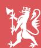

Nærings- og  
fiskeridepartementet

Helse- og  
omsorgsdepartementet

Logo of a stylized arch with a sunburst pattern above it.

A stylized graphic of a network or molecule with three pink circles connected by beige lines on a red background.

Logo of a globe with a pink grid pattern inside a white circle on a red background.

Stylized graphic of three people's heads and shoulders in a red and beige color scheme.

## Innhold

|                                                          |           |
|----------------------------------------------------------|-----------|
| <b>Forord</b>                                            | <b>5</b>  |
| <b>Næringslivets plass i helsepolitikken</b>             | <b>6</b>  |
| <b>Politikk for utvikling av helsenæringen</b>           | <b>10</b> |
| <b>Regjeringens innsatsområder</b>                       | <b>12</b> |
| 1. Test og pilotering                                    | 13        |
| 2. Kliniske studier                                      | 14        |
| 3. Klynger                                               | 15        |
| 4. Helseteknologi og persontilpasset medisin             | 16        |
| 5. Tilgang til og bruk av data                           | 18        |
| 6. Produksjon av legemidler                              | 20        |
| 7. Forskning, utdanning, innovasjon og kommersialisering | 22        |
| 8. Internasjonalt forsknings- og innovasjonssamarbeid    | 29        |
| 9. Immaterielle verdier og rettigheter                   | 33        |
| 10. Kapital                                              | 33        |
| 11. Offentlige anskaffelser                              | 35        |
| 12. Eksport                                              | 38        |
| <b>Oppsummering og veien videre</b>                      | <b>41</b> |

A stylized graphic on a red background featuring a beige path that connects three icons: a lightbulb with a plus sign, a molecular structure, and a group of three people. The path is smooth and curves around the icons.

A stylized graphic on a red background featuring a beige path that connects three icons: a lightbulb with a plus sign, a molecular structure, and a group of three people. The path is smooth and curves around the icons.

Illustration: Abstract network path with a lightbulb, molecular structure, and people icons.

## Forord

Norge skal være et attraktivt land for næringsvirksomhet, inkludert helsenæringen. En lønnsom privat sektor i godt samspill med det offentlige er grunnlaget for økt verdiskaping og en sterk og bærekraftig velferdsstat. Næringslivet har en viktig rolle for å nå våre helsepolitiske mål knyttet til forebygging, behandling og omsorg.

Det norske velferdssystemet skal opprettholdes og videreutvikles. Utfordringene står i kø for de fleste land, i en tid preget av krig, demografiske endringer, energi- og klimakrise, i tillegg til økende internasjonal konkurranse og en knapphet på kompetent arbeidskraft. Den nylig fremlagte rapporten fra Helsepersonellkommisjonen understreker betydningen av å ta i bruk ny teknologi for å møte utfordringene i helse- og omsorgstjenesten. Næringslivet vil ha en viktig rolle med å bidra til å løse disse utfordringene. I det ligger det også muligheter, og det blir opp til aktørene i helsenæringen å gripe disse.

Stortingsmeldingen om helsenæringen kom til etter et initiativ fra Arbeiderpartiet i Stortinget. Erkjennelsen av at næringslivet er en del av løsningen for nå helsepolitiske mål var noe av hovedbudskapet i meldingen som ble lagt frem av forrige regjering. Den fikk bred tilslutning i Stortinget.

Veikartet er innrettet mot den delen av næringslivet som utvikler legemidler, medisinsk utstyr og digitale verktøy som gir fagfolkene en større verktøykasse og som bidrar til økt lønnsomhet og verdiskaping i helsenæringen. Vi har hatt tett dialog med helsenæringsaktørene. Høsten 2022 hadde vi et dialogmøte med aktører fra næringslivet og helse- og omsorgssektoren. Regjeringen har på bakgrunn av dette identifisert flere temaer som er særskilt relevante for at helsenæringen skal lykkes i sine satsinger, som belyses i veikartet.

En velfungerende helse- og omsorgssektor er viktig for den enkelte av oss og for samfunnet som helhet. Sektoren er helt sentral i fremtidens bærekraftige samfunn. Dette gir næringslivet store muligheter for å etablere lønnsomme arbeidsplasser og skape verdier, ikke bare i og for Norge, men også på det globale markedet. Det offentlige og næringen må samarbeide godt for at vi skal lykkes.

Ansvar og håndtering av rammebetingelsene for norsk helsenæring ligger under forskjellige departementer og på flere nivåer i myndighetsapparatet. Formålet med veikartet er å vise den store bredden i regjeringens politikk for å fremme og styrke helsenæringen i Norge. Veikartet skal stake ut best mulig kurs fremover, og bidra til en «ny giv» for helsenæringen.

*Jan Christian Vestre*

*Ingvild Kjerkol*

## Næringslivets plass i helsepolitikken

Offentlige helsetjenester sørger for trygghet i hverdagen, og regjeringens mål er å skape et helsefremmende samfunn ved:

- bærekraftig og rettferdig ressursbruk
- god helse og mestring i befolkningen, uavhengig av sosial bakgrunn
- gode pasientforløp og rask tilgang til tjenester i hele landet
- en sektor som er forberedt i møte med kriser og katastrofer
- en sektor som er et attraktivt arbeidssted i et livslangt karriereløp

Næringslivet har en viktig rolle i arbeidet med å realisere disse målene. Nye teknologiske løsninger kan bidra til at eldre og syke vil kunne bo lenger hjemme, og det kan bidra til personellbesparende løsninger. Dette vil avhjelpe belastningen på helse- og omsorgstjenestene. Viktige bidrag fra næringslivet kan være teknologi og løsninger som tar høyde for ulik helsekompetanse i befolkningsgrupper og som

fremmer sunnere levevaner eller innsikt i egen helse. Helsenæringen har en rolle for å utvikle løsninger innenfor både diagnostisering, behandling og forebygging av sykdom og uhelse.

Regjeringens helsepolitikk presenteres i flere meldinger, strategier og utredninger i 2023 og 2024, og synliggjør næringslivet som viktige medspillere for vår felles helsetjeneste.

*Meld. St. 15 (2022–2023) Folkehelsemeldinga – nasjonal strategi for utjamning av sosiale helseforskjeller* understreker at forebyggende og helsefremmende arbeid må skje på alle samfunnsområder, inkludert i, og i samarbeid med, næringslivet.

*Nasjonal helse- og samhandlingsplan* kommer i løpet av 2023. Planen vil omhandle rammene for videreutvikling av både den kommunale helse- og omsorgstjenesten og spesialisthelsetjenesten i tillegg til samhandlingen mellom disse. Sentrale mål er gode pasientforløp og gode tjenester i hele landet.

A stylized graphic of a hand in a pink and orange color scheme, with the fingers forming a heart shape.

Mangel på helsepersonell er en utfordring for helse-systemer i de aller fleste sammenlignbare land. Helsepersonellkommisjonens utredning *Tid for handling* (NOU 2023:4) peker bl.a. på behovet for personellbesparende innovasjoner i hele helse- og

omsorgstjenesten. Løsninger som kan bidra til endring i organisering og oppgavedeling og frigjøre tid hos helsepersonell kan nå et stort marked, også internasjonalt. Arbeidet skal bl.a. følges opp i *Nasjonal helse- og samhandlingsplan*.

## Rollen til kommuner og fylkeskommuner

Som selvstendige, folkevalgte og selvstyrte organer med et stort ansvar for gode og forsvarlige helse- og omsorgstjenester, må kommunenes og fylkeskommunenes rolle understrekes. De skal yte tjenester etter helse- og omsorgstjenesteloven. Kommunene har frihet til selv å bestemme hvordan de gjennomfører sine innkjøp innenfor anskaffelsesregelverket, og om de ønsker å delta i innovasjonsprosjekter ut fra lokale forhold og behov. Dette gjelder også innenfor kommunenes ansvar innenfor helse og omsorg. Næringslivet må henvende seg direkte til kommunene om evt. samarbeid. Forut bør næringslivsaktørene sette seg godt inn i det norske helsesystemet, og bygge opp en god forståelse av kommunenes rolle, ordninger m.m.

HelseOmsorgs21-rådet har utarbeidet rapporten *Kommunenes strategiske forskningsorgan (KSF)*. KSF vil være en samarbeids- og finansieringsmodell som bidrar til å skape en struktur for et systematisk kunnskapsløft og innovasjon i kommunale tjenester.

*NOU 2023: 9 Generalistkommunesystemet* stadfester at helse- og omsorgstjenester er blant de betydeligste oppgaver kommunene har ansvaret for, med over en tredjedel av deres samlede ressurser som brukes på nettopp dette området. Utvalget har kartlagt hvordan kommunene ivaretar sine oppgaver, i hovedsak gjennom å se på lovoppfyllelse, bl.a. innenfor velferdstjenester. Utvalget fant at små distriktskommuner har mindre grad av lovoppfyllelse enn større kommuner, hovedsakelig grunnet mangel på kapasitet og kompetanse.

Decorative graphic of four stylized, colorful (pink and orange) vertical bars with circles at the top.

*Meld. St. 24 (2022–2023) Fellesskap og meistring – Bu trygt heime* ble lagt frem 16. juni i år. Andelen eldre mennesker vil øke fremover. Dette er en utvikling som vil prege samfunnet, og krever en ny og bærekraftig politikk. Økt etterspørsel etter aldersvennlige løsninger, både fra helse- og omsorgstjenesten og fra forbrukerne representerer markedsmuligheter for næringslivet.

I tillegg kommer en *stortingsmelding om helseberedskap* i 2023. Denne vil gi retning for hvordan Norge skal være forberedt på å verne befolkningens liv og helse i kriser og katastrofer.

I 2024 vil regjeringen legge frem en ny *prioriteringsmelding*. Denne skal bl.a. vurdere persontilpasset medisin og sikre åpenhet og etterprøvbarhet rundt prioriteringer i helsetjenesten.

*Nasjonal strategi for persontilpasset medisin (2023–2030)* presenterer regjeringens visjon om persontilpasset medisin som en integrert del av forebygging, diagnostikk, behandling og oppfølging i helsetjenesten, med mål om bedre helse og mestring gjennom hele livet. Næringslivet spiller en viktig rolle i å nå målene i strategien som leverandør og utviklingspartner. Flere aktører i helsenæringen har persontilpasset medisin som satsingsområde som kan gi økt verdiskaping.

Det er utviklet gode modeller for offentlig-privat samarbeid på feltet.

Direktoratet for e-helse leverte høsten 2021 rapporten *Samarbeid med næringslivet på e-helseområdet*, med anbefaling om bruk av forskning, innovasjon og næringsutvikling for å styrke gjennomføringskraften. Rapporten foreslår flere tiltak for bedre samarbeid mellom det offentlige og private på e-helseområdet. Det er utarbeidet en plan for å styrke samarbeidet mellom næringsklynger, kommunesektoren og spesialisthelsetjenesten, hvor ett av tiltakene er faste kontaktmøter med noen utvalgte bransjeorganisasjoner og foreninger.

HelseOmsorg21-rådet legger til rette for bedre koordinering gjennom dialog, samarbeid og møteplasser på tvers av offentlig, privat og frivillig sektor. Rådet er oppnevnt av HOD i samarbeid med relevante departementer, og er eneste faste nasjonale arena der representanter fra helseforetak, universitets- og høyskolesektoren, brukerorganisasjoner, helsenæringen og kommunesektoren møtes. I oppfølgingen av helsenæringsmeldingen har det som mål å bidra til god folkehelse, effektive helse- og omsorgstjenester av høy kvalitet, verdiskaping og næringsutvikling.

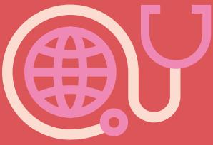

Logo of a stethoscope with a globe inside the diaphragm.

«En velfungerende helse- og omsorgs-sektor er viktig for den enkelte av oss og for samfunnet som helhet. Sektoren er helt sentral i fremtidens bærekraftige samfunn. Dette gir næringslivet store muligheter for å etablere lønnsomme arbeidsplasser og skape verdier, ikke bare i og for Norge, men også på det globale markedet. Det offentlige og næringen må samarbeide godt for at vi skal lykkes.»

## Politikk for utvikling av helsenæringen

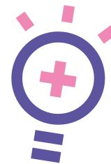

Icon of a light bulb with a pink plus sign inside the glass and a pink base.

Regjeringen skal styrke norsk næringsliv og konkurransekraft gjennom gode samlede rammebetingelser. Vi skal ha flere ben å stå på i fremtiden og sikre det gode velferdssamfunnet, gjennom flere lønnsomme arbeidsplasser og økt verdiskaping. Som kunnskapsintensiv næring i vekst, vil en godt rustet og effektiv helsenæring bidra til utvikling av bærekraftige tjenester for befolkningen.

Helsenæringen har mange av de samme behovene som det øvrige næringslivet. Gode rammebetingelser for næringslivet generelt sett, blir også gode rammebetingelser for helsenæringen. Det er summen av rammebetingelsene som er avgjørende for et verdiskapende og omstillingsdyktig næringsliv. Samlet sett har næringslivet i Norge gode vilkår, med et effektivt skattesystem, solid infrastruktur og politisk stabilitet. Vår relativt åpne økonomi krever likevel løpende tilpasninger og omstillinger.

### Verdiskapingen i helsenæringen

Ifølge tall fra Menon Economics (2023) sto norsk helsenæringen i 2021 for en samlet omsetning på 65 mrd. kroner (distribusjonsleddet ikke innberegnet), hvorav ca. 22 mrd. kroner var inntekter fra eksport.

Kommuner og helseforetak er et viktig marked for helsenæringen og omtales gjerne som «hjemmemarkedet». Helsenæringen møter myndighetene som regulator, forskningsfinansør, eier av universiteter og sykehus, forvalter av helseregistre og biobanker. Ofte er offentlig sektor den eneste kunde. For mange bedrifter er hjemmemarkedet også en viktig testarena for nye produkter og løsninger.

Mange deler av helsenæringen er kjennetegnet av lange forsknings- og utviklingsløp som trenger avansert infrastruktur og produksjonskapasiteter. Disse er strengt regulert og krever tilgang til pasienter og data fra offentlige helse- og omsorgstjenester. Dette gjør at det er mye samarbeid i forsknings- og utviklingsprosessen, på tvers av sektor- og landegrenser. Kommersialiseringsprosesser er lange, kostbare og risikofylte, og krever langsiktig og risikobærende kapital med kjennskap til helse- og omsorgssektoren og helsenæringen. I tillegg er verdikjedene lange og kompliserte, med behov for et stort antall innsatsfaktorer som ofte produseres hos kun én produsent globalt.

Utfordringene i verdi- og forsyningskjeder har vært til stede og økt over tid. Dette ble tydeliggjort under pandemien og øker nå som følge av den geopolitiske situasjonen. Noen utfordringer har oppstått gjennom markedsmekanismer og historiske strukturer, andre er skapt gjennom enkelte staters nærings- og sikkerhetspolitikk.

En solid helsenæring er del av grunnlaget for samfunnets motstandsdyktighet i krise. En god næringspolitikk, som prioriterer bærekraft, omstilling, effektivitet og lønnsomhet, vil også kunne ha positive ringvirkninger for beredskapen. Dette handler om effektiv bruk av samfunnets samlede ressurser.

For å sikre tilgang til legemidler og medisinsk utstyr trenger vi samarbeid med våre nærmeste partnere, i Norden og det øvrige Europa. Gjennom både regulatoriske og ikke-regulatoriske tiltak satser EU på helsenæringen for å bygge motstandsdyktighet. Norsk helsenæring må være del av denne europeiske satsingen.

Regjeringen er opptatt av at næringslivet skal ha en betydelig rolle i samspillet som kreves for å løse utfordringene i helse- og omsorgssektoren, og vil arbeide for at det legges godt til rette for samhandling mellom helse- og omsorgstjenestene og ulike private aktører i økosystemet for helseinnovasjon.

Regjeringen la i 2022 frem et *Veikart for grønt industriløft*. Dette inneholder flere sentrale satsingsområder for hele bredden av næringslivet, slik som kapitaltilgang, forskning, teknologiutvikling, digitalisering, kompetanse og eksport. Helsenæringen er en grønn, lavutslippsindustri, og er derved en næring regjeringen er opptatt av skal ha de beste vekst- og utviklingsmuligheter. Regjeringen tar sikte på å legge frem et oppdatert veikart for grønt industriløft høsten 2023.

Vi har mottatt innspill fra næringslivsaktører, forvaltning og forskningsmiljøer på områder de anser er særlig viktige for utvikling av helsenæring i Norge. Vi har sortert dette under tolv temaer i dette veikartet, der vi beskriver hva regjeringen gjør, og skisserer veien videre for hvordan regjeringen vil håndtere disse i tiden fremover. Innenfor de tolv temaer omtales politikk som ligger under flere departementers ansvarsområde. Ansvarlig(e) departement(er) fremgår i parentes i «veien videre».

### Industripartnerskap

Regjeringen arbeider med å etablere strategiske industripartnerskap med særlig viktige land, inkludert EU. Formålet er å systematisere samarbeidet mellom landene for å legge til rette for grønn omstilling, utvikling av felles verdikjeder og styrket eksportarbeid mot sentrale markeder. Avhengig av land og marked partnerskap omfatter, kan helsenæringen være en relevant sektor å innlemme. Et av industripartnerskapene er med Tyskland, som omfatter flere sektorer, og ambisjonen er at dette kan utvides på sikt.

## Regjeringens innsatsområder

Logo of a stylized globe with a pink border and a red background.

### 1. Test og pilotering

Det er strenge krav til legemidler og medisinsk utstyr. Testing og verifisering kreves for å vise effekt og sikkerhet. Også teknologiske løsninger til bruk i pasientbehandling eller løsninger for helse- og omsorgssektoren skal være trygge. Ulike deler av helsenæringen trenger tilgang til ulike typer testfasiliteter, og dette omfatter gjerne kostnadskrevende infrastruktur både med hensyn til investeringer og drift.

Norske sykehus, universiteter og høyskoler har kapasitet ved sine laboratorier og annen infrastruktur som er egnet for testing og pilotering. Et nytt livsvitenskapsenter bygges ved Universitetet i Oslo, som vil gi oss en forskningsinfrastruktur i verdensklasse (se side 24). Det er ingen hindringer i regelverket for utleie av laboratorier m.m. ved norske sykehus så lenge det ikke går utover normal drift. Kun de faktiske kostnadene må dekkes. Helsenæringsmeldingen viste at det finnes en uutnyttet restkapasitet som helsenæringen bør kunne dra nytte av.

Katapultordningen støtter flerbrukssentre for testing, simulering og pilotering av nye produkter og prosesser. Ordningen har små og mellomstore bedrifter som hovedmålgruppe og bidrar til at bedrifter uten tilstrekkelige ressurser kan få tilgang til kostbart utstyr og får mulighet til å teste løsninger. Ordningen forvaltes av Siva, i samarbeid med Forskningsrådet og Innovasjon Norge. I 2023 er det bevilget 148,3 mill. kroner til ordningen, og i tillegg kommer midler som tildeles under Grønn plattform der formålet er å skape bærekraftig næringsliv som bidrar til grønn omstilling. Høsten 2022 lyste Siva ut pilotprosjekter for etablering av noder under ordningen Norsk katapult. Hensikten med katapultnodene er å gi

bedrifter over hele landet lettere tilgang til testfasiliteter og næringskompetanse, og derved bidra til mer bærekraftig omstilling av norsk næringsliv.

Frem til i dag er det etablert fem sentre under katapultordningen som dekker produksjonsteknologi, materialteknologi, digitalisering, hav og marin teknologi samt fornybar energi. Pr. i dag finnes det ikke et eget katapultsenter for helse, men helsenæringen kan benytte seg av eksisterende katapulter. Helse var blant fire prioriterte områder i forprosjekter som ble gjennomført i 2019/2020 for ny utlysning av ordningen. Regjeringen vil be Siva i samarbeid med Forskningsrådet og Innovasjon Norge å utrede hvordan helsenæringen i større grad kan få nytte av katapultordningen, se forøvrig pkt. 6 om produksjon av legemidler.

Se forøvrig pkt. 6 om produksjon.

#### LINKEN eHelselab

LINKEN er en innovasjonsarena ved Nordlandssykehuset som ble åpnet av helse- og omsorgsminister Kjerkol i september 2022. Hensikten er å skape en samarbeidsarena der helsepersonell, næringslivet, forskningsmiljøer, pasienter og andre kan utvikle nye løsninger til helsesektoren. Dette skjer ved rådgivning, prosjektfasilitering og brobygging. Fokus er på utvikling og realisering av teknologier som muliggjør flere helsetjenester hjemme hos pasienter.

#### Veien videre

- ✦ Bidra til at næringslivet i økt grad utnytter test-, pilot- og oppskaleringsfasiliteter ved sykehus, universiteter og høyskoler. (HOD/KD)
- ✦ Videreutvikle katapultordningen i dagens virkemiddelapparat. (NFD)
- ✦ Bidra til utstrakt samarbeid for test og utvikling, bl.a. gjennom det nye livsvitenskaps-bygget ved Universitetet i Oslo. (KD)

### 2. Kliniske studier

Kliniske studier er en forutsetning for å utvikle legemidler og medisinsk utstyr. Det bidrar til økt kunnskap og utvikling av kompetansemiljøer, og kan gi pasienter tilgang til nye metoder med forbedret effekt enn standard behandling. I Norge og mange andre land har det vært en nedgang de siste årene på industrifinansierte kliniske studier av legemidler. Blant årsakene til dette er kapasitetsbegrensninger hos helsepersonell, utilstrekkelig infrastruktur og manglende insentiver for å utføre kliniske studier. I noen tilfeller kan det være en prioriteringskonflikt mellom industrifinansierte studier og studier initiert av tjenesten selv.

Regjeringen følger opp *Nasjonal handlingsplan for kliniske studier (2021–2025)*. Det er gitt tydelige føringer til de regionale helseforetakene og underliggende etater om at klinisk forskning skal være

en integrert del av pasientbehandlingen. Det ambisiøse målet om å øke antallet kliniske studier i helseforetakene med 15 pst. årlig er videreført. For å nå dette målet må flere bedrifter legge sine studier til Norge. Gjennomføringen av planen krever at relevante aktører bidrar med kompetanse og ressurser i en helhetlig infrastruktur for kliniske studier i Norge. Det er behov for å synliggjøre hvilke muligheter som finnes for gjennomføring av kliniske studier i Norge, også fremtidens kliniske studier. Ifølge tall fra legemiddelverket har antall omsøkte legemiddelutprøvinger fra industrien økt med 57 pst. fra 2020 til 2022.

Regjeringen har styrket budsjettene til Legemiddelverket for å øke etatens kapasitet til å gi god og effektiv regulatorisk veiledning om klinisk utprøving av legemidler og medisinsk utstyr.

#### Veien videre

- ✦ Følge opp Nasjonal handlingsplan for kliniske studier, bl.a. ved å legge til rette for etablering og utbedring av nasjonale fellestjenester for kliniske studier som digitalt samtykke. (HOD)
- ✦ Sikre at forskningsmiljøer både i privat og offentlig sektor skal få rask og relevant veiledning av høy kvalitet når de skal gjennomføre kliniske studier i Norge. (HOD)

#### NorTrials

NorTrials er flaggskipet i satsingen på industristudier, med en dedikert finansiering på 30 mill. kroner årlig over statsbudsjettet. Dette er et forpliktende partnerskap mellom spesialisthelse-tjenesten og helsenæringen. Legemiddelindustriforeningen og Melanor sitter i styret sammen med administrerende direktører i helseregionene. Seks NorTrials-sentre innenfor kreft, inflammasjon, hjernehelse, hjerte- og karsykdommer, medisinsk utstyr og fordøyelsessykdommer er etablert ved universitetssykehusene. Disse skal fungere som nav i nasjonale nettverk, og sentrene skal bidra til at pasienter over hele landet kan delta i studier.

### 3. Klynger

Samarbeidet mellom næringsliv, kunnskapsmiljøer og offentlig sektor er viktig for å fremme kunnskapsdeling, omstilling og innovasjon. I norsk helsenæring finnes det mange forskjellige nettverk og klynger som bidrar til samarbeid mellom næringslivet og kunnskapsmiljøer. Disse legger blant annet til rette for kompetansedeling mellom store og små bedrifter og forskningsmiljøer. Deltagelse i en klynge kan gi bedrifter tilgang til kunnskap og kompetanse om mulige nasjonale og internasjonale finansieringskilder, infrastruktur og deltagelse i internasjonalt forsknings- og innovasjonsarbeid. Kobling av norske aktører mot internasjonale klynger og nettverk kan ofte bidra til å styrke de norske resultatene.

Klyngeprogrammet i regi av Innovasjon Norge, Siva og Forskningsrådet bidrar til å understøtte innovasjonsaktører. Klyngeprogrammet er på tre nivåer: Arena, Arena Pro og GCE (Global Center of Expertise). Delprogrammet for modne klynger legger opp til at klynger som er kvalifisert etter en felles europeisk sertifiseringsordning, kan søke om midler til gjennomføring av utviklingsprosjekter med verdi for en sektor, verdikjede eller teknologiområde, utover klyngens egne medlemmer.

Klyngeprogrammet har hatt en særlig viktig rolle i å etablere nye klynger. Driftsstøtte til økonomisk aktivitet er i utgangspunktet forbudt i statsstøtte-regelverket, men gjør et unntak for driftsstøtte til umodne klynger, begrenset tidsmessig til maksimalt ti år. Deretter er det forventet at driften av klyngen skal være selvfinansierende. Innovasjon Norge har støttet etableringen av flere helseklynger gjennom dette programmet.

Innovasjon Norge jobber med å videreutvikle klyngeprogrammet. Hensikten er å få et mer effektivt program som er tilpasset nivået på bevilgningene. Programmet skal fortsatt bidra til å styrke samarbeid og kompetanse i norske næringsklynger.

#### Veien videre

- ✦ Utforme en konkret innretning til revidert klyngeprogram. (NFD)

#### Norske klynger

I Norge har vi flere sterke helseklynger, slik som de tre NCE-ene Norway Health Tech, Oslo Cancer Cluster og Norwegian Smart Care Cluster og Arenaklyngen The Life Science Cluster. Disse klyngene støtter og utvikler privat og offentlig samarbeid, og har solide internasjonale nettverk. Klyngene samarbeider godt og vurderer å danne en heldekkende «superklynge».

Oslo Cancer Cluster er i verdensklasse innenfor kreftimmunterapi. Klyngen har en voksende pipeline av prekliniske og kliniske ressurser. Tilstedeværelsen av flere farma-, teknologi- og IT-selskaper, styrker klyngens posisjon som et internasjonalt kunnskaps- og innovasjonssenter på kreft.

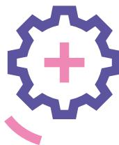

Icon of a gear with a pink plus sign inside, and a pink arc below it.

Logo of three stylized people with pink and one dark blue head, and pink arches for bodies.

### **4. Helseteknologi og persontilpasset medisin**

Digitale løsninger skal støtte opp under regjeringens mål om gode pasientforløp og rask tilgang til tjenester, samt bærekraftig og rettferdig ressursbruk. For å kunne gi best mulig helsehjelp er det en forutsetning at relevante og nødvendige opplysninger om sykdomshistorie og legemiddelbruk følger pasienten gjennom hele pasientforløpet. Slike løsninger skal også støtte opp under de ansattes arbeidshverdag og bidra til effektiv oppgaveløsning. Regjeringen vil prioritere tiltak som bidrar til samhandling på tvers av tjenestenivåene, og ha fokus på at teknologi og digitalisering bidrar til redusert vekst i personellbehov for å imøtekomme fremtidens bærekraftsutfordringer. Regjeringen vil i nasjonal helse- og samhandlingsplan legge frem sin politikk for digitalisering i helse- og omsorgstjenesten.

Digitalisering endrer både bruk og produksjon av varer og tjenester, og omfatter en rekke teknologiområder. Et godt økosystem for næringsrettet digitalisering åpner opp for nye markedsmuligheter og etablering av arbeidsplasser. Dette bør bl.a. omfatte et målrettet forskningssystem for både grunnleggende og anvendt forskning på sentrale digitale teknologier, kombinert med mekanismer for å spre og ta forskningsresultater i bruk, fasiliteter for å teste ut og verifisere ny teknologi, og tilstrekkelig tilgang på avansert digital kompetanse og kompetanse om digital sikkerhet.

Næringsutviklingspotensialet ved bruk av kunstig intelligens (KI) er betydelig innenfor mange fagområder, ikke minst innenfor helse. Internasjonalt har KI allerede i flere år bidratt til bedre diagnostikk. I Norge har vi et godt utgangspunkt for å utvikle og ta i bruk KI innenfor helse. Vi har gode helseregistre, og store datamengder som er særlig verdifulle for utviklingen av KI. Statens helsetilsyn, Direktoratet for e-helse, Statens legemiddelverk, Digitaliseringsdirektoratet og Helsedirektoratet har utarbeidet omfattende informasjonssider om KI, herunder veiledere og opplysninger om relevant regelverk og etiske problemstillinger knyttet til bruk av teknologien. I tillegg er det etablert en tverretatlig regulatorisk veiledningstjeneste hvor miljøer som utvikler eller skal innføre KI-løsninger kan søke om å få veiledning.

Felles og samordnet leverandørdialog, på de områdene som er høyt prioritert i kommunal sektor, er et sentralt virkemiddel for å sikre felles og god leverandøroppfølging i dialog med helsenæringen. Dette er en rolle kommunesektorens interesseorganisasjon KS arbeider med å tilrettelegge for, i samarbeid med andre aktører. Sektoren er avhengig av leverandører for å få gode løsninger, pasientjournalsystemer og velferdsteknologiske løsninger spesielt. Felles og samordnet leverandørdialog kan gi kommunene verktøy for å styrke sin kundekraft, og øke forutsigbarheten ved anskaffelser gjennom blant annet å utvikle felles standarder og rammeverk som understøtter deres behov. Samordnede krav og forventninger fra

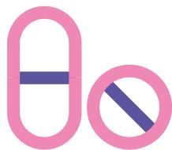

Icon of a pink pill and a pink circle with a diagonal line through it, representing a no-pill symbol.

kommuner og fylkeskommuner kan også bidra til forutsigbarhet for leverandørene, legge grunnlaget for å utvikle de kommunale systemene i en retning som dekker kommunesektorens behov – og som også legger til rette for innovasjon, utprøving, og skalering av løsninger.

Etablering av en helseteknologijordning skal støtte innføring av ny teknologi i helse- og omsorgstjenesten og vil stimulere kommunene til å gjøre investeringer i helseteknologi, bl.a. bedre journalløsninger og velferdsteknologi. Den skal kunne bygges ut gradvis, og det skal sees hen til statens ordinære virkemidler for innovasjon og næringsutvikling.

Se forøvrig pkt. 8 om internasjonalt forsknings- og innovasjonssamarbeid og pkt. 12 om eksport.

#### **Veien videre**

- ✦ Etablere en helseteknologijordning som støtter innføring av ny helseteknologi i helse- og omsorgstjenesten. (HOD)
- ✦ Etablere Direktoratet for medisinske produkter, med et helhetlig ansvar for metodevurderinger av legemidler og medisinsk utstyr. (HOD)
- ✦ Vektlegge i større grad standardisering, normering og veiledning for å bidra til at kommunene kan anskaffe journalsystemer som tilfredsstiller krav til sikkerhet, funksjonalitet og samhandling, samt gi leverandørene bedre forutsigbarhet og grunnlag for leveranseevne. (HOD)
- ✦ Følge opp Nasjonal strategi for persontilpasset medisin (2023–2030). (HOD)

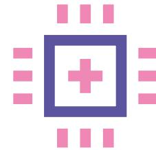

Icon of a purple square with a white cross inside, surrounded by eight pink rectangles.

### 5. Tilgang til og bruk av data

Norge har omfattende helseregistre som er bygget opp over lang tid og basert på gjensidig tillit mellom pasienter, forskere, helse- og omsorgstjenesten og registerforvalterne. Tilgang til og forvaltning av slike data vil bli stadig viktigere for utvikling og anvendelse av tjenester, medisinsk utstyr og legemidler. Området vil bl.a. kunne bidra til kvalitetsforbedring i helse- og omsorgstjenesten i tillegg til utvikling av nye og mer effektive behandlingsformer. Dette vil bidra til kommersialisering og økt verdiskaping. Helsedata er et sentralt verktøy i legemiddelutvikling og i utvikling av produkter og løsninger innenfor helse- og velferdsteknologi.

Raskere og enklere tilgang til helsedata vil også kunne åpne for mer offentlig-private samarbeid hvor bruk av helsedata er en forutsetning. Helsedataservice ble etablert i 2021 for å forenkle tilgang til og bidra til økt bruk av helsedata. Fra 15. mars 2023 er Helsedataservice blitt vedtaksmyndighet for søknader om tilgang til data fra Kreftregisteret, Helsearkivregisteret og de nasjonale helseregistrene som forvaltes av Helsedirektoratet og Folkehelseinstituttet. Helsedataservice skal videreutvikles med vekt på å hente merverdi ut av de løsningene som allerede er etablert. Det gjelder videre innføring av felles søknads- og saksbehandlingstjenester, oversikt over innholdet i registrene (metadata) og andre tjenester. Det er en

prioritert oppgave å redusere saksbehandlingstiden for behandling av søknader om tilgang til helsedata. Informasjon om dette er tilgjengelig på nettsidene til Helsedataservice.

Det er de senere årene også gjennomført endringer i regelverket for å forenkle tilgangen til helsedata. Vilkårene for tilgjengeliggjøring og sammenstilling av helseopplysninger ble samordnet og samlet i helseregisterloven gjennom en lovendring i 2020. Videre ble forskrift om nasjonal løsning for tilgjengeliggjøring av helsedata fastsatt i januar 2023 for å etablere Helsedataservice i Direktorat for e-helse som «en vei inn» for tilgang til helsedata. HOD vurderer om det er behov for ytterligere endringer i regelverket.

For å legge til rette for bedre utnyttelse av helsedata, vil helseregistrene i Helsedirektoratet og Kreftregisteret bli flyttet 1. januar 2024 til Folkehelseinstituttet. Helsedataservice flyttes også fra Direktorat for e-helse til Folkehelseinstituttet.

Det pågår parallelt et arbeid med å effektivisere og øke bruken av eksisterende data- og analyseinfrastrukturer, bl.a. i universitets- og høyskolesektoren. Direktoratet for e-helse samarbeider med sektoren om bruk av analyseinfrastrukturene TSD ved Universitetet i Oslo, SAFE ved Universitetet i Bergen og HUNT Cloud ved NTNU. Direktoratet samarbeider også med

SSB og SIKT – Kunnskapssektorens tjenesteleverandør om bruk av analysetjenesten microdata.no. Målet er å realisere så mye som mulig av gevinstene av Helsedataservice som nasjonal tilgangsforvalter uten en felles dataplattform. Arbeidet med å etablere Helseanalyseplattformen i en allmenn skyløsning er avviklet som følge av endringer i juridiske rammebetingelser etter Schrems II-dommen fra EU-domstolen. I denne situasjonen er vurderingen at gjenbruk av eksisterende data- og analysetjenester og distribuerte data gir størst nytte for brukerne på kort sikt og at det fortsatt er betydelig juridisk og økonomisk risiko knyttet til alternativer med én felles dataplattform.

Det er etablert et helsedataråd og et brukerråd som skal bidra til at brukerne skal få innflytelse på utviklingen av tiltak for å forenkle tilgangen til helsedata. Deltagerne i Helsedatarådet kommer fra næringslivet, regionale helseforetak, universitets- og høyskolesektoren og instituttsektoren, Forskningsrådet, kommunesektoren, Statistisk sentralbyrå, forvaltningen og pasient- og brukerorganisasjoner. Samarbeidet mellom næringslivet og de andre aktørene er avgjørende for å lykkes med utviklingen på dette området.

Se forøvrig pkt. 8 internasjonalt forsknings- og innovasjonssamarbeid.

#### **Veien videre**

- ✦ Legge til rette for næringslivets tilgang til offentlige helsedata. (HOD)
- ✦ Samle sentrale helseregistre og Helsedataservice i Folkehelseinstituttet for å bidra til bedre utnyttelse av helsedata. (HOD)

A stylized graphic of a microscope with a pink body and a purple base.

Stylized microscope icon in pink and purple.

### 6. Produksjon av legemidler

Det er i dag elleve selskaper som har produksjon av legemidler med markedsføringstillatelse i Norge. Flere av de store legemiddelselskapene har produksjon og/eller forskningsaktivitet i Norge, andre driver hovedsakelig med salg og distribusjon. Legemiddelmarkedet er globalt med svært komplekse verdi- og forsyningskjeder. Norsk legemiddelindustri må derfor fungere i et internasjonalt marked for å være bærekraftig. Noen legemiddelprodusenter i Norge eksporterer nesten hele produksjonen, slik som GE HealthCares produksjon av legemidler for røntgenkontrast. Utvikling av legemidler er forskningsintensivt og kapital- og kompetansekrevende med stor risiko. Legemiddelproduksjon er svært ressurs- og kostnadskrevende. Det er mulighet for høy avkastning for dem som lykkes. Med økt innovasjonstakt kobles produksjon i mange tilfeller tettere til forskning og innovasjon.

Pandemien har satt på den nasjonale dagsordenen bl.a. spørsmål om legemiddelberedskap kan forbedres gjennom å legge vaksine- og legemiddelproduksjon til Norge. Det må imidlertid skilles mellom tiltak for helseberedskap (herunder legemidler) og tiltak for lønnsom næringsutvikling, men bærekraftig næringsutvikling vil kunne ha positive ringvirkninger for helseberedskapen. I et næringspolitisk perspektiv

må utvikling og produksjon av vaksiner og legemidler gjøres der hvor næringsaktørene finner det lønnsomt.

Siva, Forskningsrådet og Innovasjon Norge har hatt i oppdrag å vurdere mulige tilnærminger, innretninger og tiltak for å følge opp Hurdalplattformens punkter om tilrettelegging av produksjon av kritisk viktige legemidler i Norge, slik som vaksiner, biologiske legemidler og råstoff til legemidler. Oppdraget innebar også en vurdering av mulige tiltak som kan bidra til lønnsom produksjon av legemidler i Norge, herunder etablering av senter. Rapporten ble levert våren 2023 der tre alternativer til senter er skissert: 1) Samlet fysisk senter for biologisk legemiddelproduksjon, med en strategisk spydspiss, 2) desentralisert kompetansesenter gjennom en virtuell senterstruktur og 3) en nasjonal satsing koblet mot Norden, hvor det gjennom delsatsinger bygges opp et nasjonalt senter for legemiddelproduksjon. Dette kan gjøres ved at en gjennom etablering av en desentralisert kompetansehub, raskt etterfulgt av en opptrapping hvor man kobler på flere tiltak, f.eks. et nasjonalt katapultsenter. Rapporten konkluderer med at et senter for produksjon av biologiske legemidler vil kunne være et viktig steg mot potensielt økt produksjon av legemidler i Norge, men at de vurderer at et senter som bygges gjennom delsatsinger er den beste tilnærming og tilrår alternativ tre. Dette begrunnes

med at en slik tilnærming vil kunne sikre en gradvis realisering av ny norsk legemiddelproduksjon, og samtidig bygge økt kapasitet og kompetanse som vil sikre bedrifters tilstedeværelse i Norge. Dette inkluderer også en tett koordinering med øvrige nordiske land, hvor man finner mye komplementær infrastruktur og kompetanse som en norsk satsing kan dra nytte av.

Regjeringen vurderer at en slik bredere nasjonal strategisk satsing vil kunne understøtte samarbeid mellom aktører og kunnskapsmiljøene for å legge til rette for legemiddelproduksjon. Videre vil det være et positivt bidrag fra norsk side i internasjonalt samarbeid, f.eks. i Norden og i EU. Satsingen innebærer at man gradvis utvikler nye miljøer basert på de eksisterende, ser verdikjeden fra forskning til produksjon i sammenheng og kobler på tiltak etter behov. En slik satsing vil også innebære at ulike teknologiområder inkluderes og at satsingen kan utvikles over tid i tråd med næringslivets og samfunnets behov samt kunne ha en tyngde internasjonalt. Dette vil skje gjennom dialog mellom virkemiddelaktørene, helse- og omsorgssektoren og myndighetene. Hvordan helsenæringen i større grad kan få nytte av katapultordningen, er også et tiltak som regjeringen vil utrede nærmere. Tiltak av budsjettmessige konsekvenser skal vurderes i de ordinære budsjettprosesser.

Regjeringen har besluttet at Norge skal forhandle med EU med sikte på å inngå en avtale om norsk tilknytning til det styrkede europeiske helseberedskaps-samarbeidet, inkludert European Health Emergency Preparedness and Response Authority (HERA). Det skal arbeides for en løsning som gir Norge størst mulig påvirkning gjennom fulle deltagerrettigheter. EU har som formål å redusere globale avhengigheter og sikre regionale kapasiteter. Helseberedskaps-meldingen som regjeringen legger frem i løpet av 2023, vil gi politisk og strategisk retning for norsk helseberedskap.

#### **Veien videre**

- ✦ Siva får i samarbeid med Innovasjon Norge og Forskningsrådet i oppdrag å etablere en nasjonal satsing innenfor legemiddelproduksjon innenfor eksisterende rammer og virkemidler. (NFD)
- ✦ Siva gis i oppdrag i samarbeid med Forskningsrådet og Innovasjon Norge å utrede hvordan helsenæringen i større grad kan få nytte av katapultordningen, herunder vurdere om det skal etableres et eget senter for næringen, eller om det skal gjøres tilpasninger eller utvidelser i de øvrige sentrene. (NFD)

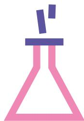

Icon of a pink Erlenmeyer flask with a purple stopper and two purple liquid droplets falling from it.

### 7. Forskning, utdanning, innovasjon og kommersialisering

Kunnskap er avgjørende for å fremme innovasjon og økt verdiskaping i helsenæringen. Regjeringen satser bredt på forskning og utdanning, og er opptatt av målrettet bruk av de betydelige midlene som går til dette. Det er også et mål at offentlig finansiert forskning skal komme samfunnet til gode. Gjennom virkemiddelapparatet stilles det til disposisjon virkemidler for å støtte forsknings- og innovasjonsprosjekter i næringslivet.

Høsten 2022 ble *Meld. St. 5 (2022–23) Langtidsplan for forskning og høyere utdanning 2023–2032* lagt frem. Målet er et demokratisk og bærekraftig samfunn med høy verdiskaping, rettferdig fordeling, utbredt tillit i befolkningen og gode offentlige tjenester over hele landet. Hovedbudskapet er at økt forskningsbasert kunnskap og kompetanse trengs for å løse de mange utfordringene vi står overfor og at denne nye kunnskapen tas i bruk. Helse er løftet frem som en av seks tematiske prioriteringer. Innenfor denne prioriteringen omtales kunnskapsbehovene knyttet til folkehelseutfordringer, én helsetilnærming, bærekraftige tjenester, integrering av forskning i tjenestetilbudet, bedre bruk av helsedata og mer verdiskaping ut av investeringer i livsvitenskap og helseforskning.

Tilgang til arbeidskraft med riktig kompetanse blir en stor utfordring fremover. Helsepersonellkommisjonens utredning *Tid for handling* (NOU 2023:4) viser at tilgangen til personellressurser i helse- og omsorgssektoren er under betydelig press. Rapporten viser også at tilgang til arbeidskraft blir en flaskehals og at andre løsninger må vurderes, slik som personellbesparende teknologier som kan sikre gode helse- og omsorgstjenester fremover. Personellinnsatsen i helse- og omsorgssektoren fremover må styres mot kommunal omsorg, for å klare å håndtere det økende antallet eldre. Samtidig må både kommuner og spesialisthelsetjenesten iverksette tiltak som reduserer veksten i personellbehovet, som bedre oppgavedeling og økt bruk av teknologi.

God tilgang på kompetanse er avgjørende for at også helsenæringen skal skape økte verdier, nye lønnsomme arbeidsplasser, innovere og realisere nye forretningsmuligheter i markedet. Tilgang til kompetanse i Norge er ikke ubegrenset, og det er behov for å prioritere. Kompetansemangel kan hemme fremveksten av ny lønnsom næringsvirksomhet innenfor helsenæringen, forsinke innovasjon i arbeidslivet og bremse produktivitetsvekst. Strukturell mangel på arbeidskraft og udekket etterspørsel etter flere sentrale og kritiske kompetanser gjør at det er nødvendig å prioritere hva vi bør satse på. En del av løsningen er å tiltrekke mer internasjonal forsknings- og innovasjonskompetanse til Norge.

#### FoU innenfor helse i offentlig finansiert forskning

Totalt brukte norske foretak, forskningsinstitusjoner, læresteder og helseforetak 81,6 mrd. kroner på FoU i 2021, og det er liten vekst i utgiftene til FoU totalt. Innenfor medisin og helsefag utgjorde helseforetakenes og universitets- og høyskolesektorens ressursbruk til forskning henholdsvis nær 5,3 mrd. og 8,4 mrd. kroner. Dette finansieres i hovedsak over rammebevilgningene fra HOD til spesialisthelsetjenesten og fra KD til universitets- og høyskolesektoren. En andel midler er øremerket til spesifikke budsjettformål i Forskningsrådet og til sykehusene, i hovedsak over HODs budsjetter.

#### Universiteter og høyskoler

Sektoren har en sentral funksjon på flere områder, bl.a. gjennom ansvar for grunnforskning, utdanning og innovasjonsaktiviteter. Nysgjerrighetsdreven grunnforskning er en viktig del av verdikjedene både innenfor utvikling av legemidler, diagnostikk og vaksiner, medisinsk teknisk utstyr og digital helse. I tillegg bidrar sektoren til næringsrettet, anvendt og tverrfaglig forskning. Den har viktig forskningsinfrastruktur samt er samarbeidspartner og leverandør av FoU-tjenester for næringsliv og det offentlige. Det ligger i samfunnsoppdraget til universiteter, høyskoler og fagskoler å utdanne kandidater i samsvar med kompetansebehovet i et arbeidsliv som er i kontinuerlig endring, forårsaket av bl.a. teknologisk utvikling, endringer i næringsstrukturer eller akutte, inngripende hendelser.

#### Institutter

Instituttsektoren er samarbeidspartner og leverandør av FoU-tjenester for næringsliv og offentlig sektor. Den omfatter nesten 50 institutter med ulike formål, der FoU i varierende grad utgjør omfang og kjerneaktiviteter. Noen institutter har også ansvar for myndighetspålagte forvaltningsoppgaver, slik som Folkehelseinstituttet.

#### Life Science-senteret ved UiO

Livsvitenskapsbygget er en historisk satsing ved Universitetet i Oslo. Det skal stå ferdig i 2026 og vil være Norges største universitets- og sykehusbygning, og et felles bygg for ledende universitets- og sykehusmiljøer innen livsvitenskap. Utstrakt tverrfaglig samarbeid vil bidra til å løse store samfunnsutfordringer innen helse og bærekraft, og sikre Norges konkurransekraft internasjonalt. Bygget vil også være sentral for samarbeid med næringslivet og deling av kompetanse og infrastruktur.

*Meld. St. 14 (2022–2023) Utsyn over kompetansebehovet i Norge (Utsynsmeldingen)* ble lagt frem våren 2023. Målet er å bidra til høy sysselsetting og dekke de viktigste kompetansebehovene i arbeids- og samfunnslivet. Regjeringen prioriterer:

- kompetanse for et høyproduktivt og konkurransedyktig næringsliv
- kompetanse for å gjennomføre det grønne skiftet
- kompetanse for gode velferdstjenester i hele landet og for å håndtere den demografiske utviklingen
- å kvalifisere og mobilisere flere personer som står utenfor arbeidslivet

Regjeringen har nedsatt et partssammensatt utvalg for en kompetansereform for arbeidslivet. En helhetlig og målrettet kompetansepolitikk er sentral for å nå målene om mest mulig relevant kompetanse i arbeidslivet og god produktivitet. Det henger også sammen med målet om at færrest mulig skal stå utenfor arbeidslivet. Det er avgjørende at

kompetansepolitikken utvikles og forankres sammen med partene i arbeidslivet. Utvalget skal levere en rapport i oktober 2024.

Utdanningssystemet er viktig for gode helse- og omsorgstjenester. Dimensjoneringen av det yrkesfaglige tilbudet skal være i tråd med samfunnets og arbeidslivets behov. Regjeringen arbeider med forenkling av finansieringssystemet for universiteter og høyskoler der formålet er å gi denne sektoren større autonomi og fleksibilitet til å tilpasse studie-tilbudene til arbeids- og samfunnslivets behov. Næringsrelevans, innovasjonsaktiviteter i tillegg til samarbeid og dialog med næringslivet, vektlegges i styringsdialogen med institusjonene. Samhandling mellom universitets- og høyskolesektoren og helsenæringen er viktig for å fremme industri- og næringsutvikling.

Godt samarbeid med instituttsektoren trengs for å realisere potensialet innenfor forskning og innovasjon for mange virksomheter i helsenæringen. Forskningsrådet utførte i 2020 en kartlegging av

A stylized brain icon with a pink outline and a pink interior. Inside the brain, there are several blue, abstract, curved shapes that resemble letters or symbols.

Stylized brain icon with pink and blue patterns inside.

potensialet for samhandling mellom helsenæringen og relevante deler av instituttsektoren. Dette bidro til å sette søkelyset på instituttenes betydning for utvikling av norsk helsenæring. Rapporten viste at helsenæringen har lite samarbeid med deler av instituttsektoren, og at det er et potensial for økt samarbeid. Forskningsrådet peker bl.a. på at instituttene må være mer aktive i å fremme egen kompetanse overfor helsenæringen, og at dialog og møteplasser er viktig. Forskningsrådet følger opp rapporten i dialog med aktørene.

Det må skapes en kultur for innovasjon, nyskaping og kommersialisering i universitets- og høyskolesektoren samt helseforetakene. Regjeringen vil legge bedre til rette for at mer av den offentlige finansierte forskningen skal styrke verdiskapingen gjennom økt kommersiell bruk av forskning. Dette vil bidra til at resultater fra offentlig finansiert forskning kommer hele samfunnet til nytte.

I HODs årlige oppdragsdokumenter til de regionale helseforetakene, er det stilt krav om at helseforetakene

skal øke innovasjonsaktiviteten og styrke samarbeidet med næringslivet. Det er innført en egen indikator for måling av innovasjon i spesialisthelsetjenesten, som gir poeng for nytte og spredning.

Teknologioverføringskontorer (TTO-er) bidrar til å mobilisere og ivareta profesjonell håndtering av kommersialisering fra offentlig finansiert forskning. TTO-ene er organisert som separate selskaper utenfor universitets- og høyskoleinstitusjonene samt helseforetakene. Noen eies av én institusjon, noen av flere i fellesskap. Halvparten av TTO-ene har både universiteter og høyskoler, universitetssykehus og de regionale helseforetakene som eiere. For å ivareta kommersialiseringsarbeidet ved institusjonene er TTO-ene utviklet og organisert for å tilrettelegge den tidlige fasen av teknologioverføringsprosessen, den såkalte TTO-funksjonen. TTO-funksjonen omfatter videre arbeid med evaluering, rettighetssikring og utvikling av ideer og kunnskap, inkludert en eventuell etablering av nye selskaper.

Decorative graphic of four stylized trees with pink and orange circles on a brown line.

Forskningsrådets program FORNY er en søkbar ordning rettet mot offentlige forskningsinstitusjoner, og kan bidra til å finansiere den tidlige fasen av TTO-funksjonen.

Virkemiddelapparatet for forskning og innovasjon består i hovedsak av generelle programmer som også er åpne for helsenæringen. Nasjonalt forvaltes disse av virkemiddelaktørene som Forskningsrådet og Innovasjon Norge. Samlet sett bruker helsenæringen offentlige virkemidler aktivt, og har gode prosjekter som når igjennom i konkurransen om midlene.

I Forskningsrådets samlede innsats for og i næringslivet i 2022 er helsenæringen den femte største næringen med en samlet innsats på rundt 750 mill. kroner. Av disse er det gitt 396 mill. kroner til næringslivet direkte. Den øvrige innsatsen gikk til instituttene, universiteter, høyskoler og helseforetakene for å utvikle nye og forbedrede produkter, prosesser og tjenester i samarbeid med næringslivet.

Helsenæringen er aktive brukere av Skattefunnordningen. I 2022 var det godkjente skattefunnsøknader for til sammen 603 mill. kroner, fordelt på 550 ulike prosjekter.

Forskning og utvikling er grunnleggende innsatsfaktorer for å fremstille og omsette kunnskap til innovasjon og høyere produktivitet. Norsk næringsliv har hatt en sterk vekst i FoU-investeringene over de siste tiåret. Regjeringen mener at en ytterligere styrking av FoU i næringslivet vil føre til økt verdiskaping i fremtiden, og har igangsatt et arbeid med en strategi for økt forskning og utvikling i næringslivet.

Innovasjon Norge har også et stort antall prosjekter som retter seg mot helse. I 2022 ble det tildelt 170 mill. kroner i lån og tilskudd til helseprosjekter i Innovasjon Norge. Blant annet ble det gitt 21 mill. kroner i offentlige forsknings- og utviklingskontrakter til helse, noe som utgjorde 43 pst. av ordningen

Selv om virkemiddelapparatet fungerer på en god måte er det mange bedrifter som opplever at det som helhet er uoversiktlig, noe som gjør det vanskelig å vite hvilken aktør eller ordning som kan dekke bedriftenes behov. Regjeringen er i gang med å gjøre virkemiddelapparatet enklere og grønnere gjennom arbeidet *Virkemiddelapparatet 2.0*.

Innovasjon Norge, sammen med Eksfin, Siva og Forskningsrådet utvikler *«Én vei inn»*, som er en digital

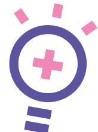

Icon of a lightbulb with a pink plus sign inside and three pink squares above it.

inngang til virkemiddelapparatet der brukerne kan få rask avklaring og veiledning til videre kontakt med det næringsrettede virkemiddelapparatet. Dette vil være et viktig skritt for å forenkle og tilgjengeliggjøre det næringsrettede virkemiddelapparatet, bl.a. ved å redusere næringslivets bruk av tid og ressurser til å søke etter informasjon om relevante ordninger.

Fremvekst av nyskapende vekstbedrifter innen helsenæringen kan bidra til nye produkter og tjenester i sektoren. Disse bedriftene bidrar også til spredning av ny kunnskap, nye konsepter og nye måter å løse ting på. Innovasjon Norge tilbyr virkemidler for oppstartsbedrifter som er relevante også for gründere i helsenæringen med vekstambisjoner. Virkemidlene omfatter både kapital, kompetanse, rådgivning og nettverk. Oppstartsordningene har til hensikt å finansiere tidlig markedsorientering og kommersialisering frem til konkurransedyktige bedrifter i markedet. Våren 2023 er virkemidlene justert med tanke på å legge til rette for mer sammenhengende oppstartsfinansiering inndelt i faser. Disse fasene vil være behovstilpasset med klare milepæler, knyttet til stegvis utvikling av produkt og markedsinnsats, med kompetanse- og nettverkstjenester. I 2023 vil det også være en pilot for en tredje fase som utformet spesielt

ut fra de behov som kjennetegner vekstorienterte nyetableringer, særlig knyttet til lengre utviklingsløp og kapitalbehov. Innovasjon Norges ordninger for oppstartsfinansieringen gjelder for bedrifter opptil fem år, og kan i stor grad kombineres med øvrige generelle ordninger for tilskudd, lån og garantier.

Det er viktig at prosjekter som finansieres gjennom det næringsrettede virkemiddelapparatet bidrar til lavutslippssamfunnet og et grønt næringsliv.

#### FoU i helsenæringen

Norsk næringsliv investerte samlet totalt i egenutført FoU på nær 38,3 mrd. kroner og det ble kjøpt FoU-tjenester for 8,9 mrd. kroner i 2021. Norsk helsenæring er forskningsintensiv og med store investeringer i FoU. Det ble utført helserelatert FoU for nesten 2,8 mrd. kroner i 2020, en økning på 367 mill. kroner fra 2019 (kilde: SSB).

#### IPCEI

IPCEI (Important Projects of Common European Interest) er en unntaksbestemmelse i EUs statsstøtteregelverk som åpner for at nasjonale myndigheter kan gi mer støtte enn det som vanligvis er tillatt for prosjekter som anses å være av strategisk betydning for EU. I juni 2022 besluttet regjeringen at det skal legges til rette for indirekte deltagelse i IPCEI Helse. Som følge av en nylig revisjon av EUs statsstøtteregelverk som en reaksjon på USAs Inflation Reduction Act (IRA), er det åpnet opp for muligheten til å benytte enklere prosedyrer for støtte til prosjekter av IPCEI-karakter.

#### Veien videre

- ✦ Gi universiteter og høyskoler mer frihet til å gjøre egne prioriteringer innenfor de gjeldende rammevilkår. (KD)
- ✦ Forvente at universiteter, høyskoler, helseforetak og forskningsinstitutter som mottar statlige grunn- eller basisbevilgninger følger opp den tematiske prioriteringen av helse i langtidsplanen for forskning og høyere utdanning, og at disse bidrar til å dekke kunnskaps- og kompetansebehovene omtalt i planen ut fra sine forutsetninger og sitt ansvar. (KD/HOD)
- ✦ Prioritere kompetanse som er nødvendig for et høyproduktivt og konkurransedyktig næringsliv og kompetanse som er nødvendig for å gjennomføre det grønne skiftet.
- ✦ Prioritere kompetanse som er nødvendig for å ha gode velferdstjenester i hele landet og for å håndtere den demografiske utviklingen, balansert opp mot behovet for arbeidskraft i andre sektorer i samfunnet.
- ✦ Prioritere studieplasser innenfor tekniske fag, helse- og omsorgsfag og områder som er

særlig viktige for det grønne skiftet ved fremtidige tildelinger av studieplasser til fagskolene, og legge opp til dialog med fylkeskommunene om hvordan de kan følge opp disse prioriteringene i sin forvaltning av sektoren.

- ✦ Innrette FORNY slik at FoU-institusjonene selv tar et ansvar for kommersialisering i tidlig fase. (NFD/KD)
- ✦ Legge frem en strategi for å øke forskning i næringslivet. (NFD/KD)
- ✦ Videreføre brede, åpne virkemidler for forskning og innovasjon der helsenæringen har hatt god uttelling. (NFD)
- ✦ Følge opp indirekte deltagelse i IPCEI Helse. (HOD/NFD)
- ✦ Videreutvikle virkemiddelapparatet gjennom *Virkemiddelapparatet 2.0*, som vil gjøre det lettere å finne frem i virkemiddelapparatet og forenkle tilbudet slik at næringslivet skal få hjelp til å bli grønnere og møte et helhetlig og koordinert virkemiddelapparat. (NFD)

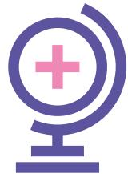

Icon of a purple globe with a pink plus sign in the center.

### 8. Internasjonalt forsknings- og innovasjonssamarbeid

Norge har dyktige forskere og med høy internasjonal anseelse innenfor flere områder, men det er gjennom internasjonalt samarbeid om forskning og innovasjon at vi utvikler de beste kunnskapsmiljøene og de mest banebrytende ideene. Gjennom internasjonalt samarbeid får norske aktører tilgang på betydelig kunnskap, internasjonale forskernettverk og globale markeder. Fra myndighetenes side legges det til rette for internasjonalt samarbeid ved at Norge deltar fullt ut i det europeiske forsknings- og innovasjonssamarbeidet, i tillegg til nordisk og bilateralt samarbeid med utvalgte land. Næringslivet bør tenke helhetlig når de satser internasjonalt, og vurdere både mulighetene bilateralt og multilateralt for finansiering av prosjekter og samarbeidskonstellasjoner.

#### *EU*

Norsk deltagelse i EU-programmer tilfører store samarbeids- og finansieringsmuligheter for norske aktører, også innenfor helsenæringen. EU legger i økende grad vekt på å utvikle sin åpne strategiske autonomi. Avhengigheter og sårbarheter i forsyningslinjer på strategisk viktige områder for samfunnet

og økonomien ønskes redusert. Tiltak innenfor en rekke politikkområder er iverksatt for å diversifisere tilgang på råvarer, øke egen produksjonskapasitet og sikre et velfungerende indre marked. Dette arbeidet omfatter også styrking av europeisk helsenæring som et strategisk viktig område.

Norge deltar i Horisont Europa, rammeprogrammet som skal styrke Europas innovasjonskapasitet og konkurransekraft, i tillegg til å skape arbeidsplasser. Det samlede bidraget til vårt lands deltagelse i Horisont Europa er anslått til omkring 25 mrd. kroner. Gjennom programmet kan næringslivet søke om finansiering til prosjekter sammen med samarbeidspartnere i andre land. Helse er blant de prioriterte områdene. Innovasjonsdimensjonen er styrket gjennom en egen programpilar for innovasjon. Denne satsingen har som mål å gjøre Europa ledende innen markedsskapende innovasjon og SMB-vekst gjennom European Innovation Council, som har et hovedfokus på å utvikle og skalere opp gjennombruddsteknologier og banebrytende innovasjoner, så vel som å støtte den generelle utviklingen av innovasjonsøkosystemet i Europa.

Icon of a folder with a pink plus sign inside it.

#### Helsepartnerskap gjennom Horisont Europa

Norge deltar i alle helsepartnerskapene i Horisont Europa. De med høyeste næringslivsrelevans er:

- Innovative Health Initiative støtter helseindustrien og bidrar til helseinnovasjon som muliggjør tverrsektorielle teknologier, kunnskap, produkter og tjenester for et pasientsentrert helsevesen.
- Transforming Health and Care Systems skal fremme utviklingen av bærekraftige helse- og omsorgssystemer med vekt på kvalitet, effektivitet, tilgjengelighet og pasientfokus.
- Personalised Medicine skal bidra til at helsesystemene optimaliserer persontilpasset medisin gjennom blant annet å dele data, demonstrere løsninger og støtte politikkutvikling.
- Pandemic preparedness and response skal forbedre Europas beredskap til å forutsi, forebygge og svare på nye smittsomme helsetrusler ved å bedre koordinere finansiering av forskning og innovasjon.

Norske forsknings- og innovasjonsmiljøer har så langt meget god økonomisk retur fra Horisont Europa sammenlignet med tidligere rammeprogram. Norske aktører har så langt i år mottatt 3,35 pst. av de konkurranseutsatte midlene, og er ledende blant de nordiske landene. Prosjektene som Norge er med i har en anslått verdi på 3,5 mrd. euro, og fortsetter denne utviklingen vil Norge få mer i retur enn vårt samlede bidrag. Norsk uttelling på utlysinger i helseklyngen i pilar 2 er så langt (2023) på 5,1 pst. Flere av partnerskapene vil også være relevante for norske innovasjons- og næringslivsmiljøer, og Norge deltar i samtlige nye helsepartnerskap. Dette er store konsortier med mange aktører innenfor ulike fagområder, sektorer og bransjer. Slike partnerskap kjennetegnes ved at Europakommisjonen, gjennom partnerskapene, inngår avtaler om at midler fra rammeprogrammet skal brukes sammen med midler fra medlemslandene eller fra næringslivet.

Norge deltar i EUs to store satsinger på kreft. EUs kreftplan omhandler både forebygging, tidlig oppdagelse, behandling, omsorg, kreftpasienters livskvalitet og omsorgspersoner. Samfunnsoppdraget på kreft er det andre store initiativet, hvor forskningsmiljøer, myndigheter, næringsliv, brukerorganisasjoner og helseforetak samarbeider nært. Kreftforeningen og Forskningsrådet har tatt initiativ til å etablere et nasjonalt knutepunkt (hub) hvor Oslo Cancer Cluster spiller en viktig rolle. Målet er å mobilisere aktører til samarbeid og sammen søke om utlysninger på tvers

av fagområder og sektorer, og sørge for sammenheng med lokale, regionale og nasjonale tiltak.

EUs helseprogram EU4Health skal bidra til å bedre helsen i befolkningen og beskytte befolkningen mot grensekryssende helsetrusler. Programmet gjennomføres ved at EU bidrar til å finansiere og legge til rette for utviklingstiltak gjennom samarbeid mellom land i Europa. Programmet har utlysninger rettet mot blant andre myndighetsaktører, ideelle organisasjoner, akademia og næringsliv. Europakommisjonen har store strategiske anskaffelser innenfor helsefeltet gjennom programmet, og bruker også dette for å sette ut drift og utvikling av ulike tjenester på anbud. Norsk næringsliv kan konkurrere om anbudskontraktene på lik linje med aktører i EU-land. Helsedirektoratet bistår med informasjon om utlysninger, analyser av EUs strategi og politikk på helseområdet, samt råd om deltagelse i programmet, og de skal mobilisere norsk næringsliv til å delta i utlysningene som utformes som anbud.

Investerings- og kapasitetsbyggingsprogrammet DIGITAL skal bidra til å øke næringslivets konkurransedyktighet. Dette er Europas viktigste verktøy for å bygge digital kapasitet og infrastruktur og sikre digital suverenitet innenfor seks områder: tungregning, kunstig intelligens og data, cybersikkerhet, avansert digital kompetanse, styrket bruk av teknologiene og en egen satsing på halvleder-produksjon (Chips Act). God kapasitet på satsingsområdene til DIGITAL har

betydning for fremtidig utvikling av helsenæringen, og testfasiliteter med søkelys på helse er nå under etablering. Tungregningsinfrastruktur, hvor et stort antall regneprosessorer arbeider parallelt med å bearbeide enorme mengder data i sanntid, er også viktig for denne kapasiteten.

#### ***Nordisk samarbeid***

Våre nordiske naboer har sterke miljøer og aktører knyttet til helse- og omsorg. De nordiske landene har en samlet befolkning på 27 mill. mennesker og meget gode registerdata. Nordisk samarbeid er dermed spesielt relevant for kliniske studier og anvendelse av helsedata.

Ministerrådet for sosial- og helsepolitikk i Nordisk ministerråd koordinerer det nordiske samarbeidet innenfor helse og velferd, hvor det bl.a. ble opprettet en e-helsegruppe i 2011. Denne har undergrupper for forskning og standardisering. I perioden 2021–2024 er et av målene at Ministerrådet skal bidra til gode, likestilte og trygge helsetjenester og velferd for alle. De nordiske næringsministrene vedtok for perioden 2021–2024 åtte tverrsektorielle programmer for å følge opp Visjon 2030, om at Norden skal bli verdens mest bærekraftige og integrerte region innen 2030. Et av disse programmene omhandler «Norden som ledende region innen livsvitenskap og helseteknologi», og det er Nordic Innovation som gjennomfører og følger opp programmet. Formålet er å legge til rette for et verdensledende økosystem for forskning,

Logo of a pink globe with dark blue lines.

innovasjon og næringsutvikling innenfor områdene bærekraftig livsvitenskap og helseteknologi. Programmet inneholder tiltak som nordiske testbeds og kliniske studier, felles markedsføring, enklere tilgang til helsedata i Norden samt utveksling av studenter og forskere.

Helsenæringen bør vurdere nærmere de bilaterale mulighetene som finnes i tillegg til å bli bedre kjent med arbeidet som foregår i Nordisk Ministerråd.

Regjeringen la frem våren 2023 *Meld. St. 16 (2022–2023) Nordisk samarbeid*, hvor det bl.a. løftes frem satsinger på helseberedskap, deling av helsedata, kunnskapsutvikling etter pandemien og legemidler til barn.

I april 2021 ble det signert en samarbeidsavtale mellom Innovasjon Norge og søsterorganisasjoner i Finland og Sverige med helseteknologi som tema. Dette følges opp gjennom kunnskapsdeling og felles markedsposisjonering.

Se forøvrig pkt. 12 om eksport.

#### ***Bilateralt***

I bilateralt samarbeid satser Norge på åtte land utenfor Europa. Disse anses som våre viktigste forsknings-, innovasjons- og utdanningspartnere. Panoramastrategien for 2021–2027 for de prioriterte landene Brasil, Canada, India, Japan, Kina, Sør-Afrika, Sør-Korea og USA, har som hensikt å øke samarbeidet om forskning, innovasjon og høyere utdanning. Disse landene er langt fra homogene, men flere av dem har verdensledende miljøer på helseforskning og - innovasjon. Det store potensialet som finnes i disse bør vurderes nøye når norske bedrifter søker seg ut i verden.

#### **Veien videre**

- ✦ Videreføre norsk deltagelse i EUs programmer og initiativ (særlig Horisont Europa og DIGITAL), ved å vurdere innretning på nasjonale virkemidler opp mot de europeiske for å få størst mulig effekt av samlede virkemidler.
- ✦ Delta i EUs Mission Cancer. (HOD)
- ✦ Bidra til å mobilisere norske søkere fra helsenæringen inn mot EUs programmer og ordninger.
- ✦ Satse videre på nordisk helsesamarbeid. (HOD)

### 9. Immaterielle verdier og rettigheter

Alle virksomheter – både offentlige og private – har immaterielle verdier i ulike former. Omfanget og betydningen av disse verdiene har økt over tid og utgjør nå over 80 pst. av foretakenes aktiva på global basis. Helsenæringen kjennetegnes av at betydningen av å sikre immaterielle verdier og rettigheter er større enn i mange andre bransjer. Det bunner i at innovasjoner innen denne næringen ofte har verden som sitt marked. De krever også typisk store investeringer i utvikling, men er lett å kopiere slik at risikoen er høy dersom man ikke har en god strategi for immaterielle rettigheter.

Hvert år inngis til patentmyndigheter verden over 300 000–400 000 patentsøknader innenfor teknologiområder som er relatert til helsenæringen. Den største andelen pleier å ligge i kategorien medisinsk teknologi, hvor det leveres nesten like mange søknader som innen legemidler og bioteknologi samlet. I Norge er det flest patentsøknader innen legemidler og bioteknologi. Det er registrert over 300 aktive designrettigheter i helsenæringen i Norge, spesielt innen medisinsk utstyr. I overkant av 42 000 aktive varemerkerettigheter er viktige verktøy for markedsføring i hele helsenæringen. Innen både varemerke og design er det utenlandske næringsaktører som

dominerer som rettighetshavere. Disse har ca. 90 pst. av de registrerte rettighetene i Norge.

Digital helse er et område i kraftig vekst hvor andre former for immaterielle rettigheter enn de som kan registreres er spesielt viktige. Dette omfatter forretningshemmeligheter, databaser, opphavsrett og avtaler.

#### Veien videre

- ✦ Arbeide for at bedrifter innenfor helsenæringen sikrer en profesjonell identifisering, sikring, håndtering og utnyttelse av sine immaterielle verdier. (NFD)
- ✦ Vurdere tiltak for å styrke kompetansen om immaterielle rettigheter i helsenæringen. (NFD)

### 10. Kapital

Norske myndigheter skal ha treffsikre virkemidler, men helsenæringen må selv søke å nyttiggjøre seg av de kommersielle mulighetene som finnes i markedet, både nasjonalt og internasjonalt. For å lykkes trenger næringen et velfungerende kapitalmarked for finansiering av mulig lønnsomme prosjekter, forskning og innovasjon. Dette gjelder spesielt de deler av næringen som kjennetegnes av lange og risikable

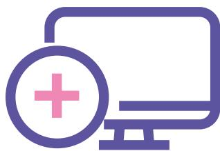

Icon of a computer monitor with a plus sign in a circle on the screen.

utviklingsløp som innebærer investeringer med begrenset annenhåndsverdi, eksempelvis innenfor FoU av legemidler og diagnostikk, men også løsninger som krever kortere og kapitalkrevende utviklingsløp som medisinsk teknologi og innenfor digital helse.

Regjeringen ga sin vurdering av kapitaltilgangen i Norge i *Finansmarkedsmeldingen 2023*, som ble lagt frem våren 2023. Der fremgår det at det norske finansmarkedet samlet sett fungerer godt, at de fleste selskaper og personer får dekket sine kapitalbehov i markedet og at offentlige ordninger utfyller det private finansieringstilbudet.

Offentlig kapital er i hovedsak innrettet mot prosjekter knyttet til forskning, entreprenørskap, innovasjon og de som er i tidlig fase, der man antar at verdiskapingen øker dersom kapitalmarkedet suppleres med virkemidler. Staten har over tid hatt flere virkemidler som både skal bygge opp kompetansen i investormiljøene og tilføre lovende bedrifter kapital.

Investinor er den sentrale aktøren i virkemiddelapparatet for egenkapitalvirkemidler rettet mot tidlige faser. Selskapets investeringer tilfører tidligfasebedrifter risikokapital og bygger opp private fondsmiljø over hele landet. Selskapet forvalter i alt syv mandater på vegne av staten, og tilfører kapital til bedrifter enten gjennom direkteinvesteringer fra Investinor eller investeringer i fond. Ved utgangen av 2021 var ca. 17 pst. av Investinors midler investert i helsesektoren. Gjennom investeringer i fond kan Investinor bidra til å få frem spesialiserte

forvaltermiljøer, som bl.a. kan komme helsenæringen til gode. Eksempler på miljøer som er tilført kapital gjennom Investinors virkemidler og hvor det har vært betydelig med helseinvesteringer er Sarsia Seed i Bergen, Norinnova i Tromsø, Sintef i Trondheim og Startuplab, Inven2 og Hadean Ventures i Oslo. Disse satsingene har gitt resultater, både ved at bedrifter har kommet seg på børs, og ved at flere bedrifter i de tidlige fasene har tiltrukket seg både norsk og utenlandsk kapital og kompetanse. Det er også andre ordninger i virkemiddelapparatet som er aktuelle, for eksempel kan lån fra Innovasjon Norge benyttes til delfinansiering av investeringsprosjekter som handler om nyetablering, nyskaping, omstilling og utvikling. Lånene skal stimulere til utvikling av innovative vekstbedrifter.

De siste formelle avtalene er kommet på plass for at norske bedrifter kan delta i det europeiske programmet InvestEU. Store muligheter i Europa åpnes for norske bedrifter. InvestEU samler finansielle instrumentene på tvers av ulike politikkområder i EU. Programmet består av finansieringsvirkemidler som lån, garantier og egenkapitalinvesteringer. Dette er trolig det viktigste EU-programmet for tilgang til finansiering for bredden av norsk næringsliv, og har sterke synergier til Horisont Europa, EU4Health, andre EU-programmer samt er en sentral del av Europas grønne giv. Næringslivet vil få tilgang på virkemidlene direkte fra Den nordiske investeringsbanken (NIB) og Den europeiske investeringsbanken (EIB) eller indirekte gjennom private investeringsfond og banker som har fått midler fra Det europeiske

investeringsfondet (EIF). Innovasjon Norge og Investinor har også mandater om å samarbeide med EIF om InvestEU-virkemidler i Norge. Helsenæringene er et hovedsatsingsområde i InvestEU. Flere norske miljøer er allerede i dialog med EIF om investeringer.

#### **Veien videre**

- ✦ Bevare et velfungerende kapitalmarked for videreutvikling av helsenæringen i Norge. (NFD/FIN)
- ✦ Virkemidlene som Investinor, ulike låneinstrumenter i Innovasjon Norge og norsk deltagelse i InvestEU kan stimulere til oppbygging av kompetente investeringsmiljø og kapitaltilgang for lønnsomme prosjekter i helsenæringene. (NFD)
- ✦ Føre en aktiv næringspolitikk som bidrar til gode samlede rammevilkår som legger til rette for private investeringer og videre vekst. (NFD)

### **11. Offentlige anskaffelser**

Offentlige anskaffelser totalt beløper seg til omkring 743 mrd. kroner i året (SSB 2022), og er et viktig strategisk virkemiddel til å stimulere til innovasjon og nye løsninger. De norske anskaffelsesreglene legger til rette for innovasjon, samtidig som grunnleggende anskaffelsesrettslige prinsipper legger føringer for gjennomføringen av offentlige anskaffelser, slik som prinsippene om konkurranse og likebehandling. Regjeringen forventer at helse- og omsorgstjenestene bruker innkjøpsmakten sin klokt, og utnytter handlingsrommet de har for dialog med markedet.

Samtidig må næringslivet kjenne til disse tjenestenes behov, dokumentasjonskrav og regulatoriske rammer.

I spesialisthelsetjenesten eier de fire helseregionene sammen Sykehusinnkjøp HF. I perioden 2020–2022 har Sykehusinnkjøp HF levert 2 700 anskaffelser med en total verdi på ca. 71 mrd. kroner. 80 pst. av anskaffelsene ble gjort for et helseforetak. I verdi utgjorde nasjonale anskaffelser to tredeler.

#### **Direktoratet for forvaltning og økonomistyring (DFØ)**

DFØ er regjeringens fagorgan for offentlige anskaffelser. De har en viktig rolle som pådriver og kompetansesenter for bærekraftige og innovative anskaffelser. Sentralt i direktoratets arbeid er metodeutvikling og anskaffelsesfaglig veiledning om prosedyrer og gjennomføringsmodeller som tilrettelegger for innovasjon. På fagsidene publiseres veiledning samt kontrakts- og konkurransegrunnlagsmaler for ulike innovative anskaffelser. DFØ bidrar aktivt inn i innovasjonsprosjekter der det gis veiledning i gjennomføring og kontraktsoppfølging av denne type anskaffelser, og er videre også ansvarlige for måling og rapportering på bruk av innovative anskaffelser som virkemiddel.

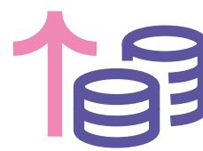

Icon of a pink upward arrow next to two blue cylindrical stacks of coins.

I de fleste større anskaffelser har Sykehusinnkjøp HF en veiledende kunngjøring der leverandører oppfordres til å gi innspill. Etter behov blir det gjennomført pipelinemøter, dialogkonferanser eller andre leverandørmøter. Hvilken type møte/konferanse man velger kommer an på kompleksitet, markedssituasjon og omfang av anskaffelsen. I mindre anskaffelser gjøres det ofte markedsundersøkelser, og det gjennomføres dialogmøter eller dialogkonferanser ved behov. Dette kan for eksempel være dersom anskaffelsen innebærer innovative produkter, tjenester eller løsninger som ikke er vanlige på markedet, eller der hvor kravene eller spesifikasjonene i anskaffelsen er komplekse eller unike.

Sykehusinnkjøp HF gjennomfører årlig omkring 300 dialogmøter knyttet til legemidler alene. Disse gjennomføres med et legemiddelselskap om en konkret anskaffelse eller et konkret legemiddel. I tillegg arrangeres det årlig leverandørsamling hvor et samlet leverandørmarked inviteres til å delta. Sykehusinnkjøp HF har også jevnlige møter med aktuelle bransjeforeninger, herunder Legemiddelindustrien og Melanor, hvor innovasjon og innovative anskaffelser er tema i møtene.

Stortingsmeldingen *Smartere innkjøp – effektive og profesjonelle offentlige anskaffelser*, som ble lagt frem av forrige regjering, omtaler virkemidler for å fremme innovasjon i offentlige anskaffelser. Innovative anskaffelser omfatter både prosedyrer for kjøp av innovasjon og anskaffelsesmetodikk eller aktiviteter som fremmer innovasjon. Man søker å utvikle et

leverandørmarked for løsninger som resulterer i ny eller betydelig forbedret vare, tjeneste eller prosess.

Regjeringen har nedsatt et offentlig utvalg som skal gjennomgå anskaffelsesregelverket og komme med forslag til endringer. Hensikten er å gjøre regelverket enklere og lettere tilgjengelig, bl.a. gjennom endringer i strukturen, materielle endringer og gjennomgang av reglene om samfunnshensyn. Utvalget skal foreslå endringer som styrker klima- og miljøhensyn, og motvirker sosial dumping og arbeidslivskriminalitet. Det skal også utrede hvordan det offentlige kan fremme innovasjon i anskaffelser, spesielt innovasjon som fremmer grønn omstilling. Overlevering av første delutredning forventes i november 2023, og den andre i mai 2024.

Leverandørutviklingsprogrammet (LUP) hjelper kommuner, fylkeskommuner og statlige virksomheter med å gjennomføre innovative anskaffelser. De gir råd om hvordan man gjennomfører innovative anskaffelser fra forberedende fase til prosjekt-gjennomføring.

#### **Veien videre**

- ✦ Sørge for økt bevissthet i offentlig sektor om innkjøpsansvar. (KDD)
- ✦ Direktoratet for forvaltning og økonomistyring (DFØ) arbeider videre for fremme av innovative offentlige anskaffelser. (KDD)
- ✦ Følge opp arbeidet fra offentlig utvalg som reviderer anskaffelsesregelverket. (NFD)

#### Verdi av Sykehusinnkjøps anskaffelser fordelt på kategori 2020–2022, i mrd. kroner

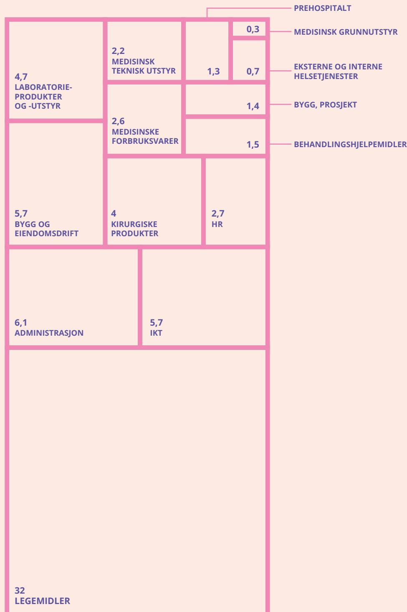

PREHOSPITALT

MEDISINSK GRUNNUTSTYR

EKSTERNE OG INTERNE HELSETJENESTER

BYGG, PROSJEKT

BEHANDLINGSHJELPEMIDLER

|                                                |                                    |           |     |                                       |
|------------------------------------------------|------------------------------------|-----------|-----|---------------------------------------|
| 4,7 LABORATORIE- PRODUKTER OG -UTSTYR | 2,2 MEDISINSK TEKNISK UTSTYR | 1,3       | 0,3 | MEDISINSK GRUNNUTSTYR                 |
|                                                |                                    |           | 0,7 |                                       |
|                                                | 2,6 MEDISINSKE FORBRUKSVARER | 1,4       |     | EKSTERNE OG INTERNE HELSETJENESTER |
|                                                |                                    | 1,5       |     | BYGG, PROSJEKT                        |
| 5,7 BYGG OG EIENDOMSDRIFT                | 4 KIRURGISKE PRODUKTER       | 2,7 HR |     | BEHANDLINGSHJELPEMIDLER               |
| 6,1 ADMINISTRASJON                          | 5,7 IKT                         |           |     |                                       |

32  
LEGEMIDLER

A treemap diagram showing the allocation of resources across various categories. The categories are labeled in Norwegian and their sizes are proportional to the values shown. The main categories are: PREHOSPITALT, MEDISINSK GRUNNUTSTYR, EKSTERNE OG INTERNE HELSETJENESTER, BYGG, PROSJEKT, and BEHANDLINGSHJELPEMIDLER. The total for LEGEMIDLER is 32.

**LEGEMIDLER**

32

Other diagram: Treemap of hospital budget or resource allocation categories in Norwegian.

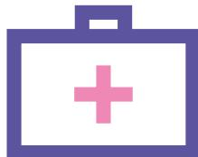

Icon of a purple medical bag with a pink cross on it.

### 12. Eksport

Vi skal markedsføre norsk næringsliv særlig der hvor vi er gode og har sterke miljøer. For styrking av vår internasjonale konkurransedyktighet vurderer regjeringen løpende en rekke strategiske grep. Internasjonalt samarbeid bør være en integrert komponent i helsenæringens vurdering av markeder, strategier og satsinger. Dette omfatter også klynger og nettverk. Koronapandemien viste hvor sårbare vi er, og at internasjonalt samarbeid er nødvendig for bl.a. å sikre tilgang til medisinske mottiltak. Slikt samarbeid må derfor omfavnes på flere nivåer, både multilateralt, bilateralt samt i nordisk sammenheng. Styrking av vår eksport skal utvikle bredden i norsk økonomi og bidra til grønn omstilling og økt verdiskaping.

Helsenæringen eksporterte i 2021 for 22 mrd. kroner og skapte 11 000 arbeidsplasser rundt om i Norge (Menon). 70 pst. av eksporten i 2021 gikk til USA og Canada, men også Asia og Norden er viktige markeder. Helsenæringen er en variert næring, men i denne sammenheng er den begrenset til legemidler, medisinsk utstyr og digitalt utstyr. Hoveddelen av eksporten kommer fra legemidler og medisinsk utstyr. Tall fra 2021 viser at 71 pst. av eksportinntektene kommer fra salg av legemidler, 28 pst. kommer fra salg av medisinsk utstyr, og 1 pst. kommer fra digitalt utstyr.

Mange av de norske helseteknologiselskapene som opererer i kommunal sektor er små i internasjonal sammenheng. De opererer i et lite hjemmemarked, og vil ha behov for innpass i et internasjonalt marked for å lykkes. Både kommunene og fylkeskommunene er avhengige av at helseteknologiselskapene har et større marked enn kun hjemmemarkedet, for å kunne utvikle bærekraftige og innovative løsninger som møter helsesektorens behov.

KS har understreket at helseteknologiske selskaper må ha støtte for å nå ut internasjonalt. Det er viktig å benytte arenaer og møteplasser som utenrikstjenesten og Innovasjon Norge kan bidra med. Nettverk og samarbeid mellom bedriftene kan bidra til at virksomhetene lærer av hverandre og at de kan stå sterkere sammen. KS viser også til at det er behov for gode insentivordninger som støtter norsk helseindustri til å nå ut internasjonalt. Det er dyrt å drive produktutvikling i Norge, som kan være til hinder for eksport. Helseteknologiske selskaper må veiledes og støttes til å tilegne seg europeiske og internasjonale standarder i sine løsninger, slik at de er relevante internasjonalt.

#### ***Hele Norge eksporterer***

Eksportreformen Hele Norge eksporterer ble lansert av næringsministeren i mars 2022. Som en del av

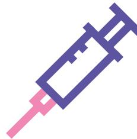

Icon of a syringe with a purple barrel and a pink needle.

reformen har regjeringen etablert en ny modell for arbeidet med større satsinger på eksportfremme. NFD har ansvaret for å analysere, prioritere og beslutte disse strategiske satsinger. For å sikre medvirkning og medfinansiering fra næringslivet, er det etablert et Nasjonalt eksportråd bestående av representanter for næringslivet og partene i arbeidslivet, som både skal gi innspill til større satsinger og gi regjeringen råd om strategisk innretning på eksportarbeidet. Modellen legger til grunn at det er næringslivet selv, gjennom Nasjonalt eksportråd, som foreslår nye nasjonale satsinger, mens departementet beslutter hvordan satsingene skal gjennomføres, herunder statens bidrag til finansiering og tildeling av midler. Innovasjon Norge skal gjennomføre satsingene i tett samarbeid med det øvrige virkemiddelapparatet, utenrikstjenesten og næringslivet. De to første satsingene er innenfor havvind og maritim sektor.

Nasjonalt eksportråd har foreslått for næringsministeren at en av de neste sektorene som utpekes som en strategisk eksportfremmesatsing bør være innen helsenæringen. Næringsministeren og helse- og omsorgsministeren lanserte i juni at rådet fra Nasjonalt eksportråd vil bli fulgt opp, noe som innebærer at helsenæringen vil være en av de særskilte eksportsatsingene under Hele Norge eksporterer. Nasjonalt eksportråd arbeider nå med å utarbeide

forslag til innhold i en slik fremtidig eksportsatsing, i tett samarbeid med øvrige relevante aktører og bedrifter innen helsenæringen. Rapport med forslag fra Nasjonal eksportråd forventes høsten 2023.

#### ***Eksportfinansiering Norge***

Eksportfinansiering Norge (Eksfin) er en del av det offentlige virkemiddelapparatet. Eksfin tilbyr lån og garantier til utenlandske kjøpere av norsk eksport. Eksfin har også i 2022 fått utvidet mandat til å gi lån og garantier til eksportrettede investeringer i Norge. Tilbudet til Eksfin ble også nylig utvidet til å omfatte garanti for lån til arbeidskapital til norske bedrifter. Eksfin hadde pr. 18. januar 2022 ca. 129 mil. kroner i utestående lån og garantier innenfor helseindustrien. Mesteparten av dette var garantier.

#### ***Markedsføring av Norge innenfor helsenæringen i særskilte land***

Innovasjon Norge har flere aktiviteter innrettet mot relevante markeder for internasjonalisering av norsk helseteknologi som EU og USA. Innen EU er det særlig Norden med Danmark og Sverige som er prioritert i tillegg til Tyskland og Storbritannia. Det pågår også et arbeid inn mot andre markeder som Asia og Nord-Amerika.

Icon of a stack of three pink books with a blue ribbon around them.

Innovasjon Norge gjennomfører satsinger basert på markedenes modenhet. Satsing skjer bl.a. ved bedriftspresentasjoner på nett og artikler på helse-teknologi rettet mot det aktuelle markedet.

I 2022 ble Norges og Sveriges regjeringer enige om å jobbe tettere sammen for å tilrettelegge for økt næringslivssamarbeid, bl.a. ved å gjøre det enklere for bedrifter å oppskalere sin virksomhet ved lettere tilgang til et nordisk marked. Som en oppfølging av dette arbeidet har Innovasjon Norges kontor i Sverige etablert et eksportprogram (Global Growth) for norske helsebedrifter. Videre deltok Team Norway i mai 2023 med en norsk paviljong på Nordens største messe innenfor digital helse, Vitalis, i Gøteborg, med deltagelse fra ca. femten norske bedrifter. Det svenske markedet har mange felles utfordringer som det norske, noe som åpner for et forsterket samarbeid, men også for eksport av norske løsninger. I Danmark er det også gjennomført et Global Growth-program, som ledet til et felles samarbeidsprosjekt med Dansk Eksportråd innen helseteknologi. I USA planlegges det for en større

satsing, HPO HealthCare USA, som skal vektlegge både medisinsk teknologi og bioteknologi.

#### **Veien videre**

- ✦ Satse på eksportfremme. Hurdalsplattformen har som mål en 50 pst. økning av norsk eksport innen 2030 (olje- og gassektoren unntatt). (NFD)
- ✦ Arbeide for at hele bredden av norsk næringsliv kan realisere sitt samlede eksportpotensiale, og sees i sammenheng med eksportreformen «Hele Norge eksporterer» og utviklingen av større nasjonale strategiske eksportsatsinger. (NFD)
- ✦ Sammen med relevant næringsliv utvikle og igangsette en egen eksportfremmesatsing innen helsenæringen som del av Hele Norge eksporterer. (NFD)
- ✦ Fremheve i diverse fora med relevante land – både bilateralt og multilateralt – potensialet som finnes i styrket samarbeid mellom norske og utenlandske aktører.

### Oppsummering og veien videre

Regjeringsplattformen flagger ambisjoner for norsk helsenæring. Med dette veikartet konkretiserer vi disse. Tiltak for å utvikle norsk helsenæring ligger innenfor flere departementers ansvarsområder, og vi ønsker i oppfølgingen av veikartet at det føres en tett og konstruktiv dialog med næringslivet, virkemiddelapparatet og helse- og omsorgssektoren om hvordan tiltakene og øvrige rammebetingelser treffer.

Vi vil som ledd i dette etablere en arena for strategisk dialog mellom myndighetene og helsenæringen. Formålet med en slik arena er å kunne drøfte veikartets innsatsområder og øvrige rammebetingelser med relevante departementer og helsenæringen i felleskap. Den vil legge til rette for bedre gjensidig forståelse av utfordingsbildet, og kunne bidra til en helhetlig oppfølging av veikartet. Samtidig er det selvsagt viktig at aktører samhandler godt seg imellom, for eksempel gjennom HelseOmsorg21-rådet.

Det ligger et stort potensial for nærings- og industriutvikling innenfor helse og livsvitenskap. Utviklingen av produkter og tjenester er et viktig grunnlag når vi skal kunne utvikle fremtidens helsetilbud og forstå både dagens og fremtidige utfordringer og kriser. Samtidig kan helsenæringen gi nye og kunnskapsbaserte lønnsomme arbeidsplasser over hele landet, samt bidra til verdiskaping i norsk økonomi. Det er derfor viktig for oss alle at vi lykkes på dette området.

Illustration of four stylized, colorful pillars (pink and beige) of increasing height on a red background.

Utgitt av:  
Nærings- og fiskeridepartementet  
Helse- og omsorgsdepartementet

Bestilling av publikasjoner:  
Departementenes sikkerhets- og serviceorganisasjon  
[www.publikasjoner.dep.no](http://www.publikasjoner.dep.no)

Telefon: 22 24 00 00

Publikasjoner er også tilgjengelige på:  
[www.regjeringen.no](http://www.regjeringen.no)

Design og layout: Anagram Design

Publikasjonskode: W-0048 B

Trykk: Departementenes sikkerhets- og serviceorganisasjon  
08/2023 – opplag 50

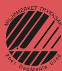

Logo of Miljømerket Trykksak, a circular design with black and white diagonal stripes and the text 'MILJOMERKET TRYKKSAK' and '2041 DepMedia 0446'.