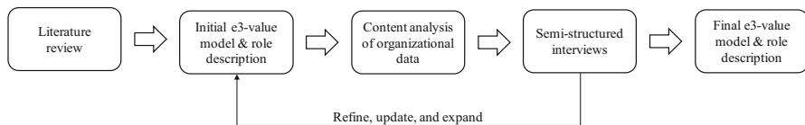
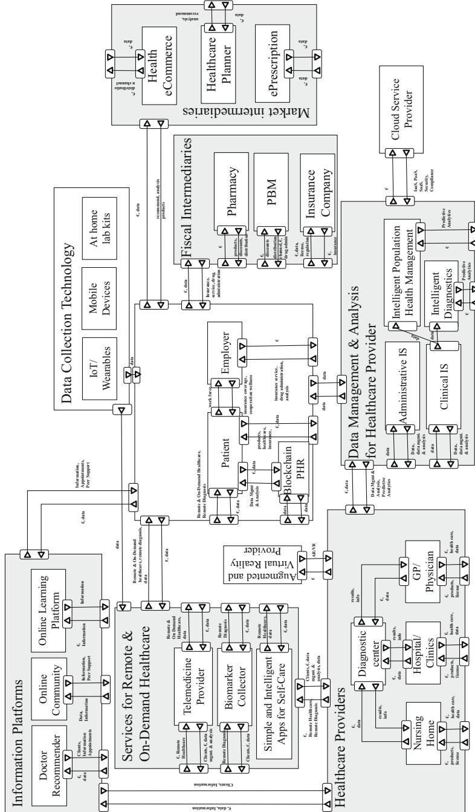
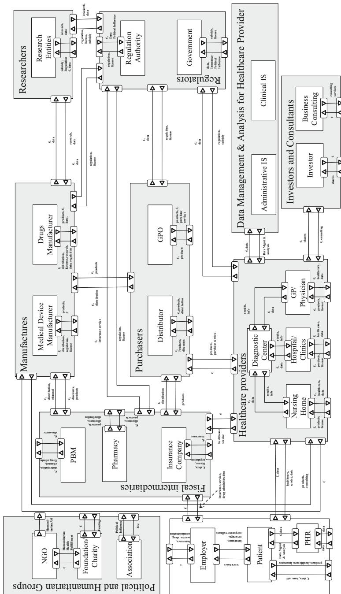

# The digital transformation of the healthcare industry: exploring the rise of emerging platform ecosystems and their influence on the role of patients

Sebastian Hermes<sup>1</sup> [!\[\]\(d66ff64371a51729ac8c1cdaa685ba6f\_img.jpg\)](http://orcid.org/0000-0002-1874-2112) · Tobias Riasanow<sup>1</sup> ·  
Eric K. Clemons<sup>2</sup> · Markus Böhm<sup>1</sup> · Helmut Krcmar<sup>1</sup>

Received: 15 October 2019 / Accepted: 3 September 2020 / Published online: 11 September 2020  
© The Author(s) 2020

**Abstract** While traditional organizations create value within the boundaries of their firm or supply chain, digital platforms leverage and orchestrate a platform-mediated ecosystem to create and co-create value with a much wider array of partners and actors. Although the change to two-sided markets and their generalization to platform ecosystems have been adopted among various industries, both academic research and industry adoption have lagged behind in the healthcare industry. To the best of our knowledge current Information Systems research has not yet incorporated an interorganizational perspective of the digital transformation of healthcare. This neglects a wide range of emerging changes, including changing segmentation of industry market participants, changing patient segments, changing patient roles as decision makers, and their interaction in patient care. This study therefore investigates the digital transformation of the healthcare industry by analyzing 1830 healthcare organizations found on Crunchbase. We derived a generic value ecosystem of the digital healthcare industry and validated our findings with industry experts from the traditional and the start-up healthcare domains. The results indicate

✉ Sebastian Hermes  
sebastian.hermes@tum.de

Tobias Riasanow  
tobias.riasanow@tum.de

Eric K. Clemons  
clemons@wharton.upenn.edu

Markus Böhm  
markus.boehm@tum.de

Helmut Krcmar  
helmut.krcmar@tum.de

<sup>1</sup> Technical University of Munich, Boltzmannstr. 3, 85748 Garching, Germany

<sup>2</sup> The Wharton School, University of Pennsylvania, 3730 Walnut St, Philadelphia, PA 19104, USA

8 new roles within healthcare, namely: information platforms, data collection technology, market intermediaries, services for remote and on-demand healthcare, augmented and virtual reality provider, blockchain-based PHR, cloud service provider, and intelligent data analysis for healthcare provider. Our results further illustrate how these roles transform value proposition, value capture, and value delivery in the healthcare industry. We discuss competition between new entrants and incumbents and elaborate how digital health innovations contribute to the changing role of patients.

**Keywords** Platform ecosystem · Ecosystem analysis · Healthcare · Digital transformation · Digital health · Health information technology

## 1 Introduction

Health spending continues to consume large shares of public spending (OECD Stat [2020\).](#block-35-2) Against the backdrop of an aging society, which further increases the burden on healthcare systems, healthcare actors are seeking solutions to both cost and quality issues. For example, Kohn et al. [\(2000\)](#block-33-2) report that on average around 75,000 preventable deaths occur each year in the United States and that health information technology (health IT) is a promising solution to this problem. Indeed, health IT has been recognized as a driver of enhanced clinical outcomes (Garg et al. [2005\)](#block-31-2) and as a cost-saving lever (Hillestad et al. [2005\),](#block-32-2) yet adoption of health IT is slow (Romanow et al. [2012;](#block-35-2) Kruse et al. [2016\).](#block-33-2)

Research indicates multiple reasons why key stakeholders in healthcare have been slow to adopt health IT and leverage opportunities afforded by digital transformation (DT)—defined by (Vial [2019\)](#block-36-2) as “a process that aims to improve an entity by triggering significant changes to its properties through combinations of information, computing, communication, and connectivity technologies”—despite its promise for business value (DesRoches et al. [2008;](#block-31-2) Hsia et al. [2019\).](#block-32-2)

First, healthcare is a complex and pluralistic public good marked by constant interaction across a varied set of individuals and organizations (Blumenthal [2011;](#block-30-2) Hansen and Baroody [2020;](#block-32-2) Davidson et al. [2018;](#block-30-2) Ozdemir et al. [2011\).](#block-34-2) The healthcare industry primarily comprises various types of patients (e.g., physical traits and medical history), professional groups (e.g., physicians, nurses, administrators, and insurers), clinical organizations (e.g., hospitals, testing laboratories, and care facilities), treatment options, healthcare delivery processes, regulators (e.g., state agencies, policy-makers and credentialing entities), non-governmental organizations, and new digital intermediary firms (Fichman et al. [2011;](#block-31-2) Agarwal et al. [2020\).](#block-30-2) Due to large costs involving the treatment of illnesses, the healthcare industry has evolved into an insurance-based industry. Insurance companies thereby contract healthcare providers and cover payments for various services provided by healthcare providers to their patients. Similarly, products produced by drug and medical devices manufacturers are generally prescribed by healthcare providers and compensated by insurance companies. Insurance companies, healthcare providers, and suppliers are strictly regulated by governments (Hansen and Baroody [2020\).](#block-32-2) For example, in form of the

Health Insurance Portability and Accountability Act. As a result of healthcare's complexity and regulation, health information silos emerged and interoperability of health IT between key stakeholders is lacking, which hamper efficiency, undermine coordination of care, and increase costs (Gupta and Sharda [2013;](#block-31-2) Hansen and Baroody [2020;](#block-32-2) Kellermann and Jones [2013;](#block-33-2) McClellan et al. [2013\).](#block-33-2)

Second, adoption of health IT is often resisted by powerful actors in healthcare delivery (Bhattacherjee and Hikmet [2007\).](#block-30-2) The resistance stems from various factors such as professional norms [physicians regard tasks aside from patient treatment as administrative nuisances (Fichman et al. [2011\)\],](#block-31-2) adverse influence [powerful, tech-averse physicians affect other's use of health IT (Venkatesh et al. [2011;](#block-36-2) Davidson et al. [2018\)\],](#block-30-2) threats to professional autonomy (physicians aim to maintain the status and refuse new technology (Walter and Lopez [2008\)\),](#block-36-2) and privacy concerns [due to hacked medical devices (Meskó et al. [2017\)](#block-33-2) as well as absent and opaque app privacy policies (Sunyaev et al. [2015\)\].](#block-35-2) Shifting towards the organizational level, Ozdemir et al. [\(2011\)](#block-34-2) demonstrate that providers lack the incentives to implement health IT systems or share their data due to competitive concerns. Such proprietary strategizing however, not only impedes the digital transformation of healthcare, it also means that healthcare provider can't leverage the full amount of patient data available across systems (Romanow et al. [2012\).](#block-35-2) Additional barriers of organizations to adopt health IT include initial and ongoing costs (DesRoches et al. [2008;](#block-31-2) Jha et al. [2009\),](#block-32-2) technical support, technical concerns (Kruse et al. [2016\),](#block-33-2) the loss of productivity during the transition, and concerns about future obsolescence of purchased health IT (McClellan et al. [2013\).](#block-33-2) Lastly, even if organizations adopt health IT, individuals often avoid using it (Kane and Labianca [2011\).](#block-33-2)

Third, patients are another significant cause why the digital transformation is slowly unfolding within healthcare. Healthcare information is highly personal (Fichman et al. [2011\)](#block-31-2) and the more patients perceive medical information as sensitive the less they are willing to disclose (Malhotra et al. [2004\)](#block-33-2) or to adopt new health IT (Li et al. [2016\).](#block-33-2) Anderson and Agarwal [\(2011\)](#block-30-2) further demonstrate that individuals do not trust governments and for-profit organizations with electronic health systems and that their unwillingness to disclose health information is higher when information is requested from governments. When it comes to data protection, Kellermann and Jones [\(2013\)](#block-33-2) and Wachter [\(2015\)](#block-36-2) argue that patients encounter insufficient access to and control over health data as witnessed by Sunyaev et al. [\(2015\)](#block-35-2) who stress that privacy policies of mobile health apps are often absent or opaque.

Lastly, health IT itself represent a significant factor for healthcare's slow digital transformation. Kellermann and Jones [\(2013\)](#block-33-2) and Spil and Klein [\(2014\)](#block-35-2) for example argue that few health IT suppliers build products that are easy to use. Consequently, physicians are frustrated that health IT requires lengthy data entry and disrupts rather than assists their practice. Such systems could even seriously harm patients as observed by Han et al. [\(2005\)](#block-32-2) who identified an unexpected increase in patient mortality with EHR system implementation. Also, the validity of health sensors, digital health devices, and smartphone applications to offer reliable and high-quality data remains unsure (Meskó et al. [2017\).](#block-33-2) Plante et al. [\(2016\)](#block-34-2) found for example inaccuracies in a popular application for measuring blood pressure.

However, recent advances in technology and policy as well as increasing amounts of health data and venture capital are rapidly changing the status quo of the digital transformation of healthcare. Significant advances in IT have been made in terms of collection, storage, processing, analysis, and distribution of data enabling new forms of healthcare. New opportunities for data collection have been provoked especially by the sophistication of mobile technologies and wearables (Oldenburg et al. [2015;](#block-34-2) Agarwal et al. [2020\).](#block-30-2) Smartphones as well as wearables are equipped with plenty of sensors ranging from accelerometers and microphones to GPS sensors and gyroscopes (Sharon [2016\)](#block-35-2) and enable the capture of longitudinal, real-time health information such as blood pressure, sleep pattern, and heart rate from vast amounts of people (Li et al. [2016\).](#block-33-2) Advances in health platforms (e.g. Apple HealthKit or Google Fit) also allow the bundling of fitness and medical data from different sources and make these available for sharing with healthcare professionals (Sharon [2016\).](#block-35-2) When it comes to advances in storage and processing, cloud computing platforms such as Amazon Web Services are largely lowering the fixed costs of setting up health analytics, and big data processing solutions like Hadopp are now mature and deployable (Agarwal et al. [2020\).](#block-30-2) Advances in data analysis are particularly made in machine learning, artificial intelligence, and natural language processing (Choi et al. [2016\).](#block-30-2) These groundbreaking techniques help to better understand and make novel inferences from newly generated health data such as Twitter data (Sinnenberg et al. [2017\).](#block-35-2) Advances in the distribution of data are reflected by online health communities (Yan and Tan [2014;](#block-36-2) Goh et al. [2016\),](#block-31-2) mobile software platforms, open data initiatives, and telemedicine. Mobile software platforms for example enable developers of mobile health apps to instantly reach billions of consumers. In 2017 there were around 325,000 health apps available on all major app store; 78,000 more than the year before [\(Research2Guid](#block-34-2)ance [2017\).](#block-34-2) Open data initiatives such as the European Open Science Cloud (EU Commission [2020\)](#block-30-2) or the US HealthData Initiative (HealthData.gov [2020\)](#block-32-2) are also gaining momentum and fostering the proliferation of health data. Although not directly relating to distribution of data, telemedicine represents an increasingly used technology to distribute healthcare in form of virtual patient-provider communication to patients experiencing geographical, temporal, and cultural problems to face-to-face communication (Meier et al. [2013\).](#block-33-2) These major advances in IT also make new forms of healthcare possible. Virtual reality, for example, has been an effective and safe adjunctive therapy for pain management in the acute inpatient setting (Mosadeghi et al. [2016\).](#block-34-2) In contrast, voice technology such as Alexa might be used to offer vetted advice to common health questions like “What are the symptoms of appendicitis?” thereby relieving healthcare providers by allowing elderly and blind patients who are unable to access the internet to receive advice for common illnesses (Downey [2019\).](#block-31-2)

Next to advances in IT, policy-makers and venture capital reflect two additional factors for the rise of digital transformation within healthcare. For instance, the US introduced in 2016 a penalty, in form of reduced reimbursements, for healthcare providers if they do not comply with meaningful use requirements. These policies had significant effects. Hospitals for example, increased their use of certified EHR systems from 72% in 2011 (Henry et al. [2016\)](#block-32-2) to 96% in 2017 (ONCHIT [2018\).](#block-34-2) In terms of funding, statistics report that digital health funding increased from 1 billion US dollars in 2010 to 14 billion US dollars in 2019 (Mikulic [2020\).](#block-34-2) Big tech firms

are especially making considerable efforts to enter healthcare through venture capital funding and acquisitions. Amazon for example invested in Grail, a cancer-detection start-up and Apple acquired Beddit, which develops sleep-monitoring software (Singer [2017\).](#block-35-2)

To the best of our knowledge, most studies within the IS community exploring the digital transformation are primarily concerned with an intra-organizational perspective, such as the transformation of processes, products, and services, organizational structures, or business model (Kaltenecker et al. [2015;](#block-32-2) Hansen and Sia [2015\).](#block-32-2) Current academic literature of digital transformation in healthcare also follows this trend by either exploring the digital transformation of traditional institutions (Mircea et al. [2010;](#block-34-2) Roehrs et al. [2017\),](#block-35-2) health information technology (Agarwal et al. [2010\),](#block-29-2) electronic health records (Kane [2015\),](#block-33-2) big data (Kane [2017\),](#block-33-2) mobile applications (Botha et al. [2018\)](#block-30-2) or single components of the digital health industry such as mHealth (Handel [2011;](#block-32-2) Kumar et al. [2013;](#block-33-2) Luxton et al. [2011\)](#block-33-2) or eHealth (Oh et al. [2005\).](#block-34-2)

However, research on digital transformation should also take an inter-organizational perspective into account (Jacobides et al. [2018;](#block-32-2) Puschmann [2017\),](#block-34-2) particularly since digital transformation may substantially influence inter-organizational partnerships in ecosystems when value is co-created among multiple and novel stakeholders (Sarker et al. [2012\).](#block-35-2) As early as 1991, Bakos addressed the transition from linear links to two-sided markets (Bakos [1991\),](#block-30-2) and Parker et al. [\(2016\)](#block-34-2) more recently postulated a transition from simple two-sided markets to more complex platform-mediated structures. However, these transformations seem almost totally absent from the evolution of the healthcare ecosystem and marketplace (Clemons [2018\).](#block-30-2)

Therefore, the present study aims to understand the digital transformation of the healthcare industry from an ecosystem rather than a firm-level perspective. Consequently, we focus on the impact of new organizations that build upon the opportunities of the digital transformation instead of exploring how the digital transformation changed the processes and structure of incumbents. Drawing upon the methodology of Gordijn and Akkermans [\(2001\)](#block-31-2) to model and analyze ecosystems, we aggregated organizations with similar characteristics and value streams into market segments and grouped them into generic roles to answer the following research questions:

**RQ1** During the digital transformation of the healthcare industry, which generic roles and value streams are adopted by emerging organizations?

**RQ2** How do these emerging organizations change patient treatment and shape the role of patients?

**RQ3** How can these emerging organizations compete against existing healthcare and technology incumbents?

The remainder of this paper is structured as follows: first, we analyze the underlying literature of digital platforms and ecosystem analysis; second, we describe our methodology; third, we present the generic roles and the generic value network of the digital healthcare industry; and lastly, we discuss the results and briefly present implications and future research.

## 2 Theoretical background

### 2.1 Digital platforms

In recent years, companies drawing upon platform-based business models have increased substantially in number and size (Evans and Gawer [2016\).](#block-31-2) Their emergence has altered the way people interact (e.g., Facebook), search for information (e.g., Google), buy products (e.g., Amazon) and utilize services (e.g., Airbnb). By drawing upon value co-creation, ecosystem orchestration and facilitating transactions, digital platforms transform linear value chains into platform-mediated two-sided markets (de Reuver et al. [2018;](#block-31-2) Constantinides et al. [2018;](#block-30-2) Schrieck et al. [2016\).](#block-35-2) We define digital platforms according to Constantinides et al. [\(2018\)](#block-30-2) and Parker et al. [\(2016\)](#block-34-2) “as a set of digital resources—including services and content—that enable value-creating interactions between external producers and consumers.”

In contrast to traditional organizations, digital platforms do not necessarily hold physical assets or produce the final service. For example, Airbnb has little in common with hotels of linear value chains, and Apple does not actually produce every application within their AppStore. Rather, digital platforms emphasize and facilitate core interactions between communities of the platform ecosystem, comprising consumers, producers, and third party actors (Parker et al. [2016;](#block-34-2) Jacobides et al. [2018\).](#block-32-2) Both examples illustrate that digital platforms set architectural and governance rules to balance platform control, engage participants, and co-create value for one another (de Reuver et al. [2018;](#block-31-2) Parker et al. [2016;](#block-34-2) Ghazawneh and Henfridsson [2013;](#block-31-2) Tiwana [2015\).](#block-35-2) In many instances, platforms therefore force organizations to change the way they operate and capture value; and can severely limit their ability to add value and to reach and to serve customers (Schrieck et al. [2019;](#block-35-2) Clemons [2018\).](#block-30-2)

Digital platforms create value in two fundamental ways. First, by facilitating transactions and second, by offering technological building blocks that are used by complementors to develop new products and services (Parker et al. [2016;](#block-34-2) Cennamo [2019;](#block-30-2) Evans and Gawer [2016\).](#block-31-2) Platforms that facilitate transactions are referred by Evans [\(2012\)](#block-31-2) as exchange platforms which “create value by helping two or more different types of users, who could benefit from getting together, find and interact with each other, and exchange value.” Hence, these platforms intermediate dyadic relationships (Rochet and Tirole [2003;](#block-35-2) Armstrong [2006\)](#block-30-2) and efficiently match buyers and sellers by reducing frictions such as search costs and information asymmetry. In contrast, platforms that offer technological building blocks, aim to orchestrate industry innovation by co-creating value with external complementors. According to Tiwana et al. [\(2010\)](#block-36-2) these innovation platforms are defined as “the extensible codebase of a software-based system that provides core functionality shared by the modules that interoperate with it, and the interfaces through which they interoperate.” Platform owner of innovation platforms provide software connectors called application programming interfaces and software developer kits, which allow complementary innovators to leverage digital affordances and create generativity in the platform ecosystem (Hein et al. [2019\).](#block-32-2) Additionally, some

authors argue for community platforms which refer to “a passive agent that enables individuals to access messages from, and disseminates messages to, other members” (Butler et al. [2014\).](#block-30-2) These platforms aim to unite various actors interested in similar content and supporting them in generating and disseminating their content among community members.

Digital platforms do not only change the nature of competition (Cennamo [2019\)](#block-30-2) and strategy (Parker et al. [2016\),](#block-34-2) they also affect consumers by allowing them to co-create value within the ecosystem (Hein et al. [2020\).](#block-32-2) For example, digital platforms in the sharing economy can be conceptualized as evolving organizations composed of actors who collaboratively share, consume, and compete (Gerwe and Silva [2018\).](#block-31-2) Thus, the roles of actors in an ecosystem are not fixed, but can evolve (Gawer [2014\).](#block-31-2) An example is Airbnb, who provides a scalable integration of consumers, providers, and prosumers (Hermes et al. [2020c\)](#block-32-2) into their platform-mediated ecosystem. Airbnb orchestrates these user roles by utilizing governance mechanisms such as defining the degree of openness and rating mechanisms (Tiwana et al. [2010\)](#block-36-2) and incentivizes consumers to engage in the role of provider. Hence, they become prosumers (Hermes et al. [2020c\).](#block-32-2)

### 2.2 Ecosystem analysis

In order to create value, ecosystems with actors comprising unique, super-modular/super-additive, or non-generic complementarities require a specific structure of relationships (Jacobides et al. [2018;](#block-32-2) Clemons [2018\).](#block-30-2) Various methods exist to model, visualize, and analyze ecosystems, such as heuristic, conceptual, mathematical, and ontological methods, or cluster analysis (Basole et al. [2018\).](#block-30-2) We focus our attention on the e3-value methodology by Gordijn and Akkermans [\(2001\),](#block-31-2) which is a rigorous, conceptual modeling approach for ecosystem analysis and visualization (Böhm et al. [2010;](#block-30-2) Riasanow et al. [2017,](#block-34-2) [2020\).](#block-34-2) Its aim is to define how economic value is created and exchanged within a network of actors. It offers a graphical approach that helps define and analyze multi-enterprise relationships by aggregating similar organizations into market segments. The main concepts of e3-value are the following (Gordijn and Akkermans [2003\):](#block-31-2)

- Actors: refer to economically and often legally independent entities. They are represented by rectangles.
- Market segments: refer to a set of actors that exhibit common characteristics and that value objects equally. They are represented by three rectangles.
- Value objects: refer to objects, such as services, goods, or money, exchanged by actors. They are represented as text next to the value exchanges;
- Value ports: refer to actors signaling that they want to offer or request value objects. This concept allows the abstraction of internal processes. They are represented by triangles.
- Value interface: refer to ingoing and outgoing value offerings. Actors can have one or more value interfaces. This concept represents the mechanism of economic reciprocity. They are represented by small rectangles with rounded edges.
- Value exchange: refer to actors willing to exchange value objects. They are represented by arrows connecting two value ports.

## 3 Methodology

The present study was guided by the e3-value methodology proposed by Gordijn and Akkermans [\(2001\)](#block-31-2) and Gordijn and Akkermans [\(2003\)](#block-31-2) and built upon the work of Böhm et al. [\(2010\),](#block-30-2) Riasanow et al. [\(2017\),](#block-34-2) and Riasanow et al. [\(2020\).](#block-34-2) The e3-value methodology is a rigorous modeling concept used to define and visualize how and with whom economic value is exchanged. We first conducted a literature review to identify the entities and value streams of the traditional healthcare industry. We then conducted a second literature review to identify the entities and value streams of the digital healthcare industry and then built the initial e3-value models of both industries. Thereafter, we analyzed the organizational data from the Crunchbase database of new healthcare organizations and conducted expert interviews to iteratively refine our e3-value models until all data was coded and insights from experts reached theoretical saturation. The iterative refinement process is illustrated in Fig. [1.](#block-8-2) We ended the process after three iterations.

### 3.1 Literature reviews

Both literature reviews were built upon the review process and categorization of concepts proposed by Webster and Watson [\(2002\).](#block-36-2) However, our goal was to go beyond a descriptive review towards a review of understanding the digital transformation and its entities and value streams (Rowe [2014\).](#block-35-2) According to Reis et al. [\(2018\),](#block-34-2) the number of articles on digital transformation significantly increased after 2013. We therefore employ the year 2013 as proxy for the beginning of literature about digital transformation. Consequently, our first literature review ranged until 2013 to assess the market segments and value streams within the traditional healthcare industry, whereas the second literature review started in 2014 to assess new market segments and value streams within the digital healthcare industry. For the traditional health industry we used the following query to scan scientific databases: ((“Health care system” OR “health care industry” OR “health care”) AND (stakeholder OR “value network” OR “value chain)) and the following query for the digital health care industry: ((“Health care” OR healthcare) AND (digitalization OR digitization OR “digital transformation” OR “digital innovation”)) and (“Digital health” AND “innovation”). After refining the initial hits and conducting a backward and forward search, we obtained 56 articles for the traditional industry and 64 articles for the digital industry. Each article was reviewed for entities, their descriptions, and value streams. Additional information about the search process is listed in Appendix [D.](#block-28-1)

### 3.2 Data extraction and screening

We used Crunchbase, a socially curated database of organizations, organizational members, and investors to extract organizational data to code market segments and value streams to model our ecosystems. According to Basole et al. [\(2018\),](#block-30-2) Crunchbase data is suitable to model ecosystems due to a large number of entries.

<a id="block-8-2"></a>

A horizontal flowchart showing a five-step research process. The steps are connected by right-pointing arrows. A feedback loop is present from the 'Semi-structured interviews' step back to the 'Initial e3-value model & role description' step, labeled 'Refine, update, and expand'.

```
graph LR; A[Literature review] --> B[Initial e3-value model & role description]; B --> C[Content analysis of organizational data]; C --> D[Semi-structured interviews]; D --> E[Final e3-value model & role description]; D -- "Refine, update, and expand" --> B;
```

Literature review → Initial e3-value model & role description → Content analysis of organizational data → Semi-structured interviews → Final e3-value model & role description

Refine, update, and expand

Flowchart: Sequential research process flowchart from literature review to final e3-value model.

**Fig. 1** Research process

Crunchbase offers a comprehensive database of incumbents and startups (Marra et al. [2015\).](#block-33-2) Additionally, start-ups at all funding stages are listed in the database, which allows researchers to capture business model innovations (Marra et al. [2015;](#block-33-2) Perotti and Yu [2015\).](#block-34-2) All entries on Crunchbase are verified before they are released online. Crunchbase, therefore, allows the extraction of a comprehensive overview of traditional and novel organizations related to an ecosystem and related technologies.<sup>1</sup> In cases where Crunchbase did not provide sufficient information, we used the organization's website, press articles, and news articles to derive the according market segment and value streams. We used the following search terms in the company description to determine the list of healthcare-related entities: mHealth, eHealth, digital health, telehealth, telemedicine, and wearables. These keywords corresponded to digital technologies or trends in the healthcare industry (Iyawa et al. [2016\).](#block-32-2) This led to a list of 1987 globally emerging and established organizations within healthcare. A total of 157 companies were excluded from the coding list because they either did not demonstrate any relevance to the healthcare industry, were closed and no longer active, or referred to actors of the traditional healthcare ecosystem.

### 3.3 Coding of market segments and value streams

With the remaining 1830 emerging organizations, we used structured content analysis, including an inductive category development based on Mayring [\(2010\)](#block-33-2) and Miles and Huberman [\(1994\)](#block-34-2) to identify the market segments and value streams within the traditional and digital healthcare industry. First, one of the coders used the organizational descriptions derived from Crunchbase to develop codes for the market segments. For example, the market segment Telemedicine provider is connected to concepts such as: online service, real time, medical consultation, and asynchronous communication, see Table [1.](#block-10-2)

Next, driven by the codes and the organizational descriptions from Crunchbase, descriptions for the market segments were developed, for example see Table [2.](#block-10-2)

Afterwards, the organizational descriptions and the descriptions of the market segments were given two additional raters, who independently coded the organizations to the market segments. All raters compared and discussed their coding for calibration purposes. Our aim was to establish intercoder reliability to ensure a consistent and reliable coding of the market segments. For this purpose, we used Fleiss's Kappa as measure for the validity of the intercoder reliability. Fleiss's Kappa allows for the computation of the intercoder reliability of  $k$  raters (Fleiss

<sup>1</sup> For data gathering we used a Crunchbase Premium account, since the free account limits the use (and amount of) available company data.

[1971\)](#block-31-2) and ranges from 0 to 1, with 1 indicating an almost perfect agreement among raters. In each of the three iteration rounds, three raters independently coded a sample of 100 organizations to become familiar with the refined coding scheme. Throughout the coding, the raters discussed discrepancies to reach consensus and equal understanding for each description of the market segments. After coding the three samples, Fleiss's Kappa indicated an intercoder reliability of 0.76 in the first round, 0.81 in the second round, and 0.84 in the third round, reflecting acceptable intercoder reliability (Fleiss [1971\).](#block-31-2) Therefore, we decided to have one rater code the remaining organizations. The total number of organizations for each new market segment in the digital healthcare industry is listed in Appendix [C.](#block-28-1)

### 3.4 Visualization and validation

In the next step, we used the e3-value method to visualize the traditional and digital healthcare ecosystem based on the identified market segments and value streams. Similar market segments were grouped into generic roles. The expert interviews were conducted in Germany with healthcare experts or founders of digital health companies using a semi-structured approach (Myers and Newman [2007\).](#block-34-2) The interviewees have significant experience in healthcare and digital technologies and are working either in a leading position or in information technology-related functions. Table [3](#block-10-2) provides additional information about the interviewees. The e-3 value models and the description of the market segments were sent to the interviewees in advance. This allowed them to become familiar with the models and prepare feedback. Three of the interviews were conducted in person. The rest were conducted via online or phone conversations. Interviewee 1 and 2 were interviewed in the first iteration, interviewee 3 and 4 in the second iteration and the remaining interviewees in the third iteration. Six of the interviewees were working for companies representing the traditional healthcare industry (Interviewee 1, Interviewee 2, Interviewee 3, Interviewee 8, Interviewee 9, Interviewee 10). The rest of the interviewees were employed in companies that emerged through the digital transformation in the healthcare sector (Interviewee 4, Interviewee 5, Interviewee 6, Interviewee 7). All interviews were recorded, transcribed, and inductively coded.

## 4 Results

### 4.1 Generic roles and value streams of emerging organizations of the digital healthcare industry

The results indicate that during the digital transformation of the healthcare industry emerging organizations converted into 15 new market segments and 3 new data collection technologies. Of the 15 new market segments, 9 market segments are represented by three new generic roles, 3 market segments are extending traditional generic roles, and 3 market segments are not represented by generic roles. The results also demonstrate that organizations are not bonded to one market segment. In contrast, most organizations occupy multiple market segments. Docandu for

<a id="block-10-2"></a>**Table 1** Example of the coding process

| Organization | Crunchbase description (extract)                                                                                                                                                                                                                                                                                                                                                                                                                                                                                                                                                                      | Coded market segment  |
|--------------|-------------------------------------------------------------------------------------------------------------------------------------------------------------------------------------------------------------------------------------------------------------------------------------------------------------------------------------------------------------------------------------------------------------------------------------------------------------------------------------------------------------------------------------------------------------------------------------------------------|-----------------------|
| Zava         | Zava is an online doctor service in which real GPs prescribe real medicines in real time. Zava offers trustworthy, affordable and regulated medical consultations without the need for a face-to-face visit. (...) And you don't have to see a doctor in person. (...) Simply complete a medical questionnaire, place your order and their doctors will check the treatment you've requested is suitable for you (...) Their service doesn't end when you receive your order. If you have any questions at all about your treatment or condition, you can contact one of their doctors free of charge | Telemedicine provider |

**Table 2** Example of the derived description of the market segment

| Market segment and description                                                                                                                                                                                                                                                                                                          | Example(s)                                         |
|-----------------------------------------------------------------------------------------------------------------------------------------------------------------------------------------------------------------------------------------------------------------------------------------------------------------------------------------|----------------------------------------------------|
| Telemedicine refers specifically to the use of IT for remote clinical services such as consultations, diagnosis, treatment, engagement and monitoring (HealthIT.gov <a href="#block-32-2">2019).</a> Emerging organizations have been identified among remote medical consultation, patient engagement platforms, and remote monitoring | Teladoc, eVisit, Physitrack, Airstrip Technologies |

**Table 3** Overview of the interviews

| Interview # | Duration | Interviewee's position            | Domain                               |
|-------------|----------|-----------------------------------|--------------------------------------|
| 1           | 55:29    | Business Development Director     | Medical Device Manufacturing         |
| 2           | 37:59    | Controlling and Business Analysis | Medical Device Manufacturing         |
| 3           | 28:54    | Incubation Manager Healthcare     | Medical Device Manufacturing         |
| 4           | 33:57    | Co-Founder                        | BioMarker Collector                  |
| 5           | 36:16    | Co-Founder                        | Digital Insurance Company            |
| 6           | 34:15    | Co-Founder                        | Administration Software              |
| 7           | 25:34    | Founder                           | Data Science and Business Consulting |
| 8           | 20:36    | Clinical Consultant               | Medical Device Manufacturing         |
| 9           | 54:16    | Manager Digital Healthcare R&D    | Medical Device Manufacturing         |
| 10          | 36:52    | Consultant Healthcare             | Business Consulting                  |

example uses AI to estimate diseases based on symptom input, offers online medical consultations, and provides a medical record to manage personal health data. Table [4](#block-12-2) depicts the generic roles, market segments, and descriptions of the emerging organizations. Figure [2](#block-15-2) illustrates the value streams among them. The presentation

of the generic roles within the traditional industry and the ecosystem visualization can be found in Appendices [A](#block-23-2) and [B](#block-26-2).

### 4.2 Value proposition transformation

We observed that the emerging organizations adopt value propositions that are significantly different from those of traditional organizations. Interviewee 4 summarized the value proposition transformation as follows:

“There is a shift from a reactive healthcare service to a proactive one, to really try to improve and foster your health and try to get healthier, prevent getting sick, instead of trying to get healthy again when you are sick.” (Interview 4)

As a result, the value proposition transforms from an acute view of healthcare, in which the hospital is the center of care, toward one in which connected and remote care is focused on prevention. Most of the new market segments in the digital healthcare industry act upon this transformation towards prevention by concentrating on self-care, preventive telemedicine, and disease prediction. Organizations focusing on self-care provide users with simple applications ranging from nutrition guides and fitness videos to intelligent applications which track activities and offer health recommendations. Organizations leveraging preventive telemedicine connect healthcare provider, relatives and patients by offering continuous and remote monitoring tools and alert systems to notify users before diseases break out. Disease prediction refers to organizations adopting novel, digital technologies such as big data, machine learning, and artificial intelligence to predict treatments, diseases and health risks. For example, the market segment of intelligent diagnostics offers healthcare provider AI-based models to detect diseases early on. The rise of these new market segments and their shift towards prevention has especially been enabled through new technologies in the domain of collecting and digitally capturing health data, improvements in methodologies for data analysis, and cloud computing.

### 4.3 Value capture transformation

Although these new roles might trigger additional efficiency and reduce costs of healthcare services (Bardhan and Thouin [2013\),](#block-30-2) the interviewees shared a more critical perspective, especially regarding the emergence of intermediaries. Interviewee 5 illustrated the problem as follows:

“Now more actors have to coordinate with each other, which requires more overhead. [...] All this stuff is supposed to increase effectiveness, increase efficiency. But it is also increasing costs. And the question is, can we actually really pay for that?” (Interview 5)

The increased cost caused by the continuous emergence of new market segments was a major concern that was also mentioned by Interviewee 7. Both interviewees argued that new market segments increase costs by placing themselves within the existing value chains and by adding new services to the value chains. Hence, these

<a id="block-12-2"></a>**Table 4** Description of the new market segments and generic roles of the digital healthcare ecosystem

| Generic role                                 | Market segment                            | Description                                                                                                                                                                                                                                                                                                                                                                                                                                                                                                                                                            |
|----------------------------------------------|-------------------------------------------|------------------------------------------------------------------------------------------------------------------------------------------------------------------------------------------------------------------------------------------------------------------------------------------------------------------------------------------------------------------------------------------------------------------------------------------------------------------------------------------------------------------------------------------------------------------------|
| Information Platforms                        | Online Community                          | Online communities promote collaboration, discussion, and distribution of information among members. They allow members to track progress with clinical scales, learn more about their condition, share information, and receive emotional support from peers (Smith and Wicks <a href="#block-35-2">2008;</a> Frost and Massagli <a href="#block-31-2">2008).</a> Examples: Citizen Health and PatientsLikeMe                                                                                                                                                         |
|                                              | Online Learning Platform                  | Online learning platforms are used by students, patients, and healthcare provider and offer information and tools to support education delivery and management. Students take online courses to build skills and advance their medical care. Patients learn about diseases, treatments, and various forms of support. Healthcare providers share medical insights, learn about new therapies and reduce time spent on patient education. Example: Navinata Health                                                                                                      |
|                                              | Doctor Recommender/Online Scheduler       | Doctor recommenders and online schedulers allow patients to search for specialists, book online appointments, view recommendations, write comments, and ask questions (Terlutter et al. <a href="#block-35-2">2014).</a> Examples: Jameda and ZocDoc                                                                                                                                                                                                                                                                                                                   |
| Services for Remote and On-Demand Healthcare | Telemedicine Provider                     | Telemedicine refers specifically to the use of IT for remote clinical services such as consultations, diagnosis, treatment, engagement, and monitoring (HealthIT.gov <a href="#block-32-2">2019).</a> Emerging organizations have been identified among remote medical consultation (e.g., Teladoc, eVisit), patient engagement platforms (e.g., Physitrack, DocJournal), and remote monitoring (e.g., Airstrip Technologies)                                                                                                                                          |
|                                              | Biomarker Collectors                      | Biomarker collectors are health-testing companies that offer at-home lab testing kits. These kits allow patients to derive detailed insights about their health. For example, biomarker collectors harness DNA to yield personalized information about food sensitivity, metabolism, or important blood values. Examples: EverlyWell and myHeritage                                                                                                                                                                                                                    |
|                                              | Simple and Intelligent Apps for Self-Care | Simple and intelligent apps for self-care refer to native as well as web applications that are used by consumers without direct involvement of healthcare providers to retrieve fitness and wellness information, self-monitor health parameters, and leverage recommendations. Hence, drawing on various functionalities to self-manage their health. For example, Headspace provides simple information about meditation, whereas FitBit uses wearables to offer activity and health tracking and Docandu leverages artificial intelligence (AI) to predict diseases |

**Table 4** continued

| Generic role               | Market segment                                 | Description                                                                                                                                                                                                                                                                                                                                                                                                           |
|----------------------------|------------------------------------------------|-----------------------------------------------------------------------------------------------------------------------------------------------------------------------------------------------------------------------------------------------------------------------------------------------------------------------------------------------------------------------------------------------------------------------|
| Data Collection Technology | IoT/Wearables                                  | Wearables are hardware devices that collect the health data of the body by behavioral sensing. They can be for personal use or for gathering data relevant for specialists by connecting to medical infrastructure, such that specialists can perform long-distance assessments (Hiremath et al. <a href="#block-32-2">2014)</a>                                                                                      |
|                            | At Home Lab Kits                               | These kits allow patients to collect a sample (e.g., blood or urine) at home which they can forward to a laboratory for testing                                                                                                                                                                                                                                                                                       |
|                            | Mobile Devices                                 | Mobile devices, such as smartphones, are equipped with plenty of sensors ranging from accelerometers and microphones to GPS sensors and gyroscopes (Sharon <a href="#block-35-2">2016)</a> and enable the capture of longitudinal, real-time health information such as stress level, sleep pattern, and walking distance                                                                                             |
|                            | Blockchain-Based Personal Health Records (PHR) | Blockchain-based PHRs compose a distributed ledger of health records by providing access through smart contracts and offering tools to protect patient privacy (Roehrs et al. <a href="#block-35-2">2019).</a> Blockchain-based PHR are designed to represent a single version of the truth that is digitized and validated by consensus of servers within the network. Example: proof.work                           |
| Market Intermediaries      | Health eCommerce                               | Health eCommerce refers to digital companies that offer various healthcare-related services and products. Example: Your.MD                                                                                                                                                                                                                                                                                            |
|                            | ePrescription                                  | ePrescription refers to software that electronically generates prescriptions. Its aim is to enable an error-free and understandable prescription, which is directly sent to a pharmacy from the point of care. Furthermore, it can be used by care teams to administer medicines or by pharmacies to review orders and manage the supply of medicines (Kierkegaard <a href="#block-33-2">2013).</a> Example: DoseSpot |
|                            | Healthcare Planner                             | A healthcare planner aims to improve employees' health. Its digital solutions are sold to employers comprising personalized healthcare plans and recommendations for their employees (Baum et al. <a href="#block-30-2">2013).</a> Example: Provata Health                                                                                                                                                            |

**Table 4** continued

| Generic role                                       | Market segment                           | Description                                                                                                                                                                                                                                                                                                                                                                                                              |
|----------------------------------------------------|------------------------------------------|--------------------------------------------------------------------------------------------------------------------------------------------------------------------------------------------------------------------------------------------------------------------------------------------------------------------------------------------------------------------------------------------------------------------------|
| Data Management & Analysis for Healthcare Provider | Intelligent Population Health Management | An intelligent population health management provider builds on actionable patient data to offer predictive analytics based on AI. The predictions involve, for example, information on upcoming threats, diseases, or effects of drug use, and help in identifying risks. These types of information are used to improve both clinical and financial outcomes (Phillips USA 2019). Examples: InsightRX and cover2protect |
|                                                    | Intelligent Diagnostics                  | Intelligent diagnostics comprise healthcare-related data sets and algorithms. It offers diagnostic models based on AI and can be bought or subscribed for by a healthcare provider (Interview 7). Examples: MD.AI and Skin Analytics                                                                                                                                                                                     |
|                                                    | Cloud Service Provider                   | A cloud service provider offers software-, platform-, and infrastructure-as-a-service security services and app development (Böhm et al. <a href="#block-30-2">2010).</a> Examples: MedStack and Chino.io                                                                                                                                                                                                                |
|                                                    | Augmented and Virtual Reality Provider   | Augmented or virtual reality provider use smart glasses or smartphones in combination with immersive technology to assist healthcare providers in physical, therapeutic, and emotional healthcare. Examples: FeelsGood and AppliedVR                                                                                                                                                                                     |
| Investors and Consultants                          | Incubator/Hub/Accelerator                | Incubators, hubs, and accelerators focus on supporting start-ups by offering consultations, capital, and services. Examples: CME Hub and Health Capital Helsinki                                                                                                                                                                                                                                                         |

new market segments not only increase the coordination costs of traditional organizations, they are also likely to reduce the generic roles available to them.

Consequently, organizations in traditional roles are facing an increasingly complex and intertwined industry. The rising complexity leads to higher costs in terms of identifying valuable actors, coordinating an increasing number of actors, and drawing on their services. According to the interviewees, these costs will either lower the profit margins of traditional healthcare organizations or increase the prices for patients; hence, increasing the total cost of healthcare. While this reflects an interesting insight, we argue that it omits efficiencies stemming from improving early intervention and prevention. In other words, it is most unlikely that new levels of interaction and reducing illness will increase the total cost of healthcare or they would hardly be adopted. We argue that the costs of coordinating services will go up, at least initially, whereas the total cost of services delivered and the need for further care will all be reduced and the quality of care improved. More significantly, as the coordination costs of traditional organizations goes up, their roles are reduced, and their revenues are reduced as a result, improvement in patient care and in system productivity may not be reflected in higher profits for traditional participants in the healthcare industry.

<a id="block-15-2"></a>

The diagram illustrates a comprehensive system architecture for 'Information Platforms' and 'Healthcare Providers'. It is divided into several main components:

- Information Platforms:** Includes Doctor Recommender, Online Community, Online Learning Platform, and Data Collection Technology (IoT/ Wearables, Mobile Devices, At home lab kits).
- Services for Remote & On-Demand Healthcare:** Encompasses Telemedicine Provider, Biomarker Collector, Simple and Intelligent Apps for Self-Care, and Patient Management (Patient, Employer, Blockchain, PHR).
- Market Intermediaries:** Includes Healthcare eCommerce, Healthcare Planner, and ePrescription.
- Augmented and Virtual Reality Provider:** A component within the Services for Remote & On-Demand Healthcare.
- Healthcare Providers:** Includes Nursing Home, Hospital/ Clinics, GP/ Physician, Diagnostic center, and Simple and Intelligent Apps for Self-Care.
- Data Management & Analysis for Healthcare Provider:** Involves Administrative IS, Intelligent Health Management, Intelligent Diagnostics, and Clinical IS.
- Cloud Service Provider:** Connected to the Data Management & Analysis for Healthcare Provider.

The diagram shows the flow of data (indicated by 'data' and 'C. data' labels) between these components, including interactions with external entities like the Cloud Service Provider and various healthcare entities.

**Key Components and Data Flows:**

- Information Platforms:**
  - Doctor Recommender: Provides data to Online Community, Online Learning Platform, and Data Collection Technology.
  - Online Community: Provides data to Online Learning Platform and Data Collection Technology.
  - Online Learning Platform: Provides data to Data Collection Technology.
  - Data Collection Technology: Provides data to Services for Remote & On-Demand Healthcare.
- Services for Remote & On-Demand Healthcare:**
  - Telemedicine Provider: Provides data to Patient Management.
  - Biomarker Collector: Provides data to Patient Management.
  - Simple and Intelligent Apps for Self-Care: Provides data to Patient Management.
  - Augmented and Virtual Reality Provider: Provides data to Patient Management.
  - Patient Management: Includes Patient, Employer, Blockchain, and PHR.
- Market Intermediaries:**
  - Healthcare eCommerce: Provides data to Market Intermediaries.
  - Healthcare Planner: Provides data to Market Intermediaries.
  - ePrescription: Provides data to Market Intermediaries.
- Healthcare Providers:**
  - Nursing Home: Provides data to Diagnostic center, Hospital/ Clinics, and GP/ Physician.
  - Hospital/ Clinics: Provides data to Diagnostic center, GP/ Physician, and Simple and Intelligent Apps for Self-Care.
  - GP/ Physician: Provides data to Diagnostic center, Hospital/ Clinics, and Simple and Intelligent Apps for Self-Care.
  - Diagnostic center: Provides data to Nursing Home, Hospital/ Clinics, and GP/ Physician.
  - Simple and Intelligent Apps for Self-Care: Provides data to Diagnostic center, Hospital/ Clinics, and GP/ Physician.
- Data Management & Analysis for Healthcare Provider:**
  - Administrative IS: Provides data to Intelligent Health Management, Intelligent Diagnostics, and Clinical IS.
  - Intelligent Health Management: Provides data to Intelligent Diagnostics and Clinical IS.
  - Intelligent Diagnostics: Provides data to Intelligent Health Management and Clinical IS.
  - Clinical IS: Provides data to Intelligent Diagnostics and Intelligent Health Management.
- Cloud Service Provider:** Provides data to Data Management & Analysis for Healthcare Provider.

**External Entities:**

- Cloud Service Provider
- Market Intermediaries (Healthcare eCommerce, Healthcare Planner, ePrescription)
- Data Collection Technology (IoT/ Wearables, Mobile Devices, At home lab kits)

**Data Flow Labels:**

- data: Indicates the flow of raw data.
- C. data: Indicates the flow of curated or processed data.
- recommend, analysis: Indicates the flow of recommendations or analysis results.
- data, data: Indicates the flow of data between entities.

**System Architecture:**

The architecture is a complex network of interconnected components. Information flows from the Information Platforms to the Services for Remote & On-Demand Healthcare, which then interact with the Market Intermediaries and Healthcare Providers. Data is also managed and analyzed by the Data Management & Analysis for Healthcare Provider, which is supported by the Cloud Service Provider.

Network diagram: System architecture diagram of Information Platforms and Healthcare Providers.

**Fig. 2** Ecosystem visualization of the digital healthcare industry. Market segments have been depicted as actors for better readability. The grey rectangles around multiple market segments represent generic roles. To further improve readability and reduce complexity traditional generic roles have been omitted (manufacturer, purchaser, investors and consultants, political and humanitarian groups, researchers, and regulators) as well as the value streams between cloud service provider and information platforms, fiscal and market intermediaries, and services for remote and on-demand healthcare

In regard to prices covered by patients, the analysis reveals a slowly emerging transformation towards personalized prices. Fitsense, for example, uses consumer data captured by devices and wearables to help insurances to provide the right kind of protection at the right price. Although Fitsense represents the only organization within our case base to offer such services, we argue that the proliferation of real-time data and comprehensive consumer profiles will increasingly transform the value capture of the healthcare industry towards a personalized one.

### 4.4 Value delivery transformation

#### 4.4.1 *Platformization*

The results demonstrate that the acute view of healthcare delivery transforms towards one in which connected and remote care focused on prevention is delivered from various actors. Such connected, network-based value delivery has been induced into the healthcare industry due to emerging new organizations with emerging new roles leveraging platform-based business models. Among the 15 new market segments we observed that a large part of them adopted exchange-based platforms. These include telemedicine providers, doctor recommenders, some apps for self-care, and health eCommerce. While telemedicine providers facilitate interactions among healthcare providers and patients, for example through video conferencing (e.g., Doctor Insta) or engagement platforms (e.g., Physitrack), doctor recommenders facilitate searching, reviewing and making contact (e.g., Jameda). Apps for self-care match users and fitness trainers (e.g., FitWell).

Regarding community-based platforms we found the market segments of Online Community and Online Learning Platform are building on this platform type. Figure [1,](#block-8-2) for example, is a social networking platform for healthcare professionals to post and comment on medical images, whereas PatientsLikeMe offers patients a platform to connect with others who have the same illness and to monitor and share their experiences with the objective to improve outcomes.

In terms of innovation platforms, we found no market segment that builds upon this type of platform. Rather, innovation platforms are explored by incumbent firms such as Apple, Google, or Nike. Nike for example launched the Nike+ Accelerator which enables external developers to build sports software using Nike's technology and data. Although we could not identify a distinct market segment leveraging innovation platforms, our case base indicates that a small number of emerging organizations are experimenting with this platform type. Fitbit, for example, offers Web APIs and a development environment to draw on the generativity of external app developers.

#### 4.4.2 *Remote and on-demand healthcare*

While we observed that patients interact directly with healthcare providers in the traditional healthcare value chain, we found that this interaction is increasingly mediated by services for remote and on-demand healthcare, information platforms, and healthcare intermediaries in the digital industry. Today, patients can access medical information and services through various online platforms and apps without

the need to physically visit their healthcare providers. Interviewee 9 provides a concrete example for the benefits of remote and on-demand healthcare:

“Instead of making an ECG once a month or once a year, you can have a wearable that collect much more data that gets the information about arrhythmia or something that otherwise would obviously be missed. So, with the abundance of sensors suddenly it increases the information content and the possibilities of utilizing this.” (Interviewee 9)

Hence, traditional approaches to individual, acute, episodic, and facility-oriented healthcare are transforming toward longitudinal, connected, and remote healthcare even to the point where the central roles of hospitals and primary care physicians are slowly being supplemented, or even replaced, by new organizations such as telemedicine provider. The demand of remote and on-demand healthcare stems from consumers who are increasingly looking for care that can be delivered continuously; on their schedule, at a time and place of their choice. That is because technological advancements such as increases in processing power and storage capacity, 5G, cloud computing, and omnipresent data collection technology allow mobile health apps, personal devices (from sensors to wearables), and telemedicine providers to experience unprecedented scale and generativity, reduced IT costs, and service availability. As a result, consumers can leverage services for remote and on-demand healthcare to stream an unprecedented variety of data and analyses to healthcare providers. In return healthcare providers can draw on these services for continuous care to better engage patients in their own care by providing information, coaching, and tools to support each patient adopt behaviors to improve health outcomes. The platform character of these services allows the integration of the patient’s personal network of family members, physicians, and social peers into this digital and remote healthcare process. For instance, family members can be provided with actionable information and alert notices, social peers can be integrated to help modify the patient’s health behavior through gamification, and various healthcare providers and their IT can be integrated to manage the patient’s health so that the healthcare services delivered are consistent and coordinated.

#### *4.4.3 Patient empowerment*

In the traditional healthcare industry, patients interact with a small number of roles that mainly consist of healthcare providers and fiscal intermediaries. Only a small fraction of patients ever interact with manufacturers. Additionally, we also observed an irregular and low interaction frequency between patients and healthcare providers. For example, outpatients rarely interact with healthcare providers or fiscal intermediaries. The process usually involves a couple of visits in a narrow timeframe until the treatment ends. Future visits will generally occur after a longer and unknown time interval. Hence, while the interaction is short-term and asynchronous, the involvement of the patient is also rather passive. Patients primarily wait for information without proactively asking for it or challenging the opinions and suggestions of their healthcare providers. As a result, patients have become fully dependent on the processes, information, and decisions of healthcare providers and systems.

However, the interaction and the communication between patients and healthcare providers as well as the self-involvement of patients are slowly being changed because of the digital transformation of the healthcare industry. Patients are confronted with a much higher number of previously unknown roles, such as information platforms, services for remote and on-demand healthcare, and market intermediaries. In contrast to the traditional healthcare industry, patients also interact far more often with healthcare providers. This interaction is increasingly mediated by third parties such as information platforms, blockchain-based personal health records, and services for remote and on-demand healthcare. These complementary services are not only increasing the interaction frequency between patients and healthcare providers; they are also providing patients with the option of informing themselves upfront, choosing suitable care providers, controlling and securely sharing personal data, and thereby becoming an active actor in the interaction with healthcare providers and prosumer of healthcare services. Doctor recommenders, for example, allow patients to rate and review doctors and thereby produce value for other users of the platform. Similarly, blockchain-based personal health records allow patients to control who can access their data and by allowing, for example, intelligent diagnostics to access that data, patients co-create value in form of better datasets and algorithmic outcomes.

Therefore, we identify patient empowerment as a crucial result of the transformation of patient involvement. Consumers have the opportunity to be better informed and make more informed choices about their health and the services they want to acquire. Interviewee 10 provides a possible explanation for the increased empowerment of patients:

“The first part is patient centricity. [...] Digital transformation is absolutely supporting this movement because digital companies are giving the tools to healthcare providers to center on the patient. [...] The patient has got all this information which was not disclosed to him in the old system.” (Interviewee 10)

## 5 Discussion

The study results indicate that the emerging digital transformation of healthcare is leading to a plethora of novel market segments, generic roles and value streams as well as the blurring of the distinction between healthcare and information technology industry. While some roles *reinvent existing solutions* by digitalizing distribution and services, others build upon digital innovations to offer *new medical procedures*. At the same time some market segments offer completely *new digital services* for problems that have existed before the digital transformation. Emerging companies reinventing existing solutions are either competing with existing healthcare incumbents or complementing the offerings of these incumbents. In contrast, emerging companies offering new digital services face strong competition from incumbent technology firms. Platform giants such as Google, Amazon, Apple and Microsoft are building the digital infrastructure of the digital healthcare ecosystem and are increasingly aiming to exploit their ability to deploy solutions

that do not require strong medical competence. These platform giants also already control vast amounts of customer-focused data, including health data from wearable devices and lifestyle data from activities scheduling. Large amounts of health-related information can be inferred from an individual's speed of motion (from GPS), health concerns (from searches), and even diet (from online restaurant reservations and online restaurant ordering); none of this information is currently explicitly covered by healthcare privacy, and in most jurisdictions using this information within a single firm, to benefit the individual, would not be forbidden.

By leveraging customer data from related industries, self-training algorithms (machine learning) and major information technology resources and capabilities, these platform giants enjoy a significant advantage over almost all emerging companies that are focusing on technical rather than medical solutions. Since regulation of the digital healthcare ecosystem has yet not been moving fast, this enables big platform operators to quickly launch new customer-facing services without facing regulatory barriers. Hence, emerging companies face a so called red ocean (Kim [2005\)](#block-33-2) when competing with incumbent healthcare firms on the basis of reinventing existing solutions and a red ocean when competing with incumbent platform operators on the basis of offering new digital services. A competitive path that involves less competition with established and dominant firms might therefore comprise building upon digital innovations to offer new medical procedures. On the one hand, big platform operators don't have the medical competence to compete in this domain and on the other hand, existing medical companies face multiple challenges of downsizing their current business model in favor for new business opportunities (Velu and Stiles [2013;](#block-36-2) Christensen et al. [2016\).](#block-30-2) While these conditions are not sufficient to demonstrate that this path is indeed a blue ocean, it seems more fruitful for emerging companies to compete against equivalent new entrants compared to well-equipped incumbents. However, this path requires new entrants to develop significant medical skills in addition to technical skills to move into areas that will not immediately be dominated by big tech or big pharma.

Our observations suggest that the healthcare industry is indeed following the inevitable progression that Bakos [\(1991\)](#block-30-2) and Parker et al. [\(2016\)](#block-34-2) predicted so many industries would follow. The healthcare industry is moving from simple linear value chains to two-sided markets mediated by central marketplaces, and then to complex interacting multi-sided markets mediated by platforms with super-modular/super-additive value creation (Jacobides et al. [2018;](#block-32-2) Clemons [2018\).](#block-30-2) High tech companies and software developers have recognized that control over a platform gives large platform operators irresistible competitive advantage; consider Microsoft's destruction of Netscape, or Google's ability to block competitors from Android devices (European Commission [2018;](#block-30-2) Edelman and Geradin [2016\).](#block-31-2) Traditional retailers are finding that it is difficult to compete with platforms like Alexa when they move into home shopping, and traditional manufacturers are finding that it is difficult to function without cooperation with existing platform operators when they moving into smart homes and autonomous vehicles; even in traditional companies, platform operators' control of customer data is emerging as a source of competitive advantage (Schreieck et al. [2019\).](#block-35-2) However, it seems likely that existing medical

systems facing platform operators and platforms like Android and iOS will enjoy significant advantages due to their existing control of patient data.

The transformation of the patient–healthcare provider relationship is guided by various digital technology applications. Patients begin to evolve from consumers of the healthcare service into prosumers co-creating value with healthcare providers due to digital technologies and intermediaries enabling patients to co-create new services with various roles within the digital industry (Zhang et al. [2015;](#block-36-2) Hardyman et al. [2015;](#block-32-2) Lucas Jr et al. [2013;](#block-33-2) McColl-Kennedy et al. [2012;](#block-33-2) Vial [2019\).](#block-36-2) Therefore, organizations have a growing interest in engaging patients with digital technologies to profit from the co-creation of value (Saldanha et al. [2017;](#block-35-2) Lusch and Nambisan [2015\).](#block-33-2) For example, patients using IoT-wearables, digitizing daily nutrition intake or sharing medical experiences are co-creating value with various healthcare providers. On the one hand, their personal health data enables their physicians to provide better care and leverage preventive medicine, and on the other hand, accumulated health data provides the breeding ground for new diagnostic software and better algorithms. Additionally, patients become more and more empowered and self-reliant. The use of digital technologies encourages patients and consumers to look for more information about health, illnesses, medical treatments, and therapies (Agarwal et al. [2010\).](#block-29-2) Patients can use medical social media platforms to share experiences and health-related data with others. At the same time, comparison portals empower patients to rate and recommend healthcare providers (Lupton [2013\),](#block-33-2) which allows patients to share their individual experiences among each other. Lastly, the development of sensors, wearables, and IoT devices and the connectivity between these mobile devices and computers are the key concepts driving remote and on-demand healthcare services, which alters the patient–healthcare provider relationship toward the digital realm (Shah and Chircu [2018\).](#block-35-2)

## 6 Limitations and future research

This study has several limitations. First, our analysis of the empirical data was limited by the subjective coding and the interpretation of the authors due to the qualitative research paradigm that we followed. Different coding and a different theoretical framework might have led to different findings. That is, we might have ended up with slightly different groups of market segments. However, we tried to counteract this limitation by establishing intercoder reliability and by validating our findings with industry experts. Second, our study did not reveal how traditional healthcare organizations should manage the implications of the digital transformation. We did not address possible changes to strategy and we did not assess the impact on internal processes and structures. Rather, we concentrated on detecting the interorganizational changes and emerging market segments within the healthcare industry. Third, our results are limited by cross-sectional information provided by the Crunchbase database. Future research could explore other methods such as econometrics to include more time-dependent and objective information. A second avenue of future research relates to platform competition in highly regulated industries such as healthcare. In various consumer-facing industries such as social

media, food delivery, or online search for example platform competition is very likely to reflect winner take all markets (Katz and Shapiro [1994\)](#block-33-2) demonstrating market convergence due to platform envelopment (Eisenmann et al. [2011;](#block-31-2) Hermes et al. [2020b\).](#block-32-2) However, sensitive health data, complex clinical trials, control over core-assets, and patent-intensity might alter the common rules of platform competition (Cennamo [2019\)](#block-30-2) which has usually been investigated in less regulated industries (e.g. Meyer and Cennamo [2019;](#block-34-2) Cennamo and Santalo [2013\).](#block-30-2) Exploring how different industry structures shape platform competition seems therefore fruitful especially as insights for platform regulation might emerge. A third avenue for future research is to compare the impact of the digital transformation in further industries and to compare and synthesize findings to derive more robust ecosystem theories about digital transformation. Lastly, new health IT will become intensely personal and potentially invasive. We therefore call for the investigation of how individual rights to privacy, organizational demands for personal health data, and societal benefits of large-scale exchanges of health data can be integrated into existing regulations on data ownership and data governance.

## 7 Conclusion

Given the lack of prior empirical research on the digital transformation of the healthcare industry and the lack of an inter-organizational perspective of digital transformation, our research is intended to advance the understanding of which new market segments emerged as a result of the digital transformation and how they changed the role of patients. We therefore applied a structured content analysis to inductively explore the transformation of healthcare by leveraging the Crunchbase database and interview data. The results indicate 8 new roles within healthcare, namely: information platforms, data collection technology, market intermediaries, services for remote and on-demand healthcare, augmented and virtual reality provider, blockchain-based PHR, cloud service provider, and intelligent data analysis for healthcare provider. Our results further illustrate how these roles transform value proposition, value capture, and value delivery in the healthcare industry. Finally, we address the role of patient data as a source of sustainable competitive advantage, both for medical records platform operators and smart phone platforms like Android and iOS. Medical records platform operators have existing health data, while Android and iOS have lifestyle data; new entrants without access to either will be unable to compete.

Our theoretical contribution is twofold. First, our results advance the literature on digital transformation by contributing a macro and interorganizational perspective of the digital transformation of the healthcare industry. This is theoretically important as the digital transformation represents more than an intra-organizational phenomenon. Second, we provide empirical evidence on how the logic of platform-mediated two-sided markets disrupted traditional linear value chains within the healthcare industry and on what platform types have and have not been adopted by emerging organizations. Lastly, we advanced the literature on the changing role of patients towards co-creators of value (Füller et al. [2014;](#block-31-2) Wirtz et al. [2019;](#block-36-2) Zhang

et al. [2015;](#block-36-2) Hardyman et al. [2015\)](#block-32-2) by illustrating how the role of patients has evolved during the digital transformation of healthcare.

For practitioners within traditional health organizations, the ecosystem models support strategic positioning and competitive analyses. The derived value networks provide practitioners with a macro perspective which eases decision-making about where to strive for a competitive advantage and where to give up sovereignty. Furthermore, the new value streams help to better understand and serve customers, especially digital natives, who have already been digitalizing their daily life activities and now engage in value co-creation and call for innovative healthcare solutions. For practitioners of emerging organizations, we illustrate promising markets and outline where and why they might face so called red oceans (Kim [2005\).](#block-33-2)

For healthcare policy-makers the implications of the study are twofold. First, policy-makers need to develop regulatory frameworks that address the tensions between (1) corporate privatization of health data and access to health data for public research, (2) protection of individual health data and societal benefits of large-scale exchanges of health data, and (3) benefits of personalized medicine and individual rights to privacy (Van Dijck et al. [2018\).](#block-31-2) Hence, policy-makers need to develop shared policies at the international level to determine whether data flows are owned privately, corporately, or collectively and to foster open health data flows to reduce power asymmetries (Sharon [2016;](#block-35-2) Hermes et al. [2020a\).](#block-32-2) Second, policy-makers need to investigate whether the changes in data collection warrants regulatory intervention to safeguard data validity and quality. Prior work has already raised concerns about data collected through wearables and mobile apps. For example, self-reported data could lead to intentional or nonintentional false reporting, data believed to be generated by the person of interest could be generated by someone else (sharing of devices) (Sharon [2016\),](#block-35-2) and the devices themselves might report in accurate data (Plante et al. [2016;](#block-34-2) Murakami et al. [2016\).](#block-34-2)

**Open Access** This article is licensed under a Creative Commons Attribution 4.0 International License, which permits use, sharing, adaptation, distribution and reproduction in any medium or format, as long as you give appropriate credit to the original author(s) and the source, provide a link to the Creative Commons licence, and indicate if changes were made. The images or other third party material in this article are included in the article's Creative Commons licence, unless indicated otherwise in a credit line to the material. If material is not included in the article's Creative Commons licence and your intended use is not permitted by statutory regulation or exceeds the permitted use, you will need to obtain permission directly from the copyright holder. To view a copy of this licence, visit <http://creativecommons.org/licenses/by/4.0/>.

<a id="block-23-2"></a>

## Appendix A: Generic roles of the traditional healthcare industry

See Table 5.

**Table 5** Description of the market segments and generic roles in the traditional healthcare industry

| Generic role          | Market segment                 | Description                                                                                                                                                                                                                                                                                                                                                                                                                                                                                        |
|-----------------------|--------------------------------|----------------------------------------------------------------------------------------------------------------------------------------------------------------------------------------------------------------------------------------------------------------------------------------------------------------------------------------------------------------------------------------------------------------------------------------------------------------------------------------------------|
|                       | Patient                        | The patient is a private person receiving healthcare services, treatment, or diagnosis from healthcare providers. On an individual level, patients pay their healthcare provider either out-of-pocket or indirectly through health insurances. Furthermore, there can be a payroll tax on employers and employees through which the costs of health insurance can be shared (Kumar et al. <a href="#block-33-2">2011)</a>                                                                          |
|                       | Personal Health Record (PHR)   | PHRs contain health data related to the care of a patient and are maintained by the patient (Fichman et al. <a href="#block-31-2">2011).</a> Health data includes for example patient-reported outcome data. With PHR, patients can choose what information to add and remove and with whom to share it with in a secure and compliant manner (Roehrs et al. <a href="#block-35-2">2017)</a>                                                                                                       |
|                       | Employer                       | Employers share the costs for insurance with their employees (Kumar et al. <a href="#block-33-2">2011).</a> Employers can also provide corporate health programs to their employees to prevent sickness (Interview 4)                                                                                                                                                                                                                                                                              |
| Fiscal intermediaries | Insurance Company              | Insurance companies accept premiums from patients, employers, and the government. In return, they reimburse healthcare providers for taking care of patients (Kumar et al. <a href="#block-33-2">2011).</a> Insurance companies currently try not only to cover the costs for healthcare services but also to incentivize their customers to stay healthy in exchange for discounts (Interview 4)                                                                                                  |
|                       | Pharmacy Benefit Manager (PBM) | PBMs interact with pharmacies and beneficiaries. They decide on pharmacy charges and provide beneficiaries with access to a nationwide network of pharmacy providers, with whom the PBMs have contracts to offer services and drugs at lower prices. Furthermore, PBMs are able to earn additional revenues through contracting pharmaceutical companies, owning a mail-order facility, or repacking and selling data to the pharmaceutical industry (Garis et al. <a href="#block-31-2">2004)</a> |
|                       | Pharmacy                       | Pharmacies can be defined as service shops and be classified, for example, based on the type of merchandise sold or the number of stores. An “independent” pharmacy has less than four stores, whereas “small chains” can have between four and 10 stores under a chain. “Large chains” include more than 10 stores (Jambulingam et al. <a href="#block-32-2">2005)</a>                                                                                                                            |

**Table 5** continued

| Generic role | Market segment                    | Description                                                                                                                                                                                                                                                                                                                                                                                                                                                                         |
|--------------|-----------------------------------|-------------------------------------------------------------------------------------------------------------------------------------------------------------------------------------------------------------------------------------------------------------------------------------------------------------------------------------------------------------------------------------------------------------------------------------------------------------------------------------|
| Purchaser    | Distributor                       | Distributors or wholesalers are non-manufacturing stakeholders that sell products to merchants, retailers, and contractors, but do not sell in significant amounts to end-users. Distributors simplify product, payment, and information flow owing to their role as an intermediary. Distributors bridge the gap between the goods and the services offered by individual producers and the demand of industrial or retail customers (Fein <a href="#block-31-2">1998)</a>         |
|              | Group Purchase Organization (GPO) | GPOs facilitate group buying on a large scale by aggregating the demands of several buyers. GPOs negotiate a lower purchase price with the seller by using the collective purchasing power of the buyers and further lower the buyers' procurement cost by reducing the unit search and transaction costs through scale (Saha et al. <a href="#block-35-2">2010)</a>                                                                                                                |
| Manufacturer | Drug Manufacturer                 | Drug manufacturers focus on the discovery, development, manufacture, and commercialization of drugs and medications (Shah <a href="#block-35-2">2004;</a> Paul et al. <a href="#block-34-2">2010).</a> The most important stakeholders to interact with the drug manufacturers are physicians, pharmacists, and the Group Purchasing Organization (Kelle et al. <a href="#block-33-2">2012)</a>                                                                                     |
|              | Medical Device Manufacturer       | Medical device manufacturers aim to make medical devices available for use. Medical devices as defined by FDA “range from simple tongue depressors and bedpans to complex programmable pacemakers with micro-chip technology and laser surgical devices. In addition, medical devices include in vitro diagnostic products, such as general purpose lab equipment, reagents, and test kits, which may include monoclonal antibody technology “ (FDA <a href="#block-31-2">2018)</a> |

**Table 5** continued

| Generic role              | Market segment       | Description                                                                                                                                                                                                                                                                                                                                                                   |
|---------------------------|----------------------|-------------------------------------------------------------------------------------------------------------------------------------------------------------------------------------------------------------------------------------------------------------------------------------------------------------------------------------------------------------------------------|
| Healthcare Provider       | Hospital             | A hospital is an institution providing medical and surgical treatment and nursing care for sick or injured people (Oxford <a href="#block-34-2">2019b)</a>                                                                                                                                                                                                                    |
|                           | Practitioner         | Practitioners provide healthcare services to patients, prescribe medication, perform operations, and determine diagnosis. In this study, practitioners comprise doctors, nursing teams, care teams, dentists, physiotherapists, etc. (Interview 10)                                                                                                                           |
|                           | Clinic               | A clinic is an establishment or hospital department in which outpatients receive medical treatment or advice, especially of a specialized nature (Oxford <a href="#block-34-2">2019a)</a>                                                                                                                                                                                     |
|                           | Diagnostic Center    | Diagnostic centers are healthcare providers, including laboratory services, radiology, and nuclear medicine (Interview 7)                                                                                                                                                                                                                                                     |
|                           | Nursing Home         | A nursing home is a facility for the stationary care of elderly or disabled individuals. Nursing homes are occupied by individuals who do not need to be hospitalized but cannot be taken care of at home                                                                                                                                                                     |
| Research                  | Research Institution | Research institutions are agencies, organizations, or universities that aim to foster innovation and collaboration in the research and development (R&D) area of healthcare. A distinction can be made between academic R&D (pure fundamental research and clinical trials) and commercial R&D (e.g., drug production)                                                        |
| Regulators                | Regulation Authority | Regulatory authorities use standards to improve data review (e.g., in pharmaceutical companies) (Hammond et al. <a href="#block-31-2">2009).</a> Furthermore, they regulate and classify medical devices, assuring patient access to “high quality, safe, and effective medical devices and avoiding access to products that are unsafe” (WHO <a href="#block-36-2">2019)</a> |
|                           | Government           | The government uses money generated from taxes to reimburse healthcare providers                                                                                                                                                                                                                                                                                              |
| Investors and Consultants | Business Consultant  | Many hospitals and care facilities need support when planning and implementing health information systems. In these cases, hospitals are advised to recruit external consultants to develop an according strategy (Brigl et al. <a href="#block-30-2">2005)</a>                                                                                                               |
|                           | Investor             | Private equity investors provide funds to companies in the form of growth or equity capital. They often pursue opportunities regarding a large healthcare provider with a stable reimbursement environment, such as acute care services, labs, or nursing homes (Robbins et al. <a href="#block-35-2">2008;</a> Stevenson and Grabowski <a href="#block-35-2">2008)</a>       |

<a id="block-26-2"></a>**Table 5** continued

| Generic role                                         | Market segment                    | Description                                                                                                                                                                                                                                                                                                                                                                                                                                                     |
|------------------------------------------------------|-----------------------------------|-----------------------------------------------------------------------------------------------------------------------------------------------------------------------------------------------------------------------------------------------------------------------------------------------------------------------------------------------------------------------------------------------------------------------------------------------------------------|
| Data Management and Analysis for Healthcare Provider | Administrative Information System | The administrative information system manages administrative, financial, and legal operations of healthcare providers. Software components include patient management patient accounting (PMPA), which is responsible for patient registration, admission, and discharge as well as a billing system and an electronic data interchange (EDI) system for insurance reimbursement (Choi et al. <a href="#block-30-2">2010)</a>                                   |
|                                                      | Clinical Information System       | The role of clinical information systems is to support the clinical activities of healthcare providers. The software components include for example electronic medical records (EMR), electronic health records (EHR) picture archiving and communication systems (PACS), and computerized physician order entry (CPOE) (Choi et al. <a href="#block-30-2">2010)</a>                                                                                            |
| Political and Humanitarian Groups                    | NGO                               | According to the United Nations “a non-governmental organization (NGO) is any non-profit, voluntary citizens’ group which is organized on a local, national or international level.[...] NGOs perform a variety of services and humanitarian functions, bring citizens’ concerns to Governments, monitor policies, and encourage political participation at the community level” (United Nations <a href="#block-36-2">2020).</a> Example: Doctors of the World |
|                                                      | Foundation/ Charity               | A private foundation is a non-profit charitable body initiated by a single benefactor. For example, the Bill & Melinda Gates Foundation. In contrast, a public charity supports its activities by funds collected publicly                                                                                                                                                                                                                                      |
|                                                      | Association                       | Associations represent groups whose members pursue a shared political, economic or social interest and strive to promote these through the political process                                                                                                                                                                                                                                                                                                    |

## Appendix B: Ecosystem visualization of the traditional healthcare industry

See Fig. [3.](#block-27-2)

<a id="block-27-2"></a>

The diagram illustrates a complex system architecture for healthcare data management and analysis, involving various stakeholders and entities. The entities are grouped into the following categories:

- Political and Humanitarian Groups:** NGO, Foundation/Charity, Association.
- Fiscal Intermediaries:** PBM, Pharmacy, Insurance Company.
- Manufactures:** Medical Device Manufacturer, Drugs Manufacturer.
- Purchasers:** Distributor, GPO.
- Healthcare providers:** Diagnostic Center, Hospital/Clinics, Nursing Home, GP/Physician.
- Data Management & Analysis for Healthcare Provider:** Administrative IS, Clinical IS.
- Regulators:** Regulation Authority, Government.
- Researchers:** Research Entities.

The diagram shows the flow of data and services between these entities, including data exchange, product distribution, and regulatory compliance. Key data flows include:

- Data from Political and Humanitarian Groups to Fiscal Intermediaries.
- Data from Fiscal Intermediaries to Purchasers.
- Data from Purchasers to Healthcare providers.
- Data from Healthcare providers to Data Management & Analysis for Healthcare Provider.
- Data from Data Management & Analysis for Healthcare Provider to Regulators.
- Data from Regulators to Researchers.

The diagram also shows the relationships between entities, such as the relationship between the Diagnostic Center and the Hospital/Clinics, and the relationship between the GPO and the Distributor.

```
graph TD; A[Political and Humanitarian Groups] --> B[Fiscal Intermediaries]; B --> C[Purchasers]; C --> D[Healthcare providers]; D --> E[Data Management & Analysis for Healthcare Provider]; E --> F[Regulators]; F --> G[Researchers];
```

This diagram provides a comprehensive overview of the healthcare data ecosystem, showing the interactions between different stakeholders and the flow of data and services.

UML diagram: System architecture diagram of healthcare data management and analysis.

**Fig. 3** Ecosystem visualization of the traditional healthcare industry

<a id="block-28-1"></a>

## Appendix C: Amount of organizations for each new market segment in the digital healthcare industry

See Table 6.

**Table 6** Number of organizations per market segment

| Role                                                 | Market segment                            | Number of organizations |
|------------------------------------------------------|-------------------------------------------|-------------------------|
| Information Platforms                                | Online Community                          | 19                      |
|                                                      | Doctor Recommender/Online Scheduler       | 51                      |
|                                                      | Online Learning Platform                  | 20                      |
| Platforms for Remote & On-Demand Healthcare          | Telemedicine Provider                     | 443                     |
|                                                      | Biomarker Collectors                      | 11                      |
|                                                      | Simple and Intelligent Apps for Self-care | 1047                    |
|                                                      | Blockchain PHR                            | 8                       |
| Market intermediaries                                | Health eCommerce                          | 61                      |
|                                                      | ePrescription                             | 21                      |
|                                                      | Healthcare Planner                        | 33                      |
| Data Management and Analysis for Healthcare Provider | Intelligent Population Health Management  | 43                      |
|                                                      | Intelligent Diagnostics                   | 47                      |
|                                                      | Cloud Service Provider                    | 157                     |
|                                                      | Augmented and Virtual Reality Provider    | 8                       |
| Investors and Consultants                            | Incubator/Hub/Accelerator                 | 30                      |

## Appendix D: Literature search process

### Search process for the traditional healthcare industry

| Search # | Search string                                                                                          | Database/ # of results |                 |
|----------|--------------------------------------------------------------------------------------------------------|------------------------|-----------------|
|          |                                                                                                        | EBSCOHOST              | Emerald Insight |
| 1        | “<i>Health care system</i>” AND “<i>stakeholders</i>” (AND KEYWORD = “<i>health care</i>”<sup>a</sup>) | 376 articles           | 256 articles    |
| 2        | “<i>Health care industry</i>” AND “<i>stakeholders</i>” (AND KEYWORD = “<i>health care</i>”)           | 222 articles           | 111 articles    |

<a id="block-29-2"></a>

## **Appendix** continued

| Search # | Search string                                                                        | Database/ # of results |                 |
|----------|--------------------------------------------------------------------------------------|------------------------|-----------------|
|          |                                                                                      | EBSCOHOST              | Emerald Insight |
| 3        | “<i>Health care</i>” AND “<i>value network</i>” (AND KEYWORD = “<i>health care</i>”) | 119 articles           | 85 articles     |
| 4        | “<i>Health care</i>” AND “<i>value chain</i>” (AND KEYWORD = “<i>health care</i>”)   | 167 articles           | 255 articles    |

<sup>a</sup>Only used for Emerald insight search to further refine the results

The search yielded 1406 unique results which were refined to 150 results based on scanning title and abstract. After assessing the full text of the articles 38 results remained. The forward and backward search yielded 18 additional results.

### Search process for the digital healthcare industry

| Search # | Search string                                                                                                                           | Database/ # of results |                 |              |                     |
|----------|-----------------------------------------------------------------------------------------------------------------------------------------|------------------------|-----------------|--------------|---------------------|
|          |                                                                                                                                         | EBSCOHOST              | Emerald Insight | IEEE Xplore  | ACM Digital Library |
| 1        | (“<i>Health care</i>” OR “<i>healthcare</i>”) AND (“<i>digitalization</i>” OR “<i>digitization</i>” OR “<i>digital transformation</i>”) | 164 articles           | 87 articles     | 74 articles  | 256 articles        |
| 2        | “<i>Health care</i>” AND “<i>digital innovation</i>”                                                                                    | 183 articles           | 110 articles    | 49 articles  | 43 articles         |
| 3        | “<i>Digital Health</i>” AND “<i>innovation</i>”                                                                                         | 107 articles           | 31 articles     | 182 articles | 87 articles         |

The search yielded 1117 unique results which were refined to 179 results based on scanning title and abstract. After assessing the full text of the articles 53 results remained. The forward and backward search yielded 11 additional results.

## References

- Agarwal, Ritu, Guodong Gao, Catherine DesRoches, and Ashish K. Jha. 2010. Research commentary—The digital transformation of healthcare: Current status and the road ahead. *Information Systems Research* 21 (4): 796–809.

<a id="block-30-2"></a>

Agarwal, Ritu, Michelle Dugas, Guodong Gordon Gao, and P.K. Kannan. 2020. Emerging technologies and analytics for a new era of value-centered marketing in healthcare. *Journal of the Academy of Marketing Science* 48 (1): 9–23.

Anderson, Catherine L., and Ritu Agarwal. 2011. The digitization of healthcare: boundary risks, emotion, and consumer willingness to disclose personal health information. *Information Systems Research* 22 (3): 469–490.

Armstrong, Mark. 2006. Competition in Two-Sided Markets. *RAND Journal of Economics* 37 (3): 668–691.

Bakos, J.Yannis. 1991. Information links and electronic marketplaces: the role of interorganizational information systems in vertical markets. *Journal of Management Information Systems* 8 (2): 31–52.

Bardhan, I.R., and M.F. Thouin. 2013. Health information technology and its impact on the quality and cost of healthcare delivery. *Decision Support Systems* 55 (2): 438–449.

Basole, Rahul C., Hyunwoo Park, and Raul O. Chao. 2018. Visual analysis of venture similarity in entrepreneurial ecosystems. *IEEE Transactions on Engineering Management* 66 (4): 568–582.

Baum, P., F. Abadie, F. V. Lupiañez, I. Maghiros, E. V. Mora, and M. B. Z. Talaya. 2013. Market Developments—Remote Patient Monitoring and Treatment, Telecare, Fitness/Wellness and mHealth. *Strategic Intelligence Monitor on Personal Health Systems*.

Bhattacharjee, Anol, and Neset Hikmet. 2007. Physicians' resistance toward healthcare information technology: a theoretical model and empirical test. *European Journal of Information Systems* 16 (6): 725–737.

Blumenthal, David. 2011. Implementation of the federal health information technology initiative. *New England Journal of Medicine* 365 (25): 2426–2431.

Böhm, M., G. Koleva, S. Leimeister, C. Riedl, and H. Krcmar. 2010. Towards a Generic Value Network for Cloud Computing. In *International Workshop on Grid Economics and Business Models*. Berlin: Springer.

Botha, Adèle, Martin Weiss, and Marlien Herselman. 2018. Towards a Taxonomy of mHealth. In *International Conference on Advances in Big Data, Computing and Data Communication Systems (icABCD)*, Durban, South Africa

Brigl, B., E. Ammenwerth, C. Dujat, S. Gräber, A. Große, A. Häber, C. Jostes, and A. Winter. 2005. Preparing strategic information management plans for hospitals: a practical guideline. *International journal of medical informatics* 74 (1): 51–65.

Butler, Brian S., Patrick J. Bateman, and Peter H. Gray. 2014. An Attraction-Selection-Attrition Theory of Online Community Size and Resilience. *MIS Quarterly* 38 (3): 699–728.

Cennamo, Carmelo. 2019. Competing in Digital Markets: A Platform-Based Perspective. *Academy of Management Perspectives*(in press).

Cennamo, Carmelo, and Juan Santalo. 2013. Platform competition: Strategic trade-offs in platform markets. *Strategic management journal* 34 (11): 1331–1350.

Choi, Jinwook, Jin Wook Kim, Jeong-Wook Seo, Chun Kee Chung, Ju Kyung-Hwan Kim, Han Kim, Jong Hyo Kim, Eui Kyu Chie, Hyun-Jai Cho, and Jin Mo Goo. 2010. Implementation of consolidated HIS: improving quality and efficiency of healthcare. *Healthcare informatics research* 16 (4): 299–304.

Choi, Edward, Mohammad Taha Bahadori, Elizabeth Searles, Catherine Coffey, Michael Thompson, James Bost, Javier Tejedor-Sojo, and Jimeng Sun. 2016. Multi-layer representation learning for medical concepts. In *Proceedings of the 22nd ACM SIGKDD International Conference on Knowledge Discovery and Data Mining*.

Christensen, Clayton M., Thomas Bartman, and Derek Van Bever. 2016. The hard truth about business model innovation. *MIT Sloan Management Review* 58 (1): 31–40.

Clemons, Eric K. 2018. *New Patterns of Power and Profit: A Strategist's Guide to Competitive Advantage in the Age of Digital Transformation*. Cham: Palgrave Macmillan.

EU Commission. 2020. European Open Science Cloud <https://ec.europa.eu/research/openscience/index.cfm?pg=open-science-cloud>. Accessed 22 June 2020.

European Commission. 2018. Antitrust: Commission fines Google €4.34 billion for illegal practices regarding Android mobile devices to strengthen dominance of Google's search engine. [https://europa.eu/rapid/press-release\\_IP-18-4581\\_en.htm](https://europa.eu/rapid/press-release_IP-18-4581_en.htm). Accessed 01 May 2019.

Constantinides, Panos, Ola Henfridsson, and Geoffrey G. Parker. 2018. Introduction—Platforms and Infrastructures in the Digital Age. *Information Systems Research* 29 (2): 253–523.

Davidson, Elizabeth, Aaron Baird, and Karl Prince. 2018. Opening the envelope of health care information systems research. *Information and Organization* 28 (3): 140–151.

<a id="block-31-2"></a>

de Reuver, Mark, Carsten Sørensen, and Rahul C. Basole. 2018. The digital platform: a research agenda. *Journal of Information Technology* 33 (2): 124–135.

DesRoches, Catherine M., Eric G. Campbell, Sowmya R. Rao, Karen Donelan, Timothy G. Ferris, Ashish Jha, Rainu Kaushal, Douglas E. Levy, Sara Rosenbaum, and Alexandra E. Shields. 2008. Electronic health records in ambulatory care—a national survey of physicians. *New England Journal of Medicine* 359 (1): 50–60.

Dijck, Van, Thomas Poell José, and Martijn De Waal. 2018. *The platform society: Public values in a connective world*. Oxford: Oxford University Press.

Downey, Andrea. 2019. Privacy organisation raises concerns over NHS and Amazon deal. <https://www.digitalhealth.net/2019/12/amazon-nhs-data-agreement/>. Accessed 22 June 2020.

Edelman, Benjamin, and Damien Geradin. 2016. Android and competition law: exploring and assessing Google’s practices in mobile. *European Competition Journal* 12 (2–3): 159–194.

Eisenmann, Thomas, Geoffrey Parker, and Marshall Van Alstyne. 2011. Platform envelopment. *Strategic management journal* 32 (12): 1270–1285.

Evans, David S. 2012. Governing bad behavior by users of multi-sided platforms. *Berkeley Technology Law Journal* 27 (2): 1201–1250.

Evans, Peter C., and Annabelle Gawer. 2016. The rise of the platform enterprise: a global survey.

FDA. 2018. Is The Product A Medical Device? <https://www.fda.gov/MedicalDevices/DeviceRegulationandGuidance/Overview/ClassifyYourDevice/ucm051512.htm>. Accessed 10 July 2020.

Fein, A.J. 1998. Understanding evolutionary processes in non-manufacturing industries: Empirical insights from the shakeout in pharmaceutical wholesaling. *Journal of Evolutionary Economics* 8 (3): 231–270.

Fichman, Robert G., Rajiv Kohli, and Ranjani Krishnan. 2011. Editorial overview—the role of information systems in healthcare: current research and future trends. *Information Systems Research* 22 (3): 419–428.

Fleiss, Joseph L. 1971. Measuring nominal scale agreement among many raters. *Psychological Bulletin* 76 (5): 378–382.

Frost, Jeana, and Michael Massagli. 2008. Social uses of personal health information within PatientsLikeMe, an online patient community: what can happen when patients have access to one another’s data. *Journal of Medical Internet Research* 10 (3): e15.

Füller, Johann, Katja Hutter, Julia Hautz, and Kurt Matzler. 2014. User roles and contributions in innovation-contest communities. *Journal of Management Information Systems* 31 (1): 273–308.

Garg, Amit X., Neill K.J. Adhikari, M. Heather McDonald, Patricia Rosas-Arellano, Philip J. Devereaux, Joseph Beyene, Justina Sam, and R. Brian Haynes. 2005. Effects of computerized clinical decision support systems on practitioner performance and patient outcomes: a systematic review. *JAMA* 293 (10): 1223–1238.

Garis, Robert I., Bartholomew E. Clark, Mark V. Siracuse, and Michael C. Makoid. 2004. Examining the value of pharmacy benefit management companies. *American Journal of Health-System Pharmacy* 61 (1): 81–85.

Gawer, Annabelle. 2014. Bridging differing perspectives on technological platforms: Toward an integrative framework. *Research policy* 43 (7): 1239–1249.

Gerwe, Oksana, and Rosario Silva. 2018. Clarifying the sharing economy: conceptualization, typology, antecedents, and effects. *Academy of Management Perspectives* (in press).

Ghazawneh, Ahmad, and Ola Henfridsson. 2013. Balancing platform control and external contribution in third-party development: the boundary resources model. *Information Systems Journal* 23 (2): 173–192.

Goh, Jie Mein, Guodong Gao, and Ritu Agarwal. 2016. The creation of social value: Can an online health community reduce rural–urban health disparities? *MIS quarterly* 40 (1): 247–263.

Gordijn, Jaap, and Hans Akkermans. 2001. Designing and evaluating e-business models. *IEEE intelligent Systems* 4: 11–17.

Gordijn, Jaap, and J.M. Akkermans. 2003. Value-based requirements engineering: exploring innovative e-commerce ideas. *Requirements engineering* 8 (2): 114–134.

Gupta, Ashish, and Ramesh Sharda. 2013. Improving the science of healthcare delivery and informatics using modeling approaches. *Decision Support Systems* 55 (2): 423–427.

Hammond, W.E., C. Jaffe, and R.D. Kush. 2009. Healthcare standards development: The value of nurturing collaboration. *Journal of AHIMA* 8 (7): 44–50.

<a id="block-32-2"></a>

Han, Yong Y., Joseph A. Carcillo, Shekhar T. Venkataraman, Robert S.B. Clark, R. Scott Watson, Trung C. Nguyen, Hülya Bayir, and Richard A. Orr. 2005. Unexpected increased mortality after implementation of a commercially sold computerized physician order entry system. *Pediatrics* 116 (6): 1506–1512.

Handel, M.J. 2011. mHealth (mobile health)—using apps for health and wellness. *EXPLORE: The Journal of Science and Healing* 7 (4): 256–261.

Hansen, Sean, and A. James Baroody. 2020. Electronic Health Records and the Logics of Care: Complementarity and Conflict in the US Healthcare System. *Information Systems Research* 31 (1): 57–75.

Hansen, Rina, and Siew Kien Sia. 2015. Hummel’s Digital Transformation Toward Omnichannel Retailing: Key Lessons Learned. *MIS Quarterly Executive* 14 (2): 51–66.

Hardyman, Wendy, Kate L. Daunt, and Martin Kitchener. 2015. Value co-creation through patient engagement in health care: a micro-level approach and research agenda. *Public Management Review* 17 (1): 90–107.

HealthData.gov. 2020. Welcome to HealthData.gov. <https://healthdata.gov/>. Accessed 22 June 2020.

HealthIT.gov. 2019. What is telehealth? How is telehealth different from telemedicine? <https://www.healthit.gov/faq/what-telehealth-how-telehealth-different-telemedicine>. Accessed 29 June 2020.

Hein, Andreas, David Soto Setzke, Sebastian Hermes, and Jörg Weking. 2019. The Influence of Digital Affordances and Generativity on Digital Platform Leadership. In *40th International Conference on Information Systems, Munich*.

Hein, Andreas, Maximilian Schrieck, Tobias Riasanow, David Soto Setzke, Manuel Wiesche, Markus Böhm, and Helmut Krcmar. 2020. Digital platform ecosystems. *Electronic Markets* 30 (1): 87–98.

Henry, J, Yuriy Pylypchuk, Talisha Searcy, and Vaishali Patel. 2016. Adoption of electronic health record systems among US non-federal acute care hospitals. 2008–2015. *ONC data brief* 35.

Hermes, Sebastian, Eric K Clemons, Maximilian Schrieck, Simon Pfab, Maya Mitre, Markus Böhm, Manuel Wiesche, and Helmut Krcmar. 2020a. Breeding Grounds of Digital Platforms: Exploring the Sources of American Platform Domination, China’s Platform Self-Sufficiency, and Europe’s Platform Gap. In *28th European Conference on Information Systems, Marrakesh, Morocco*.

Hermes, Sebastian, Jonas Kaufmann-Ludwig, Maximilian Schrieck, Jörg Weking, and Markus Böhm. 2020b. A Taxonomy of Platform Development: Revealing Patterns and Particularities. In *26th Americas Conference on Information Systems, Salt Lake City, USA*.

Hermes, Sebastian, Manuel Maier, Andreas Hein, Markus Böhm, and Helmut Krcmar. 2020c. User Roles on Peer-to-Peer Sharing Platforms: A Critical Review of the Literature and Recommended Remedies. In *Proceedings of the 53rd Hawaii International Conference on System Sciences*.

Hillestad, Richard, James Bigelow, Anthony Bower, Federico Girosi, Robin Meili, Richard Scoville, and Roger Taylor. 2005. Can electronic medical record systems transform health care? Potential health benefits, savings, and costs. *Health Affairs* 24 (5): 1103–1117.

Hiremath, Shivayogi, Geng Yang, and Kunal Mankodiya. 2014. Wearable Internet of Things: Concept, Architectural Components and Promises for Person-Centered Healthcare. In *4th International Conference on Wireless Mobile Communication and Healthcare—“Transforming healthcare through innovations in mobile and wireless technologies”: ICST*.

Hsia, Tzyh-Lih, An-Jen Chiang, Wu Jen-Her, Nelson N.H. Teng, and Amir Dan Rubin. 2019. What drives E-Health usage? Integrated institutional forces and top management perspectives. *Computers in Human Behavior* 97: 260–270.

Iyawa, Gloria Ejehiohen, Marlien Herselman, and Adele Botha. 2016. Digital Health Innovation Ecosystems: From Systematic Literature Review to Conceptual Framework. *Procedia Computer Science* 100: 244–252.

Jacobides, M.G., C. Cennamo, and A. Gawer. 2018. Towards a Theory of Ecosystems. *Strategic Management Journal* 39 (8): 2255–2276.

Jambulingam, T., R. Kathuria, and W.R. Doucette. 2005. Entrepreneurial orientation as a basis for classification within a service industry: the case of retail pharmacy industry. *Journal of operations management* 23 (1): 23–42.

Jha, Ashish K., Catherine M. DesRoches, Eric G. Campbell, Karen Donelan, Sowmya R. Rao, Timothy G. Ferris, Alexandra Shields, Sara Rosenbaum, and David Blumenthal. 2009. Use of electronic health records in US hospitals. *New England Journal of Medicine* 360 (16): 1628–1638.

Kaltenecker, Natalie, Thomas Hess, and Stefan Huesig. 2015. Managing potentially disruptive innovations in software companies: Transforming from On-premises to the On-demand. *The Journal of Strategic Information Systems* 24 (4): 234–250.

<a id="block-33-2"></a>

- Kane, Gerald C. 2015. How digital transformation is making health care safer, faster and cheaper. *MIT Sloan Management Review* 57 (1).
- Kane, Gerald C. 2017. Big data and IT talent drive improved patient outcomes at Schumacher clinical partners. *MIT Sloan Management Review* 59 (1).
- Kane, Gerald C., and Giuseppe Labianca. 2011. IS avoidance in health-care groups: A multilevel investigation. *Information Systems Research* 22 (3): 504–522.
- Katz, Michael L., and Carl Shapiro. 1994. Systems competition and network effects. *Journal of Economic Perspectives* 8 (2): 93–115.
- Kelle, Peter, John Woosley, and Helmut Schneider. 2012. Pharmaceutical supply chain specifics and inventory solutions for a hospital case. *Operations Research for Health Care* 1 (2–3): 54–63.
- Kellermann, Arthur L., and Spencer S. Jones. 2013. What it will take to achieve the as-yet-unfulfilled promises of health information technology. *Health Affairs* 32 (1): 63–68.
- Kierkegaard, Patrick. 2013. E-Prescription across Europe. *Health and Technology* 3 (3): 205–219.
- Kim, W.Chan. 2005. Blue ocean strategy: from theory to practice. *California management review* 47 (3): 105–121.
- Kohn, Linda T, Janet Corrigan, and Molla S Donaldson. 2000. *To err is human: building a safer health system*. Report of the Committee on Quality of Health Care in America, Institute of Medicine. Washington, DC: National Academy Press.
- Kruse, Clemens Scott, Caitlin Kristof, Beau Jones, Erica Mitchell, and Angelica Martinez. 2016. Barriers to electronic health record adoption: a systematic literature review. *Journal of Medical Systems* 40 (12): 252.
- Kumar, Sameer, Neha S. Ghildayal, and Ronak N. Shah. 2011. Examining quality and efficiency of the US healthcare system. *International Journal of Health Care Quality Assurance* 24 (5): 366–388.
- Kumar, S., W. Nilsen, M. Pavel, and M. Srivastava. 2013. Mobile Health: Revolutionizing Healthcare Through Transdisciplinary Research. *Computer* 46 (1): 28–35.
- Li, He, Wu Jing, Yiwen Gao, and Yao Shi. 2016. Examining individuals' adoption of healthcare wearable devices: An empirical study from privacy calculus perspective. *International journal of medical informatics* 88: 8–17.
- Lucas Jr, H., R. Agarwal, Eric K. Clemons, Omar A. El Sawy, and Bruce Weber. 2013. Impactful research on transformational information technology: an opportunity to inform new audiences. *MIS Quarterly* 37 (2): 371–382.
- Lupton, Deborah. 2013. The digitally engaged patient: Self-monitoring and self-care in the digital health era. *Social Theory & Health* 11 (3): 256–270.
- Lusch, Robert F., and Satish Nambisan. 2015. Service innovation: A service-dominant logic perspective. *MIS quarterly* 39 (1): 155–175.
- Luxton, D.D., R.A. McCann, E. Bush, M.C. Mishkind, and G.M. Reger. 2011. mHealth for mental health: Integrating smartphone technology in behavioral healthcare. *Professional Psychology: Research and Practice* 42 (6): 505–512.
- Malhotra, Naresh K., Sung S. Kim, and James Agarwal. 2004. Internet users' information privacy concerns (IUIPC): The construct, the scale, and a causal model. *Information Systems Research* 15 (4): 336–355.
- Marra, Alessandro, Paola Antonelli, Luca Dell'Anna, and Cesare Pozzi. 2015. A network analysis using metadata to investigate innovation in clean-tech – Implications for energy policy. *Energy Policy* 86: 17–26.
- Mayring, Philipp. 2010. Analyseverfahren erhobener Daten. In *Handbuch Qualitative Forschung in der Psychologie*, 601–613. München: Psychologie-Verl.-Union.
- McClellan, Sean R., Lawrence P. Casalino, Stephen M. Shortell, and Diane R. Rittenhouse. 2013. When does adoption of health information technology by physician practices lead to use by physicians within the practice? *Journal of the American Medical Informatics Association* 20 (e1): e26–e32.
- McColl-Kennedy, Janet R., Stephen L. Vargo, Tracey S. Dagger, Jillian C. Sweeney, and Yasmin van Kasteren. 2012. Health care customer value cocreation practice styles. *Journal of Service Research* 15 (4): 370–389.
- Meier, Carlos A., Maria C. Fitzgerald, and Joseph M. Smith. 2013. eHealth: extending, enhancing, and evolving health care. *Annual Review of Biomedical Engineering* 15: 359–382.
- Meskó, Bertalan, Zsófia Drobni, Éva Bényei, Bence Gergely, and Zsuzsanna Győrffy. 2017. Digital health is a cultural transformation of traditional healthcare. *Mhealth* 3 (38).

<a id="block-34-2"></a>

Meyer, Tim, and Carmelo Cennamo. 2019. For Which Incumbents Are Digital Platforms Really a Threat?—The Role of Asset Ownership. In *Academy of Management Proceedings*. New York: Academy of Management Briarcliff Manor.

Mikulic, Matej. 2020. Investor funding in digital health industry 2010–2019 <https://www.statista.com/statistics/388858/investor-funding-in-digital-health-industry/>. Accessed 10 July 2020.

Miles, M. B., and M. Huberman. 1994. *Qualitative data analysis: An expanded sourcebook*. sage. 3 Aufl.

Mircea, R.U.S.U., Gavril Saplacan, Gheorghe Sebestyen, Nicolae Todor, Lorand Krucz, and Cristian Lelutiu. 2010. eHealth: towards a healthcare service-oriented boundary-less infrastructure. *Applied Medical Informatics* 27 (3): 1–14.

Mosadeghi, Sasan, Mark William Reid, Bibiana Martinez, Bradley Todd Rosen, and Brennan Mason Ross Spiegel. 2016. Feasibility of an immersive virtual reality intervention for hospitalized patients: an observational cohort study. *JMIR Mental Health* 3 (2): e28.

Murakami, Haruka, Ryoko Kawakami, Satoshi Nakae, Yoshio Nakata, Kazuko Ishikawa-Takata, Shigehiko Tanaka, and Motohiko Miyachi. 2016. Accuracy of wearable devices for estimating total energy expenditure: comparison with metabolic chamber and doubly labeled water method. *JAMA Internal Medicine* 176 (5): 702–703.

Myers, Michael D., and Michael Newman. 2007. The qualitative interview in IS research: Examining the craft. *Information and Organization* 17 (1): 2–26.

Oh, H., C. Rizo, M. Enkin, and A. Jadad. 2005. What is eHealth (3): a systematic review of published definitions. *Journal of Medical Internet Research* 7 (1): e1.

Oldenburg, Brian, C. Barr Taylor, Adrienne O'Neil, Fiona Cocker, and Linda D. Cameron. 2015. Using new technologies to improve the prevention and management of chronic conditions in populations. *Annual Review of Public Health* 36: 483–505.

ONCHIT. 2018. Percent of Hospitals, By Type, that Possess Certified Health IT. <https://dashboard.healthit.gov/quickstats/pages/certified-electronic-health-record-technology-in-hospitals.php>. Accessed 03 July 2020.

Oxford, Dictionary. 2019a. Clinic. English Oxford Living Dictionaries. <https://en.oxforddictionaries.com/definition/clinic>. Accessed 10 July 2020.

Oxford, Dictionary. 2019b. Hospital. English Oxford Living Dictionaries. <https://en.oxforddictionaries.com/definition/hospital>. Accessed 10 July 2020.

Ozdemir, Zafer, Jack Barron, and Subhajyoti Bandyopadhyay. 2011. An analysis of the adoption of digital health records under switching costs. *Information Systems Research* 22 (3): 491–503.

Parker, Geoffrey G., Marshall Van Alstyne, Sangeet Paul Choudary, and James Foster. 2016. *Platform revolution: How networked markets are transforming the economy and how to make them work for you*. New York: WW Norton.

Paul, Steven M., Daniel S. Mytelka, Christopher T. Dunwiddie, Charles C. Persinger, Bernard H. Munos, Stacy R. Lindborg, and Aaron L. Schacht. 2010. How to improve R&D productivity: the pharmaceutical industry's grand challenge. *Nature Reviews Drug Discovery* 9 (3): 203–214.

Perotti, Victor, and Yang Yu. 2015. Startup Tribes: Social Network Ties that Support Success in New Firms. In *Proceedings of 21st Americas Conference on Information Systems (AMCIS 2015)*, Puerto Rico.

Plante, Timothy B., Bruno Urrea, Zane T. MacFarlane, Roger S. Blumenthal, Edgar R. Miller, Lawrence J. Appel, and Seth S. Martin. 2016. Validation of the instant blood pressure smartphone app. *JAMA Internal Medicine* 176 (5): 700–702.

Puschmann, T. 2017. Fintech. *Business Information Systems Engineering (BISE)* 59 (1): 69–76.

Reis, João, Marlene Amorim, Nuno Melão, and Patrícia Matos. 2018. Digital Transformation: A Literature Review and Guidelines for Future Research. In *Trends and Advances in Information Systems and Technologies*, eds. Álvaro Rocha, Hojjat Adeli, Luís Paulo Reis, and Sandra Costanzo, 411–421. Cham: Springer International Publishing.

Research2Guidance. 2017. mHealth Economics 2017/2018.

Riasanow, Tobias, Gabriela Galic, and Markus Böhm. 2017. Digital Transformation in the Automotive Industry: Towards a Generic Value Network. In *25th European Conference on Information Systems (ECIS)*.

Riasanow, Tobias, Lea Jäntgen, Sebastian Hermes, Markus Böhm, and Helmut Krcmar. 2020. Core, intertwined, and ecosystem-specific clusters in platform ecosystems: analyzing similarities in the digital transformation of the automotive, blockchain, financial, insurance and IIoT industry. *Electronic Markets*.

<a id="block-35-2"></a>

Robbins, Catherine J., Todd Rudsenske, and James S. Vaughan. 2008. Private Equity Investment In Health Care Services. *Health Affairs* 27 (5): 1389–1398.

Rochet, Jean-Charles, and Jean Tirole. 2003. Two-sided Markets. *Journal of the European Economic Association* 1 (4): 990–1029.

Roehrs, Alex, Cristiano A. da Costa, Rodrigo da Rosa Righi, and Kleinner Silva Farias de Oliveira. 2017. Personal Health Records: A Systematic Literature Review. *Journal of Medical Internet Research* 19 (1): e13.

Roehrs, Alex, Cristiano André, Rodrigo da Costa, Valter da Rosa Righi, Ferreira da Silva, José Roberto Goldim, and Douglas C. Schmidt. 2019. Analyzing the performance of a blockchain-based personal health record implementation. *Journal of Biomedical Informatics* 92: 103140.

Romanow, Darryl, Sunyoung Cho, and Detmar Straub. 2012. Editor's comments: riding the wave: past trends and future directions for health IT research. *MIS Quarterly* iii-x.

Rowe, Frantz. 2014. What literature review is not: diversity, boundaries and recommendations. *European Journal of Information Systems* 23 (3): 241–255.

Saha, Rajib L., Abraham Seidmann, and Vera Tilson. 2010. A Research Agenda for Emerging Roles of Healthcare GPOs and Their Evolution from Group Purchasing to Information Sharing to Strategic Consulting. In *43rd Hawaii International Conference on System Sciences*. IEEE.

Saldanha, Terence J.V., Sunil Mithas, and Mayuram S. Krishnan. 2017. Leveraging Customer Involvement for Fueling Innovation: The Role of Relational and Analytical Information Processing Capabilities. *MIS quarterly* 41 (1): 367–396.

Sarker, Suprateek, Saonee Sarker, A. Sahaym, and Niels Bjorn-Andersen. 2012. Exploring Value Cocreation in Relationships Between an ERP Vendor and Its Partners: A Revelatory Case Study. *Mis Quarterly* 36 (1): 317–338.

Schrieck, Maximilian, Manuel Wiesche, and Helmut Krcmar. 2016. Design and governance of platform ecosystems—key concepts and issues for future research. In *Twenty-Fourth European Conference on Information Systems (ECIS)*. Istanbul, Turkey.

Schrieck, Maximilian, Eric K. Clemons, Manuel Wiesche, and Helmut Krcmar. 2019. Competing with Giant Platform Operators: An Analysis of Which Traditional Manufacturing Companies are at Risk from Strategic Dependence on Other Companies' Platforms in the Emerging Era of the Internet of Things. In *Paper presented at the Platform Strategy Research Symposium*, Boston, USA.

Shah, N. 2004. Pharmaceutical supply chains: key issues and strategies for optimisation. *Computers & Chemical Engineering* 28 (6–7): 929–941.

Shah, R., and A. Chircu. 2018. IoT and AI in Healthcare: A Systematic Literature Review. *Issues in Information Systems* 19 (3): 33–41.

Sharon, Tamar. 2016. The Googlization of health research: from disruptive innovation to disruptive ethics. *Personalized Medicine* 13 (6): 563–574.

Singer, Natasha 2017. How Big Tech Is Going After Your Health Care. <https://www.nytimes.com/2017/12/26/technology/big-tech-health-care.html>. Accessed 22 June 2020.

Sinnenberg, Lauren, Alison M. Buttenheim, Kevin Padrez, Christina Mancheno, Lyle Ungar, and Raina M. Merchant. 2017. Twitter as a tool for health research: a systematic review. *American journal of public health* 107 (1): e1–e8.

Smith, C. A., and P. J. Wicks. 2008. PatientsLikeMe: Consumer health vocabulary as a folksonomy. In *American Medical Informatics Association*.

Spil, Ton, and Richard Klein. 2014. Personal health records success: why Google Health failed and what does that mean for Microsoft HealthVault? In *47th Hawaii International Conference on System Sciences*. IEEE.

OECD.Stat. 2020. Health expenditure and financing. <https://stats.oecd.org/Index.aspx?ThemeTreeId=9>. Accessed 01 July 2020.

Stevenson, David G., and David C. Grabowski. 2008. Private Equity Investment And Nursing Home Care: Is It A Big Deal? *Health Affairs* 27 (5): 1399–1408.

Sunyaev, Ali, Tobias Dehling, Patrick L. Taylor, and Kenneth D. Mandl. 2015. Availability and quality of mobile health app privacy policies. *Journal of the American Medical Informatics Association* 22 (e1): e28–e33.

Terlutter, R., S. Bidmon, and J. Röttl. 2014. Who uses physician-rating websites? Differences in sociodemographic variables, psychographic variables, and health status of users and nonusers of physician-rating websites. *Journal of Medical Internet Research* 16 (3): e97.

Tiwana, Amrit. 2015. Evolutionary competition in platform ecosystems. *Information Systems Research* 26 (2): 266–281.

<a id="block-36-2"></a>

Tiwana, Amrit, Benn Konsynski, and Ashley A. Bush. 2010. Research commentary—Platform evolution: Coevolution of platform architecture, governance, and environmental dynamics. *Information Systems Research* 21 (4): 675–687.

United Nations. About us. <https://outreach.un.org/ngorelations/content/about-us-0>. Accessed 26 June 2020.

Velu, Chander, and Philip Stiles. 2013. Managing decision-making and cannibalization for parallel business models. *Long Range Planning* 46 (6): 443–458.

Venkatesh, Viswanath, Xiaojun Zhang, and Tracy A. Sykes. 2011. “Doctors do too little technology”: A longitudinal field study of an electronic healthcare system implementation. *Information Systems Research* 22 (3): 523–546.

Vial, Gregory. 2019. Understanding digital transformation: A review and a research agenda. *The Journal of Strategic Information Systems* 28 (2): 118–144.

Wachter, Robert M. 2015. *The digital doctor: hope, hype, and harm at the dawn of medicine’s computer age*. New York: McGraw-Hill Education.

Walter, Zhiping, and Melissa Succi Lopez. 2008. Physician acceptance of information technologies: Role of perceived threat to professional autonomy. *Decision Support Systems* 46 (1): 206–215.

Webster, Jane, and Richard T. Watson. 2002. Analyzing the Past to Prepare for the Future: Writing a Literature Review. *MIS Quarterly* 26 (2): xiii–xxiii.

WHO. 2019. Medical device—Regulations. [https://www.who.int/medical\\_devices/safety/en/](https://www.who.int/medical_devices/safety/en/). Accessed 18 May 2019.

Wirtz, Jochen, Kevin Kam Fung So, Makarand Mody, Stephanie Liu, and Helen Chun. 2019. Platforms in the Peer-to-Peer Sharing Economy. *Journal of Service Management* 30 (4): 452–483.

Yan, Lu, and Yong Tan. 2014. Feeling blue? Go online: An empirical study of social support among patients. *Information Systems Research* 25 (4): 690–709.

Zhang, Le, H. Hangjun Tong, Onan Demirel, Vincent G. Duffy, Yuehwern Yih, and Balmatee Bidassie. 2015. A practical model of value co-creation in healthcare service. *Procedia Manufacturing* 3: 200–207.


