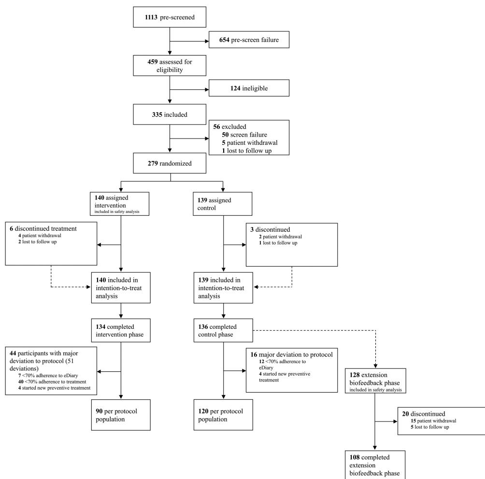
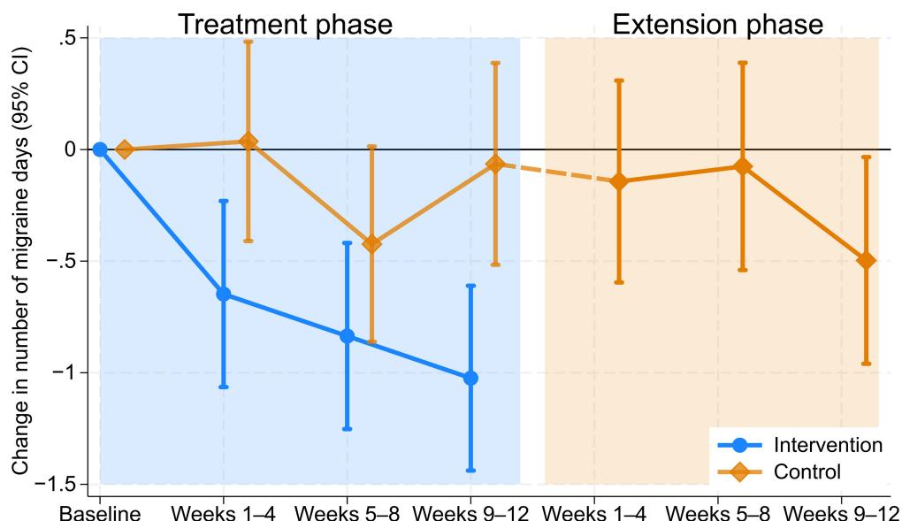
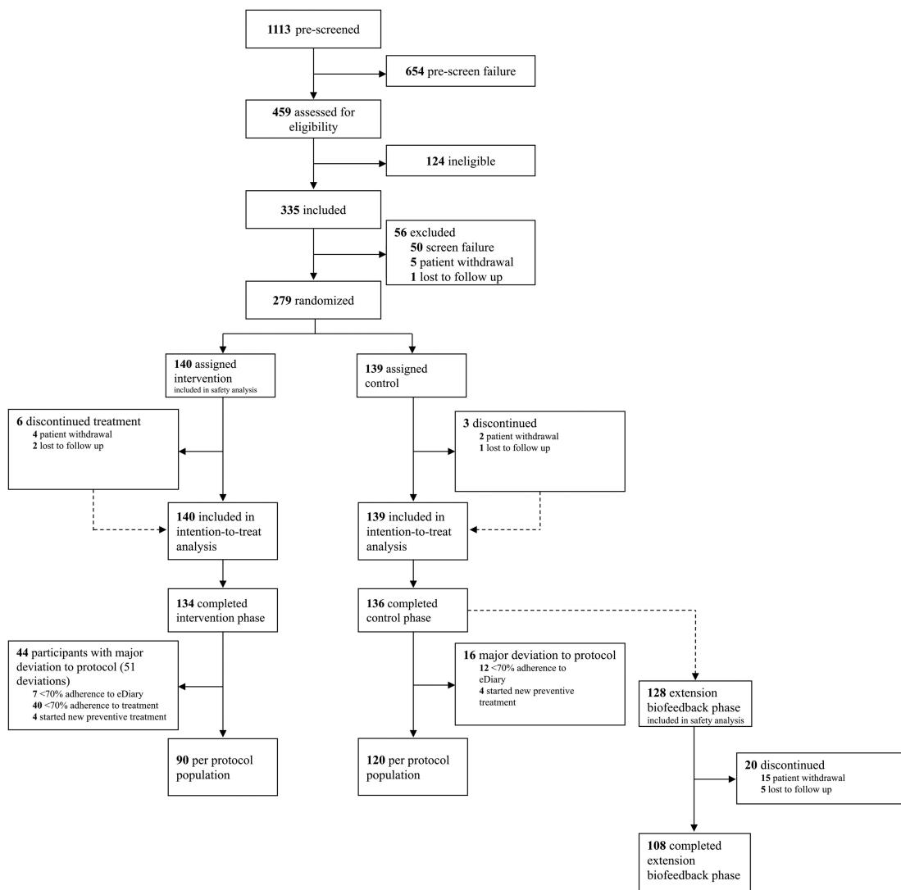

# App-based self-administered biofeedback for the prevention of episodic migraine: A randomized controlled trial

Amalie Christine Poole <https://orcid.org/0009-0007-6747-6475><sup>[1,2,3](#block-1-9)</sup>, Anker Stubberud <https://orcid.org/0000-0003-0934-9914><sup>[1,2](#block-1-9)</sup>, Melanie Rae Simpson<sup>[4](#block-1-12)</sup>, Lise Rystad Øie <https://orcid.org/0000-0001-9844-4651><sup>[1,2,3](#block-1-9)</sup>, Erling Tronvik <https://orcid.org/0000-0001-6059-0151><sup>[1,2,3](#block-1-9)</sup>, Espen Saxhaug Kristoffersen <https://orcid.org/0000-0002-8999-5424><sup>[1,5,6](#block-1-9)</sup>, Marte-Helene Bjørk <https://orcid.org/0000-0002-5745-1094><sup>[1,7,8](#block-1-9)</sup>, Iben Cornelia Keim Larsen<sup>[1,9](#block-1-9)</sup>, Kjersti Grøtta Vetvik <https://orcid.org/0000-0002-4286-5147><sup>[1,6](#block-1-9)</sup>, Nina Bäcklund<sup>[1](#block-1-9)</sup>, Joakim Høgsteggen Østhus <https://orcid.org/0009-0008-1805-8696><sup>[1,2,3](#block-1-9)</sup>, Joan Crespi<sup>[1,10](#block-1-9)</sup>, Oda Vardenær Lunder <https://orcid.org/0009-0007-8250-2977><sup>[1,6](#block-2-0)</sup>, Andrej Netland Khanevski<sup>[1,7](#block-1-9)</sup>, Ane Bakke Øvrevik<sup>[1,7](#block-2-1)</sup>, Alexander Olsen <https://orcid.org/0000-0001-8691-3860><sup>[1,11,12](#block-1-9)</sup>, Mattias Linde <https://orcid.org/0009-0000-4799-9534><sup>[1,2,13](#block-1-9)</sup>, Øyvind Salvesen<sup>[4](#block-1-12)</sup>, and Tore Wergeland <https://orcid.org/0000-0003-2295-123X><sup>[1,2,3](#block-1-10)</sup>

## Abstract

### Aim

To evaluate the efficacy and safety of a fully self-administered, app-based biofeedback intervention for the prevention of episodic migraine

### Methods

This open-label, randomized, waitlist-controlled multicenter trial included adults with episodic migraine assigned to 12 weeks of daily biofeedback or a waitlist control. The primary outcome was change in monthly migraine days (MMDs) from baseline to weeks 9–12. Secondary outcomes included migraine intensity, acute medication use, and migraine-specific quality of life (MSQ v2.1). Statistical analyses were performed according to the intention-to-treat principle by a statistician masked to treatment assignment.

### Results

Of 1113 individuals screened, 279 participants (mean [SD] age, 41 [10] years; 92% women) were randomized to the intervention (n = 140) or waitlist control (n = 139). Baseline MMDs were 4.8 (2.4) and 4.6 (2.3) in the intervention and control groups, respectively. During weeks 9–12, the estimated reduction in MMDs was 0.9 days (95% CI, –1.4 to –0.5) in the intervention group and 0.0 days (95% CI, –0.5 to 0.4) in the control group (between-group difference, 0.9 days; 95% CI, 0.3 to 1.5; P = 0.002). Participants receiving biofeedback also showed greater improvements in MSQ v2.1 total scores (mean difference, 5.3 points; 95% CI, 2.1 to 8.6; P = 0.001). Nine device-related adverse events occurred, all with mild severity.

### Conclusion

App-based self-administered biofeedback was associated with a statistically significant reduction in migraine frequency and improved quality of life, with a favorable safety profile.

## Abstract


**ORIGINAL ARTICLE**

## App-based Self-administered Biofeedback for the Prevention of Episodic Migraine: A Randomized Controlled Trial

Amalie Christine Poole, Anker Stubberud, Melanie Rae Simpson, Lise Rystad Øie, Erling Tronvik, Espen Saxhaug Kristoffersen, Marte-Helene Bjørk, Iben Cornelia Keim Larsen, Kjersti Grøtta Vetvik, Nina Bäcklund, et al.

### KEY MESSAGES

App-based self-administered biofeedback reduced monthly migraine days compared with waitlist control. The intervention improved migraine-specific quality of life and patient impression of change.

### AIM

To evaluate the efficacy and safety of a self-administered app-based biofeedback intervention for the prevention of episodic migraine.

### METHODS

**Design:** Randomized, waitlist-controlled clinical trial.  
**Setting:** 4 centers across Norway.  
**Population:** 279 patients randomized (92% women, mean age 41 [SD 10] years).  
**Intervention:** 12-week app-based self-administered biofeedback (10 minutes daily) versus waitlist control.  
**Primary outcome:** change in monthly migraine days.

### RESULTS

Statistically significant reduction in monthly migraine days compared to waitlist control (-0.9 days; 95% CI -1.4 to -0.5).

Improvements in migraine-specific quality of life and patient global impression of change.

Few adverse device effects. No serious device-related adverse effects.

The graph displays the change in the number of migraine days (95% CI) from baseline to week 9-12. The x-axis is divided into two main phases: 'Treatment phase' (Weeks 1-4 and Weeks 5-8) and 'Extension phase' (Weeks 9-12). The y-axis represents the change in migraine days, ranging from -1.5 to .5. The 'Intervention' group (blue line) shows a significant decrease in migraine days compared to the 'Control' group (orange line).

Baseline: Intervention (-0.9 days), Control (0 days)

Weeks 1-4: Intervention (-0.7 days), Control (0.1 days)

Weeks 5-8: Intervention (-0.8 days), Control (-0.4 days)

Weeks 9-12: Intervention (-1.1 days), Control (-0.1 days)

Error bars represent 95% confidence intervals.

**International Headache Society**

DOI : 10.1177/03331024261480724

**Cephalalgia**  
An International Journal of Headache

Infographic: Overview of a randomized controlled trial for app-based self-administered biofeedback in migraine prevention. Line graph showing change in number of migraine days (95% CI) from baseline to week 9-12. The x-axis is divided into 'Treatment phase' (Weeks 1-4, Weeks 5-8) and 'Extension phase' (Weeks 9-12). The y-axis ranges from -1.5 to .5. The 'Intervention' group (blue line) shows a significant decrease in migraine days compared to the 'Control' group (orange line).

Graphical abstract This is a visual representation of the abstract.

## Keywords

migraine, biofeedback, behavioral treatment, mHealth, episodic migraine, digital therapeutics

<a id="block-1-9"></a>

<sup>1</sup>Norwegian Centre for Headache Research, Norwegian University of Science and Technology, Trondheim, Norway

<a id="block-1-10"></a>

<sup>2</sup>Department of Neuromedicine and Movement Sciences, Norwegian University of Science and Technology, Trondheim, Norway

<a id="block-1-11"></a>

<sup>3</sup>Department of Neurology and Neurophysiology, St. Olavs Hospital, Trondheim University Hospital, Trondheim, Norway

<a id="block-1-12"></a>

<sup>4</sup>Department of Public Health and Nursing, Norwegian University of Science and Technology, Trondheim, Norway

<a id="block-1-13"></a>

<sup>5</sup>Department of General Practice, University of Oslo, Oslo, Norway

<a id="block-2-0"></a>

<sup>6</sup>Department of Neurology, Akershus University Hospital, Lørenskog, Norway

<a id="block-2-1"></a>

<sup>7</sup>Department of Neurology, Haukeland University Hospital, Bergen, Norway

<a id="block-2-2"></a>

<sup>8</sup>Department of Clinical Medicine, University of Bergen, Bergen, Norway

<a id="block-2-3"></a>

<sup>9</sup>Department of Neurology, University Hospital of North Norway, Tromsø, Norway

<a id="block-2-4"></a>

<sup>10</sup>Department of Anesthesiology and Intensive Care Medicine, St. Olavs Hospital, Trondheim University Hospital, Trondheim, Norway

<a id="block-2-5"></a>

<sup>11</sup>Department of Psychology, Norwegian University of Science and Technology, Trondheim, Norway

<a id="block-2-6"></a>

<sup>12</sup>Clinic of Rehabilitation, St. Olavs Hospital, Trondheim University Hospital, Trondheim, Norway

<a id="block-2-7"></a>

<sup>13</sup>Regional Migraine Unit, Sahlgrenska University Hospital, Gothenburg, Sweden

Corresponding author(s):

Amalie Christine Poole, Norwegian Centre for Headache Research, Norwegian University of Science and Technology, Trondheim, Norway. Email: [amalie.c.poole@ntnu.no](mailto:amalie.c.poole@ntnu.no)

## Introduction

Migraine is a prevalent neurological disorder that leads to substantial disability and socioeconomic burden.<sup>[1,2](#block-14-8)</sup> Preventive pharmacologic treatments are often limited by adverse effects and high discontinuation rates.<sup>[3](#block-15-2)</sup> Nonpharmacological interventions, such as biofeedback, aim to promote self-regulation of physiological responses and have shown preventive benefit in migraine,<sup>[4-7](#block-15-4)</sup> and are endorsed by the American Headache Society as evidence-based, Grade A biobehavioral therapies for migraine prevention.<sup>[8](#block-15-12)</sup>

Recent advances in mobile health (mHealth) enable self-administered biofeedback without therapist involvement, improving accessibility and cost-effectiveness.<sup>[9-11](#block-15-14)</sup> However, few randomized controlled trials have evaluated fully self-administered mHealth biofeedback interventions.<sup>[9](#block-15-14)</sup> This study aimed to assess the efficacy and safety of a 12-week, app-based self-administered biofeedback treatment for the prevention of episodic migraine in adults.

## Methods

### Study design

This open-label, randomized, waitlist-controlled, multicenter trial (BioCer) was conducted between 5 January 2023 and 23 September 2024 at four Norwegian hospitals with nationwide recruitment. This study was designed according to the recommendations of the International Headache Society for controlled trials in episodic migraine<sup>[12](#block-15-20)</sup> and was approved by the Regional Committees for Medical and Health Research Ethics (REK 502734) and the Norwegian Medical Product Agency (NOMA) (ref 22/17254-5). This was an investigator-initiated trial. The study design, data collection, analysis and interpretation were conducted independently by the academic investigators. Findings were reported using the Consolidated Standards of Reporting Trials (CONSORT) guideline.<sup>[13](#block-15-22)</sup> All participants provided electronic informed consent. The full trial protocol and statistical analysis plan are available in Supplement 1. A published version of the protocol is also available.<sup>[14](#block-15-23)</sup>

### Participants

Eligible participants were adults aged 18 years or older with migraine with or without aura according to the diagnostic criteria of the third edition of the International Classification of

Headache Disorders (ICHD-3),<sup>[15](#block-15-26)</sup> experiencing 4–14 monthly migraine days (MMDs) during the 3 months prior to inclusion and the 4-week baseline phase, with completion of at least 70% of eDiary entries (at least 19 of the 28 last days of the baseline phase). The use of concurrent migraine preventive medication was prohibited unless participants were on a stable dose ( $\geq 3$  months or  $\geq 5$  half-lives, whichever was longer) in monotherapy. Participants who had previously attempted three or more migraine preventives at adequate doses without significant clinical benefit, or  $>14$  headache days of any type per month, were excluded. Detailed eligibility criteria are provided in [Supplemental Table 1](https://journals.sagepub.com/doi/suppl/10.1177/03331024261480724).

### Recruitment and randomization

Participants were recruited nationwide through institutional websites and social media platforms. Interested individuals contacted the study site directly via email or through an institutional contact form and were pre-screened by telephone by study personnel. Potentially eligible participants were subsequently evaluated by an investigator via video consultation to confirm eligibility. Following inclusion, all participants completed a 4-week electronic baseline diary. Randomization was scheduled to occur no earlier than four weeks after inclusion, after a rescreening process to confirm participant eligibility. Eligible participants were then randomly assigned in a 1:1 ratio to the intervention group or the waitlist control group. Randomization was performed using a centralized, computer-generated system employing permuted blocks of variable size, and was stratified by concomitant preventive medication use. Allocation concealment was maintained by automated assignment procedures implemented within the electronic study platform. Participants and investigators were aware of group allocation due to the nature of the intervention, whereas trial statisticians were masked to the treatment conditions and were provided only with neutral group labels (group A and B).

### Procedures

All study visits were conducted remotely via video or telephone and collected data was entered into an electronic case report form. Participants randomized to the intervention group received access to the Cerebri biofeedback system, a fully self-administered mHealth platform integrating three biofeedback modalities: heart rate variability, peripheral skin temperature, and trapezius muscle surface electromyography (sEMG). The setup has previously been tested in a pilot study.<sup>[11](#block-15-18)</sup> The system used two wireless sensors connected via Bluetooth<sup>®</sup> to a smartphone application (app), which provided real-time visual feedback on physiological responses during training. The sensors were mailed to participants together with a brief written setup guide explaining how to connect the sensors and begin using the system. The app included automated onboarding and written instructions. No therapist-led training was provided at any time.

The intervention consisted of a daily 10-min app-based biofeedback training program for 12 weeks. Participants could complete additional sessions, up to six sessions per day, depending on individual preference and availability. During each session, participants trained with one modality at a time. The first three sessions served as standardized onboarding to each biofeedback modality, after which users could freely select which modality to train in each session. An optional paced breathing feature was available during each session to guide respiratory regulation, while an in-app library offered short textual descriptions of relaxation and awareness techniques (e.g., progressive muscle relaxation) that users could explore and apply at their discretion. All exercises were performed with continuous biofeedback to facilitate self-regulation learning.

The Cerebri application included an integrated eDiary used by all participants, including those in the waitlist control group, from the start of the 4-week baseline and throughout the study. The eDiary captured daily headache occurrence, intensity (0–10 numeric rating scale (NRS)), and acute

medication use. Participants were also asked to categorize each headache as migraine or non-migraine.

Participants allocated to the control group were instructed to continue daily eDiary reporting within the Cerebri app. They received the same scheduled remote follow-up as the intervention group but did not have access to the biofeedback module or sensors. After completing the 12-week waitlist phase, control participants were invited to participate in an optional extension phase during which they initiated biofeedback training with the Cerebri biofeedback system and received regular follow-up.

Adherence to biofeedback sessions and eDiary use was tracked via a web-based dashboard, allowing study personnel to monitor compliance in real time and address low adherence.

Participants who encountered technical difficulties with the device could access dedicated support service provided by the sponsor.

Participants could use acute treatments as needed. Opioid use was restricted to a maximum of 3 days per month.

### Outcomes

The primary endpoint was the change in MMDs from baseline to the last 28-day period of the 12-week treatment phase (weeks 9–12). A migraine day was defined as any calendar day on which the participant reported onset, continuation, or recurrence of a migraine headache, with either intensity  $\geq 4$  on a 0–10 NRS lasting  $\geq 4$  h, and/or use of migraine-specific acute medication with confirmed abortive effect.

Prespecified secondary outcomes included the change in MMDs from baseline to weeks 1–4 and 5–8; the proportion of participants achieving a  $\geq 30\%$  reduction in MMDs from baseline to weeks 9–12; the change in migraine day intensity (0–10 NRS) from baseline to weeks 9–12; changes in acute medication use for migraine from baseline to weeks 9–12; and changes in migraine-specific quality of life (MSQ v2.1) from baseline to weeks 4, 8, and 12. The only migraine-specific acute medications available were triptans and rimegepant. Other acute medications included paracetamol, NSAIDs, and opioids.

Prespecified exploratory endpoints included change from baseline in weekly migraine days, change in headache days for each 28-day period, adherence to biofeedback and eDiary use, and change in the Patient Global Impression of Change (PGIC) Scale. For waitlist participants opting for biofeedback treatment in an extension phase, changes in MMDs from the pre-randomization baseline to each 28-day period of the 12-week extension phase were analyzed.

Data obtained through the eDiary included migraine days, headache days, migraine day intensity, acute medication use, and adherence. MSQ v2.1 and PGIC scores were collected electronically at weeks 4, 8, and 12. Safety assessments included treatment-emergent adverse events (AEs), adverse device effects (ADEs), serious ADEs (SADEs), and unanticipated SADEs (USADEs).

### Statistical analysis

The sample size calculation was based on the primary outcome. Based on available data suggesting a standardized effect size of  $d = 0.4$ , we estimated that 100 participants per group would be required to achieve 80% power with a two-sided  $\alpha$  of 0.05.<sup>[6,16](#block-15-8)</sup> To account for an anticipated 30% dropout rate, 143 participants per group were planned.

Analyses followed the prespecified Statistical Analysis Plan (SAP), but also included a post hoc analysis assessing proportion of participants achieving a  $\geq 50\%$  reduction in MMDs. Statistical analyses were performed using StataNow/MP 18.0 (College Station, Texas).

For the primary outcome, a mixed logistic regression model was used to estimate the daily marginal probability of migraine for each 28-day period (baseline; weeks 1–4, 5–8, and 9–12). Fixed effects included time period, treatment group, and their interaction; stratification by preventive medication use at baseline was accounted for by including this variable as a fixed effect in the model. Model-

based estimates were used to derive the change in MMDs from baseline within each group and the between-group difference in change. As mixed models yield unbiased estimates under the assumption that data are missing at random, no imputation procedures were performed. The same modelling framework was applied to headache days and acute medication use. Linear mixed models were used to analyze changes in migraine intensity, MSQ v2.1, and PGIC scores. Sensitivity analyses for the primary outcome included additional adjustment for potential predictors of migraine day frequency and assessment of heterogeneity of treatment effect across subgroups defined by baseline preventive medication use, age (<35, 35–50, >50 years), education level, and study site.

The intention-to-treat (ITT) population included all randomized participants with available data from the baseline and 12-week treatment phases and was used for all primary, secondary, and exploratory outcomes, except the exploratory extension outcome, which included participants in the 12-week extension phase. For participants in the control group who entered the extension phase, baseline was defined as the last 28 days of the waitlist period (weeks 9–12). A per-protocol (PP) analysis was conducted for the primary outcome and included participants with  $\geq 19$  of 28 completed eDiary days per 28-day period, no changes in preventive medication, and (in the intervention arm only)  $\geq 19$  of 28 completed biofeedback days per period. Additional analyses assessed outcomes according to early and continued adherence to biofeedback sessions.

Adherence categories were defined as prolonged ( $\geq 90\%$  completion of biofeedback sessions in all three 28-day periods); early adherence ( $\geq 90\%$  completed biofeedback sessions in only the first 28-day period); not adherent ( $< 90\%$  completed biofeedback sessions in all three 28-day periods).

The safety population included all participants exposed to the biofeedback device during the treatment or extension phases. Safety outcomes were summarized descriptively. No data monitoring committee was appointed.

## Results

A total of 1113 individuals were prescreened; 459 completed eligibility assessment, 335 entered the baseline period for a minimum of 28 days, and 279 were randomized to the intervention group ( $n = 140$ ) or the waitlist control group ( $n = 139$ ). Details on the participant flow and randomization are shown in [Figure 1](#). Baseline demographics and clinical characteristics were comparable across both groups. Most participants were female (92%), with a mean age of 41.2 years ([Table 1](#)). At baseline, the mean estimated number of MMDs was 4.9 (95% CI, 4.5 to 5.2). In the intervention group, two participants were pregnant at inclusion.



The flowchart illustrates the progression of participants through a clinical trial, starting with 1113 pre-screened individuals and ending with 108 completed extension biofeedback phase participants.

```
graph TD
    A["1113 pre-screened"] --> B["459 assessed for eligibility"]
    A -.-> C["654 pre-screen failure"]
    B --> D["335 included"]
    B -.-> E["124 ineligible"]
    D --> F["279 randomized"]
    D -.-> G["56 excluded<br/>50 screen failure<br/>5 patient withdrawal<br/>1 lost to follow up"]
    F --> H["140 assigned intervention<br/>included in safety analysis"]
    F --> I["139 assigned control"]
    H --> J["140 included in intention-to-treat analysis"]
    H -.-> K["6 discontinued treatment<br/>4 patient withdrawal<br/>2 lost to follow up"]
    I --> L["139 included in intention-to-treat analysis"]
    I -.-> M["3 discontinued<br/>2 patient withdrawal<br/>1 lost to follow up"]
    J --> N["134 completed intervention phase"]
    N --> O["90 per protocol population"]
    N -.-> P["44 participants with major deviation to protocol (51 deviations)<br/>7 <70% adherence to eDiary<br/>40 <70% adherence to treatment<br/>4 started new preventive treatment"]
    L --> Q["136 completed control phase"]
    Q --> R["120 per protocol population"]
    Q -.-> S["16 major deviation to protocol<br/>12 <70% adherence to eDiary<br/>4 started new preventive treatment"]
    Q -.-> T["128 extension biofeedback phase<br/>included in safety analysis"]
    T --> U["108 completed extension biofeedback phase"]
    T -.-> V["20 discontinued<br/>15 patient withdrawal<br/>5 lost to follow up"]
```

**Pre-screening:** 1113 pre-screened, 654 pre-screen failure.

**Eligibility Assessment:** 459 assessed for eligibility, 124 ineligible.

**Inclusion:** 335 included, 56 excluded (50 screen failure, 5 patient withdrawal, 1 lost to follow up).

**Randomization:** 279 randomized into intervention (140) and control (139) groups.

**Intention-to-Treat Analysis:** 140 in intervention, 139 in control.

**Intervention Phase:** 134 completed, 90 per protocol population.

**Control Phase:** 136 completed, 120 per protocol population.

**Extension Biofeedback Phase:** 128 included, 108 completed.

Flowchart: CONSORT flow diagram of participant screening, randomization, and follow-up.

Figure 1. Study profile.

**Table 1.** Baseline demographics and clinical characteristics.

|                                                   | Intervention (n = 140) | Control (n = 139) | Total (n = 279) |
|---------------------------------------------------|------------------------|-------------------|-----------------|
| Sex, female, n (%)                                | 130 (92.9)             | 127 (91.4)        | 257 (92.1)      |
| Age, years, mean (SD)                             | 41.9 (10.1)            | 40.5 (9.9)        | 41.2 (10.0)     |
| Educational level completed, n (%)                |                        |                   |                 |
| Primary school                                    | 1 (0.7)                | 3 (2.2)           | 4 (1.5)         |
| High school                                       | 11 (8.0)               | 10 (7.4)          | 21 (7.7)        |
| Technical college                                 | 10 (7.3)               | 7 (5.1)           | 17 (6.2)        |
| Tertiary education (3 years or less)              | 42 (30.7)              | 55 (40.4)         | 97 (35.5)       |
| Tertiary education (more than 3 years)            | 73 (53.3)              | 61 (44.9)         | 134 (49.1)      |
| Pregnant<sup>a</sup>, n (%)                       | 2 (1.4)                | 0 (0.0)           | 2 (0.7)         |
| Breastfeeding<sup>a</sup>, n (%)                  | 1 (0.7)                | 2 (1.4)           | 3 (1.1)         |
| Expectations to treatment (0 to 10), mean (SD)    | 5.6 (1.8)              | 5.7 (1.8)         | 5.6 (1.8)       |
| Use of preventive medication, n (%)               | 41 (29.3)              | 39 (28.1)         | 80 (28.7)       |
| Site of inclusion, n (%)                          |                        |                   |                 |
| Akershus University Hospital                      | 31 (22.1)              | 39 (28.1)         | 70 (25.1)       |
| Haukeland University Hospital                     | 35 (25.0)              | 31 (22.3)         | 66 (23.7)       |
| St. Olavs Hospital, Trondheim University Hospital | 71 (50.7)              | 64 (46.0)         | 135 (48.4)      |
| University Hospital of North Norway               | 3 (2.1)                | 5 (3.6)           | 8 (2.9)         |

<sup>a</sup>Pregnancy and breastfeeding as reported at inclusion.  
SD, standard deviation.

### Primary outcome

At baseline, participants reported mean (SD) MMDs of 4.8 (2.4), and 4.6 (2.3) in the intervention and control groups, respectively. The estimated reduction in MMDs from baseline to the last 4-weeks of the treatment phase was 0.9 days (95% CI, -1.4 to -0.5) for the intervention group, and 0 days (95% CI, -0.5 to 0.4) for the control group (Table 2). The between-group difference was 0.9 days (95% CI, 0.3 to 1.5;  $P = 0.002$ ; Table 2; Figure 2).



Treatment phase Extension phase

Change in number of migraine days (95% CI)

Baseline Weeks 1–4 Weeks 5–8 Weeks 9–12 Weeks 1–4 Weeks 5–8 Weeks 9–12

Intervention Control

The chart shows the change in the number of migraine days for an Intervention group (blue line) and a Control group (orange line) across three time periods: Baseline, Weeks 1–4, Weeks 5–8, Weeks 9–12, Weeks 1–4, Weeks 5–8, and Weeks 9–12. The Treatment phase is highlighted in blue, and the Extension phase is highlighted in orange.

| Time Period | Intervention | Control |
|-------------|--------------|---------|
| Baseline    | 0            | 0       |
| Weeks 1–4   | -0.65        | 0.05    |
| Weeks 5–8   | -0.85        | -0.4    |
| Weeks 9–12  | -1.05        | -0.1    |
| Weeks 1–4   |              | -0.15   |
| Weeks 5–8   |              | -0.1    |
| Weeks 9–12  |              | -0.5    |

Line chart: Change in number of migraine days across treatment and extension phases.

Figure 2. Estimated mean change in monthly migraine days (MMDs) from baseline. Mean model-based change in MMDs from baseline in the intervention group ( $n = 140$ ; blue) and control group ( $n = 139$ ; orange) for each 4-week period during the 12-week treatment phase and the subsequent extension phase for the control group, during which they received the study intervention (Cerebri). Points represent estimated mean changes and error bars 95% confidence intervals. Estimates were derived from a mixed logistic regression model using the same analysis strategy as described for the primary outcome with the additional inclusion of the extension phase for the control group. Model-based daily marginal probabilities were used to derive MMDs.

**Table 2.** Primary and secondary endpoints.

|                                                               | Intervention           | Control               | Mean difference<br>(95% CI) | Odds ratio<br>(95% CI) | p-value |
|---------------------------------------------------------------|------------------------|-----------------------|-----------------------------|------------------------|---------|
| <b>Primary endpoint</b>                                       |                        |                       |                             |                        |         |
| Change in MMDs weeks 9–12 (95% CI)                            | −0.9 (−1.4 to −0.5)    | 0.0 (−0.5 to 0.4)     | −0.9 (−1.5 to −0.3)         | 0.77 (0.66 to 0.91)    | 0.002   |
| <b>Secondary endpoints</b>                                    |                        |                       |                             |                        |         |
| Change in MMDs weeks 1–4                                      | −0.6 (−1.0 to −0.2)    | 0.1 (−0.4 to 0.5)     | −0.7 (−1.3 to −0.1)         | 0.83 (0.71 to 0.96)    | 0.016   |
| Change in MMDs weeks 5–8                                      | −0.8 (−1.2 to −0.4)    | −0.4 (−0.8 to 0.0)    | −0.4 (−1.0 to 0.1)          | 0.89 (0.75 to 1.04)    | 0.15    |
| Change in migraine day intensity weeks 9–12                   | −0.34 (−0.49 to −0.18) | −0.04 (−0.18 to 0.11) | −0.30 (−0.50 to −0.09)      | NA                     | 0.007   |
| 30% responder rate weeks 9–12, No./total (%)                  | 50/113 (44.2%)         | 29/97 (30%)           | NA                          | 1.86 (1.05 to 3.30)    | 0.03    |
| Change in days with analgesic acute medication use weeks 9–12 | −0.7 (−1.1 to −0.2)    | 0.0 (−0.5 to 0.5)     | −0.7 (−1.3 to −0.1)         | 0.84 (0.72 to 0.98)    | 0.03    |
| Change in MSQ v2.1 total score week 12<sup>a</sup>            | 12.2 (9.8 to 14.6)     | 6.8 (4.3 to 9.3)      | 5.3 (2.1 to 8.6)            | NA                     | 0.001   |

<sup>a</sup>MSQ v2.1 scores range from 0–100, with higher values indicating better status.

MSQ v2.1, Migraine-specific quality-of-life questionnaire 2.1; CI: Confidence interval; MMDs, monthly migraine days.

Ninety participants (n = 90) in the intervention group and 119 participants in the control group were included in the per-protocol analyses. Per-protocol analyses showed results consistent with the intention-to-treat analysis, demonstrating a reduction in MMDs in the intervention group compared to the control group. At weeks 9–12, the estimated reduction in MMDs was −1.1 days (95% CI, −1.6 to −0.6) in the intervention group and 0.0 days (95% CI, −0.5 to 0.5) in the control group, yielding an estimated between-group difference of −1.1 days (95% CI, −1.7 to −0.5;  $P < 0.001$ ) ([Supplemental Table 2](https://journals.sagepub.com/doi/suppl/10.1177/03331024261480724)).

### Secondary outcomes

At weeks 1–4, the intervention group showed a greater reduction in MMDs than the control group, whereas no significant difference was observed at weeks 5–8 ([Table 2](#)). During weeks 9–12, migraine day intensity was lower in the intervention group (4.8; 95% CI, 4.7 to 5.0) than in controls (5.1; 95% CI, 4.9 to 5.3), with a mean difference of −0.3 (95% CI, −0.5 to −0.1;  $P = 0.006$ ). A  $\geq 30\%$  reduction in MMDs occurred in 44.2% of participants in the intervention group and 30% in the control group (OR, 1.86; 95% CI, 1.05 to 3.30;  $P = 0.03$ , [Table 2](#); [Supplemental Figure 1](https://journals.sagepub.com/doi/suppl/10.1177/03331024261480724)). A post-hoc analysis applying a 50% threshold also favored the intervention group, but the difference was not statistically significant (32.7% vs 21.7%; OR, 1.75; 95% CI, 0.94 to 3.27;  $P = 0.08$ ) ([Supplemental Table 3](https://journals.sagepub.com/doi/suppl/10.1177/03331024261480724)). The number of days with any analgesic medication for acute headache treatment was lower in the intervention group at weeks 9–12 (mean difference, −0.7 days; 95% CI, −1.3 to −0.1;  $P = 0.03$ ), while differences in migraine-specific medication use were not significant ([Table 2](#); [Supplemental Table 4](https://journals.sagepub.com/doi/suppl/10.1177/03331024261480724)). Migraine-specific quality of life (MSQ v2.1) improved more in the intervention group, with an adjusted mean difference of 5.3 points at week 12 (95% CI, 2.1 to 8.6;  $P = 0.001$ ) ([Table 2](#); [Supplemental Table 5](https://journals.sagepub.com/doi/suppl/10.1177/03331024261480724)).

### Subgroup analyses and exploratory endpoints

Subgroup analyses addressing effect of age, education level, concomitant use of preventive medication and site of inclusion showed no statistically significant treatment-by-subgroup interactions ([Supplemental Table 7](https://journals.sagepub.com/doi/suppl/10.1177/03331024261480724)). Effects appeared greater among participants using preventive medication and those aged  $>50$  years, although these differences were not statistically significant. Subgroup analysis detailing adherence to biofeedback sessions showed that higher adherence to biofeedback was associated with larger reductions in MMDs, with the greatest effect observed among participants with  $\geq 90\%$  adherence (n = 21) throughout the treatment period (mean

difference in change from baseline, −1.5 days; 95% CI, −2.5 to −0.6) ([Supplemental Table 6 and Supplemental Figure 2](https://journals.sagepub.com/doi/suppl/10.1177/03331024261480724)). The early adherence group (n = 47) and not adherent group (n = 72) showed mean differences in MMD as compared to the control of −0.9 days (95% CI, −1.6 to −0.1) and −0.8 days (95% CI, −1.4 to 0.0), respectively.

Exploratory analyses showed that weekly migraine days were generally lower in the intervention group during the treatment period ([Supplemental Figure 3](https://journals.sagepub.com/doi/suppl/10.1177/03331024261480724)). The intervention group had fewer headache days at weeks 9–12 (mean difference, −1.3 days; 95% CI, −2.0 to −0.6;  $P < 0.001$ ) and greater improvement on the PGIC, with a mean difference of −0.7 at week 12 (95% CI, −0.9 to −0.4;  $P < 0.001$ ) ([Supplemental Tables 8 and 9](https://journals.sagepub.com/doi/suppl/10.1177/03331024261480724)). Among participants in the control group who entered the extension phase, the estimated reduction in MMDs from baseline to weeks 9–12 was −0.50 days (95% CI, −0.96 to −0.03;  $P = 0.04$ , [Figure 2](#)). Adherence to biofeedback sessions was lower in the extension phase than in the randomized treatment phase ([Supplemental Table 11](https://journals.sagepub.com/doi/suppl/10.1177/03331024261480724)).

### Safety analysis

All participants exposed to biofeedback during the treatment or extension phase were included in the safety analysis. ADEs included fatigue, light-headedness, device-site discomfort and pruritus, neck or shoulder pain, rash, and unspecified sensory disturbances ([Table 3](#)). These events were uncommon, with a total of 9 reported, and all were mild. No SADEs, USADEs, or device-related discontinuations occurred. The most common treatment-emergent AEs were upper respiratory tract infections, COVID-19, gastroenteritis and influenza ([Supplemental Table 10](https://journals.sagepub.com/doi/suppl/10.1177/03331024261480724)). Two SAEs (menorrhagia and appendicitis) occurred.

**Table 3.** Summary adverse device effects.

| ADE<sup>a</sup>                     | Intervention group (n = 140) | Cerebri during extension phase (n = 128) | Total (n = 268) |
|-------------------------------------|------------------------------|------------------------------------------|-----------------|
| Fatigue                             | 0                            | 1                                        | 1               |
| Lightheadedness                     | 1                            | 1                                        | 2               |
| Medical device site discomfort      | 1                            | 0                                        | 1               |
| Medical device site pruritus        | 1                            | 1                                        | 2               |
| Neck pain                           | 1                            | 0                                        | 1               |
| Rash                                | 0                            | 1                                        | 1               |
| Sensory disturbance (not specified) | 1                            | 0                                        | 1               |

*Note:* Values are presents as the number of reported adverse device effects.

<sup>a</sup>An ADE is an AE with possible, probable or causal relationship to the intervention.

## Discussion

In this randomized trial, 12 weeks of self-administered biofeedback therapy using Cerebri resulted in a statistically significant reduction in MMDs and improvements in quality of life in adults with episodic migraine. The intervention was well tolerated. Although the absolute reduction in MMDs was modest, it occurred in a population with relatively low baseline migraine frequency. Furthermore, the observed reduction was accompanied by improvements across multiple secondary outcomes. Within-group improvements in the intervention group exceeded established minimally important difference (MID) thresholds for all three MSQ v2.1 domains, and between-group differences exceeded group-level MID thresholds for the Role Function-Restrictive and Role Function-Preventive domains, but not for the Emotional Functioning domain.<sup>[17](#block-16-0)</sup> A larger proportion of participants in the intervention group achieved a  $\geq 30\%$  reduction of MMDs compared with controls. Although the  $\geq 50\%$  responder rate was lower than typically reported for pharmacological preventives,<sup>[18,19](#block-16-0)</sup> these findings should be considered alongside the favorable safety profile, low treatment burden, and nonpharmacological nature of the intervention.

Robust clinical evaluations of digital health apps for migraine can be achieved using remote solutions and waiting list-controlled design.<sup>[20–22](#block-16-0)</sup> However, prior evidence supporting mobile biofeedback for migraine has been limited by pilot designs, small sample sizes, and reliance on single-modality or therapist-assisted approaches. A 2021 randomized controlled trial ( $n = 52$ ) of an 8-week heart-rate-variability biofeedback app did not improve migraine-specific quality of life,<sup>[23](#block-16-0)</sup> and a 2024 randomized controlled trial ( $n = 84$ ) of a 6-week therapist-guided sEMG program improved disability but not frequency.<sup>[24](#block-16-0)</sup> To the best of our knowledge, this is the first fully self-administered mHealth based biofeedback intervention to demonstrate a significant reduction in MMDs. The safety profile of Cerebri was favorable, with only 9 ADEs among 268 exposed participants ( $\approx 4\%$ ), all mild and none leading to treatment discontinuation. This contrasts with oral migraine preventives, which may lead to discontinuation in up to 20% of patients,<sup>[18](#block-16-0)</sup> and with calcitonin gene-related peptide-targeted therapies, where real-world adverse event rates range from 5% to 18%.<sup>[25](#block-16-0)</sup> The low incidence and mild nature of ADEs make Cerebri an attractive option for patients preferring non-pharmacological treatments or those who cannot tolerate conventional medications, including women who are pregnant or breastfeeding.

Sustained engagement with a daily self-administered biofeedback program represents an important consideration for real-world implementation. Although adherence to the eDiary exceeded 90% throughout the study, adherence to the biofeedback intervention varied, with 15% of participants maintaining high adherence throughout the intervention period and 51% classified as non-adherent ( $< 90\%$  of completed biofeedback sessions in each of the three 28-day periods). These findings suggest that maintaining long-term engagement with daily biofeedback training may be challenging and underscore the need for strategies that support adherence in routine clinical use of mHealth biofeedback. The greatest reduction in MMDs was observed among participants with  $\geq 90\%$  adherence, with a mean difference of  $-1.5$  days (95% CI,  $-2.5$  to  $-0.6$ ) compared with the control group during weeks 9–12. However, this association may reflect differences in participant characteristics, such as motivation, expectations, or other behavioral factors, rather than a causal dose–response relationship.

Participants who initiated biofeedback during the extension phase experienced a smaller reduction in in MMDs than those treated during the randomized phase ( $-0.50$  vs  $-0.9$  days; [Figure 2](#)), coinciding with lower adherence to biofeedback (61.7% vs 77.9% completing at least 70% of sessions in weeks 9–12; [Supplemental Table 11](https://journals.sagepub.com/doi/suppl/10.1177/03331024261480724)). As the change in migraine days in the extension phase was an exploratory outcome and lacked a concurrent control, direct comparison of effect sizes should be interpreted with caution.

Strengths of this study include the relatively large, multicenter trial design, inclusion of participants from a broad age range, and nationwide enrolment. The main limitation of this study is the use of a

waitlist control rather than a sham-controlled comparison. This design introduces a risk of expectation-related and behavioral effects, as participants receiving the intervention may have had greater expectations of benefit and engagement, while those in the waitlist group may have experienced reduced motivation, potentially contributing to the observed between-group difference. However, credible sham biofeedback is difficult to design, as false feedback may be recognized by participants and may itself have therapeutic effects<sup>[16,26](#block-16-0)</sup>; additionally, the use of deceptive feedback raises ethical concerns. For these reasons, a waitlist control was considered the most feasible and ethically appropriate comparator in this context, consistent with common practice in randomized trials of internet- and app-delivered behavioral interventions for headache.<sup>[22](#block-16-0)</sup> Moreover, the study population had relatively low baseline migraine frequency and limited prior treatment failure, which may limit generalizability to patients seen in specialized headache clinics.

## Conclusion

Twelve weeks of treatment with the Cerebri biofeedback treatment was associated with a reduction in MMDs and improvements across multiple patient-reported and clinical outcomes, with a favorable safety profile. This study supports that app-based mHealth biofeedback therapy could be an effective and tolerable preventive treatment option for individuals with episodic migraine.

## Article highlights

- App-based self-administered biofeedback therapy was associated with a reduction in migraine frequency in adults with episodic migraine
- Higher adherence was associated with a greater reduction in migraine days
- Migraine-specific quality of life improved more in the intervention group
- The intervention was well tolerated with only mild adverse events
- The fully self-administered format may support more accessible delivery of biofeedback therapy

## Supplemental Material

sj-pdf-1-cep-10.1177\_03331024261480724 - Supplemental material for App-based self-administered biofeedback for the prevention of episodic migraine: A randomized controlled trial

Supplemental material, sj-pdf-1-cep-10.1177\_03331024261480724 for App-based self-administered biofeedback for the prevention of episodic migraine: A randomized controlled trial by Amalie Christine Poole, Anker Stubberud, Melanie Rae Simpson, Lise Rystad Øie, Erling Tronvik, Espen Saxhaug Kristoffersen, Marte-Helene Bjørk, Iben Cornelia Keim Larsen, Kjersti Grøtta Vetvik, Nina Bäcklund, Joakim Høgsteggen Østhus, Joan Crespi, Oda Vardenær Lunder, Andrej Netland Khanevski, Ane Bakke Øvrevik, Alexander Olsen, Mattias Linde, Øyvind Salvesen and Tore Wergeland in Cephalalgia

sj-docx-2-cep-10.1177\_03331024261480724 - Supplemental material for App-based self-administered biofeedback for the prevention of episodic migraine: A randomized controlled trial

Supplemental material, sj-docx-2-cep-10.1177\_03331024261480724 for App-based self-administered biofeedback for the prevention of episodic migraine: A randomized controlled trial by Amalie Christine Poole, Anker Stubberud, Melanie Rae Simpson, Lise Rystad Øie, Erling Tronvik, Espen Saxhaug Kristoffersen, Marte-Helene Bjørk, Iben Cornelia Keim Larsen, Kjersti Grøtta Vetvik, Nina Bäcklund, Joakim Høgsteggen Østhus, Joan Crespi, Oda Vardenær Lunder, Andrej Netland Khanevski, Ane Bakke Øvrevik, Alexander Olsen, Mattias Linde, Øyvind Salvesen and Tore Wergeland in Cephalalgia

sj-docx-3-cep-10.1177\_03331024261480724 - Supplemental material for App-based self-administered biofeedback for the prevention of episodic migraine: A randomized controlled trial

Supplemental material, sj-docx-3-cep-10.1177\_03331024261480724 for App-based self-administered biofeedback for the prevention of episodic migraine: A randomized controlled trial by Amalie Christine Poole, Anker Stubberud, Melanie Rae Simpson, Lise Rystad Øie, Erling Tronvik, Espen Saxhaug Kristoffersen, Marte-Helene Bjørk, Iben Cornelia Keim Larsen, Kjersti Grøtta Vetvik, Nina Bäcklund, Joakim Høgsteggen Østhus, Joan Crespi, Oda Vardenær Lunder, Andrej Netland Khanevski, Ane Bakke Øvrevik, Alexander Olsen, Mattias Linde, Øyvind Salvesen and Tore Wergeland in Cephalalgia

## Acknowledgements

We thank all participants, study personnel and clinical monitors for their contribution to this trial.

### ORCID iDs

Amalie Christine Poole <https://orcid.org/0009-0007-6747-6475>

Anker Stubberud <https://orcid.org/0000-0003-0934-9914>

Lise Rystad Øie <https://orcid.org/0000-0001-9844-4651>

Erling Tronvik <https://orcid.org/0000-0001-6059-0151>

Espen Saxhaug Kristoffersen <https://orcid.org/0000-0002-8999-5424>

Marte-Helene Bjørk <https://orcid.org/0000-0002-5745-1094>

Kjersti Grøtta Vetvik <https://orcid.org/0000-0002-4286-5147>

Joakim Høgsteggen Østhus <https://orcid.org/0009-0008-1805-8696>

Oda Vardenær Lunder <https://orcid.org/0009-0007-8250-2977>

Alexander Olsen <https://orcid.org/0000-0001-8691-3860>

Mattias Linde <https://orcid.org/0009-0000-4799-9534>

Tore Wergeland <https://orcid.org/0000-0003-2295-123X>

## Ethical considerations

The study was approved by the Regional Committees for Medical and Health Research Ethics (REK 502734) and the Norwegian Medical Product Agency (NOMA) (ref 22/17254-5). This was an investigator-initiated trial.

### Consent to participate

All participants provided electronic informed consent.

### Consent for publishing

The authors agree that if accepted, the article publishes with Cephalalgia.

### Author contributions

ET, AO, and AS conceived the study. AS initiated the study. The trial and the study were coordinated and administered by TW and NB and TW served as the national coordinating investigator. MRS and TW co-developed the statistical analysis plan and MRS conducted the statistical analysis with the primary outcome also analyzed by ØS for quality control. TW and MRS accessed and verified the data, and all co-authors had access to the data on request. ACP, AS and TW prepared the manuscript. ACP, LRØ, ESK, MHB, ICKL, KGV, JHØ, JC, OVL, ANK, ABØ and TW contributed to data collection as study investigators. All authors contributed to revising the manuscript and approved the final version. ACP, AS, ET and TW were responsible for the decision to submit the manuscript.

### Funding

The authors disclosed receipt of the following financial support for the research, authorship, and/or publication of this article: This work was supported by the Oslo Regional Research Fund and Eurostars (grant number E! 115549).

### Declaration of conflicting interests

The Sponsor of the study is Nordic Brain Tech AS (contact information: [info@nordicbraintech.com](mailto:info@nordicbraintech.com)), a spin-off company from The Norwegian University of Science and Technology (NTNU) and St. Olavs Hospital in Norway. The company was founded in 2019 to commercialize a research-based intervention for treating migraines using remote biofeedback. The sponsor has no role in data collection, analysis and interpretation of data and has no authority pertaining to publication of results. The coordinating investigator has access to the final trial data set. No contractual agreement limits this access. Data management according to the data management plan is conducted by the sponsor. Nordic Brain Tech AS, NTNU and The Central Norway Regional Health Authority may benefit financially from the commercialization of the proposed treatment. A commercial license agreement exists between Nordic Brain Tech AS and NTNU Technology Transfer AS on the commercialization of the treatment. ACP has received travel grants from TEVA, AbbVie and Pfizer, and is a clinical study investigator in a trial sponsored by AbbVie (not related to present study). AS is cofounder and shareholder of Nordic Brain Tech AS, is co-inventor on a patent application related to the Cerebri invention (owned by NTNU and licensed to Nordic Brain Tech AS), and serves as a board member and medical advisor for Nordic Brain Tech AS. He has received support from the Research Council of Norway and has received lecture honoraria from TEVA. MRS has no conflicts of interest. LRØ has no conflicts of interest. ET is cofounder and shareholder of Nordic Brain Tech AS, is co-inventor on a patent application related to the Cerebri invention (owned by NTNU and licensed to Nordic Brain Tech AS), and serves as medical advisor for Nordic Brain Tech AS. He has received grants to his institution from the Research Council of Norway, the Norwegian Clinical Therapy Research in the Specialist Health Services (KLINBEFORSK) program and Nordic Innovation, and has participated in contracting trials sponsored by Lundbeck (payments to institution). He receives royalties through NTNU TTO (IP) from Man&Science and Nordic Brain Tech AS, consulting fees from Man&Science, and honoraria for lectures/advisory boards from Novartis, Eli Lilly, AbbVie, TEVA, Roche, Lundbeck, Pfizer and Biogen. He serves on advisory boards for Lundbeck, AbbVie, TEVA, Pfizer and Organon, and is a member of the Data Safety Monitoring Board

for the ExPlas study (non-paid, non-industrial). He holds patents/IP through NTNU TTO and owns stocks in Man&Science, Nordic Brain Tech AS and Keimon Medical AS. ESK has received research grants from University of Oslo, Akershus University Hospital, The Norwegian Epilepsy Foundation, and The Dam Foundation (not related to the present study). MHB has received research grants from the Research Council of Norway, KLINBEFORSK, Trond Mohn Research Foundation and NordForsk (not related to the present study). Her institution (University of Bergen) has received consulting fees from authorization holders of valproate (Sanofi, Desitin and others). She has received honoraria for lectures and presentations from Eisai, AbbVie, Angelini Pharma, Novartis, Pfizer, Teva, Organon and BestPractice. She has served on advisory boards for Jazz Pharmaceuticals, AbbVie, Angelini Pharma, Lundbeck, Pfizer and Eisai. ICKL has no conflicts of interest. KGV has received honoraria for lectures from TEVA, Novartis, Lundbeck, Pfizer and AbbVie, travel support from TEVA, and has served on advisory boards for TEVA, Novartis, Lundbeck, Pfizer and AbbVie. NB has received travel grants from TEVA. JHØ has no conflicts of interest. JC has no conflicts of interest. OVL has no conflicts of interest. ANK has received honoraria for lectures and presentations from AbbVie, Teva and Lundbeck, and owns stocks in KBB Medic AS, a Norwegian company that makes a headache calendar not affiliated with this study. ABØ has no conflicts of interest. AO is cofounder and shareholder of Nordic Brain Tech AS, is co-inventor on a patent application related to the Cerebri invention (owned by NTNU and licensed to Nordic Brain Tech AS), has previously served as a board member and currently serves as medical advisor for Nordic Brain Tech AS. ML is cofounder and shareholder of Nordic Brain Tech AS, and is co-inventor on a patent application related to the Cerebri invention (owned by NTNU and licensed to Nordic Brain Tech AS). He has received honoraria for lectures from AbbVie, Lundbeck, Novartis, Pfizer and TEVA (payments made to Tjörns Huvudvärksklinik Inc). ØS has no conflicts of interest. TW has received honoraria for lectures from TEVA, Roche, Lundbeck and Lilly, and owns stocks in Vilje Bionics AS and Keimon Medical AS.

### Data availability statement

The study protocol and statistical analysis plan are provided in the appendix. The data supporting the findings of this study are available from the corresponding author upon reasonable request 12 months after publication. An approval from the Norwegian ethical committee must be included in the request. Due to patient confidentiality, only anonymized data will be shared. For inquiries, please contact the corresponding author.

## Supplemental material

Supplemental material for this article is available online.

## Note

Open practices  
Not applicable.

## References

<a id="block-14-8"></a>

1. Linde M, Gustavsson A, Stovner LJ, et al. The cost of headache disorders in Europe: the eurolight project. *Eur J Neurol* 2012; 19: 703–711. [Crossref](https://doi.org/10.1111/j.1468-1331.2011.03612.x). [PubMed](https://pubmed.ncbi.nlm.nih.gov/22136117/). [Web of Science](https://gateway.webofknowledge.com/gateway/Gateway.cgi?GWVersion=2&DestApp=WOS_CPL&UsrCustomerID=5e3815c904498985e796fc91436abd9a&SrcAuth=atyponcel&SrcApp=literatum&DestLinkType=FullRecord&KeyUT=WOS%3A000302908900011).
- 2.

<a id="block-15-0"></a>

Stovner LJ, Nichols E, Steiner TJ, et al. Headache in the global burden of disease (GBD) studies. In: Steiner TJ, Stovner LJ (eds) Societal impact of headache: burden, costs and response. Springer International Publishing, 2019, pp.105–125. [Crossref](https://doi.org/10.1007/978-3-030-24728-7_9).

3.

<a id="block-15-2"></a>

Blumenfeld AM, Bloudek LM, Becker WJ, et al. Patterns of use and reasons for discontinuation of prophylactic medications for episodic migraine and chronic migraine: results from the second international burden of migraine study (IBMS-II). *Headache* 2013; 53: 644–655.. [Crossref](https://doi.org/10.1111/head.12055). [PubMed](https://pubmed.ncbi.nlm.nih.gov/23458496/). [Web of Science](https://gateway.webofknowledge.com/gateway/Gateway.cgi?GWVersion=2&DestApp=WOS_CPL&UsrCustomerID=5e3815c904498985e796fc91436abd9a&SrcAuth=atyponcel&SrcApp=literatum&DestLinkType=FullRecord&KeyUT=WOS%3A000317289500009).

4.

<a id="block-15-4"></a>

Everly GS, Lating JM.. Biofeedback in the treatment of the stress responseA clinical guide to the treatment of the human stress response. Springer New York, 2013, pp.267–291. [Crossref](https://doi.org/10.1007/978-1-4614-5538-7_14).

5.

Kropp P, Meyer B, Meyer W, et al. An update on behavioral treatments in migraine – current knowledge and future options. *Exp Rev Neurother* 2017; 17: 1059–1068. [Crossref](https://doi.org/10.1080/14737175.2017.1377611). [PubMed](https://pubmed.ncbi.nlm.nih.gov/28877611/). [Web of Science](https://gateway.webofknowledge.com/gateway/Gateway.cgi?GWVersion=2&DestApp=WOS_CPL&UsrCustomerID=5e3815c904498985e796fc91436abd9a&SrcAuth=atyponcel&SrcApp=literatum&DestLinkType=FullRecord&KeyUT=WOS%3A000414154300002).

6.

<a id="block-15-8"></a>

Nestoriuc Y, Martin A. Efficacy of biofeedback for migraine: a meta-analysis. *Pain* 2007; 128: 111–127. [Crossref](https://doi.org/10.1016/j.pain.2006.09.007). [PubMed](https://pubmed.ncbi.nlm.nih.gov/17084028/). [Web of Science](https://gateway.webofknowledge.com/gateway/Gateway.cgi?GWVersion=2&DestApp=WOS_CPL&UsrCustomerID=5e3815c904498985e796fc91436abd9a&SrcAuth=atyponcel&SrcApp=literatum&DestLinkType=FullRecord&KeyUT=WOS%3A000244978400015).

<a id="block-15-9"></a>

7.

Treadwell JR, Tsou AY, Rouse B, et al. Behavioral interventions for migraine prevention: a systematic review and meta-analysis. *Headache* 2025; 65: 668–694.. [Crossref](https://doi.org/10.1111/head.14914). [PubMed](https://pubmed.ncbi.nlm.nih.gov/39968795/). [Web of Science](https://gateway.webofknowledge.com/gateway/Gateway.cgi?GWVersion=2&DestApp=WOS_CPL&UsrCustomerID=5e3815c904498985e796fc91436abd9a&SrcAuth=atyponcel&SrcApp=literatum&DestLinkType=FullRecord&KeyUT=WOS%3A001424709900001).

8.

<a id="block-15-12"></a>

Ailani J, Burch RC, Robbins MS, et al. The American headache society consensus statement: update on integrating new migraine treatments into clinical practice. *Headache* 2021; 61: 1021–1039. [Crossref](https://doi.org/10.1111/head.14153). [PubMed](https://pubmed.ncbi.nlm.nih.gov/34160823/). [Web of Science](https://gateway.webofknowledge.com/gateway/Gateway.cgi?GWVersion=2&DestApp=WOS_CPL&UsrCustomerID=5e3815c904498985e796fc91436abd9a&SrcAuth=atyponcel&SrcApp=literatum&DestLinkType=FullRecord&KeyUT=WOS%3A000664630500001).

9.

<a id="block-15-14"></a>

Noser AE, Gibler RC, Ramsey RR, et al. Digital headache self-management interventions for patients with a primary headache disorder: a systematic review of randomized controlled trials. *Headache* 2022; 62: 1105–1119. [Crossref](https://doi.org/10.1111/head.14392). [Web of Science](https://gateway.webofknowledge.com/gateway/Gateway.cgi?GWVersion=2&DestApp=WOS_CPL&UsrCustomerID=5e3815c904498985e796fc91436abd9a&SrcAuth=atyponcel&SrcApp=literatum&DestLinkType=FullRecord&KeyUT=WOS%3A000874311700008).

10.

Ingvaldsen SH, Tronvik E, Brenner E, et al. A biofeedback app for migraine: development and usability study. *JMIR Form Res* 2021; 5: e23229. [Crossref](https://doi.org/10.2196/23229). [PubMed](https://pubmed.ncbi.nlm.nih.gov/34319243/). [Web of Science](https://gateway.webofknowledge.com/gateway/Gateway.cgi?GWVersion=2&DestApp=WOS_CPL&UsrCustomerID=5e3815c904498985e796fc91436abd9a&SrcAuth=atyponcel&SrcApp=literatum&DestLinkType=FullRecord&KeyUT=WOS%3A000853672500030).

11.

<a id="block-15-18"></a>

Poole AC, Winnberg IG, Simpson MR, et al. Feasibility of a 12-week, therapist-independent, smartphone-based biofeedback treatment for episodic migraine in adults: single-center, open-label, 1-armed trial. *JMIR Hum Factors* 2025; 12: e59622. [Crossref](https://doi.org/10.2196/59622). [PubMed](https://pubmed.ncbi.nlm.nih.gov/40489633/). [Web of Science](https://gateway.webofknowledge.com/gateway/Gateway.cgi?GWVersion=2&DestApp=WOS_CPL&UsrCustomerID=5e3815c904498985e796fc91436abd9a&SrcAuth=atyponcel&SrcApp=literatum&DestLinkType=FullRecord&KeyUT=WOS%3A001517245300001).

12.

<a id="block-15-20"></a>

Diener H-C, Tassorelli C, Dodick DW, et al. Guidelines of the international headache society for controlled trials of preventive treatment of migraine attacks in episodic migraine in adults. *Cephalalgia* 2020; 40: 1026–1044. [Crossref](https://doi.org/10.1177/0333102420941839). [PubMed](https://pubmed.ncbi.nlm.nih.gov/32722936/). [Web of Science](https://gateway.webofknowledge.com/gateway/Gateway.cgi?GWVersion=2&DestApp=WOS_CPL&UsrCustomerID=5e3815c904498985e796fc91436abd9a&SrcAuth=atyponcel&SrcApp=literatum&DestLinkType=FullRecord&KeyUT=000555082600001).

13.

<a id="block-15-22"></a>

Hopewell S, Chan A-W, Collins GS, et al. CONSORT 2025 Statement: updated guideline for reporting randomized trials. *JAMA* 2025; 333: 1998.. [Crossref](https://doi.org/10.1001/jama.2025.4347). [PubMed](https://pubmed.ncbi.nlm.nih.gov/40228499/). [Web of Science](https://gateway.webofknowledge.com/gateway/Gateway.cgi?GWVersion=2&DestApp=WOS_CPL&UsrCustomerID=5e3815c904498985e796fc91436abd9a&SrcAuth=atyponcel&SrcApp=literatum&DestLinkType=FullRecord&KeyUT=WOS%3A001470327000001).

<a id="block-15-23"></a>

14.

Poole AC, Stubberud A, Simpson M, et al. Biofeedback therapy using cerebri for the prevention of migraine attacks in adults with episodic migraine (BioCer): a randomized, wait-list controlled trial – the study protocol. *F1000Res* 2024; 13: 775. [Crossref](https://doi.org/10.12688/f1000research.149807.1). [PubMed](https://pubmed.ncbi.nlm.nih.gov/40909914/).

15.

<a id="block-15-26"></a>

Headache classification committee of the international headache society (IHS) the international classification of headache disorders, 3rd edition. *Cephalalgia* 2018; 38: 1–211.. [Crossref](https://doi.org/10.1177/0333102417738202). [PubMed](https://pubmed.ncbi.nlm.nih.gov/30185059/). [Web of Science](https://gateway.webofknowledge.com/gateway/Gateway.cgi?GWVersion=2&DestApp=WOS_CPL&UsrCustomerID=5e3815c904498985e796fc91436abd9a&SrcAuth=atyponcel&SrcApp=literatum&DestLinkType=FullRecord&KeyUT=WOS%3A000425149500001).

16.

<a id="block-16-0"></a>

- Stubberud A, Linde M, Brenner E, et al. Self-administered biofeedback treatment app for pediatric migraine: a randomized pilot study. *Brain Behavior* 2020; 11: e01974. [Web of Science](https://gateway.webofknowledge.com/gateway/Gateway.cgi?GWVersion=2&DestApp=WOS_CPL&UsrCustomerID=5e3815c904498985e796fc91436abd9a&SrcAuth=atyponcel&SrcApp=literatum&DestLinkType=FullRecord&KeyUT=WOS%3A000596439300001).
- 17.
- Cole J, Lin P, Rupnow M. Minimal important differences in the migraine-specific quality of life questionnaire (MSQ) version 2.1. *Cephalalgia* 2009; 29: 1180–1187. [Crossref](https://doi.org/10.1111/j.1468-2982.2009.01852.x). [PubMed](https://pubmed.ncbi.nlm.nih.gov/19830883/). [Web of Science](https://gateway.webofknowledge.com/gateway/Gateway.cgi?GWVersion=2&DestApp=WOS_CPL&UsrCustomerID=5e3815c904498985e796fc91436abd9a&SrcAuth=atyponcel&SrcApp=literatum&DestLinkType=FullRecord&KeyUT=WOS%3A000270587600006).
- 18.
- Shamliyan TA, Choi J-Y, Ramakrishnan R, et al. Preventive pharmacologic treatments for episodic migraine in adults. *J Gen Intern Med* 2013; 28: 1225–1237. [Crossref](https://doi.org/10.1007/s11606-013-2433-1). [PubMed](https://pubmed.ncbi.nlm.nih.gov/23592242/). [Web of Science](https://gateway.webofknowledge.com/gateway/Gateway.cgi?GWVersion=2&DestApp=WOS_CPL&UsrCustomerID=5e3815c904498985e796fc91436abd9a&SrcAuth=atyponcel&SrcApp=literatum&DestLinkType=FullRecord&KeyUT=WOS%3A000323254700027).
- 19.
- Deng H, Li G, Nie H, et al. Efficacy and safety of calcitonin-gene-related peptide binding monoclonal antibodies for the preventive treatment of episodic migraine – an updated systematic review and meta-analysis. *BMC Neurol* 2020; 20: 57. [Crossref](https://doi.org/10.1186/s12883-020-01633-3). [PubMed](https://pubmed.ncbi.nlm.nih.gov/32061264/). [Web of Science](https://gateway.webofknowledge.com/gateway/Gateway.cgi?GWVersion=2&DestApp=WOS_CPL&UsrCustomerID=5e3815c904498985e796fc91436abd9a&SrcAuth=atyponcel&SrcApp=literatum&DestLinkType=FullRecord&KeyUT=WOS%3A000515877000003).
- 20.
- Minen MT, Seng EK, Friedman BW, et al. Smartphone-Based muscle relaxation for migraine in the emergency department: a randomized clinical trial. *JAMA Netw Open* 2025; 8: e2534221. [Crossref](https://doi.org/10.1001/jamanetworkopen.2025.34221). [PubMed](https://pubmed.ncbi.nlm.nih.gov/41100087/).
- 21.
- Pach D, Lysk S, Heinz P, et al. A prescribed digital health app and number of migraine days: a randomized clinical trial. *JAMA Netw Open* 2025; 8: e2517708. [Crossref](https://doi.org/10.1001/jamanetworkopen.2025.17708). [PubMed](https://pubmed.ncbi.nlm.nih.gov/40591361/).
- 22.
- Stubberud A, Linde M, Tronvik E. A narrative review of app- and internet-delivered headache interventions: from ideation to implementation and the future. *Cephalalgia* 2025; 45: 03331024251348651. [Crossref](https://doi.org/10.1177/03331024251348651). [PubMed](https://pubmed.ncbi.nlm.nih.gov/40495746/). [Web of Science](https://gateway.webofknowledge.com/gateway/Gateway.cgi?GWVersion=2&DestApp=WOS_CPL&UsrCustomerID=5e3815c904498985e796fc91436abd9a&SrcAuth=atyponcel&SrcApp=literatum&DestLinkType=FullRecord&KeyUT=WOS%3A001520473600009).
- 23.
- Minen MT, Corner S, Berk T, et al. Heartrate variability biofeedback for migraine using a smartphone application and sensor: a randomized controlled trial. *Gen Hosp Psychiatry* 2021; 69: 41–49. [Crossref](https://doi.org/10.1016/j.genhosppsych.2020.12.008). [PubMed](https://pubmed.ncbi.nlm.nih.gov/33516964/). [Web of Science](https://gateway.webofknowledge.com/gateway/Gateway.cgi?GWVersion=2&DestApp=WOS_CPL&UsrCustomerID=5e3815c904498985e796fc91436abd9a&SrcAuth=atyponcel&SrcApp=literatum&DestLinkType=FullRecord&KeyUT=WOS%3A000632043100006).
- 24.
- Lazaridou A, Paschali M, Bernstein C, et al. sEMG biofeedback for episodic migraines: a pilot randomized clinical trial. *Appl Psychophysiol Biofeedback* 2024; 49: 271–279. [Crossref](https://doi.org/10.1007/s10484-023-09615-0). [PubMed](https://pubmed.ncbi.nlm.nih.gov/38280149/). [Web of Science](https://gateway.webofknowledge.com/gateway/Gateway.cgi?GWVersion=2&DestApp=WOS_CPL&UsrCustomerID=5e3815c904498985e796fc91436abd9a&SrcAuth=atyponcel&SrcApp=literatum&DestLinkType=FullRecord&KeyUT=WOS%3A001151489700001).
- 25.
- Sun W, Li Y, Xia B, et al. Adverse event reporting of four anti-calcitonin gene-related peptide monoclonal antibodies for migraine prevention: a real-world study based on the FDA adverse event reporting system. *Front Pharmacol* 2024; 14: 1257282. [Crossref](https://doi.org/10.3389/fphar.2023.1257282). [PubMed](https://pubmed.ncbi.nlm.nih.gov/38264523/). [Web of Science](https://gateway.webofknowledge.com/gateway/Gateway.cgi?GWVersion=2&DestApp=WOS_CPL&UsrCustomerID=5e3815c904498985e796fc91436abd9a&SrcAuth=atyponcel&SrcApp=literatum&DestLinkType=FullRecord&KeyUT=WOS%3A001152973500001).
- 26.
- Stubberud A, Tronvik E, Olsen A, et al. Biofeedback treatment app for pediatric migraine: development and usability study. *Headache* 2020; 60: 889–901. [Crossref](https://doi.org/10.1111/head.13772). [Web of Science](https://gateway.webofknowledge.com/gateway/Gateway.cgi?GWVersion=2&DestApp=WOS_CPL&UsrCustomerID=5e3815c904498985e796fc91436abd9a&SrcAuth=atyponcel&SrcApp=literatum&DestLinkType=FullRecord&KeyUT=WOS%3A000513011800001).

## Sections

1. [Abstract](#)
  1. [Aim](#)
  2. [Methods](#)
  3. [Results](#)
  4. [Conclusion](#)
2. [Abstract](#)
3. [Introduction](#)

4. [Methods](#)
  1. [Study design](#)
  2. [Participants](#)
  3. [Recruitment and randomization](#)
  4. [Procedures](#)
  5. [Outcomes](#)
  6. [Statistical analysis](#)
5. [Results](#)
  1. [Primary outcome](#)
  2. [Secondary outcomes](#)
  3. [Subgroup analyses and exploratory endpoints](#)
  4. [Safety analysis](#)
6. [Discussion](#)
7. [Conclusion](#)
8. [Article highlights](#)
9. [Supplemental Material](#)
10. [Acknowledgements](#)
11. [ORCID iDs](#)
12. [Ethical considerations](#)
13. [Consent to participate](#)
14. [Consent for publishing](#)
15. [Author contributions](#)
16. [Funding](#)
17. [Declaration of conflicting interests](#)
18. [Data availability statement](#)
19. [Supplemental material](#)
20. [Note](#)
21. [References](#)

## List of Illustrations

1. [Figure 1](#)
2. [Figure 2](#)



The flowchart illustrates the progression of participants through a clinical trial. It starts with 1113 pre-screened individuals, leading to 459 assessed for eligibility, 335 included, 279 randomized, 140 assigned to the intervention group, and 139 assigned to the control group. Dropouts are noted at each stage. The final numbers are 90 per protocol population for the intervention group and 120 per protocol population for the control group. An extension biofeedback phase is shown for 108 participants.

```
graph TD; A[1113 pre-screened] --> B[459 assessed for eligibility]; A -.-> C[654 pre-screen failure]; B --> D[335 included]; B -.-> E[124 ineligible]; D --> F[279 randomized]; D -.-> G[56 excluded; 50 screen failure; 5 patient withdrawal; 1 lost to follow up]; F --> H[140 assigned intervention; included in safety analysis]; F --> I[139 assigned control]; H --> J[140 included in intention-to-treat analysis]; H -.-> K[6 discontinued treatment; 4 patient withdrawal; 2 lost to follow up]; I --> L[139 included in intention-to-treat analysis]; I -.-> M[3 discontinued; 2 patient withdrawal; 1 lost to follow up]; J --> N[134 completed intervention phase]; L --> O[136 completed control phase]; N --> P[90 per protocol population]; N -.-> Q[44 participants with major deviation to protocol (51 deviations); 7 <70% adherence to eDiary; 40 <70% adherence to treatment; 4 started new preventive treatment]; O --> R[120 per protocol population]; O -.-> S[16 major deviation to protocol; 12 <70% adherence to eDiary; 4 started new preventive treatment]; O -.-> T[128 extension biofeedback phase; included in safety analysis]; T --> U[108 completed extension biofeedback phase]; T -.-> V[20 discontinued; 15 patient withdrawal; 5 lost to follow up];
```

**Screening and Eligibility:**

- 1113 pre-screened
- 654 pre-screen failure
- 459 assessed for eligibility
- 124 ineligible
- 335 included
- 56 excluded: 50 screen failure, 5 patient withdrawal, 1 lost to follow up

**Randomization:**

- 279 randomized
- 140 assigned intervention (included in safety analysis)
- 139 assigned control

**Intention-to-Treat Analysis:**

- 140 included in intervention group
- 139 included in control group
- 6 discontinued treatment (intervention): 4 patient withdrawal, 2 lost to follow up
- 3 discontinued (control): 2 patient withdrawal, 1 lost to follow up

**Completed Phase:**

- 134 completed intervention phase
- 136 completed control phase

**Per Protocol Population:**

- 90 per protocol population (intervention)
- 120 per protocol population (control)

**Protocol Deviations:**

- 44 participants with major deviation to protocol (51 deviations): 7 <70% adherence to eDiary, 40 <70% adherence to treatment, 4 started new preventive treatment
- 16 major deviation to protocol: 12 <70% adherence to eDiary, 4 started new preventive treatment

**Extension Biofeedback Phase:**

- 128 extension biofeedback phase (included in safety analysis)
- 108 completed extension biofeedback phase
- 20 discontinued: 15 patient withdrawal, 5 lost to follow up

Flowchart: CONSORT flow diagram of participant screening, randomization, and follow-up.

Figure 1. Study profile.


Treatment phase Extension phase

Change in number of migraine days (95% CI)

Baseline Weeks 1–4 Weeks 5–8 Weeks 9–12 Weeks 1–4 Weeks 5–8 Weeks 9–12

Intervention Control

The graph shows the change in the number of migraine days for an Intervention group (blue line) and a Control group (orange line) with 95% confidence intervals. The x-axis represents time, divided into a Treatment phase (blue background) and an Extension phase (orange background). The y-axis ranges from -1.5 to .5. The Intervention group shows a consistent decrease in migraine days, starting at 0 at baseline and ending at approximately -1.0. The Control group shows a slight decrease from 0 to about -0.1, followed by a slight increase to about -0.1, and then a decrease to about -0.5.

| Time                   | Intervention | Control |
|------------------------|--------------|---------|
| Baseline               | 0            | 0       |
| Weeks 1–4              | -0.7         | 0.05    |
| Weeks 5–8              | -0.85        | -0.4    |
| Weeks 9–12             | -1.05        | -0.1    |
| Weeks 1–4 (Extension)  |              | -0.15   |
| Weeks 5–8 (Extension)  |              | -0.1    |
| Weeks 9–12 (Extension) |              | -0.5    |

Line chart: Change in number of migraine days across treatment and extension phases.

Figure 2. Estimated mean change in monthly migraine days (MMDs) from baseline. Mean model-based change in MMDs from baseline in the intervention group (n = 140; blue) and control group (n = 139; orange) for each 4-week period during the 12-week treatment phase and the subsequent extension phase for the control group, during which they received the study intervention (Cerebri). Points represent estimated mean changes and error bars 95% confidence intervals. Estimates were derived from a mixed logistic regression model using the same analysis strategy as described for the primary outcome with the additional inclusion of the extension phase for the control group. Model-based daily marginal probabilities were used to derive MMDs.

Table 1. Baseline demographics and clinical characteristics.

|                                                            | Intervention (n = 140) | Control (n = 139) | Total (n = 279) |
|------------------------------------------------------------|------------------------|-------------------|-----------------|
| Sex, female, n (%)                                         | 130 (92.9)             | 127 (91.4)        | 257 (92.1)      |
| Age, years, mean (SD)                                      | 41.9 (10.1)            | 40.5 (9.9)        | 41.2 (10.0)     |
| Educational level completed, n (%)                         |                        |                   |                 |
| Primary school                                             | 1 (0.7)                | 3 (2.2)           | 4 (1.5)         |
| High school                                                | 11 (8.0)               | 10 (7.4)          | 21 (7.7)        |
| Technical college                                          | 10 (7.3)               | 7 (5.1)           | 17 (6.2)        |
| Tertiary education (3 years or less)                       | 42 (30.7)              | 55 (40.4)         | 97 (35.5)       |
| Tertiary education (more than 3 years)                     | 73 (53.3)              | 61 (44.9)         | 134 (49.1)      |
| Pregnant<sup><a href="#block-20-2">a</a></sup>, n (%)      | 2 (1.4)                | 0 (0.0)           | 2 (0.7)         |
| Breastfeeding<sup><a href="#block-20-2">a</a></sup>, n (%) | 1 (0.7)                | 2 (1.4)           | 3 (1.1)         |
| Expectations to treatment (0 to 10), mean (SD)             | 5.6 (1.8)              | 5.7 (1.8)         | 5.6 (1.8)       |
| Use of preventive medication, n (%)                        | 41 (29.3)              | 39 (28.1)         | 80 (28.7)       |
| Site of inclusion, n (%)                                   |                        |                   |                 |
| Akershus University Hospital                               | 31 (22.1)              | 39 (28.1)         | 70 (25.1)       |
| Haukeland University Hospital                              | 35 (25.0)              | 31 (22.3)         | 66 (23.7)       |

|                                                   | Intervention (n = 140) | Control (n = 139) | Total (n = 279) |
|---------------------------------------------------|------------------------|-------------------|-----------------|
| St. Olavs Hospital, Trondheim University Hospital | 71 (50.7)              | 64 (46.0)         | 135 (48.4)      |
| University Hospital of North Norway               | 3 (2.1)                | 5 (3.6)           | 8 (2.9)         |

a

<a id="block-20-2"></a>

Pregnancy and breastfeeding as reported at inclusion.  
SD, standard deviation.

**Table 2. Primary and secondary endpoints.**

|                                                               | Intervention           | Control               | Mean difference (95% CI) | Odds ratio (95% CI) | p-value |
|---------------------------------------------------------------|------------------------|-----------------------|--------------------------|---------------------|---------|
| Primary endpoint                                              |                        |                       |                          |                     |         |
| Change in MMDs weeks 9–12 (95% CI)                            | −0.9 (−1.4 to −0.5)    | 0.0 (−0.5 to 0.4)     | −0.9 (−1.5 to −0.3)      | 0.77 (0.66 to 0.91) | 0.002   |
| Secondary endpoints                                           |                        |                       |                          |                     |         |
| Change in MMDs weeks 1–4                                      | −0.6 (−1.0 to −0.2)    | 0.1 (−0.4 to 0.5)     | −0.7 (−1.3 to −0.1)      | 0.83 (0.71 to 0.96) | 0.016   |
| Change in MMDs weeks 5–8                                      | −0.8 (−1.2 to −0.4)    | −0.4 (−0.8 to 0.0)    | −0.4 (−1.0 to 0.1)       | 0.89 (0.75 to 1.04) | 0.15    |
| Change in migraine day intensity weeks 9–12                   | −0.34 (−0.49 to −0.18) | −0.04 (−0.18 to 0.11) | −0.30 (−0.50 to −0.09)   | NA                  | 0.007   |
| 30% responder rate weeks 9–12, No./total (%)                  | 50/113 (44.2%)         | 29/97 (30%)           | NA                       | 1.86 (1.05 to 3.30) | 0.03    |
| Change in days with analgesic acute medication use weeks 9–12 | −0.7 (−1.1 to −0.2)    | 0.0 (−0.5 to 0.5)     | −0.7 (−1.3 to −0.1)      | 0.84 (0.72 to 0.98) | 0.03    |
| Change in MSQ v2.1 total score week 12<sup>a</sup>            | 12.2 (9.8 to 14.6)     | 6.8 (4.3 to 9.3)      | 5.3 (2.1 to 8.6)         | NA                  | 0.001   |

a

MSQ v2.1 scores range from 0–100, with higher values indicating better status.  
MSQ v2.1, Migraine-specific quality-of-life questionnaire 2.1; CI: Confidence interval; MMDs, monthly migraine days.

**Table 3. Summary adverse device effects.**

| ADE<sup>a</sup>                        | Intervention group<br>(n = 140) | Cerebri during extension<br>phase (n = 128) | Total (n =<br>268) |
|----------------------------------------|---------------------------------|---------------------------------------------|--------------------|
| Fatigue                                | 0                               | 1                                           | 1                  |
| Lightheadedness                        | 1                               | 1                                           | 2                  |
| Medical device site<br>discomfort      | 1                               | 0                                           | 1                  |
| Medical device site<br>pruritus        | 1                               | 1                                           | 2                  |
| Neck pain                              | 1                               | 0                                           | 1                  |
| Rash                                   | 0                               | 1                                           | 1                  |
| Sensory disturbance (not<br>specified) | 1                               | 0                                           | 1                  |

Note: Values are presents as the number of reported adverse device effects.

a

An ADE is an AE with possible, probable or causal relationship to the intervention.